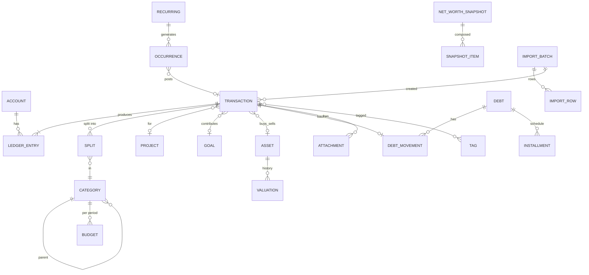

# 💰 Finance OS — خطة العمل الموحّدة والكاملة (الإصدار 4.1)

**الغرض:** وثيقة بناء **مكتفية بذاتها** لتطبيق **الماليات الشخصية والمشاريعية** (ويب + موبايل، عربي RTL، يعمل أوفلاين) يعمل **كقسم مستقل تمامًا**، ومرتبط ببقية أنظمتك (Home، Learning، Projects OS، Habit OS، Knowledge، Content، Today) عبر **عقود API/Events فقط** — بلا جداول مشتركة ولا نسخ كيانات. نفس فلسفة وثيقة Learning OS v4.0 ونفس هيكلها، لكن بما يناسب طبيعة المال: **الدقة، عدم القابلية للتزييف، التدقيق، وعدم تكرار الحركة الواحدة**.

> **هذه الوثيقة تحلّ محلّ الملفين السابقين بالكامل** (`06_FINANCE_OS_INDEPENDENT_BUILD_SPEC.md` EN v2.0 و`06_FINANCE_OS_وثيقة_البناء_المستقلة.md` AR v3.0). كل بند فيهما موجود هنا (انظر **مصفوفة التغطية في §19**) مع حسم تعارضاتهما وتعارضاتهما مع نظام Notion الحقيقي، وسد الفجوات. لا يُرسَل الملفان القديمان مع هذه الوثيقة لمنفّذ التطبيق كي لا تعود التعارضات.

**ما دخل في المراجعة:**

1. نظام **💰 Finance Module** الحقيقي داخل Notion (Personal & Business OS): 10 قواعد بيانات (Ledger، Accounts، Categories، Assets، Debts، Goals، Projects، Recurring، Exchange Rates، Net Worth History) + لوحة القيادة + الأتمتة اليدوية المتبقية (Home Shopping، زر Log Payment، التذكيرات) — قرأت **المخطط الفعلي لكل قاعدة** (الحقول، العلاقات، الـ Rollups، أسماء الصيغ).
2. الملفان المرفوعان (EN v2.0 + AR v3.0).
3. وثيقة **Learning OS v4.0** كقالب معماري ولعقود التكامل (تكلفة الدورات ← Finance، مرجع `area_ref`).
4. صفحة Core في Notion: الـ Areas، **🗺️ Projects (Master)**، Goals، Calendar — وملاحظاتها عن القرار المعلّق (توحيد Projects).

**ما الجديد في 4.1 (بعد ردودك):**

- **حُسمت قراراتك:** FD-01 دفتر واحد بـ `scope` · FD-02 المشاريع المالية منفصلة ومربوطة بـ Projects Master · FD-03 Finance مالك الميزانيات وHome يقرأ · FD-07 الشهر المالي يبدأ يوم 1 · FD-12 الأجهزة والأثاث مصروف (§23.3).
- **§20 قسم الأصول (Assets Hub):** عقار، ذهب، فضة، أسهم، صناديق، كريبتو، دخل ثابت، مركبات، حصص، مقتنيات — لكل نوع حقوله، مع الكميات والصفقات وطرق التكلفة والمحافظ وطبقة أسعار عالمية بمزوّدين قابلين للتبديل وسياسة فشل/قِدَم/شذوذ. **يحلّ محل §5.8.**
- **§21 جورنال التداول الخفيف:** إدخال عملية في ثوانٍ ← «النهارده مكسبان/خسران وكام» بتعريف محاسبي واضح، إحصاءات، حواجز سلوكية اختيارية.
- **§22 تسوية Home OS:** قرأتُ مواصفته؛ 20 تعارضًا (FC-53…72) + عقد `from-source` المعتمد. **يحلّ محل جدول Home→Finance في §11.2.**
- **§23** اختبارات FT-51…95 وتحديث المراحل وقرارات FD-19…28.
- **مفاتيح الهوية بعد التوسعة:** FC حتى 80 · FG حتى 48 · FE حتى 33 · FD حتى 28 · FV حتى 60 · FA حتى 33 · FT حتى 95.

**المرجع الأعلى عند التعارض:** هذه الوثيقة ← سلوك Notion الفعلي ← الملفان القديمان.

> **تنبيه أمانة:** لم أستطع قراءة **أكواد الصيغ** (Formulas) نفسها عبر الأداة، فاعتمدت على أسمائها ونوع الـ Rollup الذي يستهلكها وعلى شرحها في صفحة النظام. أي استنتاج مبني على اسم صيغة فقط موسوم في الوثيقة بـ **«(مستنتج)»** ويجب التحقق منه عند الترحيل (§15). ولم أفحص حجم/جودة البيانات الفعلية (عدد الحركات، تكرارات، إلخ) — خطوة «تدقيق البيانات قبل الترحيل» في §15 تغطي ذلك.

> **مفاتيح القراءة:** `FF-xx` ميزة محفوظة من النظام الحالي · `FC-xx` تعارض محسوم · `FG-xx` فجوة مسدودة · `FE-xx` تحسين مضاف · `FD-xx` قرار يحتاج تأكيدك · `FV-xx` قاعدة تحقق · `FA-xx` أتمتة · `FT-xx` اختبار قبول.

---

## 1) المراجعة الكاملة لنظام الماليات في Notion

### 1.1 فلسفة النظام (محفوظة كما هي)

> **كل حركة مال حقيقية تنتهي كسطر واحد في الـ Ledger.** الحسابات، الميزانيات، الأهداف، الديون، المشاريع، الاشتراكات، وحتى مشتريات Home Shopping — كلها **تقرأ** من الـ Ledger ولا تكرر بياناته. الأرصدة والتقدم والمتبقي **مشتقة**، لا تُعدَّل يدويًا. **النظام ليس دفتر مصروفات فقط** بل: Personal CFO + Expense Tracker + Budget Manager + Debt Tracker + Goal Tracker + Net Worth Tracker + Subscription Manager.

### 1.2 ما الموجود فعليًا (10 قواعد)

| القاعدة | الحقول الفعلية (يدخلها المستخدم) | المشتق (صيغ/Rollups) |
| :---- | :---- | :---- |
| **📒 Financial Ledger** | الاسم، المبلغ، العملة (EGP/USD/EUR/AED/SAR)، التاريخ، **النوع** (Income/Expense/Transfer)، التاجر/المستفيد، ملاحظات، **إيصال (ملف)**، **المصدر** (Manual/Home Shopping/Recurring/Debt/Project/Goal/Import/Other)، **التصنيف** (علاقة)، **من حساب / إلى حساب** (علاقتان)، **المشروع**، **الدين**، **هدف الادخار**، **Recurring Source**، **Home Shopping Item**، **سعر الصرف المستخدم** (للتوثيق)، **To Amount** (لتحويل بعملتين)، **Tags** (5: Reimbursable, Tax-Deductible, Shared, Impulse, Recheck) | Expense Amount، Revenue Amount، Incoming Amount، Is This Month، This Month Income/Expense/Net، **⚠️ Check** (كشف التحويل لنفس الحساب) |
| **🏦 Accounts** | الاسم، **النوع** (9: Bank/Cash/Mobile Wallet/Credit Card/E-Wallet/Payment Platform/Investment/Savings/Other)، العملة، **الرصيد الافتتاحي**، **Rate to EGP** (يدوي لكل حساب)، **الحالة** (Active/Archived/Closed)، **Include in Net Worth** (Checkbox، افتراضيًا false)، ملاحظات + علاقات (Incoming/Outgoing/Recurring/Assets) | Total In (Rollup من Incoming Amount)، Total Out (Rollup من Amount)، **Current Balance**، **Balance in EGP** |
| **🏷️ Categories** | الاسم، **النوع** (Income/Expense/Both)، **Default Monthly Budget**، **Parent / Sub-categories**، ملاحظات | Spent This Month، Total Spent/Received (All-Time)، **Remaining Budget**، **Budget Used %** |
| **💎 Assets & Investments** | الاسم، النوع (Cash-like/Investment/Electronics/Vehicle/Furniture/Real Estate/Other)، **حساب** (علاقة)، العملة، **Purchase Value**، **Current Value**، تاريخ الشراء، **Rate to EGP**، Include in Net Worth، ملاحظات | Gain/Loss، Gain/Loss %، Value in EGP |
| **🤝 Debts** | الاسم، الشخص، **Direction** (I Owe/Owed to Me)، **Total Amount**، العملة، **Rate to EGP**، تاريخ الاستحقاق، **نسبة فائدة سنوية** (اختياري)، **الحالة** (Open/Paid/Overdue — **يدوية**)، ملاحظات + علاقات (Payments = حركات Ledger، Recurring Payments) | Paid (Rollup من Amount)، Remaining، Remaining in EGP، **Days Past Due**، **Monthly Interest (est.)**، **Net Worth Impact (EGP)**، **Status Check** (اقتراح فقط) |
| **🎯 Financial Goals** | الهدف، النوع (9)، Target Amount، العملة، Target Date، الحالة (Active/Achieved/Paused/Cancelled)، الأولوية، **Related General Goal**، Contributions (حركات Ledger)، Recurring Contributions | Saved Amount (Rollup)، Remaining، Progress %، Months Left، Monthly Required، **🎉 Reached Target?** (اقتراح) |
| **🚀 Projects (Finance-only)** | الاسم، النوع (Freelance/Startup/Content/Side Business/Investment/Other)، Budget، العملة، Start Date، الحالة (Planning/Active/On Hold/Completed/Cancelled)، **Related Area (نص حر)**، ملاحظات، Transactions | Total Revenue، Total Expenses، Net Profit، **ROI %** (مستنتج: مقامه غير معروف) |
| **🔁 Recurring** | الاسم، المبلغ، العملة، **Type** (Income/Expense فقط)، **Frequency** (Weekly/Monthly/Yearly)، Next Payment، Last Payment، Active، **Auto Renew**، Cancellation Date، الحساب، التصنيف، **Debt**، **Savings Goal**، ملاحظات + Generated Transactions | Monthly Equivalent، Annualized Cost، Days Until Due |
| **💱 Exchange Rates** | العملة، **Rate to EGP**، Last Updated، ملاحظات | — |
| **📈 Net Worth History** | Label، Snapshot Date، Total Balance (EGP)، Total Assets (EGP)، Total Debts Remaining (EGP)، ملاحظات — **تُدخَل يدويًا** | Net Worth (EGP) |

### 1.3 قواعد النظام كما تظهر في Notion (محفوظة)

- **Home Shopping → Ledger:** عند `Status = Purchased` و`Finance Synced = false` تُنشأ حركة (Expense، Source = Home Shopping) ثم يُفعَّل `Finance Synced`. **الأتمتة تُركَّب يدويًا** (الـ API لا ينشئ Automations).
- **Recurring:** زر «Log Payment» (يدوي) ينسخ الحقول إلى الـ Ledger ويحرّك `Next/Last Payment`؛ التذكير قبل الموعد **ميزة Notion لكل صف** وليست افتراضية.
- **الديون:** `Paid` = مجموع `Amount` للحركات المرتبطة؛ حقل `Status` يدوي و`Status Check` يقترح فقط (الصيغ لا تعدّل Select).
- **الأهداف:** `Saved Amount` = مجموع `Amount` لحركات مرتبطة بالهدف؛ `Reached Target?` اقتراح فقط.
- **لوحة القيادة:** صافي الثروة **يُجمَع يدويًا** من ثلاث بطاقات لأن Notion لا يجمع عبر قواعد مختلفة؛ الميزانية «هذا الشهر» تتحدث يوميًا بصيغة تاريخ.
- **تذكيران شهريان في Calendar:** تحديث أسعار الصرف + تحديث Net Worth History (يدوي).
- **تحويل لنفس الحساب:** كشف بصيغة `⚠️ Check` (لا منع).
- **مضاف مؤخرًا (ملاحظات الصفحة):** ربط Recurring↔Debts/Goals، فائدة اختيارية على الديون، Sub-categories، ربط Assets بحساب.
- **مؤجَّل في Notion:** تتبّع الاستثمار المتقدم (عوائد/توزيعات)، تحديث الأسعار تلقائيًا.
- **قرار معلّق في Notion:** توحيد `Projects (Finance-only)` مع `Projects (Master)` أو إبقاؤهما منفصلين.

### 1.4 الحدود التي يعترف بها النظام الحالي (وكلها تُحل في التطبيق)

لا صافي ثروة حقيقي في بطاقة واحدة · ميزانية بلا تاريخ (شهر قديم لا يُسترجع) · سعر الصرف **ثابت لكل سجل** ويدوي (`Rate to EGP` على الحساب والأصل والدين) · لقطات الثروة يدوية وبثلاثة أرقام فقط · الدين/الهدف يعتمدان على علاقة حركات بلا تمييز بين أصل الدين والفائدة · لا فصل بين «مال خرج من جيبي» و«مصروف فعلي» · لا تقسيم للإيصال بين تصنيفات · لا دفعة مجدولة (Occurrence) ولا استدراك دفعات فائتة · لا تسوية رصيد مع كشف البنك · لا قفل فترة · لا تنبيهات تلقائية · الحذف حذف حقيقي بلا Audit · لا حماية من تكرار الحركة نفسها (لا idempotency) · ٥ عملات فقط.

### 1.5 اكتشافات مهمة من المراجعة (خارج الملفين)

1. **حركات الأهداف والديون تُحسب غالبًا «مصروفًا»** (مستنتج): `Savings Goal` و`Debt` علاقتان على حركة Ledger، ودعم `Recurring` يقتصر على `Income/Expense` (لا Transfer). فالادخار لهدف وتسديد أصل دين يدخلان في «مصروف هذا الشهر» ويشوّهان معدل الادخار وصافي التدفق — أخطر عيب محاسبي في النظام الحالي، ويُحسم في §6.2 و**FC-08/09/12**.
2. **سعر الصرف مكرر في ٣ أماكن** (Accounts، Assets، Debts) إضافة جدول Exchange Rates: أربع حقائق للسعر الواحد يمكن أن تتناقض.
3. **`Cash-like` أصل** مع وجود حسابات Savings/Investment ⇒ خطر عدّ مزدوج في صافي الثروة (**FC-15/16**).
4. **`Include in Net Worth` افتراضه false** (Notion يعامل NULL كـ false) ⇒ حساب جديد يغيب عن الثروة بصمت.
5. **`Related Area` نص حر** في مشاريع المال بينما Core فيه قاعدة Areas حقيقية ⇒ لا ربط فعلي (**FC-28**).
6. **المشاريع الست الحقيقية** (Koumma، Al Mosally، Marriage App، Budget App، Personal Content/YouTube، NeelGo) موجودة في `Projects (Master)` وليست في مشاريع المال ⇒ التقرير المالي لكل مشروع غير مربوط بعد (القرار المعلّق) — يُحسم في **FD-02**.
7. **وثيقة Learning** تفترض أن تكلفة التعلّم كانت تُسجَّل عبر ميزانية نظام البيت (فئة «🎓 تعلّم»)؛ لم أطّلع على مواصفة Home OS، فتعارض «ميزانية البيت» مع ميزانيات Finance مذكور كقرار **FD-03**.
8. **أنت مؤسس لعدة مشاريع**: لا يوجد في أي مصدر فصل واضح بين مال شخصي ومال مشاريع داخل نفس الـ Ledger (**FG-18، FD-01**).

### 1.6 حكم على كل عنصر

| العنصر | الحكم | القرار |
| :---- | :---- | :---- |
| Ledger كمصدر وحيد للحقيقة | **اعتماد** | + قيود (Ledger Entries) تحفظ أثر كل حركة على كل حساب |
| 3 أنواع حركات | **اعتماد + توضيح** | + `purpose` يفصل الديون/الأهداف/الأصول/الاسترداد عن الدخل والمصروف |
| الرصيد = افتتاحي + داخل − خارج | **تفكيك** | = افتتاحي + Σ قيود الحساب (بعملة الحساب) |
| `Rate to EGP` على السجلات | **استبدال** | جدول أسعار بتاريخ + سعر تاريخي ثابت على كل حركة |
| `Default Monthly Budget` | **تفكيك** | قالب فقط؛ الميزانية كيان بالشهر المالي |
| Spent This Month (Rollup + Is This Month) | **استبدال** | حساب بالفترة المالية من جدول مجاميع |
| دين بحالة يدوية | **استبدال** | `state` مشتقة + `lifecycle` يدوية + حركات (أصل/دفعة/فائدة/إعفاء) |
| هدف بـ Rollup على أي حركة | **استبدال** | مساهمات = تحويلات موسومة، أو رصيد حساب مرتبط |
| Recurring بزر يدوي | **استبدال** | محرك + `Occurrences` + مراجعة/نشر تلقائي اختياري |
| Net Worth History يدوي | **استبدال** | لقطات تلقائية + مكوّنات تفصيلية |
| Exchange Rates (٥ عملات) | **توسيع** | أي عملة ISO، سعر تاريخي، نوع السعر (رسمي/سوق) |
| Tags (5 ثابتة) | **توسيع** | جدول وسوم + علاقة M:N |
| Projects (Finance-only) | **اعتماد كـ«عدسة مالية»** | + `project_ref` لـ Projects OS؛ لا دمج (FD-02) |
| Home Shopping (أتمتة يدوية) | **استبدال** | حدث `purchase.completed` + idempotency + «صندوق مقترحات» |
| حقل 🧪/بيانات تجريبية | **استبدال** | وضع Demo/Sandbox |

---

## 2) جرد ميزات النظام الحالي (كلها محفوظة)

| ID | الميزة | أين تتحقق |
| :---- | :---- | :---- |
| FF-01 | الـ Ledger مصدر الحقيقة؛ كل حركة مال = سجل | §5.4، §3.4 |
| FF-02 | ثلاثة أنواع Income/Expense/Transfer والتحويل خارج الدخل والمصروف | §5.4، §6.2 |
| FF-03 | 9 أنواع حسابات، حالات Active/Archived/Closed، Include in Net Worth، رصيد مشتق | §5.2، §6.3 |
| FF-04 | تعدد العملات + سعر تاريخي ثابت لكل حركة + To Amount للتحويل بعملتين | §5.4، §5.13 |
| FF-05 | تصنيفات هرمية (Parent/Sub) ونوع Income/Expense/Both | §5.6 |
| FF-06 | ميزانية لكل تصنيف: المصروف، المتبقي، % الاستخدام، تنبيهات 50/75/90/100/>100 | §5.7، §6.5 |
| FF-07 | الأصول والاستثمارات: أنواع، قيمة شراء/حالية، ربح/خسارة، القيمة بالأساس، ربط بحساب | §20، §6.9 |
| FF-08 | الديون: اتجاه، شخص، استحقاق، فائدة، مدفوع/متبقٍ، حالة، أيام التأخر، أثر الثروة، فائدة شهرية | §5.9، §6.7 |
| FF-09 | الأهداف المالية: 9 أنواع، مدخر/تقدم/متبقٍ/أشهر متبقية/شهري مطلوب، اقتراح التحقق، ربط بهدف عام | §5.10، §6.8 |
| FF-10 | المتكرر: دخل/مصروف، تكرار، دفعة قادمة/سابقة، تجديد تلقائي، إلغاء، ربط بدين/هدف، مكافئ شهري وتكلفة سنوية | §5.11، §6.10 |
| FF-11 | مشاريع مالية: أنواع، ميزانية، حالات، إيراد/مصروف/ربح/ROI | §5.12، §6.11 |
| FF-12 | جدول أسعار الصرف وآخر تحديث | §5.13 |
| FF-13 | تاريخ صافي الثروة | §5.14، §6.9 |
| FF-14 | إيصالات الحركات | §5.15 |
| FF-15 | وسوم الحركات (الخمسة) | §5.15 |
| FF-16 | تكامل Home Shopping + `Finance Synced` | §11.2 |
| FF-17 | لوحة القيادة: ثروة، حسابات، دخل/مصروف، تدفق الشهر، ميزانية الشهر، الأهداف، اتجاه الثروة | §6.12، §10 |
| FF-18 | العروض: التدفق حسب النوع، لوحة بالتصنيف، كل الحركات، القادم، الأهداف/الديون بالحالة، P&L بالمشروع | §10، §6.13 |
| FF-19 | كشف التحويل لنفس الحساب (يصبح منعًا) | FV-04 |
| FF-20 | فائدة اختيارية على الدين | §5.9، §6.7 |
| FF-21 | ربط Recurring↔Debt/Goal | §5.11 |
| FF-22 | ربط الهدف المالي بهدف عام (Core) | §5.10 (`goal_ref`) |
| FF-23 | تذكيرات شهرية (الأسعار + الثروة) وتذكير قبل الاستحقاق | §12 |
| FF-24 | استيراد (CSV/Excel/كشف بنك) وتصدير | §5.16، §11.4 |
| FF-25 | Audit / Soft delete / Sync / Offline | §5.16، §13 |
| FF-26 | قفل المالية (Biometric/PIN) | §14 |
| FF-27 | معدل الادخار وبطاقات الأداء الشهرية | §6.12 |
| FF-28 | التقارير العشرة (دخل/مصروف، تصنيف، حساب، مشروع، تدفق، مراجعة شهرية، ميزانية، دين، أهداف، متكرر) | §6.13 |
| FF-29 | حقل `Source` (8 قيم) و`Recurring Source` و`Home Shopping Item` على الحركة | §5.4 |
| FF-30 | خدمات الـ Backend الـ18 وواجهات الـ API | §11.3، §17 |

---

## 3) المبادئ والحدود بين الأقسام

### 3.1 الاستقلال

Finance OS تطبيق **قائم بذاته**: قاعدة بياناته وخدماته وواجهاته منفصلة، ويعمل كاملًا (حسابات، حركات، ميزانيات، ديون، أهداف، متكرر، صافي ثروة، تقارير) **حتى لو غابت كل الأنظمة الأخرى**. الربط اختياري ومُحسِّن، وعند غياب أي نظام تتدهور الميزة بلطف.

### 3.2 من يملك ماذا

| الكيان / الحقيقة | المالك | Finance يفعل ماذا |
| :---- | :---- | :---- |
| الحسابات، الحركات، القيود، التصنيفات، الميزانيات، الأصول، الديون، الأهداف المالية، المتكرر، المشاريع المالية، الأسعار، لقطات الثروة، المرفقات، الوسوم | **Finance** | يملكها بالكامل |
| مشتريات المنزل وصيانته (قوائم، عناصر، حالة الشراء) | **Home** | يستقبل طلبات `from-source` ويحتفظ بـ `source_system/source_type/source_id` و`dimensions` معتمة فقط (§22) |
| الأسعار العالمية (كريبتو، معادن، أسهم) | **مزوّدون خارجيون عبر Finance** | `PriceService` وحده يجلب ويخزّن `quotes`؛ لا نسخ أسعار بين الأقسام (§20.6) |
| تكلفة الدورات | **Learning** | يستهلك طلب «تكلفة دورة» ويحوّله إلى **مقترح** (§11.2) |
| المشاريع (التنفيذ والمهام) و«Areas» | **Projects OS / Core** | `project_ref` و`area_ref` للقراءة والربط فقط |
| الأهداف العامة (Core Goals) | **Core / Projects OS** | `goal_ref` على الهدف المالي |
| العادات والسلاسل | **Habit OS** | يرسل أحداثًا (يوم بلا إنفاق، تسجيل يومي) ولا يسجّل عادات |
| الروابط والمستندات (عقود، فواتير مرجعية) | **Knowledge** | `resource_ref` اختياري |
| المحتوى/القنوات (مصدر دخل) | **Content OS** | مشروع مالي نوع Content + `external_ref` |
| الهوية والإشعارات والملفات والبحث والأحداث | **Core** | يستهلكها |
| صفحة اليوم | **Today** | يوفّر Feed ولا يكرر |

### 3.3 مصفوفة التدهور (عند غياب نظام مرتبط)

| الغائب | سلوك Finance |
| :---- | :---- |
| Home | لا مقترحات مشتريات؛ إدخال يدوي فقط |
| Learning | حقل «تكلفة دورة» لا يصل؛ يدخلها المستخدم يدويًا |
| Projects OS / Areas | `project_ref`/`area_ref` مخفيان؛ المشروع المالي مستقل بذاته |
| Habit OS | لا أحداث مستهلَكة؛ لا شيء يتعطل |
| Knowledge | لا `resource_ref` |
| Core (إشعارات) | تنبيهات داخل التطبيق فقط |
| Today | لا Feed خارجي؛ شاشة Finance الرئيسية تكفي |
| موفّر أسعار صرف خارجي | الأسعار يدوية + تنبيه «أسعار قديمة» (§12) |

### 3.4 المبادئ الحاكمة (ملزمة)

1. **الـ Ledger مصدر الحقيقة.** لا رصيد ولا مجموع يُخزَّن كحقل قابل للتعديل؛ ما يُخزَّن من مجاميع هو **Cache قابل لإعادة البناء** (§5.17).
2. **كل حركة مال حقيقية = حركة واحدة.** والأحداث/المزامنة/الاستيراد/المتكرر **Idempotent**: إعادة المحاولة تُرجع الحركة الموجودة ولا تنشئ أخرى.
3. **تعريفات الحركة تُنفَّذ في Domain/Service layer** (لا في الواجهة): التحقق، التصنيف المحاسبي (`flow_class`)، توليد القيود، الإعادة الحسابية.
4. **التحويل ليس دخلًا ولا مصروفًا. وأصل الدين، المساهمة في هدف، شراء أصل مرسمَل، استرداد مبلغ — ليست دخلًا ولا مصروفًا أيضًا** (§6.2). فقط الفائدة والدخل والمصروف الفعليان يدخلان قائمة الدخل.
5. **السعر التاريخي ثابت.** لا تتغير قيمة حركة قديمة بتغير الأسعار. والأرصدة الحالية تُقيَّم بالسعر الحالي؛ واللقطات التاريخية بأسعارها وقت الأخذ.
6. **لا أرقام عائمة (float) للمال**: `DECIMAL`/عدد صحيح بالوحدة الصغرى، وسياسة تقريب موحدة (§5.0، §6.1).
7. كل شاشة بيانات: **Loading / Empty / Error / Success** (+ Offline للموبايل).
8. كل تاريخ/يوم/شهر مالي يحترم **Timezone المستخدم** و**بداية الشهر المالي** (§6.15).
9. **لا Workaround من Notion** عند إمكانية التمثيل الفعلي (لا Rollups على علاقات، لا صيغ وسيطة، لا جمع يدوي لصافي الثروة، لا Checkbox لمنع التكرار).
10. **لا Dashboard أو View مصدر حقيقة.**
11. **Soft delete / Archive**؛ المحذوف لا يدخل أي حساب. الحذف النهائي لسجل له أثر مالي **محظور** (إلا بتصفير كامل بقرار صريح وAudit).
12. **سجل تدقيق (Audit) غير قابل للتعديل** لكل تغيير مالي، مع قيمتي قبل/بعد.
13. أي تكامل يحتفظ بـ **`source_type` + `source_id` ثابتين** ويمنع التكرار.
14. لا تُكرَّر كيانات مملوكة لنظام آخر؛ استخدم **Relation أو API/Event**.
15. **لا تُخزَّن بيانات اعتماد بنكية ولا أرقام بطاقات كاملة ولا CVV ولا PIN** إطلاقًا؛ فقط آخر 4 أرقام اختياريًا (§14).

### 3.5 الملكية والخصوصية

Finance **شخصي بطبيعته**: كل البيانات مملوكة لـ `user_id`، ولا مشاركة افتراضيًا، وأي مرجع بين مستخدمين مرفوض. المشاركة (شريك/مستشار قراءة فقط) خيار مستقبلي (**FE-21**). **التمييز بين المال الشخصي ومال المشاريع** يتم بـ `scope` على الحساب والمشروع داخل نفس الـ Ledger (**FD-01**).

---

## 4) النموذج المفاهيمي

```text
User (مالك كل البيانات — شخصي)
  │
  ├── FinanceSettings (عملة الأساس، المنطقة الزمنية، بداية الشهر المالي، سياسات)
  │
  ├── Account ──< LedgerEntry >── Transaction ──< Split ──> Category (شجرة)
  │      │                           │  ├──> Project (FinanceProject)  ──(اختياري)──> project_ref / area_ref
  │      │                           │  ├──> DebtMovement ──> Debt ──< Installment
  │      │                           │  ├──> Goal (مساهمة)
  │      │                           │  ├──> Occurrence ──> Recurring
  │      │                           │  ├──> Attachment / Tag (M:N)
  │      │                           │  └──> source_system/source_type/source_id + project_ref + dimensions (Home, Learning, Import…)
  │      └──< Asset ──< AssetValuation
  │
  ├── Budget (فئة × شهر مالي)           ← قالب: category.default_monthly_budget
  ├── ExchangeRate (تاريخ، append-only)
  ├── NetWorthSnapshot ──< SnapshotItem
  ├── ImportBatch · Reconciliation · PeriodLock · AuditLog · SyncQueue
  └── Inbox (مقترحات من التكاملات/الاستيراد قبل أن تصبح حركات)
```

**قاعدة الفصل الجوهرية — ثلاث «عدسات» على نفس الحقيقة:**

| العدسة | تجيب عن | ما يدخلها |
| :---- | :---- | :---- |
| **الأرصدة / النقد (Cash)** | كم أملك الآن وأين؟ | **كل** القيود (دخل، مصروف، تحويل، دين، هدف، أصل، تسوية) |
| **الأداء (P&L)** | كم كسبت وكم أنفقت فعلًا؟ | دخل ومصروف **فعليان** فقط (+ فائدة، − استردادات) |
| **الثروة (Net Worth)** | كم أساوي؟ | حسابات + أصول + مستحقات − التزامات (بأسعار اللحظة) |

نفس الحركة قد تظهر في عدسة وتغيب في أخرى **بتصميم**: سداد أصل قرض يغيّر الرصيد (النقد) ولا يغيّر الأداء، ولا يغيّر الثروة (انخفض نقد وانخفض التزام). هذا الفصل هو علاج أكبر عيوب النظام الحالي (§1.5.1).

---

## 5) نموذج البيانات الكامل

### 5.0 الحقول العامة وقواعد المال

**كل كيان:** `id` UUID ثابت · `user_id` NOT NULL (الملكية) · `created_at` · `updated_at` · `deleted_at` (Soft Delete حيث ينطبق) · `version` (تزامن متفائل) · `is_demo` (وضع التجربة، §10.6).

**قواعد المال (ملزمة):**

| القاعدة | التفصيل |
| :---- | :---- |
| النوع | `DECIMAL(20,4)` للمبالغ، `DECIMAL(24,10)` لأسعار الصرف. ممنوع float/double في أي طبقة (DB، API، العميل). في JSON تُرسَل المبالغ **نصوصًا** (`"1250.50"`) لمنع فقد الدقة. |
| العملة | جدول `finance_currencies(code, name_ar, name_en, symbol, minor_units, is_active)` — يبدأ بـ EGP, USD, EUR, AED, SAR (من Notion) ويقبل أي ISO 4217 (يحل قيد الخمس عملات). |
| التقريب | `ROUND_HALF_UP` إلى `minor_units` العملة عند **الترحيل** (حفظ القيد)، لا عند العرض فقط. تحويل العملات يقرّب عند الحفظ مرة واحدة ثم يُخزَّن. |
| التقسيم | مجموع التقسيمات (Splits) = المبلغ بالضبط؛ فرق التقريب يُلحَق بأكبر تقسيم. |
| الإشارة | المبلغ في الحركة **موجب دائمًا** (>0)، والاتجاه من `type`/الحسابات. القيود (Ledger Entries) هي الوحيدة ذات الإشارة. |
| اتجاه السعر | `rate_to_base` = **عدد وحدات عملة الأساس لكل وحدة واحدة من العملة**. عملة الأساس سعرها 1. السعر المتقاطع (USD→EUR) = `rate(USD) / rate(EUR)`. |

### 5.1 الإعدادات والقوائم

**`finance_settings`** (صف واحد لكل مستخدم، `UNIQUE(user_id)`):

| الحقل | الافتراضي | ملاحظات |
| :---- | :---- | :---- |
| base_currency | EGP | قابلة للضبط (يحل ثبات EGP — FC-01). تغييرها لاحقًا عملية «إعادة تأسيس» (Rebase) صريحة (FD-06) |
| timezone | من المستخدم | يحدد حدود اليوم والشهر المالي |
| month_start_day | 1 (1–28) | بداية الشهر المالي (يوم الراتب مثلًا). التسمية: الشهر الذي **تبدأ فيه** الفترة (FD-07) |
| week_start_day | السبت | |
| default_account_id | — | الحساب الافتراضي للإدخال السريع |
| overdraft_policy | Warn | `Warn` · `Allow` · `Block` للحسابات غير الائتمانية (FD-10) |
| auto_post_default | false | الافتراضي لعناصر المتكرر الجديدة (FD-08) |
| budget_thresholds | 50,75,90,100 | نقاط التنبيه (+ تجاوز 100 دائمًا) |
| budget_rollover_default | false | ترحيل المتبقي للشهر التالي (FE-07) |
| debt_alert_days | 7,3,1 | + يوم الاستحقاق + المتأخر |
| rate_staleness_days | 30 | بعدها تنبيه «أسعار قديمة» |
| preferred_rate_kind | Official | `Official` · `Market` · `Custom` (FE-19) |
| lock_before_date | null | قفل الفترة (§5.16) |
| snapshot_frequency | Monthly | `Daily` · `Weekly` · `Monthly` (لقطة شهرية دائمًا كحد أدنى) |
| quiet_hours | 22:00–08:00 | لا إشعارات غير عاجلة |
| privacy_mode_default | false | إخفاء الأرصدة (FE-16) |
| capitalize_defaults | حسب النوع | أنواع الأصول التي تُرسمَل افتراضيًا (FD-12) |
| default_scope | Personal | `Personal` · `Business` · `Shared` |

**`finance_lookup_values`:** `category_group`, `project_type`, `merchant_alias` … بقيم افتراضية قابلة للتخصيص (`label_ar/label_en/color/icon/position/is_active`). **المنطق** (الأنواع والحالات و`purpose` و`flow_class`) ثابت في الكود؛ **الأسماء والألوان** مرنة.

### 5.2 الحسابات `finance_accounts`

| الحقل | النوع | إلزامي | ملاحظات |
| :---- | :---- | :---: | :---- |
| name | string | نعم | فريد بين غير المؤرشف (غير حساس لحالة الأحرف) |
| account_type | enum | نعم | Bank · Cash · Mobile Wallet · Credit Card · E-Wallet · Payment Platform · Investment · Savings · Other |
| currency | FK | نعم | **لا تُغيَّر** بعد وجود قيود (FV-18) |
| initial_balance | decimal | نعم | رصيد افتتاحي **موقَّع** (بطاقة ائتمان مدينة بـ 5000 ⇒ `-5000`) |
| opened_on | date | نعم | تاريخ الرصيد الافتتاحي؛ لا حركات قبله (FV-17) |
| status | enum | نعم | `Active` · `Archived` · `Closed` (§9.1) |
| nature | enum | نعم | `ASSET` · `LIABILITY` (افتراضي: Credit Card ⇒ LIABILITY، والباقي ASSET) — **عرض وتصنيف فقط**، لا يغيّر الحساب |
| is_liquid | bool | نعم | افتراضي حسب النوع: Cash/Bank/Mobile Wallet/E-Wallet/Payment Platform = true؛ Savings/Investment/Other = false |
| include_in_net_worth | bool | نعم | **افتراضي true** (يعالج FC-48) |
| scope | enum | نعم | `Personal` · `Business` · `Shared` (FG-18) |
| institution | string | لا | اسم البنك/المحفظة |
| last4 | string(4) | لا | آخر 4 أرقام فقط (§14) |
| credit_limit | decimal | لا | للبطاقات |
| statement_day / payment_due_day | int 1–31 | لا | للبطاقات (FG-12) |
| overdraft_allowed | bool | لا | يتجاوز السياسة العامة لهذا الحساب |
| color, icon, sort_order, notes | | لا | |
| closed_at | timestamp | نظام | |

**محذوف:** `Rate to EGP` (يُستبدل بجدول الأسعار — FC-02)، `Current Balance`/`Balance in EGP`/`Total In`/`Total Out` (مشتقة).
**مشتق (قراءة فقط):** `balance` (بعملة الحساب)، `balance_base`، `total_in`، `total_out`، `last_activity_at`، `balance_as_of(date)`، `utilization` للبطاقة، `available_credit`، `reconciled_through`.

### 5.3 قيود الدفتر `finance_ledger_entries`  (جديد — يحل FC-04/05 ويضمن الرصيد)

سطر أو سطران لكل حركة، **تُولَّد في نفس معاملة قاعدة البيانات** مع الحركة ولا تُعدَّل يدويًا أبدًا، وتُعاد بناؤها بالكامل من الحركات (`rebuild_entries`).

| الحقل | النوع | ملاحظات |
| :---- | :---- | :---- |
| transaction_id | FK | |
| account_id | FK | |
| leg | enum | `Out` · `In` |
| amount | decimal موقَّع | **بعملة الحساب** (`Out` سالب، `In` موجب) |
| currency | FK | عملة الحساب وقت القيد |
| base_amount | decimal موقَّع | بعملة الأساس وقت الترحيل (ثابت تاريخيًا) |
| base_currency | FK | |
| local_date | date | تاريخ الحركة المحلي (نسخة للأداء) |
| status | enum | `Posted` فقط تدخل الأرصدة؛ `Proposed` لا قيود لها |
| deleted_at | timestamp | يتبع الحركة |

**فهارس:** `(account_id, local_date)` · `(transaction_id)` · `(user_id, local_date)`.
**الرصيد:** `balance(account) = initial_balance + Σ amount(entries غير المحذوفة، Posted)`.

### 5.4 الحركات `finance_transactions`  (الجدول المركزي — Financial Ledger)

| الحقل | النوع | إلزامي | ملاحظات |
| :---- | :---- | :---: | :---- |
| name | string | نعم | |
| type | enum | نعم | `Income` · `Expense` · `Transfer` |
| **purpose** | enum | نعم (Regular) | يحدد الأثر المحاسبي (جدول 5.4.1) — **جديد** |
| status | enum | نعم (Posted) | `Posted` · `Proposed` (مقترح من تكامل/استيراد، لا أثر له حتى يُؤكَّد) |
| amount | decimal > 0 | نعم | المبلغ **كما أُدخل** (قيمة الإيصال) |
| currency | FK | نعم | عملة المبلغ المُدخَل |
| local_date | date | نعم | تاريخ الحركة **بتوقيت المستخدم**، يُثبَّت عند الإدخال |
| occurred_at | timestamp | لا | وقت دقيق اختياري (للترتيب داخل اليوم) |
| merchant_payee | string | لا | + `merchant_id` اختياري لتطبيع الأسماء (FE-02) |
| notes | text | لا | |
| category_id | FK | شرطي | مطلوب لـ Income/Expense من purpose=Regular ما لم توجد Splits؛ يُترك فارغًا للتحويل؛ الفارغ ⇒ «غير مصنّف» النظامي |
| from_account_id | FK | شرطي | Expense/Transfer |
| to_account_id | FK | شرطي | Income/Transfer |
| from_amount | decimal | شرطي | **بعملة حساب المصدر**؛ = `amount` إن تطابقت العملتان، وإلا يُدخله المستخدم (القيمة التي سحبها البنك فعلًا) أو تُحسب بالسعر |
| to_amount | decimal | شرطي | **بعملة حساب الوجهة**؛ إلزامي للتحويل بعملتين (Notion: «To Amount») |
| fx_rate | decimal | شرطي | السعر الفعلي المستخدم (مشتق `to/from` أو مُدخَل) — **ثابت تاريخيًا** (يعادل `Exchange Rate Used`) |
| base_amount | decimal > 0 | نظام | القيمة بعملة الأساس وقت الترحيل (قاعدة الاشتقاق §6.1) |
| base_currency | FK | نظام | |
| base_estimated | bool | نظام | true إن اعتمدت على سعر جدول لا على مبلغ فعلي بعملة الأساس |
| project_id | FK | لا | مشروع مالي |
| debt_id | FK | لا | مرجع سريع؛ **الحقيقة في `debt_movements`** |
| goal_id | FK | لا | مساهمة/سحب هدف |
| goal_amount | decimal | نظام | قيمة المساهمة بعملة الهدف وقت الترحيل (ثابتة) |
| asset_id | FK | لا | شراء/بيع أصل |
| capitalized | bool | شرطي | لـ AssetPurchase: true = أصل لا مصروف |
| refund_of_id | FK ذاتي | شرطي | لـ Refund: الحركة الأصلية |
| recurring_id / occurrence_id | FK | نظام | المصدر المتكرر |
| project_ref | external | لا | مرجع مشروع في Projects OS؛ يُربط `project_id` تلقائيًا إن وُجد مشروع مالي مطابق (FC-72) |
| (الأبعاد) | جدول | لا | `finance_transaction_dimensions` — مراجع معتمة من المصدر (FC-60) |
| source_system | string | لا | النظام المرسِل (`home` · `learning` · …) |
| source_type | enum | نعم (`manual`) | أكواد snake_case: `manual · recurring · debt · project · goal · import · learning · asset_trade · home_purchase · home_maintenance_log · other` مع تسميات عرض؛ `Home Shopping` (Notion) مرادف تاريخي لـ `home_purchase` (FC-55) |
| source_id | string | لا | معرّف ثابت في نظام المصدر (idempotency) |
| client_generated_id | string | لا | معرّف العميل للأوفلاين |
| import_batch_id | FK | لا | |
| reconciled_at | timestamp | نظام | |
| manually_overridden | bool | نظام | عُدِّلت حقول يملكها المصدر يدويًا (§11.2) |
| deleted_at / deleted_by / delete_reason | | | Soft delete |

**القيود والفهارس:**

```text
index(user_id, local_date desc)
index(user_id, type, purpose)
index(user_id, from_account_id, local_date) ; index(user_id, to_account_id, local_date)
index(user_id, project_id), index(user_id, goal_id), index(user_id, debt_id), index(user_id, category_id)
UNIQUE(user_id, client_generated_id)                  WHEN client_generated_id IS NOT NULL
UNIQUE(user_id, source_type, source_id)               WHEN source_id IS NOT NULL   -- يشمل المحذوفة (FC-07)
```

> **تنفيذ `UNIQUE … WHEN`:** في PostgreSQL فهرس جزئي (`WHERE … IS NOT NULL`). في MySQL 8 (الذي استُخدم في Habit OS) لا فهارس جزئية: استخدم عمودًا مولَّدًا `source_key = IF(source_id IS NULL, NULL, CONCAT(source_type,':',source_id))` مع `UNIQUE(user_id, source_key)` (القيم NULL لا تتصادم).

**5.4.1 جدول الأثر المحاسبي (`purpose` × `type`)** — المرجع الوحيد للتصنيف:

| purpose | type | الأثر على الأداء `pnl_effect` | `flow_class` | الشرح |
| :---- | :---- | :---- | :---- | :---- |
| Regular | Income | **Income** | Operating | دخل فعلي |
| Regular | Expense | **Expense** | Operating | مصروف فعلي |
| Regular | Transfer | None | Internal | نقل بين حساباتي (يشمل سداد بطاقة الائتمان) |
| DebtDisbursement | Income *(اقترضت)* / Expense *(أقرضت)* | None | Financing | صرف أصل الدين |
| DebtRepayment | Expense *(سددت ما عليّ)* / Income *(استلمت سداد ما لي)* | None | Financing | سداد **الأصل** |
| DebtInterest | Expense *(دفعت فائدة)* / Income *(استلمت فائدة)* | **Expense / Income** | Operating | الفائدة وحدها أداء |
| GoalContribution | Transfer | None | Savings | ادخار لهدف (FC-08) |
| GoalWithdrawal | Transfer | None | Savings | سحب من مدخرات هدف |
| AssetPurchase | Expense | **Expense إن `capitalized=false`** وإلا None | Investing | شراء أصل (FD-12) |
| AssetSale | Income | None (الحصيلة)، والربح المحقق يُحسب في سجل الأصل | Investing | بيع أصل |
| Refund | Income | **ينقص مصروف تصنيف الحركة الأصلية** (لا يُحسب دخلًا) | Operating | استرداد/تعويض/سداد مصروف مسترد (Reimbursable) |
| Adjustment | Income / Expense | None | Adjustment | تسوية رصيد مع الواقع (§5.16) |

**اشتقاقات إلزامية:** `Transfer` ⇒ `from` و`to` مختلفان. `DebtDisbursement/Repayment/Interest` تتطلب `debt_id`. `Goal*` تتطلب `goal_id` و`type=Transfer`. `Asset*` تتطلب `asset_id`. حركات الصفقات (§20.4) تُولَّد بهذا الجدول نفسه دون أنواع جديدة (`source_type=asset_trade`). `Refund` تتطلب `refund_of_id`. `Adjustment` تتطلب حسابًا واحدًا وملاحظة.

### 5.5 تقسيم الحركة `finance_transaction_splits`  (جديد — FG-01)

| الحقل | ملاحظات |
| :---- | :---- |
| transaction_id | FK |
| category_id | FK (نوع التصنيف مطابق لنوع الحركة أو Both) |
| amount | decimal > 0 — **بعملة الحركة المُدخَلة**؛ `Σ amount = transaction.amount` (FV-09) |
| base_amount | نظام — بالتناسب مع تقريب الباقي على الأكبر |
| note, project_id? | اختياري (project تقسيمي مؤجل) |

حركة بلا تقسيم لها تقسيم ضمني واحد = `category_id` للحركة. **الميزانية والتقارير تقرأ التقسيمات دائمًا.** يُستخدم في فاتورة السوبرماركت (طعام + منظفات) ومشتريات Home متعددة العناصر.

### 5.6 التصنيفات `finance_categories`

| الحقل | النوع | ملاحظات |
| :---- | :---- | :---- |
| name | string | فريد تحت نفس الأب |
| type | enum | `Income` · `Expense` · `Both` — **الوحدة**: Both تقبل الاثنين، وتغيير النوع مرفوض إن عارض حركات موجودة (FV-22) |
| parent_id | FK ذاتي | ممنوع الدورات (FV-21)، عمق أقصى 3 |
| default_monthly_budget | decimal | **قالب** يولّد صفوف ميزانية الشهور الجديدة (FC-17) |
| color, icon, sort_order, notes | | |
| is_system | bool | «غير مصنّف»، «تسوية»، «فائدة» لا تُحذف |
| archived_at | timestamp | الحذف الفعلي محظور مع وجود حركات (نقل/دمج بدلًا) |

**مشتق:** `spent_period`، `income_period`، `total_all_time`، `budget_used_pct`، `remaining` (§6.5). **القيم الأولية (Presets) عند الإعداد:** شجرة مصرية جاهزة (طعام، مواصلات، سكن، فواتير، صحة، تعليم/تعلّم، ترفيه، ديون/فوائد، تبرعات، دخل: راتب/عمل حر/مشاريع/استثمار…) قابلة للتعديل.

### 5.7 الميزانيات `finance_budgets`

| الحقل | النوع | ملاحظات |
| :---- | :---- | :---- |
| category_id | FK | `NULL` ⇒ ميزانية **إجمالية** للشهر |
| period | `YYYY-MM` | الفترة المالية (§6.15) |
| budget_amount | decimal ≥ 0 | بعملة الأساس |
| rollover_in | decimal | مرحَّل من الشهر السابق (إن مفعَّل) |
| source | enum | `Manual` · `Template` · `Copied` |
| notes | text | |

`UNIQUE(user_id, COALESCE(category_id,'ALL'), period)`. **توليد تلقائي:** في أول الفترة تُنشأ الصفوف الناقصة من `default_monthly_budget` (`FA-04`). **التواريخ القديمة محفوظة** (يحل FC-17/20). `budget_alert_log(budget_id, threshold, fired_at)` يمنع تكرار التنبيه نفسه (FA-05).

### 5.8 الأصول — انتقل إلى **§20**

حلّ قسم **Assets Hub (§20)** محل هذا البند بالكامل: `finance_asset_types` · `finance_assets` (مع `attributes` خاصة بالنوع) · `finance_asset_valuations` · `finance_asset_trades` · `finance_portfolios` · `finance_instruments` · `finance_price_quotes` · `finance_price_providers` · `finance_watchlist` · `finance_price_alerts` · `finance_asset_value_daily`. وأنواع Notion القديمة تُرحَّل بالتعيين في §20.14.

### 5.9 الديون `finance_debts` وحركاتها وأقساطها

**`finance_debts`:**

| الحقل | النوع | ملاحظات |
| :---- | :---- | :---- |
| name | string | |
| person | string | + `person_ref` اختياري (Knowledge) |
| direction | enum | `I Owe` · `Owed to Me` |
| currency | FK | عملة الدين (والحساب بها وبحسبها تُحسب الدفعات) |
| initial_principal | decimal > 0 | يعادل `Total Amount` — **أول حركة أصل** |
| start_date | date | |
| due_date | date | استحقاق عام (الأقساط تتفوق عليه) |
| interest_mode | enum | `None` · `SimpleEstimate` |
| interest_rate_annual | decimal | للتقدير فقط |
| lifecycle | enum | `Active` · `Closed` · `Cancelled` · `WrittenOff` (**يدوية**) |
| include_in_net_worth | bool (true) | يمكن استثناء دين غير قابل للتحصيل |
| linked_account_id | FK | حساب القرض (اختياري) |
| notes | text | |

**`finance_debt_movements`** (يحل تثبيت `Total Amount` — FC-11):

| الحقل | ملاحظات |
| :---- | :---- |
| debt_id | FK |
| kind | `Principal` (الأصل الأول) · `Increase` (استلاف/إقراض إضافي) · `Payment` · `InterestCharge` (فائدة تُضاف) · `Forgiveness` (إعفاء) · `WriteOff` |
| amount | decimal > 0 — **بعملة الدين** |
| principal_part / interest_part | للدفعات: `principal_part + interest_part = amount` (الافتراضي كله أصل) |
| local_date | date |
| transaction_id | FK — **إلزامي** لـ `Payment`، واختياري لـ Principal/Increase (إذا انتقل مال فعلًا)، ممنوع لـ Forgiveness/WriteOff/InterestCharge |
| amount_in_debt_currency | نظام — عند اختلاف عملة الحركة عن عملة الدين |
| note | |

`UNIQUE(transaction_id) WHEN NOT NULL` (دفعة = حركة واحدة).

**`finance_debt_installments`** (اختياري — FE-05): `debt_id, seq, due_date, amount, state (مشتق)`. الدفعات **تُوزَّع FIFO** على أقدم قسط غير مسدد؛ لا تخزين لحالة القسط.
**مشتق:** `principal_total`، `paid_principal`، `interest_paid`، `interest_charged`، `forgiven`، **`remaining`**، `state` (`Open` · `Paid` · `Overdue`)، `days_past_due`، `next_due`، `monthly_interest_estimate`، `net_worth_impact_base` (+ لما لي، − لما عليّ)، `payoff_eta`.

### 5.10 الأهداف المالية `finance_goals`

| الحقل | النوع | ملاحظات |
| :---- | :---- | :---- |
| name | string | |
| type | enum | Emergency Fund · Purchase · Project Funding · Travel · Wedding · Education · Debt Payoff · Investment · Other |
| target_amount | decimal **> 0** | (FV-25) |
| currency | FK | |
| target_date | date | |
| status | enum | `Active` · `Achieved` · `Paused` · `Cancelled` |
| priority | enum | High · Medium · Low |
| tracking_mode | enum | `Contributions` (افتراضي) · `AccountBalance` (حساب ادخار مخصَّص) · `DebtPayoff` |
| linked_account_id | FK | لـ AccountBalance |
| linked_debt_id | FK | لـ DebtPayoff: التقدم = أصل مسدَّد |
| starting_amount | decimal | مدخر سابق قبل التتبع (يُسجَّل كمساهمة افتتاحية موسومة) |
| goal_ref | external | هدف عام في Core/Projects OS (FF-22) |
| project_id | FK | لـ Project Funding |
| auto_achieve | bool (false) | تحقق تلقائي (FD) |
| notes | text | |

**مشتق:** `saved`، `progress`، `remaining`، `months_left`، `monthly_required`، `pace` (`Ahead/OnTrack/Behind`)، `eta_date`، `reached_target` (اقتراح)، `recent_contribution`.

### 5.11 المتكرر `finance_recurring_items` و`finance_recurring_occurrences`

**`finance_recurring_items`:**

| الحقل | النوع | ملاحظات |
| :---- | :---- | :---- |
| name | string | |
| type | enum | `Income` · `Expense` · **`Transfer`** (يعالج FC-23: ادخار شهري، سداد بطاقة) |
| purpose | enum | `Regular` · `DebtRepayment` · `DebtInterest` · `GoalContribution` |
| amount / currency | decimal / FK | |
| amount_mode | enum | `Fixed` · `Variable` (فاتورة كهرباء: تُؤكَّد القيمة عند الاستحقاق) |
| frequency | enum | Daily · Weekly · BiWeekly · **Monthly** · Quarterly · Yearly · Custom(`interval_n` + `unit`) |
| anchor_date | date | أول موعد |
| day_of_month | int | 1–31 (31 ⇒ آخر يوم في الشهر الأقصر) |
| end_date / remaining_count | date / int | |
| active | bool | |
| auto_post | bool (false) | **اشتراك صريح** لكل عنصر (FD-08) |
| is_subscription | bool | يغذي «مدير الاشتراكات» (FE-04) |
| auto_renew | bool | يُجدِّد بعد انتهاء الفترة |
| cancellation_date | date | لا تُولَّد مواعيد بعده؛ تذكير «ألغِ قبل التجديد» قبل X يوم |
| account_id / to_account_id | FK | مصدر الدفع / وجهة (للتحويل) |
| category_id, project_id, debt_id, goal_id | FK | اختيارية |
| remind_days_before | int (1) | |
| notes | text | |

**مشتق:** `next_due`، `last_posted`، `monthly_equivalent`، `annualized_cost`، `days_until_due`، `pending_count`.

**`finance_recurring_occurrences`:** `recurring_id, scheduled_date, amount_snapshot, status (Pending/Posted/Skipped/Failed/Cancelled), transaction_id, generated_at, resolved_at, failure_reason` — `UNIQUE(recurring_id, scheduled_date)` (**مفتاح التوليد**).

### 5.12 المشاريع المالية `finance_projects`  (عدسة مالية على المشاريع — FD-02)

| الحقل | النوع | ملاحظات |
| :---- | :---- | :---- |
| name | string | |
| project_type | enum | Freelance · Startup · Content · Side Business · Investment · Other |
| budget / currency | decimal / FK | |
| start_date / end_date | date | |
| status | enum | Planning · Active · On Hold · Completed · Cancelled |
| scope | enum | Personal · Business |
| project_ref | external | **مشروع في Projects OS (Master)** — يعالج القرار المعلّق |
| area_ref | external | Area في Core (بدل النص الحر — FC-28) |
| roi_basis | enum | `ExpensesLinked` (افتراضي) · `DeclaredCapital` · `Disabled` |
| invested_capital | decimal | لـ DeclaredCapital |
| notes | text | |

**مشتق:** `revenue`، `expenses`، `net_profit`، `roi` (Not Measurable إن المقام 0 أو Disabled)، `budget_used_pct`، `monthly_burn`، `last_activity`.

### 5.13 أسعار الصرف `finance_exchange_rates`  (append-only)

| الحقل | ملاحظات |
| :---- | :---- |
| currency | FK |
| base_currency | FK (عملة الأساس وقت الإدخال) |
| rate_to_base | decimal(24,10) > 0 |
| rate_kind | `Official` · `Market` · `Custom` |
| source | نص (مصدر يدوي/موفر) |
| effective_at | timestamp |

لا تعديل ولا حذف؛ تصحيح خطأ = سطر جديد. **السعر الحالي** = آخر سطر ≤ الآن حسب `preferred_rate_kind` مع الرجوع لنوع آخر عند الغياب (وسم «بديل»). **قاعدة صارمة:** لا يُستخدم السعر الحالي لإعادة تقييم **حركات** أو **لقطات** قديمة.

### 5.14 لقطات صافي الثروة `finance_net_worth_snapshots` و`..._items`

**اللقطة:** `snapshot_at, period_type (Daily/Weekly/Monthly/Manual), period_key, base_currency, liquid_cash_base, accounts_assets_base, accounts_liabilities_base, assets_base, receivables_base, payables_base, total_assets_base, total_liabilities_base, value_base, rates_used (JSON), is_estimated, is_legacy_manual`.
`UNIQUE(user_id, period_type, period_key)`.
**البنود `snapshot_items`:** `snapshot_id, item_type (Account/Asset/Debt), item_id, name_at_time, native_value, currency, rate_used, value_base` — يمكّن «تحليل التركيب» و«أثر الصرف».
لقطات Notion القديمة (Total Balance/Assets/Debts) تُرحَّل بـ `is_legacy_manual=true` دون بنود.

### 5.15 المرفقات والوسوم والقواعد

**`finance_attachments`:** `owner_type (Transaction/Asset/Debt/Project), owner_id, storage_key, filename, mime_type, size_bytes, checksum, is_receipt, ocr_text?, uploaded_by, created_at, deleted_at` — **تحل `receipt_id` الأحادي** (FC-06). حد 10MB، قائمة MIME مسموحة (صور، PDF)، روابط موقّعة قصيرة العمر (§14).
**`finance_tags`** + **`finance_transaction_tags`** (M:N): وسوم النظام (Reimbursable, Tax-Deductible, Shared, Impulse, Recheck) + وسوم المستخدم (FC-40).
**`finance_rules`** (FE-02): `match (merchant contains / amount range / account) → set (category, tags, project, name)` تُطبَّق على الإدخال والاستيراد وتظهر كاقتراح قبل الحفظ.
**`finance_integration_defaults`** (§11.2): `source_type → default_account_id, default_category_id, mode (Auto/Proposal)`.

### 5.16 التدقيق والاستيراد والتسوية والقفل والمزامنة

| الجدول | الحقول الأساسية |
| :---- | :---- |
| **`finance_audit_log`** (append-only) | `entity_type, entity_id, action (created/updated/deleted/restored/imported/synced/overridden/locked/unlocked/rebuilt/reconciled), before_json, after_json, actor_type (User/System/Integration/Import), device_id, request_id, at` |
| **`finance_import_batches`** | `account_id, file_attachment_id, profile_id, status (Draft/Previewed/Confirmed/Undone/Failed), rows_total/new/duplicate/error, confirmed_at, undone_at` |
| **`finance_import_rows`** | `batch_id, row_no, raw, normalized, dedupe_key, state (New/Duplicate/Error/Skipped), transaction_id, error` |
| **`finance_import_profiles`** | قالب ربط أعمدة لكل بنك/ملف (يحفظه المستخدم — FE-18) |
| **`finance_reconciliations`** | `account_id, statement_date, statement_balance, computed_balance, difference, status (Matched/Adjusted), adjustment_transaction_id, reconciled_through` |
| **`finance_period_locks`** | `locked_before date, locked_at, reason` (أو `lock_before_date` في الإعدادات) |
| **`finance_sync_ops`** (الخادم) | `client_generated_id, entity, op, applied_version, result, at` — لإعادة تشغيل العمليات بأمان |
| **`finance_sync_conflicts`** | `entity, entity_id, client_payload, server_version, state (Open/Resolved), resolution` |

### 5.17 جداول التخزين المؤقت (قابلة لإعادة البناء)

`account_balance_cache(account_id, balance, last_entry_id, checksum)` · `daily_account_balances(account_id, date, balance)` · `monthly_category_totals(user_id, period, category_id, expense_base, income_base, tx_count)` · `monthly_totals` · `project_totals` · `goal_metrics_cache` · `debt_metrics_cache` · `net_worth_live_cache`. كلها **تُشتق من القيود والحركات** ويمكن حذفها وإعادة بنائها (`rebuild_metrics(user)`). **مهمة تحقق ليلية** تقارن الـ Cache بإعادة الحساب وتنبّه عند أي اختلاف (FT-06).

### 5.18 خريطة العلاقات



---

### 5.19 جداول الإصدار 4.1 (ملخص)

| الجدول | القسم | الغرض |
| :---- | :---- | :---- |
| `finance_asset_types`, `finance_assets`, `finance_asset_valuations`, `finance_asset_value_daily` | §20.2–20.7 | الأصول وحقول كل نوع والتقييم |
| `finance_asset_trades`, `finance_portfolios` | §20.4–20.5 | الصفقات والدفعات والمحافظ |
| `finance_instruments`, `finance_price_quotes`, `finance_price_providers`, `finance_price_alerts`, `finance_watchlist` | §20.6 | الأسعار |
| `finance_trading_day_summaries` | §21.4 | ملخصات أيام التداول (كاش قابل لإعادة البناء) |
| `finance_transaction_dimensions`, `finance_source_category_map` | §22 | أبعاد المصدر وخريطة التلميحات التصنيفية |

## 6) محرك الحسابات والدوال

> كل ما في هذا الفصل **مشتق**: يُحسب في Domain/Service، لا يُعدَّل يدويًا، ويُعاد حسابه عند الأحداث وفي جدولة (§6.16). `today` = تاريخ اليوم بتوقيت المستخدم. الحسابات على **تواريخ تقويمية** لا نصوص، وبـ `DECIMAL`.

### 6.1 الترحيل: من حركة إلى قيود (FF-01, FF-04)

**تحديد مبالغ الأطراف عند الحفظ:**

```text
Expense  من حساب F:
  amount بعملة C.  إن C == currency(F)  → from_amount = amount
                   وإلا → from_amount = (المُدخَل: ما سحبه البنك فعلًا) أو amount × cross_rate(C→currency(F)) [تقدير]
  fx_rate = from_amount / amount
Income   إلى حساب T: متماثل (to_amount بعملة T)
Transfer من F إلى T:
  currency(الحركة) == currency(F) إلزامًا
  إن currency(F) == currency(T) → to_amount = amount
  وإلا → to_amount إلزامي (القيمة التي دخلت فعلًا) ، fx_rate = to_amount / amount
```

**اشتقاق `base_amount`** (بالأولوية؛ الأول المتاح):

1. أحد طرفي الحركة بعملة الأساس ⇒ مبلغه الفعلي (لا تقدير).
2. عملة الحركة المُدخَلة هي الأساس ⇒ `amount`.
3. وإلا `amount × rate(C→base)` من جدول الأسعار بتاريخ `local_date` ⇒ `base_estimated = true`.

> التحويل بين حسابين بعملتين غير الأساس يحمل `base_amount` واحدًا للطرفين (التحويل **محايد القيمة** لحظة تنفيذه)؛ أي فرق صرف ينشأ لاحقًا من **إعادة التقييم** (§6.13 تحليل الصرف).

**القيود المولَّدة:**

| النوع | القيد الأول | القيد الثاني |
| :---- | :---- | :---- |
| Income | `In` على `to_account`: `+to_amount`، `+base_amount` | — |
| Expense | `Out` على `from_account`: `−from_amount`، `−base_amount` | — |
| Transfer | `Out` على المصدر: `−amount`، `−base_amount` | `In` على الوجهة: `+to_amount`، `+base_amount` |

التعديل = حذف ناعم للقيود القديمة وتوليد جديدة في نفس المعاملة + سطر Audit (قبل/بعد). التعديل لا يغيّر `fx_rate`/`base_amount` المخزَّنَين إلا إذا غيّر المستخدم المبلغ/العملة/التاريخ صراحة (عندها يُعاد الاشتقاق ويُسجَّل).

### 6.2 التصنيف المحاسبي ومقاييس الأداء (FF-02, FF-27)

مرجع التصنيف هو جدول 5.4.1. تعريفات التجميع على حركات `Posted` غير المحذوفة:

```text
income(P)   = Σ base  لحركات pnl_effect=Income      بتاريخ ∈ P
expense(P)  = Σ base  لحركات pnl_effect=Expense     بتاريخ ∈ P
              − Σ base لحركات Refund                 بتاريخ ∈ P       ← تُنسب لتصنيف الحركة الأصلية، وفترتها فترة الاسترداد (أساس نقدي)
net_operating(P)   = income(P) − expense(P)                             ← «صافي التدفق التشغيلي» (يعادل Net الشهر في Notion)
savings_rate(P)    = income(P) > 0 ? net_operating(P) / income(P) × 100 : Not Measurable   ← قد يكون سالبًا (إنفاق > دخل)
savings_amount(P)  = Σ GoalContribution − Σ GoalWithdrawal + مساهمات الاستثمار (اختياري)       ← مقياس تكميلي
```

- **ما لا يدخل `income`/`expense` أبدًا:** التحويلات، أصل الدين، المساهمة/السحب من هدف، الأصول المرسملة، الاستردادات (تُطرح من المصروف لا تُضاف للدخل)، التسويات.
- **الفائدة** (`DebtInterest`) أداء حقيقي: مصروف إن دفعتها، دخل إن استلمتها.
- القيم السالبة للمصروف الصافي في تصنيف (استرداد أكبر من الإنفاق خلال الفترة) **مسموحة وتُعرض** كما هي.

### 6.3 الحسابات (FF-03)

```text
balance(A)            = initial_balance + Σ entries(A).amount           (Posted، غير محذوف)
balance_as_of(A, d)   = initial_balance + Σ entries(A).amount حيث local_date ≤ d
balance_base(A)       = balance(A) × rate_current(currency(A)→base)      ← تقييم حالي
liquid_cash           = Σ balance_base(A) لحسابات is_liquid=true و status=Active و scope ∈ نطاق العرض
card_owed(A)          = max(−balance(A), 0)  لحسابات nature=LIABILITY
utilization(A)        = credit_limit ? card_owed / credit_limit : Not Measurable
```

- الحساب **المؤرشف** يُخفى من الاختيار ويبقى رصيده في الثروة إن `include_in_net_worth`. **المغلق** يتطلب رصيدًا صفريًا (أو تسوية صريحة) ويرفض حركات جديدة (§9.1).
- **سقف السحب:** عند ترحيل حركة تخرج حسابًا غير ائتماني وتجعل رصيده سالبًا: `Warn` تحذير وتأكيد، `Allow` صمت، `Block` رفض `OVERDRAFT_BLOCKED` (ما لم يُسمح للحساب).

### 6.4 التحويلات وسداد البطاقة

سداد بطاقة الائتمان = `Transfer` من حساب بنكي إلى حساب البطاقة (يصفّر جزءًا من الرصيد السالب) — **لا مصروف**. المصروفات نفسها سُجّلت عند الشراء بالبطاقة. فائدة/رسوم البطاقة مصروف عادي بتصنيف «فوائد ورسوم». يمنع النظام تسجيل «سداد بطاقة» كمصروف بتحذير ذكي (حساب وجهة من نوع Credit Card ⇒ اقتراح تحويل).

### 6.5 الميزانيات (FF-06)

```text
period(P)            = الفترة المالية الحاوية للتاريخ (§6.15)
spent(cat, P)        = Σ split.base لحركات pnl=Expense في cat أو أي من أحفاد cat بتاريخ ∈ P
                       − Σ استردادات تنتمي لـ cat أو أحفاده بتاريخ ∈ P
available(b)         = budget_amount + rollover_in
used_pct(b)          = available > 0 ? spent / available × 100 : (spent > 0 ? "Unbudgeted" : Not Measurable)
remaining(b)         = available − spent                      (قد يكون سالبًا)
rollover_in(next)    = rollover مفعّل ? max(remaining(b), 0) : 0
```

- الميزانية الإجمالية (`category_id = NULL`) تقيس **كل المصروف** في الفترة.
- ميزانية أب وميزانية ابن معًا مسموحة: كل صف يقيس شجرته؛ تحذير واجهة إن `Σ ميزانيات الأبناء > ميزانية الأب` (FC-18).
- **التنبيهات:** عبور كل عتبة (50/75/90/100) مرة واحدة لكل ميزانية في الفترة (`budget_alert_log`)، وعبور >100 يتكرر مرة عند كل تجاوز جديد بمقدار 10% إضافي. التصحيح (حذف حركة) لا يُلغي التنبيه المُرسَل لكنه يعيد تقييم الحالة.

### 6.6 العملات والتقييم الحالي

`value_base_now = native × rate_current(currency)` حيث السعر من §5.13. إن لم يوجد سعر لعملة: `RATE_MISSING` — القيمة **لا تُعرض كصفر** بل «غير مُقيَّم» وتُستثنى من المجاميع مع شارة تحذير (يحل صمت الصيغ في Notion). السعر قديم إن عمره > `rate_staleness_days` ⇒ شارة «تقديري».

### 6.7 الديون (FF-08)

```text
principal_total = initial_principal + Σ Increase
paid_principal  = Σ Payment.principal_part
interest_paid   = Σ Payment.interest_part
interest_charged= Σ InterestCharge
forgiven        = Σ Forgiveness + Σ WriteOff
remaining       = principal_total + interest_charged − paid_principal − interest_paid − forgiven     (≥ 0)
remaining_principal = principal_total − paid_principal − forgiven_principal
```

- **`state`:** `remaining = 0 ⇒ Paid`؛ وإلا `due ≤ today-1` (استحقاق الدين أو أقدم قسط غير مسدد) ⇒ `Overdue`؛ وإلا `Open`. `lifecycle` يدوية (`Closed/Cancelled/WrittenOff`) تُخرج الدين من الإنذارات والثروة (WriteOff يسجّل خسارة بحسب §6.2: الإعفاء/الشطب لدين **لي** بدون نقد ⇒ سطر Audit + يظهر في تقرير الديون، لا في الأداء افتراضيًا).
- `days_past_due = max(today − earliest_unpaid_due, 0)`.
- **تقدير الفائدة الشهرية** (`SimpleEstimate`): `remaining_principal × rate_annual / 100 / 12` — **تقدير** لا قيد.
- **الدفعة:** `principal_part + interest_part = amount_in_debt_currency` (الافتراضي كله أصل). **`principal_part ≤ remaining_principal`** وإلا `OVERPAYMENT` (FV-27)؛ للتصحيح: `Increase` سالب غير مسموح، يُعدَّل الأصل أو تُنشأ دفعة بفائدة.
- **توزيع الأقساط FIFO:** `paid_total` يُصرف على أقدم قسط غير مسدد فالأحدث؛ `installment.state` = `Paid`/`Partial`/`Pending`/`Overdue` مشتقة.
- **أثر الثروة:** `Owed to Me` ⇒ `+remaining_base` (مستحقات)، `I Owe` ⇒ `−remaining_base` (التزامات). تُقيَّم بالسعر الحالي.
- **إنشاء دين:** الواجهة تسأل: «هل تسلّمت/سلّمت المال فعلًا في حساب؟» ⇒ نعم: تُنشأ حركة `DebtDisbursement` وحركة أصل مرتبطتان. لا ⇒ دين افتتاحي بلا حركة (`opening=true`).

### 6.8 الأهداف المالية (FF-09)

```text
saved (Contributions) = starting_amount + Σ goal_amount[GoalContribution] − Σ goal_amount[GoalWithdrawal]
saved (AccountBalance)= balance(linked_account) محوَّلة لعملة الهدف بالسعر الحالي
saved (DebtPayoff)    = paid_principal(linked_debt) بعملة الهدف
progress    = target_amount > 0 ? saved / target_amount × 100 : Not Measurable      (القيمة الخام قد تتجاوز 100؛ الشريط يقص بصريًا)
remaining   = max(target_amount − saved, 0)
months_left = target_date ? max(ceil((target_date − today) / 30.4375), 0) : —
monthly_required = remaining = 0 ? 0 : (months_left > 0 ? remaining / months_left : remaining)   ← متأخر/مستحق الآن
avg_monthly_90 = (Σ صافي المساهمات في آخر 90 يومًا) / 3
pace        = monthly_required = 0 ? Ahead : (avg_monthly_90 ≥ monthly_required ? OnTrack : Behind)
eta_date    = avg_monthly_90 > 0 ? today + ceil(remaining / (avg_monthly_90 / 30.4375)) : —
reached_target = saved ≥ target_amount     ← اقتراح؛ لا يغيّر status إلا بـ auto_achieve أو تأكيد
```

- مساهمة الهدف = `Transfer` (`purpose=GoalContribution`) من حساب المصدر إلى حساب الادخار (حساب الهدف المخصَّص أو أي حساب ادخار). **لا تُحتسب مصروفًا** (يعالج §1.5.1).
- الحذف الناعم لمساهمة يخفض `saved` فورًا.
- ميزة «التخصيص الافتراضي» (حصة داخل حساب بلا نقل) مؤجلة FE-08.

### 6.9 الأصول وصافي الثروة (FF-07, FF-13)

> **تعديل 4.1:** قيمة الأصل تتبع `valuation_mode` (سوق · معادلة · يدوي · دفتري · إهلاك) والملكية الجزئية `ownership_pct`، والأسعار من `PriceService` — المعادلات الكاملة في **§20.7**. المعادلة أدناه هي الشكل المبسط للأصول اليدوية وصافي الثروة نفسه لم يتغير.

```text
current_value(asset) = آخر valuation ≤ today  (وإلا purchase_value)
gain = current_value − purchase_value ;  gain_pct = purchase_value > 0 ? gain / purchase_value × 100 : Not Measurable
value_base = current_value × rate_current(asset.currency)
```

**صافي الثروة (حي):**

```text
accounts_signed_base = Σ balance_base(A)  لكل A: include_in_net_worth و status ∈ {Active, Archived}   (البطاقات تدخل سالبة)
assets_base          = Σ value_base(asset) لأصول Held و include_in_net_worth
receivables_base     = Σ remaining_base لديون Owed to Me (lifecycle Active، include)
payables_base        = Σ remaining_base لديون I Owe (lifecycle Active، include)
net_worth = accounts_signed_base + assets_base + receivables_base − payables_base
total_assets      = (حسابات موجبة) + assets_base + receivables_base
total_liabilities = |حسابات سالبة| + payables_base
```

- **منع العدّ المزدوج:** الأصل المرتبط بحساب (`account_id`) يُعدّ **مستقلًا** عن رصيد الحساب (النقد المتبقي في الحساب فقط يدخل الرصيد). ونوع الأصل `Cash-like` مُهمَل: يُمنع ربطه بحساب وتُعرض شارة «هذا نقد — الأفضل حسابًا» (FC-15).
- **اللقطة (Snapshot):** تُحسب بالصيغة نفسها وتُجمَّد بكل أسعارها (`rates_used`) وبنودها؛ **لا تُعاد حسابها أبدًا** (FF-13). تُنشأ تلقائيًا حسب `snapshot_frequency` وعند الطلب `Manual`.
- **الاتجاه الزمني:** من اللقطات؛ بين اللقطات يمكن إعادة بناء تقريبي من `daily_account_balances` بوسم «تقريبي».
- **معدل تغطية الطوارئ:** `emergency_months = liquid_cash(Personal) / avg_monthly_expense_3m`.

### 6.10 محرك المتكرر (FF-10)

```text
مفتاح التوليد = (recurring_id, scheduled_date)           ← UNIQUE في Occurrences

كل يوم 00:10 بتوقيت المستخدم (FA-01) ولكل عنصر active:
  due_dates = كل مواعيد الجدول من (آخر Occurrence) حتى today  (سقف 12 موعدًا في المرة — الباقي يكمل لاحقًا)
  لكل موعد:
     INSERT Occurrence(status=Pending, amount_snapshot=قيمة العنصر الآن) ON CONFLICT DO NOTHING
     إخطار «مستحق / يحتاج تأكيد»
     إن auto_post=true و amount_mode=Fixed:
         حاول الترحيل:  transaction(source_type=Recurring, source_id="{recurring_id}:{scheduled_date}")
         نجح → Occurrence=Posted  | فشل → Occurrence=Failed(reason) + إشعار
  next_due = أول موعد > آخر Occurrence
```

- **التأكيد اليدوي** (الزر البديل لـ «Log Payment»): يحوّل `Pending` إلى حركة بالمبلغ (قابل للتعديل لـ Variable)، ويُعلَّم `Posted`. **تخطّي:** `Skipped` (لا حركة، يُسجَّل). **التأجيل:** تعديل `scheduled_date` المحلي بلا مساس بالجدول.
- **حساب الموعد التالي:** شهري ⇒ نفس `day_of_month` أو آخر يوم إن لم يوجد (31→30/28)؛ سنوي ⇒ نفس اليوم/الشهر (29 فبراير → 28 في غير الكبيسة)؛ أسبوعي/مخصص ⇒ إضافة الفترة.
- **أسباب الفشل:** حساب مغلق/مؤرشف، رفض السحب (Block)، تصنيف مؤرشف، فترة مقفلة، سعر مفقود ⇒ `Failed` مع سبب ويبقى قابلًا للإعادة بعد التصحيح. **إعادة تشغيل المهمة لا تنشئ شيئًا مكررًا** (UNIQUE + `source_id`).
- **تغيير المبلغ/التكرار** يؤثر على المواعيد **المستقبلية** فقط؛ `amount_snapshot` يثبّت الماضي.
- `monthly_equivalent`: أسبوعي ×52/12 · نصف شهري ×26/12 · شهري ×1 · ربع سنوي ÷3 · سنوي ÷12 · يومي ×365/12 · مخصص `amount × (30.4375/ interval_days)`. `annualized_cost = monthly_equivalent × 12`. (يُحوَّل بالسعر الحالي لعملة الأساس للإجمالي.)
- **الاشتراكات:** `is_subscription` + `cancellation_date` ⇒ تذكير «ألغِ قبل التجديد» قبل `remind_days_before`؛ لوحة الاشتراكات تعرض الإجمالي الشهري/السنوي وأقربها تجديدًا.

### 6.11 المشاريع المالية (FF-11)

```text
revenue(prj)  = Σ base لحركات pnl_effect=Income  بـ project_id = prj
expenses(prj) = Σ base لحركات pnl_effect=Expense بـ project_id = prj  − استردادات المشروع
net_profit    = revenue − expenses
capital_base  = roi_basis = ExpensesLinked → expenses ; DeclaredCapital → invested_capital ; Disabled → —
roi           = capital_base > 0 ? net_profit / capital_base × 100 : Not Measurable
budget_used   = budget > 0 ? expenses / (budget محوَّلة بالسعر الحالي لعملة الأساس) × 100 : Not Measurable   [تقديري]
```

حركات المشروع ذات `purpose ≠ Regular` (ديون، أصول مرسملة) لا تدخل الربح، وتظهر في «حركات رأس المال» بجانب الجدول. أموال تُحوَّل من حساب شخصي إلى حساب مشروع (`scope` مختلف) = Transfer عابر للنطاق (تظهر كـ «ضخ رأس مال»، لا دخل).

### 6.12 مؤشرات لوحة القيادة (FF-17, FF-27)

| المؤشر | التعريف |
| :---- | :---- |
| صافي الثروة | §6.9 |
| النقد السائل | §6.3 |
| إجمالي الأصول / الالتزامات | §6.9 |
| الدخل / المصروف هذا الشهر | §6.2 على الفترة المالية الجارية |
| صافي التدفق التشغيلي | `income − expense` |
| معدل الادخار | §6.2 (Not Measurable ⇒ «—»؛ لا قسمة على صفر) |
| استخدام الميزانية | `Σ spent / Σ available` للفئات ذات الميزانية، + الإجمالية إن وُجدت |
| المدفوعات القادمة (30 يومًا) | Occurrences معلقة + مواعيد متكررة متوقعة + أقساط/استحقاقات ديون + استحقاق البطاقات |
| **المتاح للصرف (Safe-to-spend)** (FE-03) | `liquid_cash − مدفوعات مستحقة حتى آخر الفترة المالية` |
| **حصة اليوم** (FE-03) | `max(remaining الميزانية الإجمالية, 0) / الأيام المتبقية في الفترة` |
| تغطية الطوارئ بالأشهر | §6.9 |
| التنبيهات | ميزانيات متجاوزة، ديون قريبة/متأخرة، أهداف متأخرة، دفعات تحتاج تأكيدًا، مقترحات في الصندوق، أسعار قديمة، فروق تسوية |

### 6.13 التقارير (FF-28)

| التقرير | التعريف |
| :---- | :---- |
| دخل مقابل مصروف | مجموعتا §6.2 بالـ يوم/أسبوع/شهر/سنة/نطاق مخصص |
| المصروف بالتصنيف | شجرة بتجميع الأحفاد + نسبة من المجموع + مقارنة بالفترة السابقة |
| المصروف بالحساب / بالمشروع / بالتاجر / بالوسم | نفس القاعدة بمحور مختلف (الوسم: Impulse، Tax-Deductible…) |
| **قائمة التدفق النقدي** | أدناه |
| المراجعة الشهرية | دخل، مصروف، صافي، معدل ادخار، استخدام ميزانية، أكبر التصنيفات، أثر الديون، تقدم الأهداف، التزامات متكررة، مدفوعات قادمة، مقارنة بالشهر السابق |
| الميزانية | لكل فئة: الميزانية، المصروف، المتبقي، % + تاريخ الأشهر السابقة |
| الديون | الرصيد، المدفوع، الفوائد، التأخر، جدول القادم |
| الأهداف | التقدم، السرعة، التوقعات |
| المتكرر / الاشتراكات | الإجمالي الشهري والسنوي، التجديدات القادمة |
| صافي الثروة | الاتجاه + التركيب (حسابات/أصول/مستحقات/التزامات) + **أثر الصرف** |
| تعرّض العملات | توزيع الأرصدة والأصول حسب العملة ونسبتها من الثروة |
| الضريبي | حركات موسومة Tax-Deductible بالنطاق والمشاريع |

**قائمة التدفق النقدي (تصحيح FC-21):** لمجموعة حسابات `S` (الافتراضي: كل الحسابات المضمَّنة، أو السائلة، أو بالنطاق Personal/Business) وفترة `P`:

```text
Opening(S) = Σ balance_as_of(A, P.start − 1)
+ Operating : دخل فعلي − مصروف فعلي (قبل الاستردادات تُدرج صافية)
+ Investing : بيع أصول − شراء أصول مرسملة
+ Financing : اقتراض وتحصيل − إقراض وسداد (أصل الديون)
+ Savings   : (مساهمات أهداف) نحو حسابات خارج S ، − سحوبات منها
+ Transfers across boundary : تحويلات من/إلى حسابات خارج S
+ Adjustments : تسويات الأرصدة
= Closing(S) = Σ balance_as_of(A, P.end)
```

**الهوية الإلزامية (FT-03):** بكل عملة حساب على حدة: `Opening + Σ flows = Closing` **بالضبط**. وبعملة الأساس: `Closing_base = Opening_base + Σ flows_base + FX_revaluation` حيث `FX_revaluation` يُحسب مستقلًا كـ `Σ_currency (closing_native × rate_end − opening_native × rate_start − flows_base)` ويُعرض سطرًا مستقلًا («أثر تغير الأسعار») — لا يُخفى. **التحويلات الداخلية بين حسابات `S` تُلغي بعضها ولا تظهر.**

### 6.14 التوقعات والمتاح للصرف (FE-03, FE-11)

```text
forecast(horizon) = رصيد سائل اليوم
                    + دخل متكرر متوقع − مصروف متكرر متوقع − أقساط/استحقاقات ديون − مدفوعات بطاقات
                    − (متوسط المصروف غير المتكرر للـ 90 يومًا الماضية × الأيام) [اختياري]
low_balance_date = أول تاريخ يصبح فيه الرصيد السائل المتوقع < حد التنبيه (إن وُجد)
```

كلها **تقديرية** وتوسَم كذلك، وتُحسب لـ 30/60/90 يومًا.

### 6.15 الفترات المالية والتوقيت

- **الشهر المالي:** إن `month_start_day = d` فالتاريخ `x` ينتمي للفترة التي بدأت في الشهر `x.month` إن `x.day ≥ d` وإلا الشهر السابق. اسم الفترة `YYYY-MM` = شهر **البداية**. الفترة `[start, nextStart − 1]`. (d=1 ⇒ الشهر التقويمي.) كل المجاميع والميزانيات والتنبيهات تعتمد هذا التعريف.
- `local_date` للحركة = تاريخ المستخدم عند الإدخال، **يُثبَّت** (لا يتحرك عند تغيير المنطقة الزمنية). الحركة العابرة لمنتصف الليل تُنسب ليوم الإدخال/ما حدده المستخدم.
- جدولة المهام اليومية بتوقيت المستخدم بما فيها أيام تغيير التوقيت الصيفي (مصر قد تطبّقه).
- **الأسبوع** حسب `week_start_day`؛ **آخر 7 أيام** متحركة حيث يلزم (Today/المراجعة الأسبوعية).

### 6.16 استراتيجية إعادة الحساب والخلاصات

1. **حسب الحدث:** إنشاء/تعديل/حذف/استعادة حركة · تغيير سعر · تغيير مدة/قيمة أصل · تغيير ميزانية · حركة دين · تعديل إعدادات ⇒ إعادة حساب (قيود ← رصيد حساب ← مجاميع الفترة ← ميزانية ← دين/هدف/مشروع ← لقطة حية) في طابور بتجميع (debounce).
2. **جدولة:** يوميًا 00:05 (فترة جديدة، قوالب الميزانية، تنبيهات، أسعار قديمة)، 00:10 (المتكرر)، لقطة الثروة حسب التكرار.
3. كل دالة **idempotent** وتعيد البناء من المصدر الحي وتطلق الأحداث عند تغيّر القيمة فقط.
4. أمر `rebuild_metrics(user)` للإعادة الكاملة، و**مقارنة ليلية** بين Cache والحساب الحي.
5. **لا حساب في الواجهة.** الواجهة تعرض ما تعيده الخدمة وتحسب فقط التنسيق.
6. **خلاصة اليوم (Today feed):** مدفوعات اليوم/المتأخرة، دفعات تنتظر التأكيد، عدد المقترحات، حصة اليوم، تنبيهات الميزانية، إجراء سريع «أضف مصروفًا».

---

## 7) سجل التعارضات وكيف حُسمت

> المصادر: **N** = نظام Notion الفعلي · **EN** = الملف الإنجليزي v2.0 · **AR** = الملف العربي v3.0 · **L** = وثيقة Learning v4.0.

| ID | التعارض | المصادر | الحل |
| :---- | :---- | :---- | :---- |
| FC-01 | عملة الأساس EGP مدمجة في الأسماء (`Rate to EGP`، `Balance in EGP`، `Net Worth (EGP)`) مقابل «يجب أن تكون قابلة للضبط» | N / EN / AR | `base_currency` في الإعدادات؛ كل قيمة أساس تحمل عملتها؛ تغييرها = Rebase صريح (FD-06) |
| FC-02 | سعر الصرف مكرر على الحساب والأصل والدين وجدول الأسعار (أربع حقائق) | N / EN / AR | يُحذف من السجلات؛ جدول أسعار بتاريخ + سعر ثابت على كل حركة/لقطة |
| FC-03 | `date`: Timestamp (AR) / Date (EN، N) | الثلاثة | `local_date` (مثبَّت بتوقيت المستخدم) + `occurred_at` اختياري |
| FC-04 | `amount/currency` + `to_amount` (N: اختياري بالحالات) مقابل `from_amount/to_amount` (EN) | N / EN / AR | أطراف صريحة: `amount` (المُدخَل) و`from_amount` و`to_amount` و`fx_rate`، و`to_amount` إلزامي عند اختلاف العملات |
| FC-05 | مصروف بعملة تختلف عن عملة الحساب: غير معرَّف في أي مصدر | الثلاثة | `amount` بعملته + `from_amount` بعملة الحساب (ما سحبه البنك فعلًا) + `fx_rate` |
| FC-06 | `receipt_id` (0..1) في AR/EN مقابل `Attachments` (1..N) مقابل `Receipt` ملف (N) | الثلاثة | `finance_attachments` فقط؛ `is_receipt` علَم |
| FC-07 | تفرّد `source_id`: `UNIQUE` (AR) مقابل فهرس عادي + `UNIQUE` للمصادر «الواحدة» (EN)؛ وأثر الحذف الناعم | EN / AR | `UNIQUE(user_id, source_type, source_id)` يشمل المحذوفة؛ حدث على حركة محذوفة ⇒ **لا إحياء صامت** (§11.2) |
| FC-08 | مساهمة الهدف: «حركة مرتبطة» (AR/EN) مقابل علاقة `Savings Goal` على أي حركة وRollup لـ `Amount` (N) ⇒ تُحتسب مصروفًا (مستنتج) | الثلاثة | `Transfer` موسوم `GoalContribution` أو رصيد حساب مرتبط؛ لا تدخل المصروف |
| FC-09 | سداد الدين: Rollup لـ `Amount` (N) مقابل كيان `DebtPayment` (AR/EN) مع `UNIQUE(transaction_id)`؛ لا فصل أصل/فائدة؛ لا عملة | الثلاثة | `debt_movements` بـ `principal_part/interest_part` وعملة الدين، مرتبطة بحركة واحدة |
| FC-10 | حالة الدين: Select يدوي + `Status Check` اقتراح (N) مقابل مشتق (EN/AR) | N / EN / AR | `state` مشتقة + `lifecycle` يدوية |
| FC-11 | `Total Amount` ثابت مقابل واقع الدين (زيادة، إعفاء، فوائد) | الثلاثة | `initial_principal` + حركات `Increase/InterestCharge/Forgiveness/WriteOff` |
| FC-12 | استلام قرض/إقراض: ليس دخلًا ولا مصروفًا؛ غير معالج في أي مصدر | الثلاثة | `purpose=DebtDisbursement` خارج الأداء، داخل النقد والتدفق التمويلي |
| FC-13 | بطاقة الائتمان: `nature` (EN/AR) غير موجود في N؛ إشارة الرصيد غير محددة | N / EN / AR | رصيد موقَّع؛ البطاقة سالبة عند المديونية؛ `nature` للعرض فقط |
| FC-14 | البطاقة (حساب) مقابل الدين (كيان) — ازدواج محتمل | N / AR | البطاقة = حساب؛ الدين = قرض/سلفة/تقسيط بين أطراف. سداد البطاقة تحويل |
| FC-15 | أصل `Cash-like` مقابل حسابات Savings/Cash ⇒ عدّ مزدوج في الثروة | N / EN / AR | النوع مُهمَل؛ منع ربطه بحساب؛ ترحيل إلى حسابات |
| FC-16 | حساب `Investment` مقابل أصل `Investment` | N / EN / AR | الحساب = نقد الوسيط، الأصل = المراكز؛ لا عدّ مزدوج (§6.9) |
| FC-17 | `Default Monthly Budget` على التصنيف (N) مقابل كيان ميزانية تاريخي (EN/AR) | N / EN / AR | كيان ميزانية بالفترة + الحقل **قالب** يولّد الصفوف |
| FC-18 | ميزانيات الأب والابن تتداخل | N | كل صف يقيس شجرته + تحذير مجموع الأبناء |
| FC-19 | دلالة `Both` وإلزامية التصنيف | N / EN / AR | `Both` يقبل النوعين؛ تصنيف «غير مصنّف» النظامي؛ تغيير النوع مقيّد |
| FC-20 | «المصروف هذا الشهر» عبر Rollup + صيغة `Is This Month` (تاريخ نسبي) فلا تاريخ | N | مجاميع بالفترة المالية من `monthly_category_totals` |
| FC-21 | التدفق النقدي = افتتاحي + دخل − مصروف (يستبعد التحويلات فقط) (EN/AR)؛ N: «صافي التدفق» = دخل − مصروف | الثلاثة | قائمة تدفق كاملة بأقسام + هوية حسابية إلزامية (§6.13) |
| FC-22 | معدل الادخار: «دخل 0 = حالة آمنة» (AR) / حراسة (EN) | EN / AR | Not Measurable ويُعرض «—»؛ يسمح بالسالب؛ الدخل لا يشمل القروض |
| FC-23 | المتكرر `Income/Expense` فقط (N، EN، AR) رغم ربطه بدين/هدف | الثلاثة | أضيف `Transfer` و`purpose` (سداد دين، مساهمة هدف، فائدة) |
| FC-24 | `next_payment` حقل مخزَّن بلا كيان للدفعة المعلقة؛ `Pending Payment` مذكورة بلا تخزين | الثلاثة | `recurring_occurrences` بمفتاح التوليد |
| FC-25 | زر `Log Payment` يدوي (N) مقابل auto-post اختياري (EN/AR) | N / EN / AR | تأكيد من إشعار/Feed + `auto_post` لكل عنصر (افتراضه false) |
| FC-26 | تكرار: Weekly/Monthly/Yearly فقط؛ يوم 31؛ كبيس | الثلاثة | تكرارات إضافية + قاعدة آخر يوم في الشهر |
| FC-27 | دلالة `Auto Renew` و`Cancellation Date` غير محددة | الثلاثة | `cancellation_date` يوقف التوليد ويطلق تذكير الإلغاء؛ `auto_renew=false` ينهي بعد الفترة |
| FC-28 | `Projects (Finance-only)` مقابل `Projects (Master)` (قرار معلّق)؛ `Related Area` نص (N) / `area_id` FK (AR) / `area_ref` (L) | N / AR / L | عدسة مالية مستقلة + `project_ref` و`area_ref` خارجيان (FD-02) |
| FC-29 | مقام ROI غير معرَّف | N / EN / AR | `roi_basis` صريح (ExpensesLinked / DeclaredCapital / Disabled) |
| FC-30 | لقطات الثروة يدوية بثلاثة أرقام (N) مقابل مشتقة بتركيب (EN/AR) | N / EN / AR | تلقائية بتركيب + قديمة مُرحَّلة بوسم |
| FC-31 | `Include in Net Worth` على الحسابات والأصول فقط (N)؛ الديون تُحتسب دومًا | N | العَلَم على الديون أيضًا؛ المستحقات تُضاف والالتزامات تُطرح |
| FC-32 | أسعار الصرف: جدول حالي (N) مقابل تاريخي؛ سعر رسمي مقابل السوق | N / EN | append-only + `rate_kind` + تفضيل المستخدم |
| FC-33 | التحويل لنفس الحساب: كشف (N) مقابل منع (EN/AR)؛ `To Amount` «اختياري» (N) | N / EN / AR | منع على الخادم؛ `to_amount` إلزامي عند اختلاف العملة |
| FC-34 | الحذف: حذف فعلي (N) مقابل Soft delete (EN/AR) وأثره على Rollups | N / EN / AR | Soft delete + استعادة + Audit؛ الحذف النهائي محظور لسجل له أثر |
| FC-35 | Home Shopping: Checkbox `Finance Synced` + Automation يدوي مقابل `source_id` فريد وإعادة محاولة | N / EN / AR | مفتاح فريد + `from-source` + ربط عكسي (العقد المحدَّث في §22؛ استبدل حدث `purchase.completed`) |
| FC-36 | ميزانية البيت (افترضت وثيقة Learning وجودها: فئة «🎓 تعلّم») قد تتعارض مع ميزانيات Finance | L | **لم أطّلع على Home OS**؛ المقترح: Finance مالك وحيد للميزانيات، وHome يقرأ (FD-03) |
| FC-37 | تكلفة الدورة: Learning يرسل `from-source` (LE-15) | L | تصل كـ**مقترح** في الصندوق، يؤكده المستخدم (§11.2) |
| FC-38 | العملات: ٥ خيارات ثابتة (N) | N | جدول عملات ISO |
| FC-39 | `Archived` مقابل `Closed` غير معرَّفين | N / EN / AR | §9.1: الأرشفة إخفاء، الإغلاق رفض حركات + رصيد صفري |
| FC-40 | الوسوم: 5 قيم ثابتة (N) مقابل M:N (EN) | N / EN | `tags` + `transaction_tags` |
| FC-41 | هدف «Debt Payoff» بلا ارتباط بدين فعلي | N / EN / AR | `tracking_mode=DebtPayoff` + `linked_debt_id` |
| FC-42 | هدف مالي ↔ هدف عام (علاقة في N، `FK/string` في AR) | N / AR | `goal_ref` خارجي |
| FC-43 | التنبيهات: جرس Notion لكل صف (يدوي) مقابل محرك تنبيهات (EN/AR) | N / EN / AR | محرك مركزي + إزالة التكرار + ساعات هدوء |
| FC-44 | الأوفلاين: حالة `Conflict` بلا سياسة حل | EN / AR | §13 |
| FC-45 | لوحة القيادة: بطاقات يدوية (N) / «لا تجعل Dashboard مصدر حقيقة» (AR) | N / AR | خدمة KPIs في الخادم |
| FC-46 | الأصل: `Current Value` رقم يُكتب فوقه (N/EN/AR) ⇒ ضياع التاريخ | الثلاثة | `asset_valuations` append-only |
| FC-47 | الأصل المشترى: مصروف أم رأسمال؟ | الثلاثة | `capitalized` + افتراضات حسب النوع (FD-12) |
| FC-48 | `Include in Net Worth` افتراضه false في N (NULL=false) | N | الافتراضي true للحسابات الجديدة |
| FC-49 | الشهر التقويمي مقابل شهر الراتب | — | `month_start_day` |
| FC-50 | الشخصي مقابل المشاريع في دفتر واحد | — | `scope` + عوامل تصفية (FD-01) |
| FC-51 | التقريب وأنواع الأرقام (float في Notion/JS) | N | `DECIMAL` + سياسة تقريب + مبالغ نصية في JSON |
| FC-52 | فهارس `UNIQUE` الجزئية غير مدعومة في MySQL 8 | تقني | عمود مولَّد `source_key` (§5.4) |

---

> **تذكير 4.1:** تعارضات الأصول والصفقات (FC-73…79) في §20.15، وتعارضات Home (FC-53…72، 80) في §22.1؛ وفجواتها (FG-33…48) وتحسيناتها (FE-26…33) في §20.15.

## 8) سجل الفجوات والتحسينات

### 8.1 فجوات (غائبة عن الملفين و/أو Notion وتؤثر على سلامة النظام)

| ID | الفجوة | الحل |
| :---- | :---- | :---- |
| FG-01 | فاتورة واحدة بتصنيفات متعددة (سوبرماركت: طعام + منظفات) | `transaction_splits` (§5.5) |
| FG-02 | استرداد/تعويض/مرتجع: تُسجَّل «دخلًا» وتشوّه الأداء | `purpose=Refund` + `refund_of_id` (ينقص مصروف التصنيف) |
| FG-03 | أصل الدين مقابل الفائدة، وصرف القرض | `debt_movements`، `DebtDisbursement/Repayment/Interest` |
| FG-04 | التقسيط (فاليو، سمبل، بنوك، شراء بالأجل) | `debt_installments` + توزيع FIFO + تنبيهات |
| FG-05 | دفعة متكررة معلّقة، استدراك فوات، فشل ترحيل | `recurring_occurrences` + سقف 12 + حالات |
| FG-06 | الرصيد يخالف كشف البنك؛ «تعديل الرصيد» يدويًا ممنوع | `finance_reconciliations` + حركة `Adjustment` موثّقة |
| FG-07 | تعديل أشهر قديمة بالخطأ | `lock_before_date` + فتح بسبب مسجّل |
| FG-08 | تاريخ تقييم الأصل، البيع، كمية×سعر | `asset_valuations`، `status=Sold`، `quantity/unit` |
| FG-09 | استيراد بلا تراجع؛ صفّان متطابقان في اليوم (قهوتان) يُعدّان تكرارًا | `import_batches` + Undo + ترتيب الصف داخل مفتاح التكرار |
| FG-10 | أثر الصرف المحقق وغير المحقق على الثروة | بنود اللقطات + تقرير أثر الصرف (FE-09) |
| FG-11 | تقريب وتقسيم بدون سياسة | §5.0 |
| FG-12 | دورة البطاقة (يوم الكشف، يوم السداد، الحد) | حقول الحساب + تنبيه استحقاق + `utilization` |
| FG-13 | السحب على المكشوف | `overdraft_policy` |
| FG-14 | إغلاق حساب برصيد | شرط الصفر أو تسوية صريحة |
| FG-15 | حذف حركة مرتبطة بدفعة دين/هدف/متكرر | قواعد التسلسل §9.3 |
| FG-16 | ميزانيات الشهور القديمة، ترحيل المتبقي | قوالب + `rollover` |
| FG-17 | شهر الراتب ليس الشهر التقويمي | `month_start_day` |
| FG-18 | فصل المال الشخصي عن مال المشاريع | `scope` على الحسابات/المشاريع + مرشح عالمي (FD-01) |
| FG-19 | لا إعداد أولي موجَّه ولا تصنيفات جاهزة | معالج أول تشغيل + Presets مصرية |
| FG-20 | بيانات تجريبية تختلط بالحقيقية | `is_demo` + وضع Sandbox (§10.6) |
| FG-21 | بحث وفلاتر محفوظة | بحث نصي + فلاتر + حفظ العروض |
| FG-22 | تصدير ونسخ احتياطي واستعادة | CSV/JSON/PDF + نسخة كاملة موقّعة (§11.4) |
| FG-23 | خصوصية على الشاشة وقفل التطبيق | Privacy mode + Finance Lock |
| FG-24 | أمان الإيصالات | تخزين خاص + روابط موقّعة + فحص أنواع |
| FG-25 | سيل الإشعارات | إزالة التكرار + تجميع + ساعات الهدوء + قنوات |
| FG-26 | حركات مقترحة من تكاملات/استيراد/إشعارات قبل اعتمادها | `status=Proposed` + صندوق الوارد |
| FG-27 | تركيب الثروة لا يظهر | بنود اللقطة + تقرير التركيب |
| FG-28 | تعديل جماعي (تصنيف عشرات الحركات) | عمليات Bulk مع Audit |
| FG-29 | إدخال نفس الحركة مرتين | تحذير تكرار (نفس الحساب/المبلغ/التاجر خلال 5 دقائق) |
| FG-30 | سياسة الاحتفاظ | الحركات والتدقيق دائمًا؛ المرفقات والملفات المؤقتة بمدد (FD) |
| FG-31 | تعارض التعديلات بين جهازين | §13 |
| FG-32 | فواتير العملاء/المستحقات التجارية (Invoices) | **خارج النطاق** حاليًا؛ الحل المرحلي: دين `Owed to Me` بتاريخ استحقاق + مشروع مالي؛ نظام فواتير مستقل لاحقًا |

### 8.2 تحسينات مضافة لتجربة المستخدم (FE)

| ID | التحسين | الفائدة |
| :---- | :---- | :---- |
| FE-01 | **إدخال سريع ذكي:** لوحة أرقام، آخر حساب/تصنيف للتاجر، مفضلات (قالب حركة)، إدخال بجملة («قهوة 45 كاش»)، مسح الإيصال | أقل احتكاك = بيانات أصدق |
| FE-02 | **قواعد التصنيف التلقائي** (تاجر ⇒ تصنيف/وسوم/مشروع) | تصنيف بلا جهد |
| FE-03 | **المتاح للصرف + حصة اليوم** | قرار فوري: كم أصرف اليوم بأمان |
| FE-04 | **مدير الاشتراكات** (إجمالي شهري/سنوي، أقرب تجديد، «ألغِ قبل») | وفر مباشر |
| FE-05 | **متتبع الأقساط** بجدول مقبل وتنبيهات | التزامات مرئية |
| FE-06 | **الجمعيات (Gam'eya):** دورة، حصة شهرية، ترتيب القبض، المدفوع/المتبقي — تُنفَّذ كدين مخصص + جدول | شائعة محليًا وغير مغطاة |
| FE-07 | **ترحيل الميزانية / المظاريف** | مرونة واقعية |
| FE-08 | **تخصيص افتراضي للأهداف** داخل حساب واحد (بلا نقل فعلي) | بساطة الادخار |
| FE-09 | **تحليل أثر الصرف:** تغيّر الثروة = ادخار + أثر الأسعار + تغير قيم الأصول | فهم حقيقي للثروة |
| FE-10 | **المراجعة الشهرية الموجَّهة:** معالج 5 خطوات (تصنيف المعلق، تسوية، مراجعة الميزانية، ضبط الشهر الجاد، لقطة الثروة) | ينفّذ طقس Notion اليدوي |
| FE-11 | **توقع التدفق 30/60/90 يومًا** وتحذير «قبل أن ينفد» | استباق العجز |
| FE-12 | **رؤى الإنفاق:** شذوذ، أكبر التجار، تقرير `Impulse` | وعي |
| FE-13 | **التقاط الإيصال** (كاميرا/معرض) + OCR اختياري للمبلغ والتاجر | سرعة وأدلة |
| FE-14 | **تقسيم المصروف مع آخرين:** «دفعت 600 عن ثلاثة» ⇒ تُنشأ مستحقات `Owed to Me` تلقائيًا | تتبّع ما لك |
| FE-15 | ودجت/اختصار شاشة القفل للإدخال السريع | سرعة موبايل |
| FE-16 | **وضع الخصوصية** (إخفاء الأرصدة بنقرة) | أمان أمام الآخرين |
| FE-17 | التقاط من إشعارات/رسائل البنك **على الجهاز فقط** وباختيار المستخدم (يُنتج مقترحات) | يقلل النسيان؛ بلا إرسال لأي خادم |
| FE-18 | **ملفات ربط الاستيراد** لكل بنك (تحفظ مرة واحدة) | استيراد متكرر سريع |
| FE-19 | **مزوّد أسعار صرف** اختياري + `rate_kind` (رسمي/سوق) | دقة التقييم في بلد بأكثر من سعر |
| FE-20 | **الزكاة والصدقات (اختياري، مغلق افتراضيًا):** حاسبة بنصاب/حول قابلة للضبط، وتتبع الصدقات كفئة | حاجة شائعة؛ بقواعد يحددها المستخدم (FD-09) |
| FE-21 | مشاركة قراءة فقط مع شريك/محاسب | شفافية أسرية/مهنية |
| FE-22 | **مخطط سداد الديون** (كرة الثلج / الانهيار) | خطة خروج من الدين |
| FE-23 | **مؤشرات الصحة المالية:** تغطية الطوارئ، نسبة الديون للأصول، نسبة الادخار، نسبة الالتزامات الثابتة من الدخل | ملخص ذكي |
| FE-24 | تكامل التقويم: مواعيد الفواتير/الأقساط/التجديد | رؤية موحدة |
| FE-25 | `GET /finance/stats/week` للمراجعة الأسبوعية في Projects OS | تكامل بلا نسخ |

---

## 9) دورات الحياة وقواعد التكامل

### 9.1 دورات الحياة

| الكيان | الانتقالات | قيود |
| :---- | :---- | :---- |
| حركة | `Proposed → Posted` · تعديل · حذف ناعم · استعادة | الحذف يعيد حساب القيود؛ المحذوفة تبقى في الـ Audit؛ لا حذف نهائي |
| حساب | `Active ⇄ Archived` · `Active/Archived → Closed` · إعادة فتح من Closed | **Archived:** يختفي من الاختيار، يبقى في الثروة (إن مضمّن) وتقبل الحركات من التسوية فقط. **Closed:** رصيد صفري إلزامي (أو تسوية)، يرفض الحركات، وتُعلَّق المتكررات المرتبطة به |
| ميزانية | تُنشأ بالقالب/يدويًا/نسخ | تعديل الماضي مسموح (Audit)، لا حذف لفترة فيها مصروف إلا بتصفير |
| تصنيف | Active → Archived؛ دمج في آخر | الحذف الفعلي محظور مع حركات؛ الدمج ينقل الحركات والميزانيات |
| أصل | `Held → Sold / WrittenOff` | `Sold` يُنشئ/يربط AssetSale |
| دين | `Active ⇄ Closed`، `Cancelled`، `WrittenOff` | `Paid` حالة مشتقة؛ إغلاق دين بمتبقٍ يتطلب إعفاء/شطب موثقًا |
| هدف | `Active ⇄ Paused → Achieved/Cancelled` | `Achieved` اقتراح عند `saved ≥ target` يُؤكَّد (أو `auto_achieve`) |
| متكرر | `Active ⇄ Paused` · انتهاء/إلغاء | الإلغاء يوقف المواعيد المستقبلية فقط |
| Occurrence | `Pending → Posted/Skipped/Failed/Cancelled` · `Failed → Pending` بعد التصحيح | `Posted` لا يُعاد توليده |
| مشروع مالي | `Planning → Active ⇄ On Hold → Completed/Cancelled` | |
| لقطة ثروة | تُنشأ ولا تُعدَّل | الحذف فقط للـ Manual الخاطئة بـ Audit |
| دفعة استيراد | `Draft → Previewed → Confirmed → Undone/Failed` | Undo يحذف ناعمًا حركات الدفعة غير المعدّلة |

### 9.2 قواعد التحقق (FV — تُنفَّذ في Domain Layer، والواجهة تعكسها فقط)

| ID | القاعدة |
| :---- | :---- |
| FV-01 | `amount > 0` وعدد المنازل ≤ `minor_units` للعملة (زيادة ⇒ رفض لا تقريب صامت) |
| FV-02 | العملة موجودة ونشطة |
| FV-03 | Expense تتطلب `from_account`، Income تتطلب `to_account`، Transfer كليهما |
| FV-04 | Transfer: `from ≠ to` (`SAME_ACCOUNT_TRANSFER`) |
| FV-05 | Transfer: عملة الحركة = عملة حساب المصدر؛ إن اختلفت عملتا الحسابين `to_amount` إلزامي |
| FV-06 | حساب `Closed` يرفض؛ `Archived` يرفض الإدخال العادي |
| FV-07 | `local_date ≤ today` للحركات `Posted` (المستقبلية تُدخَل كمتكرر/مقترح) |
| FV-08 | `local_date ≥ account.opened_on` للحسابات المعنية |
| FV-09 | `Σ splits.amount = amount` بالضبط، وتصنيف كل تقسيم متوافق مع النوع |
| FV-10 | نوع التصنيف متوافق مع نوع الحركة (`Both` يقبلهما) |
| FV-11 | شروط `purpose`: `debt_id` للدين، `goal_id` + Transfer للهدف، `asset_id` للأصل، `refund_of_id` للاسترداد، ملاحظة للتسوية |
| FV-12 | الاسترداد: الأصل موجود وExpense لنفس المستخدم، و`Σ استردادات ≤ مبلغ الأصل` |
| FV-13 | مساهمة الهدف: الهدف `Active/Paused` فقط |
| FV-14 | شراء/بيع أصل: الأصل `Held` للبيع؛ مبلغ البيع ≥ 0 |
| FV-15 | `local_date < lock_before_date` ⇒ `PERIOD_LOCKED` (يُتجاوز بفتح مسجّل السبب) |
| FV-16 | حركة `reconciled_at` لا يُعدَّل مبلغها/حسابها دون إلغاء التسوية |
| FV-17 | `opened_on` ≤ أقدم حركة للحساب |
| FV-18 | عملة الحساب غير قابلة للتغيير بعد وجود قيود |
| FV-19 | اسم الحساب فريد بين غير المؤرشف |
| FV-20 | `UNIQUE(client_generated_id)` و`UNIQUE(source_type, source_id)`؛ المخالفة تعيد الحركة الموجودة (`DUPLICATE_SOURCE` معلومات لا خطأ) |
| FV-21 | لا دورات في شجرة التصنيف، العمق ≤ 3 |
| FV-22 | تغيير `type` التصنيف يُرفض إن عارض حركاته |
| FV-23 | `budget_amount ≥ 0` و`UNIQUE` الفترة/التصنيف |
| FV-24 | `rate_to_base > 0`، وعملة الأساس سعرها 1، و`effective_at` ليس بعد أكثر من 24 ساعة |
| FV-25 | `target_amount > 0` للهدف |
| FV-26 | `tracking_mode`: AccountBalance يتطلب حسابًا، DebtPayoff يتطلب دينًا |
| FV-27 | `principal_part ≤ remaining_principal` و`principal_part + interest_part = amount_in_debt_currency` |
| FV-28 | حركة الدين `Payment` تتطلب `transaction_id`؛ Forgiveness/WriteOff/InterestCharge ممنوع ربطها بنقد |
| FV-29 | مجموع الأقساط ≤ إجمالي الدين الأصل + الفائدة المتوقعة؛ التواريخ تصاعدية |
| FV-30 | المتكرر: `anchor_date` صالح، `end_date ≥ anchor`، Transfer يتطلب `to_account` مختلفًا |
| FV-31 | حساب المتكرر نشط وغير مغلق |
| FV-32 | `quantity ≥ 0`، تقييم الأصل ≥ 0، `purchase_value ≥ 0` |
| FV-33 | المرفق ≤ 10MB وMIME مسموح |
| FV-34 | أي مرجع بين مستخدمين مرفوض (`CROSS_USER_REF`) |
| FV-35 | الحذف النهائي لحركة/حساب/دين/هدف/أصل له أثر مالي **محظور** |
| FV-36 | اسم الوسم فريد |
| FV-37 | لقطة الثروة فريدة لـ (النوع، المفتاح) |
| FV-38 | الاستيراد يتطلب حسابًا وملف ربط؛ صفوف الخطأ لا تمنع الباقي |
| FV-39 | سياسة السحب على المكشوف (§6.3) |
| FV-40 | **تحذير (لا منع)** عند تكرار (حساب، مبلغ، تاجر) خلال 5 دقائق |

### 9.3 العمليات المركّبة

- **تعديل حركة:** معاملة واحدة: إلغاء القيود القديمة + توليد الجديدة + إعادة الاشتقاق إن تغيّر المبلغ/العملة/التاريخ + Audit. تعديل حركة `source_type ≠ Manual` في الحقول التي يملكها المصدر يضع `manually_overridden=true` ويسأل التأكيد.
- **حذف حركة:** حذف ناعم + حذف قيودها. إن كانت **مرتبطة بدفعة دين** ⇒ تُحذف الحركة المرتبطة معها بتأكيد (فيعاد `remaining`)، وإن كانت **مساهمة هدف** ⇒ ينقص `saved`، وإن كانت **Occurrence** ⇒ تعود `Pending` (وليس Skipped) ليقرر المستخدم، وإن كانت **مرجَّعة (Refund)** ⇒ تحذير بوجود استردادات عليها وتُرفض حتى تُحذف.
- **استعادة حركة:** تعيد القيود؛ يُفحص قفل الفترة والحساب المغلق؛ تعارض `source_id` يُعرض.
- **تقسيم/دمج التقسيم:** تحويل حركة بسيطة إلى مقسّمة وبالعكس بمعاملة واحدة.
- **تحويل بعملتين:** يسأل عن `to_amount` الفعلي ويعرض السعر الضمني مقارنًا بسعر الجدول (تنبيه إن انحرف > 5%).
- **استرداد:** يُنشأ من الحركة الأصلية بنقرة («استرداد/مرتجع») ويقترح المبلغ كاملًا أو جزئيًا.
- **بيع أصل:** ينشئ AssetSale ويغلق الأصل `Sold` ويحسب `realized_gain` (بند معلوماتي، ويمكن اعتباره دخلًا اختياريًا FD-15).
- **إنشاء دين:** §6.7. **إعفاء/شطب:** حركة بلا نقد + Audit.
- **تسوية رصيد:** المستخدم يدخل رصيد الكشف ⇒ يحسب الفرق ⇒ يقترح حركة `Adjustment` (دخل/مصروف) بتصنيف «تسوية» ⇒ يعلّم الحركات حتى تاريخ الكشف `reconciled`.
- **دمج تصنيفين:** ينقل الحركات والتقسيمات والميزانيات (مع جمع الميزانيات المتعارضة) ويؤرشف المصدر.
- **إعادة تأسيس عملة الأساس (Rebase):** عملية إدارية: تُنشأ سلسلة لقطات جديدة بالعملة الجديدة، وتُعاد قيم `base_amount` بسعر وقت كل حركة مع وسم «معاد» وتحذير صريح؛ **لا تُجرى تلقائيًا** (FD-06).
- **إغلاق الشهر (اختياري):** يقفل الفترة، يأخذ لقطة ثروة، ويولّد المراجعة الشهرية (FE-10).
- **دمج مقترحات:** مقترحان لنفس الحركة (إشعار + استيراد) يُدمجان بمفتاح تشابه.

---

## 10) تجربة الاستخدام والشاشات

### 10.1 التنقل

```text
Finance
├── Dashboard            لوحة القيادة المالية
├── Inbox                صندوق الوارد: مقترحات (Home، Learning، استيراد، إشعارات) + دفعات تنتظر التأكيد
├── Transactions         الحركات
├── Accounts             الحسابات
├── Categories           التصنيفات
├── Budgets              الميزانيات
├── Assets               الأصول: نظرة عامة · الأصول · المحافظ · المراقبة · الأسعار (§20.11)
│   └── Trading Journal  جورنال التداول لمحافظ التداول (§21)
├── Debts                الديون والأقساط
├── Goals                الأهداف المالية
├── Recurring            المتكرر والاشتراكات
├── Projects             المشاريع المالية
├── Net Worth            صافي الثروة
├── FX                   أسعار الصرف
├── Reports              التقارير
└── Settings / Security  الإعدادات والأمان
```

**موبايل:** شريط سفلي: الرئيسية · الحركات · **＋** (إضافة سريعة، بارز) · الميزانيات · المزيد. **مرشح النطاق العالمي** (شخصي / مشاريع / الكل) أعلى كل شاشة، و**زر إخفاء الأرصدة** (الخصوصية).

### 10.2 الإضافة السريعة (FE-01)

`＋ مصروف` · `＋ دخل` · `＋ تحويل` (تحويل بعملتين يُظهر السعر الضمني مقابل سعر الجدول). مبدأ الشاشة: **المبلغ أولًا ثم Enter**، ويُملأ الباقي بذكاء:

| الحقل | الافتراضي |
| :---- | :---- |
| الحساب | آخر حساب مستخدم، أو `default_account_id` |
| التاريخ | اليوم (تبديل سريع: أمس / تاريخ) |
| التصنيف | حسب قاعدة التاجر (`finance_rules`) أو آخر تصنيف لنفس التاجر |
| العملة | عملة الحساب |
| اختياري تحت «المزيد» | تاجر، ملاحظات، إيصال، وسوم، مشروع، تقسيم، دين/هدف (يُحدد `purpose`) |

الحفظ يعطي إشعارًا صغيرًا مع **تراجع** 10 ثوانٍ. تحذير التكرار (FV-40) غير مانع. إدخال بجملة اختياري («غداء 120 كاش») يُعرَض كاقتراح قابل للتعديل لا حفظًا مباشرًا.

### 10.3 الشاشات الأساسية

| الشاشة | المحتوى |
| :---- | :---- |
| **Dashboard** | صافي الثروة مع اتجاه 12 شهرًا · المتاح للصرف وحصة اليوم · دخل/مصروف/صافي/ادخار هذا الشهر المالي · أكثر 4 ميزانيات خطورة · المدفوعات القادمة · الأهداف النشطة · تنبيهات · عدّاد الصندوق · شريط الحسابات |
| **Transactions** | قائمة مجمّعة باليوم مع مجموع اليوم · مرشحات: النوع، `purpose`، التاريخ، التصنيف، الحساب، المشروع، التاجر، المبلغ، العملة، المصدر، الوسوم، الحالة، «بإيصال/بلا»، «مسوّى/غير مسوّى» · بحث نصي · عروض محفوظة · شريط مجاميع المحدد (دخل/مصروف/صافٍ، **بدون التحويلات**) · تحديد جماعي (تصنيف/وسم/مشروع/حذف) |
| **Accounts** | بطاقات بالرصيد بعملته وبعملة الأساس · تفاصيل الحساب: حركات، رصيد تاريخي، تسوية، حدود البطاقة وموعد السداد |
| **Budgets** | الفترة المالية الجارية، شريط لكل فئة، المتبقي، تقدم بالأيام (هل تصرف أسرع من الوقت؟)، تاريخ الأشهر، تحرير سريع، نسخ من الشهر السابق |
| **Debts** | قسمان: «عليّ» و«لي» · جدول الأقساط · الدفعات (أصل/فائدة) · أيام التأخر · مخطط السداد |
| **Goals** | بطاقات: مدخر/هدف، شهري مطلوب، السرعة، التاريخ المتوقع · زر «ساهم» (ينشئ تحويلًا) |
| **Recurring** | قائمة القادم مرتبة بالموعد · لوحة الاشتراكات · الدفعات المعلقة للتأكيد |
| **Net Worth** | الاتجاه + تركيب (حسابات/أصول/مستحقات/التزامات) + تعرّض العملات + أثر الصرف |
| **Reports** | التقارير في §6.13 مع تصدير |
| **Inbox** | عناصر مقترحة: تأكيد/تعديل/تجاهل · دفعات معلّقة · تعارضات مزامنة · فروق تسوية |

### 10.4 الحالات والإتاحة

كل شاشة: **Loading** (هيكل) · **Empty** (شرح + زر الإجراء الأول) · **Error** (رسالة عربية + إعادة محاولة) · **Success**. الموبايل: **Offline** (شريط) + شارة «بانتظار المزامنة» على الحركات. المبالغ بـ `dir="ltr"` معزولة داخل نص RTL؛ **الأرقام** غربية افتراضيًا مع خيار أرقام عربية-هندية؛ إشارة السالب واضحة؛ لا اعتماد على اللون وحده (أيقونة/نص مع الأحمر/الأخضر)؛ أهداف لمس ≥ 44px.

### 10.5 الإعداد الأولي (FG-19)

معالج من 6 خطوات قصير: ① عملة الأساس والمنطقة الزمنية وبداية الشهر المالي ② الحسابات والأرصدة الافتتاحية (قوالب لأنواع شائعة: كاش، بنك، محفظة، فودافون كاش/إنستاباي…) ③ التصنيفات (Preset مصري قابل للتعديل) ④ أسعار الصرف (يدوي أو مزوّد) ⑤ ميزانية مبدئية اختيارية ⑥ تفعيل التنبيهات. **يمكن تخطي أي خطوة** والنظام يعمل بأقل من ذلك.

### 10.6 وضع Demo / Sandbox (FG-20)

مجموعة بيانات نموذجية بوسم `is_demo` لتجربة الميزات وتغطية سيناريوهات الاختبار (§16)، تُستبعد من كل الأرقام الحقيقية، وتُمسح بنقرة. **لا بيانات تجريبية داخل بيانات حقيقية** (يعالج حقل 🧪 في الأنظمة الأخرى).

---

## 11) التكامل مع الأنظمة الأخرى والـ API

### 11.1 مبادئ التكامل

- **عقود فقط:** Events + REST. لا جداول مشتركة ولا قراءة مباشرة من قاعدة نظام آخر.
- **غلاف الحدث:** `{event_id, type, schema_version, occurred_at, user_id, source:{system, entity, id}, payload}`. التسليم **at-least-once** والاستهلاك **idempotent** بـ `event_id` وبمفتاح الكيان؛ الترتيب غير مضمون فيُعتمد `updated_at/version` عند التعارض.
- **ما يصل من الخارج لا يصبح حركة مباشرة إلا بقاعدة صريحة:** `finance_integration_defaults(source_type → account, category, mode)`، `mode = Auto` (حركة `Posted`) أو `Proposal` (حركة `Proposed` في الصندوق). **الافتراضي: Proposal**، و**Auto** لـ Home إن حُدِّد حساب وتصنيف.

### 11.2 العقود

**Home ↔ Finance:** العقد المعتمد في **§22** (REST `from-source` + `capabilities` + `batch` + أحداث مرتدة). الجدول القديم القائم على أحداث `home.purchase.completed/updated/cancelled` **ملغى** وحلّ محله تعيين الأحداث في §22.4. **Finance ↔ الأصول والأسعار:** §20.13.

**Learning → Finance:** `learning.course.cost_set {course_id, name, cost, currency, paid_at?}` ⇒ `Proposed` (`source_type=Learning`, `source_id=course_id`)، تصنيف «تعلّم». تأكيد المستخدم يحوّله `Posted` ويبث `finance.transaction.created`. تغيّر التكلفة لاحقًا ⇒ مقترح تعديل.

**Projects OS ↔ Finance:** Finance يقرأ اسم/حالة المشروع عبر `project_ref` (Cache مع `projects.project.updated`)، ويوفّر `GET /finance/projects/{id}/summary` لبطاقة مالية داخل المشروع، و`GET /finance/stats/week` للمراجعة الأسبوعية (FE-25: دخل، مصروف، صافي، أعلى تصنيفات، حالة الميزانيات، أيام بلا إنفاق، تقدم الأهداف).

**Habit OS:** Finance يبث `finance.day.logged {date}` (سجّلت حركة اليوم) و`finance.no_spend_day {date}` و`finance.budget.period_within {period}`؛ Habit يقرر ما يفعل (لا يملك Finance أي عادة).

**Core Goals:** `goal_ref` على الهدف المالي؛ Finance يبث `finance.goal.progress {goal_id, goal_ref, progress, saved, target}` ليعرضها Core. **Core Calendar:** `finance.calendar.items` (فواتير، أقساط، تجديدات) تُحوَّل لأحداث تقويم بـ `source_id` — وتحل محل التذكيرين الشهريين اليدويين (تحديث الصرف، لقطة الثروة) بأتمتة داخلية (FA-08/09).

**Today:** `GET /finance/feed/today`.

**Knowledge / Content OS:** `resource_ref` اختياري (عقد، فاتورة مرجعية)؛ مشروع Content يحمل `external_ref` لحساب المحتوى دون مزامنة بيانات.

**أحداث تُبَث من Finance:** `finance.transaction.created|updated|deleted|restored` · `finance.budget.threshold_crossed` · `finance.debt.due_soon|overdue|paid` · `finance.goal.achieved|behind|progress` · `finance.recurring.pending|posted|failed` · `finance.networth.snapshot_created` · `finance.sync.conflict` · `finance.day.logged` · `finance.no_spend_day`.

### 11.3 واجهات الـ API

**قواعد عامة:** كل المسارات تحت `/finance` · ترقيم بالمؤشر `?cursor=&limit=` · مبالغ نصية · رأس `Idempotency-Key` لكل `POST` مالي · رأس `If-Match: <version>` للتعديل (`VERSION_CONFLICT` عند التعارض) · كل الاستجابات تحمل `version` · أخطاء بصيغة `{code, message_ar, message_en, details}`.

```text
# الأساس
GET/PATCH  /finance/settings
GET/POST   /finance/currencies
GET/POST   /finance/accounts            GET/PATCH /finance/accounts/:id     POST /finance/accounts/:id/close|archive|reopen
GET        /finance/accounts/:id/balance?as_of=       GET /finance/accounts/:id/entries
POST       /finance/accounts/:id/reconcile           # كشف الحساب → فرق → تسوية اختيارية

# الحركات
GET/POST   /finance/transactions        GET/PATCH/DELETE /finance/transactions/:id   (DELETE = soft)
POST       /finance/transactions/:id/restore         POST /finance/transactions/:id/refund
POST       /finance/transfers                         POST /finance/transactions/bulk   (تصنيف/وسوم/مشروع/حذف)
GET        /finance/inbox   POST /finance/inbox/:id/confirm|edit|dismiss

# التصنيف والميزانية
GET/POST   /finance/categories          POST /finance/categories/:id/merge|archive
GET/POST   /finance/budgets             POST /finance/budgets/copy?from=&to=
GET        /finance/budgets/status?period=

# الأصول والديون والأهداف
# الأصول والصفقات والأسعار والمحافظ: §20.13 · الجورنال: §21.9 · Home: §22.2
GET/POST   /finance/assets   POST /finance/assets/:id/valuations   POST /finance/assets/:id/trades   # البيع = صفقة Sell
POST       /finance/transactions/from-source   PUT|GET /finance/transactions/from-source/{type}/{id}   GET /finance/capabilities
GET/POST   /finance/debts    GET/PATCH /finance/debts/:id
POST       /finance/debts/:id/movements              GET /finance/debts/:id/installments   POST …/installments:generate
GET/POST   /finance/goals    POST /finance/goals/:id/contribute|withdraw|achieve
GET/POST   /finance/recurring   GET /finance/recurring/occurrences?status=
POST       /finance/recurring/occurrences/:id/confirm|skip|postpone
GET/POST   /finance/projects    GET /finance/projects/:id/summary

# الصرف والثروة
GET/POST   /finance/exchange-rates    GET /finance/exchange-rates/current
GET        /finance/net-worth   GET /finance/net-worth/snapshots   POST /finance/net-worth/snapshots

# الوسوم والقواعد والمرفقات
GET/POST   /finance/tags   GET/POST /finance/rules   POST /finance/transactions/:id/attachments   GET /finance/attachments/:id/url

# التقارير واللوحة
GET        /finance/dashboard?scope=      GET /finance/reports/{income-expense|by-category|by-account|by-project|cash-flow|monthly-review|budget|debts|goals|recurring|net-worth|fx-exposure|tax}
GET        /finance/forecast?horizon=     GET /finance/feed/today     GET /finance/stats/week

# الاستيراد والتصدير والتشغيل
POST       /finance/imports (upload) → GET /finance/imports/:id/preview → POST /finance/imports/:id/confirm | /undo
GET        /finance/export?format=csv|json|pdf        GET /finance/backup     POST /finance/restore
POST       /finance/admin/rebuild-metrics    POST /finance/admin/rebase    POST /finance/admin/lock   POST /finance/admin/unlock
POST       /finance/sync/push   GET /finance/sync/pull?since=
GET        /finance/audit?entity=&id=
```

**رموز الأخطاء الرئيسية:** `VALIDATION_FAILED` · `SAME_ACCOUNT_TRANSFER` · `ACCOUNT_CLOSED` · `ACCOUNT_ARCHIVED` · `PERIOD_LOCKED` · `CROSS_USER_REF` · `DUPLICATE_SOURCE` (معلوماتي: يعيد الحركة الموجودة) · `VERSION_CONFLICT` · `CURRENCY_MISMATCH` · `RATE_MISSING` · `OVERPAYMENT` · `SPLIT_SUM_MISMATCH` · `OVERDRAFT_BLOCKED` · `DELETE_BLOCKED` · `CATEGORY_CYCLE` · `RECONCILED_LOCKED` · `IMPORT_PARTIAL` · `INSUFFICIENT_QUANTITY` · `INSTRUMENT_NOT_FOUND` · `PRICE_UNAVAILABLE` · `PROVIDER_BUDGET_EXCEEDED` · `SUSPECT_PRICE` · `COST_METHOD_LOCKED` · `TRADE_REPLAY_FAILED` · `SOURCE_TYPE_UNKNOWN` · `INTEGRATION_DISABLED` · `NO_ACCOUNT_RESOLVED`.

### 11.4 الاستيراد والتصدير (FF-24)

**الاستيراد:** `Upload → Map (ملف ربط محفوظ) → Validate → Normalize → Deduplicate → Preview → Confirm → Create → Audit`. مفتاح التكرار `dedupe_key = SHA256(account_id | date | amount | normalized_description | bank_ref? | occurrence_ordinal)` — **الترتيب داخل الملف لصفوف متطابقة** يمنع اعتبار قهوتين في اليوم نفسه تكرارًا، وإعادة رفع الملف نفسه لا تنشئ شيئًا. الصفوف المعتبرة تكرارًا تُعرض في المعاينة (قابلة للإدخال بالقوة). النتيجة `source_type=Import` وكل حركة تحمل `import_batch_id`؛ **Undo** يحذف ناعمًا الحركات غير المعدّلة من الدفعة. يمر الاستيراد على `finance_rules` للتصنيف التلقائي، والحركات الغامضة تذهب للصندوق.
**التصدير:** CSV (حركات/حسابات/ميزانيات…)، JSON كامل، PDF للتقارير، ونسخة احتياطية موقّعة قابلة للاستعادة. التصدير يُسجَّل في Audit.

---

## 12) الأتمتة والتنبيهات

| ID | الأتمتة | المشغّل / الجدولة | السلوك |
| :---- | :---- | :---- | :---- |
| FA-01 | توليد دفعات المتكرر | يوميًا 00:10 بتوقيت المستخدم | §6.10؛ idempotent بـ (recurring_id, scheduled_date) |
| FA-02 | تذكيرات المتكرر | قبل الاستحقاق بـ `remind_days_before`، يوم الاستحقاق، «يحتاج تأكيد»، «فشل» | عبر Core مع إزالة التكرار |
| FA-03 | بداية فترة مالية جديدة | يوميًا 00:05 | تفعيل فترة الميزانية والمجاميع، ترحيل المتبقي إن مفعّل |
| FA-04 | توليد الميزانيات من القوالب | بداية الفترة | إنشاء الصفوف الناقصة من `default_monthly_budget` (`source=Template`) |
| FA-05 | تنبيهات الميزانية | عند عبور 50/75/90/100/>100 | مرة لكل عتبة بالفترة (`budget_alert_log`) |
| FA-06 | تنبيهات الديون | قبل الاستحقاق 7/3/1 أيام، يوم الاستحقاق، متأخر (تكرار أسبوعي) | لكل دين/قسط |
| FA-07 | تنبيهات الأهداف | اقتراب الموعد، تأخر السرعة، تحقق الهدف | تأكيد `Achieved` |
| FA-08 | لقطة صافي الثروة | حسب `snapshot_frequency` (شهرية على الأقل) | حساب + تجميد الأسعار والبنود |
| FA-09 | الأسعار | يوميًا (مزوّد) أو تذكير حسب `rate_staleness_days` | تنبيه «أسعار قديمة» ووسم التقديري |
| FA-10 | تكامل Home/Learning | عند الحدث | §11.2 |
| FA-11 | تحقق Cache | ليلًا | مقارنة الأرصدة والمجاميع بإعادة حساب حية، وتنبيه عند الخلاف |
| FA-12 | البطاقات | قبل يوم الكشف/السداد | تذكير + المستحق الحالي |
| FA-13 | تحذير نقص السيولة | يوميًا | إن توقع §6.14 رصيدًا دون الحد خلال 30 يومًا |
| FA-14 | مراجعة نهاية الشهر | أول يوم في الفترة | عرض المعالج الموجَّه (FE-10) |
| FA-15 | تذكير التسجيل اليومي (اختياري) | `nudge_time` إن لم تُسجَّل حركة ولا «يوم بلا إنفاق» | يحمي عادة التتبع |
| FA-16 | أحداث Habit | بعد كل ترحيل / نهاية يوم | §11.2 |
| FA-17 | تذكير التسوية | شهريًا لكل حساب نشط | «طابق الرصيد مع الكشف» |
| FA-18 | تذكير الصندوق | عند تجاوز N عنصر أو 3 أيام | |
| FA-19 | «ألغِ قبل التجديد» | قبل `next_due` لاشتراك `auto_renew` | |
| FA-20 | نسخ احتياطي مجدول | أسبوعيًا (اختياري) | تصدير موقّع إلى مخزن المستخدم |
| FA-21…29 | أتمتة الأصول والأسعار | انظر §20.10 | الأسعار، التنبيهات، الاستحقاقات، التقييم القديم، التركّز |
| FA-30…33 | أتمتة جورنال التداول | انظر §21.10 | ملخص اليوم، حدود الخسارة، التذكير |

**سياسة الإشعارات (FG-25):** مفتاح إزالة التكرار `(entity, event, period)` · تجميع تنبيهات الميزانية في ملخص واحد عند تعددها · احترام `quiet_hours` للتنبيهات غير العاجلة · قنوات لكل نوع (داخل التطبيق / Push / بريد) · لا تفاصيل مبالغ في نص الإشعار إذا `privacy_mode`.

---

## 13) الأوفلاين والمزامنة (FF-25)

**المبدأ:** الموبايل يحتفظ بنسخة محلية ويعمل كاملًا للعمليات اليومية؛ الخادم **المرجع النهائي** للأرصدة والمجاميع.

| الجانب | القاعدة |
| :---- | :---- |
| العمليات المسموحة أوفلاين | إضافة/تعديل حركة، تأكيد/تخطي دفعة متكررة، تصنيف المقترحات، عرض البيانات المخزنة |
| الممنوعة أوفلاين | Rebase، قفل/فتح الفترات، تأكيد الاستيراد، إغلاق/حذف الحسابات، تغيير عملة، التسوية |
| السجل المحلي | كل عملية = `{op_id=client_generated_id, entity, op, payload, base_version, created_at}` |
| الإنشاء | مقبول دائمًا و**Idempotent** (`finance_sync_ops` + `client_generated_id`). إن اعتمد على كيان صار مغلقًا/محذوفًا ⇒ `Rejected` يبقى ظاهرًا للإصلاح، **لا يُسقَط صامتًا** |
| التعديل | `base_version == server.version` ⇒ يُطبَّق. وإلا: حقول غير متداخلة وغير مالية (اسم، ملاحظات، وسوم، تصنيف) تُدمج تلقائيًا؛ أي تعارض في حقل **مالي** (المبلغ، الحساب، التاريخ، العملة، النوع) ⇒ `Conflict` يعرض الإصدارين ويختار المستخدم |
| تعديل مقابل حذف | تعديل على حركة حذفها جهاز آخر ⇒ `Conflict` «استعادة أم تجاهل؟» |
| الأرصدة المحلية | **مؤقتة** بوسم «غير متزامن» وتُستبدل بقيم الخادم بعد المزامنة |
| الوقت | العميل يرسل `local_date` + `tz`؛ الخادم لا يعيد اشتقاقها؛ حماية ضد انحراف الساعة بالاعتماد على الإصدارات لا الأوقات |
| الحالات | `Pending → Syncing → Synced` · `Failed` (إعادة محاولة أسية، حد أقصى ثم ظهور للمستخدم) · `Conflict` · `Rejected` |
| المرفقات | تُرفع بعد مزامنة الحركة، قابلة للاستئناف |
| التحقق | الخادم يعيد كل التحققات (§9.2)؛ ما قبله من العميل راحة فقط |

---

## 14) الأمان والخصوصية

| المحور | القاعدة |
| :---- | :---- |
| الملكية والصلاحيات | كل استعلام مقيَّد بـ `user_id` في طبقة الخدمة **وفي قاعدة البيانات** (RLS إن دعمتها)، وكل مرجع بين مستخدمين `CROSS_USER_REF`. اختبار IDOR إلزامي لكل مسار (FT-48) |
| ما لا يُخزَّن أبدًا | رقم البطاقة الكامل، CVV، PIN، OTP، بيانات دخول البنك/المحفظة. فقط `last4` اختياريًا. **لا كشط لحسابات بنكية بكلمة مرور المستخدم** |
| النقل والتخزين | TLS 1.2+؛ تشفير at-rest لقاعدة البيانات والنسخ الاحتياطية؛ مفاتيح مدارة خارج الكود |
| الإيصالات والمرفقات | مخزن خاص (بلا ACL عام)، روابط موقّعة قصيرة العمر (≤ 5 دقائق)، فحص MIME حقيقي لا الامتداد، تعقيم أسماء الملفات، خيار إزالة بيانات EXIF، فحص برمجيات خبيثة اختياري |
| قفل المالية | اختياري عبر Biometric/PIN **من نظام التشغيل**؛ لا يُخزَّن أي سر بيومتري خام؛ قفل تلقائي بعد خمول؛ على الويب **إعادة مصادقة (Step-up)** لعمليات: التصدير، فتح فترة مقفلة، Rebase، إغلاق/حذف حساب، النسخ الاحتياطي |
| الجلسات والأجهزة | قائمة أجهزة قابلة للإلغاء، تدوير الرموز، إنهاء الجلسات عند تغيير كلمة المرور |
| الخصوصية على الشاشة | وضع الخصوصية، إخفاء المحتوى في مبدّل التطبيقات (FLAG_SECURE اختياري)، إخفاء المبالغ من نص الإشعارات عند التفعيل |
| السجلات | لا مبالغ ولا تجار ولا ملاحظات في سجلات التشغيل؛ `request_id` فقط. **سجل التدقيق** append-only بصلاحيات قاعدة بيانات تمنع UPDATE/DELETE، ويُنصح بسلسلة تجزئة (hash chain) لكشف العبث |
| الإدخال والإخراج | تحقق خادمي كامل، منع CSV Injection عند التصدير (بادئة `'` للقيم التي تبدأ بـ `= + - @`) وتعقيم عند الاستيراد، حدود حجم وتكرار (Rate limit) |
| التكاملات | أحداث موقّعة (HMAC) ورموز خدمة بنطاق ضيق؛ لا ثقة بحقول `user_id` القادمة في الحمولة (تُستنتج من الرمز) |
| الالتقاط من الإشعارات/الرسائل (FE-17) | على الجهاز فقط، بإذن صريح قابل للإلغاء، ولا تغادر النصوص الجهاز؛ يُرسل فقط المقترح المهيكل بعد موافقة المستخدم |
| حقوق البيانات | تصدير كامل، وحذف الحساب بالكامل بتأكيد (تُمسح البيانات والمرفقات ويُحتفظ بإثبات حذف دون محتوى). راجع **قانون حماية البيانات الشخصية المصري رقم 151 لسنة 2020** مع مستشار قانوني قبل الإطلاق العام |
| إخلاء مسؤولية | التطبيق أداة تنظيم وتتبع، ليس استشارة مالية أو ضريبية أو شرعية، ولا يوصي باستثمار ولا ينفّذ أوامر تداول (§21.1)؛ حاسبة الزكاة (FE-20) وقواعدها يضبطها المستخدم |

---

## 15) الترحيل من نظام Notion الحالي

### 15.0 مبادئ

قراءة فقط من Notion · سكربت ترحيل **idempotent** (`source_type=Import`، `source_id=notion_page_id`) · تشغيل تجريبي (Dry-run) يطبع تقريرًا قبل أي كتابة · **لا تعديل للقيم صامتًا**: أي إعادة تصنيف تُسجَّل في تقرير الترحيل وفي Audit.

### 15.1 تدقيق البيانات قبل الترحيل (Checklist)

حركات بلا حساب مطلوب (Expense بلا From، Income بلا To) · تحويلات لنفس الحساب (`⚠️ Check`) · تحويل بعملتين بلا `To Amount` · عملة الحركة ≠ عملة الحساب · حركات مرتبطة بـ `Savings Goal` أو `Debt` ونوعها Expense/Income · تواريخ مستقبلية · مبالغ سالبة أو صفرية · حركات متطابقة مكررة (التاريخ+المبلغ+الاسم) · ديون حالتها اليدوية تخالف حسابها · أصول `Cash-like` · سجلات `Rate to EGP` على الحسابات/الأصول/الديون تخالف جدول الأسعار · تصنيفات بدورات أو بلا نوع · متكررات بلا حساب · ملفات إيصالات (روابطها مؤقتة — تُنزَّل فورًا) · `Include in Net Worth` غير مفعّل لحسابات يُفترض أنها مضمّنة.

### 15.2 خريطة التحويل

| Notion | الجدول الجديد | تحويلات وقواعد |
| :---- | :---- | :---- |
| 🏦 Accounts | `finance_accounts` | `Initial Balance`→`initial_balance` · `opened_on` = أقدم حركة (أو تاريخ يحدده المستخدم) · `Rate to EGP` **يُهمَل** (تُؤخذ منه قيمة أولى لجدول الأسعار فقط إن لم يوجد) · `nature`/`is_liquid` من النوع · `scope`=Personal ما لم يحدد · `include_in_net_worth`: قيمته الحالية + تقرير بالمستبعد |
| 📒 Ledger | `finance_transactions` + `ledger_entries` + `splits` | `Type`→`type` · `Source`→`source_type` · `Date`→`local_date` (+`occurred_at` إن وُجد وقت) · `Amount/Currency`→`amount/currency` · `To Amount`→`to_amount` · `Exchange Rate Used`→`fx_rate` · `base_amount` يُشتق بسعر تاريخ الحركة (الأقرب في Exchange Rates)، `base_estimated=true` · `Receipt`→`attachments` · `Tags`→`tags` · `Home Shopping Item`→`home_purchase_id/source_id` · `Recurring Source`→`recurring_id` + Occurrence `Posted` · `Category`→split ضمني |
| حركات بـ `Debt` | `debt_movements` | `Payment` بحسب اتجاه الدين؛ `purpose=DebtRepayment` ونوع الحركة الحالي يُحتفظ به؛ الفائدة (إن عُرفت) تُقسَّم يدويًا في التقرير |
| حركات بـ `Savings Goal` | تحويلات مساهمة | `Type=Expense` مع هدف ⇒ تتحول **Transfer** من `From Account` إلى **حساب ادخار تلقائي «حصالة: {الهدف}»** (`auto_created=true`) ليبقى المال في الثروة؛ `purpose=GoalContribution` · `Type=Income` مع هدف (سحب) ⇒ `GoalWithdrawal` |
| 🏷️ Categories | `finance_categories` | Parent/Sub→`parent_id` · `Default Monthly Budget`→قالب + ميزانية الفترة الحالية |
| 💎 Assets | `finance_assets` + `valuations` + صفقة افتتاحية | تعيين الأنواع وقيمة الشراء/الحالية وتاريخها: **§20.14** (اختيار المستخدم لنوع كل «Investment»؛ لا مزوّد أسعار قبل تأكيد الكمية) |
| 🤝 Debts | `finance_debts` + `movements` | `Total Amount`→`initial_principal` · `Status`(يدوية) **تُهمَل** وتُقارَن بالمشتقة في التقرير · `Interest Rate`→`interest_mode=SimpleEstimate` · دين بلا حركة صرف ⇒ `opening=true` |
| 🎯 Goals | `finance_goals` | `Saved Amount` يُعاد حسابه · `Related General Goal`→`goal_ref` |
| 🔁 Recurring | `finance_recurring_items` + `occurrences` | `Type`→`type` (`purpose` من وجود Debt/Goal) · `Frequency` · `Last Payment`/`Next Payment` · `Generated Transactions`→Occurrences `Posted` |
| 🚀 Projects (Finance-only) | `finance_projects` | `Related Area`(نص)→قائمة غير محلولة لتختار `area_ref`؛ `project_ref` يربط يدويًا بـ Master (FD-02) · `roi_basis=ExpensesLinked` |
| 💱 Exchange Rates | `finance_exchange_rates` | سطر لكل عملة بـ `effective_at = Last Updated`، `rate_kind=Custom` |
| 📈 Net Worth History | `net_worth_snapshots` | `is_legacy_manual=true`، `value_base` = Net Worth، بلا بنود |

### 15.3 التحقق بعد الترحيل (تقرير مطابقة)

① رصيد كل حساب: **الجديد = Notion `Current Balance`** بفارق ≤ 0.01، وأي فرق موثّق (سببه الغالب: التحويلات بعملتين بلا To Amount، أو عملة الحركة ≠ عملة الحساب). ② مجاميع الدخل/المصروف لكل شهر: **الفرق المتوقع** = حركات الديون والأهداف المُعاد تصنيفها (تُعرض بنودًا). ③ متبقي كل دين مقابل Notion. ④ مدخرات كل هدف مقابل `Saved Amount`. ⑤ آخر لقطة ثروة مقابل صافي الثروة الحي. ⑥ عدد الحركات والمرفقات.

### 15.4 إعادة بيان صافي الثروة وصافي التدفق (متوقع)

بعد الترحيل قد تتغير أرقام تاريخية: **المصروف الشهري ينخفض** (لخروج الادخار للأهداف وأصل الديون)، **ومعدل الادخار يرتفع**، و**الثروة التاريخية قد ترتفع** (مدخرات الأهداف تبقى في «الحصالة» بدل أن تُحسب مصروفًا). هذا تصحيح وليس خطأ، ويُعرض للمستخدم في تقرير الترحيل بمبالغ.

### 15.5 التحويل (Cutover)

① تجميد الكتابة في Notion (أو ساعة صمت) ② تشغيل ترحيل نهائي (Delta) ③ تقرير المطابقة (§15.3) ④ **إيقاف أتمتة Home Shopping وزر Log Payment** في Notion لمنع الكتابة المزدوجة؛ تحويل `Finance Synced=true` إلى `source_id` ⑤ تفعيل التكاملات الجديدة ⑥ إبقاء Notion للقراءة 30 يومًا ⑦ **تشغيل متوازٍ لأسبوعين اختياري** (إدخال في التطبيق فقط، ومقارنة أسبوعية) ⑧ الأرشفة. **التراجع:** لا يحذف شيئًا من Notion؛ يُعاد استخدامه كما هو مع تصدير أي حركات جديدة بعد الترحيل.

---

### 15.6 مطابقة بيانات Home القديمة (FC-68)

ملف `finance_import.csv` الذي يولّده Home لمعاملاته الميزانية القديمة قد يتكرر مع حركات 🏠 موجودة أصلًا في Ledger Notion. قبل الاستيراد: يُطابَق كل صف بـ (التاريخ، المبلغ، العملة، الاسم المقارب، تصنيف 🏠) مع الحركات المرحَّلة؛ المتطابق **يُربط** (يُسجَّل عليه `source_system/source_type/source_id` ويبث `finance.transaction.created` فيتحول رابط Home `Legacy→Synced`)، وغير المتطابق يُنشأ، ويصدر تقرير مطابقة.

## 16) اختبارات القبول

> كل اختبار يُنفَّذ على مستوى الخدمة وAPI، ومعظمها يتكرر في وضع Demo بسيناريوهات ثابتة. **FT-03 وFT-06 وFT-09 إلزامية قبل أي إصدار.**

**الدفتر والأرصدة**
1. **FT-01** Income يزيد رصيد `to_account` ولا يمس غيره.
2. **FT-02** Expense ينقص رصيد `from_account` فقط.
3. **FT-03** هوية التدفق: لكل عملة `Opening + Σ flows = Closing` بالضبط؛ وبالأساس `Closing = Opening + flows + FX_revaluation` مع سطر الصرف ظاهرًا.
4. **FT-04** Transfer يغيّر حسابين، مجموع قيوده بالأساس = 0، ولا يغيّر الدخل/المصروف.
5. **FT-05** تحويل لنفس الحساب مرفوض (`SAME_ACCOUNT_TRANSFER`).
6. **FT-06** `balance` من Cache = إعادة حساب حية (للحسابات والمجاميع) بعد 10,000 حركة عشوائية وتعديلات وحذف واستعادة.
7. **FT-07** تحويل بعملتين: `to_amount` إلزامي؛ `fx_rate` يُحفظ؛ تغيير سعر اليوم لا يغيّر الحركة القديمة.
8. **FT-08** مصروف بعملة تخالف عملة الحساب: `from_amount` بعملة الحساب و`base_amount` صحيح، والرصيد يتأثر بـ `from_amount`.
9. **FT-09** **Idempotency:** تكرار نفس `Idempotency-Key`/`client_generated_id`/`source_id` 5 مرات = حركة واحدة.
10. **FT-10** الحذف الناعم يزيل الأثر من الأرصدة والتقارير والميزانيات، والاستعادة تعيده، والـ Audit يحتفظ بالقبل/البعد.
11. **FT-11** مبالغ التقسيم: مجموعها = المبلغ، والفروق تُلحق بالأكبر، ومجاميع التصنيفات صحيحة.
12. **FT-12** تقريب `ROUND_HALF_UP` بحسب `minor_units` (EGP=2، JPY=0، KWD=3) ويرفض منازل زائدة.

**الأداء المحاسبي**
13. **FT-13** أصل الدين المستلم ليس دخلًا، وسداد الأصل ليس مصروفًا، والفائدة مصروف.
14. **FT-14** مساهمة الهدف ليست مصروفًا ولا تغيّر معدل الادخار سلبًا.
15. **FT-15** الاسترداد ينقص مصروف تصنيف الحركة الأصلية ولا يُحسب دخلًا، ومجموع الاستردادات ≤ الأصل.
16. **FT-16** شراء أصل مرسمَل لا يظهر مصروفًا ويظهر أصلًا في الثروة؛ غير المرسمَل يظهر مصروفًا.
17. **FT-17** معدل الادخار: دخل 0 ⇒ «—» (لا خطأ)، مصروف > دخل ⇒ سالب صحيح.
18. **FT-18** السداد الحقيقي لبطاقة الائتمان = تحويل لا مصروف؛ تحذير ذكي عند تسجيله مصروفًا.

**الميزانيات والفترات**
19. **FT-19** الميزانية تقرأ التقسيمات وتشمل الأحفاد وتطرح الاستردادات.
20. **FT-20** `used_pct` بميزانية 0 ⇒ Unbudgeted/Not Measurable دون قسمة على صفر.
21. **FT-21** الشهر المالي بـ `month_start_day=25` يوزّع حركات يومي 24 و25 على فترتين مختلفتين صحيحًا.
22. **FT-22** الأشهر السابقة تحتفظ بميزانياتها بعد تغيير القالب.
23. **FT-23** تنبيه كل عتبة يُرسل مرة واحدة بالفترة حتى مع إعادة الحساب.

**الديون والأهداف**
24. **FT-24** المتبقي ينقص بالدفعات ويزيد بـ Increase/InterestCharge ويصفّر بالإعفاء؛ `Paid` مشتقة.
25. **FT-25** دفعة تتجاوز المتبقي مرفوضة (`OVERPAYMENT`)؛ ودفعة بعملة غير عملة الدين تُحوَّل صحيحًا.
26. **FT-26** توزيع الدفعات FIFO على الأقساط، و`Overdue` عند أقدم قسط متأخر.
27. **FT-27** تقدم الهدف في الأوضاع الثلاثة صحيح؛ `target=0` مرفوض؛ هدف قديم بصفر يظهر Not Measurable.
28. **FT-28** حذف دفعة دين أو مساهمة هدف يعيد المتبقي/المدخر فورًا.

**المتكرر**
29. **FT-29** توليد المتكرر idempotent: إعادة تشغيل المهمة 3 مرات ⇒ دفعة واحدة لكل موعد.
30. **FT-30** يوم 31 في الشهور الأقصر، 29 فبراير، تغيير التوقيت الصيفي، واستدراك 12 موعدًا فائتًا.
31. **FT-31** `auto_post=false` لا ينشئ حركة قبل التأكيد؛ فشل الترحيل (حساب مغلق) يعطي `Failed` + إشعارًا.
32. **FT-32** تغيير مبلغ المتكرر لا يغيّر الدفعات الماضية (`amount_snapshot`).

**الأصول والثروة والصرف**
33. **FT-33** لقطة الثروة تاريخية: لا تتغير بعد تغيير الأسعار أو بيانات الأصول لاحقًا.
34. **FT-34** لا عدّ مزدوج: أصل مرتبط بحساب لا يضيف إلى رصيده؛ `Cash-like` لا يُربط.
35. **FT-35** عملة بلا سعر ⇒ «غير مُقيَّم» ومستثناة مع تحذير، لا صفر صامت.
36. **FT-36** `gain_pct` بتكلفة 0 ⇒ Not Measurable.
37. **FT-37** تقييمات الأصل append-only، والقيمة الحالية = آخر تقييم ≤ اليوم.
38. **FT-38** تغيير `base_currency` عبر Rebase لا يحدث إلا صراحة ويحفظ اللقطات القديمة بعملتها.

**التكامل والاستيراد والمزامنة**
39. **FT-39** مشتريات Home: حدث مكرر ⇒ حركة واحدة؛ حركة محذوفة ثم حدث ⇒ عنصر صندوق لا إحياء.
40. **FT-40** تكلفة دورة من Learning تصل `Proposed` ولا تدخل الأرصدة قبل التأكيد.
41. **FT-41** إعادة رفع ملف كشف البنك نفسه لا تنشئ حركات؛ ومشتريان متطابقان في اليوم يُستورَدان معًا.
42. **FT-42** Undo للاستيراد يحذف ناعمًا الحركات غير المعدّلة فقط.
43. **FT-43** أوفلاين: إنشاء مزدوج بنفس `op_id` ⇒ واحد؛ تعارض مالي ⇒ `Conflict` لا دمج صامت؛ إنشاء على حساب أُغلق ⇒ `Rejected` ظاهر.
44. **FT-44** تسوية الرصيد: الفرق يُنتج `Adjustment` موثّقة، والحركات حتى تاريخ الكشف تُقفل للتعديل المالي.
45. **FT-45** قفل الفترة يمنع الإنشاء/التعديل/الحذف قبل التاريخ إلا بفتح مسجّل السبب.

**الأمان والأداء**
46. **FT-46** الحركات المحذوفة والمقترحة (`Proposed`) لا تدخل أي رصيد أو تقرير.
47. **FT-47** CSV Injection مُعطَّل في التصدير.
48. **FT-48** مستخدم لا يصل لسجلات مستخدم آخر عبر أي مسار (IDOR) ولا عبر الأحداث.
49. **FT-49** تقرير الشهر على 100,000 حركة < 1 ثانية من الـ Cache، وقائمة الحركات (صفحة 50) < 300ms.
50. **FT-50** `rebuild_metrics` يعيد نفس الأرقام الحالية تمامًا من الصفر.

---

## 17) الخدمات وترتيب البناء

### 17.1 الخدمات (Backend)

`FinanceFacade` · `SettingsService` · `CurrencyService` · `AccountService` · **`LedgerService`** (التوليد والترحيل) · `TransactionService` · `SplitService` · `CategoryService` · `BudgetService` · `PeriodService` · `AssetService` · `ValuationService` · `DebtService` (+Movements/Installments) · `GoalService` · `RecurringService` (+Scheduler) · `FinanceProjectService` · `ExchangeRateService` · `NetWorthService` · `ReportService` · `ForecastService` · `AttachmentService` · `TagService` · `RulesService` · `InboxService` · `IntegrationService` · `ImportService` · `ReconciliationService` · `LockService` · `AuditService` · `SyncService` · `FinanceNotificationService` · `SearchService` · `ExportService` · `MetricsService` (Cache/Rebuild/Verify).

> **حدود الخدمات:** `LedgerService` هو الوحيد الذي يكتب `ledger_entries`. باقي الخدمات تستدعيه. الواجهة لا تحسب أي مجموع مالي.

### 17.2 ترتيب البناء ومعايير الخروج

| المرحلة | المحتوى | معيار الخروج |
| :---- | :---- | :---- |
| **P0 الأساس** | مخطط قاعدة البيانات والقيود (DECIMAL، الفهارس الفريدة، `source_key`)، الهوية والملكية، الإعدادات، العملات، الأسعار، الـ Audit، بنية Idempotency | بنية الاختبار + FT-09 على مستوى القاعدة |
| **P1 نواة الدفتر** | الحسابات، الحركات + القيود + الأرصدة، التحقق، التصنيفات، التقسيم، الوسوم، المرفقات، الحذف الناعم | FT-01…12، 46، 50 |
| **P2 الأداء والميزانية** | الفترات المالية، الميزانيات والتنبيهات، لوحة القيادة الأساسية، تقارير دخل/تصنيف | FT-17…23 |
| **P3 الالتزامات** | الديون (حركات، أقساط)، الأهداف، المتكرر (Occurrences)، الاسترداد | FT-13…15، 18، 24…32 |
| **P4a الأصول اليدوية** | الأصول بكل أنواعها وحقولها، التقييمات، الملكية، ربط الدين، لقطات الثروة، قائمة التدفق، تعرّض العملات | FT-03، 16، 33…38، 52، 64، 65 |
| **P4b الصفقات والمحافظ** | الصفقات والدفعات، طرق التكلفة، المحافظ، أثر الدفتر | FT-54…63 |
| **P4c الأسعار** | الأدوات، `PriceService`، مزوّدو كريبتو ومعادن + يدوي/CSV للأسهم، القِدَم والشذوذ، لقطات الإغلاق (**بعد حسم FD-21**) | FT-53، 66…71 |
| **P4d جورنال التداول** | الإدخال السريع، نتيجة اليوم، الإحصاءات، الاستيراد | FT-72…80 |
| **P5 الجودة** | الاستيراد (+Undo)، التسوية، قفل الفترة، القواعد، الصندوق | FT-41…45 |
| **P6 التكامل** | **§22 كاملة مع Home** (`from-source`، `capabilities`، `batch`، الأحداث)، Learning، Projects OS، Habit، Today، Calendar، الإشعارات | FT-39، 40، 81…95 |
| **P7 الأوفلاين والأمان** | المزامنة وسياسة التعارض، Finance Lock، الخصوصية، التصليب | FT-43، 47، 48 |
| **P8 الترحيل** | سكربت Notion + تعيين أنواع الأصول (§20.14) + مطابقة Home (§15.6) + تقرير المطابقة + التحويل | §15.3 كامل |
| **P9 التحسينات** | FE-01…25 حسب القيمة (الأولوية: FE-01، 03، 04، 10، 11) | — |

**تعريف «تم» لأي ميزة:** تحقق خادمي + اختبارات آلية + حالات الواجهة الأربع + Audit للتغييرات المالية + عمل في Demo + توثيق في API + لا حساب في الواجهة.

---

## 18) القرارات (المحسومة والمفتوحة)

> FD-01/02/03/07/12 **حُسمت** بردّك. القرارات الجديدة FD-19…28 في **§23.3**.

| ID | القرار | التوصية (الافتراضي إن لم تُجِب) |
| :---- | :---- | :---- |
| **FD-01** | دفتر واحد بـ `scope` (شخصي/مشاريع) أم دفاتر منفصلة؟ | **دفتر واحد + `scope` + مرشح عالمي** (يطابق Ledger الواحد الحالي ويتيح تقارير موحدة وفصلًا عند الحاجة) — ✅ **حُسم: نعم** |
| **FD-02** | مصير `Projects (Finance-only)` مقابل `Projects (Master)`؟ | **لا دمج:** يبقى المشروع المالي «عدسة مالية» مستقلة تربط بالمشروع عبر `project_ref`؛ فتبقى المشاريع الستة وتحصل كل منها على P&L — ✅ **حُسم: منفصلة + ربط بـ Projects Master** |
| **FD-03** | ميزانية البيت (إن وُجدت في Home OS) | Finance المالك الوحيد للميزانيات؛ Home يقرأ ولا يكرر (لم أرَ مواصفة Home — يحتاج مراجعة) — ✅ **حُسم بعد قراءة Home OS (FC-69)** |
| **FD-04** | أصل الدين خارج الأداء والفائدة داخله | **نعم** |
| **FD-05** | المساهمات في الأهداف تحويلات لا مصروفات | **نعم** (ويُحل عيب §1.5.1) |
| **FD-06** | تغيير عملة الأساس لاحقًا | **عملية Rebase صريحة فقط**؛ التطبيق يبدأ بـ EGP |
| **FD-07** | بداية الشهر المالي | 1 (تقويمي) — غيّرها ليوم الراتب إن أردت — ✅ **حُسم: يوم 1** |
| **FD-08** | الترحيل التلقائي للمتكرر | **مغلق افتراضيًا**، يُفعَّل لكل عنصر |
| **FD-09** | وحدة الزكاة والصدقات (FE-20) | اختيارية ومغلقة افتراضيًا؛ تحتاج تحديدك لقواعدها |
| **FD-10** | السحب على المكشوف | `Warn` |
| **FD-11** | مزوّد أسعار الصرف و`rate_kind` المفضل | يدوي أولًا؛ المزوّد لاحقًا (يحتاج مصدرًا موثوقًا ومقبولًا لك؛ الرسمي والسوق قد يختلفان بكثير) |
| **FD-12** | رسملة المشتريات | مرسمَل افتراضيًا: عقار، سيارة، استثمار، ذهب؛ **مصروف** افتراضيًا: إلكترونيات، أثاث (قابل للتغيير لكل عملية) — ✅ **حُسم: مصروف افتراضيًا** |
| **FD-13** | الاحتفاظ بالـ Audit | دائم للحركات المالية |
| **FD-14** | مشاركة القراءة مع الشريك/المحاسب | مؤجلة (FE-21) |
| **FD-15** | ربح بيع الأصل | معلوماتي افتراضيًا، لا يدخل الدخل |
| **FD-16** | تكلفة Learning | **مقترح يؤكده المستخدم** |
| **FD-17** | المستحقات (لي) في الثروة | تُحتسب مع إمكان استبعاد غير القابل للتحصيل |
| **FD-18** | الأرقام: غربية أم عربية-هندية | غربية افتراضيًا مع خيار |

---

## 19) مصفوفة التغطية — كل بند في الملفين وNotion أين ذهب

| المصدر | البند | في هذه الوثيقة |
| :---- | :---- | :---- |
| AR/EN §1 | مهمة النظام والقاعدة الذهبية | §1.1، §3.4 |
| AR §2 / EN §1 | حدود الملكية والتكامل | §3.2، §11 |
| AR §3 / EN §2 | التنقل والإضافة السريعة | §10.1–10.2 |
| AR §4 / EN §4 | الحسابات | §5.2، §6.3 |
| AR §5 / EN §5 | الحركات وقواعد الـ Ledger وFX وIdempotency | §5.3–5.5، §6.1–6.2 |
| AR §6 / EN §6 | التصنيفات | §5.6 |
| AR §7 / EN §7 | الميزانيات والتنبيهات | §5.7، §6.5، FA-05 |
| AR §8 / EN §8 | الأصول والاستثمارات | §20 (يحل محل §5.8)، §6.9 |
| AR §9–10 / EN §9–10 | الديون والدفعات والفائدة | §5.9، §6.7 |
| AR §11 / EN §11 | الأهداف المالية | §5.10، §6.8 |
| AR §11 Recurring / EN §12–13 | المتكرر والمحرك والأمان الافتراضي | §5.11، §6.10 |
| AR §12 / EN §14 | المشاريع المالية وROI | §5.12، §6.11 |
| AR §13 / EN §15 | أسعار الصرف وقابلية الأساس | §5.13 |
| AR §14 / EN §16 | لقطات الثروة | §5.14، §6.9 |
| AR §15 / EN §17–20 | المرفقات، الوسوم، التدقيق، المزامنة | §5.15–5.16، §13 |
| AR §16 / EN §21 | لوحة القيادة ومعدل الادخار | §6.12 |
| AR §17 / EN §22 | واجهة الحركات والفلاتر والنماذج | §10.3، FV-03…05 |
| AR §18 / EN §23 | التقارير والتدفق النقدي | §6.13 |
| AR §19 / EN §22 | قواعد التحقق | §9.2 |
| AR §20 | الأمان وقفل المالية | §14 |
| AR §21 / EN §24 | الأتمتة والتنبيهات | §12 |
| AR §22 / EN §25 | تكامل Home Shopping | §11.2، FT-39 |
| AR §23 | الاستيراد والتصدير | §11.4 |
| AR §24 / EN §27 | الخدمات | §17.1 |
| AR §25 | واجهات الـ API | §11.3 |
| AR §26 | الحالات الحرجة (edge cases) | §6، §9، FT: تحويل لنفس الحساب (FT-05)، FX تاريخي (FT-07)، حساب مغلق (FV-06)، إعادة المتكرر (FT-29)، إعادة Home (FT-39)، تكرار الاستيراد (FT-41)، أوفلاين (FT-43)، دين زائد (FT-25)، هدف 0 (FT-27)، دخل 0 (FT-17)، ميزانية 0 (FT-20)، أصل 0 (FT-36)، محذوفة (FT-10) |
| AR §27 / EN §29 | اختبارات القبول (16 / 18) | §16 (50 اختبارًا تشملها كلها) |
| AR §28 / EN §28 | ترتيب البناء | §17.2 |
| AR/EN §26 | قواعد المصدر الوحيد للحقيقة (10 قواعد) | §3.4، §6 |
| AR قواعد مشتركة | الحقول العامة، المشتق غير قابل للتعديل، Idempotent، Timezone، Soft delete | §5.0، §3.4 |
| Notion | الـ 10 قواعد وحقولها | §1.2 ← §5 |
| Notion | العروض (Views) | §10.3 |
| Notion | Home Shopping وزر Log Payment والتذكيرات اليدوية | §11.2، §6.10، §12 |
| Notion | ملاحظة: التقدم المؤجل (استثمار متقدم، تحديث أسعار) | FE-19، §20.6 |
| Notion | قرار توحيد المشاريع | FD-02 |
| Learning L | تكلفة الدورة (LE-15)، `area_ref`، الفئة «🎓 تعلّم» | §11.2، FC-36/37 |
| طلبك (4.1) | قسم أصول: عقار (عنوان، سعر المتر، المساحة، المواصفات)، ذهب، فضة، أسهم، كريبتو، وأي أصل | §20.2–20.3 |
| طلبك (4.1) | ربط بالسعر العالمي والكمية | §20.4–20.7 |
| طلبك (4.1) | جورنال خفيف للعملات الرقمية: «النهارده خسران/مكسب وكام» | §21 |
| Home OS v4.0 | `from-source`، `home_finance_links`، الأحداث، `dimensions`، `project_ref`، HD-05/13، HC-02/03/23/24 | §22 |

---

---

## 20) قسم الأصول (Assets Hub) — عقارات، ذهب، فضة، أسهم، عملات رقمية، وأي أصل

> **يحلّ محلّ §5.8 بالكامل** (الذي صار مجرد مؤشر إلى هنا). الأصل في Notion كان صفًّا بسيطًا (نوع، قيمة شراء، قيمة حالية يدوية). المطلوب الآن: **أصول بأنواع مختلفة، لكل نوع بياناته، مربوطة بأسعار عالمية وكميات، مع أرباح محققة وغير محققة**. وهذا يضيف ثلاث طبقات لم تكن موجودة: **سجل الأدوات والأسعار** (§20.6)، **الصفقات والدفعات** (§20.4)، **المحافظ** (§20.5).

### 20.1 المبادئ الحاكمة

1. **النقد في الحسابات، والمراكز في الأصول.** رصيد منصة الكريبتو أو شركة الوساطة بالعملة النقدية = `Account` (نوع `Investment Wallet`). ما اشتريتَه به = `Asset`. يُمنع عدّ الشيء نفسه مرتين (FC-15 يتعمّم هنا: FC-73).
2. **كل صفقة تُنتج حركة في الدفتر** (شراء/بيع) بنفس آلية §6.1، فتبقى الأرصدة مشتقة والدفتر مصدر الحقيقة. لا مسار موازٍ للمال.
3. **السعر بيانات لا حقيقة محاسبية:** الأسعار تُخزَّن كـ `quotes` بإصدارات ومصدر وزمن، ولا تُعدَّل بأثر رجعي. **لقطة صافي الثروة تجمّد الأسعار المستخدمة** (FF-13).
4. **لا رقم بلا تاريخه:** كل قيمة معروضة تحمل `as_of` وشارة «قديم» إن تجاوزت حدّها (§20.6). الفشل في جلب السعر **لا يصفّر الأصل ولا يوقف التطبيق**.
5. **كل نوع أصل يعرض ما يخصّه فقط** (التقدّم في النموذج؛ لا حقول العقار تظهر للذهب).
6. **الأصل يعمل يدويًا بالكامل أولًا.** الأسعار التلقائية تحسين، لا شرط (مبدأ الاستقلالية).
7. **التطبيق أداة تتبع لا استشارة استثمارية** (§14).

### 20.2 سجل أنواع الأصول `finance_asset_types` (نظامي + قابل للتوسيع)

لكل نوع: `valuation_mode` الافتراضي، وحدة الكمية، افتراضي الرسملة (FD-12)، فئة السيولة، ومخطط الحقول الخاصة.

| النوع (code) | وضع التقييم | الكمية/الوحدة | السعر من | رسملة افتراضية | سيولة |
| :---- | :---- | :---- | :---- | :---: | :---- |
| `RealEstate` | `Formula` (مساحة × سعر المتر) أو `Manual` | 1 وحدة (والمساحة حقل) | يدوي / تقدير | نعم | Illiquid |
| `Gold` | `Market` | جرام (نقي أو بالعيار) | معدن عالمي + علاوة محلية | نعم | Days |
| `Silver` · `OtherMetal` | `Market` | جرام / أونصة | معدن عالمي | نعم | Days |
| `Stock` | `Market` | سهم | بورصة/مزوّد/يدوي | نعم | Days |
| `Fund` (صناديق، ETF، وثائق) | `Market` أو `Manual` (NAV) | وثيقة | NAV/سعر | نعم | Days |
| `Crypto` | `Market` | عملة (حتى 18 خانة عشرية) | مزوّد أسعار | نعم | Instant |
| `FixedIncome` (شهادات، سندات، ودائع) | `Book` (أصل + فائدة مستحقة) | 1 | بلا سعر سوق | نعم | Days/Slow |
| `Vehicle` | `Manual` أو `Depreciation` | 1 | يدوي | نعم | Slow |
| `Electronics` · `Furniture` | `Depreciation`/`Manual` | 1 | — | **لا (مصروف)** | Illiquid |
| `BusinessStake` (حصة في شركة/مشروع) | `Manual` | نسبة | تقدير | نعم | Illiquid |
| `Collectible` (ساعة، عمل فني…) | `Manual` | 1 | تقدير | نعم | Slow |
| `Other` | `Manual` | حر | — | حسب الاختيار | — |

- **أنواع Notion** (`Investment · Gold & Metals · Electronics · Vehicle · Furniture · Real Estate · Other`) تُرحَّل بتعيين صريح (§20.14). نوع `Cash-like` يظل مهمَلًا (FC-15).
- **مخطط الحقول الخاصة (`attributes`):** JSON يُتحقق منه خادميًا بمخطط لكل نوع (JSON Schema)، مع أعمدة مولَّدة للحقول التي تُرشَّح/تُرتَّب بها (المساحة، العيار، الرمز). **حقول مخصصة** حتى 10 أزواج (اسم/قيمة/نوع) لأي نوع: `attributes.custom[]` — فلا تحتاج «طلب ميزة» لكل تفصيلة.

### 20.3 الجدول المشترك `finance_assets` والحقول الخاصة بكل نوع

**`finance_assets` (مشترك):**

| الحقل | النوع | ملاحظات |
| :---- | :---- | :---- |
| name | string | «شقة التجمع»، «ذهب عيار 21 — الخزنة»، «BTC» |
| type | FK → asset_types | |
| scope | enum | `Personal` · `Business` (FD-01) |
| status | enum | `Held` · `PartiallySold` (مشتق عند وجود مبيعات وبقاء كمية) · `Sold` · `WrittenOff` |
| currency | FK | عملة تقييم الأصل (قد تختلف عن الأساس) |
| instrument_id | FK | الأداة المسعَّرة (للأنواع `Market`)، 0..1 |
| portfolio_id | FK | المحفظة (§20.5)، اختياري |
| valuation_mode | enum | `Market` · `Formula` · `Manual` · `Book` · `Depreciation` |
| ownership_pct | decimal (0,100] | نسبة ملكيتي (افتراضي 100) — تدخل القيمة والثروة بها (FG-37) |
| custody_account_id | FK | أين يُحفظ (وسيط/بنك/محفظة) — معلوماتي، **لا يضيف إلى رصيد الحساب** |
| acquisition_date | date | |
| debt_id | FK | دين مرتبط (قسط عقار، تمويل سيارة) — §20.9 |
| project_id | FK | مشروع مالي (للأصول التجارية) |
| include_in_net_worth | bool (true) | |
| liquidity | enum | من النوع، قابل للتعديل: `Instant · Days · Slow · Illiquid` |
| cost_method | enum | `Average` (افتراضي) · `FIFO` — يرث من المحفظة (FD-20) |
| attributes | JSON | الحقول الخاصة أدناه |
| notes / tags / attachments | | |

**مشتق (لا يُخزَّن كحقيقة):** `quantity_held`، `cost_basis` (بعملة الأصل والأساس)، `avg_cost`، `current_price` + `price_as_of` + `stale`، `current_value`، `value_base`، `unrealized_gain`/`%`، `realized_gain` (تراكمي)، `income_received`، `total_return`، `holding_days`، `weight_in_net_worth`.

#### الحقول الخاصة بكل نوع

**🏠 عقار `RealEstate`**

| المجموعة | الحقول |
| :---- | :---- |
| الموقع | `address{governorate, city, district, street, building, unit, floor}` · `lat/lng` اختياري · رابط خريطة |
| التصنيف | `kind` (شقة · فيلا · أرض · محل · مكتب · عمارة · أخرى) · `usage` (سكن شخصي · استثمار · إيجار · أرض احتفاظ) |
| المساحات والمواصفات | `built_area_m2` · `land_area_m2` · `bedrooms` · `bathrooms` · `floor` · `finishing` (على الطوب · نصف تشطيب · كامل) · `year_built` · `facing` · `parking` · `view` |
| الملكية والمستندات | `ownership_type` (مسجل · عقد ابتدائي · توكيل · حق انتفاع) · `registry_no` · `developer` · مرفقات (عقد، رخصة، كروكي) مع تاريخ انتهاء إن وُجد |
| الشراء | `purchase_price` · `price_per_m2_purchase` (مشتق = السعر ÷ المساحة المحددة `pricing_area`) · `purchase_costs[]` (تسجيل، عمولة، ضرائب، أتعاب — **تُرسمل ضمن التكلفة**) · `payment_plan` (كاش / أقساط → §20.9) |
| التقييم | `pricing_area` (`built` أو `land`) · `price_per_m2_current` (يدوي مع تاريخ ومصدر: «سمسار / إعلان مماثل / تقييم رسمي») ⇒ `current_value = pricing_area_m2 × price_per_m2_current` أو قيمة يدوية مباشرة |
| التأجير (اختياري) | `occupancy` (ذاتي · مؤجَّر · شاغر) · `monthly_rent` · `tenant` (اسم نصي فقط) · `lease_start/end` · `maintenance_fee` · `property_tax` ← تُولِّد عناصر متكررة اختيارية (دخل/مصروف) §20.10 |

**🥇 ذهب `Gold` / 🥈 فضة `Silver` (ومعادن أخرى)**

| الحقل | ملاحظات |
| :---- | :---- |
| `form` | سبيكة · عملة/جنيه · مشغولات/مجوهرات |
| `karat` / `fineness` | ذهب: 24/22/21/18/14/9؛ فضة: 999/925/900/800 |
| `weight_g` | الوزن الإجمالي بالجرام (لكل قطعة/دفعة) |
| `pure_weight_g` | مشتق = `weight × karat/24` (فضة: `weight × fineness/1000`) |
| `making_charge` | مصنعية الشراء (للجرام أو إجمالي) — **تُرسمل في التكلفة**، **ولا تُسترد** في التقييم ما لم تُحدَّد `resale_haircut_pct` |
| `brand_mint` · `serial_no` · `certificate` | الماركة/دمغة · الرقم التسلسلي · مرفق الشهادة |
| `storage` | البيت · خزنة بنك · عند شخص (اسم) |
| `price_basis` | `Global` (افتراضي، FD-22) · `Local` · انظر التسعير أدناه |
| `local_premium_pct` | علاوة/خصم السوق المحلي عن السعر العالمي المحوَّل (معايَرة — FE-27) |
| `resale_haircut_pct` | خصم إعادة البيع (افتراضي 0؛ للمشغولات يُنصح بقيمة) |

التقييم: ‏`value = pure_weight_g × price_per_gram_24k(global, base) × (1 + local_premium_pct) × (1 − resale_haircut_pct)`. ‏أو في `Local`: سعر الجرام المحلي للعيار نفسه يُدخَل/يُجلب مباشرة.

**📈 سهم `Stock` / صندوق `Fund`**

`ticker` · `exchange` (EGX · NASDAQ · NYSE · TADAWUL · …) · `isin` اختياري · `sector` · `broker` (= حساب الحفظ) · `dividend_policy` (يدوي/إشعار) · الكمية بالأسهم/الوثائق · عملة الإدراج. للصندوق: `nav_source` (يدوي/مزوّد) و`fund_manager`. **توزيعات الأرباح** تُسجَّل كصفقة `Dividend` (§20.4) تُنتج دخل استثمار.

**🪙 عملة رقمية `Crypto`**

`symbol` (BTC) · `coin_id` لدى المزوّد · `network` · `venue` (بورصة/محفظة ذاتية) · `wallet_label` · `is_stable` (للعملات المستقرة USDT/USDC) · `staking` اختياري (ناتج مكافآت = صفقة `Reward`). الكمية حتى **18 خانة عشرية**، والسعر حتى 10.

**🏦 دخل ثابت `FixedIncome`**

`issuer` (بنك) · `principal` · `rate_pct` · `rate_basis` (سنوي/شهري) · `payout` (شهري · ربع سنوي · نهاية المدة · تراكمي) · `start_date` · `maturity_date` · `early_redemption_terms` · `auto_renew`. **التقييم `Book`** = الأصل + الفائدة المستحقة غير المقبوضة (تُحسب يوميًا). صرف العائد يُنشئ دخل فائدة (`Regular` Income مرتبط بالأصل). التنبيه قبل الاستحقاق (FA-24).

**🚗 مركبة `Vehicle`** — `make · model · year · plate · vin · mileage` · `license_expiry` و`insurance_expiry` (تنبيهات + تقويم) · التقييم يدوي أو إهلاك (`StraightLine(years, salvage)`).

**💻 إلكترونيات / 🪑 أثاث** — `brand · model · serial · warranty_until` · `home_item_ref` (مرجع اختياري لعنصر في Home OS — **ربط بمرجع لا نسخ**). **افتراضيًا مصروف لا أصل** (FD-12)؛ تظهر هنا فقط إذا اختار المستخدم الرسملة.

**🏢 حصة في شركة `BusinessStake`** — `entity_name · ownership_pct · valuation_basis` (التكلفة · مضاعف · تقدير يدوي) · `project_ref` · توزيعات أرباح كصفقة `Dividend`.

**🎨 مقتنيات `Collectible`** — وصف · مرفقات تقييم/شهادة · تاريخ آخر تقييم (تنبيه إن تجاوز سنة).

### 20.4 الصفقات `finance_asset_trades` والدفعات (Lots)

كل تغيّر في **كمية** أصل مسعَّر بالسوق (وكل شراء/بيع لأي أصل) يُسجَّل كصفقة. الأصل بلا صفقات (عقار اشتُري مرة) يُنشأ بصفقة `Buy` واحدة تلقائيًا من نموذج الإضافة.

| الحقل | النوع | ملاحظات |
| :---- | :---- | :---- |
| asset_id / portfolio_id | FK | |
| side | enum | `Buy` · `Sell` · `Dividend` · `Reward` (مكافأة/Airdrop/Staking: تكلفتها صفر أو سعر السوق — FD-26) · `Fee` (رسوم منفصلة) · `Split` (تجزئة/أسهم مجانية، نسبة) · `TransferIn` / `TransferOut` (نقل بين محافظي بلا أثر ربح) · `Adjust` (تصحيح كمية موثّق) |
| trade_date / occurred_at | date / timestamp | تاريخ بتوقيت المستخدم + وقت دقيق (للترتيب وللمتداول) |
| quantity | decimal(38,18) > 0 | |
| unit_price | decimal(24,10) | بعملة الصفقة |
| gross_amount | decimal(20,4) | = الكمية × السعر (مقرّب بعملة الصفقة) |
| fee_amount / fee_currency | decimal | الرسوم (بعملة الصفقة غالبًا) |
| currency | FK | عملة الصفقة (USDT، USD، EGP…) |
| fx_rate_to_base | decimal(24,10) | **يُجمَّد وقت الصفقة** |
| cash_account_id | FK | الحساب النقدي المتأثر (محفظة/بنك) |
| transaction_id | FK | **الحركة المولَّدة في الدفتر** |
| realized_gain / cost_removed | decimal | للبيع فقط (نظام) |
| source / client_generated_id / external_ref | | `Manual` · `Quick` · `Import` + معرّف الأوفلاين + معرّف الصفقة لدى المنصة (لمنع تكرار الاستيراد) |
| notes / tags / strategy_tag | | وسم استراتيجية (للجورنال §21) |
| deleted_at | | حذف ناعم، مع إعادة بناء الدفعات والأرباح |

**أثر الصفقة على الدفتر** (يستعمل جدول §5.4.1 كما هو بلا أنواع جديدة):

| الصفقة | الحركة المولَّدة | الأثر |
| :---- | :---- | :---- |
| `Buy` | `Expense` · `purpose=AssetPurchase` · `capitalized=true` · المبلغ = `gross + fee` من `cash_account` | نقص النقد، زيادة التكلفة؛ **لا أثر على الأداء** |
| `Sell` | `Income` · `purpose=AssetSale` · المبلغ = `gross − fee` إلى `cash_account` | زيادة النقد؛ الربح المحقق في سجل الأصل (**لا دخل**، FD-15/FD-24) |
| `Dividend` / `Reward` بسعر | `Income` · `purpose=Regular` · تصنيف «دخل استثمار» · `asset_id` | **دخل أداء** |
| `Fee` منفصلة | `Expense` · `purpose=Regular` · تصنيف «رسوم استثمار» (أو تُرسمل بخيار المحفظة) | مصروف |
| `TransferIn/Out`، `Split`، `Adjust` | لا حركة نقدية | تغيّر كمية فقط (+Audit) |

- **حركات الصفقات المولَّدة** تحمل `source_type=AssetTrade`, `source_id=trade_id` (يُضاف للتعداد في §5.4) ولا تُعدَّل من شاشة الحركات (يُحوَّل المستخدم لتعديل الصفقة) — **تحل ازدواج الإدخال** (FC-74). وتُخفى افتراضيًا من قائمة الحركات خلف مرشح «صفقات» (`show_trade_transactions=false`) كي لا تغرق الجورنال اليومي، وتبقى في الأرصدة والتقارير.
- **عملتان:** شراء BTC بـ USDT: `cash_account` بعملة USDT (عملة نظامية تُضاف بسعر صرف، FD-26). تُجمَّد `fx_rate_to_base` لحساب التكلفة بعملة الأساس.
- **التعديل الرجعي:** تعديل/حذف/إضافة صفقة بتاريخ قديم ⇒ **إعادة بناء دفعات الأصل بالكامل** ضمن معاملة واحدة وتحديث `realized_gain` لكل ما بعدها، مع Audit. يُمنع في فترة مقفلة (`PERIOD_LOCKED`).

### 20.5 المحافظ `finance_portfolios`

محفظة = حاوية منطقية لأصول يتشاركون **حساب نقدي**، وطريقة تكلفة، وغرض.

| الحقل | ملاحظات |
| :---- | :---- |
| name · scope | «كريبتو — Binance»، «أسهم EGX»، «ذهب البيت» |
| kind | `Holding` (احتفاظ طويل) · `Trading` (تداول نشط ← يفعّل الجورنال §21) |
| cash_account_id | حساب نقدي افتراضي لصفقاتها (محفظة المنصة) |
| base_currency_for_results | عملة عرض النتائج (افتراضي عملة الحساب النقدي: USDT/USD/EGP) |
| cost_method | `Average` (افتراضي) · `FIFO` — يُقفَل بعد أول بيع (تغييره = إعادة حساب موثّقة، FD-20) |
| fees_policy | `Capitalize` (افتراضي: رسوم الشراء ضمن التكلفة) · `Expense` (مصروف فوري) |
| include_in_pnl_report | هل تظهر «نتيجة الاستثمار» في تقرير الأداء كسطر منفصل (FD-24) |
| daily_result_basis | `Realized` (افتراضي) · `Equity` (§21.4) |

أصل بلا محفظة يُنسب تلقائيًا لمحفظة افتراضية بحسب نوعه (اختيار صفر-إعداد).

**معادلات التكلفة والأرباح (لكل أصل/محفظة، بعملة الصفقة ثم الأساس):**

```text
Average:
  عند Buy:   cost_total += gross + fee_capitalized ; qty += q ; avg_cost = cost_total / qty
  عند Sell:  cost_removed = q × avg_cost ; cost_total −= cost_removed ; qty −= q
             realized = (gross − fee) − cost_removed
FIFO:
  Sell يستهلك الدفعات الأقدم أولًا ؛ cost_removed = Σ (كمية مستهلكة × تكلفة وحدة الدفعة) ؛ نفس realized
Split(ratio r): qty ×= r ; avg_cost /= r   (لا يتغير cost_total)
Reward بسعر السوق p: دخل = q × p ; وتكلفة الدفعة = q × p (لا يُحسب دخل مرتين)
unrealized = current_value − cost_total
total_return = realized + unrealized + income_received
realized_base = proceeds_base(سعر يوم البيع) − cost_removed_base(بأسعار يوم الشراء)
   ⇒ يُعرض مفككًا: أثر السعر + أثر الصرف (FE-29)
```

> **يُمنع البيع بأكثر من الكمية المحتفَظ بها** (لا بيع على المكشوف في هذه النسخة) — `INSUFFICIENT_QUANTITY` (FV-45).

### 20.6 طبقة الأسعار: الأدوات والعروض والمزوّدون

**الجداول:**

| الجدول | الغرض |
| :---- | :---- |
| `finance_instruments` | `kind` (Crypto · Stock · Fund · Metal · Fx) · `symbol` · `name` · `exchange` · `quote_currency` · `unit` (coin · share · troy_oz · gram) · `provider_chain[]` (ترتيب المزوّدين) · `provider_refs{}` (مثل `coingecko:bitcoin`) · `staleness_hours` · `active` |
| `finance_price_quotes` (append-only) | `instrument_id · quote_at · price(24,10) · currency · kind (Last · Close · Nav · Bid · Ask) · source (Provider · Manual · Import · Derived) · provider · status (Ok · Suspect · Rejected) · entered_by` — `UNIQUE(instrument_id, quote_at, source)` |
| `finance_price_providers` | `code · enabled · priority · config_ref` (المفاتيح في مخزن أسرار، لا في الجدول) `· rate_budget · last_success_at · last_error · attribution_required` |
| `finance_price_alerts` | قواعد التنبيه (§20.10) |
| `finance_watchlist` | أدوات أتابعها بلا امتلاك |
| `finance_asset_value_daily` (كاش قابل لإعادة البناء) | قيمة كل أصل يوميًا للرسوم البيانية |

**خدمة `PriceService` (العقد الداخلي):**

```text
getPrice(instrument, at=now) → { price, currency, as_of, source, stale: bool, status }
  1) آخر quote بحالة Ok ≤ at من أي مصدر (اليدوي الأحدث يفوز على مزوّد أقدم منه)
  2) إن لم يوجد: null ⇒ الأصل «بلا سعر» ويُقيَّم بآخر قيمة معروفة (لا صفر) وبشارة تنبيه
refresh(instruments[]) : مجمَّع لكل مزوّد، يلتزم بميزانية المعدل، backoff عند الخطأ، ثم المزوّد التالي في السلسلة
```

**قواعد حاكمة:**

- **الجلب بالحاجة:** تُجلب أسعار الأدوات **المملوكة أو في المراقبة فقط**، وبتكرار حسب النوع (افتراضي: كريبتو كل 15 دقيقة أثناء نشاط التطبيق وساعة خارجه؛ المعادن 4 مرات يوميًا؛ الأسهم والصناديق عند الإغلاق؛ الصرف حسب FD-11). زر «تحديث الآن» مع حد للتكرار. **تُحفظ لقطة إغلاق يومية واحدة** لكل أداة للتاريخ.
- **القِدَم (Stale):** يُحسب من `staleness_hours` للأداة (افتراضي: كريبتو 2س · معادن 36س · أسهم/صناديق 4 أيام عمل · يدوي 30 يومًا). القديم يُعرض بشارة ⏱ و`as_of`، ويدخل الثروة بقيمته مع وسم «تقديري».
- **حارس الشذوذ:** سعر يخرج عن آخر سعر بأكثر من حدّ (افتراضي كريبتو 40% · معادن 8% · أسهم 20% خلال دورة جلب واحدة) ⇒ `Suspect`: **لا يدخل التقييم** حتى يؤكده المستخدم أو يتكرر من مصدر ثانٍ.
- **تعدد المصادر:** المزوّدون مبدّلون خلف واجهة موحّدة (`ProviderAdapter.fetch(instruments) → quotes[]`) — تغيير مزوّد = إعداد لا إعادة بناء. **التسعير اليدوي مواطن من الدرجة الأولى** (لأسهم البورصة المصرية والصناديق وبعض الأسواق المحلية).
- **إعادة البناء:** القيمة التاريخية لأصل = الكمية في ذلك اليوم (من الصفقات) × سعر الإغلاق ≤ ذلك اليوم.
- **حدّ الاستهلاك:** عدد النداءات الشهري يُحسب مقابل ميزانية المزوّد؛ عند اقترابه (80%) يخفّض التكرار تلقائيًا ويُنبّه (FA-25).

**المزوّدون المرشحون (نتائج بحث أولية — يجب التحقق من الشروط والأسعار قبل البناء):**

| الفئة | مرشح | ملاحظات (غير مؤكدة) |
| :---- | :---- | :---- |
| كريبتو | CoinGecko (خطة Demo) | وجدتُ في صفحة التسعير حدودًا تقارب 10 آلاف نداء/شهر و100 نداء/دقيقة مع اشتراط ذكر المصدر؛ **شروط الاستخدام التجاري غير واضحة** — تحقق |
| معادن | GoldAPI.io · gold-api.com · goldprice.dev | لم أتمكن من قراءة شروط GoldAPI.io (صفحة JS)؛ البقية لم تُفحص تفصيليًا — تحقق من الحدود والترخيص |
| صرف | UniRateAPI وغيره (FD-11) | حسب القرار الموجود |
| أسهم EGX | **لا مصدر مجاني رسمي مؤكَّد** | MIST تبيع تغذية متأخرة 20 دقيقة (الترخيص غير واضح)؛ مكتبات مفتوحة غير رسمية موجودة لكنها هشة وقد تخالف الشروط ⇒ **يدوي / استيراد CSV نهاية اليوم** في البداية (FD-27) |
| أسهم عالمية/صناديق | لم أبحث فيها بعد | يُحدَّد المزوّد في FD-21 قبل P4 |

### 20.7 التقييم وصافي الثروة (يعدّل §6.9)

```text
value(asset) =
  Market      : quantity_held × price(instrument) × [علاوة/خصم الذهب إن وُجد]
  Formula     : pricing_area × price_per_m2_current            (عقار)
  Manual      : آخر valuation ≤ today (وإلا التكلفة)
  Book        : principal + accrued_interest_unpaid
  Depreciation: purchase_value − accumulated_depreciation
value_base       = value × rate(asset.currency → base) × ownership_pct
unrealized_gain  = value − cost_basis_remaining
```

- **`finance_asset_valuations`** (append-only، يبقى كما كان لكن لأوضاع `Manual/Formula/Book/Depreciation`): `asset_id · as_of · value · unit_price? · basis (area×price, appraisal, accrual…) · source · note`. أصول `Market` لا تحتاجها (الأسعار في `quotes`).
- **صافي الثروة:** معادلة §6.9 كما هي، حيث `assets_base = Σ value_base` لأصول `Held/PartiallySold` المضمَّنة. **الدين المرتبط بأصل** (`debt_id`) يبقى في `payables_base`؛ وتُعرض بطاقة «صافي حقوقي في الأصل» = قيمة الأصل − متبقي الدين (للعرض لا للجمع).
- **النقد في محافظ المنصات** (حسابات `Investment Wallet`) يدخل `accounts_signed_base` كالمعتاد؛ المراكز تدخل `assets_base` — **لا ازدواج** لأن الشراء ينقص النقد ويرفع التكلفة (FC-73).
- **لقطة الثروة:** تحفظ سعر كل أداة وعلاوة الذهب وسعر الصرف المستعمل لكل بند (`rates_used` + `quotes_used`).
- **السيولة:** يظهر «صافي ثروة سائل» = نقد + أصول `Instant/Days` بعد خصم الالتزامات القريبة؛ ولا يُستعمل في معدل تغطية الطوارئ إلا النقد الفعلي (§6.9) — الاستثمارات لا تُحسب «طوارئ» افتراضيًا (خيار).
- **سعر الذهب — عالمي أم محلي (FD-22):**

```text
price_per_gram_24k_global = XAU_spot_USD_per_oz / 31.1034768 × rate(USD→base)
Global  : value = pure_weight_g × price_per_gram_24k_global × (1 + local_premium_pct) × (1 − resale_haircut_pct)
Local   : value = weight_g × (local_price_per_gram[karat]) × (1 − resale_haircut_pct)
المعايرة (FE-27): أدخل «سعر الجرام عيار 21 اليوم في السوق» ⇒ يحسب التطبيق local_premium_pct الحالي ويحفظه
                  ⇒ بعدها يتحرك السعر مع العالمي بنفس العلاوة حتى تعيد المعايرة.
```

### 20.8 الدخل الناتج عن الأصول

إيجار، توزيعات أرباح، فائدة، مكافآت: **حركات دخل عادية** (`Regular`) مرتبطة بـ `asset_id` وبتصنيف مخصص (إيجارات · توزيعات · فوائد · عوائد كريبتو). تظهر في تبويب «الدخل» للأصل وتحسب `income_received` و`yield` (إيجار سنوي ÷ القيمة الحالية، توزيعات ÷ التكلفة). يمكن توليد **عنصر متكرر** للإيجار الشهري من بيانات العقار بنقرة (§20.10) — بوضع Proposal افتراضيًا.

### 20.9 العقار بالتقسيط والأصول الممولة (يحل FC-77)

- **الافتراضي (مقترح FD-25):** يُسجَّل الأصل **بسعر العقد من تاريخ التعاقد**، ويُنشأ **دين `I Owe`** مقابل المتبقي (المقدم = حركة `AssetPurchase`)، وأقساط المطوّر تُسدَّد كـ `DebtRepayment` (أصل) — فلا يُحسب القسط مصروفًا، ويظهر صافي الثروة صحيحًا (أصل − التزام). فوائد/مصاريف الإدارة الفعلية مصروف.
- **البديل:** «القيمة المدفوعة فقط» (الأصل ينمو بقدر ما دُفع) لمن لا يريد الدين — خيار على مستوى الأصل `payment_recognition = ContractValue | PaidToDate`.
- نفس المنطق لتمويل سيارة أو جهاز بقسط.

### 20.10 الأتمتة والتنبيهات الخاصة بالأصول

| ID | الأتمتة | المُشغِّل | افتراضي |
| :---- | :---- | :---- | :---- |
| FA-21 | تحديث الأسعار | جدول §20.6 | ممكّن للأدوات المملوكة التي لها مزوّد |
| FA-22 | تنبيه سعر (فوق/تحت/تغيّر يومي %) | عند تجاوز العتبة | الأدوات في المراقبة، مغلق حتى تحدد عتبة |
| FA-23 | تنبيه سعر قديم / مزوّد معطّل | تجاوز `staleness` أو فشل متتالٍ | مفعّل |
| FA-24 | استحقاق شهادة/وديعة/إيجار/ترخيص مركبة/ضمان | قبل 30/7/1 يوم | مفعّل |
| FA-25 | ميزانية نداءات المزوّد | 80% من الحد الشهري | مفعّل |
| FA-26 | تقييم قديم (عقار/مقتنى > 6 أشهر، مركبة > 12) | شهريًا | مفعّل |
| FA-27 | تركّز المخاطر: أصل واحد > X% من صافي الثروة (افتراضي 40%) | عند الحساب اليومي | مفعّل بتنبيه معلوماتي |
| FA-28 | ملخص أسبوعي للأصول (التغيّر، الأفضل/الأسوأ) | أسبوعيًا | اختياري |
| FA-29 | عنصر متكرر للإيجار من بيانات العقار | عند إدخال الإيجار | Proposal |

### 20.11 الشاشات

```text
Assets
├── Overview     إجمالي القيمة · الربح/الخسارة (محقق/غير محقق) · توزيع حسب النوع/العملة/السيولة · أكبر المراكز · تنبيهات
├── All Assets   جدول/بطاقات بفلاتر (نوع · نطاق · محفظة · حالة) وفرز (قيمة · ربح % · وزن)
├── Portfolios   قائمة المحافظ ← شاشة محفظة (مراكز · نقد · نتيجة · صفقات)
├── Watchlist    أدوات أتابعها + تنبيهات سعر
├── Trading Journal  (§21) — تظهر لمحافظ التداول فقط
├── Prices       حالة المزوّدين والأسعار وآخر تحديث وإدخال سعر يدوي
└── Reports      التوزيع والتركّز · الأرباح المحققة (فترة/سنة) · الدخل من الأصول · أثر الصرف
```

**إضافة أصل (Wizard من 3 خطوات):** ① اختر النوع (أيقونات كبيرة) ② نموذج **خاص بالنوع** بأقل حقول إلزامية (الاسم + الكمية/المساحة + التكلفة + التاريخ) والباقي «تفاصيل إضافية» قابل للطي ③ ربط السعر (بحث عن الأداة تلقائيًا أو «سعر يدوي») ومن أي حساب دفعت (أو «موجود سابقًا — لا حركة» للأصول الموروثة/القديمة فتُنشأ دفعة افتتاحية بلا حركة نقدية `source=Opening`).

**صفحة الأصل:** رأس يعرض القيمة الحالية والربح بلون/سهم + شارة القِدَم؛ تبويبات: **نظرة عامة** (حقول النوع بصياغة قابلة للقراءة، مثل «150 م² × 38,000 = 5.7M») · **الصفقات/الدفعات** · **التقييمات** (يدوي) · **الدخل** · **المستندات** · **النشاط**. إجراءات سريعة: شراء المزيد · بيع · تحديث السعر/التقييم · نقل بين محافظ · محاكاة بيع (FE-28).

**الحالات الأربع** (تحميل · فارغ · خطأ · عادي) لكل شاشة؛ الفارغ يشرح «ابدأ بأول أصل» مع أمثلة.

### 20.12 التحقق (قواعد جديدة)

| ID | القاعدة |
| :---- | :---- |
| FV-41 | `quantity > 0` و`unit_price ≥ 0` (0 مسموح لـ Reward/Transfer فقط) و`fee ≥ 0` |
| FV-42 | تاريخ الصفقة ≤ اليوم + يوم (فارق المنطقة)، ولا يسبق `acquisition_date` للأصل الجديد إلا بتعديل صريح |
| FV-43 | `ownership_pct ∈ (0,100]` |
| FV-44 | عيار ذهب ضمن القائمة؛ `weight_g > 0`؛ `pure_weight` مشتق ولا يُدخَل |
| FV-45 | `Sell.quantity ≤ quantity_held` عند تاريخ الصفقة (بعد إعادة ترتيب الصفقات الرجعية) وإلا `INSUFFICIENT_QUANTITY` |
| FV-46 | `maturity_date > start_date`؛ `rate_pct ≥ 0` |
| FV-47 | العقار: `built_area_m2 > 0` أو `land_area_m2 > 0`؛ `price_per_m2 ≥ 0`؛ `pricing_area` موجودة ومعرَّفة |
| FV-48 | سعر يدوي > 0 ومحدد العملة؛ لا سعر مستقبلي |
| FV-49 | أداة واحدة لكل أصل مسعَّر؛ لا يتكرر `(portfolio, instrument)` بأصلين إلا بتأكيد |
| FV-50 | `cash_account` عملته تطابق عملة الصفقة، أو تُحدَّد `fx_rate` صريحة |
| FV-51 | **تحذير** (لا منع) تكرار صفقة (أداة + اتجاه + كمية + سعر) خلال دقيقة |
| FV-52 | `debt_id` يخص المستخدم، ولا يُربط دين مغلق بأصل جديد |
| FV-53 | تغيير `cost_method` بعد أول بيع يتطلب تأكيدًا وإعادة حساب موثقة |
| FV-54 | الأصل `Sold` لا تُضاف له صفقات `Buy`؛ إعادة الفتح بإلغاء آخر بيع فقط |

### 20.13 واجهات وأحداث

```text
GET/POST   /finance/assets   GET/PATCH/DELETE /finance/assets/:id   POST /finance/assets/:id/valuations
GET        /finance/assets/:id/trades   POST /finance/assets/:id/trades        # Buy/Sell/Dividend/Reward/Split/Transfer/Adjust
PATCH/DELETE /finance/trades/:id        POST /finance/trades/bulk (استيراد صفقات)  POST /finance/trades/:id/restore
GET        /finance/assets/summary?scope=&group_by=type|currency|portfolio|liquidity
GET        /finance/assets/:id/performance?from=&to=        # قيمة يومية + صفقات + ربح
GET/POST   /finance/portfolios   GET/PATCH /finance/portfolios/:id   GET /finance/portfolios/:id/positions
GET/POST   /finance/instruments  GET /finance/instruments/search?q=&kind=
GET        /finance/prices?instruments=   POST /finance/prices/manual   POST /finance/prices/refresh
GET        /finance/prices/status           # حالة المزوّدين والميزانية
GET/POST   /finance/watchlist   GET/POST /finance/price-alerts
POST       /finance/assets/:id/simulate-sale {quantity, price}   # لا يحفظ شيئًا
GET        /finance/reports/{allocation|realized-gains|asset-income|fx-effect}
```

- **أخطاء جديدة:** `INSUFFICIENT_QUANTITY` · `INSTRUMENT_NOT_FOUND` · `PRICE_UNAVAILABLE` (معلوماتي؛ لا يمنع الحفظ) · `PROVIDER_BUDGET_EXCEEDED` · `SUSPECT_PRICE` · `COST_METHOD_LOCKED` · `TRADE_REPLAY_FAILED`.
- **أحداث صادرة:** `finance.asset.created|updated|sold` · `finance.trade.created|updated|deleted` · `finance.asset.valued {asset_id, value_base, as_of}` (مجمَّع يوميًا — **لا حدث لكل نبضة سعر**) · `finance.price.alert_triggered` · `finance.portfolio.day_result {portfolio_id, date, result}` · `finance.asset.attention` (تقييم قديم/استحقاق قريب).
- **ما يستهلكه غيره:** Today (`feed/today`: تنبيهات الأصول المستحقة)، Projects OS (الأصول التجارية عبر `project_ref`)، Home (`home_item_ref` للقراءة فقط).

### 20.14 ترحيل أصول Notion

| ما في Notion | يصير |
| :---- | :---- |
| `Investment` | اختيار المستخدم **لكل صف**: Stock/Fund/Crypto/FixedIncome (قائمة مقترحة بالاسم) |
| `Gold & Metals` | Gold/Silver؛ تُستخلص الكمية/الوزن من الاسم إن أمكن (مستنتج) وإلا تُطلب يدويًا |
| `Real Estate` | RealEstate بقيمة يدوية، وتُطلب المساحة وسعر المتر لتفعيل `Formula` |
| `Vehicle` | Vehicle |
| `Electronics · Furniture` | يُنقلان كما هما إن كانا مرسملين وإلا يُقترح تحويلهما لمصروف (FD-12) |
| قيمة الشراء/الحالية/التاريخ | صفقة `Buy` افتتاحية بلا حركة نقدية (`source=Opening`) + تقييم أول `Manual` بتاريخ الترحيل |
| ربط الحساب | `custody_account_id` معلوماتي |

لا يُفعَّل أي مزوّد أسعار على أصل مُرحَّل إلا بعد أن يربط المستخدم الأداة ويؤكد الكمية (تجنّب تقييم خاطئ صامت).

### 20.15 تعارضات وفجوات هذا القسم

| ID | التعارض / الفجوة | الحل |
| :---- | :---- | :---- |
| FC-73 | **ازدواج النقد والمراكز:** رصيد منصة الكريبتو + قيمة العملات | النقد حساب، العملات أصل، والصفقة تحوّل بينهما في الدفتر |
| FC-74 | **إدخال الصفقة مرتين** (مرة كأصل ومرة كحركة) | الحركة تُولَّد من الصفقة ولا تُعدَّل منفردة |
| FC-75 | **ربح البيع: دخل أم لا؟** (FD-15 معلوماتي) مع حاجة المتداول لنتيجته | سطر «نتيجة الاستثمار» منفصل في التقارير (ليس دخلًا ولا مصروفًا)، يُضمَّن في الأداء بخيار المحفظة (FD-24) |
| FC-76 | **أسعار الذهب العالمي مقابل المحلي** (فرق علاوة/صرف) | `price_basis` + معايرة العلاوة (FD-22) |
| FC-77 | **عقار بالتقسيط:** هل الأقساط مصروف؟ | أصل بسعر العقد + دين مقابل (FD-25) |
| FC-78 | **تقلب السعر مقابل لقطات الثروة** | اللقطة تجمّد الأسعار؛ لا إعادة حساب |
| FC-79 | **رسوم الصفقة:** مصروف أم تكلفة؟ | تُرسمل افتراضيًا (بيع: تُخصم من الحصيلة)، وخيار المحفظة `Expense` |
| FG-33 | سجل أنواع الأصول وحقول كل نوع | §20.2–20.3 |
| FG-34 | لا كميات ولا تاريخ صفقات في Notion | الصفقات والدفعات §20.4 |
| FG-35 | لا طبقة أسعار ولا سياسة فشل المزوّد | §20.6 |
| FG-36 | لا طريقة تكلفة ولا ربح محقق | §20.5 |
| FG-37 | الملكية الجزئية (شراكة، ميراث) | `ownership_pct` |
| FG-38 | دخل الأصول (إيجار، توزيعات) غير مربوط | §20.8 |
| FG-39 | أثر العملة على الأصول الأجنبية | تفكيك سعر/صرف (FE-29) |
| FG-40 | عقار بأقساط وأصول ممولة | §20.9 |
| FG-41 | عيار الذهب والعلاوة المحلية والمصنعية | §20.3، §20.7 |
| FG-42 | الأسعار القديمة والشاذة | §20.6 |
| FG-43 | تركّز المخاطر والتوزيع | FA-27 + تقرير التوزيع |
| FG-44 | قائمة مراقبة | `finance_watchlist` |
| FG-45 | مفهوم المحفظة والنقد المرتبط | §20.5 |
| FG-46 | تاريخ الأسعار لرسم الأداء | لقطة إغلاق يومية + إعادة بناء |
| FG-47 | أحداث الشركات (تجزئة/أسهم مجانية) | صفقة `Split` بسيطة |
| FG-48 | ربط الزكاة بالذهب/الاستثمار | نقطة ربط فقط في FE-20 (قواعدك تحددها) |
| FE-26 | تنبيهات سعر وقائمة مراقبة | FA-22 |
| FE-27 | **معايرة علاوة الذهب المحلي** بنقرة | §20.7 |
| FE-28 | **محاكاة البيع:** كم سأربح/أخسر لو بعت الآن بكذا؟ | `simulate-sale` |
| FE-29 | تفكيك الربح: أثر السعر + أثر الصرف | §20.5 |
| FE-30 | مؤشر عائد الإيجار والتوزيعات | §20.8 |
| FE-31 | خزنة مستندات الأصل بتواريخ انتهاء | مرفقات + FA-24 |
| FE-32 | رسم السعر مع علامات شرائي وبيعي | شاشة الأصل |
| FE-33 | أهداف توزيع الأصول (مثلًا 50% ذهب) وتلميح إعادة توازن | تقرير التوزيع (اختياري) |

---

## 21) جورنال التداول الخفيف (Trading Journal)

> **الفكرة:** تدخل عملياتك (شراء/بيع) في ثوانٍ، فيجيبك التطبيق عن سؤال واحد بوضوح: **«النهارده مكسبان ولا خسران، وكام؟»** — دون أن يتحوّل إلى منصة تداول. الجورنال **طبقة عرض وتسجيل فوق نفس محرك الصفقات (§20.4)**: لا جداول مالية موازية ولا حسابات مكررة.

### 21.1 النطاق والحدود

| داخل النطاق (النسخة الأولى) | خارج النطاق (الآن) |
| :---- | :---- |
| تداول **فوري Spot** لعملات رقمية (ويصلح للأسهم/الذهب بنفس الآلية) | عقود آجلة، هامش/رافعة، بيع على المكشوف (`INSUFFICIENT_QUANTITY` يمنعه) |
| إدخال يدوي سريع + استيراد CSV من المنصة | تنفيذ أوامر، أو ربط مفاتيح API للبورصات (قرار مؤجل FD-28، أمنيًا حساس) |
| نتيجة اليوم/الأسبوع/الشهر، إحصاءات خفيفة، ملاحظات | إشارات وتوصيات أو تحليل فني |

> **تنبيه (ليس استشارة قانونية):** وضع التعامل بالعملات الرقمية يختلف حسب الدولة. على حدّ علمي، القانون المصري للبنك المركزي (194 لسنة 2020) يشترط ترخيصًا لبعض الأنشطة المتعلقة بالعملات المشفرة. **تحقق من وضعك القانوني والضريبي بنفسك**؛ التطبيق يسجّل ما تفعله فقط، ولا ينفّذ ولا يوصي. العبارة نفسها تظهر في إعدادات الجورنال.

### 21.2 الإدخال السريع (أقل من 10 ثوانٍ)

زر **＋ عملية** دائم أعلى الجورنال وعلى الشريط السفلي لمحافظ التداول:

| الحقل | السلوك |
| :---- | :---- |
| الأداة | بحث/آخر 5 أدوات مستخدمة؛ الافتراضي آخر أداة |
| الاتجاه | **شراء / بيع** (زرّان كبيران بلونين + نص، لا لون وحده — FV-59) |
| الكمية **أو** المبلغ | أحدهما يكفي: إدخال «مبلغ 100 USDT» يحسب الكمية = المبلغ ÷ السعر (والعكس) |
| السعر | افتراضيًا **السعر الحالي من PriceService** مع `as_of` ظاهر؛ يُعدَّل يدويًا (الأفضل لسعر التنفيذ الفعلي). السعر المقترح يُوسَم «تقديري» إن كان قديمًا |
| الرسوم | تُحسب تلقائيًا من `fee_rate_pct` للمحفظة (مثلًا 0.1%) ويمكن تعديلها؛ أو رسوم ثابتة؛ أو **بالعملة نفسها** (مثل BNB) |
| الوقت | الآن افتراضيًا، قابل للتعديل (للعمليات الفائتة) |
| وسم/ملاحظة | اختيارية: `strategy_tag` · سبب · حالة نفسية (😌/😬/😤) · لقطة شاشة |

- بعد الحفظ: تظهر **نتيجة اليوم محدّثة فورًا** + إشعار صغير مع **تراجع 10 ثوانٍ**.
- «كرّر آخر عملية» و«بيع الكل/نصف المركز» (يملأ الكمية من المركز المفتوح).
- **أوفلاين:** يعمل بالكامل (الصفقة تُحفظ محليًا بـ `client_generated_id` وتُزامَن؛ السعر المقترح من آخر لقطة محلية).
- الحفظ ينتج صفقة `Buy/Sell` عبر **نفس الخدمة** (§20.4) فتُولَّد الحركة وتُحدَّث الدفعات والأرباح في معاملة واحدة.

**رسوم بنفس العملة:** شراء 1 BTC برسوم 0.001 BTC ⇒ `quantity_net = 0.999`، والتكلفة = إجمالي المدفوع. بيع برسوم بعملة التسعير ⇒ تُخصم من الحصيلة (§20.5). رسوم بعملة ثالثة (BNB) ⇒ صفقة `Fee` منفصلة تُخفض كمية BNB وتُحتسب مصروفًا/تكلفة حسب `fees_policy`.

### 21.3 سؤال «النهارده كام؟» — التعريف الحاكم (FD-23)

يوم التداول = اليوم المحلي للمستخدم (يمكن ضبط `trading_day_cutoff` مثل 00:00 افتراضيًا؛ لمن يتداول ليلًا). نتيجة اليوم بعملة المحفظة (USDT/USD…) **ومعادلها بعملة الأساس** (بأسعار صرف أيام الصفقات).

| المقياس | التعريف | دوره |
| :---- | :---- | :---- |
| **النتيجة المحققة (الرئيسية)** | Σ `realized_gain` لكل **صفقات البيع** التي تمت اليوم، صافية من رسوم البيع، وتكلفتها تشمل رسوم الشراء المُرسملة (حتى لو اشتُريت أيام سابقة) | **الجواب الأساسي**: «ربحت/خسرت فعليًا اليوم» |
| الرسوم اليوم | Σ رسوم كل صفقات اليوم | شفافية (معروضة بجوار النتيجة) |
| **التغير غير المحقق** | حركة سعر المراكز المفتوحة اليوم = `equity_result − realized_today` (المعادلة أدناه) | سطر ثانوي «لو بعت الآن» |
| **النتيجة الكلية التقديرية** | محققة + تغير غير محقق | معروضة صغيرة بوسم «تقديري» |

```text
realized_today   = Σ_{Sell اليوم} realized_gain
equity(t)        = cash_balance(portfolio wallet, t) + Σ positions qty(t) × price(t)
net_deposits_day = تحويلات داخلة − تحويلات خارجة من/إلى حسابات خارج المحفظة خلال اليوم
equity_result    = equity(now) − equity(day_open) − net_deposits_day          # شامل (يلتقط المفتوح أيضًا)
unrealized_change= equity_result − realized_today                              # الباقي = حركة سعر المراكز المفتوحة
```

- **حالات اليوم:** لا عمليات ⇒ «لا عمليات اليوم». شراء فقط بلا بيع ⇒ المحققة = 0 («لا مبيعات بعد») والغير محقق يظهر. بيع بخسارة ⇒ «خاسر −$12.40». التعادل (|النتيجة| < عتبة صغيرة) ⇒ «تعادل تقريبًا».
- **الصياغة:** عنوان واحد واضح: **«النهارده: مكسبان +42.30 USDT (≈ 2,040 ج.م) — محقق»**، يليه سطر رمادي: «غير محقق على المراكز المفتوحة: −5.10». لا ألوان وحدها: نص + سهم + إشارة.
- **أمانة الأرقام:** سعر قديم/شاذ ⇒ يُوسم الجزء غير المحقق «تقديري» ولا يؤثر على المحقق. تغيّرت الأسعار لاحقًا؟ **ملخص اليوم يُعاد بناؤه** من الصفقات والأسعار المخزنة (قابل لإعادة الحساب)، لكن **لقطة اليوم المغلق تُحفظ** (`finance_trading_day_summaries`) لاستقرار التقارير.
- **ما لا يدخل النتيجة:** إيداع/سحب بين البنك والمنصة (تحويل لا ربح)، وفروق الصرف على الإيداع (تُعرض بعيدًا، FE-29).

### 21.4 البيانات

**`finance_trading_day_summaries`** (كاش قابل لإعادة البناء، يُجمَّد عند مرور اليوم + مهلة تصحيح): `portfolio_id · date · realized · fees · trades_count · sells_count · wins · losses · best_trade · worst_trade · equity_open · equity_close · net_deposits · unrealized_change · result_currency · realized_base · is_final`.

**حقول الصفقة المضافة للجورنال:** `strategy_tag` · `reason` (نص) · `emotion` (اختياري) · `rating` (1–5 تقييم تنفيذي ذاتي) · مرفقات. **قواعد المحفظة (JSON):** `fee_rate_pct` · `trading_day_cutoff` · `daily_loss_limit` · `max_trades_per_day` · `show_results` (إخفاء الأرقام) · `quiet_mode`.

### 21.5 شاشات الجورنال

```text
Trading Journal (لكل محفظة تداول)
├── اليوم        بطاقة النتيجة الكبيرة · قائمة عمليات اليوم (وقت، أداة، اتجاه، كمية، سعر، نتيجة الصفقة) · المراكز المفتوحة (غير محقق) · ＋ عملية
├── الأسبوع/الشهر  شريط 7 أيام (أعمدة +/−) · تقويم حراري للشهر (يوم = لون+رمز) · الإجمالي
├── الإحصاءات    §21.6
├── المراكز      المفتوح الآن: كمية · متوسط التكلفة · السعر · غير محقق · محاكاة بيع
├── المراجعة     عمليات بملاحظات · بحسب الوسم/الحالة النفسية · «ما الذي تعلمته؟» أسبوعيًا (اختياري)
└── الاستيراد    CSV من المنصة بمعاينة وتراجع (§11.4)
```

### 21.6 الإحصاءات (خفيفة، بنقرة)

لفترة (اليوم/7/30/الكل) ولكل محفظة/أداة/وسم: **صافي النتيجة المحققة** · عدد الصفقات (شراء/بيع) · **نسبة الرابحة** (بيوع بربح ÷ كل البيوع) · متوسط الربح ومتوسط الخسارة · **معامل الربح** (Σ الأرباح ÷ |Σ الخسائر|) · التوقع لكل صفقة (Expectancy) · أكبر ربح وأكبر خسارة · إجمالي الرسوم ونسبتها من الأرباح · أفضل/أسوأ أداة · أطول سلسلة ربح/خسارة · **منحنى النتيجة التراكمية**. **Not Measurable** عند غياب بيوع. كلها مشتقة من الصفقات (لا إدخال).

### 21.7 حواجز الأمان السلوكية (اختيارية، مغلقة افتراضيًا)

- **حد خسارة يومي** و**حد عدد صفقات**: عند تجاوزهما بانر هادئ غير مانع («وصلت لحدّك اليومي −50 USDT — خذ استراحة؟») + حدث `finance.trading.limit_reached` (للإشعار فقط).
- **وضع هادئ `quiet_mode`:** يخفي النتائج اللحظية ويعرضها مرة واحدة في نهاية اليوم (يخفف المراقبة القهرية).
- **لا ألعاب ولا احتفالات**: لا confetti ولا سلاسل ربح ولا مقارنات اجتماعية — الجورنال أداة وعي لا حافز للمراهنة.
- **إخفاء الأرقام** (الخصوصية §14) ينطبق على الجورنال.

### 21.8 الاستيراد والتسوية

- **استيراد CSV** بقوالب محفوظة لكل منصة (تعيين أعمدة: وقت، رمز، اتجاه، كمية، سعر، رسوم، عملة الرسوم، `trade_id` الخارجي). **منع التكرار** بـ `external_ref` + (أداة، وقت، كمية، سعر). معاينة ← تأكيد ← **تراجع للدفعة** (FF-24).
- **تسوية المحفظة:** أدخل كميات كشف المنصة ⇒ فرق عن المحسوب ⇒ صفقة `Adjust` موثقة (سبب إلزامي) — مثل تسوية الحساب (§5.16).
- **ترتيب الصفقات الرجعية:** استيراد/إدخال متأخر يعيد بناء الدفعات والنتائج لما بعده تلقائيًا (FV-45 يحمي من البيع الزائد).

### 21.9 واجهات وأحداث الجورنال

```text
POST  /finance/trading/quick                 # اختصار لـ POST trades مع افتراضيات المحفظة (يرجع النتيجة المحدّثة)
GET   /finance/trading/today?portfolio=      # { realized, fees, unrealized_change, equity_result, trades[], positions[], label }
GET   /finance/trading/days?portfolio=&from=&to=         GET /finance/trading/days/:date
GET   /finance/trading/stats?portfolio=&from=&to=&group_by=instrument|tag|day|hour
GET   /finance/trading/calendar?portfolio=&month=
POST  /finance/trading/import  → preview → confirm | undo
```

أحداث: `finance.portfolio.day_result` (عند إغلاق اليوم) · `finance.trading.limit_reached`. **لا ربط بـ Habit OS** (تجنب التلعيب)؛ Today يقرأ `feed/today` ويعرض سطر النتيجة فقط إن فعّل المستخدم ذلك.

### 21.10 أتمتة الجورنال

| ID | الأتمتة | المُشغِّل |
| :---- | :---- | :---- |
| FA-30 | بناء ملخص اليوم وتجميده | نهاية يوم التداول + مهلة تصحيح 24 ساعة |
| FA-31 | بانر حد الخسارة/عدد الصفقات | عند الإدخال إن فُعِّلت القواعد |
| FA-32 | تذكير مسائي «سجّلت صفقات اليوم؟» | اختياري، مغلق افتراضيًا |
| FA-33 | تنبيه أصل «مركز مفتوح منذ > N يومًا» | اختياري |

### 21.11 تحقق وإتاحة

| ID | القاعدة |
| :---- | :---- |
| FV-55 | الإدخال السريع يتطلب: أداة + اتجاه + (كمية أو مبلغ) + (سعر أو سعر حالي صالح غير `Suspect`) |
| FV-56 | الكمية تُقرَّب لخانات الأداة (`decimals`)، والمبلغ لخانات العملة؛ فرق التقريب > 0.5% ⇒ تحذير |
| FV-57 | الرسوم الافتراضية من المحفظة ولا تتجاوز 10% من المبلغ دون تأكيد |
| FV-58 | صفقة في فترة مقفلة ⇒ `PERIOD_LOCKED`؛ ويُقترح إدخالها بتاريخ اليوم مع ملاحظة |
| FV-59 | الاتجاه واللون: **نص + رمز + لون** دائمًا، وتباين WCAG AA، وأهداف لمس ≥ 44px للزرّين |
| FV-60 | تجاوز حد الخسارة/الصفقات **تحذير لا منع** |

---

## 22) تسوية Home OS مع Finance (تعارضات FC-53…FC-72 وFC-80)

> قرأتُ **Home OS v4.0** كاملًا (§5.12، §14.3، §15.1–15.3، HD-05/13، HC-02/03/23/24). Home صُمِّم ليعمل **بلا Finance** (`Not Required`) ويطلب من Finance معاملات عبر **REST + Outbox + إعادة محاولة** ويتوقع أحداثًا مرتدة. فيما يلي ما يختلف عمّا افترضه Finance v4.0 (§11.2)، وحسمه. **هذا القسم هو المرجع الأعلى لكل ما يخص Home** وينسخ جدول Home→Finance في §11.2.

### 22.1 جدول التعارضات

| ID | التعارض | الحسم |
| :---- | :---- | :---- |
| **FC-53** | **قناة الاتصال:** Home يستدعي `POST /finance/transactions/from-source` (REST، Idempotency-Key، ينتظر `transaction_id`)، بينما §11.2 افترض أحداثًا `home.purchase.completed` | **REST هو قناة الأوامر الأساسية** (استجابة متزامنة تغذي `sync_status`). الأحداث تبقى **إشعارات**؛ وإن وصل حدث `home.purchase.purchased` بدون استدعاء REST يستدعي Finance **المعالج نفسه** داخليًا (معالج واحد، نقلان) |
| **FC-54** | **أسماء الأحداث:** Home يبث `home.purchase.purchased\|received\|reversed\|amount_changed` و`home.maintenance.logged`، وFinance توقع `completed\|updated\|cancelled` | جدول التعيين §22.4؛ يُعتمد اسم Home (مالك الحدث) |
| **FC-55** | **`source_type`:** Home: `home_purchase \| home_maintenance_log`؛ Finance: «Home Shopping»؛ Home يطلب (HD-05) قيمًا `Home Purchase`/`Home Maintenance` | **أكواد آلية snake_case هي المعتمدة** في الحقل: `manual · recurring · debt · project · goal · import · learning · asset_trade · home_purchase · home_maintenance_log · other`، مع **تسميات عرض** عربية/إنجليزية (مشتريات البيت · صيانة البيت). `Home Shopping` القديمة (Notion) = مرادف تاريخي يُعيَّن لـ `home_purchase` عند الترحيل (يُحدَّث §5.4) |
| **FC-56** | **نوع المبلغ:** Home يرسل رقمًا JSON (`350.00`)، وFinance قرر نصوصًا لمنع أخطاء الفاصلة العائمة | الإدخال يقبل **رقمًا أو نصًا**، ويُقرأ الرقم من **نص JSON الخام** كعشري دقيق (لا Float)؛ وأكثر من خانات العملة ⇒ `VALIDATION_FAILED`. الاستجابات دائمًا نصوص. **يُنصح Home بإرسال نص** (توصية لا شرط) |
| **FC-57** | **التاريخ:** Home `occurred_on` مقابل Finance `local_date` | `occurred_on` ⇒ `local_date` كما هو (تاريخ المستخدم، بلا تحويل منطقة زمنية)، و`occurred_at` اختياري |
| **FC-58** | **التاجر والإيصال:** `merchant` و`receipt_file_ref` | `merchant → merchant_payee`؛ `receipt_file_ref` مرجع ملف في Core يُربط كمرفق **بالمرجع لا بالنسخ** (§5.15) |
| **FC-59** | **التصنيف:** Home يرسل `category_hint` (`Home/Purchases`, `Home/Maintenance`) ولا يعرف تصنيفات Finance | جدول `finance_source_category_map (source_type, hint → category_id)` قابل للتعديل، تُنشأ افتراضيًا تصنيفات «البيت ← مشتريات / صيانة» عند أول استخدام. تلميح مجهول ⇒ «غير مصنّف» + اقتراح في الصندوق (لا فشل) |
| **FC-60** | **الأبعاد `dimensions`** (property/room/item/maintenance) لا مكان لها | جدول `finance_transaction_dimensions (transaction_id, source_system, key, value)` — **مرجع معتم** (≤8 مفاتيح، القيمة ≤64 حرفًا) بلا مفاتيح أجنبية. Finance لا يفسّرها ولا يعرض أسماء الغرف؛ تُرجَع كما هي. فهرس `(user_id, source_system, key, value)`. `GET /finance/summary?source_system=home&group_by=room\|item\|property\|category&from&to` (Home يترجم الأسماء) |
| **FC-61** | **Proposal مقابل Auto:** Finance اقترح Posted لـ Home وProposed لـ Learning، وHome لديه حلقة إعادة محاولة تنتظر `Synced` | إعداد `integration.home.mode`: **`Auto` (افتراضي)** ينشئ `Posted` عند توفر حساب (FC-62)، أو **`Proposal`** ينشئ `Proposed`. في الحالتين الاستجابة `200` فيها `status`؛ Home يعتبرها `Synced`، ويعرض «بانتظار التأكيد» إن `Proposed`. رفض المقترح ⇒ حدث `transaction.deleted(reason=dismissed)` ⇒ Home يضع `Detached` |
| **FC-62** | **أي حساب يُخصم؟** Home لا يرسل حسابًا (`account_hint` اختياري ومفقود) | ترتيب القرار: (1) `account_hint` إن وُجد وصالح (2) قاعدة المصدر (قواعد §5.15) (3) `home_default_account_id` في الإعدادات (4) آخر حساب استُخدم لتاجر/تصنيف مماثل. **إن لم يوجد ⇒ `Proposed` مهما كان الوضع** (لا حركة بلا حساب) |
| **FC-63** | **دلالات الاستجابة:** Home يتوقع `200 {transaction_id, created}`؛ Finance يعيد خطأ `DUPLICATE_SOURCE` | `from-source` يعيد دائمًا `200 {transaction_id, created, status, version, amount, currency, payload_differs?}`؛ التكرار بنفس المفتاح/المصدر ⇒ `created=false` ولا خطأ. اختلاف المحتوى ⇒ `payload_differs=true` **دون تعديل** (التعديل بـ PUT). `DUPLICATE_SOURCE` يبقى لمسار `POST /transactions` العام فقط |
| **FC-64** | **تعديل وعكس:** `PUT …/from-source/{type}/{id}` و`POST …/reverse` غير موجودين عندنا | يُضافان. **PUT:** `200 {updated:true}` إن طُبّق؛ `202 {updated:false, proposal_id}` إن عُدّل المبلغ يدويًا في Finance (`manually_overridden`) فيصير مقترحًا في الصندوق؛ `409 PERIOD_LOCKED`. **reverse:** غير مسوّاة ⇒ حذف ناعم `{action:"deleted"}`؛ مسوّاة/مقفلة ⇒ مقترح `Refund` `{action:"refund_proposed"}`. وتُبث أحداث المرتدة لتحديث `finance_amount_snapshot` |
| **FC-65** | **مفتاح الـIdempotency:** Home `home:{source_type}:{source_id}:v1` | يُعامَل مفتاحًا **معتمًا** ≤128 حرفًا ضمن نطاق المستخدم، ويُحفظ ≥30 يومًا؛ **وتبقى الحماية الدائمة بـ `UNIQUE(user_id, source_type, source_id)`**. التعديل يستخدم `:v{n}` جديدًا |
| **FC-66** | **حركة محذوفة ثم إعادة محاولة من Home** | لا إحياء صامت (FC-07): يعيد `200 {created:false, status:"Deleted", transaction_id}` + عنصر صندوق «استعادة أم تجاهل؟»؛ Home يضع `Detached` **ويتوقف عن إعادة المحاولة**. الاستعادة تبث `transaction.restored` فيعود Home `Synced` |
| **FC-67** | **الأحداث المرتدة:** Home يتوقع `transaction.created/updated/deleted` بحقول المصدر | أحداث Finance `finance.transaction.*` تحمل إضافيًا: `source_system, source_type, source_id, status, amount, currency, version, event_id` (إضافة فقط)؛ تسليم **at-least-once** مع Outbox؛ Home يتجاهل المكرر بـ `event_id`. نقل: ناقل أحداث Core، أو Webhook موقّع HMAC إلى `/home/integrations/finance/events` + سحب بديل `GET /finance/events?since=` |
| **FC-68** | **الاستيراد القديم (Legacy):** علاقة Notion «Home Shopping Item» معلّقة (Home: `object_not_found`)؛ وHome يولّد `finance_import.csv` لمعاملات الميزانية القديمة (HT-86) — خطر **تكرار** حركات موجودة أصلًا في Ledger Notion | (1) الاستيراد يقبل عمودي `source_type`,`source_id` ⇒ عند الإنشاء يبث `finance.transaction.created` بحقول المصدر فيتحول رابط Home `Legacy→Synced` (HT-65). (2) **خطوة جديدة في §15:** كل صف من CSV Home يُطابَق مع Ledger Notion المرحَّل بـ (التاريخ، المبلغ، العملة، الاسم المقارب، تصنيف 🏠) ⇒ المتطابق **يُربط ولا يُنشأ** (يُسجَّل `source_id` عليه)، وغير المتطابق يُنشأ. تقرير مطابقة |
| **FC-69** | **الميزانية:** Home لا شاشة ميزانية (HC-24) ويقرأ ملخصات Finance؛ وFD-03 | Finance **المالك الوحيد** للميزانيات. ميزانية البيت = ميزانيات تصنيفات شجرة «البيت». يقرأها Home بـ `GET /finance/budgets/status?category_root=home` ولا يخزّنها (لقطة مع `snapshot_at`). ميزانية **لكل غرفة** غير مدعومة الآن (FE مستقبلي عبر `dimensions`) |
| **FC-70** | **بيت متعدد الأفراد مقابل Finance شخصي:** مشتريات يدفعها أي فرد، وربط Home واحد لكل مصدر | الاستدعاء بهوية **المستخدم الفاعل**؛ تُنشأ الحركة في دفتر **من دفع فقط** (`paid_by_member` في Home) إن كان مفعّلًا Finance، وإلا `Not Required`. عروض Finance داخل Home **لكل مستخدم من دفتره** («مصروفي»)، ولا إجمالي أسرة من Finance؛ إجمالي الأسرة يُحسب في Home من `actual_total` ويُوسَم بوضوح. القاعدة «لا يُجمع المصدران» (Home §6.9) تبقى (FD-19) |
| **FC-71** | **تكلفة الصيانة متعددة البنود** (قطع + عمالة) وسجل واحد | `from-source` يقبل `splits[] {name, amount, category_hint}` (مجموعها = المبلغ وإلا `SPLIT_SUM_MISMATCH`) ⇒ حركة واحدة بتقسيمات (يوحّد `items[]` القديمة في §11.2) |
| **FC-72** | **`project_ref`:** Home يرسل مرجع Projects OS، وFinance عنده `finance_projects.project_id` | يُضاف `finance_transactions.project_ref` (خارجي، اختياري)؛ Finance يربط `project_id` تلقائيًا إن وُجد مشروع مالي بنفس `project_ref`، وإلا يُخزَّن المرجع فقط ويظهر اقتراح «أنشئ مشروعًا ماليًا لهذا المشروع؟». الاسم يُجلب من كاش Projects OS؛ مرجع غير متاح ⇒ «مشروع غير متاح» بلا تسريب. تصل التكلفة لـ Projects OS **عبر Finance فقط** (`/finance/projects/{id}/summary` أو بـ `project_ref`) |
| **FC-80** | **تداخل الأصول:** عناصر Home (أجهزة وأثاث بسعر شراء) مقابل أصول Finance (إلكترونيات/أثاث) | Home يملك **سجل العنصر والصيانة**؛ Finance يعامل الشراء **مصروفًا** افتراضيًا (FD-12). لا ينشئ Home أصولًا في Finance؛ إن رسمل المستخدم عنصرًا أنشأه في Finance مع `home_item_ref` (قراءة فقط). تكلفة الملكية في Home = سعر الشراء + الصيانة من Finance (Home §6.9) بلا جمع مزدوج |

### 22.2 العقد المعتمد `from-source` (مرجع التنفيذ الوحيد)

```text
POST /finance/transactions/from-source
Headers: Idempotency-Key: home:home_purchase:{id}:v1  ·  Authorization: <المستخدم الفاعل>
{
  "source_system": "home",
  "source_type":   "home_purchase | home_maintenance_log",     # يقبل أي source_type مسجّل لمصدر آخر (Projects/Learning لاحقًا)
  "source_id":     "<uuid>",
  "type":          "Expense",                                  # Income مسموح لمصادر أخرى
  "amount":        "350.00",                                   # نص (أو رقم يُقرأ كعشري)
  "currency":      "EGP",
  "occurred_on":   "2026-10-03",  "occurred_at": "2026-10-03T14:20:00+03:00"?,
  "name":          "سائل غسيل أطباق",
  "merchant":      "…"?,   "account_hint": "<account_id>"?,
  "category_hint": "Home/Purchases | Home/Maintenance"?,
  "splits":        [ {"name":"قطعة غيار","amount":"200.00","category_hint":"…"}, … ]?,
  "project_ref":   "<مرجع Projects OS>"?,
  "receipt_file_ref": "<مرجع ملف Core>"?,
  "dimensions":    { "property_id":"…","room_id":"…","item_id":"…","maintenance_id":"…" }?,
  "notes":         "…"?
}
→ 200 { "transaction_id":"…", "created": true|false, "status":"Posted|Proposed|Deleted", "version":3,
        "amount":"350.0000","currency":"EGP", "payload_differs": false }

PUT    /finance/transactions/from-source/{source_type}/{source_id}   (جسم جزئي) → 200 {updated:true,…} | 202 {updated:false, proposal_id} | 409 PERIOD_LOCKED | 404
POST   /finance/transactions/from-source/{source_type}/{source_id}/reverse → 200 {action:"deleted"|"refund_proposed"|"noop"}
POST   /finance/transactions/from-source:batch   (≤100 عنصر، للحاق بعد انقطاع) → [{source_id, result}] ؛ فشل عنصر لا يُفشل الباقي
GET    /finance/transactions/from-source/{source_type}/{source_id}   → الحالة الحالية (لإعادة تزامن Home)
GET    /finance/capabilities → { "from_source": true, "contract_version": "1.0", "modes": ["Auto","Proposal"], "max_batch": 100 }
GET    /finance/summary?source_system=home&group_by=room|item|property|category&from=&to=      → [{key, total, count, currency}]
GET    /finance/budgets/status?category_root=home&period=
```

- **التحقق:** `amount > 0` · العملة معرّفة · `source_id` غير فارغ · `splits` مجموعها = `amount` · `occurred_on` صالح ولا يقع في فترة مقفلة (⇒ `Proposed` بتاريخ اليوم مع ملاحظة، لا رفض صامت) · `dimensions` ≤8 مفاتيح · مرجع الملف يخص المستخدم (`CROSS_USER_REF`).
- **`GET /finance/capabilities`** يمكّن Home من تقرير «Finance متاح؟» ويبقي زر «سجّل في Finance» مخفيًا وحالة `Not Required` إن غاب (مبدأ الاستقلالية).
- **أخطاء مضافة:** `SOURCE_TYPE_UNKNOWN` · `INTEGRATION_DISABLED` (المستخدم أوقف الربط) · `NO_ACCOUNT_RESOLVED` (معلوماتي؛ ينتج `Proposed`).

### 22.3 إعدادات التكامل مع Home (في Settings → Integrations)

`integration.home.enabled` (افتراضي true عند ربط الحسابين) · `integration.home.mode = Auto|Proposal` · `home_default_account_id` · `home_category_map` (الجدول FC-59) · `home_dimension_retention` (تُحفظ مع الحركة دائمًا) · «ماذا يحدث عند فصل الربط؟» (الحركات تبقى؛ روابط Home تصير `Detached`).

### 22.4 جدول تعيين الأحداث (يعوّض جدول Home→Finance في v4.0)

| حدث Home | معالجة Finance (المعالج نفسه لـ REST) |
| :---- | :---- |
| `home.purchase.purchased` | إنشاء/إرجاع الحركة بـ `source_type=home_purchase` (يطابق `from-source` POST) |
| `home.purchase.amount_changed` | PUT (FC-64) |
| `home.purchase.reversed` | reverse (FC-64) |
| `home.purchase.received` | **لا أثر مالي** (استلام مخزني فقط) — يُتجاهل |
| `home.maintenance.logged` (بتكلفة > 0) | إنشاء `home_maintenance_log`؛ بلا تكلفة ⇒ تجاهل |
| حركة Finance محذوفة/مستعادة | `finance.transaction.deleted/restored` ⇒ Home `Detached`/`Synced` |

> **حالات `sync_status` في Home وما يقابلها هنا:** `Pending` (لم يصل بعد) · `Synced` (200 مع `Posted` أو `Proposed`) · `Failed` (أخطاء شبكة/5xx؛ Home يعيد بتراجع 1د، 5د، 30د، 6س، يوميًا × 7 كما في HA-12) · `Detached` (حذف/رفض) · `Legacy` (من الاستيراد). Finance **لا يعيد محاولة نيابة عن Home**؛ كل خطأ `4xx` غير قابل للإعادة (مثل `VALIDATION_FAILED`) يعيد سببًا واضحًا ليعرضه Home ولا يعاود.

### 22.5 توصيات لـ Home OS (طلبات تعديل صغيرة على وثيقتهم)

1. إرسال `amount` كنص، و`account_hint` اختياريًا، وقراءة `status` من الاستجابة، وعرض «بانتظار التأكيد».
2. التوقف عن إعادة المحاولة عند `status=Deleted` (وضع `Detached`).
3. إضافة `paid_by_member` والاستدعاء بهوية الدافع فقط (FC-70).
4. استدعاء `GET /finance/capabilities` عند التهيئة لإظهار/إخفاء زر Finance.
5. استقبال `finance.transaction.*` بحقول `source_*` الجديدة وتجاهل المكرر بـ `event_id`.

---

## 23) إضافات الإصدار 4.1 — اختبارات، مراحل، قرارات

### 23.1 اختبارات القبول الجديدة (تُضاف بعد FT-50)

**الأصول والصفقات**

51. **FT-51** إنشاء أصل لكل نوع (عقار، ذهب، فضة، سهم، كريبتو، دخل ثابت، مركبة) يقبل حقوله الخاصة ويرفض غير الصالحة (FV-44، 46، 47).
52. **FT-52** عقار: `150 م² × 38,000` ⇒ قيمة `5,700,000`؛ تغيير سعر المتر ينتج `valuation` جديدًا بدون فقد التاريخ.
53. **FT-53** ذهب: 10 جم عيار 21 بسعر أونصة معلوم وصرف معلوم ⇒ القيمة تطابق المعادلة (31.1034768) بخطأ < 0.01؛ ومعايرة العلاوة تعيد القيمة المحلية المُدخلة.
54. **FT-54** شراء كريبتو بـ USDT ينتج حركة واحدة `AssetPurchase` مرسملة وينقص رصيد المحفظة ولا يغيّر الأداء.
55. **FT-55** متوسط التكلفة: شراء 1@100 ثم 1@200 ثم بيع 1@300 ⇒ `avg=150`، `realized=150`، المتبقي `qty=1, cost=150`.
56. **FT-56** FIFO لنفس السيناريو ⇒ `realized=200` والمتبقي تكلفته 200.
57. **FT-57** بيع أكبر من المتاح ⇒ `INSUFFICIENT_QUANTITY` دون أثر.
58. **FT-58** صفقة بتاريخ قديم تعيد بناء الدفعات والأرباح اللاحقة تلقائيًا؛ وتفشل في فترة مقفلة.
59. **FT-59** حذف صفقة يعيد الرصيد والتكلفة كما كانا، وAudit كامل.
60. **FT-60** تقسيم 2:1 يضاعف الكمية ويقسّم المتوسط دون تغيير التكلفة الكلية.
61. **FT-61** رسوم الشراء تُرسمل؛ رسوم البيع تخفض الحصيلة؛ سياسة `Expense` تنقلها لمصروف.
62. **FT-62** توزيع أرباح ينتج دخل أداء ويرتبط بالأصل ويحسب `income_received`.
63. **FT-63** عدم العدّ المزدوج: صافي الثروة قبل وبعد شراء كريبتو من محفظة المنصة متساوٍ (باستثناء الرسوم).
64. **FT-64** ملكية 50% تضاعف نصف القيمة في الثروة، ودين مرتبط يظهر «صافي حقوقي».
65. **FT-65** عقار بقسط: الأصل بسعر العقد + دين؛ سداد قسط لا يظهر مصروفًا؛ الثروة صحيحة.

**الأسعار**

66. **FT-66** سعر قديم يُعرض بشارة ⏱ ولا يصفّر الأصل؛ فشل المزوّد لا يُفشل لوحة القيادة.
67. **FT-67** سعر شاذ (+60% كريبتو) ⇒ `Suspect` ولا يدخل التقييم حتى التأكيد.
68. **FT-68** السعر اليدوي الأحدث يفوز على سعر مزوّد أقدم؛ والعكس بالعكس.
69. **FT-69** لقطة الثروة تجمّد الأسعار؛ تغيّر السعر لاحقًا لا يغيّرها.
70. **FT-70** تجاوز ميزانية نداءات المزوّد يخفض التكرار ويُنبّه ولا يتجاوز الحد.
71. **FT-71** إعادة بناء القيمة اليومية التاريخية تعطي نفس الأرقام (idempotent).

**جورنال التداول**

72. **FT-72** إدخال سريع بمبلغ فقط يحسب الكمية صحيحًا ويقرّب لخانات الأداة.
73. **FT-73** شراء بالصباح وبيع بالمساء بربح ⇒ «مكسبان +X» بالمقدار الصافي من الرسوم.
74. **FT-74** شراء فقط ⇒ المحقق 0 والغير محقق يظهر بوسم تقديري.
75. **FT-75** بيع بخسارة ⇒ «خاسر −X» وبعبارة/رمز لا لون فقط.
76. **FT-76** إيداع من البنك إلى المنصة لا يغيّر نتيجة اليوم (`net_deposits`).
77. **FT-77** `equity_result = realized + unrealized_change` يتحقق دائمًا (تماسك الأرقام).
78. **FT-78** استيراد CSV مرتين لا ينتج تكرارًا؛ وتراجع الدفعة يعيد كل شيء.
79. **FT-79** حد الخسارة اليومي يظهر بانر غير مانع؛ والوضع الهادئ يخفي اللحظي.
80. **FT-80** إدخال أوفلاين ثم مزامنة ينتج صفقة واحدة وحركة واحدة.

**تكامل Home**

81. **FT-81** `from-source` بنفس المفتاح مرتين ⇒ `created=false` ونفس `transaction_id`.
82. **FT-82** رقم JSON `350.10` يُقرأ بدقة (لا `350.0999…`)، وثلاث خانات لـ EGP تُرفض.
83. **FT-83** بلا حساب قابل للحل ⇒ `Proposed` ولو الوضع Auto.
84. **FT-84** `Proposal` ⇒ `status=Proposed` ويعدّه Home `Synced`؛ الرفض يبث `deleted` فيصير `Detached` بلا إعادة محاولة.
85. **FT-85** حذف الحركة ثم إعادة محاولة Home ⇒ `status=Deleted` + عنصر صندوق، بلا إحياء.
86. **FT-86** PUT بعد تعديل المستخدم المبلغ يدويًا ⇒ `202` ومقترح؛ والفترة المقفلة ⇒ `409`.
87. **FT-87** reverse لحركة مسوّاة ⇒ مقترح `Refund`؛ لغير المسوّاة ⇒ حذف ناعم.
88. **FT-88** `dimensions` تُخزَّن وتُرجَع وتصلح لـ `group_by=room`؛ أكثر من 8 مفاتيح مرفوض.
89. **FT-89** `category_hint` مجهول ⇒ «غير مصنّف» + اقتراح، لا فشل.
90. **FT-90** `splits` بمجموع مختلف ⇒ `SPLIT_SUM_MISMATCH`.
91. **FT-91** `project_ref` يربط مشروعًا ماليًا قائمًا تلقائيًا وإلا يقترح إنشاءه، ولا يسرّب مرجعًا غير مصرح به.
92. **FT-92** استيراد CSV Home مع `source_id` يقلب رابط `Legacy→Synced`، ويتجنب تكرار حركة موجودة في Ledger المرحَّل.
93. **FT-93** غياب Finance (`capabilities` تفشل) ⇒ Home يعمل `Not Required` بلا أخطاء.
94. **FT-94** دفعة `from-source:batch` فيها عنصر معيب لا تفشل الباقي.
95. **FT-95** مستخدمان في أسرة: كل منهما يرى مصروفه فقط من دفتره (FC-70).

### 23.2 تحديث ترتيب البناء

| المرحلة | التعديل في v4.1 |
| :---- | :---- |
| **P4 الثروة والصرف** | تُقسَّم: **P4a** الأصول اليدوية (كل الأنواع، تقييمات، ثروة، ملكية، ربط دين) FT-52، 64، 65 · **P4b** الصفقات والدفعات والمحافظ وطرق التكلفة FT-54…63 |
| **P4c (جديدة)** الأسعار | الأدوات، `PriceService`، مزوّد كريبتو + معادن + يدوي/CSV للأسهم، القِدَم والشذوذ، لقطات الإغلاق FT-66…71 (**بعد حسم FD-21**) |
| **P4d (جديدة)** جورنال التداول | الإدخال السريع، نتيجة اليوم، الإحصاءات، الاستيراد FT-72…80 |
| **P6 التكامل** | تُنفَّذ **§22** كاملة مع Home (عقد `from-source` + capabilities + batch + الأحداث) FT-81…95 |
| **P8 الترحيل** | يضاف: تعيين أنواع الأصول (§20.14) وخطوة مطابقة CSV Home (FC-68) |

### 23.3 القرارات الجديدة (مع القرارات المحسومة من ردك)

**حُسمت بإجابتك:**

| ID | القرار | الحسم |
| :---- | :---- | :---- |
| **FD-01** | دفتر واحد بـ `scope` | ✅ نعم (شخصي/مشاريع في دفتر واحد + مرشح عالمي) |
| **FD-02** | مصير المشاريع المالية | ✅ تبقى **منفصلة** ومربوطة بـ Projects Master (`project_ref`) وبعض الأشياء مرتبطة بـ Finance (الصرف/الإيراد/ROI) |
| **FD-03** | ميزانية البيت | ✅ بعد قراءة Home OS: **Finance مالك الميزانيات** وHome يقرأ فقط (FC-69) |
| **FD-07** | بداية الشهر المالي | ✅ **يوم 1** |
| **FD-12** | الأجهزة والأثاث | ✅ **مصروف** افتراضيًا (يمكن الرسملة لكل عنصر) |

**قرارات جديدة تحتاج تأكيدك** (لكل منها افتراضي آمن يُعمل به إن لم تُجب):

| ID | القرار | التوصية (الافتراضي) |
| :---- | :---- | :---- |
| **FD-19** | في البيت متعدد الأفراد: هل تريد «إجمالي الأسرة» من Finance؟ | **لا**: كل فرد يرى مصروفه من دفتره؛ إجمالي الأسرة من Home (FC-70) |
| **FD-20** | طريقة حساب التكلفة | **متوسط التكلفة** (أبسط وأقرب لتداول الكريبتو)؛ FIFO خيار للمحفظة، يُقفل بعد أول بيع |
| **FD-21** | مزوّدو الأسعار | **كريبتو:** CoinGecko أو غيره بعد قراءة الشروط · **معادن:** مزوّد يُحسم بعد التحقق · **أسهم:** يدوي/CSV ← **أرجو تأكيدك**، وأي مزوّد يُراجَع ترخيصه قبل البناء |
| **FD-22** | سعر الذهب | **عالمي + علاوة محلية قابلة للمعايرة** (`Global`)؛ `Local` يدوي لمن يفضله |
| **FD-23** | تعريف «ربح/خسارة اليوم» | **المحقق من المبيعات صافيًا من الرسوم** كجواب رئيسي + غير المحقق كسطر ثانوي (§21.3) |
| **FD-24** | هل «نتيجة الاستثمار» تدخل تقرير الدخل/المصروف؟ | **سطر منفصل** لا دخل ولا مصروف؛ يُضمَّن في الأداء لمحافظ التداول فقط بخيار |
| **FD-25** | عقار بالتقسيط | **أصل بسعر العقد + دين مقابل** (الأقساط سداد دين لا مصروف) |
| **FD-26** | عملات مستقرة (USDT) وخلافها | **عملة نظامية** بسعر صرف (افتراضيًا 1:1 مع USD وقابل للتعديل/الجلب) وحسابات محافظ بها؛ والمكافآت المجانية تُسجَّل بسعر السوق كدخل |
| **FD-27** | بيانات البورصة المصرية | **يدوي + استيراد CSV نهاية اليوم** حتى يظهر مصدر مرخّص |
| **FD-28** | ربط مفاتيح API للمنصات (قراءة فقط) لاستيراد الصفقات | **مؤجل**: يلزمه تصميم أمني خاص (تخزين أسرار، صلاحيات قراءة فقط) |

---

### خلاصة الإصدار 4.1

- **محسوم:** FD-01, 02, 03, 07, 12 بإجاباتك.
- **ما يحتاج تأكيدك أولًا (لكلٍّ افتراضي آمن):** **FD-21** مزوّدو الأسعار (أهمها: كريبتو ومعادن؛ ويُراجَع الترخيص قبل البناء) · **FD-22** سعر الذهب (عالمي + علاوة محلية معايَرة) · **FD-23** تعريف ربح/خسارة اليوم (المحقق صافيًا من الرسوم) · **FD-19** إجمالي الأسرة في Home · **FD-25** عقار بالتقسيط (أصل + دين).
- **غير مؤكَّد في هذه الوثيقة:** شروط وأسعار مزوّدي الأسعار (§20.6)، وأكواد الصيغ في Notion (موسومة «مستنتج»)، والوضع القانوني للتداول في بلدك (§21.1).
