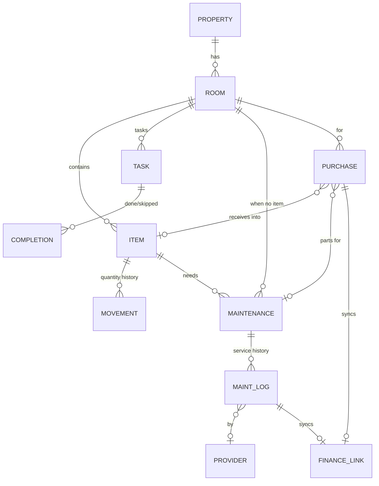

# 🏠 Home OS — خطة العمل الموحّدة والكاملة (الإصدار 4.0)

**الغرض:** وثيقة بناء واحدة لتطبيق **إدارة البيت** (ويب + موبايل، عربي RTL، متعدد أفراد الأسرة) يعمل **كقسم مستقل تمامًا**، ومرتبط بباقي أنظمتك (Projects OS، Finance، Today، المعرفة) عبر **عقود API/Events فقط** — بدون جداول مشتركة ولا نسخ كيانات.

**ما الذي دخل في المراجعة:**
1. نظام **🏠 Home OS** الحقيقي في Notion: كل قواعد البيانات الست (الحقول، الحالات، العلاقات، الصيغ كما يشرحها الدليل)، ودليل النظام (الشرح + الحدود المعروفة).
2. الملفان: **Independent Build Spec v2.0 (EN)** و**وثيقة البناء المستقلة v3.0 (AR)**.
3. السياق المحيط: صفحة **Personal & Business OS** (Finance Module + Shared Core) وقاعدة **📒 Financial Ledger**، لأن Home مرتبط بها فعليًا.
4. خطة **Projects OS v4.0** التي اعتمدناها (لضمان التوافق بين الأقسام).

**المرجع الأعلى عند التعارض:** هذه الوثيقة ← سلوك Notion الفعلي المجرَّب ← الملفان القديمان.

> **مفاتيح القراءة:** `HF-xx` ميزة محفوظة من النظام الحالي · `HC-xx` تعارض محسوم · `HG-xx` فجوة مسدودة · `HE-xx` تحسين مضاف (لتجربة المستخدم/النظام) · `HD-xx` قرار يحتاج تأكيدك · `HV-xx` قاعدة تحقق · `HA-xx` أتمتة · `HT-xx` اختبار قبول.

---

## 1) المراجعة الكاملة لنظام البيت في Notion

### 1.1 ما الموجود فعليًا (6 قواعد + دليل)

| القاعدة | الحقول الفعلية | المشتق (صيغ/Rollups) |
|---|---|---|
| **🏠 الغرف** | الاسم، **النوع** (غرفة نوم/مطبخ/حمام/صالة/مكتب/بلكونة/مخزن/خارجي)، **الموقع/الطابق** (نص)، ملاحظات، 🧪 مثال؟ + علاقات (مهام/صيانة/مخزون/مشتريات) | مهام مفتوحة، متأخرة، مهام اليوم، عدد الأصول والمخزون، نواقص المخزون، صيانة متأخرة، مشتريات مطلوبة وتكلفتها، **صحة الغرفة 🔴🟡🟢** |
| **📦 المخزون والأصول** | الاسم، **النوع** (أصل/مستهلك/أداة/أثاث/ملابس ومفروشات/مستند/**متفرقات**)، **الفئة** (6)، **الحالة** (متوفر/ناقص/نفد/معطّل/للتخلص)، الكمية، **الوحدة** (قطعة/عبوة/كيلو/لتر/علبة)، الحد الأدنى، **السعر**، تاريخ الشراء، **الضمان حتى**، **تاريخ الانتهاء (صلاحية المستهلك)**، الموديل، الرقم التسلسلي، ملاحظات + علاقات | حالة الضمان (✅/⚠️ ≤60 يوم/⛔)، يحتاج شراء؟، عدد بنود الصيانة، أقرب صيانة، صيانة متأخرة، مشتريات مطلوبة |
| **🧹 المهام والجدول** | المهمة، **النوع** (روتيني/لمرة واحدة/**موسمي**)، الأولوية، **الحالة** (لم تبدأ/جارية/تمت/**تخطيت**)، التاريخ، **كل كام يوم؟**، **آخر تنفيذ**، **المدة (دقيقة)**، **المسؤول** (نص)، **وقت البدء** (نص)، الغرفة، ملاحظات | الموعد الفعلي، مفتوحة؟، متأخرة؟، اليوم؟، حالة الموعد |
| **🔧 الصيانة** | البند، **النوع** (وقائية/إصلاح/**تفتيش**/**موسمية**)، **الحالة** (مطلوب/جارٍ/تم/**مؤجل**)، الأولوية، الأصل، الغرفة، كل كام يوم؟، آخر مرة، موعد الإصلاح، **الفني/الجهة** (نص)، **التكلفة التقديرية**، ملاحظات + مشتريات | الموعد القادم، حالة الموعد (🔴/🟡 ≤14 يوم/🟢)، متأخرة؟، مفتوح؟ |
| **🛒 المشتريات** | الصنف، الكمية، **السعر التقديري (للوحدة)**، **الأولوية**، **الحالة** (مطلوب/في السلة/تم الشراء/ملغي)، **المتجر**، **الرابط**، تاريخ الشراء، الغرفة، **من المخزون**، **من الصيانة**، **معاملة الميزانية**، ملاحظات | الإجمالي التقديري، مطلوبة؟، تقدير المطلوب، المبلغ المسجّل (من معاملات الميزانية) |
| **💰 معاملات الميزانية (نقطة الربط)** | المعاملة، **النوع (مصروف/دخل)**، المبلغ، التاريخ، **الفئة** (منزل-مشتريات/منزل-صيانة/طعام/فواتير/تعلّم/أخرى)، **المشروع** (علاقة بـ Projects OS)، المشتريات، ملاحظات | مصروف رقم |

### 1.2 قواعد النظام كما يشرحها الدليل (محفوظة)
- الغرفة هي المحور. لا قاعدة أصول منفصلة: الجهاز = صف في المخزون نوعه "أصل".
- المستهلك: `يحتاج شراء = 1` عند `الكمية ≤ الحد الأدنى`، ولا يضيف مشتريات تلقائيًا.
- المهمة المتكررة: `الموعد الفعلي = آخر تنفيذ + كل كام يوم` (وإلا التاريخ) ولا تتغيّر حالتها (الحالة للمرة الواحدة فقط).
- الصيانة الدورية: `الموعد القادم = آخر مرة + كل كام يوم` · الإصلاح: `موعد الإصلاح`.
- صحة الغرفة: 🔴 مهام/صيانة متأخرة · 🟡 مهام اليوم أو نواقص أو مشتريات مطلوبة · 🟢 تمام.

### 1.3 الحدود التي يعترف بها الدليل (وكلها تُحل في التطبيق)
لا أتمتة · لا مهمة جديدة عند تنفيذ المتكررة (تُحسب من آخر تنفيذ فقط → **بلا تاريخ تنفيذ**) · التقويم مبني على "التاريخ" لا "الموعد الفعلي" · لا فلاتر على الصيغ · لا مشتريات تلقائية من النواقص · الميزانية "نقطة ربط فقط" · بيانات 🧪 تجريبية تحتاج تنظيفًا يدويًا.

### 1.4 اكتشافات مهمة من المراجعة (خارج الملفين)
1. **قاعدة "معاملات الميزانية" في Home هي دفتر مالي مصغّر متخفٍّ** (فيها نوع مصروف/دخل، فئات طعام وفواتير وتعلّم، ومشروع). هذا **يخالف** قاعدة "Home لا ينشئ Ledger ثانية". ← يُلغى كيان مستقل ويُستبدل بـ `finance_links` (§5.12) وتُرحَّل بياناته إلى Finance (§15.4).
2. **📒 Financial Ledger في Finance مرتبط بحقل `Home Shopping Item` يشير إلى قاعدة غير موجودة/غير متاحة** (لم أستطع فتحها: `object_not_found`)، أي أن الربط الحالي بين Finance والمشتريات **مقطوع** — المشتريات في Home OS الجديد لا ترتبط فعليًا بالـ Ledger. ويوجد في صفحة Personal & Business OS شرح لأتمتة Home Shopping **يدوية** لم تُنفَّذ بعد.
3. معاملات الميزانية في Home **ترتبط بقاعدة المشاريع القديمة** (علاقة `المشروع`)، بينما Finance له قاعدة 🚀 Projects (Finance-only) وCore له 🗺️ Projects (Master) وقرار توحيدها **معلّق**. ← في التطبيق: المشروع يُشار إليه بـ `project_ref` (مرجع Projects OS) وتنتقل الإحالة المالية لـ Finance.
4. **الصيانة الدورية و"آخر تنفيذ" بلا أي سجل تاريخي** (يُستبدل التاريخ كل مرة) ← لا يمكن معرفة تاريخ خدمة الجهاز ولا تكلفته ولا مطالبة الضمان.
5. الدليل نفسه يذكر أنه **اختُبر على سيناريو مطبخ واحد فقط** — لذلك اختبارات هذه الوثيقة (§18) أوسع بكثير.
6. **ما لم أراجعه:** أكواد الصيغ نفسها (غير قابلة للقراءة عبر الأداة) فاعتمدت على شرحها في الدليل؛ ولم أفتح **Habit OS** فلم أحسم أي تداخل محتمل معه (HD-09).

### 1.5 حكم على كل عنصر في النظام الحالي

| العنصر | الحكم | القرار |
|---|---|---|
| الغرف + النوع + الطابق | **اعتماد + توسيع** | تُضاف طبقة `Property` (أكثر من بيت) وغرفة نظامية "عام" |
| المخزون الموحّد (لا Assets منفصلة) | **اعتماد** | + حركات كمية + مرفقات + حالة الصلاحية |
| الحالة اليدوية (متوفر/ناقص/نفد…) | **تفكيك** | `condition` يدوية (سليم/معطّل/للتخلص) + `stock_state` **مشتقة** (HC-08) |
| الفئة / الوحدة / السعر / الانتهاء | **استعادة** | موجودة في Notion وأسقطها الملفان (HC-06) |
| المهام روتينية/مرة/موسمية | **اعتماد + محرك تكرار** | قاعدة تعريف + سجل إنجازات (HE-01) |
| "آخر تنفيذ" كحقل وحيد | **استبدال** | يُشتق من سجل الإنجازات |
| الصيانة بأنواعها الأربعة والمؤجَّل | **اعتماد** | + سجل خدمة + مزوّد خدمة |
| المشتريات بحالاتها الأربع | **اعتماد** | + حلقة الاستلام→المخزون + شراء فعلي |
| معاملات الميزانية | **إلغاء كيان** | تُستبدل بربط Finance وترحيل (HC-02) |
| صحة الغرفة | **اعتماد + أسباب** | قواعد دقيقة + `reasons[]` (§6.9) |
| حقل 🧪 مثال؟ | **استبدال** | وضع Demo/Sandbox |

---

## 2) جرد ميزات النظام الحالي (كلها محفوظة)

| ID | الميزة | أين تتحقق |
|---|---|---|
| HF-01 | الغرفة محور التنقل مع ملخص وصحة | §5.2، §6.9، §10 |
| HF-02 | أنواع الغرف الثمانية + الطابق | §5.2 |
| HF-03 | مخزون موحّد: 7 أنواع + فئة + وحدة + سعر | §5.3 |
| HF-04 | حالة الضمان (60 يومًا) | §6.1 |
| HF-05 | تاريخ انتهاء المستهلكات | §6.2 |
| HF-06 | الحد الأدنى + "يحتاج شراء" دون إضافة تلقائية | §6.3 |
| HF-07 | مهام: روتيني/لمرة/موسمي + كل X يوم + آخر تنفيذ | §5.5، §6.5 |
| HF-08 | المدة، وقت البدء، المسؤول، الأولوية | §5.5 |
| HF-09 | "تخطيت" كنتيجة | §5.6 (outcome=skipped) |
| HF-10 | صيانة: وقائية/إصلاح/تفتيش/موسمية + مؤجل | §5.7 |
| HF-11 | موعد قادم + حالة 🔴🟡🟢 (14 يومًا) | §6.6 |
| HF-12 | الفني/الجهة + التكلفة التقديرية | §5.7، §5.9 |
| HF-13 | أقرب صيانة على الأصل + عدد بنودها | §6.7 |
| HF-14 | مشتريات: 4 حالات + متجر + رابط + أولوية | §5.10 |
| HF-15 | إجمالي تقديري + تقدير المطلوب | §6.8 |
| HF-16 | ربط الشراء بالمخزون والصيانة | §5.10 |
| HF-17 | المبلغ المسجّل للشراء + ربط معاملة | §5.12 |
| HF-18 | ربط المصروف بمشروع | §5.10 (`project_ref`) |
| HF-19 | Rollups الغرفة (6 عدّادات + تكلفة المطلوب) | §6.9 |
| HF-20 | مسار "ابدأ من هنا" (5 خطوات) | §10.1 (الرئيسية) |
| HF-21 | سيناريو اختبار المطبخ | §18 + بيانات Demo |
| HF-22 | عرض "الأقرب موعدًا أولًا" | §10.4 |

---

## 3) المبادئ والحدود بين الأقسام (مهم: استقلال + ارتباط)

### 3.1 الاستقلال
Home OS تطبيق **قائم بذاته**: قاعدة بياناته وخدماته وواجهاته منفصلة. يعمل كاملًا (غرف، مخزون، مهام، صيانة، مشتريات، تنبيهات) **حتى لو كان Projects OS وFinance غير موجودين**. الربط **اختياري ومُحسَّن**، وعند غياب أي نظام تتدهور الميزة بلطف.

### 3.2 من يملك ماذا
| الكيان / الحقيقة | المالك | Home يفعل ماذا |
|---|---|---|
| الغرف، المخزون، المهام المنزلية، الصيانة، المشتريات، مزوّدو الخدمة | **Home** | يملكها بالكامل |
| الدفتر المالي (Ledger) والحسابات والفئات | **Finance** | يطلب إنشاء معاملة، ولا يخزّن دفترًا |
| المشاريع ومهام المشاريع | **Projects OS** | يحتفظ بـ `project_ref` ويستطيع "ترقية" بند إلى مشروع |
| الأفكار/الاجتماعات/المجالات | **Knowledge** | ربط/قراءة فقط |
| الهوية والإشعارات والملفات والبحث والأحداث | **Core** | يستهلكها |
| صفحة اليوم | **Today** | يوفّر Feed ويقرأ منها لا يكرّر |

### 3.3 مصفوفة التدهور (عند غياب نظام مرتبط)
| الغائب | سلوك Home |
|---|---|
| Finance | الشراء يعمل؛ `finance_sync_status = Not Required/Pending`؛ لا أرقام مالية مقروءة؛ زر "سجّل في Finance" مخفي |
| Projects OS | حقل `project_ref` مخفي؛ لا "ترقية إلى مشروع" |
| Today/Knowledge | لا Feed خارجي؛ الصفحة الرئيسية لـ Home كافية |
| Core (إشعارات) | تنبيهات داخل التطبيق فقط |

### 3.4 المبادئ الحاكمة
1. **المشتق لا يُعدَّل يدويًا** (health، warranty_state، stock_state، next_due، totals…). يُحسب في Domain/Service.
2. **كيان واحد لكل مفهوم** (لا جدول أصول ثانٍ؛ لا دفتر مالي ثانٍ).
3. **idempotency** لكل ما يعاد تنفيذه: إنجاز مهمة، حركة مخزون، مزامنة Finance، إنشاء occurrence.
4. **Timezone:** كل "اليوم/الموعد" بتوقيت المنزل (افتراضي `Africa/Cairo`).
5. **كل شاشة:** Loading / Empty / Error / Success (+ Offline للموبايل).
6. **Soft delete/Archive** ولا يدخل المؤرشف في أي حساب.
7. **لا Workaround من Notion** (لا صيغ تقويم، لا 🧪، لا نسخ قوالب يدويًا).
8. **كل تكامل** بـ `source_type/source_id` ثابتين و`Idempotency-Key`.
9. **سجل نشاط (Audit)** للتعديلات الحرجة: كمية، ضمان، حالة صيانة، شراء، إعدادات.
10. **لا Dashboard أو View مصدر حقيقة.**

### 3.5 الأسرة (Household) — لأن النظام لأكثر من شخص
- `workspace_kind = household` (مختلف عن Workspace الفريق في Projects OS). المستخدم الواحد قد يكون عضوًا في Workspace فريق **و** Workspace بيت؛ **الهوية واحدة**، والبيانات منفصلة، والربط عبر مراجع خارجية بصلاحيات (HC-20).
- الأدوار: **Owner** · **Adult** (كل التعديلات) · **Child** (يرى ويُنجز المهام المسندة له ويضيف طلبات شراء كمسوّدة) · **Guest** (قراءة).
- المسؤول عن المهام/المخاطر = عضو حقيقي (FK) بدل نص حر، مع **تدوير مسؤولية** اختياري (HE-05).

---
## 4) النموذج المفاهيمي

```text
   Household (Workspace)
        │
     Property (بيت/شقة/سيارة…)  ── اختياري ويُخفى لو بيت واحد
        │
      Room  (الغرفة = المحور؛ + غرفة نظامية "عام / البيت كله")
        ├──< InventoryItem ──< InventoryMovement   (كمية)   ──< Files (فاتورة/ضمان/دليل/صورة)
        │        └──< Maintenance ──< MaintenanceLog (سجل خدمة + تكلفة)  ──> Provider
        ├──< HomeTask (تعريف) ──< TaskCompletion (سجل إنجاز/تخطي)
        └──< Purchase  ──> (يستلم إلى) InventoryItem  ·  (قطع غيار) Maintenance
                 └──> FinanceLink ═══> Finance (معاملة واحدة بـ idempotency)
   Purchase / Maintenance ──(اختياري)──> project_ref (Projects OS)
```
**السؤال المحوري الذي يجيب عليه النظام:** ماذا يوجد؟ ← أين؟ ← ماذا يحتاج؟ ← متى؟ ← ماذا يجب شراؤه؟ ← ماذا يجب إصلاحه؟ ← كم سيكلف؟ ← **كم كلّف فعلًا؟** (الأخيرة مضافة، تُقرأ من Finance).

---

## 5) نموذج البيانات الكامل

### 5.0 الحقول العامة (كل كيان)
`id` UUID · `workspace_id` NOT NULL · `created_by` · `created_at` · `updated_at` · `deleted_at` · `archived_at` (حيث ينطبق) · `version` (تزامن متفائل) · `external_refs` عند الحاجة. القيم المشتقة لا تُخزَّن كحقول قابلة للتعديل؛ التخزين المؤقت في `*_metrics_cache` قابل لإعادة البناء.

### 5.1 العقارات `home_properties` (HE-17)
| الحقل | النوع | ملاحظات |
|---|---|---|
| name | string | إلزامي. مثال: "شقة القاهرة" |
| kind | lookup | شقة / بيت / فيلا / مصيف / سيارة / أخرى |
| address, notes | text | |
| is_default | bool | يوجد واحد افتراضي؛ الواجهة تخفي المستوى إن كان العقار واحدًا |

### 5.2 الغرف `home_rooms`
| الحقل | النوع | إلزامي | ملاحظات |
|---|---|---|---|
| property_id | FK | نعم | |
| name | string | نعم | فريد داخل العقار (غير حساس لحالة الأحرف، لا يشمل المؤرشف) |
| type | lookup(`room_type`) | لا | 🛏️ نوم · 🍳 مطبخ · 🚿 حمام · 🛋️ صالة · 💻 مكتب · 🌿 بلكونة · 📦 مخزن · 🚗 خارجي · (قابلة للتخصيص) |
| floor_label | string | لا | "الموقع/الطابق" سابقًا |
| notes | text | لا | |
| sort_order | numeric | نظام | |
| is_system | bool | نظام | غرفة **"عام / البيت كله"** لكل عقار (HD-03) — لا تُحذف ولا تُؤرشف |
| archived_at | ts | | الأرشفة تتبع §9.3 |

**مشتق (قراءة فقط):** `health` + `health_reasons[]` + العدّادات (§6.9) + تقدير المطلوب + مصروف آخر 30 يومًا (من Finance إن وُجد).

### 5.3 المخزون والأصول `home_inventory_items`
**جدول واحد** لكل الأشياء (لا جدول أصول منزلي منفصل).

| الحقل | النوع | إلزامي | ملاحظات |
|---|---|---|---|
| room_id | FK | **نعم** | الموقع الحالي (غرفة واحدة فقط) |
| storage_spot | string | لا | "الدولاب العلوي/الدرج الثاني" (HE-14) |
| parent_item_id | FK self | لا | داخل حاوية (صندوق عدة…) — مرحلة 7 |
| name | string | نعم | |
| type | lookup(`item_type`) | نعم | 🧊 أصل (جهاز) · 🛒 مستهلك · 🧰 أداة · 🛋️ أثاث · 👕 ملابس ومفروشات · 📄 مستند · 📦 متفرقات |
| category | lookup(`item_category`) | لا | كهرباء وأجهزة · مطبخ وطعام · نظافة · حمام وعناية · أدوات وصيانة · أخرى |
| condition | enum | نعم (افتراضي OK) | `OK` · `Faulty` (معطّل) · `To Dispose` (للتخلص) · `Disposed` — **يدوية** |
| quantity | decimal(12,3) ≥ 0 | نعم | **تتغيّر عبر الحركات فقط** (§5.4) |
| unit | lookup | نعم | قطعة · عبوة · كيلو · لتر · علبة (قابلة للتخصيص) |
| minimum_quantity | decimal ≥ 0 | لا | الحد الأدنى؛ فارغ = لا تتبع مخزون |
| reorder_quantity | decimal > 0 | لا | الكمية الافتراضية عند "أضف للمشتريات" (وإلا = الحد الأدنى) |
| brand, model | string | لا | |
| serial_number | string | لا | فريد داخل الـ Workspace بين غير المؤرشف |
| purchase_date | date | لا | |
| purchase_price | money | لا | سعر الوحدة (السعر سابقًا) + `currency` |
| warranty_until | date | لا | + مساعد واجهة: "مدة الضمان بالأشهر" تحسب التاريخ ولا تُخزَّن |
| expiry_date | date | لا | صلاحية المستهلك (HC-06) |
| owner_member_id | FK member | لا | صاحب الغرض (ملابس/أدوات شخصية) |
| notes | text | لا | |
| disposed_at / disposal_reason | | عند Disposed | بيع/تبرع/تلف |

**مشتق:** `warranty_state`, `expiry_state`, `stock_state`, `needs_purchase`, `purchase_pending`, `next_maintenance_due`, `overdue_maintenance_count`, `maintenance_count`, `predicted_runout_date`, `lifetime_cost` (من Finance + سجلات الصيانة).

### 5.4 حركات المخزون والملفات
**`home_inventory_movements`** (HE-02): `item_id`, `kind` (`initial` · `receipt` · `consumption` · `adjustment` · `transfer` · `disposal`), `delta` (موقّع)، `resulting_quantity`, `occurred_at`, `member_id`, `source_type/source_id` (مثل purchase)، `from_room_id/to_room_id` (للنقل)، `note`, `client_op_id` (**فريد** لكل item). قاعدة: `resulting_quantity ≥ 0`.
**`home_item_files`** (HE-03): `item_id`, `file_id` (Core), `kind` (صورة · فاتورة · بطاقة ضمان · دليل استخدام · أخرى).

### 5.5 المهام المنزلية `home_tasks` (تعريف المهمة)
| الحقل | النوع | إلزامي | ملاحظات |
|---|---|---|---|
| title | string | نعم | |
| room_id | FK | لا | الافتراضي: الغرفة النظامية "عام" |
| task_kind | enum | نعم | `One-time` · `Recurring` (**الموسمي = Recurring بقاعدة سنوية**) |
| priority | enum | لا | عالية / متوسطة / منخفضة |
| estimated_minutes | integer | لا | "المدة" |
| start_time | time | لا | (كان نصًا) للتذكير |
| assignee_mode | enum | نعم (Fixed) | `Fixed` · `Rotate` (HE-05) |
| assignee_id | FK member | لا | |
| rotation_member_ids | uuid[] | لو Rotate | |
| notes | text | لا | |
| **One-time:** `due_date`, `status` (`Not Started` · `In Progress` · `Done` · `Cancelled`) | | | "تخطيت" = Cancelled + `cancel_reason='skipped'` |
| **Recurring:** `first_date`, `recurrence` (JSON)، `is_paused`, `missed_policy` | | | لا `status` لها (HC-12) |

**`recurrence` (JSON موثَّق):**
```json
{ "mode": "after_completion | fixed",
  "unit": "day | week | month | year",
  "interval": 1,
  "weekdays": [6],            // للأسبوعي: 0=الأحد..6=السبت (قابل للضبط)
  "month_day": 1,             // للشهري (يُقلَّم لآخر يوم إن لزم)
  "months": [10],             // للسنوي/الموسمي
  "lead_days": 0,             // تذكير مسبق
  "ends_on": null }
```
**تكافؤ مع النظام الحالي:** "كل X يوم" = `{mode:after_completion, unit:day, interval:X}` (السلوك الحالي بالضبط، وهو الافتراضي — HD-07).
`missed_policy`: `roll_forward` (**الافتراضي**: لا تتراكم فواتات؛ تظهر فائتة واحدة فقط) أو `catch_up`.
**مشتق:** `next_due`, `due_state`, `is_overdue`, `is_open`, `last_completed_at`, `completion_rate_30d`.

### 5.6 سجل الإنجازات `home_task_completions` (HE-01)
`task_id`, `occurrence_date` (التاريخ الذي حقّقه هذا الإنجاز), `completed_at`, `completed_by`, `outcome` (`done` · `skipped`), `actual_minutes`, `note`, `client_op_id`.
**قيود:** `UNIQUE(task_id, occurrence_date)` و`UNIQUE(task_id, client_op_id)` ⇒ إعادة الإرسال لا تكرر. للمهام المنفردة: إكمالها ينشئ سجلًا واحدًا أيضًا.

### 5.7 الصيانة `home_maintenance`
| الحقل | النوع | إلزامي | ملاحظات |
|---|---|---|---|
| title | string | نعم | "البند" |
| type | enum | نعم | `Preventive` (وقائية) · `Repair` (إصلاح) · `Inspection` (تفتيش) · `Seasonal` (موسمية) |
| inventory_item_id | FK | **لا** | اختياري (صيانة عامة: السطح، خزان المياه) |
| room_id | FK | شرطي | **يُشتق من الأصل إن وُجد** ولا يُخزَّن مستقلًا؛ يُخزَّن فقط عند غياب الأصل (HC-16) |
| priority | enum | لا | عالية/متوسطة/منخفضة |
| provider_id | FK | لا | الفني/الجهة (§5.9) |
| estimated_cost / currency | money | لا | |
| notes | text | لا | |
| **الدوريّ (Preventive/Inspection/Seasonal):** `first_due_date`, `recurrence` (نفس البنية، الافتراضي `after_completion`), `is_paused` | | | بلا `status` |
| **الإصلاح (Repair):** `status` (`Required` · `In Progress` · `Done` · `Postponed`), `repair_due_at`, `postponed_until` | | | |
| project_ref | external | لا | ترقية لمشروع (§15.3) |

**مشتق:** `next_due_at` (= آخر تنفيذ + الدورة، وإلا `first_due_date`)، `due_state`, `is_overdue`, `is_open`, `warranty_may_cover` (HE-15).
**قيد:** يجب وجود `inventory_item_id` **أو** `room_id`.

### 5.8 سجل الصيانة `home_maintenance_logs` (HE-04)
`maintenance_id`, `done_at` (date), `outcome` (`done` · `skipped`), `performed_by_member_id` أو `provider_id`, `actual_cost/currency`, `notes`, ملفات (فاتورة)، `client_op_id` (**فريد** لكل بند). **آخر مرة** = أحدث `done_at` (مشتق، لا يُعدَّل يدويًا؛ للتصحيح تُضاف سجلات).

### 5.9 مزوّدو الخدمة `home_providers` (HD-02)
`name`, `trade` (سباك/كهربائي/فني تكييف/صيانة أجهزة/نظافة/…)، `phone`, `notes`, `rating` (1–5)، `contact_ref` (مرجع اختياري لجهة اتصال في Projects OS — لا نسخ بيانات)، **مشتق:** `last_used_at`, `jobs_count`, `total_cost`.
لا دمج بالاسم وحده؛ تلميح "تكرار محتمل" ودمج يدوي مسجَّل.

### 5.10 المشتريات `home_purchases`
| الحقل | النوع | إلزامي | ملاحظات |
|---|---|---|---|
| name | string | نعم | "الصنف" |
| quantity | decimal | نعم | **> 0** (HC-18) |
| unit | lookup | لا | |
| estimated_unit_price | money | لا | **null = غير معروف** (وليس 0) |
| priority | enum | لا | عالية/متوسطة/منخفضة |
| status | enum | نعم | `Needed` (مطلوب) · `In Cart` (في السلة) · `Purchased` (تم الشراء) · `Cancelled` (ملغي) |
| store | string | لا | المتجر |
| url | URL | لا | |
| needed_by | date | لا | (إضافة) |
| room_id | FK | لا | يُملأ تلقائيًا من الأصل عند وجوده |
| inventory_item_id | FK | لا | شراء لعنصر موجود/بديل |
| maintenance_id | FK | لا | قطع غيار |
| project_ref | external | لا | تحميل المصروف على مشروع (HF-18) |
| requested_by | FK member | نظام | |
| purchased_at / purchased_by | ts / FK | عند Purchased | |
| actual_total / currency | money | عند Purchased* | المبلغ المدفوع فعلًا (*أو تعليم "لا أريد تسجيله ماليًا") |
| received_at / received_quantity | ts / decimal | لا | الاستلام (HE-06) |
| notes | text | لا | |

**مشتق:** `estimated_total` (= الكمية × سعر الوحدة، وإلا null)، `is_needed` (Needed أو In Cart)، `variance` (فعلي − تقديري)، `finance_status` و`finance_amount` (من `finance_links`).

### 5.11 الإعدادات والقوائم
**`home_settings`** (لكل Workspace بيت): `timezone` (Africa/Cairo) · `week_start_day` (السبت) · `default_currency` (EGP) · `warranty_soon_days=60` · `maintenance_soon_days=14` · `expiry_soon_days=7` · `task_soon_days=0` · `default_missed_policy=roll_forward` · `health_includes{...}` (§6.9) · `auto_add_low_stock=false` · `digest_day/time` · `quiet_hours`.
**`lookup_values`**: `room_type`, `property_kind`, `item_type`, `item_category`, `unit`, `provider_trade`، بقيم افتراضية قابلة للتخصيص (`label_ar/label_en/color/position/is_active`). **فئات الأنواع والحالات المنطقية ثابتة** (للمحرك)، أما الأسماء والألوان فمرنة.

### 5.12 الربط المالي `home_finance_links` (يحلّ HC-03)
| الحقل | ملاحظات |
|---|---|
| source_type | `home_purchase` · `home_maintenance_log` |
| source_id | UUID المصدر. **`UNIQUE(source_type, source_id)`** |
| idempotency_key | `home:{source_type}:{source_id}:v1` |
| finance_transaction_id | معرّف خارجي من Finance (0..1) |
| sync_status | `Not Required` · `Pending` · `Synced` · `Failed` · `Detached` · `Legacy` |
| amount / currency / occurred_on | ما أُرسل |
| attempts, last_error, last_attempt_at, synced_at | لإعادة المحاولة |
| finance_amount_snapshot, snapshot_at | القيمة كما هي الآن في Finance (قراءة فقط) |

`finance_synced` (boolean في الملفين) = `sync_status == Synced` **مشتق**. لا كيان "معاملة ميزانية" في Home.

### 5.13 خريطة العلاقات


---
## 6) محرك الحسابات والدوال

> كل ما في هذا الفصل **مشتق**: يُحسب في طبقة Domain/Service، لا يُعدَّل يدويًا، ويُعاد حسابه عند الأحداث وفي جدولة يومية (§6.11).
> `today` = تاريخ اليوم بتوقيت المنزل. كل الحسابات بحساب **تواريخ تقويمية** وليس مقارنة نصوص.

### 6.1 الضمان (HF-04)
```text
days_left = warranty_until − today
warranty_until فارغ        → No Warranty
days_left < 0               → Expired      ⛔
0 ≤ days_left ≤ 60          → Expiring Soon ⚠️   (يوم الانتهاء نفسه: ما زال ساريًا لكنه "ينتهي قريبًا")
days_left > 60              → Valid         ✅
```
(60 قابلة للضبط `warranty_soon_days`.) تنبيهات متدرجة: 60 / 30 / 7 / يوم الانتهاء (HA-03).

### 6.2 صلاحية المستهلكات (HF-05)
```text
days_left = expiry_date − today
quantity = 0 أو لا expiry_date → لا حالة
days_left < 0 → Expired | 0..7 → Expiring Soon | > 7 → Fresh      (7 = expiry_soon_days)
```

### 6.3 حالة المخزون والنواقص (HF-06)
```text
minimum_quantity فارغ              → stock_state = Untracked
quantity = 0                        → Out
quantity <= minimum_quantity        → Low
غير ذلك                             → OK
low_stock        = stock_state ∈ {Low, Out}               (لأي نوع له حد أدنى — HC-07)
purchase_pending = يوجد شراء مرتبط بالعنصر حالته Needed أو In Cart
needs_purchase   = low_stock AND NOT purchase_pending      ("يحتاج شراء" يختفي بمجرد إضافة الشراء)
```
- **لا ينشئ Purchase تلقائيًا افتراضيًا.** خيار اختياري `auto_add_low_stock` (مغلق افتراضيًا): عند الدخول في Low/Out ولا يوجد شراء معلّق ⇒ ينشئ شراء `Needed` واحدًا بكمية `reorder_quantity` (وإلا الحد الأدنى) — **idempotent** (شراء مفتوح واحد لكل عنصر).
- المستهلك بدون حد أدنى ⇒ تلميح "حدّد الحد الأدنى لتفعيل التنبيه".
- المؤرشف/Disposed مستثنى.

### 6.4 توقع نفاد المستهلك (HE-07 — تقديري)
```text
شرط الحساب: ≥ 3 حركات consumption خلال آخر 90 يومًا تمتد ≥ 14 يومًا
window_days  = min(90, today − أول حركة استهلاك في النافذة)
daily_rate   = Σ|delta| لحركات consumption في النافذة ÷ window_days
predicted_runout_date = today + quantity ÷ daily_rate        (daily_rate = 0 → لا توقع)
تنبيه عندما days_left ≤ 7
```
يُعرض دائمًا بوسم "تقديري".

### 6.5 التكرار والموعد القادم (HF-07، HE-01)
**أ) المهمة لمرة واحدة:** `next_due = due_date` · `is_open = status ∈ {Not Started, In Progress}`.

**ب) المهمة المتكررة (لا `status` لها):**
```text
last_occurrence_date = أحدث occurrence_date في سجل الإنجازات (done أو skipped)
last_completed_date  = تاريخ completed_at بتوقيت المنزل لذلك السجل

mode = after_completion (الافتراضي، سلوك Notion الحالي):
    next_due = first_date                                   إن لا سجلات
             = last_completed_date + interval(unit)         وإلا
mode = fixed (جدول مثبّت على first_date):
    G = تواريخ الشبكة (أسبوعي على weekdays / شهري على month_day / سنوي على months)
    إن لا سجلات:  next_due = first_date
    وإلا:
      roll_forward (الافتراضي): next_due = أول g ∈ G حيث g > max(last_occurrence_date, last_completed_date)
      catch_up:                 next_due = أول g ∈ G حيث g > last_occurrence_date
حساب الشهور يُقلَّم لآخر يوم صالح (31 → 30/28)
```
- `skipped` يُحتسب إنجازًا للجدولة. `is_paused` أو بعد `ends_on` ⇒ مغلقة.
- **الحالات:**
```text
is_overdue = open AND next_due <  today
is_today   = open AND next_due == today
is_soon    = open AND today < next_due <= today + task_soon_days
بلا next_due (منفردة بلا موعد) → "بلا موعد" ولا تُحسب متأخرة/اليوم
```
- **الإنجاز idempotent:** الواجهة ترسل `occurrence_date` المستهدف؛ تكراره (نفس `occurrence_date` أو نفس `client_op_id`) يعيد السجل الأول ولا ينشئ آخر.
- **التدوير (Rotate):** `done` ⇒ يتحول `assignee_id` للتالي في `rotation_member_ids`؛ `skipped` ⇒ لا يتغيّر.
- **إسقاطات التقويم (HE-01):** لمدى [a,b]: المنفردة بتاريخها، الشبكة `fixed` بتواريخها، و`after_completion` تُسقَط من `next_due` ثم `+interval` ويُوسم المستقبلي **"تقديري"**. الإنجازات الماضية تُرسم من السجل. (يحل حد Notion: التقويم على "التاريخ" لا "الموعد الفعلي".)

### 6.6 موعد الصيانة وحالتها (HF-11)
```text
Preventive / Inspection / Seasonal (دورية، لا status):
    next_due_at = first_due_date                  إن لا سجلات
                = جدولة recurrence من آخر سجل (done|skipped)  وإلا       ← نفس منطق 6.5
Repair:
    due = Postponed ? postponed_until : repair_due_at
    is_open = status ∈ {Required, In Progress, Postponed}
days = due − today (أو next_due_at − today)
days < 0                     → Overdue      🔴
0 ≤ days ≤ 14                → Due Soon     🟡    (maintenance_soon_days)
days > 14                    → Healthy      🟢
إصلاح مفتوح بلا تاريخ        → Unscheduled  (سبب REPAIR_OPEN في صحة الغرفة)
```
`Done` مغلق. **تأجيل** بلا `postponed_until` يُستبعد من التأخر لكنه يظهر في "المؤجَّل".

### 6.7 تجميعات الأصل (HF-13)
```text
maintenance_count          = عدد بنود الصيانة غير المؤرشفة للأصل
overdue_maintenance_count  = عدد بنوده Overdue
next_maintenance_due       = أقرب due لبنوده المفتوحة
warranty_may_cover (HE-15) = بند Repair جديد/مفتوح AND warranty_state ≠ Expired AND warranty_until ≥ تاريخ فتح البند
lifetime_cost (للأصول)     = purchase_price + Σ تكلفة سجلات صيانته (مبلغ Finance إن Synced وإلا actual_cost)
```

### 6.8 المشتريات والتكلفة (HF-15)
```text
estimated_total = quantity × estimated_unit_price         (سعر فارغ ⇒ null، وليس 0)
is_needed       = status ∈ {Needed, In Cart}
required_estimate(room) = Σ estimated_total للمشتريات is_needed ذات السعر المعروف
                          + unknown_count (عدد غير المسعّر) يُعرض بجواره  "≈ 1,250 ج + 3 بلا سعر"
variance        = actual_total − estimated_total          (إن وُجدا)
المبلغ المعتمد  = finance_amount_snapshot إن Synced وإلا actual_total      (لا يُجمع الاثنان أبدًا)
```
**قاعدة منع الازدواج (يحل مشكلة "طبقة الميزانية تضاعف المصروف"):** أي مصروف حقيقي له **مصدر واحد**: معاملة Finance إن وُجدت، وإلا سجل Home الداخلي (موسوم "غير مسجّل ماليًا") — لا يُجمعان.

### 6.9 صحة الغرفة (HF-01، HF-19)
**التقييم** لغير المؤرشف، ويستثني المهام/الصيانة الموقوفة والعناصر Disposed. النتيجة `health` + `health_reasons[]` (كل الأسباب المتحققة، والمستوى = الأشد).

| المستوى | الكود | الشرط | افتراضي |
|---|---|---|:-:|
| 🔴 Attention | `OVERDUE_TASK` | مهمة مفتوحة `next_due < today` | ✔ |
| 🔴 | `OVERDUE_MAINTENANCE` | صيانة/إصلاح Overdue (لعناصر الغرفة أو الغرفة نفسها) | ✔ |
| 🔴 | `EXPIRED_STOCK` | مستهلك `quantity > 0` منتهي الصلاحية | ✔ |
| 🟡 Work Needed | `TASK_DUE` | مهمة مفتوحة `today ≤ next_due ≤ today + task_soon_days` | ✔ |
| 🟡 | `MAINTENANCE_SOON` | صيانة Due Soon (≤14 يومًا) | ✔ |
| 🟡 | `REPAIR_OPEN` | إصلاح مفتوح بلا تاريخ | ✔ |
| 🟡 | `LOW_STOCK` | عنصر `low_stock` | ✔ |
| 🟡 | `PURCHASE_NEEDED` | شراء `is_needed` للغرفة | ✔ |
| 🟡 | `FAULTY_NO_REPAIR` | عنصر `Faulty` بلا بند إصلاح مفتوح | ✔ |
| 🟡 | `EXPIRING_SOON` | مستهلك ينتهي ≤ 7 أيام | ✔ |
| 🟡 | `WARRANTY_EXPIRING` | ضمان ينتهي ≤ 60 يومًا | ✘ (يُفعَّل من الإعدادات؛ يبقى شارة دائمًا) |
| 🟢 Healthy | — | لا شيء مما سبق | |

- **مهام مفتوحة عامة لا تجعل الغرفة صفراء** (HC-04): المتكررة "مفتوحة دائمًا" فلو حُسبت لأصبحت كل الغرف صفراء.
- **إسناد الغرفة:** مهمة بلا غرفة ← "عام"؛ صيانة لها أصل ← غرفة الأصل (الحالية)؛ شراء ← غرفته أو غرفة أصله.
- **عدّادات الغرفة (HF-19):** `open_tasks`, `overdue_tasks`, `due_today`, `items_count`, `low_stock_count`, `overdue_maintenance`, `maintenance_soon`, `purchases_needed`, `required_estimate (+unknown)`, `expired_count`, `warranty_expiring_count`.
- **صحة العقار/البيت:** أسوأ مستوى بين الغرف + عدد الغرف في كل مستوى.
- الحدث `home.room.health_changed(from,to,reasons)` يُطلق فقط عند تغيّر **المستوى**.

### 6.10 قراءات Finance (للقراءة فقط — إن وُجد)
`spent_30d`, `spent_ytd`, `spent_by_category` لكل (غرفة/أصل/عقار) عبر `dimensions` المرسلة مع المعاملات (§15.1). لا تُخزَّن كحقيقة؛ تُخزَّن لقطة مع `snapshot_at`. الميزانية الشهرية لفئات المنزل **يملكها Finance** ويعرض Home تقدمها فقط.

### 6.11 استراتيجية إعادة الحساب
1. **حسب الحدث:** إنجاز/تخطي مهمة، تغيير موعد، سجل صيانة، تغيير حالة إصلاح، حركة مخزون، تغيير شراء، نقل عنصر، تغيير إعدادات ⇒ إعادة حساب الغرفة (والأصل) في طابور بتجميع.
2. **جدولة يومية** (00:05 بتوقيت المنزل) للحالات الزمنية (الضمان، الصلاحية، الموعد، الصحة).
3. **الدالة idempotent** وتُعيد البناء من المصدر الحي، وتطلق الأحداث عند تغيّر القيمة فقط.
4. أمر `rebuild_metrics(workspace)` لإعادة البناء الكامل. **لا حساب في الواجهة.**

---

## 7) سجل التعارضات وكيف حُسمت

| ID | التعارض | المصادر | الحل |
|---|---|---|---|
| HC-01 | الملكية `user_id` مقابل بيت متعدد الأفراد | AR/EN | `workspace_id` (Household) + `created_by` + أدوار |
| HC-02 | **معاملات الميزانية**: قسم كامل في EN، مختصرة في AR، ودفتر مصغّر (دخل/مصروف/فئات/مشروع) في Notion — يخالف "لا Ledger ثانية" | EN/AR/Notion | يُلغى الكيان؛ `home_finance_links` + ترحيل إلى Finance (§15.4) |
| HC-03 | `finance_synced` boolean (EN) مقابل `finance_transaction_id` FK (AR) وغياب حالة الفشل/إعادة المحاولة | AR/EN | جدول `home_finance_links` بحالات `sync_status`؛ `finance_synced` مشتق |
| HC-04 | صحة الغرفة: EN "مفتوح/قريب" مبهمة، AR "عمل مفتوح" تجعل كل غرفة صفراء (المتكررة دائمًا مفتوحة)، Notion "مهام اليوم" فقط | الثلاثة | جدول أسباب دقيق §6.9 (اليوم/القريب بدل "مفتوح") |
| HC-05 | تسميات الصحة: `Needs Attention/Has Work` (EN) مقابل `Attention/Work Needed` (AR) | EN/AR | enum واحد: `Attention` · `Work Needed` · `Healthy` + ترجمات |
| HC-06 | حقول أسقطها الملفان: الفئة، الوحدة، السعر، تاريخ الانتهاء، الحالة | Notion vs الملفان | تُستعاد (§5.3) |
| HC-07 | النقص: EN للمستهلكات فقط، AR لأي عنصر له حد أدنى، Notion للمستهلك | الثلاثة | أي عنصر له حد أدنى (يغطي الكل)؛ الواجهة تعرض الحقل افتراضيًا للمستهلك/الأداة |
| HC-08 | `الحالة` اليدوية (متوفر/ناقص/نفد) تتعارض مع "يحتاج شراء" المحسوب | Notion | `condition` يدوية (OK/Faulty/To Dispose) + `stock_state` مشتقة |
| HC-09 | أنواع المخزون: 6 (الملفان) مقابل 7 (+متفرقات) في Notion، وتسمية "ملابس ومفروشات" | Notion vs الملفان | 7 أنواع قابلة للتخصيص |
| HC-10 | حد الضمان: EN `today < until−60` ⇒ Valid، AR "أكثر من 60 يومًا" | EN/AR | `days_left > 60` Valid؛ `0..60` Expiring Soon (§6.1) |
| HC-11 | المهام: نوعان (الملفان) مقابل ثلاثة (+موسمي) في Notion؛ التكرار `frequency_days` (EN) مقابل `frequency_config` (AR) مقابل "كل X يوم" | الثلاثة | `recurrence` JSON موثَّق + الموسمي = سنوي (§5.5) |
| HC-12 | حالة المهمة المتكررة: دورة حياة كاملة (AR) مقابل "لا تغيّر الحالة" (Notion) | AR/Notion | المتكررة بلا `status`؛ فقط `is_paused`؛ والمنفردة لها دورة حياة |
| HC-13 | الإنجاز: حقل `last_completed_at` فقط (EN) مقابل Occurrences اختيارية (AR) + "تخطيت" | الثلاثة | سجل `task_completions` (done/skipped) بقيد `UNIQUE(task_id, occurrence_date)` — بلا صفوف مسبقة التوليد |
| HC-14 | `next_due_at` مخزَّن؟ والتقويم على التاريخ لا الموعد الفعلي | EN/Notion | مشتق دائمًا + إسقاطات تقويم (§6.5) |
| HC-15 | الصيانة: نوعان وثلاث حالات (الملفان) مقابل 4 أنواع و4 حالات (+مؤجل) | Notion vs الملفان | 4 أنواع، والحالات للإصلاح فقط: Required/In Progress/Done/Postponed |
| HC-16 | الصيانة تُخزّن `item` و`room` معًا فتنفصل الغرفة عن الأصل بعد نقله | EN/AR | الغرفة تُشتق من الأصل؛ تُخزَّن فقط بلا أصل |
| HC-17 | الدورية التي لم تُنفَّذ أبدًا: `next_due` غير معرّف | EN/AR | `first_due_date` إلزامي للدوري |
| HC-18 | كمية الشراء `> 0` (EN) مقابل `>= 0` (AR) | EN/AR | `> 0` |
| HC-19 | حالات الشراء غير محددة (EN) / "اعتماد product statuses" (AR) | EN/AR | حالات Notion الأربع |
| HC-20 | روابط بين Workspace بيت وWorkspace فريق (مشروع ↔ مصروف) | Notion/Projects | `project_ref` خارجي + فحص صلاحية المستخدم في النظامين |
| HC-21 | حقول الشراء الناقصة: الأولوية، المتجر، الرابط، **المبلغ الفعلي** (Notion يستعمل مبلغ معاملة الميزانية)، المشروع | Notion vs الملفان | تُضاف (§5.10) + `actual_total` |
| HC-22 | `estimated_total` عند غياب السعر: 0 أم مجهول؟ | EN/AR | `null` + "بلا سعر" |
| HC-23 | تسمية المصدر: "Home Shopping / Purchase"؛ وLedger في Notion مرتبط بقاعدة Home Shopping **غير متاحة** (علاقة معلّقة) | AR/EN/Notion | `source_type` ∈ {`home_purchase`,`home_maintenance_log`}؛ يُنسَّق مع Finance (HD-05) |
| HC-24 | التنقل: EN فيه "Budget/Finance Links" وRoom Detail متداخل؛ AR قائمة مسطحة | EN/AR | خريطة §10.1 (الغرفة محور؛ لا شاشة ميزانية مستقلة بل "سياق مالي") |
| HC-25 | تفرّد اسم الغرفة "موصى به" (EN) وغائب (AR) | EN/AR | فريد داخل العقار |
| HC-26 | تفرّد الرقم التسلسلي "لكل مستخدم" | AR/EN | داخل الـ Workspace بين غير المؤرشف |
| HC-27 | غرفة العنصر إلزامية، لكن المهمة بلا غرفة مسموحة | EN/AR | الغرفة النظامية "عام" |
| HC-28 | المسؤول نص حر | Notion | FK لعضو + تدوير |
| HC-29 | ربط المصروف بمشروع موجود في Notion وغائب عن الملفين | Notion | `project_ref` على الشراء/الصيانة |
| HC-30 | ثلاثة أنظمة مهام: مهام Home، مهام Projects OS، Tasks في Core | Notion/Projects | **لا دمج**: مجالان مختلفان؛ التوحيد في عرض اليوم/التقويم فقط (§15.2) |
| HC-31 | الفني/الجهة نص مقابل جهات اتصال Projects OS | Notion/Projects | `home_providers` مملوكة لـ Home + `contact_ref` اختياري |
| HC-32 | اختبارات قبول: 12 (EN) مقابل 8 (AR) | EN/AR | مجموعة موحّدة موسّعة §18 |
| HC-33 | بيانات 🧪 تجريبية داخل البيانات الحقيقية | Notion | وضع Demo/Sandbox |
| HC-34 | الكمية decimal للأصول (1.5 ثلاجة؟) | EN/AR | الأصول/الأثاث/المستندات أعداد صحيحة؛ العشري للمستهلكات |
| HC-35 | نوافذ "القريب": الصيانة 14 والضمان 60 والمهام غير محددة | الثلاثة | إعدادات صريحة (§5.11) |
| HC-36 | علاقات Notion قد تربط عنصرًا بأكثر من غرفة | Notion | غرفة واحدة؛ يُرفع في تقرير الترحيل |

---

## 8) سجل الفجوات والتحسينات

### 8.1 فجوات (غائبة عن الملفين و/أو Notion وتؤثر على صحة النظام)
| ID | الفجوة | الحل |
|---|---|---|
| HG-01 | لا تاريخ إنجاز للمهام | `task_completions` |
| HG-02 | لا تاريخ خدمة للأجهزة (متى/من/بكم) | `maintenance_logs` |
| HG-03 | لا تاريخ للكميات ولا استهلاك | `inventory_movements` |
| HG-04 | **حلقة الشراء→المخزون مفتوحة**: بعد الشراء تبقى الكمية ناقصة | استلام Idempotent يزيد المخزون (HE-06) |
| HG-05 | لا مبلغ فعلي على الشراء | `actual_total` |
| HG-06 | تكلفة الصيانة لا تصل لـ Finance | `finance_links` على سجل الصيانة |
| HG-07 | لا حالة فشل/إعادة محاولة | `sync_status` + attempts |
| HG-08 | دورية بلا تاريخ أول ⇒ "الموعد الفعلي فارغ" | `first_date/first_due_date` إلزامي |
| HG-09 | تراكم الفوائت بعد غياب/سفر | `missed_policy = roll_forward` |
| HG-10 | التقويم لا يعرض المتكررة | إسقاطات §6.5 |
| HG-11 | نقل العنصر يترك الصيانة في غرفة قديمة | الغرفة مشتقة |
| HG-12 | لا مرفقات (فاتورة/ضمان/دليل) | `item_files` |
| HG-13 | لا تنبيهات صلاحية | §6.2 + HA-04 |
| HG-14 | لا تعدد أفراد/صلاحيات | Household + أدوار |
| HG-15 | سعر مجهول يُعدّ صفرًا | null + عدّاد "بلا سعر" |
| HG-16 | أرشفة غرفة بها سجلات بلا مسار | §9.3 |
| HG-17 | لا Demo/Sandbox | وضع Demo |
| HG-18 | وحدات وكسور بلا قواعد | HV-05 |
| HG-19 | لا قاعدة Timezone لـ "اليوم" | §5.11 |
| HG-20 | لا Audit | `activity_log` |
| HG-21 | لا سياسة تعارض أوفلاين | §16 |
| HG-22 | تكرار اقتراح الشراء لنفس العنصر | `purchase_pending` + شراء مفتوح واحد |
| HG-23 | تنبيه ضمان واحد متأخر | 60/30/7/يوم الانتهاء |
| HG-24 | لا بحث ولا مسح سريع | بحث Core + HE-12 |

### 8.2 تحسينات مضافة لتجربة المستخدم (HE)
| ID | التحسين | الفائدة |
|---|---|---|
| HE-01 | محرك تكرار (after_completion/fixed + سياسة الفوائت + إسقاط التقويم) | يغطي الروتيني والموسمي وكل "كل X يوم" |
| HE-02 | حركات المخزون (استلام/استهلاك/تعديل/نقل) | تاريخ وتدقيق وتوقع نفاد |
| HE-03 | مرفقات العنصر (فاتورة، ضمان، دليل، صورة) | مطالبات الضمان وإعادة البيع |
| HE-04 | سجل خدمة الصيانة + التكلفة + المزوّد | معرفة تاريخ الجهاز وتكلفته |
| HE-05 | **تدوير المسؤولية** بين أفراد الأسرة | عدالة توزيع الأعمال |
| HE-06 | استلام الشراء يضيف للمخزون، و"أنشئ عنصرًا من هذا الشراء" لأصل جديد | إغلاق الحلقة |
| HE-07 | توقع نفاد المستهلك | شراء استباقي |
| HE-08 | **حزم بداية** (غرفة + مهام روتينية + صيانة مقترحة لكل نوع جهاز) | تشغيل سريع بلا إدخال يدوي طويل |
| HE-09 | **وضع التسوق** (قائمة بحسب المتجر، شطب أثناء الشراء، يعمل أوفلاين، مشاركة لحظية للأسرة) | الاستخدام اليومي الأهم على الموبايل |
| HE-10 | **تقرير جرد للتأمين** (PDF/CSV: عناصر، أسعار، أرقام تسلسلية، صور، فواتير) | قيمة عملية كبيرة |
| HE-11 | اشتراك تقويم (ICS) لمهام وصيانة البيت | يظهر في تقويم الجوال |
| HE-12 | باركود/QR للعناصر ومسحها لفتح السجل أو تعديل الكمية | سرعة |
| HE-13 | صيانة بالعدّاد (كم/ساعات تشغيل) للسيارات والمولدات | مرحلة 7 اختيارية |
| HE-14 | موضع التخزين + عناصر داخل حاويات | "أين وضعتها؟" |
| HE-15 | **لافتة الضمان** عند فتح إصلاح لجهاز تحت الضمان | يمنع دفع تكلفة مغطاة |
| HE-16 | **ملخص البيت الأسبوعي** (متأخر/قريب/نواقص/مصروف) | عادة أسبوعية خفيفة |
| HE-17 | أكثر من عقار (شقة + بيت العائلة + سيارة) | مرونة |
| HE-18 | تكلفة الملكية (للأصل/للغرفة/للعقار) من Finance | قرارات استبدال/إصلاح |
| HE-19 | زر إضافة سريعة موحّد (عنصر/مهمة/شراء) مع التقاط صورة | تقليل الاحتكاك |

---

## 9) دورات الحياة وقواعد التكامل

### 9.1 دورات الحياة
| الكيان | الانتقالات المسموحة | قيود |
|---|---|---|
| مهمة منفردة | Not Started→In Progress→Done · أي→Cancelled · Done/Cancelled→إعادة فتح | `Cancelled` بسبب (مثل skipped) |
| مهمة متكررة | Active⇄Paused → Archived | الإنجاز = سجل (لا تغيّر حالة) |
| إصلاح | Required→In Progress→Done · Required/In Progress→Postponed→Required | Done = سجل صيانة + اقتراح تحديث condition |
| صيانة دورية | Active⇄Paused → Archived | الإنجاز = سجل |
| شراء | Needed⇄In Cart→Purchased · Needed/In Cart→Cancelled · Cancelled→Needed · Purchased→(عكس) In Cart | Purchased يتطلب `actual_total` أو "لا تسجيل مالي"؛ العكس يرسل `purchase.reversed` ولا يحذف Finance تلقائيًا |
| عنصر (condition) | OK⇄Faulty · أي→To Dispose→Disposed | Disposed يُصفّر الكمية ويوقف صيانته |
| finance_link | Pending→Synced · Pending→Failed→Pending (retry) · Synced→Detached (حذف من Finance) · Legacy→Synced (عند الاستيراد) | تغيّر الحالة بحدث |

### 9.2 قواعد التكامل (HV — تنفَّذ في Domain Layer)
| ID | القاعدة |
|---|---|
| HV-01 | `quantity ≥ 0` ولا تتغيّر إلا عبر حركة؛ `resulting_quantity ≥ 0` |
| HV-02 | `minimum_quantity ≥ 0`؛ `reorder_quantity > 0` إن وُجد |
| HV-03 | `room_id` إلزامي للعنصر، من نفس الـ Workspace، وغير مؤرشف |
| HV-04 | `serial_number` فريد بين غير المؤرشف داخل الـ Workspace عند وجوده |
| HV-05 | الأصل/الأثاث/المستند: كمية صحيحة؛ العشري للمستهلكات/الأدوات حسب الوحدة |
| HV-06 | تحذير إن `warranty_until < purchase_date` |
| HV-07 | المتكررة: `first_date` إلزامي، `interval > 0`، `unit` صالحة، `weekdays ⊂ 0..6`، `month_day ∈ 1..31` |
| HV-08 | `UNIQUE(task_id, occurrence_date)` و`UNIQUE(task_id, client_op_id)` للإنجازات |
| HV-09 | الصيانة: `inventory_item_id` أو `room_id` (واحد على الأقل)؛ الدورية تتطلب `first_due_date` و`recurrence`؛ الإصلاح يتطلب `status` |
| HV-10 | لا يُعيَّن `room_id` للصيانة يخالف غرفة أصلها |
| HV-11 | `maintenance_log.done_at ≤ today`؛ `UNIQUE(maintenance_id, client_op_id)` |
| HV-12 | الشراء: `quantity > 0`؛ `Purchased` يتطلب `actual_total > 0` أو `finance_opt_out_reason` |
| HV-13 | `estimated_total = null` عند غياب السعر |
| HV-14 | الاستلام: `received_quantity > 0` ومرة واحدة لكل شراء (تكراره يعيد نفس الحركة) |
| HV-15 | `home_finance_links`: `UNIQUE(source_type, source_id)` و`amount > 0` |
| HV-16 | `project_ref` يُتحقق منه عبر Projects OS (صلاحية المستخدم)؛ غيابه لا يمنع الحفظ |
| HV-17 | الغرفة النظامية لا تُحذف ولا تُؤرشف؛ غرفة بسجلات نشطة لا تُؤرشف قبل إعادة التعيين |
| HV-18 | اسم الغرفة فريد داخل العقار (غير حساس لحالة الأحرف) |
| HV-19 | `rotation_member_ids` غير فارغة وكلها أعضاء في المنزل |
| HV-20 | عنصر `Disposed` للقراءة (ملاحظات فقط) ويُستثنى من الحسابات |
| HV-21 | المزوّد المستخدم لا يُحذف (يُؤرشف) |
| HV-22 | دور Child لا يعدّل الإعدادات ولا يحذف ولا يُنهي الشراء (يضيف مسوّدة فقط) |
| HV-23 | كل مرجع عبر Workspace مرفوض إلا عبر `*_ref` الموثَّقة |

### 9.3 العمليات المركّبة
- **نقل عنصر بين الغرف:** حركة `transfer` (من/إلى) ← تُعاد اشتقاق غرفة صيانته ومشترياته المرتبطة ← تُعاد صحة الغرفتين.
- **أرشفة غرفة:** يُعرض خياران: (أ) نقل كل عناصرها/مهامها/مشترياتها إلى غرفة أخرى، (ب) أرشفة الكل بتأكيد. لا يُسمح بترك سجل نشط في غرفة مؤرشفة.
- **استلام شراء:** حركة `receipt` بـ `source=purchase:{id}` (idempotent) ← تُحدَّث `low_stock` ← يُغلق `purchase_pending`.
- **شراء جزئي:** "قسّم الشراء" ينشئ شراءين (المشترى/المتبقي) بمجموع الكميات نفسه.
- **عكس شراء:** يعيد الحالة إلى `In Cart` ويرسل `purchase.reversed` لـ Finance؛ تبقى `Synced→Detached` عند حذف Finance للمعاملة.
- **التخلص من عنصر:** `Disposed` + حركة `disposal` + إيقاف صيانته الدورية + اقتراح إغلاق مشترياته المفتوحة.
- **إكمال إصلاح:** سجل صيانة (تكلفة/فني/فاتورة) ← حالة `Done` ← اقتراح `condition = OK` ← عرض "سجّل المصروف في Finance".
- **ترقية بند إلى مشروع:** (§15.3).

---
## 10) الشاشات والتنقل وتجربة الاستخدام

### 10.1 خريطة التنقل
```text
Home
├── الرئيسية (Dashboard)       ← مبدّل العقار يظهر فقط إن وُجد أكثر من عقار
│     └── "ابدأ من هنا": ① غرفة 🔴 ② مهام اليوم ③ صيانة متأخرة/قريبة ④ نواقص المخزون ⑤ مشتريات للتنفيذ
├── الغرف
│   └── تفاصيل الغرفة (Room Detail)  ← المحور
├── المخزون
├── المهام والجدول   (اليوم | القادم | المتكررة | التقويم | حسب الغرفة | حسب الشخص)
├── الصيانة          (متأخرة | قريبة | وقائية | إصلاح | السجل | مزوّدو الخدمة)
├── المشتريات        (مطلوب | في السلة = وضع التسوق | تم الشراء | حالة Finance)
├── التقارير         (جرد التأمين | الضمانات | الصلاحية | التكلفة)
└── الإعدادات        (العقارات، أفراد الأسرة، العتبات، التنبيهات، القوائم، التكاملات)
```
**لا توجد شاشة "ميزانية" مستقلة** (HC-24): السياق المالي يظهر داخل الغرفة والعنصر والشراء، وبياناته تأتي من Finance.

### 10.2 الشاشات الرئيسية
| الشاشة | المحتوى الإلزامي |
|---|---|
| **Dashboard** | صحة الغرف (مع الأسباب)، المهام المتأخرة/اليوم، الصيانة المتأخرة والقريبة، النواقص، الضمانات والصلاحيات القريبة، المشتريات المطلوبة وتقديرها، مصروف الشهر على البيت (من Finance) |
| **Room Detail** | §10.3 |
| **Inventory** | Table + Gallery، فلاتر: الكل · أصول · مستهلكات · نواقص · ضمان قريب · منتهٍ/قريب الانتهاء · معطّل · للتخلص، بحث، مسح باركود |
| **Item Detail** | البيانات، حالات (ضمان/صلاحية/مخزون)، حركات الكمية، بنود الصيانة وسجلها، المشتريات المرتبطة، الملفات، التكلفة الإجمالية، النشاط |
| **Tasks** | اليوم · القادم · المتكررة · تقويم (بإسقاطات) · حسب الغرفة · حسب الشخص؛ إنجاز/تخطٍّ/تأجيل بنقرة |
| **Maintenance** | متأخرة · قريبة · وقائية · إصلاح · **السجل** · مزوّدو الخدمة؛ لافتة الضمان عند فتح إصلاح |
| **Purchases** | مطلوب · في السلة · تم الشراء · حالة Finance؛ **وضع التسوق** (§10.5) |
| **Reports** | جرد التأمين (PDF/CSV)، تقرير الضمانات، الصلاحيات، تكلفة الملكية |

### 10.3 Room Detail (أقسام إلزامية)
1. **Overview:** الصحة + **لماذا؟** (قائمة الأسباب بروابط للسجلات)، العدّادات، تقدير المطلوب (+ "بلا سعر").
2. **Inventory** · 3. **Tasks** · 4. **Maintenance** · 5. **Purchases**
6. **Finance Context:** مصروف 30 يومًا/السنة للغرفة (قراءة من Finance).
7. **Files & Notes** · 8. **Activity.**

### 10.4 العروض (Views) المعتمدة
**"الأقرب موعدًا أولًا"** (HF-22) للمهام والصيانة · Board للمشتريات حسب الحالة · تقويم مع إسقاطات التكرار · Gallery للمخزون · Timeline لسجل الصيانة · Group by متجر في المشتريات. العروض المحفوظة لكل مستخدم/مشتركة. **العرض ليس مصدر حقيقة.**

### 10.5 تفاصيل تجربة الاستخدام (HE)
- **إجراءات بنقرة واحدة:** إنجاز مهمة · تخطٍّ · "أضف للمشتريات" من عنصر ناقص · "استلمت" لشراء · "أنشئ عنصرًا من الشراء" · "سجّل صيانة".
- **التراجع (Undo)** 10 ثوانٍ بعد كل إنجاز/شراء/تعديل كمية.
- **وضع التسوق:** قائمة مشتريات `Needed/In Cart` مجمّعة بالمتجر، شطب أثناء الشراء، **مشتركة لحظيًا بين الأسرة**، تعمل أوفلاين، وزر "أنهِ الرحلة" يطلب المبالغ الفعلية دفعة واحدة (عنصر عنصر أو إجمالي موزّع).
- **الإضافة السريعة:** زر واحد (عنصر/مهمة/شراء) + التقاط صورة + مسح باركود؛ الحقول الإضافية لاحقًا.
- **حالات فارغة ذكية:** تعرض حزم البداية (§11) بدل شاشة فارغة.
- **توضيح الألوان:** كل لون صحة يشرح سببه، ولا اعتماد على اللون وحده (أيقونة + نص).
- **عمليات جماعية:** نقل عدة عناصر لغرفة، تعديل أولوية، تأجيل مهام لتاريخ.
- **ودجت موبايل:** مهام اليوم + عدّاد المتأخر + قائمة التسوق.
- **حالات كل شاشة:** Loading / Empty / Error / Success، وللموبايل **Offline** (شارة + آخر مزامنة + عدد العمليات المعلّقة).

---

## 11) حزم البداية والقوالب (HE-08)

> **ملاحظة:** الفواصل الزمنية أدناه **اقتراحات تقريبية قابلة للتعديل** لتسهيل البداية، وليست مرجعًا فنيًا؛ الأصل دائمًا دليل الشركة المصنّعة.

### 11.1 حزم الغرف
| نوع الغرفة | مهام روتينية مقترحة | عناصر/أصول شائعة |
|---|---|---|
| 🍳 مطبخ | مسح الأسطح (يوميًا)، تنظيف الفرن/الموقد (أسبوعيًا)، تنظيف الثلاجة من الداخل (شهريًا)، تفريغ الفلاتر | ثلاجة، بوتاجاز، غسالة أطباق، سخان |
| 🛏️ نوم | تغيير الملاءات (أسبوعيًا)، ترتيب الدولاب (شهريًا)، قلب المراتب (موسميًا) | مكيف، دولاب، مرتبة |
| 🚿 حمام | تنظيف شامل (أسبوعيًا)، تنظيف المصرف (شهريًا)، فحص التسريب | سخان مياه، خلاط |
| 🛋️ صالة | تنظيف الأرضيات (أسبوعيًا)، تنظيف الستائر (موسميًا) | تلفاز، مكيف |
| 💻 مكتب | تنظيف الأجهزة (شهريًا)، نسخ احتياطي للمستندات (شهريًا) | حاسوب، طابعة |
| 🌿 بلكونة | ري النباتات، تنظيف الأرضية (أسبوعيًا) | — |
| 📦 مخزن | جرد سريع (كل 3 أشهر) | صناديق، أدوات |
| 🚗 خارجي | غسيل/فحص (حسب العقار) | سيارة/مولد |
| عام / البيت كله | دفع الفواتير (شهريًا)، فحص كاشف الدخان، مكافحة الحشرات (كل ~3 أشهر) | كاشف دخان، طفاية حريق |

### 11.2 حزم صيانة حسب نوع الجهاز (اقتراحات تقريبية)
| الجهاز | البند (النوع) | الدورة التقريبية |
|---|---|---|
| ثلاجة | تنظيف الملفات/الخلفية (وقائية) | ~180 يومًا |
| غسالة | تنظيف الفلتر والدرج (وقائية) · إزالة الترسبات | ~30–90 يومًا |
| مكيف | تنظيف الفلاتر (وقائية) | ~30 يومًا وقت الاستخدام |
| مكيف | صيانة سنوية قبل الصيف (موسمية) | سنوي |
| سخان مياه | فحص/تفريغ (وقائية) | سنوي |
| فلتر مياه | تغيير الشمعات (وقائية) | ~90–180 يومًا |
| خزان مياه | تنظيف (وقائية) | ~180 يومًا |
| كاشف دخان | اختبار (تفتيش) · تغيير البطارية | شهري · سنوي |
| طفاية حريق | فحص الصلاحية (تفتيش) | سنوي |
| كهرباء المنزل | فحص اللوحة (تفتيش) | سنوي |
عند إضافة جهاز، يقترح التطبيق الحزمة المناسبة بنقرة ("أضف الصيانة المقترحة") ويضبط `first_due_date` تلقائيًا.

### 11.3 بيانات Demo (بديل حقل 🧪) — HF-21
وضع Demo ينشئ بيانات **بتواريخ نسبية لليوم** (فلا تفسد الاختبار مع الزمن) ومعلّمة `is_demo` ومستثناة من كل الحسابات والإحصاءات الحقيقية، ويُحذف بنقرة:
- **المطبخ:** ثلاجة (ضمان ينتهي بعد 12 يومًا)، صيانة "تنظيف ملفات الثلاجة" متأخرة 30 يومًا، مستهلك "سائل غسيل أطباق" كمية 1 وحد أدنى 2.
- **غرفة النوم:** مهمة "ترتيب الدولاب" متأخرة 5 أيام.
- **النتيجة المتوقعة:** المطبخ 🔴 (`OVERDUE_MAINTENANCE` + `LOW_STOCK` + `WARRANTY` شارة) وغرفة النوم 🔴 (`OVERDUE_TASK`)، وظهور الثلاجة في فلتر "ضمان قريب" والسائل في "يحتاج شراء".

---

## 12) الأتمتة والتنبيهات

| ID | الأتمتة | المُشغِّل → الفعل | dedupe_key | افتراضي |
|---|---|---|---|:-:|
| HA-01 | إعادة حساب صحة الغرفة/الأصل | أي حدث §6.11 | — | إلزامي |
| HA-02 | الجدولة اليومية للحالات الزمنية | 00:05 بتوقيت المنزل | — | إلزامي |
| HA-03 | تنبيه الضمان | 60 / 30 / 7 أيام + يوم الانتهاء | `warranty:{item}:{stage}` | ✔ |
| HA-04 | تنبيه الصلاحية | 7 أيام + يوم الانتهاء | `expiry:{item}:{stage}` | ✔ |
| HA-05 | تنبيه الصيانة | قبل الموعد بـ N يومًا (افتراضي 14) + يوم الاستحقاق + تأخر يومي مجمّع | `maint:{id}:{date}:{stage}` | ✔ |
| HA-06 | تذكير المهمة | قبل `lead_days` + صباح اليوم (09:00 أو `start_time`) | `task:{id}:{occ}:{stage}` | ✔ |
| HA-07 | تنبيه المتأخر | ملخص يومي مجمّع | `overdue:{date}` | ✔ |
| HA-08 | تنبيه النقص | دخول `Low/Out` | `low:{item}:{date}` | ✔ |
| HA-09 | إضافة النقص لقائمة الشراء | `auto_add_low_stock` | `autoadd:{item}` (شراء مفتوح واحد) | ✘ |
| HA-10 | توقع النفاد | `days_left ≤ 7` | `runout:{item}:{week}` | ✔ |
| HA-11 | مزامنة Finance | `Purchased` أو سجل صيانة بتكلفة | `finance_link.idempotency_key` | ✔ |
| HA-12 | إعادة محاولة Finance | فشل ← backoff (1د، 5د، 30د، 6س، يوميًا × 7) | | ✔ |
| HA-13 | تنبيه فشل Finance نهائيًا | بعد استنفاد المحاولات | `finfail:{link}` | ✔ |
| HA-14 | لافتة الضمان عند فتح إصلاح | إنشاء Repair لأصل | — | ✔ |
| HA-15 | تدوير المسؤولية | إنجاز مهمة Rotate | — | ✔ |
| HA-16 | ملخص البيت الأسبوعي | يوم/وقت قابل للضبط | `digest:{week}` | ✔ |
| HA-17 | تذكير قائمة التسوق | عند الاقتراب من متجر (اختياري) | | ✘ |
| HA-18 | اقتراح تحديث `condition` | إنهاء إصلاح | | ✔ |
| HA-19 | اقتراح إغلاق المشتريات المفتوحة | التخلص من عنصر | | ✔ |
| HA-20 | **ممنوع:** إنشاء مشتريات أو مهام جديدة بصمت | — (القاعدة الأصلية محفوظة) | — | — |

**قنوات:** داخل التطبيق · Push · بريد، بتفضيلات لكل عضو وساعات هدوء (افتراضي 22:00–07:00)، **ويصل التنبيه للمسؤول** عن المهمة/الصيانة (وللـ Owner/Adult عند عدم الإسناد).

---

## 13) الأسرة والصلاحيات

| الإجراء | Owner | Adult | Child | Guest |
|---|:-:|:-:|:-:|:-:|
| قراءة كل بيانات البيت | ✔ | ✔ | ✔ | ✔ |
| إنشاء/تعديل غرف وعناصر | ✔ | ✔ | — | — |
| تعديل كمية مستهلك (استهلاك/استلام) | ✔ | ✔ | ✔ | — |
| إنجاز/تخطي مهمة | ✔ | ✔ | المسندة له فقط | — |
| إنشاء/تعديل المهام والصيانة | ✔ | ✔ | — | — |
| إضافة طلب شراء | ✔ | ✔ | كمسوّدة (Needed) | — |
| إنهاء شراء + تسجيل المبلغ | ✔ | ✔ | — | — |
| إعدادات المنزل والعتبات | ✔ | — | — | — |
| دعوة/إزالة أفراد | ✔ | — | — | — |
| قراءة التقارير المالية للبيت | ✔ | ✔ | — | — |
| حذف/أرشفة | ✔ | ✔ (غير النظامي) | — | — |

- إزالة عضو: تُعاد إسناداته (أو تُترك بلا مسؤول مع تنبيه)؛ لا يُحذف تاريخ إنجازاته.
- **التدقيق:** `activity_log` لكل تعديل حرج يُظهر المنفِّذ والقيمة قبل/بعد.
- **الخصوصية:** عناصر مرتبطة بمالك شخصي (`owner_member_id`) يمكن تعليمها خاصة (لا تظهر للـ Guest).

---

## 14) الخدمات والواجهات والأحداث

### 14.1 الخدمات
```text
PropertyService · RoomService · InventoryService (+MovementService, ItemFileService)
HomeTaskService (+RecurrenceEngine, CompletionService) · MaintenanceService (+LogService)
ProviderService · PurchaseService (+ReceiptService, ShoppingModeService)
HomeFinanceIntegrationService (outbox + retry) · HomeAnalyticsService (محرك §6 + metrics cache)
HomeDashboardService · HomeAlertService · HomeReportService (التأمين/الضمان) · CalendarFeedService
StarterPackService · DemoDataService · NotionImportService
```

### 14.2 REST API (كل POST/PATCH يقبل `Idempotency-Key` و`If-Match: version`)
```text
# العقارات والغرف
GET/POST   /home/properties
GET/POST   /home/rooms                    GET/PATCH /home/rooms/:id
GET        /home/rooms/:id/summary        POST /home/rooms/:id/archive   {mode: move|archive_all, target_room_id}
# المخزون
GET/POST   /home/inventory                GET/PATCH /home/inventory/:id
POST       /home/inventory/:id/movements  {kind, delta, client_op_id}
POST       /home/inventory/:id/move       {room_id}
POST       /home/inventory/:id/dispose    POST /home/inventory/:id/add-to-shopping
GET/POST   /home/inventory/:id/files      GET /home/inventory/:id/history
# المهام
GET/POST   /home/tasks                    PATCH /home/tasks/:id
POST       /home/tasks/:id/complete       {occurrence_date, client_op_id, actual_minutes?, note?}
POST       /home/tasks/:id/skip           POST /home/tasks/:id/pause|resume
GET        /home/calendar?from&to         GET /home/calendar.ics?token=…
# الصيانة
GET/POST   /home/maintenance              PATCH /home/maintenance/:id
POST       /home/maintenance/:id/log      {done_at, outcome, provider_id?, actual_cost?, client_op_id}
POST       /home/maintenance/:id/postpone {postponed_until}
POST       /home/maintenance/:id/promote-to-project
GET/POST   /home/providers                POST /home/providers/merge
# المشتريات
GET/POST   /home/purchases                PATCH /home/purchases/:id
POST       /home/purchases/:id/add-to-cart | mark-purchased {actual_total|opt_out_reason} | cancel | reopen
POST       /home/purchases/:id/receive    {received_quantity?}     POST /home/purchases/:id/reverse
POST       /home/purchases/:id/split      POST /home/purchases/:id/create-item
POST       /home/shopping/finish-trip     {purchases:[{id, actual_total}]}
# التجميع والتقارير
GET        /home/dashboard                GET /home/feeds/today?date&tz | upcoming   GET /home/attention   (عقد Today الموحّد: عناصر TodayItem)
GET        /home/reports/inventory?format=pdf|csv   GET /home/reports/warranties
GET/PATCH  /home/settings
# التكامل
POST       /home/integrations/finance/events        (inbound)
GET        /home/integrations/finance/status        POST /home/integrations/finance/retry/:link_id
POST       /home/integrations/notion/import         {mode: dry_run|apply}
POST       /home/demo/seed | DELETE /home/demo
```
**أكواد الأخطاء:** `ROOM_ARCHIVE_BLOCKED` · `NEGATIVE_QUANTITY` · `SERIAL_DUPLICATE` · `RECURRENCE_INVALID` · `OCCURRENCE_ALREADY_COMPLETED` · `MAINTENANCE_TARGET_REQUIRED` · `MAINTENANCE_ROOM_MISMATCH` · `PURCHASE_AMOUNT_REQUIRED` · `RECEIPT_ALREADY_APPLIED` · `FINANCE_SYNC_FAILED` · `CROSS_WORKSPACE_REF` · `VERSION_CONFLICT`.

### 14.3 الأحداث (Outbox — تسليم مرة واحدة منطقيًا، المستهلكون idempotent)
**صادرة:** `home.purchase.purchased|received|reversed|amount_changed` · `home.maintenance.logged` · `home.task.completed|skipped|overdue` · `home.item.low_stock|expiring|warranty_expiring|disposed` · `home.room.health_changed` · `home.feed.updated`.
**واردة:** `finance.transaction.created|updated|deleted` (مع `source_type/source_id`) · `project.completed|archived` (من Projects OS؛ اقتراح فقط) · `core.member.removed`.
كل حدث: `event_id`, `workspace_id`, `occurred_at`, `entity_id`, `payload`.

---
## 15) الربط والتكامل

### 15.1 الربط مع Finance (الدفتر المالي مستقل — Home لا يملك Ledger)

**المبدأ:** Home يطلب إنشاء معاملة **ولا يخزّن حسابات ولا فئات ولا دفترًا**. Finance يقرر الحساب والفئة بقواعده. كل شيء Idempotent.

**1) طلب إنشاء معاملة (Home → Finance)**
```http
POST /finance/transactions/from-source
Idempotency-Key: home:home_purchase:{purchase_id}:v1
{
  "source_system": "home",
  "source_type":   "home_purchase | home_maintenance_log",
  "source_id":     "<uuid>",
  "type":          "Expense",
  "amount":        350.00,  "currency": "EGP",
  "occurred_on":   "2026-10-03",
  "name":          "سائل غسيل أطباق",
  "merchant":      "<المتجر>",
  "category_hint": "Home/Purchases | Home/Maintenance",
  "project_ref":   "<مرجع Projects OS إن وُجد>",
  "receipt_file_ref": "<اختياري>",
  "dimensions":    { "property_id": "..", "room_id": "..", "item_id": "..", "maintenance_id": ".." }
}
→ 200 { "transaction_id": "...", "created": true | false }     // نفس المفتاح ⇒ نفس المعاملة (created=false)
```
**2) تعديل/عكس:** `PUT /finance/transactions/from-source/{source_type}/{source_id}` عند تغيير المبلغ بعد المزامنة (نفس المعاملة، لا جديدة) · `POST …/reverse` عند عكس الشراء (Finance يقرر الإلغاء/الحذف ويصدر حدثًا).
**3) أحداث واردة (Finance → Home):** `transaction.updated` (يحدّث `finance_amount_snapshot`) · `transaction.deleted` ⇒ `Detached` · `transaction.created` من استيراد قديم بنفس `source_id` ⇒ `Legacy → Synced`.
**4) قراءات (Home ← Finance):** `GET /finance/summary?source_system=home&group_by=room|item|category|property&from&to` لعرض المصروف والتكلفة.
**5) الأعطال:** الطلب يُخزَّن في Outbox، حالة `Pending`، إعادة محاولة بتأخير متصاعد (HA-12)، ثم `Failed` + تنبيه (HA-13) + زر "أعد المحاولة". **لا تكرار أبدًا** بفضل `idempotency_key` و`UNIQUE(source_type, source_id)`.
**6) الأمان:** مصادقة خدمة-إلى-خدمة بصلاحيات محدودة؛ لا يمرَّر إلا ما يلزم.
**7) تنسيق مطلوب مع مواصفة Finance (HD-05):** (أ) واجهة `from-source` أعلاه. (ب) إضافة قيم `Source`: `Home Purchase` و`Home Maintenance` (حاليًا قيمة `Home Shopping` فقط وعلاقتها مقطوعة). (ج) قبول `dimensions` و`project_ref`. حتى يتم ذلك يُعيَّن كلاهما إلى `Home Shopping`.
**8) غياب Finance:** `sync_status = Not Required` ولا أخطاء (§3.3).

### 15.2 الربط مع الأنظمة الأخرى (علاقة/API/Event فقط)
| النظام | الاتجاه | العقد |
|---|---|---|
| **Today** | Home يوفّر، Today يقرأ | `GET /home/feeds/today|upcoming` بعناصر موحّدة: `{source_system:'home', id, kind: task|maintenance|purchase|alert, title, due_date, due_time, priority, room, assignee, deep_link, actions[]}` — Today يجمع Home + Projects OS + غيرها **بلا نسخ** |
| **Core Calendar** | اختياري | اشتراك ICS (`/home/calendar.ics`) أو دفع أحداث عبر `home.feed.updated` |
| **Knowledge** | قراءة | `area_ref` (مجال "البيت")؛ لا نسخ أفكار/اجتماعات |
| **Habit OS** | غير مراجَع | لا ازدواج: العادة = سلوك شخصي بسلاسل (streaks)، والمهمة المنزلية = التزام مرتبط بغرفة/أصل. أي ربط يكون **بمرجع فقط** (HD-09) |
| **Core** | استهلاك | هوية، إشعارات، ملفات، بحث، تعليقات، أحداث |
| **Learning** | لا ارتباط مباشر | — |

### 15.3 الربط مع Projects OS (قسمان مستقلان + ارتباط اختياري)

**الاتجاه الوحيد المسموح: Home → Projects OS (اختياري).** Projects OS لا يعتمد على Home إطلاقًا.

| الربط | التفاصيل |
|---|---|
| **`project_ref`** على الشراء والصيانة | مرجع ثابت لمشروع في Projects OS (مثل "تجديد المطبخ"). يُتحقق بصلاحية المستخدم في النظامين (HV-16)؛ بدونها يُخفى الحقل ولا يُسرَّب شيء. يُمرَّر لـ Finance مع المعاملة |
| **كيف تصل التكلفة للمشروع؟** | عبر Finance فقط: Home → Finance (`project_ref`) → Projects OS يقرأ الصرف حسب عقده في §15.3 من خطته. **Home لا يرسل مبالغ لـ Projects OS مباشرة** (يعوّض "معاملات الميزانية ↔ المشروع" القديمة) |
| **ترقية بند إلى مشروع** | `POST /home/maintenance/:id/promote-to-project` (وكذلك من مشتريات مختارة): Home يطلب من Projects OS إنشاء مشروع بـ `source={system:'home', type, id}` وميزانية مخططة من `estimated_cost`؛ يحفظ `project_ref`؛ ويبقى **سجل الصيانة ملكًا لـ Home** (حالته تتغيّر من Home فقط) |
| **إغلاق المشروع** | `project.completed` من Projects OS ⇒ Home **يقترح** إنهاء الإصلاح/استلام المشتريات المرتبطة (لا يغيّر شيئًا تلقائيًا) |
| **المهام** | **لا دمج** (HC-30): مهام Home (روتين مرتبط بغرفة/أصل بدورية وسجل إنجاز) ≠ مهام Projects OS (شجرة تنفيذ بتقدّم وصحة). يلتقيان في **عرض اليوم/التقويم** فقط |
| **جهات الاتصال** | `home_providers` مملوكة لـ Home، و`contact_ref` اختياري لجهة اتصال في Projects OS بلا نسخ بيانات |
| **الهوية** | مستخدم واحد، Workspace منفصلان (بيت/فريق)، الربط عبر `*_ref` بصلاحيات (HC-20) |
| **قالب مقترح في Projects OS** | "تجهيز/تجديد غرفة" (شجرة مهام + مخاطر افتراضية) يُنشأ عند الترقية من Home |

### 15.4 الترحيل من Notion (Home OS الحالي)

**الأداة:** `POST /home/integrations/notion/import` بوضعين `dry_run` (تقرير فقط) و`apply`. كل سجل يحمل `external_ref(system='notion', source_id=<page id>)` بقيد فريد ⇒ **إعادة التشغيل آمنة ولا تكرار**.
**ترتيب الاستيراد:** العقار والغرفة النظامية ← الغرف ← المخزون (+حركة `initial`) ← المزوّدون ← الصيانة (+سجلات) ← المهام (+إنجازات) ← المشتريات (+finance_links Legacy).

| Notion | التطبيق | قواعد التحويل |
|---|---|---|
| 🏠 الغرف | `home_rooms` | النوع بلا إيموجي، `الموقع/الطابق`→`floor_label`. صفوف 🧪 تُتخطّى. كل الـ Rollups والصيغ **لا تُستورد** |
| 📦 المخزون | `home_inventory_items` | الحالة: ✅ متوفر / ⚠️ ناقص / ❌ نفد → `condition=OK` (المخزون يُشتق؛ عدم التطابق مثل "نفد" مع كمية > 0 يُرفع في التقرير) · 🔧 معطّل→`Faulty` · 🗑️ للتخلص→`To Dispose`. `الكمية`→حركة `initial`. `السعر`→`purchase_price`. علاقة الغرفة المتعددة ⇒ الأولى + تقرير |
| 🧹 المهام | `home_tasks` + `task_completions` | 🔁 روتيني→Recurring `{after_completion, day, interval=كل كام يوم}` · 1️⃣→One-time · 🍂 موسمي→Recurring (بـ"كل كام يوم" إن وُجد وإلا سنوي ثابت من التاريخ). الحالة (للمنفردة): ⚪→Not Started · 🔵→In Progress · ✅ تمت→Done · ⏭️ تخطيت→Cancelled(skipped). `التاريخ`→`due_date`/`first_date`. **`آخر تنفيذ`→سجل إنجاز واحد**. `وقت البدء` نص→وقت إن أمكن. `المسؤول` نص→عضو بالمطابقة اليدوية وإلا ملاحظة. متكررة بلا تاريخ ولا آخر تنفيذ ⇒ `first_date` = تاريخ الإنشاء + تقرير |
| 🔧 الصيانة | `home_maintenance` + `maintenance_logs` | وقائية→Preventive · إصلاح→Repair · تفتيش→Inspection · موسمية→Seasonal. الحالة للإصلاح فقط: 🔧 مطلوب→Required · 🔵 جارٍ→In Progress · ✅ تم→Done · ⏸️ مؤجل→Postponed. `الأصل`→العنصر (والغرفة تُشتق؛ تعارض الغرفة يُرفع). `آخر مرة`→سجل. `كل كام يوم`→recurrence. `الفني/الجهة` نص→مزوّد لكل نص مميّز مع وسم "راجع التكرار" (لا دمج آلي). دورية بلا آخر مرة ⇒ `first_due_date` = تاريخ الإنشاء + تقرير |
| 🛒 المشتريات | `home_purchases` + `finance_links` | الحالة: 📝 مطلوب→Needed · 🛒 في السلة→In Cart · ✅ تم الشراء→Purchased · ❌ ملغي→Cancelled. `من المخزون/الصيانة`→الربط. `المبلغ المسجّل` = Σ معاملات "مصروف" المرتبطة ⇒ `actual_total` و`finance_link` بحالة **Legacy** |
| 💰 معاملات الميزانية | **لا كيان في Home** | تُولَّد `finance_import.csv` لاستيرادها في Finance: الفئة 🏠 منزل-مشتريات→`Home/Purchases` · 🔧 منزل-صيانة→`Home/Maintenance` · 🍽️ طعام→طعام · 📄 فواتير→فواتير · 🎓 تعلّم→تعلّم · 📦 أخرى→أخرى؛ مع `source_type/source_id` القديمين و`project_ref` (من ترحيل Projects OS). معاملات **الدخل** تُرفع كملاحظة "خارج اختصاص Home" وتذهب كـ Income لـ Finance. عند استيرادها في Finance تتحول الروابط `Legacy→Synced` |

**فحوص الجودة قبل `apply` (تقرير إلزامي):** صفوف 🧪 · عنصر بلا غرفة أو بأكثر من غرفة · كمية سالبة/فارغة · أرقام تسلسلية مكررة · متكررة بلا فترة/تاريخ · دورية بلا تاريخ أول · إصلاح بلا حالة · `تم الشراء` بلا مبلغ · علاقات يتيمة · تعارض غرفة الصيانة مع غرفة أصلها · تعارض حالة مع كمية · أسماء مزوّدين متشابهة · أعضاء لم تتم مطابقتهم.
**مصالحة بعد الاستيراد:** مقارنة صحة كل غرفة والعدّادات بين Notion والتطبيق. **الاختلافات المتوقعة فقط:** أسباب جديدة (`EXPIRED_STOCK`, `FAULTY_NO_REPAIR`, `EXPIRING_SOON`, `MAINTENANCE_SOON`) · فصل النقص عن الحالة اليدوية · "مفتوحة" لا تُصفّر الغرفة · عدّ الفوائت `roll_forward`.

---

## 16) المنصات: ويب + موبايل + عربي

| المحور | القرار |
|---|---|
| المنصات | ويب Responsive + تطبيق موبايل (iOS/Android) على **نفس الـ API** |
| اللغة | عربي افتراضي RTL كامل + إنجليزي؛ كل التسميات من `lookup_values` (`label_ar/label_en`)؛ أرقام وتواريخ حسب اللغة؛ نصوص Bidi مختلطة تُختبر |
| التوقيت | Timezone المنزل (افتراضي Africa/Cairo، **مع مراعاة التوقيت الصيفي**)؛ بداية الأسبوع السبت قابلة للضبط |
| **أوفلاين (موبايل)** | يعمل: عرض الغرف/المخزون/المهام، إنجاز/تخطي مهمة، تعديل كمية، **وضع التسوق** والشطب، إضافة سريعة. لا يعمل أوفلاين: إنهاء شراء بمزامنة مالية، استيراد، صلاحيات |
| المزامنة | طابور عمليات محلي بـ `client_op_id` لكل عملية + `version`. حقول بسيطة: آخر كاتب. العمليات الهيكلية (نقل، أرشفة، تغيير غرفة) ⇒ `VERSION_CONFLICT` وحوار حل. الحركات والإنجازات **تراكمية** فلا تضيع (idempotent بـ `client_op_id`) |
| التسوق المشترك | مزامنة لحظية بين أفراد الأسرة؛ حل تعارض الشطب: "تم الشراء" يغلب |
| باركود/QR | مسح لفتح العنصر أو تعديل كمية؛ طباعة ملصقات (مرحلة 7) |
| الأداء | لوحة < 1 ث مع 2,000 عنصر و300 مهمة؛ ترقيم صفحات؛ فهارس: `(workspace_id, room_id)`, `(next_due)`, `(warranty_until)`, `(expiry_date)`, `UNIQUE(serial)` الجزئي |
| الأمان | عزل Workspace (Row-Level)، تشفير، حدود معدل، Audit، نسخ احتياطي، تصدير بيانات |
| الإشعارات | Push + بريد + داخل التطبيق، تفضيلات وساعات هدوء |
| إمكانية الوصول | تباين، أيقونات مع الألوان، قارئ شاشة، أهداف لمس ≥ 44px |

---

## 17) خطة التنفيذ

> الحجم: S (أيام) · M (1–2 أسبوع) · L (2–4 أسابيع). **المرحلة 0 مشتركة مع Projects OS** (Core)؛ لا تُبنى مرتين.

| المرحلة | المحتوى | الحجم | معيار الخروج |
|---|---|---|---|
| **0 — الأساس** | Core: Workspace نوع Household، أعضاء وأدوار (Owner/Adult/Child/Guest)، Lookups، ملفات، إشعارات، Outbox، Audit، i18n/RTL | (مشتركة) | عزل الـ Workspace + دعوة عضو |
| **1 — الغرف والمخزون** | Properties، Rooms (+General)، Inventory، **Movements**، Files، محركات الضمان/الصلاحية/المخزون، وضع Demo | L | HT-01…HT-16 + HT-72 |
| **2 — المهام** | `home_tasks`، **RecurrenceEngine**، Completions، التدوير، Today/Calendar بإسقاطات، ICS | L | HT-17…HT-34 |
| **3 — الصيانة** | Maintenance (4 أنواع)، Logs، Providers، لافتة الضمان، **محرك الصحة الكامل + الأسباب** | L | HT-35…HT-48 + HT-67…HT-78 |
| **4 — المشتريات والمال** | Purchases، الاستلام، وضع التسوق (أوفلاين + مشاركة)، `finance_links` + Outbox + إعادة المحاولة | L | HT-49…HT-66 |
| **5 — التجميع والأسرة** | Dashboard، التنبيهات HA-xx، الملخص الأسبوعي، التقارير (جرد التأمين)، تشديد الصلاحيات | M | HT-79…HT-84 + HT-90…HT-92 |
| **6 — التكاملات والترحيل** | Today feed، Core Calendar، `project_ref` + ترقية لمشروع، أداة ترحيل Notion + CSV لـ Finance | L | HT-63 + HT-85…HT-87 |
| **7 — الإغلاق والتحسينات** | باركود/QR، توقع النفاد، ودجت، صيانة بالعدّاد (اختياري)، حاويات، E2E، أداء، أمان، Beta ببياناتك الحقيقية | M | كل §18 + موافقة Beta |

**مخاطر المشروع:** (1) تعقيد التكرار والمنطقة الزمنية ← اختبارات خاصية على RecurrenceEngine عبر DST. (2) مزامنة Finance ← الـ Outbox والمفاتيح الثابتة قبل أي واجهة. (3) أوفلاين وتسوق مشترك ← ابدأ بالتراكمي (حركات/إنجازات) قبل التعديلات الهيكلية. (4) جودة بيانات Notion ← `dry_run` قبل `apply`. (5) توسّع النطاق ← HE-13/HE-12 اختياريتان.

---

## 18) اختبارات القبول

**المخزون والضمان والصلاحية والنواقص**
- HT-01 العنصر مرتبط بغرفة واحدة حالية فقط.
- HT-02 الضمان: بعد 61 يومًا Valid · 60 يومًا Expiring Soon · 0 يوم Expiring Soon · −1 Expired.
- HT-03 حساب التواريخ تقويمي بتوقيت المنزل (يشمل حدود التوقيت الصيفي).
- HT-04 الصلاحية: Expired / Expiring Soon (≤7) / Fresh، وبلا حالة عند كمية صفر.
- HT-05 مستهلك منتهٍ بكمية > 0 ⇒ الغرفة 🔴 `EXPIRED_STOCK`؛ بكمية 0 لا.
- HT-06 `stock_state`: بلا حد أدنى = Untracked · 0 = Out · = الحد = Low · أعلى = OK.
- HT-07 النقص **لا** ينشئ شراء افتراضيًا.
- HT-08 `auto_add_low_stock=on` ينشئ شراء `Needed` واحدًا ولا يكرره عند إعادة التشغيل.
- HT-09 `needs_purchase` يختفي بوجود شراء `Needed/In Cart`.
- HT-10 كمية سالبة مرفوضة؛ حركة تجعل الناتج < 0 مرفوضة.
- HT-11 الكمية تتغيّر بالحركات فقط (تعديل الكمية = حركة adjustment) ويُسجَّل التاريخ.
- HT-12 رقم تسلسلي مكرر بين غير المؤرشف مرفوض؛ المؤرشف لا يعارض.
- HT-13 كمية كسرية لأصل مرفوضة؛ للمستهلك مقبولة حسب الوحدة.
- HT-14 نقل عنصر يعيد اشتقاق غرفة صيانته ومشترياته ويعيد صحة الغرفتين.
- HT-15 العنصر `Disposed` يُستثنى من كل الحسابات.
- HT-16 توقع النفاد يعمل بشروطه (≥3 حركات/14 يومًا) ويُوسم "تقديري".

**المهام والتكرار**
- HT-17 مهمة منفردة: تظهر اليوم/متأخرة بحسب `due_date`؛ بلا موعد ⇒ "بلا موعد".
- HT-18 `after_completion`: `next_due = تاريخ الإنجاز + N`.
- HT-19 المتكررة بلا إنجاز: `next_due = first_date` (وإنشاؤها بلا `first_date` مرفوض).
- HT-20 إنجاز نفس `occurrence_date` مرتين ⇒ سجل واحد.
- HT-21 إعادة إرسال بنفس `client_op_id` ⇒ سجل واحد.
- HT-22 `skipped` يقدّم الجدول ويُحتسب.
- HT-23 `fixed` أسبوعيًا: `roll_forward` يتخطى الفوائت و`catch_up` يبقيها.
- HT-24 الشهري `month_day=31` يُقلَّم لآخر يوم في الشهر.
- HT-25 `is_paused` لا تُحسب متأخرة وتستأنف بعدها؛ و`ends_on` تغلقها.
- HT-26 التدوير: `done` يدوّر المسؤول و`skipped` لا.
- HT-27 المتكررة ترفض حقل `status`.
- HT-28 إسقاطات التقويم للمدى صحيحة والمستقبلي "تقديري" والماضي من السجل.
- HT-29 مهمة بلا غرفة تُنسب إلى "عام".
- HT-30 إنجاز قرب منتصف الليل يستخدم تاريخ المنزل المحلي.
- HT-31 دور Child ينجز المسندة له فقط.
- HT-32 التذكير في `start_time` أو 09:00 محليًا بلا تكرار (dedupe).
- HT-33 مهمة مفتوحة بلا موعد لا تُحسب متأخرة ولا اليوم.
- HT-34 اشتراك ICS يعرض المهام والصيانة القادمة.

**الصيانة**
- HT-35 الدورية: `next_due = آخر سجل + الدورة`.
- HT-36 بلا سجلات: `first_due_date`؛ وهو إلزامي للدورية.
- HT-37 حدود الحالة: <0 Overdue · 0..14 Due Soon · >14 Healthy.
- HT-38 إصلاح مفتوح بلا تاريخ ⇒ 🟡 `REPAIR_OPEN`.
- HT-39 `Postponed` يستخدم `postponed_until`؛ بلا تاريخ لا يُحسب متأخرًا ويُعرض في "المؤجَّل".
- HT-40 صيانة بلا أصل وبلا غرفة مرفوضة؛ غرفة تخالف غرفة الأصل مرفوضة.
- HT-41 `last_done` مشتق من السجلات (لا يُعدَّل مباشرة) والسجل idempotent.
- HT-42 فتح إصلاح لأصل تحت الضمان يُظهر لافتة "قد يغطيه الضمان".
- HT-43 إنهاء الإصلاح ينشئ سجلًا ويقترح `condition=OK` ويعرض "سجّل في Finance".
- HT-44 المزوّد: إحصاءات صحيحة وبلا دمج آلي بالاسم.
- HT-45 فاتورة مرفقة بسجل الصيانة.
- HT-46 `skipped` في الصيانة يقدّم الجدول.
- HT-47 الأنواع Inspection/Seasonal تعمل كدورية.
- HT-48 صيانة دورية موقوفة لا تؤثر على الصحة.

**المشتريات وFinance**
- HT-49 `estimated_total = الكمية × السعر`؛ بلا سعر ⇒ null، وتقدير الغرفة يعرض عدد "بلا سعر".
- HT-50 الكمية يجب أن تكون > 0.
- HT-51 `Purchased` يتطلب `actual_total` أو سبب "لا تسجيل مالي".
- HT-52 `Purchased` ينشئ معاملة Finance **واحدة**؛ `finance_synced` مشتق من `sync_status`.
- HT-53 إعادة المُشغِّل ترجع نفس المعاملة (`created=false`).
- HT-54 تعطل Finance ⇒ `Pending` ثم إعادة محاولة بتأخير ثم `Synced` بلا تكرار.
- HT-55 فشل نهائي ⇒ `Failed` + تنبيه + إعادة يدوية.
- HT-56 حذف المعاملة في Finance ⇒ `Detached` + حدث.
- HT-57 تعديل المبلغ بعد المزامنة يحدّث **نفس** المعاملة.
- HT-58 عكس الشراء يعيده `In Cart` ويرسل `purchase.reversed` ولا يحذف تلقائيًا.
- HT-59 لا ازدواج: عند `Synced` يُستخدم مبلغ Finance فقط.
- HT-60 الاستلام يزيد المخزون مرة واحدة (idempotent) ويزيل النقص.
- HT-61 "أنشئ عنصرًا من الشراء" يملأ الحقول المناسبة.
- HT-62 "قسّم الشراء" يحفظ مجموع الكميات.
- HT-63 `project_ref` يُتحقق بصلاحية المستخدم، ويصل لـ Finance، ويُخفى عند عدم الصلاحية.
- HT-64 سجل صيانة بتكلفة يُنشئ معاملة بـ `source_type=home_maintenance_log`.
- HT-65 روابط Legacy تتحول إلى Synced عند استيراد Finance لها بنفس المعرّف.
- HT-66 بلا Finance: `Not Required` وبلا أخطاء.

**الغرف والصحة**
- HT-67 `health` مشتقة ورفض أي تعديل مباشر عبر API.
- HT-68 كل سبب يُنتج مستواه المتوقع، وتظهر كل الأسباب عند تعددها.
- HT-69 المهام المتكررة المفتوحة لا تجعل الغرفة صفراء (فقط اليوم/القريب).
- HT-70 `WARRANTY_EXPIRING` لا يؤثر إلا إذا فُعّل.
- HT-71 `home.room.health_changed` يُطلق عند تغيّر المستوى فقط.
- HT-72 سيناريو Demo: المطبخ 🔴 وغرفة النوم 🔴 وظهور الثلاجة والسائل في الفلاتر المتوقعة.
- HT-73 أرشفة غرفة بسجلات نشطة محجوبة حتى إعادة التعيين؛ والنظامية لا تُؤرشف؛ والاسم فريد داخل العقار.
- HT-74 صحة العقار تجمع أسوأ مستوى وعدد الغرف بكل مستوى.
- HT-75 عدّادات الغرفة تطابق الاستعلامات الفعلية.
- HT-76 الجدولة اليومية 00:05 محليًا (بما فيها يوم تغيير التوقيت).
- HT-77 المؤقف/المؤرشف مستثنى.
- HT-78 تغيير عتبة في الإعدادات يعيد الحساب.

**الأسرة والأوفلاين والترحيل**
- HT-79 مصفوفة الصلاحيات §13 تُنفَّذ (كل خلية).
- HT-80 Child يضيف طلب شراء كمسوّدة فقط.
- HT-81 أوفلاين: إنجاز، تعديل كمية، شطب تسوق ⇒ مزامنة مرة واحدة؛ والعمليات الهيكلية تُظهر `VERSION_CONFLICT`.
- HT-82 قائمة التسوق مشتركة لحظيًا و"تم الشراء" يغلب.
- HT-83 تقرير جرد التأمين يضم الرقم التسلسلي والسعر والصور والفواتير.
- HT-84 `home.feed.updated` يظهر في Today فورًا.
- HT-85 استيراد Notion: `dry_run` لا يكتب؛ `apply` مرتين بلا تكرار؛ التقرير بالأعداد.
- HT-86 معاملات الميزانية لا تُستورد ككيان؛ يُولَّد CSV لـ Finance؛ الدخل يُرفع كملاحظة.
- HT-87 فحوص الجودة تلتقط كل الحالات المذكورة في §15.4.
- HT-88 RTL/عربي: لا قصّ ولا تداخل، وأرقام صحيحة.
- HT-89 أي مرجع بين Workspace مرفوض إلا `*_ref` الموثَّقة.
- HT-90 Audit يسجّل تعديل الكمية والضمان وحالة الصيانة.
- HT-91 dedupe يمنع تكرار الإشعار نفسه.
- HT-92 ساعات الهدوء تؤجّل ولا تُسقط.
- HT-93 الأداء: لوحة < 1 ث مع 2,000 عنصر.

---

## 19) قرارات تحتاج تأكيدك (لكل منها افتراضي مقترح)

| ID | القرار | الافتراضي | الأثر إن تغيّر |
|---|---|---|---|
| **HD-01** | طبقة العقار (Property): أكثر من بيت/سيارة | نعم، وتُخفى إن كان واحدًا | يُحذف المستوى ويبقى البيت الواحد |
| **HD-02** | `home_providers` ملك Home مع `contact_ref` اختياري | نعم | بديل: ربط كامل بجهات اتصال Projects OS (يخلق اعتمادًا عليه) |
| **HD-03** | غرفة نظامية "عام / البيت كله" | نعم | بديل: كل عنصر/صيانة يحتاج غرفة دائمًا |
| **HD-04** | **إلغاء كيان "معاملات الميزانية"** وترحيله إلى Finance | نعم | بديل: إبقاؤه انتقاليًا بدون تكرار المصروف (EN) |
| **HD-05** | واجهة Finance `from-source` + قيم Source جديدة + `dimensions` | تُدرج في مواصفة Finance | بدونها يبقى Pending |
| **HD-06** | أدوار الأسرة بما فيها Child | نعم | بديل: Owner/Adult فقط |
| **HD-07** | التكرار الافتراضي `after_completion` + `roll_forward` | نعم | تغيير الافتراضي فقط |
| **HD-08** | `auto_add_low_stock` | مغلق | يُفتح من الإعدادات |
| **HD-09** | التداخل مع Habit OS (لم أراجعه) | بلا ربط حاليًا | يُحسم بعد مراجعته |
| **HD-10** | ترقية بند Home إلى مشروع في Projects OS | نعم (اختياري) | بدونه لا تظهر الميزة |
| **HD-11** | `WARRANTY_EXPIRING` خارج صحة الغرفة افتراضيًا | نعم | تفعيله يزيد الغرف الصفراء |
| **HD-12** | السيارات: عقار بنوع "سيارة" + صيانة بالعدّاد (مرحلة 7) أم نظام مركبات مستقل؟ | داخل Home | بديل: Vehicle OS لاحقًا |
| **HD-13** | توحيد "Projects" (Master / Finance-only / Projects OS) المعلّق في Notion | Finance يشير لمشاريع Projects OS عبر `project_ref` | قرار معماري أوسع من Home |

---

## ملحق أ) إعدادات المنزل (قابلة للضبط)
`timezone` · `week_start_day` · `default_currency` · `warranty_soon_days=60` (+مراحل 30/7) · `maintenance_soon_days=14` · `expiry_soon_days=7` · `task_soon_days=0` · `default_missed_policy=roll_forward` · `health_includes{...}` (§6.9) · `auto_add_low_stock=false` · `digest_day/time` · `quiet_hours=22:00–07:00` · قوائم Lookups · تفعيل أتمتة HA-xx · حدود الملفات · تفعيل وحدات اختيارية (العدّاد، الحاويات، الباركود).

## ملحق ب) اتساق العقود بين Home و Projects OS (للتنفيذ المشترك)
| البند | العقد المشترك |
|---|---|
| الهوية والـ Workspace | Core؛ مستخدم واحد، Workspace منفصل لكل قسم |
| المراجع الخارجية | `external_refs` بـ `system/type/id` ثابتة + منع التكرار |
| Idempotency | `Idempotency-Key` على كل كتابة + `client_op_id` للعمليات التراكمية |
| التزامن | `version` + `If-Match` + `VERSION_CONFLICT` |
| الأحداث | Outbox، `event_id`، مستهلكون idempotent |
| التوقيت | Timezone الـ Workspace، جدولة 00:05 محلية |
| Finance | `from-source` موحّد (Home وProjects يستخدمان نفس العقد) |
| Today | عناصر Feed موحّدة الشكل |
| الأرشفة | `archived_at` + استثناء من كل حساب |
| Lookups | `lookup_values` بقيم عربية/إنجليزية قابلة للتخصيص |

## ملحق ج) خلاصة
- **محفوظ كاملًا من نظامك:** الغرفة محور، مخزون موحّد، ضمان 60 يومًا، النقص بلا إضافة تلقائية، تكرار "كل X يوم"، صيانة بأنواعها وحالة 14 يومًا، مشتريات بحالاتها، ربط المشروع، صحة الغرفة.
- **أُصلح:** دفتر الميزانية المتخفّي، الربط المقطوع مع Finance، الحالة اليدوية مقابل المشتقة، الغرفة المزدوجة للصيانة، أنواع/حالات ناقصة في الملفين، حقول أسقطت (فئة/وحدة/سعر/انتهاء).
- **مُضاف:** سجل الإنجاز والخدمة، حركات المخزون، حلقة الشراء→المخزون، المبلغ الفعلي، مرفقات، أفراد الأسرة والتدوير، وضع التسوق، جرد التأمين، تنبيهات متدرجة، ترحيل آمن، وعقود ربط موحّدة مع Finance وProjects OS.

*— نهاية الوثيقة (الإصدار 4.0) —*
