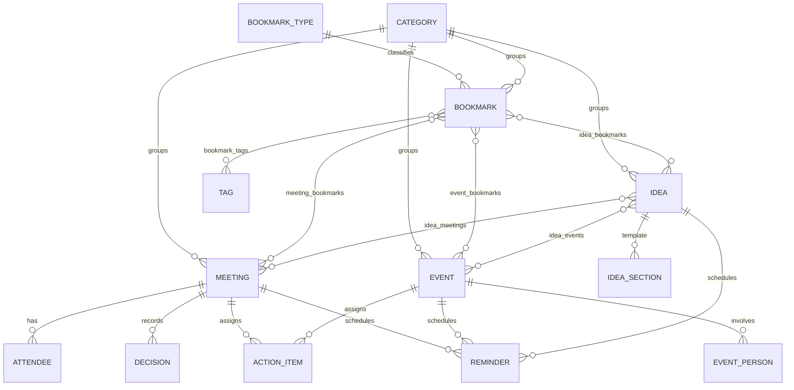

# 🧠 Knowledge & Resource OS — خطة العمل الموحّدة والكاملة (الإصدار 4.0)

**الغرض:** وثيقة بناء **مكتفية بذاتها** لتطبيق **المعرفة والموارد** (ويب + موبايل، عربي RTL، يعمل أوفلاين): التقط ← وضّح ← نظّم ← استخدم ← أرشف. يعمل **كقسم مستقل تمامًا**، ومرتبط ببقية أنظمتك (Learning، Projects OS، Home، Finance، Today) عبر **عقود API/Events فقط** — بلا جداول مشتركة ولا نسخ كيانات.

> **هذه الوثيقة تحلّ محلّ الملفين السابقين بالكامل** (Independent Build Spec v2.0 EN + وثيقة البناء المستقلة v3.0 AR). كل بند فيهما موجود هنا (انظر **مصفوفة التغطية في §20**)، مع حسم تعارضاتهما وسد فجواتهما. لا يُرسَل الملفان القديمان مع هذه الوثيقة لمنفّذ التطبيق كي لا تعود التعارضات.

**ما دخل في المراجعة:**
1. نظام **🧠 Knowledge & Resource OS** الحقيقي في Notion: **اثنتا عشرة قاعدة بيانات** (مجموعتان متوازيتان، انظر §1.4)، ودليل النظام كاملًا (الصيغ، طرق الإدخال، الحدود، ما اختُبر).
2. الملفان المرفوعان (EN v2.0 + AR v3.0).
3. السياق المحيط: قاعدة **المجالات** المشتركة مع Learning، وعلاقات المشاريع وجهات الاتصال والدورات من الأنظمة الأخرى.
4. خطط **Projects OS v4.0** و**Home OS v4.0** و**Learning OS v4.0** (لضمان توافق العقود).

**المرجع الأعلى عند التعارض:** هذه الوثيقة ← سلوك Notion الفعلي المجرَّب ← الملفان القديمان.

> **مفاتيح القراءة:** `KF-xx` ميزة محفوظة · `KC-xx` تعارض محسوم · `KG-xx` فجوة مسدودة · `KE-xx` تحسين مضاف · `KD-xx` قرار يحتاج تأكيدك · `KV-xx` قاعدة تحقق · `KA-xx` أتمتة · `KT-xx` اختبار قبول.

---

## 1) المراجعة الكاملة لنظام المعرفة في Notion

### 1.1 الفلسفة (محفوظة كما هي)
- **المجال = السياق الرئيسي** · **الرابط = المعرفة والمصادر** · **الفكرة = ما يمكن صنعه من المعرفة** · **الاجتماع = الأشخاص والقرارات** · **الفعالية = الفرص والأحداث** · **الدورة/الدرس = التعلّم** (يبقى في Learning).
- **Capture → Clarify → Organize → Use → Archive**: أي جديد يدخل Inbox، ثم تُحدَّد خطوته التالية، ثم يُنظَّم **بالقدر الضروري فقط**، ثم يتحول إلى فكرة/قرار/إجراء، ثم يُؤرشف ما انتهى.
- **قواعد الاستخدام المعتمدة:** لا Bookmark بلا سبب واضح · لا Category جديدة إن كان في الموجود ما يكفي · كل Idea نشطة لها **Next Action** · كل Meeting ينتهي بـ **Decisions + Action Items** عند وجودهما · كل Event له **تاريخ وحالة**.
- **قواعد التصميم:** أقل عدد من قواعد البيانات · اربط ولا تكرّر · الـ Dashboard اليومي بسيط · التعلم نفسه يبقى في Learning بينما **الموارد والأفكار الناتجة عنه تدخل هنا**.

### 1.2 ما الموجود فعليًا — **المجموعة العربية (الأغنى، هي العاملة فعليًا)**

| القاعدة | الحقول الفعلية | المشتق (صيغ/Rollups) |
|---|---|---|
| **🔖 الروابط والمصادر** | الاسم، الرابط، **النوع** (علاقة)، **التصنيف** (علاقة)، **المجال** (علاقة)، **الحالة** (🆕 جديد / 🧪 قيد التجربة / ⭐ أساسي / 📚 مرجع / ⏳ للمستقبل / 🗄️ مؤرشف)، **الأهمية** (⭐1–⭐5)، **آخر زيارة (تاريخ يدوي)**، دليل الاستخدام ("متى وإزاي؟")، **الوسوم (5 ثابتة: مجاني/مدفوع/عربي/English/للمراجعة)**، ملاحظات، تاريخ الإنشاء، 🧪 + علاقات: أفكار، اجتماعات، فعاليات | `أساسي؟`، `جديد هذا الأسبوع` (إنشاء ≤ 7 أيام) |
| **🏷️ أنواع الروابط** | الاسم، ملاحظات (13 نوعًا: Video, Article, Tool, Book, Course, App…) — **بلا لون** | إجمالي العناصر، العناصر الأساسية، الجديدة هذا الأسبوع، التصنيفات المرتبطة |
| **🗂️ التصنيفات** | الاسم، ملاحظات، **المجال** + علاقات: روابط، أفكار، اجتماعات، فعاليات — **بلا حقل نوع** | إجمالي الروابط/الأفكار/الاجتماعات/الفعاليات، الأفكار النشطة |
| **💡 خزنة الأفكار** | العنوان، **الحالة (8):** 💡 فكرة خام / 🔍 قيد التقييم / 🧠 قيد التطوير / 🚀 جاهزة / 🔨 قيد التنفيذ / ✅ مكتملة / ⏸️ متوقفة / 📦 مؤرشفة، **الأولوية** (عالية/متوسطة/منخفضة)، **التأثير** (عالٍ/متوسط/منخفض)، **الجهد** (قليل/متوسط/كبير)، **المخرج النهائي (11 نوعًا)**، **تاريخ مستهدف**، تاريخ الإنشاء/آخر تعديل، **قالب؟** + علاقات: المجال، التصنيف، الروابط، الاجتماعات، الفعاليات، **المشروع** (إلى Projects OS) — **بلا حقل Next Action** رغم القاعدة | `نشطة؟` (تقييم/تطوير/جاهزة/تنفيذ)، `في الصندوق؟` (فكرة خام)، **`نوع الفرصة`** (🔥 فرصة سريعة / 🏔️ مشروع كبير / 🚫 غير مجدية / ⚖️ عادية — بحسب التأثير والجهد)، أعداد المصادر/الاجتماعات/الفعاليات |
| **🤝 الاجتماعات** | الاسم، **التاريخ والوقت (مدى زمني واحد)**، **النوع (13):** فريق/أعمال/شريك/مستثمر/تطوير/تصميم/تسويق/عميل/تعلّم/إرشاد/مقابلة/تخطيط/مراجعة، **الحالة (5):** 📅 مجدول / 🔵 جارٍ / ✅ تم / ❌ ملغى / 🔄 أُعيد جدولته، الأهمية، **الحاضرون (نص)**، **الشركة (نص)**، **الأشخاص (علاقة بجهات اتصال Projects OS)**، المكان/الرابط، جدول الأعمال، **القرارات (نص)**، **المهام المطلوبة (نص)**، **تاريخ المتابعة**، قالب؟ + علاقات: المجال، التصنيف، الفكرة، **المشروع**، الروابط | `قادم؟` (التاريخ لم يمر والحالة ليست ملغاة)، `متابعة معلّقة` (تم + تاريخ متابعة لم يمر) |
| **🎟️ الفعاليات** | الاسم، **التاريخ والوقت**، **النوع (12):** مؤتمر/ورشة/ويبينار/إطلاق/مسابقة/هاكاثون/Networking/ندوة/فعالية توظيف/بث مباشر/Demo Day/تدريب، **الحالة (6):** 🆕 مهتم / 📝 مسجّل / 🎟️ سأحضر / ✔️ حضرت / ❌ فاتتني / 🚫 ملغاة، الأهمية، الجهة المنظمة، المكان، الرابط أونلاين، **التسجيل مطلوب؟**، رابط التسجيل، **التكلفة (رقم)**، **تنبيه (تاريخ)**، **النتيجة**، ملاحظات + علاقات: **الأشخاص**، المجال، التصنيف، الفكرة، **المشروع**، **الدورة (من Learning)**، الروابط | `قادمة؟` |

### 1.3 ما الذي يشرحه الدليل (محفوظ)
المجال هو المحور (وهو **نفس قاعدة المجالات في Learning**) · علاقات ثنائية الاتجاه بين كل الأنواع · الإدخال: رابط (اسم+رابط+نوع+تصنيف يكفي) / فكرة (نسخ القالب ثم إزالة "قالب؟") / اجتماع (نسخ قالب ثم "تم" + قرارات + تاريخ متابعة ⇒ يظهر في "🔔 متابعات معلّقة") / فعالية (بعد الحضور تُكتب النتيجة) · **ما اختُبر:** اجتماع مجدول ⇒ `قادم؟ = 1` (والقالب لا يُحتسب)، والعلاقات تعمل في الاتجاهين.

### 1.4 اكتشافات مهمة من المراجعة (خارج الملفين)
1. **يوجد في Notion مجموعتان متوازيتان لنفس الأنظمة الستة:** مجموعة **إنجليزية مبسّطة** (Bookmarks, Bookmark Types, Categories, Ideas, Meetings, Events: بحالات أقل وبلا علاقات بالمجال/المشروع/الأشخاص/الدورة) ومجموعة **عربية غنية** (المذكورة أعلاه). هذا هو ما تسميه المواصفة "التنفيذ الحالي المبسّط" مقابل "التصميم الكامل". المجموعة المبسّطة: روابط (حالات Inbox/Reading/Reference/Archived + وسوم ثابتة)، أفكار (Inbox/Exploring/Active/Parked/Done + نوع من 6)، اجتماعات (Planned/Completed/Cancelled + نصوص للأشخاص والمجال)، فعاليات (Upcoming/Attended/Cancelled + أنواع 5)، تصنيفات (**بحقل نوع** Area/Topic/Skill/Project/Personal). **ازدواج يجب إنهاؤه** (KC-01).
2. **حقل `التصنيفات.النوع` (Area/Topic/Skill/Project/Personal) غير موجود في المجموعة العربية** وموجود في المبسّطة والمواصفة، وقيمه تكرّر كيانات تملكها أنظمة أخرى (المجال، المهارة في Learning، المشروع في Projects OS) (KC-07).
3. **`آخر زيارة` يدوية** في Notion بينما المواصفة تجعلها بيانات نظام تُحدَّث عند فتح الرابط (KC-05).
4. **الأفكار بلا `Next Action`** في المجموعة العربية رغم أن قاعدة النظام تقول إنه إلزامي للنشطة (وهو موجود في المبسّطة والمواصفة) (KC-12).
5. **علاقة `المشروع` موجودة فعلًا الآن** في الأفكار والاجتماعات والفعاليات (إلى Projects OS)، بينما الدليل يقول إنه لم يجد قاعدة مشاريع وقت كتابته (تقادم الدليل).
6. **علاقة `الأشخاص` في الاجتماعات والفعاليات تشير إلى جهات الاتصال في Projects OS** (مع حقول نصية موازية: الحاضرون/الشركة) — ازدواج ونقطة اعتماد على نظام آخر (KC-17، KC-49).
7. **التقويم الموحّد غير ممكن في Notion** (View واحد لقاعدة واحدة)؛ استُعيض بثلاثة تقويمات منفصلة، والتنبيهات **تُضبط يدويًا** لكل صف.
8. **تعارض مع خطتي السابقة لـ Projects OS:** كنت قد أضفت كيان اجتماعات داخل Projects OS (D-02)؛ المواصفة هنا تنص على أن **Knowledge يملك الاجتماعات** (بحقل `project_id`)، فعُدِّلت خطة Projects OS لتستهلكها بدل أن تملكها (KC-23).
9. **أخطاء/حدود يعترف بها الدليل:** تصنيفات بلا مجال (AI, Content Creation, Video Editing, Graphic Design, Finance, Productivity, Business, Education, Fitness) · القوالب نسخ لا Database Templates · بيانات 🧪 (فكرة Koumma Travel Mode، مقال Airbnb، اجتماع مطوّر Flutter، مؤتمر TravelTech).
10. **ما لم أفتحه:** كود الصيغ نفسه (اعتمدت على شرحه في الدليل)، وقاعدة **Bookmark Types** الإنجليزية (اعتمدت على المواصفة: الاسم، الوصف، اللون).

### 1.5 حكم على كل عنصر

| العنصر | الحكم | القرار |
|---|---|---|
| مجموعتان متوازيتان | **توحيد** | كيان واحد لكل مفهوم؛ العربية هي الأساس والمبسّطة تُرحَّل وتُحذف |
| الروابط بحالاتها الست | **اعتماد** | + Inbox مشتق + فتح تلقائي لـ `last_visited_at` + منع تكرار URL |
| الوسوم الثابتة | **استبدال** | كيان وسوم M:N قابل للتخصيص (الخمسة قيم أولية) |
| أنواع الروابط (13) | **اعتماد** | + لون (من المواصفة) |
| التصنيفات | **اعتماد + استعادة النوع** | + محاذاة اختيارية بمراجع بدل التكرار |
| الأفكار بثماني حالات | **اعتماد** | + Next Action + قواعد انتقال + لوحة Kanban + مصفوفة الفرص |
| `نوع الفرصة` | **اعتماد** | صيغة موثَّقة (§6.3) |
| الاجتماعات: نصوص للقرارات/المهام | **تفكيك** | صفوف مهيكلة + تحويل المهام لـ Projects |
| المتابعة المعلّقة | **اعتماد + إغلاق صريح** | `followed_up_at` |
| الفعاليات: حالات الحضور الست | **اعتماد** | + حالة زمنية مشتقة منفصلة |
| التقويم الموحّد | **خدمة** | تجميع حي بلا نسخ + سجل مصادر + ICS |
| Hub | **خدمة** | استعلامات حية |
| 🧪 مثال؟ / قالب؟ | **استبدال** | وضع Demo + قوالب حقيقية |

---

## 2) جرد ميزات النظام الحالي (كلها محفوظة)

| ID | الميزة | أين تتحقق |
|---|---|---|
| KF-01 | دورة Capture → Clarify → Organize → Use → Archive | §10، §9.1 |
| KF-02 | الالتقاط السريع (رابط/فكرة/اجتماع/فعالية/تصنيف) | §10.3 |
| KF-03 | الروابط: نوع، تصنيف، مجال، حالة (6)، أهمية، آخر زيارة، دليل استخدام، وسوم، ملاحظات | §5.4 |
| KF-04 | 13 نوع رابط + إجمالي/أساسي/جديد هذا الأسبوع | §5.1، §6.2 |
| KF-05 | التصنيفات تجمع كل ما يخصها (روابط/أفكار/اجتماعات/فعاليات) + ربط بالمجال | §5.2، §6.7 |
| KF-06 | خزنة الأفكار: 8 حالات، أولوية/تأثير/جهد، مخرج نهائي، تاريخ مستهدف، قالب 10 أقسام | §5.5 |
| KF-07 | نوع الفرصة (سريعة/مشروع كبير/غير مجدية/عادية) | §6.3 |
| KF-08 | تعريف "نشطة" و"في الصندوق" للفكرة | §6.3 |
| KF-09 | الاجتماعات: نوع (13)، حالة (5)، حاضرون، جدول أعمال، قرارات، مهام، تاريخ متابعة | §5.6 |
| KF-10 | "متابعات معلّقة" | §6.4 |
| KF-11 | الفعاليات: نوع (12)، حالات الحضور، تسجيل، تكلفة، تنبيه، نتيجة | §5.7 |
| KF-12 | "قادم؟" للاجتماعات والفعاليات (والقالب لا يُحتسب) | §6.4، §6.5 |
| KF-13 | علاقات ثنائية الاتجاه بين كل الأنواع | §5.9 |
| KF-14 | المجال كمحور مشترك مع Learning | §15.1 |
| KF-15 | القواعد الخمس للاستخدام | §9.2، §12 |
| KF-16 | Hub: أعداد حية | §6.6 |
| KF-17 | التقويم: اجتماعات + فعاليات + دراسة (+ مواعيد المشاريع والأفكار) | §6.9 |
| KF-18 | علاقة الأفكار/الاجتماعات/الفعاليات بالمشروع | §15.3 |
| KF-19 | علاقة الاجتماعات/الفعاليات بالأشخاص | §5.6، §15.3 |
| KF-20 | ربط الفعالية بدورة من Learning | §5.7، §15.2 |
| KF-21 | سيناريوهات الاختبار (اجتماع مجدول ⇒ قادم، القالب مستثنى، علاقات الاتجاهين) | §11.4، §18 |

---

## 3) المبادئ والحدود بين الأقسام

### 3.1 الاستقلال
Knowledge OS تطبيق **قائم بذاته**: قاعدة بياناته وخدماته وواجهاته منفصلة، ويعمل كاملًا (التقاط، تنظيم، أفكار، اجتماعات، فعاليات، Hub، تقويم، بحث، تذكيرات) **حتى لو غابت كل الأنظمة الأخرى**. الربط اختياري ومُحسِّن.

### 3.2 من يملك ماذا
| الكيان / الحقيقة | المالك | Knowledge يفعل ماذا |
|---|---|---|
| Bookmark Types, Categories, Tags, Bookmarks, **Ideas, Meetings (+attendees/decisions/action items), Events**, التذكيرات | **Knowledge** | يملكها بالكامل |
| المجالات (Areas) | **Learning** | `area_ref` للقراءة والاختيار؛ بدونه تُستخدم Categories كتصنيف (§3.3) |
| المشاريع، المهام، قرارات المشروع، جهات الاتصال | **Projects OS** | `project_ref` و`contact_ref`؛ تحويل Action Items والقرارات بإجراء صريح |
| الدورات والجلسات | **Learning** | `course_ref` على الفعالية؛ يقرأ `calendar-items` |
| الدفتر المالي | **Finance** | يطلب معاملة لتكلفة فعالية (اختياري) |
| Knowledge Hub، Unified Calendar، Inbox، Search | **لا أحد (خدمات استعلام)** | ليست جداول ولا تخزّن نسخًا |
| الهوية والإشعارات والملفات والبحث العام والأحداث | **Core** | يستهلكها |

### 3.3 مصفوفة التدهور (عند غياب نظام مرتبط)
| الغائب | سلوك Knowledge |
|---|---|
| **Learning** (المجال/الدورة) | حقل `area_ref` يُخفى؛ يُستعمل **Category من نوع Area/Topic** كتصنيف رئيسي؛ لا `course_ref`؛ لا مصدر "دراسة" في التقويم |
| **Projects OS** | `project_ref`/`contact_ref` مخفيان؛ المشاركون نصوص حرة؛ لا تحويل Action Items إلى مهام (تبقى ضمن Knowledge كقائمة "ما أدين به") |
| **Finance** | تكلفة الفعالية رقم محلي فقط |
| **Today** | لا Feed خارجي؛ Home الخاصة بـ Knowledge تكفي |
| **Core (إشعارات)** | تذكيرات داخل التطبيق فقط |

### 3.4 المبادئ الحاكمة (ملزمة)
1. **كيان واحد لكل مفهوم** (لا مجموعتين متوازيتين، لا نسخة تقويم).
2. **Hub والتقويم الموحّد والـ Inbox والبحث ليست جداول**؛ تُحسب حيًا ولا تُخزَّن كحقيقة.
3. **المشتق لا يُعدَّل يدويًا** ولا عدّادات يدوية.
4. قواعد العمل في **Domain/Service layer**، لا في الواجهة فقط.
5. أي عملية قابلة للإعادة **Idempotent** (فتح رابط، تذكير، تحويل، استيراد، تجميع).
6. كل شاشة: **Loading / Empty / Error / Success** (+ Offline للموبايل).
7. كل تاريخ/موعد يحترم **Timezone** (مع تخزين UTC + منطقة العنصر).
8. **لا Workaround من Notion**: لا نسخ قوالب يدوي، لا تنبيه يدوي، لا تقويمات منفصلة، لا 🧪.
9. أي تكامل بـ **`source_id/ref` ثابت** ويمنع التكرار.
10. **Soft delete + Archive**؛ المؤرشف لا يظهر في الـ Views الافتراضية ولا في التجميعات الجارية.
11. **سجل نشاط (Audit)** للحالات الحرجة: انتقال حالة فكرة، تحويل لمشروع، حذف/دمج روابط، إغلاق اجتماع.
12. **لا نسخ لكيانات مملوكة لأنظمة أخرى**: Project وCourse وContact وArea مراجع فقط.

### 3.5 الملكية والخصوصية
Knowledge **شخصي** (`user_id`): لا مشاركة افتراضيًا. مشاركة قراءة لمجموعة (تصنيف) مؤجلة (KD-09).

---
## 4) النموذج المفاهيمي

```text
                    ┌────────────── خدمات استعلام (ليست جداول) ──────────────┐
                    │  Inbox  ·  Knowledge Hub  ·  Unified Calendar  ·  Search │
                    └───────────────────────────┬─────────────────────────────┘
                                                │ تقرأ حيًا
  BookmarkType ──< Bookmark >──< Tag             │
                       │ M:N                     │
                       ├──────────< Idea >───────┤──(project_refs)──> Projects OS
                       ├──────────< Meeting >────┤──(project_ref, contact_refs)──> Projects OS
                       └──────────< Event >──────┘──(course_ref)──> Learning
  Category ──< (Bookmark | Idea | Meeting | Event)          Category ─(area_ref)─> Learning Area
  Meeting ──< Attendee · Decision · ActionItem        Event ──< Person · ActionItem
  (Meeting|Event|Idea|Follow-up|Registration) ──< Reminder  ──> Core Notifications
```
**مسار التصعيد:** `Bookmark (New) → Clarify (نوع/سبب) → Organize (تصنيف/وسوم) → Use (فكرة/قرار/إجراء) → Archive`، و`Idea → Project` بإجراء صريح فقط.

---

## 5) نموذج البيانات الكامل

### 5.0 الحقول العامة (كل كيان)
`id` UUID ثابت · `user_id` NOT NULL (الملكية) · `created_at` · `updated_at` · `deleted_at` (Soft Delete) · `archived_at` (حيث ينطبق) · `version` (تزامن متفائل) · `external_refs`. القيم المشتقة لا تُخزَّن كحقول قابلة للتعديل.

### 5.1 أنواع الروابط `knowledge_bookmark_types`
| الحقل | النوع | إلزامي | ملاحظات |
|---|---|:-:|---|
| name | string | نعم | `UNIQUE(user_id, lower(name))` |
| description | text | لا | |
| color | enum | لا | Blue · Green · Yellow · Red · Purple · Gray |
| icon | string | لا | |
| sort_order | numeric | نظام | |

**القيم الأولية (13، كـ instances لا سلاسل ثابتة):** Video · Article · Tool · Browser Extension · Template · Book · Course · App · Research · Website · Podcast · Report · Documentation.
**مشتق:** `total_items`, `essential_items`, `new_this_week`, `categories` (التصنيفات التي ظهر فيها).
**علاقة:** Type 1:N Bookmarks. حذف نوع مستخدم ⇒ ممنوع (أرشفة أو إعادة تعيين) (KV-12).

### 5.2 التصنيفات `knowledge_categories`
| الحقل | النوع | إلزامي | ملاحظات |
|---|---|:-:|---|
| name | string | نعم | فريد (غير حساس لحالة الأحرف، بين غير المؤرشف) |
| description | text | لا | |
| type | enum | نعم (Topic) | `Area` · `Topic` · `Skill` · `Project` · `Personal` — **تسمية تصنيفية** |
| area_ref | external | لا | المجال (من Learning)؛ فارغ ⇒ التصنيف بلا مجال (تنبيه في الواجهة) |
| aligned_ref | external | لا | محاذاة اختيارية: لنوع Skill ⇒ مهارة Learning، ولنوع Project ⇒ مشروع Projects OS — **مرجع فقط، لا نسخ** |
| notes | text | لا | |
| color | string | لا | |

**قاعدة:** تصنيف من نوع Project هو **تصنيف فقط وليس سجل مشروع** (المواصفة).
**مشتق (لا عدّادات يدوية):** `bookmarks_total`, `ideas_total`, `ideas_active`, `meetings_total`, `events_total`.
**علاقات:** Category 1:N لكل من Bookmarks/Ideas/Meetings/Events (تصنيف واحد لكل عنصر).

### 5.3 الوسوم `knowledge_tags`
`name` (فريد غير حساس لحالة الأحرف)، `color`. **القيم الأولية الخمس من Notion:** مجاني · مدفوع · عربي · English · للمراجعة. العلاقة بالروابط عبر `bookmark_tags` (M:N). (الوسوم للروابط كما في المواصفة؛ تعميمها على الأفكار تحسين اختياري.)

### 5.4 الروابط `knowledge_bookmarks`
| الحقل | النوع | إلزامي | ملاحظات |
|---|---|:-:|---|
| name | string | نعم | يُملأ تلقائيًا من عنوان الصفحة عند الالتقاط (KE-01) ويمكن تعديله |
| url | URL | **نعم** | كما أُدخل |
| url_normalized | string | نظام | للتحقق من التكرار (§6.1)؛ فهرس غير فريد + **تحذير تكرار** |
| domain | string | نظام | |
| description | text | لا | ما هو الرابط |
| type_id | FK | **عند الخروج من `New`** | اختياري لحظة الالتقاط، **إلزامي** عند أي حالة غير New (KC-02) |
| category_id | FK | لا | |
| area_ref | external | لا | المجال الفعلي = `area_ref` وإلا مجال التصنيف (§6.2) |
| status | enum | نعم (New) | `New` · `Testing` · `Essential` · `Reference` · `Future` · `Archived` |
| importance | smallint 1..5 | لا | (⭐1–⭐5) |
| last_visited_at | timestamp | نظام | **يُحدَّث عند فتح الرابط من التطبيق** (لا نموذج تحرير) |
| visit_count | integer | نظام | |
| usage_guide | text | لا | "متى وكيف أستخدمه؟" |
| notes | text | لا | ملاحظات شخصية |
| source | enum | نظام | manual · share · extension · import |
| snoozed_until | date | لا | تأجيل الفرز في Inbox |
| status_before_archive | enum | نظام | للاستعادة |
| learning_course_ref | external | لا | إن أُنشئت دورة Learning من هذا الرابط (KE-14) |
| archived_at | ts | | Archived ⇔ `archived_at` موجود |

**علاقات:** `bookmark_tags` · `idea_bookmarks` · `meeting_bookmarks` · `event_bookmarks` (M:N).
**مشتق:** `is_new_this_week`, `is_essential`, `in_inbox`, `effective_area`, `is_duplicate`, `stale_testing`, `days_since_visit`.
**سلوك:** فتح الرابط داخل التطبيق ⇒ `GET /knowledge/bookmarks/:id/open` يسجّل الزيارة ويعيد الرابط (idempotent خلال نافذة قصيرة). الأرشفة تُخرجه من الـ Views الافتراضية.

### 5.5 الأفكار `knowledge_ideas`
| الحقل | النوع | إلزامي | ملاحظات |
|---|---|:-:|---|
| title | string | نعم | |
| description | text | لا | ملخص قصير (وتفاصيله في الأقسام العشرة) |
| status | enum | نعم (Raw Idea) | `Raw Idea` · `Evaluating` · `Developing` · `Ready` · `In Progress` · `Completed` · `Paused` · `Archived` |
| priority | enum | لا | High · Medium · Low |
| impact | enum | لا | High · Medium · Low |
| effort | enum | لا | Small (قليل) · Medium · Large (كبير) |
| area_ref | external | لا | |
| category_id | FK | لا | |
| target_date | date | لا | يظهر في التقويم |
| next_action | text | **للنشطة (§9.2)** | الخطوة التالية |
| next_action_date | date | لا | موعد الخطوة؛ يظهر في التقويم والتذكيرات |
| final_output_type | lookup | لا | 🎥 فيديو · 📱 تطبيق · 💻 برنامج · 📚 دورة · 📄 مقال · 💼 مشروع تجاري · 📊 بحث · 📣 حملة · 🧪 تجربة · 🛠️ أداة · 📋 خطة |
| final_output_url / final_output_file_id / final_output_ref | URL / file / ref | لا | المخرج الفعلي (رابط أو ملف أو مرجع لمخرج مشروع) |
| project_refs | external[] (`idea_project_refs`) | لا | مشروع/مشاريع Projects OS؛ **لا يُنشأ Project داخل Knowledge** |
| origin_ref | external | لا | مصدر الفكرة (مثل رابط التُقطت منه) |
| paused_reason | text | لا | |
| status_changed_at | ts | نظام | |
| completed_at | ts | نظام | |

**الأقسام (قالب الفكرة — 10 أقسام)** عبر `idea_sections(idea_id, key, content, position)`: `idea` (الفكرة) · `problem` (المشكلة) · `solution` (الحل) · `audience` (الجمهور) · `expected_result` (النتيجة المطلوبة) · `resources` (الموارد) · `references` (المراجع) · `implementation` (التنفيذ) · `risks` (المخاطر) · `decision` (القرار). (حقلا "الخطوة التالية" و"المخرج" **حقول مهيكلة** لا أقسام.)
**علاقات:** `idea_bookmarks` · `idea_meetings` · `idea_events` (M:N).
**مشتق:** `is_active`, `in_inbox`, `opportunity_type`, `bookmarks_count`, `meetings_count`, `events_count`, `days_in_status`, `stale`.
**سجل الحالات:** `idea_status_history(idea_id, from, to, at, by)` (Audit).

### 5.6 الاجتماعات `knowledge_meetings`
| الحقل | النوع | إلزامي | ملاحظات |
|---|---|:-:|---|
| name | string | نعم | |
| type | lookup | لا | 👥 فريق · 💼 أعمال · 🤝 شريك · 💰 مستثمر · 🧑‍💻 تطوير · 🎨 تصميم · 📈 تسويق · 📞 عميل · 🎓 تعلّم · 🧠 إرشاد · 👨‍💼 مقابلة · 📋 تخطيط · 🔍 مراجعة (+ أنواع الطقوس: Standup · Weekly Sync · Sprint Planning · Post-mortem · Ad Hoc) |
| status | enum | نعم (Scheduled) | `Scheduled` · `In Progress` · `Completed` · `Cancelled` · `Rescheduled` |
| starts_at | timestamp (UTC) | نعم | بدل "date + start_time" |
| ends_at | timestamp | لا | `ends_at ≥ starts_at` |
| all_day | bool | لا | |
| timezone | IANA | نعم | منطقة الاجتماع (ثابتة وقت الإنشاء؛ §16) |
| location | string | لا | مكان |
| meeting_url | URL | لا | رابط الانضمام |
| importance | smallint 1..5 | لا | |
| company | string | لا | الجهة |
| area_ref / category_id | external / FK | لا | |
| project_ref | external | لا | مشروع في Projects OS |
| agenda | rich text | لا | |
| notes | rich text | لا | |
| follow_up_date | date | لا | يُنشئ تذكيرًا حقيقيًا |
| follow_up_note | text | لا | |
| followed_up_at | ts | لا | **إغلاق المتابعة** |
| no_decisions_confirmed / no_actions_confirmed | bool | لا | تأكيد "لا قرارات/لا إجراءات" عند الإكمال |
| rescheduled_from_id | FK self | لا | عند إعادة الجدولة |
| template_id | FK | لا | |

**جداول فرعية:**
- **`meeting_attendees`:** `meeting_id`, `kind` (contact · member · external), `contact_ref` (Projects OS)، `member_ref`، `display_name` **إلزامي**، `company`, `role`, `attended` (nullable). (يغني عن حقلي "الحاضرون" و"الأشخاص" المنفصلين في Notion.)
- **`meeting_decisions`:** `meeting_id`, `text`, `rationale`, `decided_by_attendee_id`, `position`, `project_decision_ref` (بعد "سجّل كقرار مشروع").
- **`knowledge_action_items`** (مشتركة مع الفعاليات، §5.8).
**علاقات:** `meeting_bookmarks` · `idea_meetings` (M:N).
**مشتق:** `is_upcoming`, `is_in_progress`, `follow_up_state`, `duration_minutes`, `open_action_items`.

### 5.7 الفعاليات `knowledge_events`
| الحقل | النوع | إلزامي | ملاحظات |
|---|---|:-:|---|
| name | string | نعم | |
| type | lookup | نعم | 🎤 Conference · 🧑‍🏫 Workshop · 💻 Webinar · 🚀 Launch · 🏆 Competition · 💻 Hackathon · 🤝 Networking · 🎓 Seminar · 💼 Career Event · 📢 Livestream · 🧪 Demo Day · 📚 Training (+ Other) |
| status | enum | نعم (Interested) | `Interested` (مهتم) · `Registered` (مسجّل) · `Will Attend` (سأحضر) · `Attended` (حضرت) · `Missed` (فاتتني) · `Cancelled` (ملغاة) |
| starts_at / ends_at / all_day / timezone | | | كما في الاجتماعات |
| format | enum | لا | In-person · Online · Hybrid |
| location | string | لا | |
| online_url | URL | لا | |
| organizer | string | لا | |
| importance | smallint 1..5 | لا | |
| registration_required | bool | لا | |
| registration_url | URL | لا | |
| registration_deadline | date | لا | يُنشئ تذكيرًا (KG-15) |
| cost_amount / cost_currency | money | لا | + `cost_paid` bool |
| area_ref / category_id | external / FK | لا | |
| course_ref | external | لا | دورة في Learning |
| project_refs | external[] | لا | |
| outcome | rich text | لا | "ما الذي خرجت به؟" |
| notes | text | لا | |

**جداول فرعية:** `event_people(event_id, kind, contact_ref, display_name, role[speaker|attendee|contact])` · `knowledge_action_items`.
**علاقات:** `event_bookmarks` · `idea_events` (M:N).
**مشتق:** `time_state` (Upcoming/Happening/Past)، `is_upcoming`, `needs_registration_setup`, `needs_outcome`.
**قاعدة المواصفة:** `registration_required = true` بلا `registration_url` ⇒ **تحذير/حالة إعداد** (لا منع).

### 5.8 الإجراءات والتذكيرات
**`knowledge_action_items`** (مشتركة): `parent_type` (meeting · event), `parent_id`, `text` **إلزامي**, `owner_attendee_id`/`owner_name`, `due_date`, `status` (`Open` · `Done` · `Cancelled`), `done_at`, `converted_ref` (`{system:'projects', type:'task', id}`)، `position`. تحويلها إلى مهام Projects OS إجراء صريح (§15.3).
**`knowledge_reminders`** — **جداول إشعار حقيقية** (لا حقول تاريخ مطلوب ضبطها يدويًا):
`parent_type` (meeting · event · idea · bookmark), `parent_id`, `kind` (before_start · absolute · follow_up · registration_deadline · next_action · inbox_attention), `offset_minutes` / `remind_at` (UTC)، `channel`, `status` (pending · sent · cancelled), `dedupe_key` (**فريد**).
**الافتراضات:** اجتماع: قبل 15 دقيقة · فعالية: قبل يوم وقبل ساعة · متابعة: 09:00 يوم التاريخ · موعد التسجيل: قبل يومين · الخطوة التالية: 09:00 يوم `next_action_date` (قابلة للتخصيص).
**قاعدة:** أي تغيير في الموعد/الحالة يُعيد توليد التذكيرات (idempotent) ويلغي ما لم يعد صالحًا.

### 5.9 خريطة العلاقات (حقيقية — ليست حقولًا نصية)
```text
Bookmark ↔ Type (N:1)        Bookmark ↔ Category (N:1)     Bookmark ↔ Area (ref)
Bookmark ↔ Tag (M:N)         Bookmark ↔ Idea / Meeting / Event (M:N)
Idea ↔ Area (ref) · Category (N:1) · Bookmark (M:N) · Meeting (M:N) · Event (M:N) · Project (refs)
Meeting ↔ Area (ref) · Category (N:1) · Idea (M:N) · Bookmark (M:N) · Project (ref) · Attendees (1:N)
Event ↔ Area (ref) · Category (N:1) · Idea (M:N) · Bookmark (M:N) · Course (ref) · Project (refs) · People (1:N)
Category ↔ Area (ref optional)
```
كل علاقة **ثنائية الاتجاه** (جداول وسيطة `idea_bookmarks`, `meeting_bookmarks`, `event_bookmarks`, `idea_meetings`, `idea_events`, `bookmark_tags`, `idea_project_refs`، تُنشأ/تُحذف من أي طرف دون كسر الآخر).
**تعديل علاقة لا يمس السجلات المتصلة** (KT-122): الحذف الناعم لأحد الأطراف يُسقط الوصلة فقط.

### 5.10 القوائم والإعدادات
**`lookup_values`:** `meeting_type`, `event_type`, `idea_output_type`, `event_format`… (قابلة للتخصيص: `label_ar/label_en/color/position/is_active`) — **المنطق** (الحالات والفئات) ثابت و**الأسماء والألوان** مرنة.
**`knowledge_settings`:** `timezone` · `week_start_day` · `new_window_days=7` · `inbox_stale_days=14` · `testing_stale_days=30` · `evaluating_stale_days=30` · تذكيرات افتراضية · `calendar_sources{knowledge, learning, projects, home}` · `duplicate_policy` (warn) · `dead_link_check=false` · `hub_widgets`.
### 5.11 العروض المحفوظة `knowledge_saved_views`
`entity`, `name`, `filters` (JSON)، `sort`, `group_by`, `shared=false` — تحل "المرشّحات اليدوية" في Notion. **العرض ليس مصدر حقيقة.**

### 5.12 خدمات الاستعلام (ليست جداول — ممنوع تخزينها)
**Inbox** · **Knowledge Hub** · **Unified Calendar** · **Search**. لا `knowledge_hub` ولا `calendar_items` في قاعدة البيانات.
شكل **`CalendarItem`** (يُعاد من الخدمة فقط):
```json
{ "source_module": "knowledge|learning|projects|home",
  "source_entity": "meeting|event|idea_target|follow_up|next_action|registration_deadline|lesson_session|course_deadline|project_deadline|...",
  "source_id": "<uuid>", "title": "…",
  "start": "2026-10-04T09:00:00Z", "end": "…", "all_day": false, "timezone": "Africa/Cairo",
  "status": "…", "color": "…", "area_ref": "…",
  "deep_link": "app://knowledge/meetings/<id>",
  "primary_action": { "type": "open|join|register|log_session", "label": "…", "url": "…" } }
```

### 5.13 خريطة العلاقات (ERD)


---
## 6) محرك الحسابات والدوال

> كل ما في هذا الفصل **مشتق** ويُحسب حيًا في Domain/Service، ولا يُعدَّل يدويًا. `now/today` بتوقيت المستخدم. الحسابات على **تواريخ تقويمية** وأوقات UTC المحوَّلة.

### 6.1 تطبيع الروابط وكشف التكرار
```text
normalize(url):
  1) trim + حروف النطاق صغيرة + حذف المنفذ الافتراضي (80/443)
  2) http ≡ https، وحذف البادئة www.
  3) حذف الـ fragment (#…) وحذف معاملات التتبع (utm_*, fbclid, gclid, igshid, mc_cid, ref…) — قائمة قابلة للتخصيص
  4) ترتيب بقية معاملات الاستعلام أبجديًا، وحذف "/" الأخيرة (ما عدا الجذر)
  5) توحيد صيغ شائعة (مثل youtu.be/ID ⇒ youtube.com/watch?v=ID)
duplicate(b) = يوجد رابط آخر غير محذوف بنفس url_normalized (بما فيه المؤرشف)
```
**السلوك (`duplicate_policy = warn`):** عند الحفظ يُعرض "موجود مسبقًا" مع: افتح الموجود / استعده إن كان مؤرشفًا / أضف على أي حال / ادمج. لا منع صلب.

### 6.2 الروابط (KF-03, KF-04)
```text
is_new_this_week = (today − date(created_at)) ≤ new_window_days (7)          ← "جديد هذا الأسبوع"
is_essential     = status = Essential                                          ← "أساسي؟"
in_inbox         = status = New AND archived_at = null AND (snoozed_until = null OR snoozed_until ≤ today)
effective_area   = area_ref ?? category.area_ref
area_conflict    = area_ref ≠ null AND category.area_ref ≠ null AND area_ref ≠ category.area_ref   (تحذير فقط)
stale_testing    = status = Testing AND (today − date(status_changed_at)) > testing_stale_days (30)
days_since_visit = last_visited_at ? today − date(last_visited_at) : null
```
**`last_visited_at`:** يُحدَّث **فقط** عبر `open` من التطبيق (idempotent: فتحان خلال دقيقة = زيارة واحدة) ويزيد `visit_count`. لا حقل تحرير.

### 6.3 الأفكار (KF-06, KF-07, KF-08)
```text
is_active  = status ∈ {Evaluating, Developing, Ready, In Progress}                  ← "نشطة؟"
in_inbox   = status = Raw Idea                                                       ← "في الصندوق؟"
stale      = (status ∈ {Evaluating, Developing} AND days_in_status > evaluating_stale_days)
             OR (status = Raw Idea AND days_in_status > inbox_stale_days)
```
**نوع الفرصة `opportunity_type`** (مصفوفة 3×3؛ الصيغة الأصلية في Notion بحسب التأثير والجهد وغير قابلة للقراءة، فهذه المصفوفة افتراضية **قابلة للضبط** — KD-14):
| التأثير \ الجهد | Small | Medium | Large |
|---|---|---|---|
| **High** | 🔥 Quick Win (فرصة سريعة) | ⚖️ Normal (عادية) | 🏔️ Big Project (مشروع كبير) |
| **Medium** | 🔥 Quick Win | ⚖️ Normal | ⚖️ Normal |
| **Low** | ⚖️ Normal | 🚫 Not Worth It (غير مجدية) | 🚫 Not Worth It |
> أيٌّ من التأثير/الجهد فارغ ⇒ `Unscored` (لا تصنيف مفترض).

**الأعداد:** `bookmarks_count`, `meetings_count`, `events_count` استعلامات حية (لا حقول مخزَّنة).

### 6.4 الاجتماعات (KF-09, KF-10, KF-12)
```text
is_upcoming     = starts_at ≥ now AND status = Scheduled          ← "قادم؟" (Cancelled/Rescheduled/Completed مستثناة)
is_in_progress  = starts_at ≤ now ≤ coalesce(ends_at, starts_at + 60 دقيقة) AND status ∈ {Scheduled, In Progress}
follow_up_state (لاجتماع Completed فقط):
    لا follow_up_date            → None
    followed_up_at موجود         → Done
    follow_up_date ≥ today       → Pending      ← "متابعة معلّقة"
    follow_up_date <  today      → Overdue      ← (جديد: لا تختفي بصمت بعد فوات التاريخ)
open_action_items = count(action_items WHERE status = Open)
suggest_complete  = status = Scheduled AND ends_at < now − 30 دقيقة   (اقتراح فقط)
```
**القوالب لا تُحتسب أبدًا** لأنها كيانات `knowledge_templates` وليست صفوف اجتماعات (حل لعلامة "قالب؟" — KC-47).

### 6.5 الفعاليات (KF-11, KF-12)
```text
time_state     = now < starts_at → Upcoming
               | starts_at ≤ now ≤ coalesce(ends_at, starts_at + 3 ساعات) → Happening
               | غير ذلك → Past          (الفعالية طوال اليوم تُقاس بتاريخها المحلي)
is_upcoming    = starts_at ≥ now AND status ∉ {Cancelled, Missed, Attended}               ← "قادمة؟"
needs_registration_setup  = registration_required AND registration_url = null AND status ∈ {Interested, Registered, Will Attend}
registration_deadline_soon = registration_required AND status = Interested AND registration_deadline ≤ today + 7
suggest_missed = time_state = Past AND status ∈ {Registered, Will Attend}                 (اقتراح "فاتتني؟" لا تغيير تلقائي)
needs_outcome  = status = Attended AND outcome فارغ AND ends_at < now − 24 ساعة
```

### 6.6 Knowledge Hub — **خدمة حية** (KF-16)
اتحاد العدّادات المذكورة في الملفين:
| القسم | المؤشرات |
|---|---|
| **Resources** | الإجمالي (غير المؤرشف) · الأساسية · الجديدة هذا الأسبوع · في الـ Inbox · قيد التجربة · الراكدة |
| **Ideas** | في الصندوق · قيد التقييم · قيد التطوير · جاهزة · قيد التنفيذ · النشطة (مجموع) · فرص سريعة · راكدة |
| **Meetings** | اليوم · هذا الأسبوع (حسب `week_start_day`) · متابعات معلّقة · متابعات متأخرة · إجراءات مفتوحة · "تحتاج إغلاقًا" (انتهت بلا قرارات/إجراءات مؤكدة) |
| **Events** | اليوم · هذا الأسبوع · القادمة (30 يومًا) · تحتاج إعداد تسجيل · مواعيد تسجيل قريبة · تحتاج نتيجة |
| **قوائم** | آخر 5 موارد · الأفكار النشطة (بالأولوية) · اجتماعات اليوم · فعاليات قادمة |
**لا جدول `knowledge_hub`**؛ استعلامات مفهرسة، ومخبأ قصير العمر (يُبطَل بالأحداث) لتسريع الرئيسية فقط — **ليس مصدر حقيقة**.

### 6.7 تجميعات النوع والتصنيف والمجال (بلا عدّادات يدوية)
```text
Type.total / essential / new_this_week      = استعلامات على bookmarks WHERE type_id = X
Category.{bookmarks,ideas,meetings,events}_total = عدّ العناصر غير المؤرشفة ذات category_id = X
Category.ideas_active                       = عدّ is_active
Area (ref) ملخص المعرفة                     = نفس العدّادات على effective_area / area_ref (يقرؤها Learning/المجال عبر API)
```

### 6.8 الـ Inbox — **خدمة استعلام**
```text
inbox = Bookmarks WHERE in_inbox   ∪   Ideas WHERE in_inbox        ORDER BY created_at DESC   (الأحدث أولًا)
inbox_stale(item) = (today − date(created_at)) > inbox_stale_days (14)
```
**إجراءات Clarify/Organize/Use** على العنصر: حدّد النوع/السبب (Clarify) ← تصنيف/وسوم/مجال (Organize) ← أساسي/مرجع/للمستقبل/حوّل إلى فكرة/أرسل لمشروع (Use) ← أرشفة/تأجيل (Archive/Snooze). الاجتماعات التي تحتاج إغلاقًا تظهر في Hub ("تحتاج إغلاقًا") لا في Inbox.

### 6.9 التقويم الموحّد — **خدمة تجميع، لا نسخ** (KF-17)
**المصادر (سجل مصادر قابل للتفعيل `calendar_sources`):**
| المصدر | العناصر |
|---|---|
| **Knowledge** | اجتماعات (غير الملغاة/المعاد جدولتها) · فعاليات (غير الملغاة) · `target_date` للأفكار النشطة · `next_action_date` · متابعات اجتماعات (Pending/Overdue) · `registration_deadline` |
| **Learning** | `GET /learning/calendar-items` (جلسات/دروس مخطَّطة + مواعيد دورة/وحدة/هدف) |
| **Projects OS** | `GET /projects/calendar-items` (مواعيد المشاريع المستهدفة؛ لا مهام افتراضيًا) |
| **Home** (اختياري) | محوّل على `GET /home/calendar` (مهام/صيانة) |
**قواعد التجميع:**
1. **لا جدول Calendar ولا نسخ**؛ كل عنصر مرجع (`source_module/entity/id`) بـ `deep_link` و`primary_action`.
2. **فك التكرار** بمفتاح `(source_module, source_entity, source_id, start)`.
3. **الترتيب** حسب `start` تصاعديًا ثم المصدر.
4. **المنطقة الزمنية:** كل عنصر بمنطقته، والعرض بتوقيت المستخدم؛ الأحداث طوال اليوم بتاريخها المحلي.
5. **الحالات:** تُستبعد المُلغاة/المعاد جدولتها/المؤرشفة؛ المكتملة/الفائتة تُعرض خافتة عند الطلب.
6. **كشف التعارض:** عنصران زمنيان فعّالان متداخلان ⇒ علامة `conflict` (لا منع).
7. **المدى** ≤ 366 يومًا؛ فشل مصدر لا يُسقط الباقي (`source_errors[]` وإعادة نتيجة جزئية).
8. **تصفية:** بالمصدر/المجال/التصنيف/الحالة/الأهمية؛ **ICS** للاشتراك (`/knowledge/calendar.ics?token`).

### 6.10 التذكيرات (بدل "Remind" اليدوي في Notion)
```text
remind_at = start − offset (بمنطقة العنصر → UTC)           يُتخطى إن كان في الماضي وقت الإنشاء
dedupe_key = {parent_type}:{parent_id}:{kind}:{remind_at(ISO)}   (فريد)
إعادة التوليد: عند تغيير الموعد/الحالة/المنطقة ⇒ إلغاء غير الصالح وإنشاء الجديد (idempotent)
ساعات الهدوء: تؤجّل التذكيرات ما عدا "قبل البدء بـ 15 دقيقة"
التأخر عن الإرسال بعد توقف الخدمة: يُرسل مرة واحدة إن ≤ 30 دقيقة، وإلا يُوسم "فائت"
```

### 6.11 البحث (KnowledgeSearchService)
- **الحقول:** رابط(الاسم، URL، النطاق، الوصف، دليل الاستخدام، الملاحظات، الوسوم، النوع، التصنيف) · فكرة(العنوان، الوصف، الأقسام، الخطوة التالية) · اجتماع(الاسم، الأجندة، الملاحظات، القرارات، الإجراءات، الحاضرون، الجهة) · فعالية(الاسم، الجهة المنظمة، المكان، الملاحظات، النتيجة).
- **الترتيب:** تطابق العنوان الكامل > البادئة > النص الكامل؛ تعزيز للحديث والأساسي.
- **اللغة:** تطبيع عربي (الهمزات، التاء المربوطة، التشكيل) + جذوع إنجليزية.
- **المرشحات:** النوع، الحالة، المجال، التصنيف، الوسم، المدى الزمني، الأهمية، **يشمل المؤرشف** اختياريًا.
- **الفهرسة:** عبر Core Search بأحداث Outbox (إنشاء/تعديل/حذف)، **مقيّدة بمالكها**.

### 6.12 إعادة الحساب والجدولة
كل المشتقات حية، فلا مخابئ إلزامية. **جدولة يومية 00:05 محليًا:** حالات الركود، المتابعات المتأخرة، "تحتاج نتيجة/إغلاقًا"، اقتراحات `Missed/Completed`، تذكيرات اليوم. `rebuild_search_index` و`rebuild_reminders` أوامر إدارية.

---

## 7) سجل التعارضات وكيف حُسمت

| ID | التعارض | المصادر | الحل |
|---|---|---|---|
| KC-01 | **مجموعتان متوازيتان** (عربية غنية + إنجليزية مبسّطة) لنفس الأنظمة الستة | Notion | كيان واحد لكل مفهوم؛ العربية هي الأساس؛ المبسّطة تُرحَّل بمطابقة (§15.5) ثم تُلغى |
| KC-02 | النوع إلزامي (EN) مقابل الالتقاط بالاسم+الرابط فقط (الدليل) | EN/Notion | اختياري عند `New`، **إلزامي عند أي حالة أخرى** |
| KC-03 | تعريف Inbox: "جديدة" (AR) / "حالة Inbox" (EN) / حالة 🆕 جديد (Notion) / فكرة خام | الثلاثة | **استعلام**: Bookmarks(New) ∪ Ideas(Raw Idea)، الأحدث أولًا (§6.8) |
| KC-04 | الوسوم: 5 ثابتة (Notion) مقابل M:N للمستخدم (المواصفة) | Notion/الملفان | كيان `tags` قابل للتخصيص (الخمسة قيم أولية) |
| KC-05 | `آخر زيارة` يدوية (Notion) مقابل نظام عند الفتح | Notion/الملفان | تلقائية عند `open` فقط (idempotent) |
| KC-06 | مجال الرابط ومجال تصنيفه: مساران قد يتناقضان | الملفان/Notion | `effective_area = area_ref ?? category.area_ref` + تحذير التضارب |
| KC-07 | **نوع التصنيف** غائب في Notion العربي وموجود في EN والمواصفة؛ وقيمه تكرّر Area/Skill/Project | EN/AR | يُستعاد كحقل تسمية + `aligned_ref` اختياري بدل التكرار |
| KC-08 | أنواع الروابط: "Instances لا سلاسل" والمواصفة تذكر لونًا، وNotion بلا لون | EN/Notion | 13 قيمة أولية بلون من 6 ألوان |
| KC-09 | الأهمية غير معرّفة (EN/AR) وNotion ⭐1–5؛ الأولوية للأفكار 3 مستويات | الثلاثة | `importance` 1–5 للروابط/الاجتماعات/الفعاليات، و`priority` 3 مستويات للأفكار |
| KC-10 | حالات الفكرة: 5 (EN المبسّط) مقابل 8 (AR/المواصفة) و"لا تُختزل" | الثلاثة | 8 حالات + جدول ترحيل 5→8 |
| KC-11 | التأثير/الجهد: "رقم/enum" (EN) مقابل 3 مستويات (Notion) | EN/Notion | enum 3 مستويات + مصفوفة الفرص |
| KC-12 | `Next Action`: موجود في EN والمواصفة وغائب عن Notion العربي رغم القاعدة | الثلاثة | حقل + قاعدة (تحذير ثم إلزام عند Ready/In Progress) |
| KC-13 | فكرة→مشروع: علاقة `المشروع` (Notion) / إجراء `create-project` (AR) / PIO داخل Projects OS (خطتي) | الثلاثة | الفكرة ملك Knowledge؛ `project_refs`؛ "أرسل إلى Projects" إجراء صريح idempotent؛ لا Project داخل Knowledge |
| KC-14 | المخرج النهائي: text/url/file (المواصفة) مقابل قائمة 11 (Notion) | EN/Notion | `final_output_type` (11) + url/file/ref |
| KC-15 | قالب الفكرة: 10 أقسام (EN) مقابل تخطيط شاشة بتسع عناصر (AR) | EN/AR | 10 أقسام معتمدة؛ "الخطوة التالية" و"المخرج" حقول مهيكلة |
| KC-16 | وقت الاجتماع: مدى واحد (Notion) مقابل `date + start_time + end_time` | EN/AR/Notion | `starts_at/ends_at` UTC + `timezone` + `all_day` |
| KC-17 | الحاضرون: نص + شركة نصية + علاقة أشخاص (Notion) مقابل `people/contact_ids` | الثلاثة | جدول `meeting_attendees` (contact_ref/member_ref/اسم) |
| KC-18 | حالات الاجتماع 3 (EN) مقابل 5؛ ودلالة "أُعيد جدولته" | EN/AR | 5 حالات + إعادة الجدولة تُنشئ اجتماعًا جديدًا مربوطًا (`rescheduled_from_id`) |
| KC-19 | القرارات والمهام نصوص | الثلاثة | صفوف مهيكلة + تحويل (KE-07) |
| KC-20 | المتابعة: date/text (EN) / تاريخ فقط (Notion)؛ "المعلّقة" تختفي بعد فوات التاريخ | EN/Notion | `follow_up_date` + `note` + `followed_up_at` + حالة `Overdue` |
| KC-21 | نوع الاجتماع enum/string مقابل 13 | EN/Notion | lookup (13 + أنواع الطقوس الخمسة) |
| KC-22 | `project_id` FK مقابل علاقة إلى قاعدة مشاريع Projects OS | EN/Notion | `project_ref` |
| KC-23 | **من يملك الاجتماعات؟** خطتي السابقة لـ Projects OS أنشأت كيانًا موازيًا | Projects v4.0 مقابل مواصفة Knowledge | Knowledge يملكها؛ تم **تعديل خطة Projects OS** لتستهلكها (Action Items→مهام، digest، calendar-items) |
| KC-24 | حالات الفعالية: غير معرّفة (EN/AR) / 3 (المبسّط) / 6 حضور (Notion) | الثلاثة | 6 حالات + `time_state` زمنية منفصلة |
| KC-25 | أنواع الفعالية: 12 (المواصفة/Notion) مقابل 5 (المبسّط) | الثلاثة | 12 + Other قابلة للتخصيص |
| KC-26 | تذكير الفعالية: datetime/config (EN) مقابل تاريخ تنبيه (Notion) | EN/Notion | `knowledge_reminders` بقواعد |
| KC-27 | التكلفة رقم مقابل money | EN/Notion | `cost_amount + currency + cost_paid` + ربط Finance اختياري (KD-10) |
| KC-28 | تسجيل مطلوب بلا رابط | EN/AR | تحذير/حالة إعداد (`needs_registration_setup`) |
| KC-29 | `course_id` FK → Learning | EN | `course_ref` (Learning يملك الدورة) |
| KC-30 | المنظّم نص مقابل جهة اتصال | EN/Notion | نص + `event_people` بأدوار |
| KC-31 | مصادر التقويم: "Study Sessions" (EN) / "Learning deadlines/sessions" (AR) / ثلاثة تقويمات منفصلة (Notion) | الثلاثة | خدمة واحدة بسجل مصادر + ICS |
| KC-32 | شكل `CalendarItem`: `primary_action` (AR) مقابل "click/deep-link" (EN) | EN/AR | الاثنان: `deep_link` + `primary_action` |
| KC-33 | عدّادات الـ Hub مختلفة بين الملفين | EN/AR | اتحاد (§6.6) |
| KC-34 | معنى "الأفكار النشطة" | AR/Notion | `is_active` = تقييم/تطوير/جاهزة/تنفيذ |
| KC-35 | حالة الفكرة عند تحويلها لمشروع/إكماله | Notion/AR | اقتراح `In Progress` عند ربط مشروع، واقتراح `Completed` عند حدث `project.completed` (لا تغيير بصمت) |
| KC-36 | الأرشفة: حالة `Archived` للروابط والأفكار فقط مقابل "يزيل من الـ Views الافتراضية" عامة | EN/AR | `archived_at` لكل الكيانات؛ حالة Archived ⇔ `archived_at` |
| KC-37 | URL مكرر: حالة حدّية بلا قاعدة | AR | تطبيع + تحذير (§6.1) |
| KC-38 | حذف تصنيف مستخدم | AR | ممنوع؛ أرشفة أو دمج/إعادة تعيين (KV-12) |
| KC-39 | تغيير المنطقة الزمنية | AR | UTC + `timezone` للعنصر؛ مواعيد "ثابتة" مقابل "عائمة" (§16) |
| KC-40 | فكرة مرتبطة بمشروع مؤرشف | AR | المرجع يبقى قابلًا للحل + تحذير |
| KC-41 | علاقات مفردة (`idea_id`, `project_id`) مقابل علاقات متعددة في Notion | AR/Notion | M:N لكل العلاقات |
| KC-42 | `description` (EN) مقابل `notes` (AR) مقابل `usage_guide` | الثلاثة | الثلاثة بمعانٍ متمايزة (ما هو / ملاحظاتي / متى أستخدمه) |
| KC-43 | `area_id` FK عام مقابل أن المجال ملك Learning | EN/AR/Notion | `area_ref` + تدهور لطيف إلى Categories |
| KC-44 | التنبيهات تُضبط يدويًا لكل صف | Notion | `knowledge_reminders` تلقائية |
| KC-45 | Hub والتقويم كـ Views داخل Notion | Notion | خدمات حية لا جداول |
| KC-46 | لا بحث عام في Notion | Notion/AR | KnowledgeSearchService |
| KC-47 | حقلا `قالب؟` و`🧪 مثال؟` | Notion | `knowledge_templates` حقيقية + وضع Demo |
| KC-48 | تصنيفات بلا مجال (الدليل) | Notion | تنبيه "بلا مجال" + اقتراح الربط |
| KC-49 | `الأشخاص` تشير لجهات اتصال Projects OS؛ والتطبيق قد يعمل بدونه | Notion/Projects | `contact_ref` اختياري + `display_name` إلزامي |
| KC-50 | المتحدثون والحاضرون في الفعاليات | Notion | `event_people` بأدوار |
| KC-51 | تصنيف نوعه Project مقابل كيان Project | EN/AR | تصنيف فقط + `aligned_ref` اختياري |
| KC-52 | "قادم؟" قد يحتسب صفوف القوالب (حُلَّت بعلامة) | Notion | القوالب كيانات منفصلة لا تدخل أي استعلام |

---

## 8) سجل الفجوات والتحسينات

### 8.1 فجوات (غائبة عن الملفين و/أو Notion وتؤثر على سلامة النظام)
| ID | الفجوة | الحل |
|---|---|---|
| KG-01 | الالتقاط يتطلب إدخال حقول يدويًا | التقاط بالرابط وحده + جلب العنوان/الأيقونة (KE-01) |
| KG-02 | لا حماية من تكرار الروابط ولا دمج | تطبيع + تحذير + دمج (KE-02) |
| KG-03 | قاعدة "لا رابط بلا سبب" بلا تطبيق | يُطلب النوع/دليل الاستخدام عند الفرز؛ تلميح "لماذا حفظته؟" |
| KG-04 | لا مسار فرز واضح (Clarify→Organize→Use) | وضع فرز Inbox (KE-03) |
| KG-05 | لا كشف للركود (روابط تُترك قيد التجربة، أفكار تُنسى) | `stale` + تنبيهات (KE-04) |
| KG-06 | قاعدة Next Action بلا حقل ولا تطبيق | حقل + قواعد انتقال |
| KG-07 | لا تاريخ لتغيّر حالة الفكرة | `idea_status_history` |
| KG-08 | التذكيرات يدوية | `knowledge_reminders` |
| KG-09 | لا ملخص قبل الاجتماع ولا مطالبة بعده | KE-06 |
| KG-10 | لا قائمة "ما أدين به" (إجراءات مفتوحة) | `knowledge_action_items` + عدّاد Hub |
| KG-11 | لا ربط القرارات/الإجراءات بالتنفيذ | KE-07 |
| KG-12 | لا اجتماعات متكررة (Standup/Weekly Sync) | KE-08 |
| KG-13 | لا ICS ولا تكامل تقويم خارجي | ICS (KE-10) |
| KG-14 | حالة الفعالية بعد انتهائها لا تُراجَع (فائتة؟ بلا نتيجة؟) | `suggest_missed` + `needs_outcome` (KE-09) |
| KG-15 | لا آخر موعد للتسجيل | `registration_deadline` + تذكير |
| KG-16 | تكلفة الفعالية بلا مسار مالي | KD-10 |
| KG-17 | لا تحويل الحاضرين إلى جهات اتصال | إجراء "أضف كجهة اتصال" عبر Projects OS |
| KG-18 | المرشّحات يدوية | عروض محفوظة (KE-11) |
| KG-19 | لا استيراد مفضلات المتصفح ولا تصدير | KE-12 |
| KG-20 | لا فحص روابط ميتة | KE-13 (اختياري) |
| KG-21 | لا بحث | KE-16 |
| KG-22 | المناطق الزمنية والمواعيد "الثابتة" مقابل "العائمة" | §16 |
| KG-23 | الأوفلاين: لا التقاط بلا اتصال | §16 |
| KG-24 | لا Audit | `activity_log` |
| KG-25 | لا مرفقات للاجتماعات/الأفكار | ملفات Core |
| KG-26 | لا سلوك عند حذف تصنيف/نوع مستخدم | KV-12 |
| KG-27 | لا مراجع بين الأنظمة محددة العقد | §15 |
| KG-28 | لا تصدير ملخص اجتماع | KE-20 |
| KG-29 | تضارب مجال الرابط والتصنيف | KC-06 |
| KG-30 | غياب نظام Learning يترك الرابط بلا مجال | تدهور إلى Categories (§3.3) |

### 8.2 تحسينات مضافة لتجربة المستخدم (KE)
| ID | التحسين | الفائدة |
|---|---|---|
| KE-01 | **التقاط شامل:** مشاركة من أي تطبيق، إضافة متصفح، لصق، قراءة الحافظة؛ يملأ العنوان والأيقونة والوصف تلقائيًا | أسرع التقاط ممكن |
| KE-02 | كشف التكرار والدمج (استعادة الأرشيف) | قاعدة نظيفة |
| KE-03 | وضع فرز Inbox بإجراءات سريعة (أساسي/مرجع/للمستقبل/فكرة/أرشفة/تأجيل) | يُفرَّغ الصندوق في دقائق |
| KE-04 | تنبيهات الركود (جديد > 14 يومًا، تجربة > 30، تقييم > 30) | لا شيء يُنسى |
| KE-05 | **لوحة Kanban للأفكار** بالحالات + مصفوفة الأثر/الجهد + "أرسل إلى Projects" | تحويل المعرفة لعمل |
| KE-06 | **ملخص ما قبل الاجتماع** (الأجندة، آخر اجتماع مع الحضور، إجراءات مفتوحة، روابط/أفكار مرتبطة) + مطالبة ما بعد الاجتماع (قرارات/إجراءات/متابعة) | اجتماعات منتجة |
| KE-07 | قرارات وإجراءات مهيكلة + **تحويل إلى مهام وقرارات Projects OS** بنقرة | لا يضيع شيء بعد الاجتماع |
| KE-08 | اجتماعات متكررة (سلسلة + استثناءات) | Standup/Weekly Sync |
| KE-09 | مسار حضور الفعالية: تسجيل ← سأحضر ← حضرت + مطالبة النتيجة + تذكير آخر موعد تسجيل | لا تفوّت فرصة |
| KE-10 | تقويم موحّد بسجل مصادر + ICS + كشف التعارض | رؤية واحدة |
| KE-11 | عروض محفوظة ومشتركة | بلا مرشحات يدوية |
| KE-12 | استيراد جماعي (مفضلات المتصفح HTML/CSV) وتصدير | بدء سريع وملكية بياناتك |
| KE-13 | فاحص الروابط الميتة (اختياري) | موارد صالحة |
| KE-14 | **إنشاء دورة Learning من رابط** (يحفظ `learning_course_ref` و`resource_ref` المقابل) | يربط المعرفة بالتعلّم |
| KE-15 | اقتراحات مرتبطة ("قد يهمك": نفس التصنيف/الوسوم) | اكتشاف |
| KE-16 | بحث موحّد متقدم (عربي، مرشحات، عوامل تشغيل) | الوصول السريع |
| KE-17 | ملخص معرفة أسبوعي (أساسيات جديدة، أفكار للمراجعة، متابعات) | عادة أسبوعية خفيفة |
| KE-18 | فتح الرابط داخل التطبيق/عبر الوسيط لتسجيل الزيارة + "اقرأ لاحقًا" | `last_visited_at` دقيق |
| KE-19 | ودجت/اختصار موبايل للالتقاط | سرعة |
| KE-20 | مشاركة/تصدير ملخص اجتماع بعد انتهائه (نص/PDF) | متابعة سريعة |

---

## 9) دورات الحياة وقواعد التكامل

### 9.1 دورات الحياة
| الكيان | الانتقالات المسموحة | قيود |
|---|---|---|
| **رابط** | New→Testing/Essential/Reference/Future · أي→Archived→استعادة للحالة السابقة | الخروج من New يتطلب `type_id` |
| **فكرة** | Raw Idea→Evaluating→Developing→Ready→In Progress→Completed · أي→Paused⇄ · أي→Archived | شروط §9.2 |
| **اجتماع** | Scheduled→In Progress→Completed · Scheduled→Cancelled · Scheduled→Rescheduled (ينشئ اجتماعًا جديدًا) | Completed لا يكون مستقبليًا |
| **فعالية** | Interested→Registered→Will Attend→Attended · أي (قبل الحدث)→Cancelled · Registered/Will Attend→Missed | Attended لا يكون مستقبليًا |
| **Action item** | Open→Done · Open→Cancelled · Open→(Converted: يبقى Open/Done مع `converted_ref`) | التحويل مرة واحدة |
| **تذكير** | pending→sent · pending→cancelled | `dedupe_key` فريد |

### 9.2 قواعد انتقال الفكرة (قواعد النظام الأصلية مُنفَّذة)
| الانتقال | الشرط |
|---|---|
| Raw Idea → Evaluating | `title` فقط |
| → Developing | `impact` و`effort` محدّدان (تحذير إن غابا) |
| → **Ready** | قسما `problem` و`solution` غير فارغين + **`next_action` موجود** (إلزامي) |
| → **In Progress** | `project_refs` غير فارغ **أو** تأكيد صريح "تنفيذ بلا مشروع" + `next_action` موجود |
| → Completed | `final_output` (نوع/رابط/ملف/مرجع) **أو** قسم `decision` غير فارغ |
| Evaluating/Developing | **تحذير** إن غاب `next_action` ("كل فكرة نشطة يجب أن تحتوي Next Action") |
| → Paused | `paused_reason` اختياري |
| → Archived | أي حالة، `archived_at` + استبعاد من الـ Views الافتراضية |

### 9.3 قواعد التكامل (KV — تُنفَّذ في Domain Layer)
| ID | القاعدة |
|---|---|
| KV-01 | `url` إلزامي وصحيح (http/https)، طوله ≤ 2048 |
| KV-02 | `type_id` إلزامي لأي حالة غير `New` |
| KV-03 | الوسم فريد داخل الرابط |
| KV-04 | `Archived ⇔ archived_at`؛ الاستعادة تعيد `status_before_archive` |
| KV-05 | `importance ∈ 1..5` |
| KV-06 | انتقالات الفكرة وفق §9.2 |
| KV-07 | `next_action` إلزامي عند Ready/In Progress وتحذير عند Evaluating/Developing |
| KV-08 | `In Progress` يتطلب `project_refs` أو تأكيد "بلا مشروع" |
| KV-09 | `Completed` يتطلب مخرجًا نهائيًا أو قسم القرار |
| KV-10 | `ends_at ≥ starts_at` للاجتماع والفعالية |
| KV-11 | `follow_up_date ≥ تاريخ الاجتماع` |
| KV-12 | حذف **نوع/تصنيف/وسم** مستخدم ممنوع (أرشفة أو إعادة تعيين/دمج) |
| KV-13 | `display_name` إلزامي للحاضر؛ `kind=contact` يتطلب `contact_ref` |
| KV-14 | إكمال اجتماع بلا قرارات ولا إجراءات يطلب تأكيد "لا يوجد" (مطالبة لا منع) |
| KV-15 | إعادة الجدولة تُنشئ اجتماعًا جديدًا (`rescheduled_from_id`) وتضع القديم `Rescheduled` وتنقل الحاضرين والروابط |
| KV-16 | الفعالية: `cost ≥ 0` و`currency` مع التكلفة؛ `Attended` غير مستقبلي |
| KV-17 | `registration_required` بلا `registration_url` ⇒ حالة إعداد (تحذير) |
| KV-18 | `knowledge_reminders.dedupe_key` فريد؛ لا `remind_at` في الماضي عند الإنشاء |
| KV-19 | `action_item.text` إلزامي؛ التحويل مرة واحدة (idempotent بـ `converted_ref`) |
| KV-20 | أي مرجع بين مستخدمين مرفوض؛ المرجع إلى مؤرشف يبقى قابلًا للحل + تحذير |
| KV-21 | اسم التصنيف فريد؛ `type` من القيم الخمس |
| KV-22 | تحذير `area_conflict` عند اختلاف مجال الرابط عن مجال تصنيفه |
| KV-23 | `snoozed_until ≥ today` |
| KV-24 | القوالب النظامية للقراءة فقط (النسخ لتخصيصها) |
| KV-25 | إنشاء مشروع من فكرة مرتبطة بمشروع بالفعل ⇒ `DUPLICATE_PROJECT_LINK` ما لم يؤكد المستخدم "إضافة آخر" |
| KV-26 | تحويل Action Item/قرار إلى Projects OS يتطلب `project_ref` صالحًا وصلاحية المستخدم هناك |

### 9.4 العمليات المركّبة
- **تحويل رابط إلى فكرة:** تُنشأ فكرة `Raw Idea` بـ `origin_ref` ويُربط الرابط بها (`idea_bookmarks`)؛ حالة الرابط لا تتغير تلقائيًا.
- **إنشاء مشروع من فكرة (explicit، idempotent):** استدعاء Projects OS `POST /projects` بـ `source_ref=knowledge_idea:{id}`؛ تُحفظ `project_refs`؛ يُقترح `In Progress`. تكراره بنفس المفتاح يعيد المشروع نفسه (لا تكرار).
- **أرسل إلى Projects (PIO):** `POST /discovery` بنوع Idea و`knowledge_idea_ref` — بلا نسخ المحتوى.
- **إكمال اجتماع:** يطلب القرارات والإجراءات والمتابعة؛ يولّد تذكير المتابعة؛ يرسل حدث `knowledge.meeting.completed`.
- **إعادة جدولة:** KV-15.
- **تحويل Action Item:** `POST /tasks/from-source` في Projects OS بـ `source_ref=knowledge_action_item:{id}` ثم يُخزَّن `converted_ref`.
- **تسجيل قرار اجتماع كقرار مشروع:** `POST /projects/:id/decisions` بـ `meeting_ref` ثم `project_decision_ref`.
- **دمج تصنيفين:** تُنقل كل العناصر إلى التصنيف الهدف ثم يُؤرشف المصدر.
- **دمج رابطين مكررين:** يُنقل الأعلى أهمية والوسوم والروابط المرتبطة (اتحاد) ويُحفظ أقدم `created_at` ثم يُؤرشف المكرر.
- **تغيير المنطقة الزمنية للمستخدم:** تبقى المواعيد "الثابتة" (اجتماعات/فعاليات بمنطقة محددة) كما هي، وتتحرك "العائمة" (إجراءات اليوم) — §16.

---
## 10) الشاشات والتنقل وتجربة الاستخدام

### 10.1 خريطة التنقل
```text
Knowledge
├── الرئيسية (Home / Hub)      ← أعداد حية + آخر الموارد + أفكار نشطة + اجتماعات اليوم + فعاليات قادمة + "تحتاج إغلاقًا"
├── الـ Inbox                    ← روابط جديدة + أفكار خام (الأحدث أولًا) مع إجراءات الفرز
├── الروابط والمصادر
│   └── تفاصيل الرابط
├── الأفكار
│   └── تفاصيل الفكرة            ← Board بالحالات | جدول | مصفوفة الأثر/الجهد
├── الاجتماعات
│   └── تفاصيل الاجتماع          ← قادمة | سابقة | متابعات | إجراءات مفتوحة | تقويم
├── الفعاليات
│   └── تفاصيل الفعالية          ← قادمة | مسجّلة | سابقة | تحتاج تسجيلًا | تقويم
├── التقويم الموحّد
├── التصنيفات
├── أنواع الروابط
├── البحث
└── الإعدادات (تذكيرات، عتبات الركود، مصادر التقويم، القوائم، التكاملات)
```
**مسار التطبيق اليومي:** التقط (بنقرة) ← افتح Inbox ← وضّح/نظّم/استخدم/أرشف ← راجع اجتماعات اليوم ومتابعاتك.

### 10.2 الشاشات الرئيسية
| الشاشة | المحتوى الإلزامي |
|---|---|
| **Home / Hub** | §6.6 كاملًا + زر **التقاط** دائم + "تحتاج إغلاقًا" + إجراءات مفتوحة |
| **Inbox** | قائمة موحّدة (الأحدث أولًا) + وضع الفرز السريع + مؤشر الركود + عدّاد |
| **Bookmarks** | Views: الكل · Inbox/للتوضيح · أساسي · مرجع · للمستقبل · قيد التجربة · مؤرشف؛ تجميع بالنوع/التصنيف/المجال؛ بحث؛ شبكة أو قائمة؛ **افتح** (يسجّل الزيارة) |
| **Bookmark Detail** | الرابط والنوع والتصنيف والمجال الفعلي والوسوم وحالة الرابط، دليل الاستخدام، الملاحظات، **المرتبطات** (أفكار/اجتماعات/فعاليات)، تحذير التكرار، "أنشئ دورة" (KE-14)، "حوّل إلى فكرة" |
| **Ideas** | **Board بالحالات الثماني** (سحب وإفلات مع فحص القواعد §9.2)، جدول، **مصفوفة الأثر/الجهد** (نوع الفرصة)، فلاتر: نشطة/راكدة/فرص سريعة |
| **Idea Detail** | الحالة والأولوية والتأثير والجهد ونوع الفرصة، **الخطوة التالية** وتاريخها، **الأقسام العشرة** (قالب الفكرة)، المخرج النهائي، المصادر/الاجتماعات/الفعاليات، المشروع المرتبط، تاريخ الحالات، زر **أرسل إلى Projects** |
| **Meetings** | قادمة · اليوم · سابقة · متابعات (Pending/Overdue) · إجراءات مفتوحة · تقويم؛ إنشاء من قالب |
| **Meeting Detail** | الهدف · الحاضرون (جهات اتصال/أعضاء/نص) · الأجندة · الملاحظات · النقاط الرئيسية · **القرارات** · **Action Items** (المسؤول، الموعد، تحويل) · المتابعة (+إغلاقها) · المرتبطات (أفكار/روابط/مشروع) · **ملخص قبل الاجتماع** · مطالبة بعده |
| **Events** | قادمة · مسجّلة · تحتاج تسجيلًا · مواعيد تسجيل قريبة · سابقة · تقويم |
| **Event Detail** | الموعد (بمنطقته) · المكان/الرابط · التسجيل (مطلوب؟ رابط؟ آخر موعد؟) · التكلفة والدفع · الأشخاص · المرتبطات (دورة Learning، أفكار، روابط، مشروع) · التذكيرات · **النتيجة** (مطالبة بعد الحضور) · Action Items |
| **Unified Calendar** | يوم/أسبوع/شهر/أجندة؛ تصفية بالمصدر والمجال؛ علامة تعارض؛ فتح العنصر المصدر؛ اشتراك ICS |
| **Categories / Types** | قائمة مع عدّادات حية؛ دمج/أرشفة/إعادة تعيين |
| **Search** | §6.11 مع مرشحات وحفظ البحث كعرض |

### 10.3 تفاصيل تجربة الاستخدام (KE)
- **الالتقاط بنقرة (KE-01):** لصق/مشاركة رابط ⇒ يُنشأ `Bookmark(New)` ويُملأ العنوان والأيقونة والوصف في الخلفية؛ لا حقول إلزامية سوى الرابط. التقاط فكرة بعنوان فقط. التقاط اجتماع/فعالية بالاسم والتاريخ فقط.
- **وضع فرز Inbox (KE-03):** بطاقة واحدة في كل مرة بإجراءات: أساسي · مرجع · للمستقبل · جرّبه · حوّل إلى فكرة · أرشف · أجّل (يوم/أسبوع)؛ مع اقتراح النوع والتصنيف.
- **التراجع (Undo)** 10 ثوانٍ بعد كل إجراء مؤثر.
- **فتح الرابط** عبر الوسيط (`/open`) فيُحدَّث `last_visited_at` تلقائيًا (KE-18).
- **الأفكار:** السحب إلى حالة جديدة يعرض ما ينقص (مثل "أضف الخطوة التالية") ولا يرفض بصمت.
- **الاجتماعات:** قبل البدء "ملخص الاجتماع"، وبعد الانتهاء مطالبة "سجّل القرارات والإجراءات والمتابعة".
- **الفعاليات:** بعد الانتهاء "هل حضرت؟ ما النتيجة؟"؛ وقبل آخر موعد تسجيل تنبيه.
- **حالات فارغة ذكية:** تعرض إجراء الالتقاط الأول وقوالب الأفكار والاجتماعات.
- **الحالات الإلزامية لكل شاشة:** Loading / Empty / Error / Success، وللموبايل **Offline** (شارة + آخر مزامنة + عدد العمليات المعلّقة).
- **سهولة الوصول:** لا اعتماد على اللون وحده، قارئ شاشة، أهداف لمس ≥ 44px، RTL كامل.

---

## 11) القوالب والقيم الأولية (Presets) وبيانات Demo

### 11.1 قالب الفكرة (10 أقسام)
1. **الفكرة** — جملة أو اثنتان · 2. **المشكلة** — ماذا تحل ولمن · 3. **الحل** — كيف · 4. **الجمهور** · 5. **النتيجة المطلوبة** — كيف أعرف أنها نجحت · 6. **الموارد** — ما أحتاجه · 7. **المراجع** — روابط/مصادر (تُستكمل من `idea_bookmarks`) · 8. **التنفيذ** — الخطوات · 9. **المخاطر** · 10. **القرار** — المضي/التأجيل/الإلغاء ولماذا.
> **الخطوة التالية** و**المخرج النهائي** حقلان مهيكلان وليسا قسمين.

### 11.2 قوالب الاجتماعات
قالب عام: **الهدف · الحاضرون · الأجندة · الملاحظات · النقاط الرئيسية · القرارات · Action Items (المسؤول) · المتابعة · المرتبطات**.
قوالب مهيَّأة بالنوع (تُنشأ هنا وتُستخدم من Projects OS كطقوس مشروع):
| القالب | الأقسام |
|---|---|
| **Daily Standup** | ماذا أنجزنا أمس؟ · ماذا سننجز اليوم؟ · عوائق محتملة؟ · Action Items |
| **Weekly Sync** | ماذا حدث الأسبوع الماضي؟ · ماذا نعمل هذا الأسبوع؟ · عوائق؟ · Action Items |
| **Sprint Planning** | هدف الدورة · البنود الملتزم بها · الفريق والأدوار · ملاحظات |
| **Post-mortem** | الأثر · الجدول الزمني · المقاييس · تحليل السبب · ما نجح/ما يُحسَّن · أعمال مستقبلية · Action Items |
| **Ad Hoc** | الأجندة · الملاحظات · القرارات · Action Items |
| **اجتماع عميل/مستثمر/شريك/مقابلة/إرشاد** | الهدف · الأسئلة · الملاحظات · الالتزامات · المتابعة |
Standup/Weekly Sync لمشروع يسحبان تلقائيًا ملخص `GET /projects/:id/digest` (مهام اكتملت/متعطّلة/مواعيد قريبة).

### 11.3 قالب الفعالية
**الموعد · المكان/الرابط · التسجيل (مطلوب؟ رابط، آخر موعد) · التكلفة · المرتبطات · التذكيرات · النتيجة (ما خرجت به؟ من قابلت؟ ماذا سأفعل؟)**.

### 11.4 بيانات Demo (بديل 🧪 وقوالب "قالب؟") — تحويل لاختبارات Notion
وضع Demo ينشئ بيانات معلَّمة `is_demo` بتواريخ **نسبية لليوم** (فلا تفسد مع الزمن)، مستثناة من كل الحسابات الحقيقية وتُحذف بنقرة:
- **فكرة** (Developing) مرتبطة بـ **رابط** (مقال)، و**اجتماع** مجدول بعد يومين مرتبط بالفكرة والرابط، و**فعالية** (مؤتمر) بعد 10 أيام مرتبطة بالفكرة.
- **المتوقع:** الاجتماع `is_upcoming = true` ويظهر في التقويم والـ Hub؛ الفعالية تظهر في القادمة وتقويمها؛ العلاقات تظهر **من الاتجاهين**؛ لا تُحتسب أي صفوف قوالب؛ تحذير "فكرة نشطة بلا خطوة تالية" يظهر حتى تُضاف.
- **القيم الأولية الدائمة:** أنواع الروابط الـ 13 بألوانها، الوسوم الخمسة، أنواع الاجتماعات (13+5)، أنواع الفعاليات (12+Other)، أنواع المخرج الـ 11.

---

## 12) الأتمتة والتنبيهات

| ID | الأتمتة | المُشغِّل → الفعل | dedupe_key | افتراضي |
|---|---|---|---|:-:|
| KA-01 | تحديث `last_visited_at` | `GET /bookmarks/:id/open` | `visit:{id}:{minute}` | إلزامي |
| KA-02 | توليد التذكيرات وإعادتها | تغيّر الموعد/الحالة/المنطقة | `{parent}:{id}:{kind}:{remind_at}` | إلزامي |
| KA-03 | تذكير الاجتماع | قبل 15 دقيقة (+ يوم قبله اختياري) | | ✔ |
| KA-04 | مطالبة ما بعد الاجتماع | `ends_at` + 15 دقيقة إن لم يُكمل | `postmeet:{id}` | ✔ |
| KA-05 | تذكير المتابعة | 09:00 يوم `follow_up_date` ثم تذكير يوم التأخر | `followup:{id}:{stage}` | ✔ |
| KA-06 | تذكير الفعالية | قبل يوم وقبل ساعة | `event:{id}:{stage}` | ✔ |
| KA-07 | آخر موعد تسجيل | قبل يومين | `regdl:{id}` | ✔ |
| KA-08 | مطالبة النتيجة | بعد 24 ساعة من فعالية Attended بلا نتيجة | `outcome:{id}` | ✔ |
| KA-09 | اقتراح `Missed` | فعالية Registered/Will Attend فاتت | `missed:{id}` | ✔ (اقتراح) |
| KA-10 | تنبيه الـ Inbox | عناصر أقدم من 14 يومًا (ملخص يومي) | `inbox:{date}` | اختياري |
| KA-11 | ركود الروابط/الأفكار | Testing > 30، Evaluating/Developing > 30 | `stale:{id}:{week}` | ✔ |
| KA-12 | الخطوة التالية | 09:00 يوم `next_action_date` | `nextaction:{id}:{date}` | ✔ |
| KA-13 | تجميع التقويم الحي | عند الطلب | — | إلزامي |
| KA-14 | فهرسة البحث | أحداث الإنشاء/التعديل/الحذف | — | إلزامي |
| KA-15 | الجدولة اليومية | 00:05 محليًا (ركود، متأخر، اقتراحات) | — | إلزامي |
| KA-16 | حدث `knowledge.meeting.completed` | إكمال اجتماع | `meetdone:{id}` | ✔ |
| KA-17 | ملخص معرفة أسبوعي | يوم/وقت قابل للضبط | `kdigest:{week}` | اختياري |
| KA-18 | فحص الروابط الميتة | أسبوعيًا للأساسية فقط | `deadlink:{id}` | ✘ |
| KA-19 | اقتراح `In Progress`/`Completed` للفكرة | ربط مشروع / `project.completed` | `ideasuggest:{id}` | ✔ (اقتراح) |
| KA-20 | **ممنوع:** إنشاء مشروع أو مهمة تلقائيًا؛ تغيير حالة فكرة/فعالية بصمت | — | — | — |

**القنوات:** داخل التطبيق · Push · بريد، بتفضيلات وساعات هدوء (22:00–07:00) مع استثناء "قبل الاجتماع بـ 15 دقيقة".

---

## 13) الخصوصية والمشاركة
Knowledge **شخصي** (`user_id`): لا يراه غيرك. **التصدير الكامل** (CSV/JSON/HTML مفضلات) و**الحذف الكامل** متاحان. مشاركة قراءة لتصنيف أو اجتماع مؤجلة (KD-09). **Audit** لتغييرات الحالات الحرجة والدمج والحذف.

---

## 14) الخدمات والواجهات والأحداث

### 14.1 الخدمات
```text
BookmarkService (+UrlNormalizer, DuplicateService, OpenTracker) · BookmarkTypeService · CategoryService · TagService
IdeaService (+IdeaTransitionService, IdeaTemplateService) · MeetingService (+AttendeeService, DecisionService)
EventService · ActionItemService · ReminderService (+ReminderScheduler)
InboxService · KnowledgeHubService · CalendarAggregationService (+CalendarSourceRegistry, IcsFeedService)
KnowledgeSearchService · TemplateService · DemoDataService · ImportExportService · NotionImportService
KnowledgeIntegrationService (Learning / Projects / Finance clients) · KnowledgeDigestService
```

### 14.2 REST API (كل POST/PATCH يقبل `Idempotency-Key` و`If-Match: version`)
```text
# الأنواع والتصنيفات والوسوم
GET/POST   /knowledge/bookmark-types        PATCH /knowledge/bookmark-types/:id
GET/POST   /knowledge/categories            GET/PATCH /knowledge/categories/:id    POST /knowledge/categories/merge
GET/POST   /knowledge/tags
# الروابط
GET/POST   /knowledge/bookmarks             GET/PATCH /knowledge/bookmarks/:id
GET        /knowledge/bookmarks/:id/open    POST /knowledge/bookmarks/:id/archive | restore | snooze | merge
POST       /knowledge/bookmarks/:id/to-idea            POST /knowledge/bookmarks/:id/create-course
POST       /knowledge/bookmarks/capture     {url, source}      GET /knowledge/bookmarks/duplicates?url=
# الأفكار
GET/POST   /knowledge/ideas                 GET/PATCH /knowledge/ideas/:id
POST       /knowledge/ideas/:id/transition  {to, ...}          GET /knowledge/ideas/:id/history
POST       /knowledge/ideas/:id/create-project                 POST /knowledge/ideas/:id/send-to-projects
PUT        /knowledge/ideas/:id/links       (bookmarks, meetings, events)
# الاجتماعات
GET/POST   /knowledge/meetings              GET/PATCH /knowledge/meetings/:id
POST       /knowledge/meetings/:id/complete | cancel | reschedule | follow-up-done
GET        /knowledge/meetings/:id/brief
GET/POST   /knowledge/meetings/:id/attendees | decisions
POST       /knowledge/meetings/:id/decisions/:did/record-project-decision
# الفعاليات
GET/POST   /knowledge/events                GET/PATCH /knowledge/events/:id
POST       /knowledge/events/:id/register | attend | miss | cancel | outcome
# الإجراءات والتذكيرات
GET        /knowledge/action-items?status=open        PATCH /knowledge/action-items/:id
POST       /knowledge/action-items/:id/convert-to-task
GET/POST   /knowledge/reminders
# الخدمات الحية
GET        /knowledge/inbox                 GET /knowledge/hub
GET        /knowledge/calendar?from&to      GET /knowledge/calendar.ics?token=…
GET        /knowledge/search?q=&filters…    GET/POST /knowledge/saved-views
GET        /knowledge/feeds/today?date&tz   GET /knowledge/attention   GET /knowledge/calendar-items?from&to   (عقد Today الموحّد: عناصر TodayItem)
GET        /knowledge/stats/week?week_start
# التكامل والإدارة
GET        /knowledge/bookmarks/refs?ids=   GET /knowledge/ideas/refs?ids=       GET /knowledge/meetings/refs?ids=
POST       /knowledge/integrations/notion/import {mode: dry_run|apply}
POST       /knowledge/import (html|csv)     GET /knowledge/export
POST       /knowledge/demo/seed | DELETE /knowledge/demo
```
**أكواد الأخطاء:** `URL_INVALID` · `BOOKMARK_TYPE_REQUIRED` · `DUPLICATE_URL` (تحذير) · `IDEA_TRANSITION_BLOCKED` · `IDEA_NEXT_ACTION_REQUIRED` · `DUPLICATE_PROJECT_LINK` · `MEETING_TIME_RANGE` · `MEETING_ALREADY_RESCHEDULED` · `EVENT_ATTENDED_FUTURE` · `REGISTRATION_URL_MISSING` (تحذير) · `DELETE_BLOCKED_IN_USE` · `CROSS_USER_REF` · `PROJECT_REF_UNAVAILABLE` · `VERSION_CONFLICT`.

### 14.3 الأحداث (Outbox — تسليم مرة واحدة منطقيًا، المستهلكون idempotent)
**صادرة:** `knowledge.bookmark.created|archived|deleted` · `knowledge.idea.status_changed|project_linked` · `knowledge.meeting.created|rescheduled|completed|cancelled` · `knowledge.action_item.created|done` · `knowledge.event.status_changed|attended` · `knowledge.followup.due` · `knowledge.feed.updated`.
**واردة:** `learning.area.created|renamed|archived` · `learning.course.completed` (اقتراح) · `project.completed|archived` · `finance.transaction.deleted` · `core.user.timezone_changed`.
كل حدث: `event_id`, `user_id`, `occurred_at`, `entity_id`, `payload`.

---
## 15) الربط والتكامل

### 15.1 عقد "المجال" (`area_ref`) — مملوك لـ Learning
- Knowledge **لا ينشئ مجالات**: يخزّن `area_ref = {system:'learning', type:'area', id}` على التصنيف والفكرة والاجتماع والفعالية والرابط، ويقرأ القائمة من `GET /learning/areas/refs`.
- المجال المؤرشف **يظل قابلًا للحل**؛ وأحداث `learning.area.created|renamed|archived` تُحدّث نسخ العرض.
- **عند غياب Learning:** يختفي حقل `area_ref` وتُستخدم **Categories** (نوع Area/Topic) كتصنيف رئيسي (§3.3). عند تفعيل Learning لاحقًا تُعرض أداة ربط الفئات بالمجالات (`aligned_ref`).
- Knowledge يوفّر لـ Learning ملخص المعرفة للمجال: `GET /knowledge/stats/area?area_ref=` (عدّادات حية للقراءة فقط).

### 15.2 الربط مع Learning
| الاتجاه | العقد |
|---|---|
| Knowledge → Learning | `course_ref` على الفعالية؛ **"أنشئ دورة من رابط"** (`POST /learning/courses` بـ `source_ref=knowledge_bookmark:{id}`) فيُحفظ `learning_course_ref` هنا و`resource_ref` هناك — لا نسخ بيانات |
| Learning → Knowledge | `GET /learning/calendar-items` (جلسات/مواعيد دراسة) مصدر في التقويم الموحّد؛ و`resource_ref` على الدورة/الدرس يشير لرابط هنا؛ `GET /knowledge/bookmarks/refs?ids=` للعرض |
| حدث | `knowledge.bookmark.deleted|archived` ينظّف `resource_ref` عندهم (تنبيه "رابط مؤرشف") |

### 15.3 الربط مع Projects OS (تحديث بعد مراجعة المواصفة)
| الربط | التفاصيل |
|---|---|
| **الفكرة → مشروع** | `POST /knowledge/ideas/:id/create-project` يستدعي Projects OS `POST /projects` بـ `source_ref=knowledge_idea:{id}` **idempotent**؛ يُحفظ `project_refs`؛ لا يُنشأ Project داخل Knowledge؛ تكراره بنفس المفتاح يعيد المشروع نفسه (`DUPLICATE_PROJECT_LINK` لإضافة آخر) |
| **أرسل إلى Projects (PIO)** | `POST /discovery` بنوع Idea و`knowledge_idea_ref` — مرجع وعنوان للعرض فقط |
| **اجتماع ↔ مشروع** | `project_ref` على الاجتماع؛ Projects يقرأ اجتماعات المشروع عبر `GET /knowledge/meetings?project_ref=` |
| **Action Items → مهام** | `POST /tasks/from-source {source_ref:{system:'knowledge', type:'action_item', id}, project_id,…}` — مرة واحدة (idempotent) ثم `converted_ref` |
| **قرار اجتماع → قرار مشروع** | `POST /projects/:id/decisions` بـ `meeting_ref` ثم `project_decision_ref` |
| **جهات الاتصال** | `contact_ref` للحاضرين والأشخاص؛ حدث `knowledge.meeting.completed` (مع `attendees[].contact_ref`) يغذّي `last_meeting_at` في Projects؛ "أضف الحاضر كجهة اتصال" إجراء صريح يستدعي Projects |
| **الملخص الحي للطقوس** | `GET /projects/:id/digest?since=` يملأ Standup/Weekly Sync |
| **مواعيد المشاريع** | `GET /projects/calendar-items?from&to` مصدر في التقويم الموحّد |
| **الإغلاق** | `project.completed|archived` ⇒ اقتراح `Completed` للفكرة (KA-19) وتحذير المرجع المؤرشف |
| **عند غياب Projects OS** | `project_ref/contact_ref` مخفيان؛ الحاضرون نصوص؛ Action Items تبقى هنا كقائمة "ما أدين به" |

### 15.4 الربط مع Today والمالية وHome وContent وHabit
| النظام | الاتجاه | العقد |
|---|---|---|
| **Today** | Knowledge يوفّر | `GET /knowledge/feeds/today`: اجتماعات اليوم (مع `join_url`)، متابعات مستحقة/متأخرة، فعاليات اليوم، خطوات تالية مستحقة، مواعيد تسجيل قريبة، عدّاد Inbox، **إجراءات الاجتماع المستحقة**؛ بعناصر موحّدة `{source_system:'knowledge', kind: meeting|event|follow_up|next_action|registration|inbox|action_item, id, title, start, end, status, importance, deep_link, actions[]}` |
| **Finance** | اختياري | تكلفة الفعالية ⇒ `POST /finance/transactions/from-source` بنفس عقد Home/Projects/Learning: `source_system:'knowledge'`, `source_type:'knowledge_event'`, `Idempotency-Key: knowledge:knowledge_event:{id}:v1`, `category_hint:'Events/Learning'`, `dimensions:{event_id, area_ref}` — عند "تم الدفع" فقط |
| **Home** | اختياري (مصدر تقويم) | محوّل على `GET /home/calendar` ⇒ `CalendarItem` (مهام/صيانة) |
| **Content OS** | مرجع فقط | يستطيع Content OS الإشارة لروابط هنا بـ `resource_ref` كمراجع؛ ومواعيد النشر/الاعتماد تصل التقويم الموحّد عبر مصدره `GET /content/calendar-items` إن فُعّل. **Knowledge لا يملك سجلات محتوى** |
| **Habit OS** | لا ارتباط مباشر | (لا كتب هنا؛ الكتب العامة في Habit، والتعلّم المنظَّم في Learning) |
| **Core** | استهلاك | هوية، إشعارات، ملفات، بحث عام، أحداث |

### 15.5 الترحيل من Notion (المجموعتان)
**الأداة:** `POST /knowledge/integrations/notion/import` بوضعين `dry_run`/`apply`؛ كل سجل يحمل `external_ref(system='notion', source_id)` بقيد فريد ⇒ **إعادة التشغيل آمنة**. **المجموعة العربية هي الأساس والمبسّطة تُرحَّل وتُدمَج ثم تُلغى** (KC-01).
**الترتيب:** الأنواع ← التصنيفات ← الوسوم ← الروابط ← الأفكار ← الاجتماعات (+حاضرون/قرارات/إجراءات) ← الفعاليات ← الوصلات (M:N) ← التذكيرات.

#### أ) المجموعة العربية (الغنية) → التطبيق
| Notion | التطبيق | قواعد التحويل |
|---|---|---|
| 🏷️ أنواع الروابط | `bookmark_types` | الاسم/الملاحظات→`name/description`؛ لون افتراضي من القيم الأولية |
| 🗂️ التصنيفات | `categories` | `type` غير موجود ⇒ **Topic** افتراضيًا مع تقرير؛ المجال→`area_ref` عبر `area_id_map.csv` من ترحيل Learning |
| 🔖 الروابط والمصادر | `bookmarks` | الحالة: 🆕→New · 🧪→Testing · ⭐→Essential · 📚→Reference · ⏳→Future · 🗄️→Archived. الأهمية ⭐N→N. `آخر زيارة`→`last_visited_at` كما هي. الوسوم الخمسة→`tags`. العلاقات→وصلات. صفوف 🧪 تُتخطّى. النوع الفارغ مع حالة غير New ⇒ تقرير (يُعيَّن "Website" مؤقتًا بموافقة) |
| 💡 خزنة الأفكار | `ideas` | الحالة: 💡→Raw Idea · 🔍→Evaluating · 🧠→Developing · 🚀→Ready · 🔨→In Progress · ✅→Completed · ⏸️→Paused · 📦→Archived. التأثير/الجهد/الأولوية كما هي. `المخرج النهائي`→`final_output_type`. `المشروع`→`project_refs` عبر خريطة ترحيل Projects. **`Next Action` غير موجود** ⇒ تقرير بالأفكار النشطة التي تحتاجه. صفوف `قالب؟=نعم` تُحوَّل إلى `knowledge_templates` لا أفكار. محتوى الصفحة يُقسَّم على الأقسام العشرة حسب العناوين |
| 🤝 الاجتماعات | `meetings` (+فرعيات) | الحالة: 📅→Scheduled · 🔵→In Progress · ✅→Completed · ❌→Cancelled · 🔄→Rescheduled. النطاق الزمني→`starts_at/ends_at` (المنطقة: Africa/Cairo أو من المستخدم). `الحاضرون` نص→`attendees` (تقسيم بالفاصلة/السطر) ؛ `الأشخاص` (علاقة)→`contact_ref` عبر خريطة Projects؛ `الشركة`→`company`. `القرارات` نص→`decisions` (قرار لكل سطر)؛ `المهام المطلوبة` نص→`action_items` (إجراء لكل سطر). `تاريخ المتابعة`→`follow_up_date`. `المشروع`→`project_ref`. قوالب→`knowledge_templates` |
| 🎟️ الفعاليات | `events` | الحالة: 🆕→Interested · 📝→Registered · 🎟️→Will Attend · ✔️→Attended · ❌→Missed · 🚫→Cancelled. `التكلفة` رقم→`cost_amount` بعملة افتراضية (تقرير). `تنبيه` (تاريخ)→تذكير `absolute`. `الدورة`→`course_ref` عبر خريطة Learning. الأشخاص→`event_people` |

#### ب) المجموعة الإنجليزية (المبسّطة) → دمج في نفس الكيانات
| Notion (EN) | التطبيق | قواعد التحويل |
|---|---|---|
| Bookmarks | `bookmarks` | الحالة: Inbox→New · Reading→Testing · Reference→Reference · Archived→Archived. الوسوم الثابتة (AI, Design, Business, Learning, Research, Tools)→`tags`. `Added`→`created_at`. **كشف التكرار بـ `url_normalized` مع المجموعة العربية**: التكرار يُدمج (يُحفظ الأغنى) أو يُرفع في التقرير |
| Ideas | `ideas` | الحالة: Inbox→Raw Idea · Exploring→Evaluating · Active→In Progress · Parked→Paused · Done→Completed. `Type` (Content/Product/Business/Design/Learning/Personal)→تصنيف بالاسم (تُنشأ تصنيفات عند الحاجة) مع تقرير. `Next Action`→`next_action` ✔ (يُغني عن الحقل الغائب) |
| Meetings | `meetings` | Planned→Scheduled · Completed · Cancelled. `People` نص→`attendees`. `Area` نص→`area_ref` بالمطابقة مع `area_id_map` وإلا تقرير. `Decisions`/`Action Items` نصوص→صفوف |
| Events | `events` | Upcoming→Interested (ما لم يُعرف غير ذلك) · Attended · Cancelled. النوع: Community→Networking · Other→Other. `URL`→`online_url` |
| Categories | `categories` | **يوفّر `type` الفعلي** (Area/Topic/Skill/Project/Personal)؛ يُطابَق بالاسم مع تصنيفات المجموعة العربية ويملأ الفراغ |
| Bookmark Types | `bookmark_types` | تُطابَق بالاسم؛ (لم أفتحه؛ المواصفة تذكر الاسم/الوصف/اللون) |
**المطابقة بين المجموعتين:** روابط بـ `url_normalized`؛ أفكار/اجتماعات/فعاليات بالعنوان + التاريخ ⇒ **تقرير تكرار محتمل فقط بلا دمج آلي**.

#### ج) فحوص الجودة قبل `apply` (تقرير إلزامي)
صفوف 🧪/القوالب · روابط بلا نوع في حالة غير New · روابط مكررة داخل/بين المجموعتين · تصنيفات بلا نوع/مجال · أفكار نشطة بلا Next Action · أفكار مرتبطة بمشروع غير موجود في خريطة Projects · اجتماعات `ends < starts` · اجتماعات Completed بلا قرارات/إجراءات · أشخاص لم تُطابَق · فعاليات `registration_required` بلا رابط · تكلفة بلا عملة · `course_ref` غير موجودة · أسماء متشابهة (تكرار محتمل) · أهمية خارج 1–5.
**مصالحة بعد الاستيراد:** مقارنة عدّادات Hub والأنواع والتصنيفات بين Notion والتطبيق. **الاختلافات المتوقعة فقط:** دمج التكرار بين المجموعتين · `Inbox` كاستعلام لا حالة · تحويل القوالب إلى كيانات · فصل القرارات/الإجراءات إلى صفوف · "قادم؟" بلا قوالب · المتابعة المتأخرة تظهر بدل أن تختفي.

---

## 16) المنصات: ويب + موبايل + عربي

| المحور | القرار |
|---|---|
| المنصات | ويب Responsive + تطبيق موبايل (iOS/Android) على **نفس الـ API** |
| اللغة | عربي افتراضي RTL كامل + إنجليزي؛ كل التسميات من `lookup_values`؛ روابط وعناوين إنجليزية داخل واجهة عربية (Bidi) تُختبر |
| **التوقيت** | الاجتماعات والفعاليات مخزَّنة UTC + `timezone` للعنصر: **"ثابتة"** (موعد في منطقة معينة؛ لا يتحرك إن سافر المستخدم) و**"عائمة"** (الإجراءات وتواريخ الاستحقاق الطوال اليوم؛ تتبع تاريخ المستخدم المحلي). تغيّر منطقة المستخدم لا يغيّر اللحظة الزمنية المخزَّنة ويُعاد حساب التذكيرات (KC-39) |
| **أوفلاين (موبايل)** | **الالتقاط أساسي**: لصق رابط/فكرة/اجتماع/فعالية بلا اتصال، عرض الأحدث، تحرير ملاحظات الاجتماع، تسجيل القرارات والإجراءات. لا يعمل أوفلاين: الاستيراد، التكاملات، الإرسال إلى Projects، جلب البيانات الوصفية (تُؤجَّل) |
| المزامنة | طابور عمليات محلي بـ `client_op_id` + `version`؛ الالتقاط تراكمي (لا تعارض)؛ الحقول البسيطة آخر كاتب؛ العمليات الهيكلية (دمج، حذف، إعادة جدولة) ⇒ `VERSION_CONFLICT` وحوار حل |
| الالتقاط | مشاركة نظام/إضافة متصفح/ودجت/اختصار (KE-01، KE-19) |
| الأداء | Hub < 1 ث مع 50,000 رابط؛ البحث < 300 مللي ثانية؛ فهارس `(user_id, status)` و`(user_id, url_normalized)` و`(user_id, starts_at)` وFTS |
| الإشعارات | Push محلي مجدول للتذكيرات حتى بلا اتصال + بريد + داخل التطبيق |
| الأمان | تشفير أثناء النقل/التخزين، عزل بالمستخدم (Row-Level)، Rate limiting (خصوصًا الجلب الخارجي للبيانات الوصفية: حماية SSRF وحدود زمنية/حجمية)، Audit، نسخ احتياطي/تصدير |
| سهولة الوصول | تباين، أيقونة مع اللون، قارئ شاشة، أهداف لمس ≥ 44px |

---

## 17) خطة التنفيذ

> الحجم: S (أيام) · M (1–2 أسبوع) · L (2–4 أسابيع). **المرحلة 0 مشتركة مع الأقسام الأخرى** (Core).

| المرحلة | المحتوى | الحجم | معيار الخروج |
|---|---|---|---|
| **0 — الأساس (Core)** | هوية، منطقة زمنية، إشعارات، ملفات، بحث عام، Outbox، Audit، i18n/RTL | (مشتركة) | تسجيل دخول + إشعار تجريبي |
| **1 — الروابط** | Types (13)، Categories، Tags، Bookmarks (+تطبيع URL، تكرار، `open`، Inbox، أرشفة، دمج)، وضع Demo | L | KT-01…KT-22 |
| **2 — الأفكار** | Ideas (8 حالات + قواعد الانتقال)، الأقسام العشرة، مصفوفة الفرص، Board، السجل، الخطوة التالية | L | KT-23…KT-42 |
| **3 — الاجتماعات** | Meetings (+حاضرون، قرارات، Action Items، قوالب، تذكيرات، متابعة، إعادة جدولة، ملخص قبل/مطالبة بعد) | L | KT-43…KT-64 |
| **4 — الفعاليات** | Events (6 حالات، تسجيل، تكلفة، نتيجة، تذكيرات، أشخاص) | M | KT-65…KT-80 |
| **5 — Hub وInbox والبحث** | Hub حي، Inbox + وضع الفرز، البحث الموحّد، العروض المحفوظة | M | KT-81…KT-86 + KT-94…KT-97 |
| **6 — التقويم الموحّد** | CalendarAggregationService + سجل المصادر + ICS + كشف التعارض + Today feed + `calendar-items` | M | KT-87…KT-93 + KT-98…KT-100 |
| **7 — التكاملات والترحيل** | `area_ref` (Learning)، Projects (فكرة→مشروع، Action Items، قرارات، digest، contacts)، Finance (تكلفة)، أداة ترحيل Notion (المجموعتان) | L | KT-101…KT-115 |
| **8 — الإغلاق والتحسينات** | التقاط شامل (إضافة/مشاركة)، استيراد/تصدير مفضلات، اجتماعات متكررة، ملخص أسبوعي، فاحص الروابط الميتة، ودجت، E2E، أداء، أمان، Beta ببياناتك | M | KT-116…KT-122 + موافقة Beta |

**مخاطر المشروع:** (1) تكرار الاجتماعات والمناطق الزمنية ← اختبارات DST/سفر. (2) جلب البيانات الوصفية الخارجية (SSRF/بطء) ← خدمة معزولة بحدود. (3) دمج المجموعتين في Notion ← `dry_run` وتقرير التكرار قبل `apply`. (4) اعتماد على عقود أنظمة أخرى (Learning/Projects) ← التدهور اللطيف (§3.3). (5) تضخم النطاق ← الاجتماعات المتكررة والفاحص اختياريان.

---

## 18) اختبارات القبول

**الروابط والأنواع والتصنيفات (المرحلة 1)**
- KT-01 رابط يمكن ربطه بنوع وتصنيف ومجال (`area_ref`).
- KT-02 الالتقاط بالرابط وحده ينشئ `New` بلا حقول إلزامية أخرى.
- KT-03 الخروج من `New` بلا نوع مرفوض (`BOOKMARK_TYPE_REQUIRED`).
- KT-04 `open` يحدّث `last_visited_at` و`visit_count` (مرة واحدة خلال الدقيقة) وبلا نموذج تحرير.
- KT-05 تطبيع الرابط يكتشف التكرار (utm/www/الشرطة الأخيرة/youtu.be).
- KT-06 تحذير التكرار لا يمنع الحفظ ويعرض: افتح الموجود/استعده/أضف/ادمج. *(حالة حدّية: URL مكرر)*
- KT-07 الرابط المؤرشف لا يظهر في الـ Views الافتراضية ويُحتسب في كشف التكرار ويُستعاد لحالته السابقة. *(حالة حدّية: Archived bookmark)*
- KT-08 `Archived ⇔ archived_at`.
- KT-09 `importance` ضمن 1..5 فقط.
- KT-10 الوسوم M:N قابلة للتخصيص والخمسة الأولية موجودة.
- KT-11 `effective_area` من التصنيف عند غياب مجال الرابط، وتحذير عند التضارب.
- KT-12 `is_new_this_week` عند الحد (7 أيام).
- KT-13 `is_essential` يطابق الحالة.
- KT-14 `in_inbox` = New وغير مؤرشف وغير مؤجَّل.
- KT-15 `snooze` يخفيه حتى التاريخ.
- KT-16 علم `stale_testing` بعد 30 يومًا.
- KT-17 دمج رابطين يوحّد الوسوم والروابط ويحفظ أقدم `created_at`.
- KT-18 الأنواع الـ13 الأولية بألوانها؛ حذف نوع مستخدم ممنوع.
- KT-19 تجميعات النوع حية (إجمالي/أساسي/جديد الأسبوع) بلا عدّادات يدوية.
- KT-20 تجميعات التصنيف حية (روابط/أفكار/اجتماعات/فعاليات/أفكار نشطة).
- KT-21 حذف تصنيف مستخدم ممنوع، والدمج ينقل كل العناصر. *(حالة حدّية: Category مستخدمة وقت الحذف)*
- KT-22 "أنشئ دورة" يحفظ `learning_course_ref` ويحفظ المقابل في Learning بلا تكرار.

**الأفكار (المرحلة 2)**
- KT-23 Board الأفكار يجمع حسب الحالات الثماني.
- KT-24 `Ready` يتطلب قسمي المشكلة والحل + `next_action`.
- KT-25 `In Progress` يتطلب `project_refs` أو تأكيد "بلا مشروع".
- KT-26 `Completed` يتطلب مخرجًا نهائيًا أو قسم القرار.
- KT-27 فكرة نشطة بلا `next_action` ⇒ تحذير (Evaluating/Developing) وإلزام (Ready/In Progress).
- KT-28 مصفوفة نوع الفرصة (الخلايا التسع) و`Unscored` عند غياب أحد المحورين.
- KT-29 `is_active` و`in_inbox` يطابقان التعريف.
- KT-30 علم الركود للأفكار (Evaluating/Developing > 30، Raw > 14).
- KT-31 `create-project` idempotent: تكراره لا ينشئ مشروعًا ثانيًا.
- KT-32 ربط ثانٍ يتطلب تأكيد `DUPLICATE_PROJECT_LINK`.
- KT-33 فكرة مرتبطة بمشروع مؤرشف: المرجع قابل للحل + تحذير. *(حالة حدّية: Idea linked إلى Project مؤرشف)*
- KT-34 "أرسل إلى Projects" ينشئ PIO بمرجع فقط بلا نسخ المحتوى.
- KT-35 حدث `project.completed` يقترح `Completed` ولا يغيّر الحالة بصمت.
- KT-36 سجل انتقال الحالات يُحفظ (من/إلى/متى/من).
- KT-37 قالب الفكرة بأقسامه العشرة.
- KT-38 `final_output_type` مع رابط/ملف/مرجع.
- KT-39 `target_date` للفكرة يظهر في التقويم.
- KT-40 `next_action_date` يظهر في التقويم ويولّد تذكيرًا.
- KT-41 علاقات الأفكار مع الروابط/الاجتماعات/الفعاليات M:N ومن الاتجاهين.
- KT-42 لا يُنشأ Project ولا Course داخل Knowledge أبدًا.

**الاجتماعات (المرحلة 3)**
- KT-43 اجتماع `ends_at < starts_at` مرفوض. *(حالة حدّية: Meeting end قبل start)*
- KT-44 `is_upcoming` للمجدول المستقبلي فقط؛ والقوالب لا تُحتسب.
- KT-45 `is_in_progress` ضمن النافذة.
- KT-46 إكمال اجتماع بلا قرارات/إجراءات يطلب تأكيد "لا يوجد".
- KT-47 **Follow-up ينشئ تذكيرًا حقيقيًا** في الموعد.
- KT-48 `follow_up_state`: Pending / Overdue / Done صحيحة.
- KT-49 "أُنجزت المتابعة" يضع `followed_up_at` ويخرجه من المعلّق.
- KT-50 إعادة الجدولة تُنشئ اجتماعًا جديدًا مربوطًا وتضع القديم `Rescheduled` ويُخفى من التقويم.
- KT-51 الحاضرون: `display_name` إلزامي، و`contact_ref/member_ref` اختياريان.
- KT-52 بلا Projects OS: الحاضرون نصوص حرة ويعمل كل شيء.
- KT-53 القرارات صفوف مهيكلة؛ "سجّل كقرار مشروع" idempotent.
- KT-54 Action Item يتحول إلى مهمة **مرة واحدة** (`converted_ref`)، وتكراره لا يكرر.
- KT-55 عدّاد الإجراءات المفتوحة صحيح.
- KT-56 حدث `knowledge.meeting.completed` يحمل الحاضرين وجهات الاتصال.
- KT-57 اجتماع بمنطقة ثابتة لا يتحرك بتغيّر منطقة المستخدم. *(حالة حدّية: Timezone change)*
- KT-58 ملخص قبل الاجتماع يضم الأجندة وآخر اجتماع مع الحضور والإجراءات المفتوحة والمرتبطات.
- KT-59 مطالبة ما بعد الاجتماع تظهر عند الانتهاء بلا إكمال.
- KT-60 اجتماعات متكررة: سلسلة + استثناء لمرة (المرحلة 8).
- KT-61 أنواع الاجتماع (13 + الطقوس الخمسة) وقوالبها.
- KT-62 الاجتماع يظهر في التقويم مرة واحدة.
- KT-63 **التذكير يعمل في وقته المضبوط** (قبل 15 دقيقة افتراضيًا).
- KT-64 تغيير الموعد يعيد توليد التذكيرات بلا تكرار.

**الفعاليات (المرحلة 4)**
- KT-65 **الفعالية تظهر في التقويم الموحّد بلا تكرار**، ولا ينشأ لها سجل نسخة.
- KT-66 حالات الفعالية الست؛ `Attended` لفعالية مستقبلية مرفوضة.
- KT-67 `time_state` (Upcoming/Happening/Past) صحيح.
- KT-68 `registration_required` بلا رابط ⇒ حالة إعداد/تحذير. *(حالة حدّية)*
- KT-69 تذكير آخر موعد تسجيل.
- KT-70 `suggest_missed` للفائتة (اقتراح لا تغيير).
- KT-71 `needs_outcome` بعد 24 ساعة من الحضور.
- KT-72 التكلفة money + `cost_paid`؛ ومزامنة Finance (اختيارية) idempotent.
- KT-73 `course_ref` يحلّ إلى Learning ويتدهور بلطف بدونه.
- KT-74 `event_people` بأدوار (متحدث/حاضر/جهة اتصال).
- KT-75 تذكيرات الفعالية الافتراضية (يوم + ساعة).
- KT-76 أنواع الفعالية الـ12 + Other.
- KT-77 علاقات الفعاليات M:N مع الأفكار والروابط.
- KT-78 المُلغاة مستثناة من القادمة والتقويم.
- KT-79 فعالية طوال اليوم بتاريخها المحلي.
- KT-80 تغيّر المنطقة الزمنية: الثابتة تبقى والعائمة تتبع.

**Hub وInbox والتقويم والبحث (المراحل 5–6)**
- KT-81 **عدّادات Hub تطابق البيانات الحية** (كل المؤشرات في §6.6).
- KT-82 لا جدول `knowledge_hub` ولا `calendar_items` في قاعدة البيانات.
- KT-83 Inbox الأحدث أولًا.
- KT-84 Inbox = روابط New ∪ أفكار Raw فقط.
- KT-85 مؤشر ركود Inbox بعد 14 يومًا.
- KT-86 **المؤرشف لا يظهر في الـ Views الافتراضية** (روابط/أفكار/اجتماعات/فعاليات).
- KT-87 التقويم يدمج المصادر ويفك التكرار بالمفتاح.
- KT-88 التقويم لا ينشئ نسخًا؛ كل عنصر مرجع بـ `deep_link`.
- KT-89 فشل مصدر لا يُسقط الباقي (`source_errors[]`).
- KT-90 علامة التعارض للعنصرين الزمنيين المتداخلين.
- KT-91 اشتراك ICS يحوي الاجتماعات والفعاليات القادمة.
- KT-92 مصادر Learning وProjects (وHome الاختياري) عبر عقودها.
- KT-93 المُلغاة/المعاد جدولتها/المؤرشفة مستثناة من التقويم.
- KT-94 البحث بتطبيع عربي (همزات/تاء مربوطة/تشكيل).
- KT-95 مرشحات البحث وخيار "يشمل المؤرشف".
- KT-96 البحث مقيّد بمالك البيانات.
- KT-97 العروض المحفوظة تعمل وتُشارَك كما ينبغي.
- KT-98 شكل `CalendarItem` كامل (المصدر، الكيان، المعرّف، العنوان، البدء/الانتهاء، الحالة، `deep_link`، `primary_action`).
- KT-99 `knowledge/feeds/today` يضم العناصر المحددة وبالشكل الموحّد.
- KT-100 `knowledge/stats/week` يطابق الاستعلام الحي.

**التكامل والترحيل (المرحلة 7)**
- KT-101 `area_ref` من Learning؛ وعند غيابه يتدهور إلى Categories.
- KT-102 أي مرجع بين مستخدمين مرفوض (`CROSS_USER_REF`).
- KT-103 `project_ref` غير متاح ⇒ يُخفى بلا أخطاء.
- KT-104 الأحداث تُسلَّم مرة واحدة منطقيًا والمستهلكون idempotent.
- KT-105 عقد Finance لتكلفة الفعالية يعمل بمفتاح ثابت.
- KT-106 استيراد Notion `dry_run` لا يكتب شيئًا.
- KT-107 `apply` مرتين لا يكرر.
- KT-108 دمج المجموعتين يكشف تكرار الروابط بـ`url_normalized` ويقرر الأغنى.
- KT-109 جداول ترحيل الحالات (الأفكار 5→8، الروابط، الاجتماعات، الفعاليات) تعمل.
- KT-110 الوسوم الثابتة تتحول إلى كيانات.
- KT-111 صفوف 🧪 و`قالب؟` تُتخطّى وتتحول القوالب إلى `knowledge_templates`.
- KT-112 نصوص القرارات/المهام تتحول إلى صفوف.
- KT-113 نص الحاضرين يتحول إلى `attendees`.
- KT-114 `contact_ref` يُطابَق من خريطة ترحيل Projects.
- KT-115 تقرير المصالحة يطابق الاختلافات المتوقعة فقط.

**المنصات والجودة (المرحلة 8)**
- KT-116 RTL/عربي بلا قصّ أو تداخل وبنص إنجليزي مختلط.
- KT-117 التقاط أوفلاين يُزامَن مرة واحدة.
- KT-118 dedupe التذكيرات وساعات الهدوء (مع استثناء "قبل الاجتماع").
- KT-119 استيراد مفضلات HTML/CSV وتصدير كامل.
- KT-120 Audit يسجّل انتقالات الأفكار والدمج والحذف والإكمال.
- KT-121 الأداء: Hub < 1 ث مع 50,000 رابط؛ البحث < 300 مللي ثانية.
- KT-122 **العلاقات تبقى سليمة بعد تعديل أي طرف** (حذف ناعم/تعديل/أرشفة) دون كسر السجلات المتصلة.

---

## 19) قرارات تحتاج تأكيدك (لكل منها افتراضي مقترح)

| ID | القرار | الافتراضي | الأثر إن تغيّر |
|---|---|---|---|
| **KD-01** | Knowledge يعتمد مجال Learning (`area_ref`) ويتدهور إلى Categories عند غيابه | نعم | بديل: كيان Areas مستقل داخل Knowledge (ازدواج) |
| **KD-02** | Knowledge يملك الاجتماعات والأفكار، وعدّلتُ Projects OS ليستهلكها | نعم | بديل: عودة كيان اجتماعات في Projects |
| **KD-03** | النوع إلزامي عند الخروج من `New` لا عند الالتقاط | نعم | بديل: إلزامي دائمًا (يبطئ الالتقاط) |
| **KD-04** | `type` التصنيف تسمية + `aligned_ref` اختياري | نعم | بديل: حذف النوع |
| **KD-05** | حالات الأفكار الثماني + إلزام Next Action عند Ready/In Progress | نعم | بديل: تحذير فقط |
| **KD-06** | حالات الفعالية الست (دورة حضور) | نعم | بديل: ثلاث حالات |
| **KD-07** | الاجتماعات المتكررة في المرحلة 8 (اختيارية) | نعم | نقلها لمرحلة 3 |
| **KD-08** | افتراضيات التذكير (اجتماع 15د، فعالية يوم+ساعة، متابعة 09:00) | نعم | تغيير الأرقام |
| **KD-09** | Knowledge شخصي بلا مشاركة | نعم | بديل: مشاركة قراءة مبكرة |
| **KD-10** | تكلفة الفعالية → Finance اختياريًا | نعم | بديل: رقم محلي |
| **KD-11** | مصادر التقويم الافتراضية: Knowledge + Learning + Projects (مواعيد المشاريع فقط)، وHome/Content اختياريان | نعم | تفعيل/تعطيل |
| **KD-12** | فاحص الروابط الميتة مغلق | نعم | يُفعَّل من الإعدادات |
| **KD-13** | التقاط شامل (إضافة متصفح/مشاركة) ضمن المرحلة 8 | نعم | أبكر |
| **KD-14** | مصفوفة نوع الفرصة (§6.3) قابلة للضبط | نعم | تعديل الخلايا |
| **KD-15** | المجموعة الإنجليزية تُحذف بعد ترحيلها ومراجعة التقرير | نعم | إبقاؤها للقراءة فقط |

---

## 20) مصفوفة التغطية — إثبات أن هذه الوثيقة تغني عن الملفين

### 20.1 الملف الإنجليزي (Independent Build Spec v2.0)
| بند الملف | أين في هذه الوثيقة |
|---|---|
| §1 النطاق والحدود (Projects/Courses لا تُكرَّر) + "الحالي مقابل الهدف" | §3.2، §1.4، KC-01 |
| §2 Navigation | §10.1 |
| §3 Bookmark Types (الاسم/الوصف/اللون، الـ13 نوعًا، `UNIQUE(user_id, name)`) | §5.1 |
| §4 Categories (النوع، المجال، المشتق بلا عدّادات) | §5.2، §6.7 |
| §5 Bookmarks (كل الحقول، الحالات، `last_visited_at`، Views) | §5.4، §6.2، §10.2 |
| §6 Ideas (الحقول، تدفق الحالات الكامل، قالب الـ10، حدود Project) | §5.5، §9.2، §11.1 |
| §7 Meetings (الحقول، الحالات، القالب، التذكير الحقيقي) | §5.6، §11.2، §5.8 |
| §8 Events (الحقول، الأنواع الـ12، تحقق التسجيل) | §5.7، §6.5 |
| §9 خريطة العلاقات (علاقات حقيقية) | §5.9 |
| §10 Knowledge Hub (ليس Database) | §5.12، §6.6 |
| §11 Unified Calendar (ليس Database، عناصر مصنَّفة) | §5.12، §6.9 |
| §12 الشاشات والتدفقات | §10.2 |
| §13 الأتمتة | §12 |
| §14 قيود Notion المراد إزالتها | §1.4، §3.4، §7 (KC-44…KC-47) |
| §15 ترتيب البناء | §17 |
| §16 الاختبارات (11) | KT-01…KT-122 (تشملها كلها) |

### 20.2 الملف العربي (وثيقة البناء المستقلة v3.0)
| بند الملف | أين في هذه الوثيقة |
|---|---|
| §1 المهمة (Capture→…→Archive) | §1.1، §10.1 |
| §2 القواعد (Hub وCalendar ليسا Tables) | §3.4، §5.12 |
| §3 Navigation (Inbox، Bookmark Types…) | §10.1 |
| §4 Bookmark Types (الألوان الستة) | §5.1 |
| §5 Categories (type، area_id، Project = taxonomy فقط) | §5.2، KC-51 |
| §6 Bookmarks (الجدول، فتح الرابط، Archive، العلاقات) | §5.4، §6.2، §5.9 |
| §7 Ideas (الحقول، الحالات، التحويل إلى Project بعلاقة واضحة) | §5.5، §9.4، §15.3 |
| §8 Meetings (الحقول، الحالات، Follow-up → Reminder) | §5.6، §6.4، §5.8 |
| §9 Events (الحقول، الأنواع) | §5.7 |
| §10 Knowledge Hub | §6.6 |
| §11 Unified Calendar + نموذج CalendarItem | §5.12، §6.9 |
| §12 UX (Inbox، تفاصيل الرابط/الفكرة/الاجتماع/الفعالية) | §10.2 |
| §13 الأتمتة | §12 |
| §14 الخدمات (8) | §14.1 (تشملها كلها وتزيد) |
| §15 الـ APIs | §14.2 (تشمل كل المسارات المذكورة وتزيد: `bookmark-types`, `categories`, `bookmarks`, `ideas` + `create-project`, `meetings`, `events`, `hub`, `calendar`) |
| §16 الحالات الحدّية (URL مكرر، Archived bookmark، Meeting end قبل start، Registration بلا URL، Idea لمشروع مؤرشف، Category مستخدمة وقت الحذف، Timezone change) | KT-06، KT-07، KT-43، KT-68، KT-33، KT-21، KT-57/KT-80 |
| §17 الاختبارات (9) | KT-04، KT-23، KT-31، KT-47، KT-65، KT-62/KT-88، KT-81، KT-86، KT-122 |
| §18 ترتيب البناء | §17 |
| "قواعد التنفيذ المشتركة" (الحقول العامة + 8 قواعد) | §3.4، §5.0 |

### 20.3 ما تضيفه هذه الوثيقة فوق الملفين
حسم 52 تعارضًا · سد 30 فجوة · 20 تحسينًا · عقود التكامل (`area_ref`، `calendar-items`، `feeds/today`، `from-source`، الإجراءات/القرارات→Projects) · خطة ترحيل المجموعتين العربية والإنجليزية · بيانات Demo · قوالب الفكرة والاجتماعات والفعالية · 122 اختبارًا.

---

## ملحق أ) إعدادات المستخدم (قابلة للضبط)
`timezone` · `week_start_day` · `new_window_days=7` · `inbox_stale_days=14` · `testing_stale_days=30` · `evaluating_stale_days=30` · تذكيرات افتراضية · `calendar_sources{knowledge, learning, projects, home, content}` · `duplicate_policy=warn` · قائمة معاملات التتبع المحذوفة من الروابط · `dead_link_check=false` · مصفوفة نوع الفرصة · قوائم Lookups · تفعيل KA-xx · القنوات وساعات الهدوء.

## ملحق ب) اتساق العقود بين الأقسام (للتنفيذ المشترك)
| البند | العقد المشترك |
|---|---|
| الهوية والإشعارات والملفات والبحث | Core |
| المراجع الخارجية | `*_ref = {system, type, id}` ثابتة + منع التكرار |
| Idempotency | `Idempotency-Key` + `client_op_id` + `source_ref` |
| التزامن | `version` + `If-Match` + `VERSION_CONFLICT` |
| الأحداث | Outbox + `event_id` + مستهلكون idempotent |
| التوقيت | UTC + `timezone` للعنصر؛ جدولة 00:05 محلية |
| Finance | `from-source` موحّد مع Home وProjects وLearning |
| Today / Calendar | `feeds/today` و`calendar-items` موحّدا الشكل |
| الأرشفة | `archived_at` + استثناء من التجميعات والـ Views الافتراضية |

*— نهاية الوثيقة (الإصدار 4.0) —*
