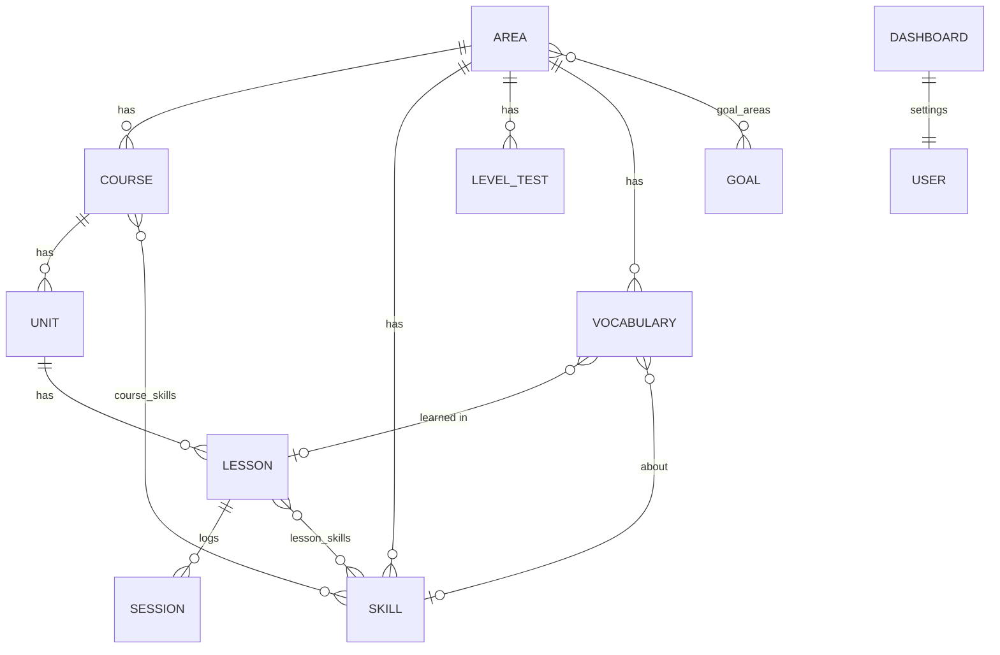

# 🎓 Learning OS — خطة العمل الموحّدة والكاملة (الإصدار 4.0)

**الغرض:** وثيقة بناء **مكتفية بذاتها** لتطبيق **التعلّم والتطوير المهني** (ويب + موبايل، عربي RTL، يعمل أوفلاين) يعمل **كقسم مستقل تمامًا**، ومرتبط ببقية أنظمتك (Projects OS، Home، Finance، المعرفة، Habit OS، Today) عبر **عقود API/Events فقط** — بلا جداول مشتركة ولا نسخ كيانات.

> **هذه الوثيقة تحلّ محلّ الملفين السابقين بالكامل** (Independent Build Spec v2.0 EN + وثيقة البناء المستقلة v3.0 AR). كل بند فيهما موجود هنا (انظر **مصفوفة التغطية في §20**)، مع حسم تعارضاتهما وسد فجواتهما. لا يُرسَل الملفان القديمان مع هذه الوثيقة لمنفّذ التطبيق كي لا تعود التعارضات.

**ما دخل في المراجعة:**
1. نظام **🎓 Learning OS** الحقيقي في Notion: كل القواعد العشر (الحقول، الحالات، العلاقات)، ودليل النظام كاملًا (الصيغ بنصها، طرق الإدخال، ما اختُبر، الحدود المعروفة).
2. الملفان المرفوعان (EN v2.0 + AR v3.0).
3. السياق المحيط: علاقات قاعدة **المجالات** مع أنظمة أخرى، وعلاقة **لوحة التعلّم** بالمراجعات الأسبوعية في Projects OS، و**Habit OS**.
4. خطط **Projects OS v4.0** و**Home OS v4.0** (لضمان توافق العقود بين الأقسام).

**المرجع الأعلى عند التعارض:** هذه الوثيقة ← سلوك Notion الفعلي المجرَّب ← الملفان القديمان.

> **مفاتيح القراءة:** `LF-xx` ميزة محفوظة من النظام الحالي · `LC-xx` تعارض محسوم · `LG-xx` فجوة مسدودة · `LE-xx` تحسين مضاف · `LD-xx` قرار يحتاج تأكيدك · `LV-xx` قاعدة تحقق · `LA-xx` أتمتة · `LT-xx` اختبار قبول.

---

## 1) المراجعة الكاملة لنظام التعلّم في Notion

### 1.1 فلسفة النظام (محفوظة كما هي)
> **لا تسجّل ما لا تحتاج إلى تسجيله.** الدقائق هي المدخل الوحيد؛ والباقي (حالة الدرس، تقدم الوحدة والدورة والمجال، الوقت المتبقي، السلسلة، الأهداف) **يُستنتج**. **التقدم يُحسب بالوقت لا بعدد الدروس** (فيديو 5 دقائق ≠ فيديو 120 دقيقة). **اللغات ليست نظامًا منفصلًا**: هي مجال عادي بطبقات إضافية (مستوى A1–C2 للوحدة، مهارة للدرس، مفردات، اختبارات مستوى).

### 1.2 ما الموجود فعليًا (10 قواعد)

| القاعدة | الحقول الفعلية (يدخلها المستخدم) | المشتق (صيغ/Rollups) |
|---|---|---|
| **🗂️ المجالات** | الاسم، **التصنيف** (مهني/شخصي/أكاديمي/لغة)، **الحالة** (نشط/متوقف/مؤرشف)، الأولوية، **الهدف المهني (نص)**، **المستوى الحالي/المستهدف** (A1–C2)، **هدف الدراسة الأسبوعي (ساعات)**، **اللوحة** (علاقة)، ملاحظات + **علاقات خارجية** (أفكار، اجتماعات، فعاليات، روابط، تصنيفات، حسابات محتوى، محتوى، مشاريع، أهداف OKR) | التقدم، الوقت المتبقي، شريط التقدم، عدد/مكتمل الدورات، الدروس/المكتملة، دقائق آخر 7 أيام، نسبة هدف الأسبوع، **المستوى المثبت بالاختبار** |
| **🎓 الدورات** | الاسم، المجال، **النوع** (يوتيوب/مسجّلة/مباشرة/حضوري/كتاب-قائمة/مشروع)، المزوّد، المحاضر، الرابط، **الحالة** (لم تبدأ/جارية/مكتملة/متوقفة)، الأولوية، تاريخ البدء/المستهدف، **المستوى** (للغة)، **المهارات المكتسبة (وسوم)**، **مهارات الدورة (علاقة)**، التقييم، **شهادة؟ (checkbox)**، **الدرس الحالي** (علاقة يدوية)، فعاليات، ملاحظات، 🧪 | الدقائق الكلية/المنجزة، عدد الدروس/الوحدات والمكتمل منها، التقدم، الشريط، المتبقي، **الحالة التلقائية**، مكتملة؟ |
| **📚 الوحدات** | الاسم، الدورة، **الترتيب**، **مستوى اللغة**، تاريخ البدء/الانتهاء، ملاحظات | مدة الدروس ومنجزها، عدد الدروس والمكتمل، التقدم، الشريط، المتبقي، **الحالة** (لم تبدأ/جارية/مكتملة)، المجال |
| **🎥 الدروس** | الاسم، الوحدة، رقم الدرس، الرابط، **المهارة (قائمة: Reading/Listening/Speaking/Writing/Vocabulary/Grammar/Pronunciation/Conversation/عامة)**، **مهارات الدرس (علاقة)**، **الحالة** (لم يبدأ/جارٍ/مكتمل/متوقف/**تخطيته**)، الأولوية، تاريخ الدراسة، وقت البدء (نص)، **المدة الكلية**، **الدقائق المشاهدة**، **هدف جلسة اليوم**، ملاحظات، 🧪 | **المشاهد = max(مشاهدة، مجموع الجلسات)**، المنجز = min(المشاهد، المدة)، التقدم، المتبقي، مكتمل، الشريط، الوقت المتبقي، الدورة، المجال |
| **📆 جلسات الدراسة** | الجلسة (عنوان)، التاريخ، الدقائق، الدرس، ملاحظة | `قيد` = نص `YYYY-MM-DD=دقائق` (حل التفافي) |
| **🎛️ لوحة التعلّم** | صف واحد "لوحتي": **هدف اليوم (30)**، **الحد الأدنى للاستمرار (10)**، **هدف الأسبوع (12 ساعة)**، المجالات (علاقة)، المراجعات الأسبوعية (علاقة بـ Projects OS) | دقائق اليوم، نسبة اليوم، **حالة اليوم** (✅ اكتمل / 🟡 جزئي والسلسلة محفوظة / ⚪ لم تدرس بعد)، دقائق آخر 7 أيام، نسبة الأسبوع، **سلسلة الدراسة** (بسقف 120 يومًا) |
| **🧩 المهارات** | المهارة، **النوع** (لغة/تقنية/مهنية/شخصية)، المجال، الدورات، الدروس، **تقييم ذاتي (0–100)**، ملاحظات | الدقائق الكلية والمنجزة (دورات + دروس)، التقدم، **المستوى** (🔴 مبتدئ … 🟢 متقدم **من نسبة التقدم**) |
| **🧪 اختبارات المستوى** | الاختبار، المجال، التاريخ، **المستوى المُختبَر**، **الدرجة (%)**، المصدر (Cambridge/EF SET/…)، ملاحظات | رقم المستوى (A1=1…C2=6)، النتيجة (✅ ≥80 / 🟡 ≈60 / 🔴)، رقم الناجح |
| **🎯 الأهداف المهنية** | الهدف، **الحالة** (جارٍ/تحقق/متوقف)، **التاريخ المستهدف**، **لماذا هذا الهدف؟**، المجالات | مجموع الدقائق والدورات والدروس، التقدم، الشريط، الوقت المتبقي |
| **🧠 المفردات** | الكلمة، المعنى، **نوع الكلمة** (اسم/فعل/صفة/ظرف/تعبير/Phrasal Verb)، المستوى، **المهارة (قائمة)**، **الحالة** (جديدة/قيد التعلم/مراجعة/متقنة)، **المراجعة القادمة**، جملة مثال، **النطق/ملاحظة**، الدرس، المجال | — |

### 1.3 قواعد النظام كما يشرحها الدليل (محفوظة)
- الهرم: **مجال ← دورة ← وحدة ← درس ← (جلسة دراسة)**.
- **الدقائق المشاهدة** يدوي بديل للجلسات، والنظام يأخذ **الأكبر** بينهما (لا مضاعفة)؛ **السلسلة والهدف اليومي يعتمدان على الجلسات فقط**.
- أي يوم فيه دقائق ≥ الحد الأدنى **يحافظ على السلسلة** حتى لو لم يبلغ الهدف الكامل؛ ولو لم تدرس اليوم تُحسب السلسلة من أمس دون كسر.
- **المستوى المثبت** = أعلى مستوى اختبار نجح فيه (≥ 80%)، **ولا يُستمدّ من نسبة مشاهدة الدورات**.
- الهدف المهني: تقدمه = مجموع المنجز لكل مجالاته ÷ مجموع مددها.
- ربط المهارات: مهارة تقنية ← **الدورة كلها**؛ مهارة لغة ← **الدروس**؛ **تجنّب ربط الدورة ودروسها بنفس المهارة** وإلا تتكرر الدقائق.

### 1.4 الحدود التي يعترف بها الدليل (وكلها تُحل في التطبيق)
سقف السلسلة 120 يومًا · نص الجلسات المجمَّع يكبر ويتباطأ · ربط المجال باللوحة **يدوي** (مجال غير مربوط لا يدخل السلسلة) · **جلسة بلا درس لا تُحسب** والدرس بلا وحدة لا يدخل أي تجميع · مستوى المهارة من التقدم وليس إتقانًا · عتبة النجاح 80% مكتوبة داخل الصيغة · **لا حماية من تكرار نفس الجلسة** · لا Rollup فوق Rollup (صيغ وسيطة) · لا Database Templates · بيانات 🧪 تجريبية تُمسح يدويًا.

### 1.5 اكتشافات مهمة من المراجعة (خارج الملفين)
1. **قاعدة "المجالات" هي المحور المشترك لعدة أنظمة**: ترتبط بالأفكار والاجتماعات والفعاليات والروابط والتصنيفات وحسابات المحتوى والمحتوى والمشاريع وأهداف OKR. أي أن "المجال" مفهوم **مشترك** مملوك عمليًا لـ Learning، بينما يوجد في Personal & Business OS كيان آخر باسم **Areas** (Business/Personal/Finance) — **مفهومان مختلفان بنفس الاسم** (LC-01).
2. **لوحة التعلّم مرتبطة بقاعدة المراجعات الأسبوعية** (نفس قاعدة Projects OS): المراجعة تعرض بيانات التعلّم. في التطبيق: Learning يوفّر **API إحصاءات** لا علاقة جداول (LC-33).
3. **المهارة مُمثَّلة بثلاث طرق في الدورات والدروس**: وسوم (`المهارات المكتسبة`)، علاقة (`مهارات الدورة/الدرس`)، وقائمة (`المهارة` في الدرس والمفردات) — ازدواج صريح (LC-06، LC-11).
4. **مستوى المهارة المحسوب في Notion مبني على نسبة التقدم**، وهذا يخالف مبدأ النظام نفسه ومواصفتَي الملفين ("التقدم ≠ الإتقان") (LC-17).
5. **الأهداف المهنية لها حالات وتاريخ مستهدف وحقل "لماذا"** في Notion، بينما يقول الملفان إن الحالات غير معرّفة (LC-22).
6. **Habit OS فيه "📚 مكتبة الكتب"** و"سلاسل" عادات، وهو يتقاطع مع نوع دورة "كتاب" ومع سلسلة الدراسة (LC-32).
7. تكاليف التعلّم (فئة "🎓 تعلّم") كانت تُسجَّل عبر **معاملات الميزانية في نظام البيت**؛ في الهيكل الجديد تذهب إلى **Finance** مباشرة (LC-41).
8. **لم أستطع قراءة أكواد الصيغ نفسها** عبر الأداة؛ اعتمدت على نصها المشروح في الدليل (وهو مفصَّل) وعلى الاختبارات المذكورة فيه (انظر §11.3 لتحويلها إلى بيانات Demo).

### 1.6 حكم على كل عنصر

| العنصر | الحكم | القرار |
|---|---|---|
| الهرم والتقدم بالوقت | **اعتماد** | + حساب مرجَّح بالوقت في كل المستويات |
| `الدقائق المشاهدة` + max(جلسات) | **اعتماد بدلالة واضحة** | + "سجّل تقدمي" ينشئ جلسة بالفرق (LE-02) |
| جلسات `قيد` النصية | **استبدال** | صفوف مهيكلة + مفتاح idempotency |
| لوحة التعلّم (إعدادات + إحصاءات) | **تفكيك** | إعدادات محفوظة + إحصاءات مشتقة؛ ربط المجالات يتحول إلى `counts_toward_streak` |
| السلسلة بسقف 120 | **استبدال** | حساب بلا سقف + أيام راحة اختيارية |
| حالة الدرس/الدورة اليدوية | **تفكيك** | `status` يدوية (Active/Paused/Skipped) + `state` مشتقة |
| وسوم/قوائم المهارة | **توحيد** | علاقة المهارات فقط (M:N) |
| مستوى المهارة من التقدم | **تفكيك** | مستوى من التقييم الذاتي + "تغطية" منفصلة |
| اختبارات المستوى (عتبة 80) | **اعتماد** | عتبات قابلة للضبط + حالة "قديم" |
| الأهداف المهنية بحالاتها الثلاث | **اعتماد** | + M:N مع المجالات + مراجع مشاريع |
| المفردات + قائمة المراجعة | **اعتماد** | بلا SRS كامل (كما في المواصفة) |
| حقل 🧪 مثال؟ | **استبدال** | وضع Demo/Sandbox |

---

## 2) جرد ميزات النظام الحالي (كلها محفوظة)

| ID | الميزة | أين تتحقق |
|---|---|---|
| LF-01 | الهرم مجال ← دورة ← وحدة ← درس ← جلسة | §4، §5 |
| LF-02 | التقدم بالوقت لا بعدد الدروس | §6.1–6.3 |
| LF-03 | المشاهد = max(المشاهدة اليدوية، مجموع الجلسات) والمنجز لا يتجاوز المدة | §6.1 |
| LF-04 | المتبقي، شريط التقدم، الوقت المتبقي في كل طبقة | §6.2، §10 |
| LF-05 | حالة الوحدة والدورة التلقائية | §6.2 |
| LF-06 | الدرس الحالي (Continue Learning) | §5.2، §6.2 |
| LF-07 | جلسات الدراسة (تاريخ + دقائق + درس) | §5.5 |
| LF-08 | هدف جلسة اليوم للدرس الطويل | §5.4 |
| LF-09 | لوحة التعلّم: هدف اليوم/الحد الأدنى/هدف الأسبوع | §5.6، §6.4 |
| LF-10 | دقائق اليوم، نسبة اليوم، حالة اليوم، آخر 7 أيام، نسبة الأسبوع | §6.4 |
| LF-11 | سلسلة الدراسة وقاعدة الحد الأدنى | §6.4 |
| LF-12 | المهارات: دقائق/تقدم/مستوى + تقييم ذاتي 0–100 | §5.7، §6.6 |
| LF-13 | تجنّب مضاعفة دقائق المهارة | §6.6 |
| LF-14 | اختبارات المستوى + CEFR + النجاح ≥80 | §5.8، §6.7 |
| LF-15 | المستوى المثبت بالاختبار = أعلى ناجح | §6.7 |
| LF-16 | الأهداف المهنية بتقدم مجمَّع | §5.9، §6.3 |
| LF-17 | المفردات + المراجعة القادمة + عرض "للمراجعة" | §5.10، §6.8 |
| LF-18 | مستوى لغة للوحدة، مهارة للدرس، ربط المفردة بالدرس | §5.3، §5.4، §5.10 |
| LF-19 | نوع الدورة/المزوّد/المحاضر/الرابط/التقييم/الشهادة | §5.2 |
| LF-20 | هدف أسبوعي لكل مجال + مستوى حالي ومستهدف | §5.1 |
| LF-21 | "دروس اليوم" (المجدولة) | §10، §6.10 |
| LF-22 | مسار "كيف تستخدم النظام" اليومي | §10.1 |
| LF-23 | سيناريوهات الاختبار (وحدة 50%، سلسلة 3، 102 دقيقة، مستوى مثبت A1) | §11.3 |
| LF-24 | الربط بالأنظمة الأخرى عبر المجال | §15.1 |

---

## 3) المبادئ والحدود بين الأقسام

### 3.1 الاستقلال
Learning OS تطبيق **قائم بذاته**: قاعدة بياناته وخدماته وواجهاته منفصلة، ويعمل كاملًا (مجالات، دورات، جلسات، سلسلة، مهارات، اختبارات، مفردات) **حتى لو غابت كل الأنظمة الأخرى**. الربط اختياري ومُحسِّن، وعند غياب أي نظام تتدهور الميزة بلطف.

### 3.2 من يملك ماذا
| الكيان / الحقيقة | المالك | Learning يفعل ماذا |
|---|---|---|
| المجالات (كتصنيف تعلّم)، الدورات، الوحدات، الدروس، الجلسات، المهارات، الاختبارات، الأهداف المهنية، المفردات، لوحة الإعدادات | **Learning** | يملكها بالكامل |
| الروابط/Bookmarks والأفكار والاجتماعات والفعاليات | **Knowledge** | `resource_ref` للقراءة والربط فقط |
| المحتوى وحسابات المحتوى | **Content OS** | محاذاة بمرجع فقط |
| المشاريع والتنفيذ | **Projects OS** | `project_ref` على الأهداف المهنية |
| العادات والكتب والسلاسل | **Habit OS** | يرسل أحداثًا (الحد الأدنى تحقق) ولا يسجّل عادات |
| الدفتر المالي | **Finance** | يطلب معاملة لتكلفة دورة (اختياري) |
| الهوية والإشعارات والملفات والبحث والأحداث | **Core** | يستهلكها |
| صفحة اليوم | **Today** | يوفّر Feed ولا يكرر |

### 3.3 مصفوفة التدهور (عند غياب نظام مرتبط)
| الغائب | سلوك Learning |
|---|---|
| Knowledge | حقول `resource_ref` مخفية؛ لا ربط روابط |
| Projects OS | `project_ref` على الأهداف مخفي |
| Habit OS | لا أحداث مستهلَكة؛ السلسلة تعمل داخليًا |
| Finance | حقل التكلفة محلي فقط (`Not Required`) |
| Core (إشعارات) | تنبيهات داخل التطبيق فقط |
| Today | لا Feed خارجي؛ شاشة Learning الرئيسية تكفي |

### 3.4 المبادئ الحاكمة (ملزمة)
1. **الدقائق هي المدخل؛ والباقي مشتق** (حالة، تقدم، متبقي، سلسلة، أهداف). المشتق لا يُعدَّل يدويًا.
2. قواعد العمل تُنفَّذ في **Domain/Service layer** وليس في الواجهة فقط.
3. أي عملية قابلة للإعادة **Idempotent** (جلسة، مزامنة، حدث، استيراد).
4. كل شاشة بيانات: **Loading / Empty / Error / Success** (+ Offline للموبايل).
5. كل تاريخ/يوم/موعد يحترم **Timezone المستخدم** (حدود اليوم والأسبوع).
6. **لا Workaround من Notion** عند إمكانية التمثيل الفعلي (لا `date=minutes`، لا صيغ وسيطة، لا حد 120، لا ربط يدوي للوحة).
7. **لا Dashboard أو View مصدر حقيقة.**
8. أي تكامل يحتفظ بـ **`source_id` ثابت** ويمنع التكرار.
9. **Soft delete / Archive**؛ المؤرشف لا يدخل في الحسابات الجارية (لكن دقائقه التاريخية تبقى في إجماليات الأيام).
10. **سجل نشاط (Audit)** للتعديلات الحساسة: حذف/تعديل جلسة، تغيير مدة درس، تغيير إعدادات اللوحة، نتيجة اختبار.
11. لا تُكرَّر كيانات مملوكة لنظام آخر؛ استخدم **Relation أو API/Event**.

### 3.5 الملكية والخصوصية
Learning **شخصي بطبيعته**: كل البيانات مملوكة لـ `user_id` ولا مشاركة افتراضيًا (خلافًا لـ Projects OS للفِرق وHome للأسرة). مشاركة قراءة فقط مع "شريك مساءلة" خيار مستقبلي (LD-02، LE-17).

---
## 4) النموذج المفاهيمي

```text
   User (مالك كل البيانات — شخصي)
     │
     ├── LearningDashboard (صف واحد: هدف اليوم/الحد الأدنى/هدف الأسبوع/إعدادات)
     │
     └── Area (مجال تعلّم: برمجة، إنجليزية، مبيعات…)       ← "المجال" مرجع مشترك للأنظمة الأخرى (area_ref)
           ├──< Course (دورة/كتاب/قائمة/برنامج…)  ──< Unit (وحدة؛ للغة: مستوى A1–C2)
           │                                            └──< Lesson (درس: مدة + مهارة)
           │                                                   └──< StudySession (الدقائق = المدخل الوحيد)
           ├──< Skill  ↔  Course (M:N)  ↔  Lesson (M:N)
           ├──< LevelTest (لغة: CEFR + درجة %)
           ├──< Vocabulary ──(اختياري)──> Lesson / Skill
           └──>< ProfessionalGoal (M:N)  ──(اختياري)──> project_ref (Projects OS)
```
**مسار التصعيد:** `Session → Lesson (observed) → Unit → Course → Area → Goal` وبالتوازي `Session → daily_totals → Dashboard (اليوم/الأسبوع/السلسلة)`.
**قاعدة الفصل:** *تقدم المحتوى* (كم من الدورة أنجزت) ≠ *إتقان المهارة* (تقييمك الذاتي) ≠ *المستوى المثبت* (نتيجة اختبار حقيقي). ثلاثة مقاييس مستقلة لا يُستنتج أحدها من الآخر.

---

## 5) نموذج البيانات الكامل

### 5.0 الحقول العامة (كل كيان)
`id` UUID ثابت · `user_id` NOT NULL (الملكية) · `created_at` · `updated_at` · `deleted_at` (Soft Delete) · `archived_at` (حيث ينطبق) · `version` (تزامن متفائل) · `external_refs` عند الحاجة. القيم المشتقة لا تكون حقولًا قابلة للتعديل؛ التخزين المؤقت في جداول `*_metrics_cache` قابلة لإعادة البناء الكاملة.

### 5.1 المجالات `learning_areas`
| الحقل | النوع | إلزامي | ملاحظات |
|---|---|:-:|---|
| name | string | نعم | فريد بين غير المؤرشف (غير حساس لحالة الأحرف) |
| category | lookup | لا | مهني · شخصي · أكاديمي · لغة (قابلة للتخصيص) |
| is_language | bool | نعم | يفعّل طبقات اللغة (CEFR، اختبارات، مفردات). افتراضي `true` عند التصنيف "لغة" |
| status | enum | نعم | `Active` · `Paused` · `Archived` |
| priority | enum | لا | عالية / متوسطة / منخفضة |
| current_language_level | CEFR | لا | **مستوى معلَن** يدويًا (للغات فقط) |
| target_language_level | CEFR | لا | للغات فقط |
| weekly_goal_minutes | integer ≥ 0 | لا | هدف أسبوعي **للمجال** (بالدقائق؛ الواجهة تعرضه بالساعات) |
| counts_toward_streak | bool | نعم (true) | يحل ربط "اللوحة" اليدوي (LC-03) |
| notes, color, icon, sort_order | | لا | |
| content_area_ref | external | لا | محاذاة اختيارية مع مجال في Content OS |

**مشتق (قراءة فقط):** `total_minutes`, `completed_minutes`, `progress` (أو Not Measurable), `remaining_minutes`, `courses_count`, `active_courses`, `completed_courses`, `lessons_total/completed`, `minutes_last_7_days`, `weekly_goal_pct`, `confirmed_level` (+`confirmed_level_stale`), `declared_vs_confirmed_gap`.
**قيد:** مجال بلا دورات صالح؛ ولا نسبة وهمية (§6.2).

### 5.2 الدورات `learning_courses`
| الحقل | النوع | إلزامي | ملاحظات |
|---|---|:-:|---|
| area_id | FK | نعم | |
| name | string | نعم | |
| type | lookup | نعم | **Course** (مسجّلة) · **YouTube Playlist** · **Book** · **Program** · **Live Class** · **In-person** · **Project** (7؛ تسميات فقط بلا منطق خاص) |
| provider, instructor | string | لا | |
| url | URL | لا | |
| status | enum | نعم | `Active` · `Paused` · `Archived` (**يدوية**) |
| priority | enum | لا | |
| start_date, target_date | date | لا | `start ≤ target` |
| level | string/CEFR | لا | مستوى المحتوى (للغة CEFR، وإلا نص: مبتدئ/متوسط…) |
| rating | decimal 0–5 | لا | بخطوة 0.5 |
| certificate_file_id / certificate_url | file/URL | لا | `has_certificate` مشتق (يستبدل checkbox "شهادة؟") |
| cost / currency | money | لا | اختياري (LE-15) |
| pinned_lesson_id | FK | لا | "أكمل من هنا" يدويًا؛ غيابه ⇒ الدرس الحالي مشتق |
| resource_ref | external | لا | رابط/Bookmark في Knowledge |
| notes | text | لا | |

**علاقات:** `course_skills` (M:N مع المهارات) — **تُلغى الوسوم** (LC-06).
**مشتق:** `state` (`Not Started` · `In Progress` · `Completed`)، `total_minutes`, `completed_minutes`, `lessons_total/completed`, `units_total/completed`, `progress`, `remaining`, `current_lesson` (= `pinned_lesson_id` وإلا أول درس غير مكتمل وغير متخطّى بترتيب الوحدة ثم رقم الدرس)، `eta_date` (LE-04).
**إكمال يدوي لدورة بلا دروس:** `manual_completed_at` ⇒ `state = Completed` (§6.2).

### 5.3 الوحدات `learning_units`
| الحقل | النوع | إلزامي | ملاحظات |
|---|---|:-:|---|
| course_id | FK | نعم | |
| name | string | نعم | |
| order | integer ≥ 1 | نعم | `UNIQUE(course_id, order)` مع **إعادة ترتيب تلقائية** عند الإدراج/النقل |
| language_level | CEFR | لا | لوحدات اللغة |
| start_date, target_date | date | لا | (كان "تاريخ الانتهاء" في Notion) |
| notes | text | لا | |
| is_default | bool | نظام | وحدة افتراضية مخفية للدورات المسطّحة (LD-03، LE-08) |

**مشتق:** `lessons_count`, `completed_lessons`, `total_minutes`, `completed_minutes`, `progress`, `remaining`, `state` (`Not Started` · `In Progress` · `Completed`)، `area` (عبر الدورة).

### 5.4 الدروس `learning_lessons`
| الحقل | النوع | إلزامي | ملاحظات |
|---|---|:-:|---|
| unit_id | FK | نعم | |
| name | string | نعم | |
| lesson_number | integer | لا | ترتيب داخل الوحدة |
| url | URL | لا | |
| skill_ids | M:N (`lesson_skills`) | لا | **المصدر الوحيد للمهارة** (تُلغى قائمة "المهارة") (LC-11) |
| status | enum | نعم | `Active` · `Paused` · `Skipped` (**يدوية**) |
| priority | enum | لا | |
| study_date | date | لا | موعد **مخطَّط** للدراسة (يغذّي "دروس اليوم") |
| start_time | time | لا | (كان نصًا) |
| total_duration_minutes | integer ≥ 0 | **نعم** | `0` = غير معروفة (Not Measurable) |
| watched_minutes | integer ≥ 0 | لا | عدّاد يدوي تراكمي (§6.1 التحذيرات) |
| today_session_goal | integer > 0 | لا | تذكير بما تنوي دراسته اليوم |
| resource_ref | external | لا | |
| notes | rich text | لا | |

**مشتق:** `sessions_minutes`, `observed`, `completed`, `progress`, `remaining`, `state` (`Not Started` · `In Progress` · `Completed` · `Skipped`)، `minutes_over`, `completed_at`, `last_studied_at`, `completed_by_override` (bool).

### 5.5 جلسات الدراسة `learning_study_sessions`  (سجل النشاط الحقيقي)
| الحقل | النوع | إلزامي | ملاحظات |
|---|---|:-:|---|
| lesson_id | FK | **نعم** | جلسة بلا درس غير مقبولة |
| date | date | نعم | تاريخ **محلي** بتوقيت المستخدم لحظة البدء |
| minutes | integer | نعم | `1 … 1440` |
| note | text | لا | |
| started_at / ended_at | timestamp | لا | `started_at < ended_at` |
| kind | enum | نعم (study) | `study` (دراسة فعلية) · `adjustment` (تسوية إكمال) |
| source | enum | نظام | `manual` · `timer` · `quick_log` · `import` · `completion_adjustment` |
| client_generated_id | string | لا | **`UNIQUE(user_id, client_generated_id)`** عند وجوده (idempotency للأوفلاين وإعادة المحاولة) |
| deleted_at | ts | | الحذف الناعم يعيد حساب الأعلى |

**فهارس:** `(user_id, date)` · `(lesson_id, date)` · `UNIQUE(user_id, client_generated_id) WHERE NOT NULL`.
**قاعدة `kind`:** جلسات `adjustment` تُحتسب في تقدم الدرس **ولا تدخل** في دقائق اليوم/الأسبوع/السلسلة/الهدف (§6.4).
**حدث:** `learning.study_session.created|updated|deleted`.

### 5.6 لوحة التعلّم `learning_dashboards`  (إعدادات فقط؛ الإحصاءات مشتقة)
صف واحد لكل مستخدم (`UNIQUE(user_id)`).
| الحقل | الافتراضي | ملاحظات |
|---|---:|---|
| daily_goal_minutes | 30 | `≥ daily_minimum_minutes` |
| daily_minimum_minutes | 10 | `≥ 1` |
| weekly_goal_minutes | 720 | (12 ساعة) — **دقائق** في التخزين (LC-04) |
| timezone | من المستخدم | يحدد حدود اليوم والأسبوع |
| week_start_day | السبت | للعروض الأسبوعية التقويمية |
| nudge_time | 20:00 | تذكير نهاية اليوم إن لم يتحقق الحد الأدنى |
| vocab_review_time | 09:00 | |
| rest_days_per_month | 0 | أيام راحة لا تكسر السلسلة (LE-06) |
| pass_threshold / close_threshold | 80 / 60 | عتبات الاختبارات (LC-20) |
| stale_test_months | 12 | |
| skill_bands | 25/50/75 | عتبات مستوى المهارة |

**مشتق:** `minutes_today`, `daily_pct`, `daily_state`, `minutes_to_minimum`, `minutes_last_7_days`, `weekly_pct`, `streak`, `longest_streak`.

### 5.7 المهارات `learning_skills`
| الحقل | النوع | إلزامي | ملاحظات |
|---|---|:-:|---|
| area_id | FK | نعم | |
| name | string | نعم | فريد داخل المجال |
| type | lookup | لا | لغة · تقنية · مهنية · شخصية |
| self_rating | integer 0–100 | لا | **رأيك في مستواك الحقيقي** (مصدر المستوى) |
| notes | text | لا | |

**علاقات:** `course_skills`, `lesson_skills`.
**مشتق:** `coverage` (تغطية المحتوى: `total_minutes`, `completed_minutes`, `progress`)، `mastery_level` (من `self_rating`)، `suggested_level` (غير مخزَّن؛ من التغطية)، `evidence` (دقائق دراسة آخر 30 يومًا).
**القيم الأولية (Presets):** لمجال اللغة تُنشأ مهارات Reading/Listening/Speaking/Writing/Vocabulary/Grammar/Pronunciation/Conversation.

### 5.8 اختبارات المستوى `learning_level_tests`
| الحقل | النوع | إلزامي | ملاحظات |
|---|---|:-:|---|
| area_id | FK | نعم | مجال `is_language = true` |
| name | string | نعم | |
| date | date | نعم | ليس مستقبليًا |
| tested_level | CEFR | نعم | A1…C2 |
| score_percent | decimal 0–100 | **نعم** | (يستبدل "score number"؛ LC-20) |
| score_raw / score_max | decimal | لا | الدرجة الأصلية للتوثيق |
| source | string | لا | Cambridge / EF SET / المدرّس… |
| skill_id | FK | لا | اختبار لمهارة بعينها (LE-09) |
| notes | text | لا | |

**مشتق:** `level_number` (A1=1 … C2=6)، `result` (`Passed` ≥ 80 · `Close` ≥ 60 و< 80 · `Not Passed` < 60)، `passed_level_number` (= الرقم إن Passed وإلا 0).

### 5.9 الأهداف المهنية `learning_professional_goals`
| الحقل | النوع | إلزامي | ملاحظات |
|---|---|:-:|---|
| name | string | نعم | مثل: "أصبح مطوّر Flutter محترفًا" |
| description | text | لا | **لماذا هذا الهدف؟** (يشمل حقل Notion) |
| status | enum | نعم | `Active` · `Achieved` · `Paused` (حالات Notion الثلاث — LC-22) |
| target_date | date | لا | |
| area_ids | M:N (`goal_areas`) | لا | |
| project_refs | external[] | لا | مراجع Projects OS (التنفيذ هناك) |

**مشتق:** `total_minutes`, `completed_minutes`, `courses_count`, `lessons_total/completed`, `progress`, `remaining`, `setup_state` (`Needs Setup` عند غياب المجالات)، `eta_date`.

### 5.10 المفردات `learning_vocabulary`
| الحقل | النوع | إلزامي | ملاحظات |
|---|---|:-:|---|
| area_id | FK | نعم | مجال لغة |
| word | string | نعم | |
| meaning | text | نعم | |
| part_of_speech | lookup | لا | اسم · فعل · صفة · ظرف · تعبير · Phrasal Verb |
| level | CEFR | لا | |
| skill_id | FK | لا | (كانت قائمة؛ تُحوَّل إلى علاقة بمهارة) |
| lesson_id | FK | لا | الدرس الذي تعلّمتها منه |
| status | enum | نعم (New) | `New` · `Learning` · `Review` · `Mastered` |
| next_review_date | date | لا | "المراجعة القادمة" (= `review_date` في الملفين) |
| example | text | لا | جملة مثال |
| pronunciation | string | لا | نطق/ملاحظة (IPA/نص) |
| pronunciation_audio_file_id | file | لا | صوت اختياري |
| notes | text | لا | |

**تحذير تكرار (لا منع):** نفس `(area_id, lower(word), part_of_speech)`.
**ممنوع:** بناء خوارزمية تكرار متباعد كاملة (SRS) إلا بقرار لاحق (LD-07)؛ المراجعة تعتمد `next_review_date` والحالة.

### 5.11 القوائم والإعدادات
**`lookup_values`:** `area_category`, `course_type`, `skill_type`, `part_of_speech`, … بقيم افتراضية قابلة للتخصيص (`label_ar/label_en/color/position/is_active`). **المنطق** (الحالات والفئات) ثابت؛ **الأسماء والألوان** مرنة.
**CEFR:** enum ثابت `A1 A2 B1 B2 C1 C2` ↔ `1..6`.
**`learning_rest_days`** (LE-06): `user_id, date` — يوم راحة مخطَّط يُحتسب حتى سقف شهري.

### 5.12 جداول التخزين المؤقت (قابلة لإعادة البناء)
`lesson_metrics_cache` · `unit_metrics_cache` · `course_metrics_cache` · `area_metrics_cache` · `skill_metrics_cache` · `goal_metrics_cache` · **`daily_study_totals(user_id, date, study_minutes, adjustment_minutes, counts_toward_streak_minutes)`** · `streak_cache`. كلها **تُشتق من الجلسات** ويمكن حذفها وإعادة بنائها (`rebuild_metrics(user)`) دون فقدان حقيقة.

### 5.13 خريطة العلاقات


---
## 6) محرك الحسابات والدوال

> كل ما في هذا الفصل **مشتق**: يُحسب في Domain/Service، لا يُعدَّل يدويًا، ويُعاد حسابه عند الأحداث وفي جدولة يومية (§6.10). `today` = تاريخ اليوم بتوقيت المستخدم. الحسابات بحساب **تواريخ تقويمية** لا نصوص.

### 6.1 الدرس (LF-02, LF-03, LF-04)
```text
D = total_duration_minutes                  (≥ 0؛ 0 = غير معروفة)
W = watched_minutes                         (عدّاد يدوي تراكمي، الافتراضي 0)
S = Σ minutes لجلسات الدرس غير المحذوفة     (kind = study + adjustment)

observed  = max(W, S)                       ← المشاهد (لا مضاعفة بين الطريقتين)
completed = min(observed, D)                ← المنجز لا يتجاوز المدة
progress  = D > 0 ? completed / D : Not Measurable      (لا قسمة على صفر)
remaining = max(D − completed, 0)
minutes_over = max(observed − D, 0)         (دقائق زائدة تُعرض ولا تُحتسب)
```
**الحالة المشتقة `state`** (مع الحالة اليدوية `status`):
```text
status = Skipped                                   → state = Skipped          (مستبعد من كل التجميعات)
D > 0 AND observed >= D                            → Completed
observed > 0                                       → In Progress
غير ذلك                                            → Not Started
D = 0: لا يكتمل تلقائيًا؛ يكتمل فقط بـ "إكمال يدوي" (manual_completed_at) ويُستبعد من تجميعات الوقت ويُحتسب في عدّاد الدروس المكتملة
status = Paused: يحتفظ بـ state ويظل داخل المقام (مخطَّط لكنه متوقف)
```
**الإكمال اليدوي** لدرس `observed < D`: يُنشأ تلقائيًا جلسة `adjustment` بـ `D − observed` دقيقة (`source=completion_adjustment`) فيصبح التقدم 100% **دون** أن يدخل في دقائق اليوم/السلسلة (يحل تناقض Notion: "مكتمل" بالحالة مع تقدم < 100%). التراجع عن الإكمال يحذف جلسة التسوية.
**تحذيرات الدلالة:**
- إذا `W > S` فالجلسات الجديدة **لن تزيد التقدم** حتى يتجاوز `S` قيمة `W` (هذا مقتضى `max`). الواجهة تُظهر الرقمين، وتحذّر قبل الحفظ، وتعرض إجراء **"حوّل المشاهدة اليدوية إلى جلسة تسوية"** (ينشئ جلسة `adjustment` بقيمة `W` ويصفّر `W`) لتصبح الجلسات تراكمية بعد ذلك.
- **السلسلة والهدف اليومي يعتمدان على جلسات `study` فقط** (لا على `W` ولا التسويات).

### 6.2 تجميع الطبقات (LF-02, LF-05) — **مرجَّح بالوقت**
```text
قابل للقياس = درس غير متخطّى و D > 0
total(X)     = Σ D           لكل الدروس القابلة للقياس تحت X
completed(X) = Σ completed   لكل الدروس القابلة للقياس تحت X
progress(X)  = total(X) > 0 ? completed(X) / total(X) : Not Measurable      (X = وحدة | دورة | مجال | هدف)
remaining(X) = max(total(X) − completed(X), 0)
```
- **ليس متوسط نسب**؛ الدرس الطويل يزن أكثر (فيديو 120 دقيقة ≠ 5 دقائق).
- **عدّادات** (إلى جانب الوقت): `lessons_count` (غير متخطّى)، `completed_lessons` (state=Completed)، `units_total/completed`، `courses_count/completed`.
- **حالة الوحدة `state`:** لا دروس غير متخطّاة ⇒ `Not Started`؛ كلها Completed (وعددها ≥ 1) ⇒ `Completed`؛ أي منها بدأ ⇒ `In Progress`؛ وإلا `Not Started`.
- **حالة الدورة `state`:** نفس القاعدة على الوحدات/الدروس، أو `Completed` إن `manual_completed_at`.
- **الدورة المؤرشفة** تُستبعد من تجميع المجال/الهدف؛ **الموقوفة (Paused)** تبقى في التقدم وتخرج من `active_courses` ومن توقعات الإنجاز.
- **المجال:** `progress` على الدورات غير المؤرشفة؛ بلا محتوى قابل للقياس ⇒ **Not Measurable** (لا 0/100 وهمية).
- **الدرس الحالي (LF-06):** `pinned_lesson_id` إن وُجد وإلا أول درس `state ∈ {Not Started, In Progress}` وغير `Skipped` بترتيب (`unit.order`, `lesson_number`).
- **المتبقي بالوقت المقروء:** `≥ 60` ⇒ "س د"، وإلا "د".
- **شريط التقدم:** عنصر واجهة (لا نص)، 10 خانات + نسبة.

### 6.3 الهدف المهني (LF-16)
```text
areas(G)  = المجالات غير المؤرشفة المرتبطة بالهدف (كل مجال مرة واحدة)
total(G)  = Σ total(area) ،  completed(G) = Σ completed(area)
progress(G) = total(G) > 0 ? completed(G) / total(G) : Not Measurable
setup_state = areas(G) فارغة ? "Needs Setup" : OK
```
مجال مشترك بين هدفين **يُحتسب في كل منهما** (لا تجميع بين الأهداف نفسها).

### 6.4 اليوم والأسبوع والسلسلة (LF-09, LF-10, LF-11)
```text
study_minutes(d)  = Σ minutes لجلسات kind=study بتاريخ d
                    في مجالات counts_toward_streak = true          ← "daily_totals.counts_toward_streak_minutes"
minutes_today     = study_minutes(today)
daily_pct         = minutes_today / daily_goal_minutes             (يُعرض بسقف 100% بصريًا؛ القيمة غير مقيّدة)
minutes_to_minimum = max(daily_minimum − minutes_today, 0)
minutes_last_7_days = Σ study_minutes(d) لـ d = today−6 … today    (7 أيام تقويمية متحركة)
weekly_pct        = minutes_last_7_days / weekly_goal_minutes
```
**حالة اليوم `daily_state`:**
| الشرط | الحالة |
|---|---|
| `minutes_today ≥ daily_goal` | ✅ Goal Reached |
| `daily_minimum ≤ minutes_today < daily_goal` | 🟡 Streak Safe (جزئي والسلسلة محفوظة) |
| `0 < minutes_today < daily_minimum` | 🟠 Below Minimum (يعرض `minutes_to_minimum`) |
| `minutes_today = 0` | ⚪ Not Studied Yet |

**السلسلة (بلا سقف):**
```text
qualifies(d) = study_minutes(d) ≥ daily_minimum
rest(d)      = d ∈ rest_days AND NOT qualifies(d)           (حتى rest_days_per_month؛ LE-06)
start        = today إن qualifies(today) وإلا (rest(today) أو لم يتحقق بعد) → أمس   ← اليوم الجاري "معلّق" لا كاسر
streak       = عدد الأيام المتتالية الأقدم من start التي qualifies(d) أو rest(d) (الراحة لا تُعدّ ولا تكسر)
               وتتوقف عند أول يوم لا يحقق ولا راحة
longest_streak = أطول تتابع في التاريخ
```
- يوم بـ 10 دقائق (والحد 10) **يحافظ** على السلسلة؛ 9 دقائق **لا**.
- لا يُحتسب في اليوم/السلسلة: جلسات `adjustment`، و`watched_minutes`، ومجالات `counts_toward_streak=false`.
- **حدود اليوم والأسبوع** بتوقيت المستخدم (§6.11).
- **الحساب** من جدول `daily_study_totals` بنافذة SQL؛ لا مسح لكل الجلسات ولا نص مجمَّع (يحل حد 120 وبطء Notion).

### 6.5 أيام الراحة (LE-06)
`rest_days_per_month = 0` افتراضيًا (مغلق). عند تفعيله يحدد المستخدم أيام راحة مسبقًا حتى السقف الشهري؛ اليوم الذي يُحقق الحد الأدنى فيه يُحتسب عادة ولو كان مُعلَّمًا راحة.

### 6.6 المهارات (LF-12, LF-13) — **تغطية المحتوى ≠ الإتقان**
**قاعدة الإسناد (تمنع المضاعفة وتفضّل مستوى الورقة):**
```text
لكل مهارة S:
  direct(S)   = دروس مرتبطة بالمهارة مباشرة (lesson_skills)
  لكل دورة C مرتبطة بالمهارة (course_skills):
      إن كان في C درس ∈ direct(S)  →  تُحتسب فقط الدروس المرتبطة مباشرة من C   (تفضيل مستوى الدرس)
      وإلا                          →  تُحتسب كل دروس C القابلة للقياس
  set(S) = اتحاد النتائج (كل درس يُحتسب مرة واحدة فقط مهما تعددت طرق ربطه)
coverage.total(S)     = Σ D على set(S)
coverage.completed(S) = Σ completed على set(S)
coverage.progress     = total > 0 ? completed/total : Not Measurable
```
واجهة الربط تُظهر تلميح **"ارتباط مكرر"** عند ربط دورة وبعض دروسها بنفس المهارة.
**الإتقان (المستوى `mastery_level`) يأتي من `self_rating` وليس من التقدم:**
```text
self_rating فارغ → Unrated
0      → Not Started
1–24   → Beginner
25–49  → Advanced Beginner
50–74  → Intermediate
≥ 75   → Advanced                (العتبات 25/50/75 قابلة للضبط)
```
**`suggested_level`** (غير مخزَّن، يُعرض كاقتراح مُعنوَن "حسب التغطية"): من `coverage.progress` بنفس العتبات؛ لا يُكتب في `self_rating` ولا يُغيّر `mastery_level`.
**لا تُوسَم مهارة بأنها متقنة لمجرد اكتمال دورة 100%** (قاعدة الأتمتة).

### 6.7 CEFR والاختبارات (LF-14, LF-15)
```text
level_number: A1=1, A2=2, B1=3, B2=4, C1=5, C2=6
result(t)    = score_percent ≥ pass_threshold(80)  → Passed
             = score_percent ≥ close_threshold(60) → Close
             = otherwise                           → Not Passed
passed_level_number(t) = result = Passed ? level_number : 0
confirmed_level(area)  = أعلى passed_level_number بين اختبارات المجال  (None إن لا ناجح)
```
- الاختبار الأدنى المتأخر **لا يخفض** المستوى المؤكد.
- `confirmed_level_stale = true` إن مضى أكثر من `stale_test_months` (12) على آخر اختبار ناجح للمستوى المؤكد (تنبيه، لا تغيير).
- `declared_vs_confirmed_gap`: الفرق بين `current_language_level` (المعلَن) و`confirmed_level`.
- **`content_level_completed`** (معلوماتي، ليس كفاءة): أعلى `language_level` لوحدة `Completed` في مجال اللغة؛ يُعنوَن "مستوى المحتوى المنجز".
- **لا يُستنتج المستوى المؤكد من تقدم الدورات إطلاقًا.**

### 6.8 المفردات (LF-17)
```text
due(v)        = status ≠ Mastered AND next_review_date ≠ null AND next_review_date ≤ today
overdue(v)    = due AND next_review_date < today
review_queue  = due مرتبة تصاعديًا بـ next_review_date (ثم المستوى)
counts        = {New, Learning, Review, Mastered, due_today, overdue} لكل (مجال/مهارة/درس)
```
بلا SRS (LD-07): المستخدم يحدد التاريخ التالي؛ وخيار **سلّم المراجعة** (1، 3، 7، 14، 30 يومًا) اختياري ومغلق افتراضيًا (LE-10).

### 6.9 التوقعات (LE-04 — تقديري)
```text
avg_daily_28 = Σ study_minutes لآخر 28 يومًا ÷ 28
eta_date(X)  = avg_daily_28 > 0 ? today + ceil(remaining(X) ÷ avg_daily_28) : لا توقع
required_daily(X) = target_date ? remaining(X) ÷ max(target_date − today, 1) : —
pace(X)      = eta_date ≤ target_date ? On Pace : Behind
```
تنطبق على الدورة والمجال والهدف المهني. يُعرض دائمًا بوسم "تقديري".

### 6.10 استراتيجية إعادة الحساب والخلاصات
1. **حسب الحدث:** جلسة (إنشاء/تعديل/حذف) · تغيير مدة/مشاهدة/حالة درس · نقل أو إعادة ترتيب · ربط مهارات · تغيير إعدادات اللوحة ⇒ إعادة حساب (درس ← وحدة ← دورة ← مجال ← هدف) + `daily_study_totals` + السلسلة، في طابور بتجميع (debounce).
2. **جدولة يومية** (00:05 بتوقيت المستخدم): حالة اليوم، السلسلة، "قديم" للاختبارات، المفردات المستحقة، أيام الراحة.
3. الدالة **idempotent** وتعيد البناء من المصدر الحي وتطلق الأحداث عند تغيّر القيمة فقط.
4. أمر `rebuild_metrics(user)` للإعادة الكاملة. **لا حساب في الواجهة.**
5. **خلاصة اليوم (Today feed):** دروس `study_date = today` + دروس مخطَّطة فائتة غير مكتملة + "أكمل التعلّم" (الدرس الحالي لكل دورة نشطة، حتى N) + عدد المفردات المستحقة + `minutes_today/goal/minimum/streak/daily_state`.

### 6.11 قواعد التوقيت
- `date` للجلسة = تاريخ **توقيت المستخدم** عند `started_at` (أو التاريخ المُدخَل)، **ويُثبَّت** (لا يتحرك إن تغيّر التوقيت لاحقًا).
- الجلسة العابرة لمنتصف الليل تُنسب ليوم البدء ولا تُقسَّم.
- الأسبوع التقويمي حسب `week_start_day`؛ أما **نسبة الأسبوع** فتعتمد 7 أيام متحركة (LC-40).
- الجدولة اليومية 00:05 محليًا بما فيها أيام تغيير التوقيت الصيفي.

---

## 7) سجل التعارضات وكيف حُسمت

| ID | التعارض | المصادر | الحل |
|---|---|---|---|
| LC-01 | "المجال": مفهوم مشترك تتعلق به الأفكار والاجتماعات والمشاريع وOKR، وفي Personal & Business OS كيان **Areas** مختلف (Business/Personal/Finance) | Notion | Learning يملك `learning_areas` (مجال تعلّم) ويوفّر **مرجعًا** `area_ref` للأنظمة الأخرى (§15.1)؛ **لا دمج** مع Areas الحياة (LD-01) |
| LC-02 | علاقة المجال بالهدف: `professional_goal_id` واحد (الملفان) + حقل نصي (Notion) + M:N من جهة الهدف | الملفان/Notion | **M:N فقط** (`goal_areas`)؛ يُحذف الحقل الفردي والنصي (يُرحَّل النص إلى هدف) |
| LC-03 | المجال يدخل السلسلة بربط يدوي مع اللوحة (Notion) / `dashboard_id` FK (EN) | EN/Notion | `counts_toward_streak` (افتراضي true) — كل المجالات تُحتسب ما لم تُستثنَ |
| LC-04 | هدف الأسبوع بالساعات (Notion) مقابل 720 دقيقة (الملفان)؛ وهدف عام (لوحة) وهدف لكل مجال | Notion/الملفان | **دقائق** في التخزين، **ساعات** في العرض؛ هدف عام + هدف اختياري لكل مجال |
| LC-05 | أنواع الدورات: 4 (الملفان) مقابل 6 (Notion) | الملفان/Notion | اتحاد (7) قابل للتخصيص، تسميات بلا منطق |
| LC-06 | مهارات الدورة: وسوم + علاقة (Notion) مقابل `skill_ids` (الملفان) | الثلاثة | **علاقة M:N فقط**؛ الوسوم تُرحَّل إلى مهارات |
| LC-07 | الشهادة: checkbox (Notion) مقابل file/url/text (الملفان) | الثلاثة | ملف + رابط؛ `has_certificate` مشتق |
| LC-08 | `current_lesson_id`: مشتق (AR) / مشتق-أو-يدوي (EN) / علاقة يدوية (Notion) | الثلاثة | مشتق افتراضيًا + `pinned_lesson_id` يدوي يتجاوزه |
| LC-09 | حالة الدورة يدوية بأربع قيم + "حالة تلقائية" (Notion) مقابل `status` + "state" (الملفان) | الثلاثة | `status` يدوية (Active/Paused/Archived) + `state` مشتقة |
| LC-10 | حالة الدرس: select يدوي بخمس قيم، ويُقال إنها "تُستنتج"، وصيغة "مكتمل" تقرأ الحالة أو الدقائق | Notion | `status` يدوية (Active/Paused/Skipped) + `state` مشتقة + إكمال يدوي بجلسة تسوية |
| LC-11 | مهارة الدرس: قائمة (Reading…) + علاقة (Notion) + `skill_id` (EN) / `skill relation` (AR) | الثلاثة | علاقة M:N فقط؛ القائمة تُرحَّل إلى مهارات المجال |
| LC-12 | `watched_minutes` مقابل الجلسات: `max` بلا مضاعفة لكن الجلسات الجديدة قد لا تزيد التقدم؛ والسلسلة تعتمد الجلسات فقط | الثلاثة | `max` كما هي + تحذيرات + "حوّل المشاهدة إلى تسوية" + "سجّل تقدمي" (LE-02) |
| LC-13 | مدة الدرس 0: `Not Measurable` (AR) / "0% حسب UI" (AR نفسه) / 0 (Notion) / غير مذكور (EN) | الثلاثة | **Not Measurable** دائمًا، مستبعد من تجميعات الوقت |
| LC-14 | الجلسة: نص `date=minutes` (Notion) + جلسة بلا درس لا تُحسب + لا حماية تكرار | Notion/الملفان | صفوف مهيكلة + `client_generated_id` + مجال/دورة/درس "دراسة حرة" (LG-03) + تحذير تكرار |
| LC-15 | `date` مقابل `started_at/ended_at` ومنطقة التوقيت | EN/AR | التاريخ المحلي لحظة البدء، مثبَّت، وجلسة عبر منتصف الليل لا تُقسَّم |
| LC-16 | السلسلة: سقف 120 (Notion)، وقاعدة الحد الأدنى (EN/AR)، واليوم الجاري | الثلاثة | بلا سقف + اليوم الجاري "معلّق" + أيام راحة اختيارية |
| LC-17 | **مستوى المهارة من التقدم (Notion)** مقابل "التقدم ≠ الإتقان" (EN/AR/الدليل نفسه) | الثلاثة | المستوى من `self_rating`؛ التغطية منفصلة؛ اقتراح مُعنوَن لا يُخزَّن |
| LC-18 | مضاعفة دقائق المهارة (تحذير يدوي في Notion) مقابل "تفضيل مستوى الدرس" (EN) | Notion/EN | خوارزمية إسناد حتمية (§6.6) |
| LC-19 | `self_rating` 0–100 وانتماء المهارة لمجال واحد (EN) مقابل علاقة مجال (Notion) | EN/Notion | `area_id` إلزامي؛ تقييم 0–100 عدد صحيح؛ ربط محتوى من مجال آخر مسموح مع تحذير |
| LC-20 | `score` (EN) مقابل `الدرجة %` (Notion)؛ عتبات 80/60 مدمجة في الصيغة | EN/Notion | `score_percent` + عتبات قابلة للضبط (+ الدرجة الخام اختيارية) |
| LC-21 | "المستوى": معلَن (يدوي) / مؤكد (اختبار) / "مستوى الدورات" (نسبة مشاهدة) | Notion | ثلاثة مقاييس منفصلة مُعنوَنة (§6.7) |
| LC-22 | حالات الأهداف: "غير معرّفة" (EN/AR) لكن Notion يعرّفها ويضيف تاريخًا و"لماذا" | الثلاثة | `Active/Achieved/Paused` + `target_date` + `description` |
| LC-23 | "Needs Setup" بلا مجالات (AR) وتجميع المجالات المشتركة بين الأهداف | AR/Notion | `setup_state` + احتساب المجال في كل هدف |
| LC-24 | المفردات: المهارة قائمة (Notion) مقابل `skill_id` (EN/AR)؛ SRS؛ النطق نص/صوت | الثلاثة | علاقة بمهارة + نطق نص + صوت اختياري + بلا SRS |
| LC-25 | المفردة: المجال إلزامي (EN) مقابل اختياري (Notion) | EN/Notion | إلزامي؛ المفردات اليتيمة تُرفع في تقرير الترحيل |
| LC-26 | `UNIQUE(course_id, order)` مقابل إعادة ترتيب تلقائية | EN | الاثنان: قيد + إعادة ترتيب في نفس المعاملة |
| LC-27 | حالة الوحدة | Notion/EN | مشتقة (§6.2) |
| LC-28 | تاريخ انتهاء الوحدة (Notion) مقابل `target_date` (EN) | EN/Notion | `target_date` |
| LC-29 | دلالة `today_session_goal` | Notion/EN | تذكير فقط، لا يدخل في الحساب |
| LC-30 | `start_time` نص (Notion) و`study_date` | Notion/EN | `time` حقيقي، و`study_date` = موعد مخطَّط |
| LC-31 | نطاق `rating` غير محدد | EN/Notion | 0–5 بخطوة 0.5 |
| LC-32 | **Habit OS**: سلاسل عادات + "مكتبة الكتب" تتقاطع مع سلسلة الدراسة ونوع دورة "كتاب" | Notion | Learning يرسل `daily_minimum_met` فقط؛ Habit يسجّل. الكتب المنظَّمة بدقائق = Course(Book)، وقوائم القراءة العامة تبقى في Habit ويُربط بمرجع (LD-09) |
| LC-33 | اللوحة ↔ المراجعات الأسبوعية (علاقة جداول في Notion) | Notion | **API إحصاءات** (`/learning/stats/week`) لا علاقة جداول |
| LC-34 | حالة المجال غير محددة (EN/AR) وNotion: نشط/متوقف/مؤرشف | EN/AR/Notion | `Active/Paused/Archived` |
| LC-35 | `user_id` شخصي مقابل أنظمة بمشاركة (Projects/Home) | الملفان | شخصي؛ مشاركة قراءة اختيارية مستقبلًا |
| LC-36 | بيانات 🧪 داخل البيانات الحقيقية (درس اختبار، اختباران A1/B1، دروس نموذجية) | Notion | وضع Demo/Sandbox |
| LC-37 | نص الجلسات المجمَّع يكبر ويتباطأ | Notion | جدول `daily_study_totals` + أرشفة/تقسيم الجلسات القديمة |
| LC-38 | "التقدم بالوقت" مقابل عدّادات الدروس/الوحدات | Notion | الاثنان: الوقت للنسبة، والعدّادات للعرض |
| LC-39 | محاذاة المجالات مع Content OS | EN | `content_area_ref` بلا نسخ |
| LC-40 | نسبة الأسبوع: 7 أيام متحركة (Notion) مقابل أسبوع تقويمي | Notion/EN | 7 أيام متحركة للنسبة + عرض أسبوع تقويمي إضافي |
| LC-41 | تكلفة التعلّم تُسجَّل في معاملات ميزانية البيت (فئة 🎓 تعلّم) | Notion/Home | `cost` على الدورة + `from-source` إلى Finance (اختياري) |
| LC-42 | "تخطيته" للدرس غير موجودة في الملفين | Notion/الملفان | `status = Skipped` مستبعد من المقام |
| LC-43 | إكمال درس بالحالة مع مشاهدة أقل من المدة | Notion | جلسة تسوية `adjustment` خارج السلسلة |
| LC-44 | اختبارات المستوى لأي مجال (EN) مع CEFR للغات فقط | EN/Notion | مقيَّدة بمجالات `is_language` |

---

## 8) سجل الفجوات والتحسينات

### 8.1 فجوات (غائبة عن الملفين و/أو Notion وتؤثر على سلامة النظام)
| ID | الفجوة | الحل |
|---|---|---|
| LG-01 | تعديل/حذف جلسة بلا إعادة حساب ولا تدقيق | حذف ناعم + إعادة حساب سلسلة الأعلى + Audit |
| LG-02 | لا مؤقت/جلسة حيّة | LE-01 |
| LG-03 | دراسة بلا درس معرَّف لا تُحسب | مجال/دورة/وحدة/درس **"دراسة حرة"** نظامي لكل مجال: دقائقه تدخل اليوم/السلسلة ولا تدخل التقدم (مستبعد: D=0) |
| LG-04 | درس بلا وحدة / دورة مسطحة (يوتيوب/كتاب) | وحدة افتراضية مخفية (LE-08) |
| LG-05 | دورة بلا دروس لا تُكمل | `manual_completed_at` |
| LG-06 | لا نقل/إعادة ترتيب للدروس والوحدات | عمليات §9.3 |
| LG-07 | أثر أرشفة المجال/الدورة غير محدد | قواعد §9.3 |
| LG-08 | تكرار الجلسة نفسها | تحذير (نفس الدرس/التاريخ/الدقائق) + `client_generated_id` |
| LG-09 | تباطؤ مع آلاف الجلسات | `daily_study_totals` + فهارس + أرشفة |
| LG-10 | لا تذكيرات ولا تنبيه نهاية اليوم | LA-03…LA-08 |
| LG-11 | لا تاريخ/تحليلات | LE-05 |
| LG-12 | لا توقع إنجاز | LE-04 |
| LG-13 | السفر وتغيّر المنطقة الزمنية | التاريخ مثبَّت وقت الإنشاء |
| LG-14 | لا تصدير/نسخ احتياطي | LE-16 |
| LG-15 | لا استيراد جماعي للدروس | LE-07 |
| LG-16 | إكمال يدوي يخالف التقدم | جلسة تسوية |
| LG-17 | عتبات الاختبار ثابتة | قابلة للضبط |
| LG-18 | لا اختبار لكل مهارة ولا "قديم" | LE-09 |
| LG-19 | لا إضافة سريعة للمفردة من الدرس ولا صوت | LE-10 |
| LG-20 | لا أحداث للتكامل | §14.3 |
| LG-21 | لا Audit | `activity_log` |
| LG-22 | تكلفة التعلّم بلا مسار مالي | LE-15 |
| LG-23 | لا سياسة تعارض أوفلاين | §16 |
| LG-24 | الحذف النهائي مع وجود جلسات | يُمنع (أرشفة بدلًا) |
| LG-25 | أثر مجال مؤرشف/موقوف على السلسلة | دقائقه التاريخية تبقى؛ الجديدة بحسب `counts_toward_streak` |

### 8.2 تحسينات مضافة لتجربة المستخدم (LE)
| ID | التحسين | الفائدة |
|---|---|---|
| LE-01 | **مؤقت دراسة** (ابدأ/أوقف، يستمر في الخلفية، ينشئ جلسة) | أسرع طريقة لتسجيل جلسة |
| LE-02 | **"سجّل تقدمي"**: أدخل "وصلت لدقيقة 45" فتُنشأ جلسة بالفرق؛ و"حوّل المشاهدة اليدوية إلى تسوية" | يحافظ على السلسلة ويمنع فخ `max` |
| LE-03 | **خطة دراسة**: `study_date + start_time + today_session_goal` تتحول لكتل مجدولة وتذكير | "دروس اليوم" فعّالة |
| LE-04 | توقع الإنجاز والدقائق اليومية المطلوبة | قرارات واقعية |
| LE-05 | خريطة حرارية وتاريخ وتقرير أسبوعي | حافز ومراجعة |
| LE-06 | أيام الراحة المخطَّطة | سلسلة واقعية |
| LE-07 | استيراد جماعي للدروس (CSV/قائمة نصية/روابط قائمة تشغيل مع جلب المدد اختياريًا) | إنشاء دورة في دقائق |
| LE-08 | وحدة افتراضية مخفية للدورات المسطحة | لا إدخال زائد |
| LE-09 | اختبار لكل مهارة + تنبيه "قديم" | دقة المستوى |
| LE-10 | إضافة مفردة من شاشة الدرس + سلّم مراجعة اختياري (مغلق) + جلسة مراجعة | بلا SRS كامل |
| LE-11 | أحداث لـ Habit OS (الحد الأدنى تحقق) | سلسلة موحّدة بلا ازدواج |
| LE-12 | ملاحظات الدرس بطوابع زمنية + رفع الشهادة | قيمة معرفية |
| LE-13 | **أكمل التعلّم** الذكي (آخر درس + الأقرب موعدًا) | احتكاك أقل |
| LE-14 | تذكير نهاية اليوم إن لم يتحقق الحد الأدنى | حماية السلسلة |
| LE-15 | تكلفة الدورة → Finance عبر `from-source` | تتبع الإنفاق على التعلّم |
| LE-16 | تصدير CSV/JSON | ملكية بياناتك |
| LE-17 | شريك مساءلة (قراءة فقط) | اختياري مستقبلي |
| LE-18 | ودجت/اختصار شاشة القفل لتسجيل جلسة | سرعة على الموبايل |

---

## 9) دورات الحياة وقواعد التكامل

### 9.1 دورات الحياة
| الكيان | الانتقالات | قيود |
|---|---|---|
| درس (`status`) | Active⇄Paused · Active/Paused→Skipped→Active | `state` مشتق؛ Skipped يُستبعد من المقام |
| وحدة | بلا `status` (مشتقة) | حذف وحدة بدروس ⇒ نقل/أرشفة الدروس أولًا |
| دورة (`status`) | Active⇄Paused → Archived → استعادة | Archived تُستبعد من التجميع |
| مجال (`status`) | Active⇄Paused → Archived | أرشفة تعرض خيارات §9.3 |
| جلسة | إنشاء · تعديل · حذف ناعم | `adjustment` لا يُعدَّل يدويًا |
| هدف | Active⇄Paused → Achieved | Achieved اقتراح عند progress=100% لا تلقائي |
| مفردة | New→Learning→Review→Mastered (وعودة) | Mastered تُخرجها من المراجعة |
| اختبار | إنشاء/تعديل/حذف | تغيير ما يؤثر على المستوى المؤكد يطلق حدثًا |

### 9.2 قواعد التكامل (LV — تُنفَّذ في Domain Layer)
| ID | القاعدة |
|---|---|
| LV-01 | `minutes` عدد صحيح `1 … 1440` |
| LV-02 | الجلسة تتطلب `lesson_id` موجودًا؛ على درس `Skipped` تُطلب إعادة تفعيله؛ على Paused مسموح |
| LV-03 | `UNIQUE(user_id, client_generated_id)` عند وجوده |
| LV-04 | `date` ليست بعد `today` بتوقيت المستخدم |
| LV-05 | `started_at < ended_at`، وعند وجودهما تُشتق `minutes` (تقريب) وتُراجَع |
| LV-06 | `total_duration_minutes ≥ 0`، `watched_minutes ≥ 0`، `today_session_goal > 0` (صحيحة) |
| LV-07 | `UNIQUE(course_id, order)` مع إعادة ترتيب تلقائية في نفس المعاملة |
| LV-08 | `start_date ≤ target_date` للدورة والوحدة |
| LV-09 | `daily_goal ≥ daily_minimum ≥ 1`، `weekly_goal ≥ 0` |
| LV-10 | `self_rating` عدد صحيح 0–100 |
| LV-11 | الاختبار: `score_percent ∈ [0,100]`، `tested_level` CEFR، مجال `is_language`، `date` غير مستقبلي |
| LV-12 | المفردة: `word` و`meaning` إلزاميان، والمجال لغة |
| LV-13 | `goal_areas` من نفس المستخدم؛ `pinned_lesson_id` تابع لنفس الدورة |
| LV-14 | عناصر "دراسة حرة" والوحدة الافتراضية نظامية: لا تُحذف ولا يُعدَّل أساسها |
| LV-15 | الحذف النهائي لدرس/وحدة/دورة/مجال بجلسات **محظور** (أرشفة) |
| LV-16 | `rating` خطوته 0.5 ضمن 0–5 |
| LV-17 | أيام الراحة ≤ `rest_days_per_month` |
| LV-18 | أي مرجع بين مستخدمين مرفوض (`CROSS_USER_REF`) |
| LV-19 | مهارة: `name` فريد داخل المجال؛ ربط محتوى من مجال آخر ⇒ تحذير |
| LV-20 | تحذير (لا منع) عند تكرار جلسة بنفس (الدرس، التاريخ، الدقائق) خلال 5 دقائق |

### 9.3 العمليات المركّبة
- **نقل درس بين الوحدات/الدورات:** الجلسات تتبع الدرس؛ تُعاد حسابات الأعلى لكلا الطرفين.
- **إعادة ترتيب الوحدات/الدروس:** معاملة واحدة تحدّث `order/lesson_number` دون تعارض.
- **إكمال درس يدويًا / التراجع:** إنشاء/حذف جلسة التسوية (§6.1).
- **إكمال دورة يدويًا:** إن كانت قابلة للقياس ⇒ يُكمل كل دروسها غير المتخطّاة بجلسات تسوية (بتأكيد)؛ وإلا يضع `manual_completed_at`.
- **تغيير مدة درس:** يُسجَّل في Audit ويُعاد الحساب (التقدم قد يتغير).
- **تحويل المشاهدة اليدوية:** جلسة `adjustment` بقيمة `W` ثم `W = 0`.
- **حذف جلسة:** حذف ناعم + إعادة حساب الدرس والأعلى و`daily_study_totals` والسلسلة.
- **أرشفة مجال:** خيارات: (أ) أرشفة دوراته، (ب) إبقاء الدورات النشطة بلا مجال نشط (ممنوع) ⇒ تُطبَّق (أ) أو نقل الدورات لمجال آخر. دقائقه التاريخية تبقى في إجماليات الأيام؛ والجديدة لا تُسجَّل عليه.
- **إيقاف دورة:** تخرج من `active_courses` والتوقعات وتبقى في التقدم.
- **دمج مفردات مكررة:** يدوي مسجَّل بلا دمج آلي بالنص.

---
## 10) الشاشات والتنقل وتجربة الاستخدام

### 10.1 خريطة التنقل (مع مسار "كل يوم")
```text
Learning
├── الرئيسية (Dashboard)    ← ① دروس اليوم ② سجّل جلسة ③ الهدف اليومي/الحد الأدنى/السلسلة ④ أكمل التعلّم ⑤ مفردات للمراجعة
├── المجالات
│   └── تفاصيل المجال (Area Detail)
├── الدورات
│   └── تفاصيل الدورة ← الوحدات ← الدروس ← الجلسات
├── المهارات (Skill Matrix)
├── اختبارات المستوى
├── الأهداف المهنية
├── المفردات / المراجعة
├── التاريخ والتحليلات (خريطة حرارية، تقارير)
└── الإعدادات (اللوحة: الأهداف، الحد الأدنى، التذكيرات، العتبات، القوائم، التكاملات)
```
**مسار اليوم المقترح:** افتح "دروس اليوم" ← ادرس ← سجّل جلسة (مؤقت أو يدوي أو "سجّل تقدمي") ← تتحدث الأشرطة والسلسلة والتقدم تلقائيًا.

### 10.2 الشاشات الرئيسية
| الشاشة | المحتوى الإلزامي |
|---|---|
| **Dashboard** | دقائق اليوم/الهدف/الحد الأدنى (+`minutes_to_minimum`)، **حالة اليوم**، السلسلة وأطولها، نسبة آخر 7 أيام، "أكمل التعلّم" للدورات النشطة، دروس اليوم المجدولة، لقطة مهارات، مفردات مستحقة، زر **سجّل جلسة** دائم |
| **Area Detail** | ملخص الدورات، التقدم والمتبقي، الهدف الأسبوعي ونسبته، آخر الدراسة، **المستوى المؤكد** (و"قديم" إن لزم) مقابل المعلَن والمستهدف، المهارات، المفردات، الأهداف المرتبطة |
| **Course Detail** | البيانات الوصفية، **التقدم والمتبقي والتوقع**، الدرس الحالي، الوحدات (مع تقدم كل وحدة)، المهارات، الشهادة، التكلفة |
| **Unit Detail** | دروس مرتبة، المدة الكلية/المنجزة، التقدم، إعادة ترتيب بالسحب |
| **Lesson Detail** | الرابط/الوسائط، المدة، **المشاهد/المنجز/المتبقي**، تحذير `W > S` والإجراءات، **تسجيل سريع** (مؤقت/يدوي/تقدمي)، سجل الجلسات، ملاحظات بطوابع زمنية، المفردات المرتبطة |
| **Skills** | التقييم الذاتي، **مستوى الإتقان**، **التغطية** (منفصلة)، اقتراح "حسب التغطية"، المحتوى المرتبط وتلميح الارتباط المكرر، دليل الدراسة (آخر 30 يومًا) |
| **Level Tests** | السجل، آخر درجة، النتيجة، **المستوى المؤكد**، رسم تطور الدرجات |
| **Professional Goals** | المجالات المرتبطة، التقدم المجمَّع، التوقع، المشاريع المرتبطة، "Needs Setup" |
| **Vocabulary** | الكل · مستحقة اليوم · متأخرة · حسب المجال/المهارة/الدرس · جلسة مراجعة |
| **Analytics** | خريطة حرارية للدقائق، تقرير أسبوعي، توزيع حسب المجال |

### 10.3 تفاصيل تجربة الاستخدام (LE)
- **المؤقت (LE-01):** ابدأ من أي درس؛ يستمر في الخلفية ويظهر كإشعار ثابت؛ الإيقاف ينشئ جلسة بـ `client_generated_id`.
- **سجّل تقدمي (LE-02):** "وصلت لدقيقة 45" ← جلسة بالفرق (`45 − observed`) مع معاينة قبل الحفظ.
- **التسجيل بنقرتين:** زر عائم ← الدرس الأخير ← دقائق (اختصارات 10/15/30/45) ← تم.
- **دراسة حرة:** اختيار "دراسة حرة" يسجّل في درس نظامي دون إنشاء محتوى.
- **تراجع (Undo)** 10 ثوانٍ بعد كل تسجيل أو حذف.
- **توضيح الأرقام:** الضغط على أي نسبة يعرض كيف حُسبت (الدقائق والمعادلة).
- **الحالات الإلزامية لكل شاشة:** Loading / Empty / Error / Success، وللموبايل **Offline** (شارة + آخر مزامنة + عدد العمليات المعلّقة).
- **حالات فارغة ذكية:** تعرض قوالب الدورات (§11) وإنشاء المهارات الافتراضية للغة.
- **أشرطة التقدم:** عناصر واجهة (10 خانات + %)، ولا تُخزَّن نصًا.
- **سهولة الوصول:** لا اعتماد على اللون وحده (أيقونة + نص)، قارئ شاشة، أهداف لمس ≥ 44px.

---

## 11) القوالب والقيم الأولية (Presets) وبيانات Demo

### 11.1 قوالب الدورات
| القالب | بنية افتراضية |
|---|---|
| **دورة لغة (CEFR)** | وحدات A1, A2, B1, B2, C1, C2 (قابلة للحذف)، مهارات اللغة الثماني، مفردات مرتبطة |
| **دورة تقنية** | وحدات: مقدمة ← أساسيات ← مشروع ← مراجعة |
| **كتاب** | وحدة افتراضية مخفية + فصول كدروس (مدة تقديرية بالدقائق) |
| **قائمة يوتيوب** | وحدة افتراضية + دروس من قائمة روابط (LE-07) |
| **برنامج** | دورات متعددة تحت مجال واحد |
**مساعد تقدير المدة:** للكتب: عدد الصفحات × دقائق للصفحة (إعداد المستخدم) = `total_duration_minutes`.

### 11.2 القيم الأولية
- **مهارات اللغة:** Reading · Listening · Speaking · Writing · Vocabulary · Grammar · Pronunciation · Conversation.
- **تصنيفات المجال:** مهني · شخصي · أكاديمي · لغة.
- **أنواع الكلمة:** اسم · فعل · صفة · ظرف · تعبير · Phrasal Verb.

### 11.3 بيانات Demo (بديل 🧪 — تحويل لاختبارات Notion المسجَّلة في الدليل)
وضع Demo ينشئ بيانات معلَّمة `is_demo` بتواريخ **نسبية لليوم** (فلا تفسد مع الزمن)، مستثناة من كل الحسابات الحقيقية وتُحذف بنقرة:
- **الوحدة:** A1 بثلاثة دروس مجموع مددها 80 دقيقة، منجز منها 40 ⇒ **تقدم الوحدة 50% ونفس النسبة تصل إلى المجال**.
- **الجلسات (اليوم = T):** `T = 20` · `T−1 = 35` · `T−2 = 12` · `T−3 = 5` · `T−4 = 30` دقيقة. مع حد أدنى 10 ⇒ **دقائق اليوم = 20**، **السلسلة = 3** (T و T−1 و T−2؛ يوم T−3 بـ 5 دقائق يكسرها)، **دقائق آخر 7 أيام = 102**.
- **الاختبارات:** A1 بـ 90% و B1 بـ 55% ⇒ **المستوى المؤكد A1**.
- **مهارة Reading:** درس مكتمل 20/20 ⇒ **تغطية 100%**.

---

## 12) الأتمتة والتنبيهات

| ID | الأتمتة | المُشغِّل → الفعل | dedupe_key | افتراضي |
|---|---|---|---|:-:|
| LA-01 | إعادة حساب Session→Lesson→Unit→Course→Area→Goal والسلسلة | أي حدث §6.10 | — | إلزامي |
| LA-02 | الجدولة اليومية | 00:05 بتوقيت المستخدم | — | إلزامي |
| LA-03 | **تذكير نهاية اليوم** | عند `nudge_time` إن `minutes_today < minimum` | `nudge:{date}` | ✔ |
| LA-04 | تهنئة تحقق هدف اليوم | `minutes_today ≥ goal` أول مرة | `goal:{date}` | ✘ |
| LA-05 | تنبيه السلسلة | خطر الانكسار (آخر 3 ساعات) + معالم 7/30/100 | `streak:{n}` | ✔ |
| LA-06 | ملخص الأسبوع | نهاية أسبوع تقويمي | `weekly:{week}` | ✔ |
| LA-07 | مراجعة المفردات | `vocab_review_time` إن وُجدت مستحقة | `vocab:{date}` | ✔ |
| LA-08 | مواعيد مستهدفة | دورة/وحدة/هدف قبل 7 أيام و1 يوم | `deadline:{id}:{stage}` | ✔ |
| LA-09 | كتلة دراسة مجدولة | `study_date + start_time` | `block:{lesson}:{date}` | ✔ |
| LA-10 | معالم الإنجاز | إكمال وحدة/دورة، تغيّر المستوى المؤكد | `milestone:{type}:{id}` | اختياري |
| LA-11 | اختبار قديم | مرور `stale_test_months` | `stale:{area}` | ✔ |
| LA-12 | مؤقت طويل | تشغيل > 4 ساعات | `timer:{id}` | ✔ |
| LA-13 | حدث `learning.daily_minimum_met` | مرة واحدة يوميًا عند أول بلوغ الحد الأدنى | `min:{date}` | ✔ |
| LA-14 | مزامنة تكلفة الدورة مع Finance | إدخال/تعديل `cost` | `finance_link.idempotency_key` | ✘ (اختياري) |
| LA-15 | اقتراح إعادة جدولة | درس مخطَّط فائت | `resched:{lesson}:{date}` | ✔ |
| LA-16 | اقتراح تغيير الهدف المهني إلى Achieved | progress = 100% | `goalfull:{id}` | ✔ (اقتراح) |
| LA-17 | **ممنوع:** وسم مهارة "متقنة" تلقائيًا لمجرد اكتمال دورة | — | — | — |
| LA-18 | **ممنوع:** إنشاء جلسات تلقائيًا (إلا الإجراءات الصريحة: تسجيل تقدمي/تسوية الإكمال) | — | — | — |

**القنوات:** داخل التطبيق · Push · بريد، بتفضيلات وساعات هدوء (افتراضي 22:00–07:00 ما لم تكن LA-03 مجدولة داخلها).

---

## 13) الخصوصية والمشاركة
- كل البيانات **شخصية** (`user_id`)، ولا يراها غيرك.
- **التصدير الكامل** (CSV/JSON) و**الحذف الكامل** لحساب Learning متاحان (LE-16).
- **شريك مساءلة** (LE-17): قراءة فقط لمقاييس مختارة (السلسلة، الدقائق) — مؤجل ويتطلب قرارك (LD-02).
- **Audit:** `activity_log` لتعديل/حذف الجلسات، تغيير المدة، إعدادات اللوحة، الاختبارات.

---

## 14) الخدمات والواجهات والأحداث

### 14.1 الخدمات
```text
AreaService · CourseService · UnitService · LessonService
StudySessionService (+TimerService, QuickLogService)
LearningDashboardService · LearningProgressService (محرك §6 + metrics cache)
SkillService · LevelTestService · ProfessionalGoalService · VocabularyService
TemplateService · DemoDataService · ImportService (CSV/Playlist) · NotionImportService
CalendarItemsService · LearningAlertService · LearningFinanceIntegrationService · ReportService
```

### 14.2 REST API (كل POST/PATCH يقبل `Idempotency-Key` و`If-Match: version`)
```text
# التسلسل الهرمي
GET/POST   /learning/areas                      GET/PATCH /learning/areas/:id        POST /learning/areas/:id/archive
GET/POST   /learning/courses                    GET/PATCH /learning/courses/:id      POST /learning/courses/:id/complete | pause | resume
GET/POST   /learning/courses/:id/units          PATCH /learning/units/:id            POST /learning/units/reorder
GET/POST   /learning/units/:id/lessons          PATCH /learning/lessons/:id          POST /learning/lessons/:id/move
POST       /learning/lessons/:id/complete       POST /learning/lessons/:id/uncomplete
POST       /learning/lessons/:id/convert-watched-to-adjustment
POST       /learning/courses/:id/import-lessons   (CSV | text | playlist urls)
# الجلسات
GET/POST   /learning/lessons/:id/sessions       PATCH/DELETE /learning/sessions/:id
POST       /learning/sessions/quick-log          {lesson_id, position_minute | minutes, client_generated_id}
POST       /learning/timer/start | stop          GET /learning/timer
# اللوحة والإحصاءات
GET/PATCH  /learning/dashboard
GET        /learning/stats/daily?date           GET /learning/stats/range?from&to    GET /learning/stats/week?week_start
GET        /learning/streak                     GET /learning/analytics/heatmap
# المهارات والاختبارات والأهداف والمفردات
GET/POST   /learning/skills                     PATCH /learning/skills/:id           PUT /learning/skills/:id/links
GET/POST   /learning/level-tests                GET /learning/areas/:id/confirmed-level
GET/POST   /learning/professional-goals         PUT /learning/professional-goals/:id/areas
GET/POST   /learning/vocabulary                 GET /learning/vocabulary/queue       POST /learning/vocabulary/:id/review
# التجميع والتكامل
GET        /learning/feeds/today?date&tz        GET /learning/attention   GET /learning/calendar-items?from&to   (عقد Today الموحّد: عناصر TodayItem)
GET        /learning/areas/refs                 GET /learning/courses/refs
POST       /learning/integrations/finance/events   (inbound)      POST /learning/integrations/notion/import {mode}
POST       /learning/demo/seed | DELETE /learning/demo            GET /learning/export
```
**أكواد الأخطاء:** `SESSION_MINUTES_RANGE` · `SESSION_DATE_FUTURE` · `SESSION_DUPLICATE` (تحذير) · `LESSON_SKIPPED` · `UNIT_ORDER_CONFLICT` · `CROSS_USER_REF` · `DELETE_BLOCKED_HAS_SESSIONS` · `GOAL_LT_MINIMUM` · `TEST_AREA_NOT_LANGUAGE` · `SCORE_RANGE` · `SYSTEM_ENTITY_LOCKED` · `VERSION_CONFLICT`.

### 14.3 الأحداث (Outbox — تسليم مرة واحدة منطقيًا، المستهلكون idempotent)
**صادرة:** `learning.study_session.created|updated|deleted` · `learning.daily_minimum_met` · `learning.daily_goal_reached` · `learning.streak_changed` · `learning.lesson.completed` · `learning.unit.completed` · `learning.course.completed` · `learning.test.confirmed_level_changed` · `learning.goal.achieved` · `learning.vocabulary.due` · `learning.area.created|renamed|archived`.
**واردة:** `knowledge.resource.deleted|archived` (تنظيف `resource_ref`) · `project.completed` (اقتراح هدف مهني) · `core.user.timezone_changed` · `finance.transaction.deleted` (لتكلفة الدورة).
كل حدث: `event_id`, `user_id`, `occurred_at`, `entity_id`, `payload`.

---
## 15) الربط والتكامل

### 15.1 عقد "المجال" المشترك (`area_ref`) — لأنه محور أنظمة متعددة
في Notion ترتبط المجالات بالأفكار والاجتماعات والفعاليات والروابط والتصنيفات والمحتوى وحسابات المحتوى والمشاريع وOKR. في التطبيق:
- **Learning يملك** `learning_areas` ويوفّر **مرجعًا** للأنظمة الأخرى: `GET /learning/areas/refs` ⇒ `[{id, name, category, status, color, icon}]` (للقراءة فقط).
- الأنظمة الأخرى تخزّن `area_ref = {system:'learning', type:'area', id}` **ولا تنشئ مجالات**. المجال المؤرشف **يظل قابلًا للحل** (resolvable) كي لا تنكسر المراجع؛ و`learning.area.created|renamed|archived` أحداث تُحدِّث نسخ العرض عندهم.
- **لا دمج** مع كيان **Areas (Business/Personal/Finance)** في Personal & Business OS: مفهومان مختلفان؛ إن أردت لاحقًا جدول مطابقة بينهما يكون في طبقة Core (LD-01).
- ملف مطابقة `area_id_map.csv` يُولَّد عند الترحيل ليستعمله ترحيل Knowledge وProjects وContent.

### 15.2 العقود مع بقية الأنظمة
| النظام | الاتجاه | العقد |
|---|---|---|
| **Today** | Learning يوفّر | `GET /learning/feeds/today` بعناصر موحّدة: `{source_system:'learning', id, kind: lesson|nudge|vocabulary|goal, title, due_date, due_time, priority, area, deep_link, actions[]}` + `{minutes_today, goal, minimum, streak, daily_state}` — Today يجمع ولا يكرر |
| **Knowledge (Unified Calendar)** | Learning يوفّر | `GET /learning/calendar-items?from&to` بالشكل `CalendarItem {source_module:'learning', source_entity: lesson_session|lesson_plan|course_deadline|unit_deadline|goal_deadline, source_id, title, start, end, status, deep_link, primary_action}` — Calendar لا ينسخ ولا يخزّن |
| **Knowledge (روابط/فعاليات)** | مرجع فقط | `resource_ref` على الدورة/الدرس لرابط في Knowledge؛ و`GET /learning/courses/refs` ليُشير حدث Knowledge إلى `course_id` (Learning يملك الدورة) |
| **Projects OS** | Learning يوفّر + اختياري | `GET /learning/stats/week?week_start` يغذّي **المراجعة الأسبوعية** (دقائق، جلسات، توزيع المجالات، السلسلة، نسبة الهدف) كقراءة حية؛ و`project_refs` على الأهداف المهنية (Projects يملك التنفيذ) |
| **Content OS** | محاذاة | `content_area_ref` اختياري على المجال؛ لا نسخ سجلات محتوى |
| **Habit OS** | Learning يطلق | `learning.daily_minimum_met` (مرة يوميًا) و`learning.streak_changed`؛ Habit يقرر تسجيل عادة "دراسة". الكتب المنظَّمة بالدقائق = `Course(Book)` هنا، وقوائم القراءة العامة تبقى في Habit بـ `book_ref` (LD-09) |
| **Finance** | اختياري | `cost` على الدورة ⇒ `POST /finance/transactions/from-source` بنفس عقد Home/Projects: `source_system:'learning'`, `source_type:'learning_course'`, `source_id`, `Idempotency-Key: learning:learning_course:{id}:v1`, `category_hint:'Learning'`, `dimensions:{area_id, course_id}` (يحل كونه كان يُسجَّل في معاملات ميزانية Home) |
| **Core** | استهلاك | هوية، إشعارات، ملفات (الشهادات)، بحث، أحداث |

### 15.3 الترحيل من Notion (Learning OS الحالي)
**الأداة:** `POST /learning/integrations/notion/import` بوضعين `dry_run` (تقرير فقط) و`apply`. كل سجل يحمل `external_ref(system='notion', source_id=<page id>)` بقيد فريد ⇒ **إعادة التشغيل آمنة**.
**الترتيب:** المهارات (مهيَّأة أولًا) ← المجالات ← الدورات ← الوحدات ← الدروس ← الجلسات ← الاختبارات ← الأهداف ← المفردات ← إعدادات اللوحة.

| Notion | التطبيق | قواعد التحويل |
|---|---|---|
| 🗂️ المجالات | `learning_areas` | التصنيف: مهني/شخصي/أكاديمي/لغة؛ `is_language = (لغة)`. الحالة: نشط→Active · متوقف→Paused · مؤرشف→Archived. `هدف الدراسة الأسبوعي (ساعات)` × 60 ⇒ `weekly_goal_minutes`. المستوى الحالي/المستهدف كما هي. **الارتباط بـ"اللوحة"**: المجال المرتبط ⇒ `counts_toward_streak=true`، وغير المرتبط ⇒ `false` مع تقرير ليقرر المستخدم. `الهدف المهني` (نص) ⇒ يُنشأ هدف مهني ويُربط. علاقات الأفكار/الاجتماعات/الفعاليات/الروابط/المحتوى/المشاريع/OKR **لا تُرحَّل هنا** (تملكها أنظمتها) ويُسلَّم لها `area_id_map.csv` |
| 🎓 الدورات | `learning_courses` | النوع: 🎥 يوتيوب→YouTube Playlist · 💻 مسجّلة→Course · 🔴 مباشرة→Live Class · 🏫 حضوري→In-person · 📚 كتاب/قائمة→Book · 🧪 مشروع→Project. الحالة: ⚪/🔵/🟢→Active (وتُشتق `state`) · ⏸️→Paused (حالة 🟢 مع تقدم < 100% تُرفع في التقرير مع اقتراح "إكمال يدوي"). `المهارات المكتسبة` (وسوم) و`مهارات الدورة` (علاقة) ⇒ `course_skills` (تُنشأ مهارات للوسوم). `شهادة؟` ⇒ تقرير (لا ملف). `الدرس الحالي` ⇒ `pinned_lesson_id`. 🧪 تُتخطّى |
| 📚 الوحدات | `learning_units` | `الترتيب`→`order` (تُحل التعارضات تلقائيًا)، `مستوى اللغة`، `تاريخ الانتهاء`→`target_date`. وحدات بلا دورة ⇒ تقرير |
| 🎥 الدروس | `learning_lessons` | الحالة: ⚪/🔵/🟢→Active · ⏸️→Paused · ⏭️ تخطيته→Skipped. `الدقائق المشاهدة`→`watched_minutes`. `المدة الكلية`→`total_duration_minutes` (فارغ→0 + تقرير). `وقت البدء` (نص)→`time` إن أمكن. `المهارة` (قائمة) و`مهارات الدرس` (علاقة) ⇒ `lesson_skills` (قائمة المهارة تُحوَّل لمهارة المجال). دروس بلا وحدة ⇒ الوحدة الافتراضية + تقرير. 🧪 و"درس اختبار" تُتخطّى |
| 📆 جلسات الدراسة | `learning_study_sessions` | **صفوف مهيكلة أصلًا** (التاريخ، الدقائق، الدرس، الملاحظة)؛ حقل `قيد` النصي لا يُستورد. جلسة بلا درس ⇒ تُسجَّل في "دراسة حرة" للمجال إن عُرف وإلا تقرير. تكرار محتمل (نفس الدرس/التاريخ/الدقائق) ⇒ تحذير في التقرير |
| 🎛️ لوحة التعلّم | `learning_dashboards` | `هدف اليوم`→`daily_goal_minutes`، `الحد الأدنى`، `هدف الأسبوع (ساعات)` × 60. بقية الحقول مشتقة فلا تُستورد |
| 🧩 المهارات | `learning_skills` | النوع: لغة/تقنية/مهنية/شخصية. `تقييم ذاتي`→`self_rating`. الروابط بالدورات والدروس كما هي (مع تلميح الارتباط المكرر). **المستوى المحسوب من التقدم لا يُستورد** (يُحسب من التقييم الذاتي) |
| 🧪 اختبارات المستوى | `learning_level_tests` | `الدرجة (%)`→`score_percent`. اختباران تجريبيان (A1 90% / B1 55%) يُتخطّيان كـ Demo. مجال غير لغة ⇒ تقرير |
| 🎯 الأهداف المهنية | `learning_professional_goals` | الحالة: 🎯 جارٍ→Active · ✅ تحقق→Achieved · ⏸️→Paused. `لماذا`→`description`. `التاريخ المستهدف`. المجالات→`goal_areas` |
| 🧠 المفردات | `learning_vocabulary` | الحالة: 🆕→New · 📖→Learning · 🔁→Review · ✅→Mastered. `نوع الكلمة`→`part_of_speech`. `المهارة` (قائمة)→`skill_id` بالاسم. `النطق/ملاحظة`→`pronunciation`. مفردة بلا مجال ⇒ تقرير (المجال إلزامي) |

**فحوص الجودة قبل `apply` (تقرير إلزامي):** صفوف 🧪/Demo · دروس بلا وحدة · وحدات بلا دورة · دورات بلا مجال · جلسات بلا درس · جلسات مكررة محتملة · مدة 0 أو فارغة · `watched > duration` · ارتباط مكرر (دورة + دروسها بنفس المهارة) · درجات خارج 0–100 · مجالات غير مربوطة بالوحدة · دورات 🟢 بتقدم < 100% · دروس 🟢 بمشاهدة < المدة · مفردات بلا مجال · مهارات بلا مجال · وسوم دورات بلا مهارة مقابلة.
**مصالحة بعد الاستيراد:** مقارنة تقدم كل وحدة/دورة/مجال وقيم اليوم/آخر 7 أيام/السلسلة بين Notion والتطبيق. **الاختلافات المتوقعة فقط:** تغطية المهارات (قاعدة الإسناد الحتمية) · استبعاد الدروس المتخطّاة · Not Measurable للمدة 0 · السلسلة بعد 120 يومًا · مستوى المهارة (من التقييم الذاتي) · حالة اليوم المحسّنة (4 حالات) · المجالات غير المربوطة باللوحة.

---

## 16) المنصات: ويب + موبايل + عربي

| المحور | القرار |
|---|---|
| المنصات | ويب Responsive + تطبيق موبايل (iOS/Android) على **نفس الـ API** |
| اللغة | عربي افتراضي RTL كامل + إنجليزي؛ كل التسميات من `lookup_values`؛ نصوص Bidi مختلطة (عناوين دروس إنجليزية داخل واجهة عربية) تُختبر |
| التوقيت | Timezone المستخدم (بما فيه التوقيت الصيفي)؛ حدود اليوم والأسبوع محلية؛ التاريخ مثبَّت على الجلسة |
| **أوفلاين (موبايل)** | **أساسي لتسجيل الجلسات**: يعمل بالكامل: المؤقت، التسجيل اليدوي والتقدمي، عرض الدروس والمجالات والمفردات، مراجعة المفردات. غير متاح أوفلاين: الاستيراد، التكاملات، تغيير الإعدادات الحساسة |
| المزامنة | طابور عمليات محلي بـ `client_generated_id`/`client_op_id` لكل عملية + `version`. الجلسات **تراكمية** (لا تتعارض ولا تُكرَّر). تعديلات الحقول البسيطة: آخر كاتب. العمليات الهيكلية (نقل، إعادة ترتيب، تغيير مدة) ⇒ `VERSION_CONFLICT` وحوار حل. المشتقات تُعاد من الخادم |
| المؤقت | وقت البدء يُحفظ على الخادم عند أول اتصال مع `client_time` + `server_received_at` وتسامح انحراف ±5 دقائق |
| الأداء | السلسلة والإجماليات من `daily_study_totals` (استجابة < 300 مللي ثانية مع 100,000 جلسة)، ترقيم صفحات، فهارس §5.5 |
| الإشعارات | Push محلي ومجدول لتذكير نهاية اليوم حتى بلا اتصال + بريد + داخل التطبيق |
| الودجت | تسجيل جلسة، مؤقت، السلسلة (LE-18) |
| إمكانية الوصول | تباين، أيقونة مع اللون، قارئ شاشة، أهداف لمس ≥ 44px |
| الأمان | تشفير أثناء النقل/التخزين، عزل بالمستخدم (Row-Level)، Rate limiting، Audit، نسخ احتياطي/تصدير |

---

## 17) خطة التنفيذ

> الحجم: S (أيام) · M (1–2 أسبوع) · L (2–4 أسابيع). **المرحلة 0 مشتركة مع الأقسام الأخرى** (Core) ولا تُبنى مرتين.

| المرحلة | المحتوى | الحجم | معيار الخروج |
|---|---|---|---|
| **0 — الأساس (Core)** | هوية، منطقة زمنية، إشعارات، ملفات، Outbox، Audit، i18n/RTL | (مشتركة) | تسجيل دخول + إشعار تجريبي |
| **1 — التسلسل الهرمي** | Areas، Courses، Units (+order)، Lessons، Lookups، الوحدة الافتراضية و"دراسة حرة"، وضع Demo | L | LT-22…LT-27 + LT-99 |
| **2 — الجلسات والمحرك** | Study Sessions (+idempotency)، محرك الدرس والتجميع، metrics cache، إعادة الحساب، Audit | L | LT-01…LT-40 |
| **3 — اللوحة والسلسلة والأوفلاين** | Dashboard، daily totals، السلسلة (+أيام الراحة)، Today feed، المؤقت، التسجيل التقدمي، التذكيرات LA-03…LA-09، أوفلاين الجلسات | L | LT-41…LT-55 + LT-101…LT-106 |
| **4 — المهارات والاختبارات والأهداف** | Skills (إسناد/إتقان)، Level Tests + CEFR، Professional Goals | M | LT-56…LT-75 |
| **5 — المفردات** | Vocabulary + قائمة المراجعة + إضافة من الدرس + الاستيراد الجماعي + الملاحظات | M | LT-76…LT-82 |
| **6 — التكاملات والترحيل** | `area_ref`، stats API، calendar-items، Today، Projects/Knowledge/Content/Habit/Finance، أداة ترحيل Notion + `area_id_map.csv` | L | LT-83…LT-100 |
| **7 — الإغلاق والتحسينات** | التوقع، التحليلات والخريطة الحرارية، التقارير، الودجت، التصدير، E2E، أداء، أمان، Beta ببياناتك | M | كل §18 + موافقة Beta |

**مخاطر المشروع:** (1) دقة التجميع المرجَّح عبر طبقات ← اختبارات خاصية (property-based) على الشجرة. (2) السلسلة والمناطق الزمنية ← اختبارات على DST والسفر. (3) الأوفلاين ← جلسات تراكمية idempotent أولًا. (4) جودة بيانات Notion ← `dry_run` قبل `apply`. (5) المجال المشترك ← عقد `area_ref` قبل ترحيل الأنظمة الأخرى.

---

## 18) اختبارات القبول

**محرك الدرس**
- LT-01 `observed = max(watched, Σجلسات)` (لا مضاعفة).
- LT-02 جلسة 35 دقيقة تحدّث الدرس.
- LT-03 المنجز لا يتجاوز المدة؛ التقدم لا يتجاوز 100%.
- LT-04 المتبقي لا يصبح سالبًا.
- LT-05 `watched > duration` ⇒ clamp + `minutes_over`.
- LT-06 المدة 0 ⇒ Not Measurable بلا قسمة على صفر ومستبعد من تجميعات الوقت.
- LT-07 انتقالات `state` صحيحة؛ Skipped مستبعد.
- LT-08 الإكمال اليدوي ينشئ جلسة تسوية ولا يؤثر على اليوم/السلسلة.
- LT-09 التراجع عن الإكمال يحذف التسوية.
- LT-10 تحذير `W > S` وإجراء "حوّل المشاهدة إلى تسوية" يعملان.
- LT-11 "سجّل تقدمي" ينشئ جلسة بالفرق الصحيح.
- LT-12 درس Paused يبقى في المقام.
- LT-13 تغيير المدة يعيد الحساب ويُسجَّل في Audit.
- LT-14 درس بمدة 0 مكتمل يدويًا يُحتسب في عدّاد الدروس لا في الوقت.

**التجميع والهرم**
- LT-15 تغيّر الجلسة يحدّث الوحدة.
- LT-16 تغيّر الوحدة يحدّث الدورة.
- LT-17 تغيّر الدورة يحدّث المجال.
- LT-18 التجميع مرجَّح بالوقت لا متوسط نسب.
- LT-19 مجال بلا دورات ⇒ Not Measurable.
- LT-20 دورة بلا دروس ⇒ Not Measurable، والإكمال اليدوي يضع Completed.
- LT-21 دورة مؤرشفة تُستبعد؛ الموقوفة تبقى في التقدم وتخرج من النشطة.
- LT-22 وحدة A1 (3 دروس، 80 دقيقة، 40 منجزة) ⇒ 50% ونفس النسبة تصل للمجال.
- LT-23 الدرس الحالي مشتق، و`pinned_lesson_id` يتجاوزه.
- LT-24 `UNIQUE(course_id, order)` مع إعادة ترتيب تلقائية.
- LT-25 نقل درس بين الوحدات يعيد حساب الطرفين.
- LT-26 الهدف المهني: تقدم مجمَّع صحيح و"Needs Setup" بلا مجالات.
- LT-27 مجال مشترك بين هدفين يُحتسب في كل منهما.

**الجلسات**
- LT-28 `minutes ∈ [1,1440]` فقط.
- LT-29 إعادة إرسال بنفس `client_generated_id` ⇒ جلسة واحدة.
- LT-30 مزامنة أوفلاين تُنشئ الجلسة مرة واحدة.
- LT-31 حذف جلسة يعيد حساب الدرس والأعلى و`daily_totals` والسلسلة.
- LT-32 تاريخ مستقبلي مرفوض.
- LT-33 حدّ اليوم بتوقيت المستخدم (جلسة 23:50 محلي تُنسب لليوم نفسه).
- LT-34 جلسة عبر منتصف الليل لا تُقسَّم.
- LT-35 تغيير المنطقة الزمنية لا يغيّر تواريخ القديم.
- LT-36 تحذير تكرار الجلسة (نفس الدرس/التاريخ/الدقائق).
- LT-37 جلسة على درس Skipped تُرفض مع طلب التفعيل.
- LT-38 "دراسة حرة" تدخل اليوم/السلسلة ولا تدخل التقدم.
- LT-39 المؤقت: بدء/إيقاف idempotent ومؤقت واحد فعّال.
- LT-40 جلسات `adjustment` غير قابلة للتعديل اليدوي.

**اللوحة والسلسلة**
- LT-41 10 دقائق (حد أدنى 10) تحافظ على السلسلة.
- LT-42 9 دقائق لا تحافظ.
- LT-43 اليوم الجاري غير المكتمل لا يكسر السلسلة (يُحسب من أمس).
- LT-44 لا يوم أمس ولا اليوم ⇒ السلسلة 0.
- LT-45 سلسلة أطول من 120 يومًا تُحسب صحيحة.
- LT-46 السلسلة تعتمد جلسات `study` فقط.
- LT-47 مجال `counts_toward_streak=false` مستبعد من اليوم/السلسلة.
- LT-48 أيام الراحة لا تكسر ولا تُعدّ، وبحد شهري.
- LT-49 حالات اليوم الأربع صحيحة.
- LT-50 `minutes_to_minimum` صحيح.
- LT-51 نسبة الأسبوع على 7 أيام متحركة.
- LT-52 سيناريو Demo: اليوم 20، السلسلة 3، آخر 7 أيام 102.
- LT-53 `daily_goal < daily_minimum` مرفوض.
- LT-54 التخزين بالدقائق والعرض بالساعات متطابقان.
- LT-55 `longest_streak` صحيح.

**المهارات**
- LT-56 دورة ودروسها بنفس المهارة ⇒ لا مضاعفة (الإسناد الحتمي).
- LT-57 تفضيل مستوى الدرس عند وجود ربط مباشر لبعض دروس الدورة.
- LT-58 درس مرتبط بطريقتين يُحتسب مرة واحدة.
- LT-59 مستوى الإتقان من `self_rating` وفق العتبات.
- LT-60 اكتمال دورة 100% لا يجعل المهارة متقنة.
- LT-61 `suggested_level` لا يُخزَّن ولا يغيّر الإتقان.
- LT-62 مهارة Reading (درس 20/20) ⇒ تغطية 100%.
- LT-63 `self_rating` خارج 0–100 مرفوض.
- LT-64 اسم المهارة فريد داخل المجال؛ تلميح الارتباط المكرر يظهر.

**الاختبارات والمستوى**
- LT-65 80% ⇒ Passed.
- LT-66 79.9% ⇒ Close و59.9% ⇒ Not Passed.
- LT-67 أعلى مستوى ناجح = المؤكد.
- LT-68 اختبار أدنى لاحق لا يخفض المؤكد.
- LT-69 Demo: A1 90% وB1 55% ⇒ المؤكد A1.
- LT-70 درجة خارج 0–100 مرفوضة.
- LT-71 اختبار على مجال غير لغة مرفوض.
- LT-72 العلم "قديم" بعد 12 شهرًا والعتبات قابلة للضبط.
- LT-73 المعلَن مقابل المؤكد يُظهر الفجوة؛ و`content_level_completed` منفصل.
- LT-74 اختبار لمهارة يعمل (LE-09).
- LT-75 تغيّر المستوى المؤكد يطلق حدثًا.

**الأهداف والمفردات**
- LT-76 حالات الهدف الثلاث + اقتراح Achieved عند 100%.
- LT-77 قائمة المراجعة: `next_review_date ≤ today` وغير Mastered ومرتبة.
- LT-78 Mastered تخرج من المراجعة.
- LT-79 تحذير تكرار المفردة دون منع.
- LT-80 لا تغيّر تلقائي لـ`next_review_date` (بلا SRS)؛ والسلّم اختياري مغلق.
- LT-81 المفردة تتطلب مجال لغة وتُضاف من الدرس مرتبطة به.
- LT-82 عدّادات المفردات صحيحة.

**التكامل والترحيل**
- LT-83 `area_ref` ثابت والمجال المؤرشف يظل قابلًا للحل.
- LT-84 `stats/week` يطابق الاستعلام الحي لمراجعة Projects.
- LT-85 Today feed يضم دروس اليوم والمخطَّطة الفائتة و"أكمل التعلّم".
- LT-86 `calendar-items` بالشكل الموحّد بلا نسخ.
- LT-87 `daily_minimum_met` مرة واحدة يوميًا.
- LT-88 حذف مورد في Knowledge ينظّف `resource_ref`.
- LT-89 تكلفة الدورة تُنشئ معاملة Finance واحدة (idempotent) ولا شيء بدون Finance.
- LT-90 التدهور اللطيف عند غياب أي نظام مرتبط.
- LT-91 أي مرجع بين مستخدمين مرفوض.
- LT-92 الأحداث تُسلَّم مرة واحدة منطقيًا.
- LT-93 الاستيراد: `dry_run` لا يكتب؛ `apply` مرتين بلا تكرار.
- LT-94 وسوم الدورات تتحول إلى مهارات وعلاقات.
- LT-95 قائمة مهارة الدرس تتحول إلى علاقة.
- LT-96 مجال غير مربوط باللوحة ⇒ `counts_toward_streak=false` + تقرير.
- LT-97 ساعات الأسبوع × 60 صحيحة.
- LT-98 التقرير يطابق الاختلافات المتوقعة فقط.
- LT-99 صفوف 🧪 وDemo تُتخطّى؛ ووضع Demo يعمل ويُحذف.
- LT-100 جلسات بلا درس تُسجَّل في "دراسة حرة" أو تُرفع في التقرير.

**المنصات والجودة**
- LT-101 RTL/عربي بلا قصّ أو تداخل وأرقام صحيحة، ونص إنجليزي مختلط.
- LT-102 وضع أوفلاين كامل لتسجيل الجلسات والمزامنة اللاحقة.
- LT-103 dedupe الإشعارات وساعات الهدوء (مع استثناء LA-03).
- LT-104 تذكير نهاية اليوم يصل محليًا بلا اتصال.
- LT-105 التصدير الكامل صحيح.
- LT-106 الأداء: السلسلة < 300 مللي ثانية مع 100,000 جلسة.
- LT-107 Audit يسجّل تعديل/حذف الجلسات والمدة والإعدادات.
- LT-108 اختبار خاصية: لأي شجرة عشوائية، `progress(X) = Σ completed ÷ Σ total`.

---

## 19) قرارات تحتاج تأكيدك (لكل منها افتراضي مقترح)

| ID | القرار | الافتراضي | الأثر إن تغيّر |
|---|---|---|---|
| **LD-01** | "المجال" كتصنيف تعلّم مشترك يملكه Learning، منفصل عن Areas (Business/Personal/Finance) | نعم، منفصلان | بديل: كيان Areas واحد في Core |
| **LD-02** | Learning شخصي بالكامل، والمشاركة (شريك مساءلة) مؤجلة | نعم | بديل: مشاركة قراءة مبكرة |
| **LD-03** | وحدة افتراضية مخفية للدورات المسطحة (كتب/يوتيوب) | نعم | بديل: إلزام إنشاء وحدة يدويًا |
| **LD-04** | مستوى المهارة من التقييم الذاتي، والتغطية منفصلة | نعم | بديل: المستوى من التقدم (يخالف المواصفة) |
| **LD-05** | كل المجالات تدخل السلسلة افتراضيًا (استثناء بالمجال) | نعم | بديل: إدخال يدوي لكل مجال |
| **LD-06** | أيام الراحة مغلقة (0) افتراضيًا | نعم | يُفتح من الإعدادات |
| **LD-07** | المفردات بلا SRS؛ السلّم اختياري ومغلق | نعم | بديل: بناء SRS كامل لاحقًا |
| **LD-08** | تكلفة الدورة → Finance اختياريًا بعقد `from-source` الموحّد | نعم | بديل: حقل محلي فقط |
| **LD-09** | حدّ Habit OS: الكتب المنظَّمة بالدقائق هنا، وقوائم القراءة هناك | نعم | بديل: دمج المكتبتين |
| **LD-10** | حالات الهدف المهني الثلاث (Active/Achieved/Paused) | نعم (من Notion) | يمكن توسيعها لاحقًا |
| **LD-11** | عتبات الاختبار 80/60 قابلة للضبط | نعم | تثبيتها فقط |
| **LD-12** | نسبة الأسبوع على 7 أيام متحركة + عرض أسبوع تقويمي | نعم | بديل: أسبوع تقويمي فقط |
| **LD-13** | أنواع الدورات السبعة قابلة للتخصيص | نعم | تقليصها لأربعة |
| **LD-14** | الدروس المتخطّاة مستبعدة من المقام | نعم | بديل: تبقى في المقام |
| **LD-15** | مهارات اللغة الثماني تُنشأ تلقائيًا لمجال اللغة | نعم | إنشاء يدوي |

---

## 20) مصفوفة التغطية — إثبات أن هذه الوثيقة تغني عن الملفين

### 20.1 الملف الإنجليزي (Independent Build Spec v2.0)
| بند الملف | أين في هذه الوثيقة |
|---|---|
| §1 النطاق (10 كيانات) + الفلسفة + "لا workaround النصي" | §1.1، §3، §4، §5 |
| §2 خريطة الشاشات | §10.1 |
| §3 ERD | §4، §5.13 |
| §4 المجالات (حقول، مشتق، قيد "بلا 0/100 وهمية") | §5.1، §6.2 |
| §5 الدورات (4 أنواع، حقول، مشتق) | §5.2، §6.2 |
| §6 الوحدات (`UNIQUE(course_id, order)`) | §5.3، LV-07 |
| §7 الدروس + خوارزمية observed/completed/progress/remaining | §5.4، §6.1 |
| §8 جلسات الدراسة (قيود، فهارس) | §5.5، LV-01/03 |
| §9 لوحة التعلّم (30/10/720، السلسلة) | §5.6، §6.4 |
| §10 المهارات (0–100، المستويات، منع المضاعفة) | §5.7، §6.6 |
| §11 اختبارات المستوى (CEFR، 80/60، المؤكد) | §5.8، §6.7 |
| §12 الأهداف المهنية (بلا قاموس حالات صلب) | §5.9، LC-22 |
| §13 المفردات (بلا SRS) | §5.10، §6.8، LD-07 |
| §14 الشاشات | §10.2 |
| §15 الأتمتة | §12 |
| §16 التكامل (Today/Projects/Knowledge/Content) | §15.2 |
| §17 ترتيب البناء | §17 |
| §18 الاختبارات (13) | LT-01…LT-108 (تشمل كلها) |

### 20.2 الملف العربي (وثيقة البناء المستقلة v3.0)
| بند الملف | أين في هذه الوثيقة |
|---|---|
| §1–2 المهمة وقاعدة الاستخدام | §1.1، §3.4 |
| §3 Navigation | §10.1 |
| §4–7 المجالات/الدورات/الوحدات/الدروس (+ المدة 0) | §5.1–5.4، §6.1–6.2، LC-13 |
| §8 جلسات الدراسة + حدث `learning.study_session.created` | §5.5، §14.3 |
| §9 اللوحة | §5.6، §6.4 |
| §10 المهارات | §5.7، §6.6 |
| §11 الاختبارات (لا يستبدل الأدنى الأعلى) | §6.7 |
| §12 الأهداف (Needs Setup) | §5.9، §6.3 |
| §13 المفردات (review_date ≤ اليوم وغير مكتمل) | §5.10، §6.8 |
| §14 تجربة المستخدم | §10.2–10.3 |
| §15 الأتمتة (+ الإنذارات والمزامنة) | §12، §16 |
| §16 الخدمات (11) | §14.1 (تشملها كلها وتزيد) |
| §17 الـ APIs | §14.2 (تشمل كل المسارات المذكورة وتزيد) |
| §18 الحالات الحدّية (watched>duration، المدة 0، تكرار الجلسة، حدود المنطقة الزمنية، دورة بلا دروس، مهارة مرتبطة بدورة ودرس، درجة خارج 0–100، حذف جلسة) | LT-05، LT-06، LT-29، LT-33، LT-20، LT-56، LT-70، LT-31 |
| §19 الاختبارات (12) | LT-02…LT-69 (تشمل كلها) |
| §20 ترتيب البناء | §17 |
| "قواعد التنفيذ المشتركة" (الحقول العامة + 8 قواعد) | §3.4، §5.0 |

### 20.3 ما تضيفه هذه الوثيقة فوق الملفين
حسم 44 تعارضًا · سد 25 فجوة · 18 تحسينًا · عقود التكامل (`area_ref`، calendar-items، stats/week، `from-source`) · خطة ترحيل Notion الكاملة · بيانات Demo · 108 اختبارات.

---

## ملحق أ) إعدادات المستخدم (قابلة للضبط)
`timezone` · `week_start_day` · `daily_goal_minutes` · `daily_minimum_minutes` · `weekly_goal_minutes` · `nudge_time` · `vocab_review_time` · `rest_days_per_month` · `pass_threshold` · `close_threshold` · `stale_test_months` · `skill_bands` · قوائم Lookups · تفعيل LA-xx · الخيارات الاختيارية (سلّم المراجعة، Finance، أيام الراحة) · `minutes_per_page` لتقدير الكتب · الودجت.

## ملحق ب) اتساق العقود بين الأقسام (للتنفيذ المشترك)
| البند | العقد المشترك |
|---|---|
| الهوية والإشعارات والملفات | Core |
| المراجع الخارجية | `*_ref = {system, type, id}` ثابتة + منع التكرار |
| Idempotency | `Idempotency-Key` + `client_generated_id`/`client_op_id` |
| التزامن | `version` + `If-Match` + `VERSION_CONFLICT` |
| الأحداث | Outbox + `event_id` + مستهلكون idempotent |
| التوقيت | Timezone المستخدم + جدولة 00:05 محلية |
| Finance | `from-source` موحّد مع Home وProjects |
| Today / Calendar | عناصر Feed موحّدة (`CalendarItem`) |
| الأرشفة | `archived_at` + استثناء من الحسابات الجارية |

*— نهاية الوثيقة (الإصدار 4.0) —*
