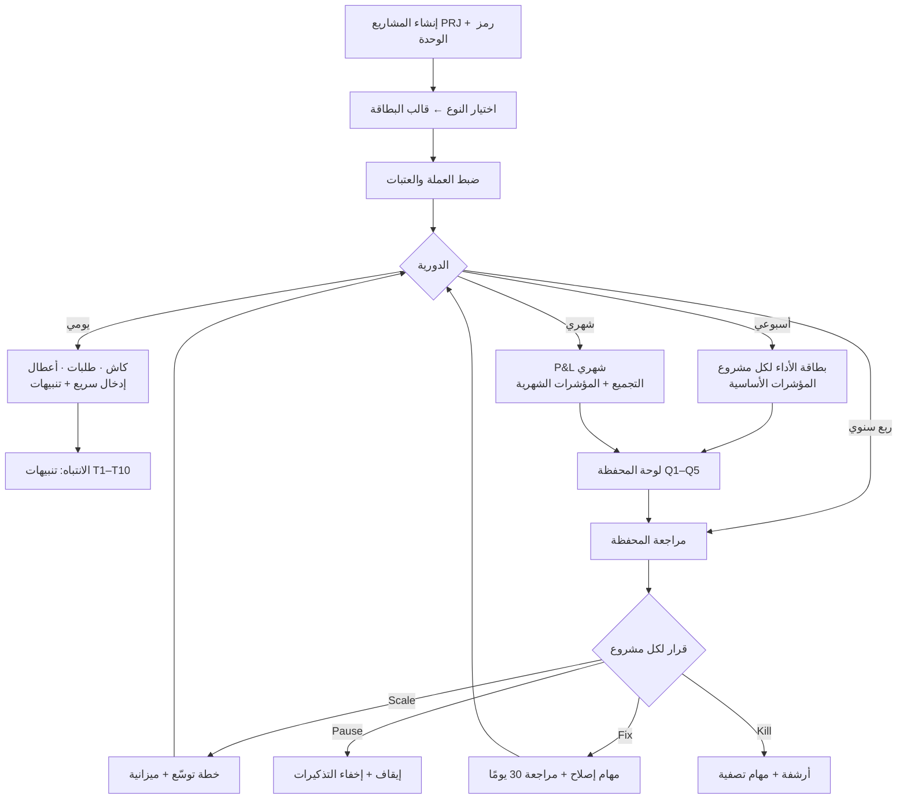

# 📊 Projects OS — بطاقات الأداء الموحّدة للمحفظة (27 مشروعًا) + تدفّق المراجعة (الإصدار 1.0)

> **ملحق للملف:** `MASTERPLAN_MIGRATION_PROJECT_TYPES_TRACKING_v1.md` (أنواع المشاريع ووحدات التتبّع). هذا الملف **يضيف** إليه ولا يستبدله، ويستخدم نفس المفاهيم (النوع ← ملف وحدات، وضع «تتبّع»، `useRecordStore`، المجموعات الصلاحية).
>
> **مصدره:** النص الذي أرفقتَه (أولًا… سادسًا): المؤشرات المشتركة، المتاجر الـ11 (دروبشيبينج/POD/رقمي)، التطبيقات الـ3، المدونات الـ11، البزنس الأرضي (O01/O02)، والربط في نظام واحد.
>
> **حدود:** هذا تصميم مواصفات لم يُنفَّذ في الكود بعد. لا أعرف أسماء مشاريعك الـ27 ولا أي مشروع من E01–E11 هو دروبشيبينج أو POD أو رقمي (انظر §14). كل ما هو منقول حرفيًا من نصك موسوم 📝، وكل قرار مني موسوم 🛠️.

---

## 0) الفهرس
1. ماذا أخذت من النص وأين وضعته · 2. المحفظة: الأنواع والأكواد · 3. محرّك المؤشرات (كيف تُخزَّن وتُحسب) · 4. **المؤشرات المشتركة لكل مشروع** · 5. **بطاقة المتجر + دروبشيبينج + POD + رقمي** · 6. **بطاقة التطبيق** · 7. **بطاقة المدونة** · 8. **بطاقة البزنس الأرضي (O01/O02)** · 9. مؤشر القرار وسجل القرارات (Scale/Fix/Pause/Kill) · 10. المعادلات · 11. الربط الموحّد (IDs، UTM، SKU، Events، الربط المالي) · 12. **لوحة المحفظة (الأسئلة الخمسة)** · 13. **التدفّق التشغيلي (يومي/أسبوعي/شهري/ربع سنوي)** · 14. الشاشات والأزرار والخانات · 15. نموذج البيانات والصلاحيات · 16. إنشاء الـ27 مشروعًا دفعة واحدة · 17. اختبارات القبول · 18. خطة التنفيذ · 19. الفجوات والقرارات

---

## 1) ماذا أخذت من النص وأين وضعته
| جزء النص | ماذا فعلت به | القسم |
|---|---|---|
| أولًا: القاسم المشترك (7 مجموعات) | **بطاقة مشتركة** تظهر في كل مشروع مهما كان نوعه | §4 |
| معادلات أساسية (الربح الإجمالي، CAC، ROAS، MER، AOV، CVR، المرتجعات، LTV/CAC) | مؤشرات **مشتقة** تُحسب ولا تُدخل | §10 |
| ثانيًا: المتاجر (بطاقة موحدة + 3 أنواع) | بطاقة متجر + إضافات لكل نوع | §5 |
| ثالثًا: التطبيقات | بطاقة تطبيق مختلفة تمامًا عن المتجر | §6 |
| رابعًا: المدونات | بطاقة مدونة | §7 |
| خامسًا: البزنس الأرضي O01/O02 | بطاقتان | §8 |
| «مؤشر القرار» لكل نوع + Scale/Fix/Pause/Kill | مؤشر قرار معروض + سجل قرارات | §9 |
| سادسًا: IDs/UTM/SKU/Events/ربط مالي | أدوات وقواعد تسمية تفرضها الشاشات | §11 |
| لوحة المحفظة (5 أسئلة) | لوحة محفظة فيها بطاقة لكل سؤال | §12 |
| دورية المراجعة يومي/أسبوعي/شهري/ربع سنوي | تدفّق + مهام مكررة + شاشات | §13 |
| «مصدر واحد للحقيقة» (Sheets/GA4/المنصات/POS/المحاسبة) | **أُجِّل**: الإدخال اليدوي/CSV أولًا، التوصيلات لاحقًا | §18 |

**ما غيّرته أو أضفته 🛠️ (بدقّة):**
- **صافي الربح** لم يُعرَّف في نصك؛ اعتمدت `الربح الإجمالي − مصاريف التشغيل − مصاريف التسويق`.
- **ROAS** في نصك «الإيراد ÷ مصاريف الإعلانات»؛ جعلته `الإيراد المنسوب للإعلانات ÷ مصاريف الإعلانات` (حقل إدخال إضافي) لأن إيراد الموقع كله لا يُنسب للإعلان. إن أردته كما كتبت اجعل الحقل = الإيراد.
- **العتبات (أخضر/أحمر):** نصك لا يحدد أرقامًا، فلم أخترع أي رقم. العتبات فارغة افتراضيًا وتضبطها أنت لكل مؤشر.
- **حقول مساعدة** (مثل `orders` و`ad_revenue`) أضفتها لأن الصيغ لا تعمل بدونها.
- **مجموعة «أساسي»** من المؤشرات لكل نوع (§3.4) لأن إدخال 40–50 مؤشرًا أسبوعيًا لـ27 مشروعًا غير واقعي يدويًا.

---

## 2) المحفظة: الأنواع والأكواد

### 2.1 ربط مشاريعك بأنواع النظام
| مجموعتك | العدد | نوع المشروع في النظام | ملف المؤشرات |
|---|---|---|---|
| متاجر دروبشيبينج | ؟ من 11 | `store_dropship` | متجر + دروبشيبينج |
| متاجر POD | ؟ من 11 | `store_pod` **(جديد)** | متجر + POD |
| متاجر رقمية | ؟ من 11 | `digital_product` | متجر + رقمي |
| تطبيقات A01–A03 | 3 | `app` | تطبيق |
| مدونات B01–B11 | 11 | `website_content` | مدونة |
| بزنس أرضي O01 (تيشرتات) | 1 | `offline_retail` **(جديد)** + `subtype=apparel` | أرضي O01 |
| بزنس أرضي O02 (منتجات عامة) | 1 | `offline_retail` + `subtype=general` | أرضي O02 |

يُضاف النوعان الجديدان إلى قائمة الأنواع في الملف الأول (§4.1)، ومصفوفة الوحدات تحصل على ثلاث وحدات جديدة:

| الوحدة الجديدة | متجر | تطبيق | مدونة | أرضي | عمل/أخرى |
|---|---|---|---|---|---|
| **بطاقة الأداء** (§4–8) | ✔ | ✔ | ✔ | ✔ | ○ (المشتركة فقط) |
| **القرارات** (§9) | ✔ | ✔ | ✔ | ✔ | ✔ |
| **أدوات الربط** (UTM/SKU/Events) (§11) | ✔ | ○ (UTM+Events) | ✔ (UTM) | ○ (SKU) | — |

### 2.2 الأكواد
| الكود | الشكل | مثال | قاعدة |
|---|---|---|---|
| **كود المشروع** `code` | `PRJ-###` | `PRJ-007` | فريد في الـworkspace، **لا يتغيّر بعد الإنشاء**، يُولَّد تلقائيًا بالتسلسل |
| **رمز الوحدة** `unit_code` | `E01–E11` · `A01–A03` · `B01–B11` · `O01–O02` | `B04` | يُدخل عند الإنشاء؛ البادئة تُحدَّد من `kind`، والرقم فريد داخل البادئة |
| **نوع الكيان** `kind` | `store` · `app` · `blog` · `offline` | — | يحدد رمز الوحدة وبطاقة الأداء |

---

## 3) محرّك المؤشرات

### 3.1 الفكرة
بدل 250+ عمودًا ثابتًا، المؤشرات **تعريفات** (`p_metric_defs`) وقيمها **سجلات** (`p_metric_values`): سجل لكل (مشروع، فترة، مؤشر). فتُضاف مؤشرات جديدة دون تعديل قاعدة البيانات، وتتغيّر البطاقة حسب النوع بتغيير القالب فقط.

### 3.2 أنواع المؤشرات
| النوع | معناه | يُخزَّن؟ |
|---|---|---|
| **إدخال** | رقم تكتبه أو تلصقه أو يستورده CSV | نعم |
| **مشتق** | يُحسب من إدخالات (مثل CAC) | **لا** (يُحسب دائمًا، مبدأ M12) |
| **نص/جدول** | ملاحظة أو جدول فرعي (مصادر، حملات، SKU، أسباب…) | نعم |
| **نعم/لا** | خانة (مثل «اعتماد على مورد واحد») | نعم |

### 3.3 الفترات والعملات
- **الفترة:** يومي / أسبوعي / شهري / ربع سنوي. بداية الأسبوع إعداد (الافتراضي **السبت** 🛠️ لأن التوقيت القاهري).
- **كل مؤشر له تكرار موصى به** (عمود «التكرار»)؛ المؤشر الشهري لا يُطلب أسبوعيًا.
- **الفترة الناقصة:** مؤشر بلا قيمة يظهر «—» ويُهمَل من المتوسطات (لا يُعدّ صفرًا). صفر حقيقي يُدخل صراحةً.
- **العملة:** لكل مشروع عملة (`currency`). تجميع المحفظة يتطلب جدول أسعار صرف شهريًا (`p_fx_rates`) تُدخله أنت؛ بدونه لا تُجمَع الأرقام عبر عملات مختلفة (يظهر تنبيه، لا رقم خاطئ).

### 3.4 المجموعة «الأساسي» (الحد الأدنى الأسبوعي) 🛠️
الهدف: إدخال معقول لـ27 مشروعًا. الباقي شهري/ربع سنوي/اختياري ويُفعَّل من زر «الوضع الكامل».

| النوع | المؤشرات الأسبوعية الأساسية |
|---|---|
| **متجر (كل الأنواع)** | الإيراد · الطلبات · الجلسات · مصاريف الإعلانات · COGS · الشحن · الرسوم (منصة+دفع) · المرتجعات · الطلبات المتأخرة · تذاكر الدعم |
| **تطبيق** | التثبيتات · D1 · D7 · DAU · MRR (شهري) · Crash-free · التقييم · الإنفاق التسويقي |
| **مدونة** | الجلسات العضوية · كلمات Top 10 · CTR · نقرات الأفلييت · الإيراد (شهري) · أخطاء الفهرسة |
| **أرضي** | Footfall · الفواتير · الإيراد · COGS · الفاقد · الكاش (يومي) |

### 3.5 العتبات والتلوين
لكل مؤشر عتبتان اختياريتان (`good`، `bad`) حسب اتجاه «الأفضل» (↑ أو ↓). بلا عتبات يظهر الرقم بلا لون. زر **«🎯 العتبات»** في بطاقة الأداء. يُمكن ضبط عتبات افتراضية **لكل نوع** ثم تخصيصها لمشروع.

---

## 4) المؤشرات المشتركة لكل مشروع 📝
> مصدرها «أولًا». **تظهر في كل المشاريع** ولو كان لنوعها بطاقة خاصة (البطاقة الخاصة تضيف عليها). الأسئلة التي تجيب عنها: هل النمو صحي؟ ماذا يبيع وماذا يخسر؟ أين المخاطر؟ هل يستحق الوقت؟

| المجال | المؤشر | المفتاح | الوحدة | النوع | الصيغة / ملاحظة | التكرار | الأفضل |
|---|---|---|---|---|---|---|---|
| المالية | الإيراد | `revenue` | ج | إدخال | — | أسبوعي | ↑ |
| المالية | تكلفة البضاعة/الخدمة (COGS) | `cogs` | ج | إدخال | — | أسبوعي | ↓ |
| المالية | الربح الإجمالي | `gross_profit` | ج | مشتق | revenue − cogs | أسبوعي | ↑ |
| المالية | هامش الربح الإجمالي | `gross_margin_pct` | % | مشتق | gross_profit ÷ revenue | أسبوعي | ↑ |
| المالية | مصاريف التشغيل | `opex` | ج | إدخال | — | شهري | ↓ |
| المالية | مصاريف التسويق | `marketing_spend` | ج | إدخال | — | أسبوعي | ↓ |
| المالية | صافي الربح | `net_profit` | ج | مشتق | gross_profit − opex − marketing_spend 🛠️ (انتبه: لا تُدخل التسويق مرتين) | شهري | ↑ |
| المالية | التدفق النقدي | `cash_flow` | ج | إدخال | يُدخل أو يُربط لاحقًا بـ Finance OS | أسبوعي | ↑ |
| المالية | الذمم | `receivables` | ج | إدخال | — | شهري | ↓ |
| المالية | الضرائب/الرسوم | `taxes_fees` | ج | إدخال | — | شهري | ↓ |
| العملاء | عدد الطلبات/المعاملات | `orders` | # | إدخال | مدخل مساعد للحسابات | أسبوعي | ↑ |
| العملاء | عملاء جدد | `new_customers` | # | إدخال | — | أسبوعي | ↑ |
| العملاء | عملاء متكررون | `repeat_customers` | # | إدخال | — | أسبوعي | ↑ |
| العملاء | متوسط قيمة الطلب AOV | `aov` | ج | مشتق | revenue ÷ orders | أسبوعي | ↑ |
| العملاء | تكلفة اكتساب العميل CAC | `cac` | ج | مشتق | marketing_spend ÷ new_customers | أسبوعي | ↓ |
| العملاء | قيمة العميل LTV | `ltv` | ج | إدخال | تُدخل حسب نموذج عملك (لا تُحسب تلقائيًا) | ربع سنوي | ↑ |
| العملاء | LTV ÷ CAC | `ltv_cac` | × | مشتق | ltv ÷ cac — الحكم عليها حسب نموذج العمل | ربع سنوي | ↑ |
| العملاء | معدل الشراء المتكرر | `repeat_rate` | % | مشتق | repeat_customers ÷ (new_customers + repeat_customers) 🛠️ | شهري | ↑ |
| العملاء | الشكاوى | `complaints` | # | إدخال | — | أسبوعي | ↓ |
| العملاء | متوسط التقييمات | `rating_avg` | 1–5 | إدخال | — | شهري | ↑ |
| التسويق | الجلسات/الزيارات | `sessions` | # | إدخال | — | أسبوعي | ↑ |
| التسويق | أهم المصادر | `top_sources` | نص | نص/جدول | من جدول المصادر أو نص | أسبوعي | — |
| التسويق | معدل التحويل CVR | `cvr` | % | مشتق | orders ÷ sessions | أسبوعي | ↑ |
| التسويق | مصاريف الإعلانات | `ad_spend` | ج | إدخال | — | أسبوعي | ↓ |
| التسويق | الإيراد المنسوب للإعلانات | `ad_revenue` | ج | إدخال | مدخل مساعد لحساب ROAS 🛠️ | أسبوعي | ↑ |
| التسويق | ROAS | `roas` | × | مشتق | ad_revenue ÷ ad_spend | أسبوعي | ↑ |
| التسويق | MER | `mer` | × | مشتق | revenue ÷ marketing_spend | أسبوعي | ↑ |
| التسويق | عدد الليدز | `leads` | # | إدخال | للخدمات/المدونات | أسبوعي | ↑ |
| التسويق | تكلفة الليد | `cost_per_lead` | ج | مشتق | marketing_spend ÷ leads | أسبوعي | ↓ |
| التسويق | إيراد الإيميل/SMS | `email_sms_revenue` | ج | إدخال | — | شهري | ↑ |
| المنتج/الخدمة | المرتجعات | `returns` | # | إدخال | — | أسبوعي | ↓ |
| المنتج/الخدمة | معدل المرتجعات | `return_rate` | % | مشتق | returns ÷ orders | أسبوعي | ↓ |
| المنتج/الخدمة | مشاكل الجودة | `quality_issues` | # | إدخال | — | أسبوعي | ↓ |
| المنتج/الخدمة | المخزون (وحدات) | `stock_units` | # | إدخال | إن وُجد | أسبوعي | — |
| المنتج/الخدمة | مدة التنفيذ | `fulfillment_days` | يوم | إدخال | — | أسبوعي | ↓ |
| التشغيل | التأخيرات | `delays` | # | إدخال | — | أسبوعي | ↓ |
| التشغيل | الأخطاء | `errors` | # | إدخال | — | أسبوعي | ↓ |
| التشغيل | تذاكر الدعم | `support_tickets` | # | إدخال | — | أسبوعي | ↓ |
| التشغيل | متوسط وقت الرد | `avg_response_hours` | ساعة | إدخال | — | أسبوعي | ↓ |
| المخاطر | اعتماد على منصة واحدة | `dep_platform` | نعم/لا | نعم/لا | — | ربع سنوي | ↓ |
| المخاطر | اعتماد على مورد واحد | `dep_supplier` | نعم/لا | نعم/لا | — | ربع سنوي | ↓ |
| المخاطر | اعتماد على حساب إعلاني واحد | `dep_ad_account` | نعم/لا | نعم/لا | — | ربع سنوي | ↓ |
| المخاطر | إيراد أكبر منتج | `top_product_revenue` | ج | إدخال | مدخل مساعد | شهري | — |
| المخاطر | تركّز الإيراد | `revenue_concentration_pct` | % | مشتق | top_product_revenue ÷ revenue | شهري | ↓ |
| المخاطر | بنود امتثال مفتوحة | `compliance_open` | # | مشتق | من وحدة الامتثال | شهري | ↓ |
| المخاطر | خطر ملكية فكرية | `ip_risk` | نعم/لا | نعم/لا | — | ربع سنوي | ↓ |
| المشروع نفسه | المالك | `owner` | شخص | نص/جدول | من حقل Lead في المشروع | — | — |
| المشروع نفسه | المرحلة | `phase` | قائمة | نص/جدول | من شجرة المهام | — | — |
| المشروع نفسه | المهام المتأخرة | `overdue_tasks` | # | مشتق | من المهام | أسبوعي | ↓ |
| المشروع نفسه | العوائق | `blockers` | نص | نص/جدول | — | أسبوعي | — |
| المشروع نفسه | القرار: Scale / Fix / Pause / Kill | `decision` | قائمة | نص/جدول | سجل قرارات (§9) | ربع سنوي | — |

**ملاحظات على المشتركة:**
- «الإيراد وحده مضلل؛ المهم الربح والكاش» 📝 ← لذلك تعرض البطاقة **الربح الإجمالي وصافي الربح والتدفق النقدي** بحجم أكبر من الإيراد.
- المجموعة «المشروع نفسه» لا تُدخل: المالك والمرحلة والمتأخرات تأتي من مهام Projects OS، والقرار من سجل القرارات (§9) — **لا ازدواج**.
- المخاطر المنطقية (نعم/لا) تُراجع ربع سنويًا؛ وتغذي «تركّز المخاطر» في لوحة المحفظة (§12).

---

## 5) بطاقة المتجر الإلكتروني (E01–E11) 📝
> **بطاقة موحدة** لكل المتاجر الـ11، ثم **إضافات** حسب النوع. تُضاف فوق المؤشرات المشتركة (§4).

### 5.1 البطاقة الموحدة (كل المتاجر)
| المجال | المؤشر | المفتاح | الوحدة | النوع | الصيغة / ملاحظة | التكرار | الأفضل |
|---|---|---|---|---|---|---|---|
| المبيعات | عدد القطع المباعة | `items_sold` | # | إدخال | — | أسبوعي | ↑ |
| المبيعات | قطع/طلب | `items_per_order` | # | مشتق | items_sold ÷ orders | أسبوعي | ↑ |
| المبيعات | سلال أُنشئت | `carts_created` | # | إدخال | — | أسبوعي | — |
| المبيعات | معدل السلة المتروكة | `abandoned_cart_rate` | % | مشتق | 1 − (orders ÷ carts_created) | أسبوعي | ↓ |
| المبيعات | بدء الدفع | `checkout_started` | # | إدخال | — | أسبوعي | — |
| المبيعات | معدل إتمام الدفع | `checkout_completion_rate` | % | مشتق | orders ÷ checkout_started | أسبوعي | ↑ |
| الربحية | تكلفة الشحن | `shipping_cost` | ج | إدخال | — | أسبوعي | ↓ |
| الربحية | رسوم المنصة | `platform_fees` | ج | إدخال | — | شهري | ↓ |
| الربحية | رسوم الدفع | `payment_fees` | ج | إدخال | — | شهري | ↓ |
| الربحية | قيمة المرتجعات | `returns_value` | ج | إدخال | — | أسبوعي | ↓ |
| الربحية | صافي المساهمة | `contribution_net` | ج | مشتق | revenue − cogs − shipping_cost − platform_fees − payment_fees − ad_spend − returns_value | أسبوعي | ↑ |
| الربحية | صافي المساهمة لكل طلب | `contribution_per_order` | ج | مشتق | contribution_net ÷ orders | أسبوعي | ↑ |
| التسويق | CTR | `ctr` | % | إدخال | — | أسبوعي | ↑ |
| التسويق | CPC | `cpc` | ج | إدخال | — | أسبوعي | ↓ |
| التسويق | الجلسات حسب المصدر | `sessions_by_source` | جدول | نص/جدول | جدول فرعي: المصدر · الجلسات | أسبوعي | — |
| التسويق | أداء الحملات | `campaign_performance` | جدول | نص/جدول | جدول فرعي: الحملة · إنفاق · إيراد · ROAS | أسبوعي | — |
| المنتج | أفضل 20 منتج/SKU | `top_skus` | جدول | مشتق | يُرتَّب تلقائيًا من جدول SKU حسب صافي المساهمة | شهري | — |
| المنتج | المنتجات الخاسرة | `losing_skus` | # | مشتق | عدد SKU صافي مساهمتها < 0 | شهري | ↓ |
| المنتج | معدل المرتجعات لكل منتج | `return_rate_by_sku` | % | مشتق | من جدول SKU | شهري | ↓ |
| المنتج | شكاوى الجودة | `quality_complaints` | # | إدخال | — | أسبوعي | ↓ |
| العميل | سبب الاسترجاع | `return_reason` | جدول | نص/جدول | جدول فرعي: السبب · العدد | شهري | — |
| التشغيل | وقت التجهيز | `prep_days` | يوم | إدخال | — | أسبوعي | ↓ |
| التشغيل | وقت الشحن | `ship_days` | يوم | إدخال | — | أسبوعي | ↓ |
| التشغيل | طلبات متأخرة | `late_orders` | # | إدخال | — | أسبوعي | ↓ |
| التشغيل | نسبة الطلبات المتأخرة | `late_orders_pct` | % | مشتق | late_orders ÷ orders | أسبوعي | ↓ |
| التشغيل | أخطاء الطلب | `order_errors` | # | إدخال | — | أسبوعي | ↓ |
| المخزون (اختياري) | متوسط البيع اليومي | `avg_daily_sales` | # | إدخال | — | أسبوعي | — |
| المخزون (اختياري) | أيام المخزون | `stock_days` | يوم | مشتق | stock_units ÷ avg_daily_sales | أسبوعي | — |
| المخزون (اختياري) | وحدات مباعة | `units_sold` | # | إدخال | — | أسبوعي | ↑ |
| المخزون (اختياري) | معدل البيع | `sell_through` | % | مشتق | units_sold ÷ (units_sold + stock_units) 🛠️ | شهري | ↑ |
| المخزون (اختياري) | مخزون ميت | `dead_stock_units` | # | إدخال | — | شهري | ↓ |
| المخزون (اختياري) | حالات نقص المخزون | `stockouts` | # | إدخال | — | أسبوعي | ↓ |

### 5.2 إضافات متاجر الدروبشيبينج
**مؤشر القرار الأساسي 📝:** `contribution_net` (صافي المساهمة بعد الإعلان والشحن والرسوم) — «وليس ROAS فقط».

| المجال | المؤشر | المفتاح | الوحدة | النوع | الصيغة / ملاحظة | التكرار | الأفضل |
|---|---|---|---|---|---|---|---|
| أداء المورد | مدة تجهيز المورد | `supplier_prep_days` | يوم | إدخال | — | أسبوعي | ↓ |
| أداء المورد | مدة شحن المورد | `supplier_ship_days` | يوم | إدخال | — | أسبوعي | ↓ |
| أداء المورد | نسبة تأخر المورد | `supplier_late_pct` | % | إدخال | — | أسبوعي | ↓ |
| أداء المورد | نسبة أخطاء المورد | `supplier_error_pct` | % | إدخال | — | أسبوعي | ↓ |
| أداء المورد | نسبة الإلغاء | `supplier_cancel_pct` | % | إدخال | — | أسبوعي | ↓ |
| جودة المنتج | تقييم المنتج | `product_rating` | 1–5 | إدخال | — | شهري | ↑ |
| النزاعات المالية | Chargebacks | `chargebacks` | # | إدخال | — | أسبوعي | ↓ |
| النزاعات المالية | النزاعات | `disputes` | # | إدخال | — | أسبوعي | ↓ |
| النزاعات المالية | قيمة الاستردادات | `refunds_value` | ج | إدخال | — | أسبوعي | ↓ |
| النزاعات المالية | نسبة الاسترداد | `refund_pct` | % | مشتق | refunds_value ÷ revenue | أسبوعي | ↓ |
| مزامنة المخزون | أخطاء نفاد المخزون | `oos_errors` | # | إدخال | — | أسبوعي | ↓ |
| مزامنة المخزون | طلبات لم تُنفَّذ | `unfulfilled_orders` | # | إدخال | — | أسبوعي | ↓ |
| مزامنة المخزون | اختلاف السعر | `price_mismatch` | # | إدخال | — | أسبوعي | ↓ |
| أداء المنتج | منتجات مختبرة | `products_tested` | # | إدخال | معدل الاختبار | شهري | ↑ |
| أداء المنتج | منتجات رابحة | `winning_products` | # | إدخال | — | شهري | ↑ |
| أداء المنتج | نسبة المنتجات الرابحة | `winner_rate` | % | مشتق | winning_products ÷ products_tested | شهري | ↑ |
| الاعتماد | إيراد أكبر مورد | `top_supplier_revenue` | ج | إدخال | — | شهري | — |
| الاعتماد | نسبة الإيراد من مورد واحد | `top_supplier_share_pct` | % | مشتق | top_supplier_revenue ÷ revenue | شهري | ↓ |
| الاعتماد | نسبة الإيراد من منتج واحد | `top_product_share_pct` | % | مشتق | top_product_revenue ÷ revenue | شهري | ↓ |

### 5.3 إضافات متاجر الطباعة عند الطلب (POD)
**مؤشر القرار 📝:** هامش الربح لكل تصميم + معدل الشكاوى/الاستبدال.

| المجال | المؤشر | المفتاح | الوحدة | النوع | الصيغة / ملاحظة | التكرار | الأفضل |
|---|---|---|---|---|---|---|---|
| أداء التصميم | مبيعات كل تصميم | `design_sales` | جدول | مشتق | جدول التصاميم: التصميم · مبيعات · CTR · CVR | أسبوعي | ↑ |
| أداء التصميم | أفضل تصميم/منتج | `best_design` | نص | مشتق | أعلى هامش | شهري | — |
| الهوامش | تكلفة القطعة الفارغة | `blank_cost` | ج | إدخال | لكل SKU | شهري | ↓ |
| الهوامش | تكلفة الطباعة | `print_cost` | ج | إدخال | لكل SKU | شهري | ↓ |
| الهوامش | الشحن | `pod_shipping` | ج | إدخال | — | شهري | ↓ |
| الهوامش | هامش كل تصميم/مقاس/لون | `design_margin` | ج | مشتق | sell_price − blank_cost − print_cost − pod_shipping − رسوم | شهري | ↑ |
| الجودة | شكاوى الطباعة | `print_complaints` | # | إدخال | — | أسبوعي | ↓ |
| الجودة | العيوب | `defects` | # | إدخال | — | أسبوعي | ↓ |
| الجودة | المرتجعات/الاستبدال | `replacements` | # | إدخال | حسب المقاس أو اللون | أسبوعي | ↓ |
| الجودة | معدل الشكاوى/الاستبدال | `complaint_rate` | % | مشتق | (print_complaints + replacements) ÷ orders 🛠️ | أسبوعي | ↓ |
| الإنتاج | مدة الإنتاج | `production_days` | يوم | إدخال | — | أسبوعي | ↓ |
| الإنتاج | مدة الشحن | `pod_ship_days` | يوم | إدخال | — | أسبوعي | ↓ |
| الإنتاج | طلبات متأخرة | `pod_late_orders` | # | إدخال | — | أسبوعي | ↓ |
| الموسمية | إيراد التصميمات الموسمية | `seasonal_revenue` | ج | إدخال | وسم التصميم: عيد/ترند/موسم | شهري | — |
| المخاطر | مخاطر حقوق الملكية | `ip_flags` | # | إدخال | — | شهري | ↓ |
| المخاطر | تصميمات مقلدة | `copied_designs` | # | إدخال | — | شهري | ↓ |
| المخاطر | الاعتماد على مورّد POD | `pod_supplier_share_pct` | % | إدخال | — | ربع سنوي | ↓ |

### 5.4 إضافات المتاجر الرقمية
**مؤشر القرار 📝:** صافي الإيراد بعد الرسوم والاسترداد + تكلفة اكتساب العميل.

| المجال | المؤشر | المفتاح | الوحدة | النوع | الصيغة / ملاحظة | التكرار | الأفضل |
|---|---|---|---|---|---|---|---|
| القمع | زيارات صفحة المنتج | `product_views` | # | إدخال | — | أسبوعي | ↑ |
| القمع | إضافة للسلة | `add_to_cart` | # | إدخال | — | أسبوعي | ↑ |
| القمع | إتمام الشراء | `purchases` | # | إدخال | — | أسبوعي | ↑ |
| القمع | معدل التحويل | `digital_cvr` | % | مشتق | purchases ÷ product_views | أسبوعي | ↑ |
| التسليم | مشاكل الوصول/التحميل | `access_issues` | # | إدخال | — | أسبوعي | ↓ |
| التسليم | نسبة مشاكل الوصول | `access_issue_rate` | % | مشتق | access_issues ÷ purchases | أسبوعي | ↓ |
| التسليم | إعادة الإرسال | `resends` | # | إدخال | — | أسبوعي | ↓ |
| الاسترداد | عدد الاستردادات | `refunds` | # | إدخال | — | أسبوعي | ↓ |
| الاسترداد | معدل الاسترداد | `refund_rate` | % | مشتق | refunds ÷ purchases | أسبوعي | ↓ |
| الاسترداد | سبب الاسترداد | `refund_reason` | جدول | نص/جدول | جدول فرعي | شهري | — |
| الاسترداد | النزاعات | `disputes` | # | إدخال | — | أسبوعي | ↓ |
| القيمة | طلبات فيها Upsell/Bundle | `upsell_orders` | # | إدخال | — | أسبوعي | ↑ |
| القيمة | Upsell/Bundle attach rate | `attach_rate` | % | مشتق | upsell_orders ÷ purchases | أسبوعي | ↑ |
| القيمة | إيميلات مكتسبة | `emails_captured` | # | إدخال | — | أسبوعي | ↑ |
| الحماية | قرصنة/تسريب | `piracy_incidents` | # | إدخال | — | شهري | ↓ |
| الحماية | متوسط التحميلات/ترخيص | `downloads_per_license` | # | إدخال | إن أمكن | شهري | — |
| الاشتراكات (إن وجدت) | بداية تجارب | `trials` | # | إدخال | — | أسبوعي | ↑ |
| الاشتراكات (إن وجدت) | تحويل Trial → Paid | `paid_from_trial` | # | إدخال | — | أسبوعي | ↑ |
| الاشتراكات (إن وجدت) | نسبة Trial → Paid | `trial_to_paid` | % | مشتق | paid_from_trial ÷ trials | شهري | ↑ |
| الاشتراكات (إن وجدت) | مشتركون نشطون | `active_subs` | # | إدخال | — | شهري | ↑ |
| الاشتراكات (إن وجدت) | مشتركون ألغوا | `churned_subs` | # | إدخال | — | شهري | ↓ |
| الاشتراكات (إن وجدت) | Churn | `churn` | % | مشتق | churned_subs ÷ مشتركي بداية الفترة | شهري | ↓ |
| الاشتراكات (إن وجدت) | MRR | `mrr` | ج | إدخال | — | شهري | ↑ |
| الاشتراكات (إن وجدت) | ARPU | `arpu` | ج | مشتق | mrr ÷ active_subs | شهري | ↑ |
| المحتوى | جلسات محتوى مؤدية للمنتج | `content_sessions` | # | إدخال | — | شهري | ↑ |
| المحتوى | مشتريات من المحتوى | `purchases_from_content` | # | إدخال | — | شهري | ↑ |
| المحتوى | تحويل المحتوى → المنتج | `content_to_product_cvr` | % | مشتق | purchases_from_content ÷ content_sessions | شهري | ↑ |
| المحتوى | صافي الإيراد بعد الرسوم والاسترداد | `net_revenue` | ج | مشتق | revenue − رسوم − refunds_value | شهري | ↑ |

### 5.5 جداول فرعية للمتاجر (تغذي البطاقة)
| الجدول | الأعمدة | يغذّي |
|---|---|---|
| **SKU** (`p_skus`) | الكود · الاسم · النوع · التكلفة · السعر · الحالة · (دروبشيبينج) المورد · (POD) التصميم/المقاس/اللون | أفضل 20، الخاسرة، هامش كل SKU/تصميم |
| **مبيعات SKU بالفترة** (`p_sku_periods`) | SKU · الفترة · وحدات · إيراد · مرتجعات · إنفاق إعلاني (اختياري) | صافي مساهمة لكل SKU، معدل المرتجعات لكل منتج |
| **الجلسات حسب المصدر** | المصدر · الوسيط · الجلسات | أهم المصادر |
| **الحملات** (`p_campaigns`) | كود الحملة · القناة · إنفاق · إيراد | أداء الحملات، ROAS لكل حملة |

---

## 6) بطاقة التطبيق (A01–A03) 📝
> **مختلفة عن المتجر**: القلب هو **الاحتفاظ والتفعيل**. تُضاف فوق المشتركة (والتي تُقرأ هنا بمعنى المشتركين/الاشتراكات: الإيراد = إيراد الاشتراكات والمشتريات).
>
> **مؤشر القرار 📝:** `D30 Retention` + `MRR` + `Crash-free`. «لو الاحتفاظ ضعيف، لا تصرف على الاكتساب» ← تظهر هذه الجملة كتنبيه في البطاقة عندما D30 تحت عتبته وإنفاق الاكتساب مرتفع (القاعدة T4 في §12.4).

| المجال | المؤشر | المفتاح | الوحدة | النوع | الصيغة / ملاحظة | التكرار | الأفضل |
|---|---|---|---|---|---|---|---|
| الاكتساب | مشاهدات صفحة المتجر | `listing_views` | # | إدخال | — | أسبوعي | ↑ |
| الاكتساب | التثبيتات | `installs` | # | إدخال | — | أسبوعي | ↑ |
| الاكتساب | CPI | `cpi` | ج | مشتق | ad_spend ÷ installs_paid (إن لم يُدخَل installs_paid يُستخدم installs) | أسبوعي | ↓ |
| الاكتساب | تحويل صفحة المتجر | `listing_cvr` | % | مشتق | installs ÷ listing_views | أسبوعي | ↑ |
| الاكتساب | مصادر التثبيت | `install_sources` | جدول | نص/جدول | جدول فرعي | أسبوعي | — |
| التفعيل | إتمام Onboarding | `onboarding_completion` | % | إدخال | — | أسبوعي | ↑ |
| التفعيل | أول جلسة | `first_session_rate` | % | إدخال | — | أسبوعي | ↑ |
| التفعيل | أول إجراء أساسي | `first_core_action_rate` | % | إدخال | — | أسبوعي | ↑ |
| التفعيل | معدل الإسقاط لكل خطوة | `step_dropoff` | جدول | نص/جدول | جدول فرعي: الخطوة · النسبة | أسبوعي | ↓ |
| الاحتفاظ | D1 Retention | `d1` | % | إدخال | — | أسبوعي | ↑ |
| الاحتفاظ | D7 Retention | `d7` | % | إدخال | — | أسبوعي | ↑ |
| الاحتفاظ | D30 Retention | `d30` | % | إدخال | — | شهري | ↑ |
| الاحتفاظ | DAU | `dau` | # | إدخال | — | أسبوعي | ↑ |
| الاحتفاظ | MAU | `mau` | # | إدخال | — | شهري | ↑ |
| الاحتفاظ | DAU ÷ MAU | `stickiness` | % | مشتق | dau ÷ mau | شهري | ↑ |
| الاحتفاظ | جلسات/مستخدم | `sessions_per_user` | # | إدخال | — | أسبوعي | ↑ |
| الاحتفاظ | مدة الجلسة | `session_minutes` | دقيقة | إدخال | — | أسبوعي | ↑ |
| الإيراد | Trial start | `trial_starts` | # | إدخال | — | أسبوعي | ↑ |
| الإيراد | Trial → Paid | `trial_to_paid_pct` | % | إدخال | — | شهري | ↑ |
| الإيراد | MRR | `mrr` | ج | إدخال | — | شهري | ↑ |
| الإيراد | ARPU | `arpu` | ج | إدخال | — | شهري | ↑ |
| الإيراد | Churn | `churn` | % | إدخال | — | شهري | ↓ |
| الإيراد | Refunds | `refunds` | # | إدخال | — | شهري | ↓ |
| الإيراد | مشاهدات Paywall | `paywall_views` | # | إدخال | — | أسبوعي | — |
| الإيراد | Paywall CVR | `paywall_cvr` | % | مشتق | مشتريات ÷ paywall_views | أسبوعي | ↑ |
| التفاعل | استخدام الميزات الأساسية | `core_feature_usage` | % | إدخال | — | أسبوعي | ↑ |
| التفاعل | Feature adoption | `feature_adoption` | % | إدخال | — | شهري | ↑ |
| التفاعل | Push opt-in | `push_optin` | % | إدخال | — | شهري | ↑ |
| التفاعل | فتح الإشعارات | `notification_open_rate` | % | إدخال | — | شهري | ↑ |
| الجودة التقنية | Crash-free sessions | `crash_free` | % | إدخال | — | أسبوعي | ↑ |
| الجودة التقنية | ANR | `anr_rate` | % | إدخال | — | أسبوعي | ↓ |
| الجودة التقنية | أخطاء API | `api_errors` | # | إدخال | — | أسبوعي | ↓ |
| الجودة التقنية | زمن التحميل | `load_ms` | ms | إدخال | — | أسبوعي | ↓ |
| الجودة التقنية | أداء الإصدارات | `release_perf` | جدول | نص/جدول | جدول فرعي: الإصدار · Crash-free · تقييم | شهري | — |
| المتجر | التقييم | `store_rating` | 1–5 | إدخال | — | أسبوعي | ↑ |
| المتجر | المراجعات | `reviews_count` | # | إدخال | — | أسبوعي | ↑ |
| المتجر | الشكاوى | `store_complaints` | # | إدخال | — | أسبوعي | ↓ |
| المتجر | حالة الامتثال | `compliance_status` | قائمة | نص/جدول | ok / تحذير / مخالفة | شهري | — |
| المتجر | سياسة الخصوصية سارية | `privacy_policy_ok` | نعم/لا | نعم/لا | — | ربع سنوي | ↑ |
| الدعم | تذاكر | `app_tickets` | # | إدخال | — | أسبوعي | ↓ |
| الدعم | وقت الرد | `app_response_hours` | ساعة | إدخال | — | أسبوعي | ↓ |
| الدعم | أسباب الإلغاء | `cancel_reasons` | جدول | نص/جدول | جدول فرعي | شهري | — |
| المخاطر | اعتماد على متجر واحد | `dep_single_store` | نعم/لا | نعم/لا | — | ربع سنوي | ↓ |
| المخاطر | تغيير سياسات المتجر | `policy_change` | نص | نص/جدول | — | ربع سنوي | — |
| المخاطر | منافس جديد | `competitor_note` | نص | نص/جدول | — | ربع سنوي | — |
| المخاطر | تكلفة الاستضافة | `hosting_cost` | ج | إدخال | — | شهري | ↓ |

---

## 7) بطاقة المدونة (B01–B11) 📝
> **مؤشر القرار 📝:** الجلسات العضوية المؤهلة + الإيراد لكل 1000 جلسة (RPM أو EPC).

| المجال | المؤشر | المفتاح | الوحدة | النوع | الصيغة / ملاحظة | التكرار | الأفضل |
|---|---|---|---|---|---|---|---|
| النمو العضوي | جلسات عضوية | `organic_sessions` | # | إدخال | — | أسبوعي | ↑ |
| النمو العضوي | جلسات عضوية مؤهلة | `qualified_organic_sessions` | # | إدخال | ما تعدّه أنت مؤهلًا (دولة/نية) | أسبوعي | ↑ |
| النمو العضوي | صفحات مفهرسة | `indexed_pages` | # | إدخال | — | شهري | ↑ |
| النمو العضوي | كلمات في Top 3 | `kw_top3` | # | إدخال | — | أسبوعي | ↑ |
| النمو العضوي | كلمات في Top 10 | `kw_top10` | # | إدخال | — | أسبوعي | ↑ |
| النمو العضوي | متوسط الترتيب | `avg_position` | # | إدخال | — | أسبوعي | ↓ |
| النمو العضوي | CTR | `organic_ctr` | % | إدخال | — | أسبوعي | ↑ |
| المحتوى | مقالات منشورة | `articles_published` | # | إدخال | — | شهري | ↑ |
| المحتوى | أداء كل مقال | `article_performance` | جدول | نص/جدول | جدول المقالات: عنوان · جلسات · إيراد · آخر تحديث | شهري | — |
| المحتوى | محتوى متهاوٍ (Decay) | `decaying_articles` | # | إدخال | — | شهري | ↓ |
| المحتوى | فرص التحديث | `refresh_opportunities` | # | إدخال | — | شهري | — |
| التفاعل | وقت القراءة | `read_time` | ثانية | إدخال | — | أسبوعي | ↑ |
| التفاعل | Scroll depth | `scroll_depth` | % | إدخال | — | أسبوعي | ↑ |
| التفاعل | Engagement | `engagement_rate` | % | إدخال | — | أسبوعي | ↑ |
| التفاعل | Bounce | `bounce_rate` | % | إدخال | — | أسبوعي | ↓ |
| التفاعل | صفحات/جلسة | `pages_per_session` | # | إدخال | — | أسبوعي | ↑ |
| التحويل | تسجيل الإيميل | `email_signups` | # | إدخال | — | أسبوعي | ↑ |
| التحويل | تحميل Lead magnet | `leadmagnet_downloads` | # | إدخال | — | أسبوعي | ↑ |
| التحويل | نقرات أفلييت | `affiliate_clicks` | # | إدخال | — | أسبوعي | ↑ |
| التحويل | تحويلات لمنتج/خدمة | `product_conversions` | # | إدخال | — | شهري | ↑ |
| الإيراد | إيراد إعلانات | `ad_revenue_blog` | ج | إدخال | — | شهري | ↑ |
| الإيراد | RPM | `rpm` | ج | مشتق | ad_revenue_blog ÷ sessions × 1000 | شهري | ↑ |
| الإيراد | إيراد أفلييت | `affiliate_revenue` | ج | إدخال | — | شهري | ↑ |
| الإيراد | EPC | `epc` | ج | مشتق | affiliate_revenue ÷ affiliate_clicks | شهري | ↑ |
| الإيراد | إيراد منتجات | `product_revenue` | ج | إدخال | — | شهري | ↑ |
| الإيراد | إيراد رعاية | `sponsorship_revenue` | ج | إدخال | — | شهري | ↑ |
| الإيراد | الإيراد لكل 1000 جلسة | `rev_per_1000` | ج | مشتق | revenue ÷ sessions × 1000 | شهري | ↑ |
| SEO تقني | Core Web Vitals (نسبة الصفحات الناجحة) | `cwv_pass_pct` | % | إدخال | — | شهري | ↑ |
| SEO تقني | سرعة الصفحة | `page_speed` | ث | إدخال | — | شهري | ↓ |
| SEO تقني | أخطاء الفهرسة | `indexing_errors` | # | إدخال | — | أسبوعي | ↓ |
| SEO تقني | الروابط الداخلية | `internal_links` | # | إدخال | — | شهري | ↑ |
| SEO تقني | Backlinks | `backlinks` | # | إدخال | — | شهري | ↑ |
| المخاطر | محتوى AI مكرر | `dup_ai_content` | # | إدخال | — | شهري | ↓ |
| المخاطر | حالات Cannibalization | `cannibalization` | # | إدخال | — | شهري | ↓ |
| المخاطر | اعتماد على كلمة واحدة | `top_keyword_share` | % | إدخال | نسبة الجلسات من أكبر كلمة | شهري | ↓ |
| المخاطر | تأثير تحديثات جوجل | `core_update_note` | نص | نص/جدول | — | ربع سنوي | — |

**ملاحظة:** وحدات المدونة الموجودة أصلًا (الكلمات، المحتوى، الباك لينك، فحص SEO… في الملف الأول) هي **سجلات تفصيلية**؛ بطاقة الأداء هنا **ملخص الفترة**. المؤشرات المشتركة بينهما (مثل `kw_top10`) يمكن أن **تُحسب تلقائيًا** من وحدة الكلمات بدل الإدخال اليدوي (خيار «مصدر القيمة: وحدة الكلمات»).

---

## 8) بطاقة البزنس الأرضي 📝

### 8.1 O01 — بيع تيشرتات
**مؤشر القرار 📝:** هامش المساهمة لكل متر مربع + Sell-through للمقاسات/التصميمات.

| المجال | المؤشر | المفتاح | الوحدة | النوع | الصيغة / ملاحظة | التكرار | الأفضل |
|---|---|---|---|---|---|---|---|
| المبيعات | الزوار Footfall | `footfall` | # | إدخال | — | يومي | ↑ |
| المبيعات | عدد الفواتير | `transactions` | # | إدخال | — | يومي | ↑ |
| المبيعات | معدل التحويل | `offline_cvr` | % | مشتق | transactions ÷ footfall | أسبوعي | ↑ |
| المبيعات | قطع/فاتورة | `units_per_invoice` | # | مشتق | items_sold ÷ transactions | أسبوعي | ↑ |
| المنتج | مبيعات كل تصميم/مقاس/لون | `variant_sales` | جدول | نص/جدول | جدول SKU | أسبوعي | — |
| المنتج | Sell-through | `sell_through_o` | % | مشتق | units_sold ÷ (units_sold + stock_units) | شهري | ↑ |
| المنتج | مخزون ميت | `dead_stock_o` | # | إدخال | — | شهري | ↓ |
| المنتج | أيام المخزون | `stock_days_o` | يوم | مشتق | stock_units ÷ avg_daily_sales | شهري | — |
| الربحية | تكلفة القطعة | `unit_cost` | ج | إدخال | — | شهري | ↓ |
| الربحية | الطباعة | `print_cost_o` | ج | إدخال | — | شهري | ↓ |
| الربحية | الإيجار | `rent` | ج | إدخال | — | شهري | ↓ |
| الربحية | الرواتب | `payroll` | ج | إدخال | — | شهري | ↓ |
| الربحية | المساحة (م²) | `area_sqm` | م² | إدخال | ثابت للفرع | — | — |
| الربحية | هامش المساهمة | `contribution_margin` | ج | مشتق | revenue − cogs − print_cost_o − رسوم متغيّرة 🛠️ | شهري | ↑ |
| الربحية | هامش المساهمة لكل م² | `contribution_per_sqm` | ج/م² | مشتق | contribution_margin ÷ area_sqm | شهري | ↑ |
| الجودة | المرتجعات/الاستبدال | `returns_exchanges` | # | إدخال | — | أسبوعي | ↓ |
| الجودة | العيوب | `defects_o` | # | إدخال | — | أسبوعي | ↓ |
| الجودة | الشكاوى | `complaints_o` | # | إدخال | — | أسبوعي | ↓ |
| التشغيل | دقة المخزون | `inventory_accuracy` | % | إدخال | — | شهري | ↑ |
| التشغيل | فرق الجرد | `count_variance` | # | إدخال | — | شهري | ↓ |
| التشغيل | الفاقد | `shrinkage` | # | إدخال | — | شهري | ↓ |
| التشغيل | وقت التجهيز | `prep_time_o` | دقيقة | إدخال | — | أسبوعي | ↓ |
| التسويق المحلي | العروض المنفّذة | `offers_run` | # | إدخال | — | شهري | — |
| التسويق المحلي | الإحالات | `referrals` | # | إدخال | — | شهري | ↑ |
| التسويق المحلي | سوشيال محلي (وصول) | `local_social_reach` | # | إدخال | — | شهري | ↑ |

### 8.2 O02 — بيع منتجات عامة
**مؤشر القرار 📝:** معدل دوران المخزون + هامش المساهمة للفرع.

| المجال | المؤشر | المفتاح | الوحدة | النوع | الصيغة / ملاحظة | التكرار | الأفضل |
|---|---|---|---|---|---|---|---|
| المبيعات | Footfall | `footfall` | # | إدخال | — | يومي | ↑ |
| المبيعات | عدد الفواتير | `transactions` | # | إدخال | — | يومي | ↑ |
| المبيعات | Conversion | `offline_cvr` | % | مشتق | transactions ÷ footfall | أسبوعي | ↑ |
| المبيعات | Basket size (قطع/فاتورة) | `basket_size` | # | مشتق | items_sold ÷ transactions | أسبوعي | ↑ |
| المخزون | متوسط قيمة المخزون | `inventory_value_avg` | ج | إدخال | — | شهري | — |
| المخزون | معدل دوران المخزون | `inventory_turnover` | × | مشتق | cogs ÷ inventory_value_avg | شهري | ↑ |
| المخزون | أيام التغطية | `days_cover` | يوم | مشتق | inventory_value_avg ÷ (cogs ÷ أيام الفترة) | شهري | — |
| المخزون | SKU بطيء | `slow_skus` | # | إدخال | — | شهري | ↓ |
| المخزون | الفاقد Shrinkage | `shrinkage_pct` | % | إدخال | — | شهري | ↓ |
| المخزون | دقة الجرد | `count_accuracy` | % | إدخال | — | شهري | ↑ |
| الربحية | هامش كل SKU | `sku_margin` | جدول | مشتق | من جدول SKU | شهري | ↑ |
| الربحية | ربحية الفرع | `branch_profit` | ج | مشتق | gross_profit − opex | شهري | ↑ |
| الربحية | هامش مساهمة الفرع | `branch_contribution` | ج | مشتق | gross_profit − تكاليف الفرع المباشرة | شهري | ↑ |
| العملاء | تكرار الشراء | `repeat_o` | % | إدخال | — | شهري | ↑ |
| العملاء | عملاء جدد | `new_o` | # | إدخال | — | شهري | ↑ |
| العملاء | شكاوى | `complaints_o` | # | إدخال | — | أسبوعي | ↓ |
| العملاء | مرتجعات | `returns_o` | # | إدخال | — | أسبوعي | ↓ |
| الموردون | مدة التوريد | `supplier_lead_days` | يوم | إدخال | — | شهري | ↓ |
| الموردون | الالتزام | `supplier_compliance` | % | إدخال | — | شهري | ↑ |
| الموردون | جودة الدفعات | `batch_quality` | 1–5 | إدخال | — | شهري | ↑ |
| التشغيل | الكاش | `cash_on_hand` | ج | إدخال | — | يومي | — |
| التشغيل | الورديات | `shifts` | # | إدخال | — | أسبوعي | — |
| التشغيل | الموظفون | `staff_count` | # | إدخال | — | شهري | — |
| التشغيل | الفاقد التشغيلي | `shrink_ops` | # | إدخال | — | شهري | ↓ |

**ملاحظة:** البزنس الأرضي له **إدخال يومي** (Footfall، الفواتير، الكاش) لأن الكاش والفاقد لا ينتظران أسبوعًا. في الأسبوع/الشهر تُجمع اليوميات تلقائيًا (جمع الإدخالات من نوع «عدد»، ومتوسط/آخر قيمة لغيرها حسب تعريف المؤشر).

---

## 9) مؤشر القرار وسجل القرارات

### 9.1 مؤشر القرار لكل نوع 📝
| النوع | مؤشر القرار المعروض في رأس البطاقة |
|---|---|
| دروبشيبينج | صافي المساهمة بعد الإعلان والشحن والرسوم |
| POD | هامش الربح لكل تصميم + معدل الشكاوى/الاستبدال |
| رقمي | صافي الإيراد بعد الرسوم والاسترداد + CAC |
| تطبيق | D30 Retention + MRR + Crash-free |
| مدونة | الجلسات العضوية المؤهلة + الإيراد/1000 جلسة |
| أرضي O01 | هامش المساهمة/م² + Sell-through |
| أرضي O02 | دوران المخزون + هامش مساهمة الفرع |

### 9.2 سجل القرارات (`p_decisions`) — Scale / Fix / Pause / Kill
| الخانة | النوع | إلزامي | ماذا تفعل |
|---|---|---|---|
| القرار | Scale · Fix · Pause · Kill | نعم | اختيار واحد |
| السبب | نص | نعم | لا يُحفظ بدون سبب |
| الأدلة | تلقائي | — | لقطة بمؤشر القرار وصافي الربح والتدفق وآخر 4 فترات وقت اتخاذ القرار (لا تتغيّر لاحقًا) |
| موعد المراجعة القادمة | تاريخ | نعم | يولّد مهمة تذكير |
| المسؤول | شخص | نعم | من ينفّذ |
| أنشئ مهام المتابعة | خانة | لا | ينشئ مهام جاهزة حسب القرار (أدناه) |

| القرار | ماذا يحدث تلقائيًا (بعد تأكيدك) |
|---|---|
| **Scale** | مهمة «خطة التوسّع» + اقتراح ميزانية + علامة ⭐ في المحفظة |
| **Fix** | مهمة لكل مؤشر خارج العتبة + موعد مراجعة قصير (افتراضي 30 يومًا) |
| **Pause** | حالة المشروع «متوقف»؛ تُخفى تذكيرات الأسبوعي؛ يبقى في المحفظة بشارة |
| **Kill** | تأكيد بكتابة كود المشروع؛ المشروع «مؤرشف»؛ لا حذف بيانات؛ مهمة «تصفية: إعلانات/اشتراكات/دومين» |

**الصلاحية:** مسؤول فأعلى. المحرر يقترح قرارًا (يُرسَل للمراجعة).
**لا قرار تلقائي:** النظام قد **يقترح** (إن ضُبطت عتبات) لكن لا يقرّر ولا يغيّر الحالة وحده.

---

## 10) المعادلات 📝 (كلها مشتقة، null-safe)
| المعادلة | الصيغة | قاعدة القسمة على صفر/الفراغ |
|---|---|---|
| الربح الإجمالي | الإيراد − COGS | فراغ إن أحدهما فارغ |
| هامش الربح الإجمالي | الربح الإجمالي ÷ الإيراد | «—» إن الإيراد = 0 |
| CAC | مصاريف التسويق ÷ عملاء جدد | «—» إن لا عملاء جدد (لا ∞) |
| ROAS | إيراد منسوب للإعلانات ÷ مصاريف الإعلانات | «—» إن لا إنفاق |
| MER | إجمالي الإيراد ÷ إجمالي مصاريف التسويق | «—» إن لا إنفاق |
| AOV | الإيراد ÷ عدد الطلبات | «—» إن لا طلبات |
| CVR | الطلبات ÷ الجلسات | «—» إن لا جلسات |
| معدل المرتجعات | المرتجعات ÷ الطلبات | «—» إن لا طلبات |
| LTV/CAC | LTV ÷ CAC | «—»؛ **التفسير حسب نموذج العمل** 📝 لذلك لا لون افتراضي |
| صافي الربح 🛠️ | الربح الإجمالي − التشغيل − التسويق | تحذير «تأكد ألا يكون التسويق داخل التشغيل» |
| صافي المساهمة (متجر) | الإيراد − COGS − الشحن − رسوم المنصة − رسوم الدفع − الإعلانات − المرتجعات | الأجزاء الفارغة تُحسب «—» وتظهر الشارة «ناقص: …» ولا تُعامل صفرًا |

**قاعدة عامة:** المشتق **لا يظهر رقمًا** إن كان أحد مدخلاته ناقصًا؛ يظهر «—» مع تلميح «ينقص: {الحقل}». هذا يمنع أرقامًا مضلّلة (نفس درس الخلل B5 في Masterplan).

---

## 11) الربط الموحّد في نظام واحد (من «سادسًا») 📝

### 11.1 IDs موحدة
المنفّذة في §2.2 (`PRJ-###` + رمز الوحدة). يظهر الكود في كل قائمة وتقرير ومعرّف مهمة، ويُبحَث به.

### 11.2 UTM موحد — شاشة «منشئ UTM»
**الخانات:**
| الخانة | إلزامي | القاعدة |
|---|---|---|
| المشروع | نعم | يُحدّد `code` |
| `utm_source` | نعم | قائمة (facebook, instagram, google, tiktok, email, sms…) قابلة للتوسعة؛ أحرف صغيرة |
| `utm_medium` | نعم | قائمة (cpc, social, email, organic, referral, affiliate…) |
| `utm_campaign` | نعم | يُبنى تلقائيًا `prj-007_اسم-الحملة` 🛠️ (كود المشروع + اسم بأحرف صغيرة وشرطات) |
| `utm_content` | لا | للنسخة/الكرييتيف |
| `utm_term` | لا | للكلمة |
| الرابط الوجهة | نعم | `https://` فقط |

**الأزرار:** «توليد» (يعرض الرابط) · «📋 نسخ» · «💾 حفظ كحملة» (يُنشئ سجلًا في `p_campaigns` لتظهر في تقارير القنوات) · «تحقق» (يكشف التكرار وأحرفًا غير مسموحة).
**التحقق:** لا مسافات ولا حروف كبيرة؛ لا يتجاوز 100 حرف لكل جزء؛ كود الحملة فريد داخل المشروع.

### 11.3 SKU موحد — شاشة «مولّد SKU»
**الصيغة 📝:** كود المشروع + النوع + المنتج + المقاس/اللون ← `PRJ-007-TS-HOODIE-L-BLK`.
| الخانة | القاعدة |
|---|---|
| المشروع | يحدد البادئة |
| النوع | قائمة تعرّفها أنت (TS=تيشرت، HD=هودي، DG=رقمي…) |
| المنتج | حروف/أرقام/شرطات، حتى 20 |
| المقاس / اللون | اختياري؛ أكواد قصيرة من قوائمك |
- **الفرادة:** يرفض SKU مكررًا داخل المشروع. **لا يغيّر SKU بعد وجود مبيعات عليه** (يُؤرشف ويُنشأ جديد).
- زر «توليد دفعة» من CSV (منتج × مقاسات × ألوان).

### 11.4 Events موحدة — «قاموس الأحداث» (مرجع + تعيين)
هذا **قاموس مرجعي** يوحّد أسماء الأحداث ويربطها بمؤشرات البطاقة؛ لا يركّب كود تتبّع في مواقعك (هذا خارج النظام الحالي).
| الحدث | يغذّي المؤشر | الأنواع |
|---|---|---|
| `view_item` | `product_views` | متجر، رقمي |
| `add_to_cart` | `add_to_cart` | متجر، رقمي |
| `purchase` | `orders` · `revenue` · `purchases` | متجر، رقمي |
| `sign_up` | `new_customers` · `email_signups` | الكل |
| `trial_start` | `trial_starts` / `trials` | تطبيق، رقمي |
| `subscription_start` | `active_subs` / `mrr` | تطبيق، رقمي |
| `app_open` | `dau` · `sessions_per_user` | تطبيق |
| `onboarding_complete` | `onboarding_completion` | تطبيق |
| `lead` | `leads` | مدونة، خدمات |
| `offline_sale` | `transactions` · `revenue` | أرضي |

**الفائدة العملية الآن:** عند استيراد CSV من GA4 أو منصة المتجر يُستخدم هذا الجدول كخريطة أعمدة جاهزة. **لاحقًا:** توصيلات مباشرة (§18).

### 11.5 الربط المالي
نصّك: «كل إيراد/مصروف مرتبط بمشروع + قناة + SKU/حملة».
- السجل المالي التتبّعي `p_ledger` (من الملف الأول) يحصل على حقول: `project_id` · `channel` · `sku` · `campaign_code` · `kind` (إيراد/مصروف/COGS/تسويق/رسوم/ضريبة).
- **مبدأ §15.3:** Finance OS هو مالك المعاملات. هنا **تتبّع غير رسمي** للقرار؛ وحين يُربط Finance OS تُستبدل الإدخالات بربط عبر `project_id` و`campaign_code`.
- **مصدر أرقام P&L الشهري:** إن وُجدت حركات في `p_ledger` لتلك الفترة فهي المصدر (شارة «من السجل المالي»)، وإلا فالمؤشرات المُدخلة (شارة «ملخص مُدخل»). لا خلط بينهما في نفس الفترة.

### 11.6 «لوحة واحدة»
تبويب **محفظة** + تبويب **لكل مشروع** + تبويب **قنوات** (§14).

---

## 12) لوحة المحفظة: الأسئلة الخمسة 📝

> عتبات الأعداد (مثل «3 فترات») إعدادات تضبطها. لا قرار تلقائي: اللوحة **تقترح وتبرز** والقرار لك.

### 12.1 كل سؤال ← بطاقة ← حساب فعلي
| # | السؤال | البطاقة | كيف تُحسب بالضبط | البيانات اللازمة |
|---|---|---|---|---|
| Q1 | أي مشروع يولّد **ربحًا نقديًا فعليًا**؟ | «يولّد كاشًا» | `cash_flow > 0` و`net_profit > 0` لآخر N فترات (افتراضي 3)، مرتّبة بالتدفق | `cash_flow`, `net_profit` |
| Q2 | أي مشروع **يستهلك وقتًا/كاشًا بلا أفق**؟ | «يستنزف» | `cash_flow ≤ 0` **و**اتجاه الإيراد ≤ 0 لآخر N فترات **و**وقت مسجّل في المؤقّت > حد (اختياري) | `cash_flow`, `revenue`, وقت المهام |
| Q3 | أين **تركّز الإيراد والمخاطر**؟ | «التركّز» | حصة كل مشروع من إيراد المحفظة؛ وعدد المشاريع المعتمدة على نفس المنصة/المورد/الحساب الإعلاني؛ وأكبر منتج في كل مشروع | `revenue`, `dep_*`, `revenue_concentration_pct` |
| Q4 | أي مشروع **يستحق Scale**؟ | «مرشّح للتوسّع» | `net_profit > 0` **و**مؤشر القرار يتحسّن لفترتين **و**صحة المشروع ليست حمراء **و**بلا مخاطر حرجة مفتوحة | مؤشر القرار حسب النوع |
| Q5 | أي مشروع **Fix / Pause / Kill**؟ | «يحتاج قرارًا» | مؤشر القرار تحت عتبة «سيّئ» أو `net_profit < 0` لـN فترات، أو قرار منتهي موعد مراجعته | العتبات + سجل القرارات |

> **شرط التشغيل:** بلا عتبات لا تظهر قوائم Q4/Q5 «المقترحة»، فقط ترتيب حسب مؤشر القرار مع ملاحظة «اضبط العتبات لتظهر الاقتراحات».

### 12.2 الجدول الرئيسي للمحفظة (صف لكل مشروع)
| العمود | المصدر |
|---|---|
| الكود · الرمز (PRJ-007 · B04) | §2.2 |
| الاسم · النوع | المشروع |
| الإيراد · صافي الربح · التدفق النقدي | المؤشرات (محوّلة لعملة العرض) |
| **مؤشر القرار** (اسمه حسب النوع + قيمته + سهم الاتجاه) | §9.1 |
| المخاطر (أعلام: منصة/مورد/إعلان/IP) | §4 |
| القرار الحالي + تاريخه | §9.2 |
| الصحة | صحة Projects OS |
| **آخر تحديث للبيانات** | شارة رمادية «قديم» إن فات أكثر من فترة |

**أزرار/تحكمات:** مرشّحات (النوع · الكيان · الحالة · المسؤول · القرار) · اختيار الفترة · عملة العرض · ترتيب بأي عمود · «تصدير CSV» · «ابدأ مراجعة ربع سنوية» (§13).

### 12.3 رسوم اللوحة
تركّز الإيراد (أعمدة مكدّسة حسب المشروع) · خريطة مخاطر (مصفوفة مشروع × نوع خطر) · أداء مؤشر القرار عبر الزمن لكل مجموعة (متاجر/تطبيقات/مدونات/أرضي).

### 12.4 تنبيهات بطاقات الأداء (تُضاف إلى §9 في الملف الأول)
| # | القاعدة | الخطورة |
|---|---|---|
| T1 | بيانات الفترة لم تُسجَّل (أسبوعي متأخر 3 أيام) | معلومة |
| T2 | صافي المساهمة < 0 لفترتين (متجر) | تحذير |
| T3 | معدل الاسترداد/المرتجعات فوق عتبته | تحذير |
| T4 | **D30 تحت عتبته مع إنفاق اكتساب مرتفع** (تطبيق) — «لا تصرف على الاكتساب» | تحذير |
| T5 | Crash-free تحت العتبة | حرج |
| T6 | SKU صافي مساهمته سالب 4 أسابيع | معلومة |
| T7 | اعتماد > X% على مورد/منتج واحد | تحذير |
| T8 | فاقد/فرق جرد فوق العتبة (أرضي) | تحذير |
| T9 | قرار منتهي موعد مراجعته | تحذير |
| T10 | مدونة: محتوى متهاوٍ فوق عتبة | معلومة |

---

## 13) التدفّق التشغيلي (الدورية) 📝

### 13.1 المخطط

### 13.2 الجدول التنفيذي
| الدورية | ماذا تفعل | الشاشة | ما يولّده النظام |
|---|---|---|---|
| **يومي** | تسجّل الكاش والطلبات والأعطال (للأرضي: Footfall والفواتير) · تفتح «الانتباه» | «إدخال سريع» + الانتباه | تنبيهات؛ لا مهام إلا إن اخترت |
| **أسبوعي** | تُدخل **المؤشرات الأساسية** لكل مشروع (أو تلصقها من جدول) | بطاقة الأداء ← «＋ تسجيل الفترة» | مهمة مكررة «بطاقة الأداء الأسبوعية» لكل مشروع نشط + تنبيه T1 عند التأخر |
| **شهري** | تُدخل المؤشرات الشهرية وتراجع **P&L** | «P&L الشهري» (عرض مشتق) | مهمة «مراجعة الشهر»؛ تقرير PDF/CSV |
| **ربع سنوي** | تراجع المحفظة وتتخذ **Scale/Fix/Pause/Kill** لكل مشروع | «مراجعة ربع سنوية» (معالج §14.6) | سجل قرارات + مهام المتابعة |

> **المهام المكررة:** تُنشأ بقاعدة تكرار على مهام Projects OS. **أفترض** أن النظام الحالي يدعم تكرار المهام؛ إن لم يكن، تُضاف قاعدة التكرار ضمن المرحلة 1 (§18).

### 13.3 معالج المراجعة الربع سنوية (خطوات)
1. **اختر الربع** ← يعرض كل المشاريع النشطة مع مؤشر القرار.
2. **راجع الأسئلة الخمسة** (بطاقات Q1–Q5 بالأرقام).
3. **مشروع بمشروع:** شاشة بمؤشر القرار + آخر 4 فترات + المخاطر + المهام المتأخرة + العوائق ← زر **«اتخذ قرارًا»** (§9.2).
4. **ملخص:** عدد القرارات لكل نوع + المهام التي ستُنشأ ← «تأكيد وإنشاء».
5. **تقرير الربع** (CSV/PDF) محفوظ.
المشروع الذي لم تُحدّث بياناته يظهر بشارة «بيانات قديمة» ويُنصح بتحديثها قبل القرار (لا يُمنع).

---

## 14) الشاشات والأزرار والخانات

### 14.1 تبويب «بطاقة الأداء» داخل المشروع
**الرأس:**
| العنصر | ماذا يفعل |
|---|---|
| مبدّل **أسبوع / شهر / ربع** | يغيّر الفترة المعروضة (البطاقات تُعاد حسابها) |
| **◀ ▶** وقائمة الفترة | تنقّل بين الفترات |
| مبدّل **أساسي / كامل** | يخفي/يُظهر المؤشرات غير الأساسية (§3.4) |
| **مؤشر القرار** (بطاقة كبيرة) | القيمة + الاتجاه + لونها حسب العتبة |
| زر **＋ تسجيل الفترة** | يفتح نموذج الإدخال (أدناه) |
| زر **لصق من جدول** | تلصق صفوفًا من Sheets (مفتاح ← قيمة)؛ يعرض معاينة ثم «تطبيق» |
| زر **استيراد CSV** | أعمدة: `period,key,value,note`؛ يتحقق ويعرض الأخطاء قبل الحفظ |
| زر **مقارنة** | فترتان، أو هذا المشروع مقابل مشروع آخر من نفس النوع |
| زر **🎯 العتبات** | يحرّر `good/bad` لكل مؤشر (لهذا المشروع أو افتراضي النوع) |
| زر **⋯ تصدير** | CSV للبطاقة |

**البطاقات:** مجموعات حسب المجال (المالية، العملاء، …). كل مؤشر: **القيمة · الفرق عن الفترة السابقة (% وسهم) · مخطط مصغّر لآخر 8 فترات · لون العتبة · أيقونة ⓘ (التعريف والصيغة) · شارة «مشتق» أو «إدخال»**. مؤشر ناقص: «—» مع «ينقص: …».

**نموذج «تسجيل الفترة»:**
| الخانة | القاعدة |
|---|---|
| الفترة | منتقي؛ لا يقبل فترة مستقبلية؛ يحذّر إن كانت مسجّلة (يفتحها للتعديل) |
| العملة | من المشروع؛ تغييرها هنا يحذّر |
| كل مؤشر إدخال | رقم ≥ 0 (إلا التدفق النقدي يقبل السالب)؛ **خانة «لا بيانات»** بجانب كل مؤشر تفرّق بين الصفر والفراغ |
| المشتقات | تُعرض حيّة (للقراءة فقط) أثناء الكتابة |
| الجداول الفرعية | زر «＋ صف» لكل جدول (مصدر، حملة، سبب…) |
| ملاحظة | نص حتى 500 حرف لكل مؤشر |
- **الحفظ:** «حفظ» (تحقق: أرقام صالحة، النسب 0–100، الأعداد صحيحة) ← قفل متفائل بالنسخة ← إشعار «تم». «حفظ وانتقل للمشروع التالي» **لتسريع الأسبوعي** (يفتح نفس الفترة للمشروع التالي النشط).
- **التقييد:** تعديل فترة قديمة (> 90 يومًا) يتطلب سببًا ويُسجَّل في السجل.

### 14.2 لوحة المحفظة
كما في §12 (بطاقات الأسئلة، الجدول، الرسوم، المرشّحات، التصدير).

### 14.3 تبويب «القنوات»
| الجزء | المحتوى |
|---|---|
| جدول القنوات | المصدر/الوسيط ← جلسات · إنفاق · إيراد · ROAS · CAC (من الحملات والجلسات) على مستوى المحفظة أو مشروع |
| مرشّحات | المشروع · الفترة · القناة |
| **أزرار** | «＋ حملة» (منشئ UTM) · «تصدير» |
- الأرقام تظهر فقط حيث توجد حملات بأكواد؛ «بدون UTM» تُجمَّع في صف مستقل لتُرى فجوة التتبّع.

### 14.4 نافذة «اتخاذ قرار»
حقول §9.2. أزرار: **حفظ القرار** · **إلغاء**. تأكيد إضافي لـ Kill (كتابة الكود). تظهر لقطة الأدلة قبل الحفظ.

### 14.5 شاشات الأدوات (§11)
«منشئ UTM» · «مولّد SKU» · «قاموس الأحداث» · «سجل الأكواد» (يعرض PRJ ورمز الوحدة وحالتهما).

### 14.6 معالج «مراجعة ربع سنوية»
§13.3.

### 14.7 الإعدادات الجديدة
| الإعداد | الافتراضي |
|---|---|
| بداية الأسبوع | السبت |
| عملة العرض للمحفظة | عملة المشروع الأكبر |
| أسعار الصرف الشهرية | فارغ (إدخال يدوي) |
| N (عدد الفترات لتقييم Q1/Q2/Q5) | 3 |
| قوالب المؤشرات والعتبات الافتراضية لكل نوع | فارغة العتبات |
| تفعيل قواعد T1–T10 | الكل |
| تذكير الإدخال الأسبوعي | يوم/ساعة تختارهما |

---

## 15) نموذج البيانات والصلاحيات

### 15.1 حقول جديدة على `projects`
| الحقل | النوع | ملاحظة |
|---|---|---|
| `code` | نص `PRJ-###` | فريد، ثابت |
| `unit_code` | نص | `E01…O02`، فريد داخل البادئة |
| `kind` | `store`/`app`/`blog`/`offline`/`other` | يحدد البطاقة |
| `subtype` | نص | `dropship`/`pod`/`digital`/`apparel`/`general`… |
| `currency` | نص ISO | |
| `scorecard_template` | نص | مشتق من النوع، قابل للتخصيص |

### 15.2 المجموعات الجديدة
| المجموعة | المحتوى | المجموعة الصلاحية |
|---|---|---|
| `p_metric_defs` | تعريفات المؤشرات (المفتاح، العنوان، الوحدة، النوع، الصيغة، التكرار، الاتجاه، أساسي؟، القوالب المطبَّق عليها، عتبات افتراضية) | `tracking_ops` |
| `p_mv_fin` | قيم المؤشرات **المالية** (الإيراد، التكاليف، الأرباح، التدفق، الذمم، الضرائب، LTV/CAC) | `tracking_money` (مسؤول فأعلى) |
| `p_mv_ops` | قيم باقي المؤشرات (تسويق، منتج، تشغيل، احتفاظ، SEO…) | `tracking_growth` (محرر يكتب) |
| `p_thresholds` | عتبات مخصّصة لكل مشروع/مؤشر | `tracking_ops` |
| `p_skus` · `p_sku_periods` | SKU ومبيعاتها | `tracking_money` |
| `p_campaigns` | الحملات وUTM | `tracking_growth` |
| `p_decisions` | القرارات | `decisions` (مسؤول فأعلى يكتب، الجميع يقرأ ما عدا المشاهد الخارجي) |
| `p_fx_rates` | أسعار الصرف | `tracking_money` |
| `p_code_registry` | سجل الأكواد (يمنع التكرار) | `imports` |

**كل سجل قيمة:** `project_id` · `period_type` · `period_start` · `key` · `value_num`/`value_text`/`value_bool` · `no_data` · `source` (`manual`/`paste`/`csv`/`derived_from_module`/`connector`) · `note` · `version` · `created_by` · `updated_at`. **المشتقات لا تُخزَّن.**
**تقسيم القيم إلى مجموعتين** (مالي/تشغيلي) هو الطريقة المتاحة لإخفاء المالية عن المحرر دون تعقيد صلاحيات الحقول؛ تعريف كل مؤشر يحدد في أي مجموعة تُكتب قيمته (`group = fin|ops`).

### 15.3 الصلاحيات
| الفعل | مشاهد | محرر | مسؤول | مالك |
|---|---|---|---|---|
| رؤية المؤشرات التشغيلية | ✔ | ✔ | ✔ | ✔ |
| رؤية المؤشرات المالية والمحفظة | ✘ | ✘ | ✔ | ✔ |
| تسجيل مؤشرات تشغيلية | ✘ | ✔ | ✔ | ✔ |
| تسجيل مؤشرات مالية | ✘ | ✘ | ✔ | ✔ |
| ضبط العتبات/القوالب | ✘ | ✘ | ✔ | ✔ |
| اتخاذ قرار | ✘ | يقترح | ✔ | ✔ |
| Kill (أرشفة) | ✘ | ✘ | ✔ | ✔ |

> **تنبيه تصميمي:** إن كان من يُدخل المالية هو المحرر عندك، غيّر مجموعة `tracking_money` الافتراضية إلى «محرر». القرار لك (§19-Q8).

ملف الترحيل (migration) يسجل المجموعات الجديدة ويضبط RLS؛ **لا يُطبَّق على القاعدة قبل موافقتك**.

---

## 16) إنشاء الـ27 مشروعًا دفعة واحدة
يُضاف إلى معالج النقل (الملف الأول §6) مصدرٌ ثالث: **«جدول CSV لمشاريع جديدة»** (وليس فقط Masterplan).

| العمود | إلزامي | القاعدة |
|---|---|---|
| `unit_code` | نعم | `E01–E11` / `A01–A03` / `B01–B11` / `O01–O02`؛ فريد |
| `name` | نعم | حتى 120 |
| `kind` | نعم | store/app/blog/offline (يتحقق من تطابقه مع البادئة) |
| `subtype` | للمتجر والأرضي | dropship/pod/digital · apparel/general |
| `owner_email` | نعم | يطابق شخصًا في الـworkspace |
| `currency` | نعم | ISO |
| `status` | لا | نشط افتراضيًا |
| `link` | لا | `https://` |
| `area_sqm` | للأرضي | رقم > 0 |

**المعاينة:** `code` (PRJ-###) يُولَّد ويُعرض؛ يعرض النوع المشتق وقالب البطاقة؛ يكتشف التكرار؛ **تجربة جافة** ثم «إنشاء». **التراجع** كما في المعالج (14 يومًا).
> الاتفاق: عند استيراد مواقع Masterplan (المدونات غالبًا) يُطبَّق نفس `unit_code`/`kind` في الخطوة 3 من المعالج، فلا يتكرر العمل.

---

## 17) اختبارات القبول
| # | السيناريو | المتوقع |
|---|---|---|
| PF-01 | إنشاء 27 مشروعًا من CSV | 27 كودًا PRJ تسلسلية فريدة؛ رموز الوحدات صحيحة |
| PF-02 | `unit_code` مكرر أو يخالف `kind` | يُرفض السطر مع السبب |
| PF-03 | تغيير `code` بعد الإنشاء | غير ممكن |
| PF-04 | مشروع `dropship` | تظهر البطاقة الموحدة + إضافات الدروبشيبينج، ولا تظهر إضافات POD |
| PF-05 | مشروع `app` | بطاقة التطبيق (احتفاظ/تفعيل/جودة) لا مبيعات متجر |
| PF-06 | إدخال إيراد 1000 وطلبات 0 | AOV = «—» لا ∞ |
| PF-07 | مصاريف التسويق مُدخلة وعملاء جدد فارغ | CAC = «—» مع «ينقص: عملاء جدد» |
| PF-08 | مؤشر فارغ مقابل صفر | الفارغ «—» ويُهمل من المتوسط؛ الصفر 0 |
| PF-09 | صافي المساهمة مع رسوم دفع مفقودة | يظهر «ناقص: رسوم الدفع» ولا رقم مضلل |
| PF-10 | لصق 30 مؤشرًا من Sheets | معاينة ثم تطبيق؛ الأخطاء تُعرض ولا تُحفظ |
| PF-11 | CSV بمؤشر غير معروف | يُهمل مع تحذير |
| PF-12 | فترتان لنفس المشروع | تعديل الموجودة لا إنشاء مكررة |
| PF-13 | محرر يفتح مؤشرات مالية | غير مرئية |
| PF-14 | بلا عتبات | لا ألوان ولا اقتراحات Q4/Q5، مع رسالة |
| PF-15 | بعد ضبط العتبات | تظهر الألوان والاقتراحات |
| PF-16 | مشروعان بعملتين وبلا سعر صرف | لا تجميع، ورسالة «أدخل سعر الصرف» |
| PF-17 | Kill | يطلب كتابة الكود؛ يؤرشف؛ لا حذف بيانات |
| PF-18 | Pause | حالة متوقف؛ اختفاء تذكير الأسبوعي |
| PF-19 | قرار بلا سبب | يُرفض |
| PF-20 | لقطة أدلة القرار | لا تتغيّر بعد تحديث القيم لاحقًا |
| PF-21 | UTM بحروف كبيرة ومسافات | يرفض أو يطبّع بتحذير |
| PF-22 | حفظ UTM كحملة | تظهر في «القنوات» |
| PF-23 | SKU مكرر داخل المشروع | يُرفض |
| PF-24 | تعديل SKU عليه مبيعات | غير مسموح (أرشفة وإنشاء جديد) |
| PF-25 | قناة بلا UTM | تُجمَّع في «بدون UTM» |
| PF-26 | T1 (أسبوعي متأخر) | تنبيه بعد 3 أيام |
| PF-27 | T4 (تطبيق D30 ضعيف + إنفاق) | تنبيه «لا تصرف على الاكتساب» |
| PF-28 | مشروع أرضي: إدخال يومي | يُجمع أسبوعيًا بقاعدة المؤشر (عدّ/متوسط/آخر) |
| PF-29 | معالج المراجعة الربع سنوية | قرار لكل مشروع نشط + مهام + تقرير |
| PF-30 | مشروع ببيانات قديمة في المراجعة | شارة «بيانات قديمة» ولا يُمنع |
| PF-31 | تعديل فترة عمرها > 90 يومًا | يطلب سببًا ويُسجَّل |
| PF-32 | تغيير نوع مشروع من dropship إلى pod | المؤشرات المُدخلة تبقى، والبطاقة تتبدّل، وغير المنطبق يظهر بشارة |

---

## 18) خطة التنفيذ
| المرحلة | المحتوى | يعمل في نهايتها |
|---|---|---|
| **1** | حقول المشروع (code/unit_code/kind/subtype/currency)، النوعان الجديدان، الإنشاء الدفعي من CSV، سجل الأكواد | الـ27 مشروعًا موجودة بأكوادها وأنواعها |
| **2** | محرّك المؤشرات + البطاقة المشتركة + بطاقة المدونة والمتجر (الأساسي) + إدخال/لصق/CSV | تسجيل أسبوعي فعلي لأغلب المحفظة |
| **3** | بطاقتا التطبيق والأرضي + بقية إضافات المتجر (دروبشيبينج/POD/رقمي) + SKU والحملات | كل البطاقات |
| **4** | سجل القرارات + لوحة المحفظة + تنبيهات T1–T10 + المهام المكررة | الدورة التشغيلية كاملة |
| **5** | معالج المراجعة الربع سنوية + P&L شهري + تبويب القنوات | المراجعة الدورية |
| **6** (لاحقًا) | توصيلات مباشرة (GA4، منصات المتاجر، App Store/Play، POS، المحاسبة)، ربط Finance OS | إدخال يدوي أقل |

**ما أنصح بالبدء به:** المرحلتان 1 و2 (تعطيك قاعدة البيانات الموحدة والإدخال الأسبوعي). المراحل الباقية تعتمد عليهما.

---

## 19) الفجوات والقرارات
| # | البند | الحالة |
|---|---|---|
| G1 | أسماء المشاريع الـ27 وتوزيع E01–E11 على دروبشيبينج/POD/رقمي | **ناقص** — أحتاج جدولًا بها (أو تكتب لي الأعداد). وجود CSV في §16 يغني عن الباقي |
| G2 | بعض المتاجر قد تجمع أكثر من نوع (دروبشيبينج + POD) | غير مغطى؛ الافتراضي نوع واحد لكل مشروع، وإضافات النوع الثاني يدويًا |
| G3 | العتبات | لم أضع أي رقم؛ تضبطها أنت (أو تعطيني أرقامك لأحوّلها لقوالب) |
| G4 | الإدخال اليدوي لـ27 مشروعًا | ثقيل؛ لذلك «الأساسي» وCSV؛ والتوصيلات المباشرة المرحلة 6 |
| G5 | وحدة الوقت المسجَّل (Q2) | تفترض استخدامك للمؤقّت؛ بدونه يُهمل شرط الوقت |
| G6 | تكرار المهام | أفترض أنه موجود في Projects OS؛ إن لم يكن يُبنى في المرحلة 1 |
| G7 | عملات متعددة | تحتاج أسعار صرف مُدخلة |
| G8 | غير منفَّذ | هذا الملف تصميم لم يُنفَّذ في الكود ولم أختبره |

**قرارات مطلوبة منك (الافتراضي بين قوسين):**
- **Q6:** هل «صافي الربح = الإجمالي − التشغيل − التسويق» مناسب لك؟ (نعم)
- **Q7:** هل أضيف النوع `store_pod` و`offline_retail` كنوعين جديدين؟ (نعم)
- **Q8:** من يُدخل المالية: مسؤول فقط أم المحرر أيضًا؟ (مسؤول فقط)
- **Q9:** بداية الأسبوع (السبت)؟
- **Q10:** هل تريد تفعيل «الأساسي» أسبوعيًا والباقي شهريًا؟ (نعم)
- **Q11:** هل تعتمد تعريف ROAS بحقل «الإيراد المنسوب للإعلانات»؟ (نعم)
