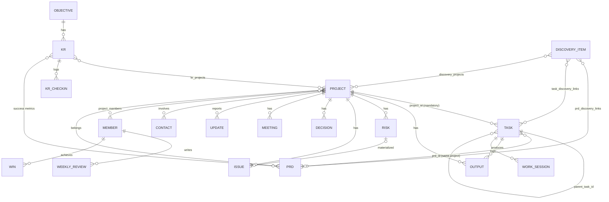

# 🚀 Projects OS — خطة العمل الموحّدة والكاملة (الإصدار 4.0)

**الغرض:** وثيقة بناء واحدة لتطبيق إدارة مشاريع **للفريق** (ويب + موبايل، عربي RTL) تجمع:
1. كل ميزات نظام **🚀 نظام المشاريع والمخرجات Projects OS** (النظام الأول).
2. كل ما يستحق الأخذ من صفحة **Projects** (النظام الثاني: Roadmap / OKR / PRD / PIO / Wins / Meetings / Updates).
3. حل صريح لكل **تعارض** وكل **فجوة** بين النظامين وبين الملفين السابقين (v2.0 الإنجليزي و v3.0 العربي).

**مصادر المراجعة:** قراءة مباشرة من Notion لكل قواعد البيانات (الحقول، العلاقات، الحالات، القوالب، الـ Views)، ودليل النظام الأول، والملفين المرفوعين.
**المرجع الأعلى عند التعارض:** هذه الوثيقة، ثم Notion (السلوك الفعلي المجرَّب)، ثم الملفين القديمين.

> **ملاحظة قراءة:** الرموز المستخدمة: `F-xx` ميزة محفوظة من النظام الأول، `S2-xx` عنصر من النظام الثاني، `C-xx` تعارض محسوم، `G-xx` فجوة مسدودة، `D-xx` قرار يحتاج تأكيدك (آخر الوثيقة)، `T-xx` اختبار قبول.

---

## 1) مراجعة كاملة لصفحة Projects (النظام الثاني)

### 1.1 ماذا تحتوي الصفحة فعليًا
- **واجهة الصفحة:** Team OKR's + Roadmap (جدولان)، وقسم **This Week** فيه (Tasks كـ Board، PIO، Wins).
- **صفحة Databases:** مجموعتان:
  - **Org:** Roadmap، Team OKR's، Teams، People، Meeting Notes.
  - **Items:** Tasks، Sub Tasks، PRDs، Problems/Ideas/Opportunities، Wins.
- **قاعدة updates:** تحديثات دورية للمستثمرين/أصحاب المصلحة، بقالب مكتوب.
- **قوالب:** PRD Template، 5 قوالب اجتماعات (Daily Standup, Weekly Sync, Sprint Planning, Post-mortem, Ad Hoc)، قالب Task (فيه قاعدة Sub Tasks مدمجة)، قالب New update.
- **Views:** Tasks كـ Board مجمّع حسب `Prioritised`، Roadmap كـ Timeline حسب `Duration`، Meeting Notes كقائمة.
- **لا توجد صيغ حسابية حقيقية** تقريبًا (Rollup واحد = عدّ المهام المكتملة، وصيغة Done في Sub Tasks). القيمة في **الربط والتتبع** وليس في الحساب.

### 1.2 جرد كل عنصر والحكم عليه

| # | العنصر في النظام الثاني | الحقول/الميزة | الحكم | القرار في النظام الموحّد |
|---|---|---|---|---|
| S2-01 | **Roadmap** | Name, Status (On Track/At Risk/Behind/Not started/Shipped), Due Date, Duration (نطاق), Budget, Project Lead, People, Team, OKR, PRD, Related Tasks | **دمج** | يتحوّل إلى **Project** نفسه. الـ Roadmap = *عرض Timeline* على المشاريع، وليس كيانًا ثانيًا (C-08). `Duration` = `start_date → target_date`. الحالة اليدوية تُستبدل بـ Health محسوبة + تقييم القائد داخل Project Update (C-12). |
| S2-02 | **Team OKR's** | Category, Status (يدوي), Deadline, Current metric (نص), Notes, روابط لـ Roadmap/PRD/PIO/Actions | **دمج** | يُدمج في Objective/KR. الحالة تصبح **Pace محسوب** (C-13)، والمقياس النصي يصبح قيمة رقمية + سجل Check-ins (G-05). |
| S2-03 | **Teams** | Name, Note, Tags, Members, Roadmap, PRDs | **اعتماد** | يُعتمد (الفريق مطلب أساسي). كيان Core: `teams` + `team_members`. |
| S2-04 | **People** | Name, Role (Consultant/Employee), Title (CEO/Co-Founder), **Base Salary**, Team, Project Lead on, Working on, Meeting | **تحويل** | يصبح **Members** (مستخدمو النظام). **الراتب مستبعد نهائيًا** من Projects OS (بيانات حساسة تتبع نظام HR/مالي). `Title` ← `job_title` نص حر. `Role` ← `employment_type` (Employee/Consultant/Guest). |
| S2-05 | **Meeting Notes** + 5 قوالب | Name, Type, Participants + محتوى قالب | **تحويل** | **الاجتماعات يملكها Knowledge OS** (مواصفته الأحدث وNotion): Projects OS **لا ينشئ كيان اجتماعات**؛ يقرأ اجتماعات المشروع عبر `project_ref` ويحوّل Action Items إلى مهام (D-02). قوالب الاجتماعات الخمسة تُنشأ داخل Knowledge وتُوسم "طقوس مشروع". |
| S2-06 | **Tasks** | Name, Completed ☑, Due before, **Prioritised (Inbox/Soon/This Week/Icebox)**, Related Objective/PIO/Project, Sub Tasks | **تحويل** | الفكرة الأهم المأخوذة: `planning_bucket` (C-11). `Completed` ☑ يُستبدل بحالة (C-10). `Related Objective` يصبح مشتقًا. `Related PIO` يبقى (علاقة M:N). |
| S2-07 | **Sub Tasks** (قاعدة منفصلة) | Name, Status, Select(أولوية), Date | **استبدال** | تُلغى. الشجرة الهرمية الموحّدة أقوى (عمق غير محدود) (C-09). |
| S2-08 | **PRDs** + قالب | Name, Status (Not started/In progress/Ready for review/Approved), TLDR, Shipping Estimate, Lead, Related OKR, Roadmap, Team | **اعتماد** | كيان `project_prds` كامل + أقسام القالب (6 مجموعات / 10 أقسام) + اعتماد/قفل/نسخ (G-20). |
| S2-09 | **Problems / Ideas / Opportunities** | Name, Type, Status (Inbox/Prioritized/Working on/Icebox/Completed), Severity, Related Actions, Related OKRs | **اعتماد + توسيع** | كيان `project_discovery_items` + حقل **الحل المقترح** + ربط بـ PRD/Project/Task (طلبك: مشكلة ← فرصة ← حل ← PRD ← Roadmap ← Task). |
| S2-10 | **Wins** | Name, Created | **اعتماد** | كيان `project_wins` + ربط اختياري بمشروع/مهمة/مخرج. يغذّي المراجعة الأسبوعية (بدل حقل "أهم الإنجازات" النصي). |
| S2-11 | **updates** (Investor updates) | Update, Date, Investor + قالب (Asks, Key metrics, Lows, Highlights, Next period) | **تعميم** | `project_updates` = تحديثات أصحاب المصلحة (مستثمر/عميل/إدارة)، مع لقطة ثابتة للأرقام وقت النشر. |
| S2-12 | **Board by Prioritised** | عرض | **اعتماد** | عرض افتراضي في "مهامي" و"هذا الأسبوع". |
| S2-13 | **Timeline by Duration** | عرض | **اعتماد** | عرض Roadmap على المشاريع. |
| S2-14 | **This Week** (قسم) | Tasks/PIO/Wins لهذا الأسبوع | **اعتماد** | شاشة "هذا الأسبوع" (مرتبطة بالمراجعة الأسبوعية وتخطيط الأسبوع القادم). |
| S2-15 | **Status groups** (to_do / in_progress / complete) | تصنيف الحالات إلى فئات | **اعتماد** | كل حالة لها `category` (todo / active / done / cancelled). المحرك يعتمد على الفئة لا على الاسم → يسمح بتخصيص الأسماء دون كسر الحساب. |
| S2-16 | **Default reminder** على Due Date (09:00، توقيت القاهرة) | تذكير افتراضي | **اعتماد** | إعداد Workspace: `default_reminder_time=09:00`, `timezone=Africa/Cairo` قابل للتغيير. |
| S2-17 | **قالب Task فيه Sub Tasks مدمجة** | مهمة + قائمة فرعية | **استبدال** | قوالب مهام/مشاريع بشجرة كاملة (الفصل 11). |
| S2-18 | Rollup "checked" (عدّ المكتمل) | عدّ مباشر | **إسقاط** | يُستبدل بالتقدم القائم على الأوراق (يتفادى مضاعفة العدّ). |
| S2-19 | Roadmap.People / Roadmap.Team | علاقة أعضاء/فرق | **اعتماد** | `project_members` (بأدوار) + `project_teams`. |
| S2-20 | PRD.Shipping Estimate (نص) | تقدير | **ترقية** | يصبح تاريخًا `target_ship_date` + `shipping_note`. |
| S2-21 | Budget (رقم على Roadmap) | رقم | **دمج** | يندمج في ميزانية المشروع المربوطة بنظام مالي مستقل (D4 / الفصل 15). |

### 1.3 ما لم أستطع قراءته
- كود صيغة `Done` في Sub Tasks لم يظهر لي (غير مهم لأن القاعدة تُلغى).
- محتوى قالب **Ad Hoc Meeting** لم أفتحه؛ سأعامله كقالب بسيط (Agenda / Notes / Action Items).

---

## 2) جرد ميزات النظام الأول — كلها محفوظة

| ID | الميزة (من Notion + الملفين) | أين تتحقق في هذه الوثيقة |
|---|---|---|
| F-01 | المشروع: نوع، حالة، أولوية، تواريخ، الهدف النهائي، وصف، روابط مهمة | §5.1 |
| F-02 | مهام هرمية بعمق غير محدود، و`project_id` صريح لكل مهمة | §5.2 + §9 |
| F-03 | التقدم = الأوراق المكتملة ÷ كل الأوراق | §6.2 |
| F-04 | صحة المشروع المحسوبة | §6.3 |
| F-05 | عدّادات المشروع: مهام ورقية، مكتملة، متأخرة، مخرجات، معتمدة، مخاطر/مشاكل مفتوحة، قرارات | §6.1 |
| F-06 | الأيام المتبقية وشريط التقدم | §6.1 |
| F-07 | الوقت المقدّر مقابل الفعلي ونسبة الانحراف | §6.5 |
| F-08 | ميزانية مخصصة / مصروف / متبقي / نسبة صرف (عبر ربط مالي) | §15.3 |
| F-09 | معرض المخرجات (نوع/اعتماد/ملف/رابط) | §5.3 |
| F-10 | جلسات العمل: يدوي + Timer + Void + idempotency | §5.4 |
| F-11 | سجل القرارات بالمبررات والبدائل المرفوضة | §5.7 |
| F-12 | سجل المخاطر: درجة = احتمال × تأثير + مستوى | §5.8 |
| F-13 | سجل المشاكل + أثر الحرجة على الصحة | §5.9 |
| F-14 | جهات الاتصال + حالة تواصل محسوبة + موعد متابعة | §5.10 |
| F-15 | OKR: هدف ← نتائج (رقمية/مبنية على مشاريع) ← مشاريع | §5.11 |
| F-16 | المراجعة الأسبوعية (تقييم، طاقة، 6 حقول تأمل، تركيز قادم، دقائق التعلّم) | §5.12 |
| F-17 | لوحة اليوم (Today) تقرأ مهام ومواعيد المشاريع | §10.2 + §15.2 |
| F-18 | النتيجة المباشرة على المهمة (ملاحظة/رابط) | §5.2 (`result_note`) |
| F-19 | مسؤول المهمة والمخاطر والمشاكل | §5.2 (صار FK لعضو) |
| F-20 | صفحة المشروع الداخلية بأقسام مفلترة | §10.3 |
| F-21 | ربط المشروع بالأفكار/الاجتماعات/الفعاليات/المجال | §15.2 |
| F-22 | معرّفات مصدر ثابتة ومنع التكرار في التكاملات | §15 |
| F-23 | Not Measurable بدل 0/0 | §6.2 |
| F-24 | التسلسل والتحقق: لا self-parent، لا cycles، نفس المشروع | §9 |
| F-25 | القيم المشتقة غير قابلة للتعديل | §3 مبدأ 3 |
| F-26 | حقل "🧪 مثال؟" لتمييز بيانات تجريبية | **يُستبدل** بوضع Demo/Sandbox (G-24) |

---

## 3) المبادئ والقرارات المعمارية (مبنية على إجاباتك)

| # | قرارك | كيف طُبّق |
|---|---|---|
| 1 | **فريق** | كل كيان يحمل `workspace_id` (عزل بيانات) + `created_by`. أعضاء، فرق، أدوار، مسؤول = FK لعضو، إشعارات، تعليقات، سجل نشاط. انتهى مفهوم `user_id` كمالك وحيد. |
| 2 | **مشكلة / فكرة / فرصة داخل التطبيق** | كيان `project_discovery_items` داخل Projects OS (وليس ربطًا فقط). والأفكار القادمة من نظام المعرفة تُستورد بـ `source_id` ثابت (D-01). |
| 3 | الصحة والتعارضات الافتراضية | معتمدة (انظر §6.3): مهمة متأخرة واحدة = 🔴، خطر عالٍ مفتوح = 🟠. |
| 4 | **المالية: ربط بنظام مالي مستقل فقط** | Projects OS لا يسجّل أي حركة مالية. يخزّن ميزانية مخططة + مرجع ربط، ويستقبل أرقام الصرف قراءةً فقط (§15.3). |
| 5 | (لم تفهم السؤال) | شرح مبسّط في §5.12 وقرار افتراضي: **الأرقام حيّة أثناء كتابة المراجعة، وتتجمّد لقطة عند "إغلاق المراجعة"** حتى لا يتغيّر التاريخ لاحقًا (D-06). |
| 6 | حقول جهات الاتصال الكاملة | معتمدة (§5.10). |
| 7 | القوائم قابلة للتخصيص | جدول `lookup_values` لكل Workspace (أنواع المشاريع، أدوار الاتصال، أنواع المخرجات، ...) مع قيم افتراضية. |
| 8 | **ويب + موبايل، عربي** | RTL كامل، i18n (عربي افتراضي + إنجليزي)، موبايل بنمط offline-first للمهام والتايمر (§16). |

**المبادئ الحاكمة (ملزمة):**
1. **كيان واحد لكل مفهوم.** (Roadmap = عرض على Project، لا كيان مستقل.)
2. **التتبع الكامل:** أي مهمة تستطيع الإجابة: *لماذا وُجدت؟* (PIO ← PRD ← Project/Roadmap ← KR ← Objective).
3. **المشتق لا يُعدَّل يدويًا** (progress, health, scores, status للأب، spent...). يُحسب في طبقة Domain/Service لا في الواجهة.
4. **لا Workaround من Notion:** ما كان حلًا التفافيًا يُحذف أو يُمثَّل فعليًا.
5. **Idempotency** لكل عملية قابلة للإعادة (تايمر، تكامل، استيراد).
6. **كل شاشة:** Loading / Empty / Error / Success.
7. **التوقيت:** كل تاريخ يحترم Timezone الـ Workspace (افتراضي `Africa/Cairo`) وبداية الأسبوع قابلة للضبط (افتراضي السبت).
8. **لا نسخ كيانات تملكها أنظمة أخرى:** (Finance, Learning, Knowledge) — علاقة/API/Event فقط مع `source_id` ثابت.
9. **Soft delete + Archive** (`deleted_at` / `archived_at`) ولا يدخل المؤرشف في أي حساب.
10. **سجل نشاط** (Audit) للكيانات الحساسة: مشروع، مهمة، PRD، قرار، خطر، مشكلة، KR.

---
## 4) النموذج المفاهيمي الموحّد والتتبع الكامل

### 4.1 الهرم التنفيذي (من النظام الأول) + سلسلة الاكتشاف (من النظام الثاني)

```text
 ┌──────────────────────── الاكتشاف (Discovery) ────────────────────────┐
 │  PIO: مشكلة / فكرة / فرصة  ──(الحل المقترح)──▶  PRD (المواصفات)      │
 └───────────────────────────────┬───────────────────────────────────────┘
                                 ▼
 Objective ──▶ KR ──▶  PROJECT (= عنصر الـ Roadmap)  ──▶ Parent Task ──▶ Child Task ──▶ Leaf Task
                          │                                                     │
                          ├── Outputs  ├── Risks  ├── Issues  ├── Decisions    ├── Work Sessions
                          ├── Meetings ├── Wins   ├── Updates ├── Contacts     └── Outputs
```

### 4.2 قاعدة التتبع (طلبك: كل Task مرتبط بـ PRD + Roadmap + فرصة/مشكلة/حل)

| الرابط | كيف يُمثَّل | إلزامي؟ | قاعدة التحقق |
|---|---|---|---|
| Task → **Project/Roadmap** | `project_id` | **نعم** | صريح لكل مهمة (بما فيها الفرعية) — لا وراثة |
| Task → **PRD** | `prd_id` | لا (تحذير حسب السياسة) | `prd.project_id == task.project_id` |
| Task → **PIO** (مشكلة/فرصة/فكرة) | جدول `task_discovery_links` (M:N) | لا (تحذير حسب السياسة) | أي PIO غير `Dropped` |
| Task → **Objective/KR** | **مشتق**: Task→Project→KR→Objective | — | لا يُخزَّن (يمنع التناقض) |
| PIO → **Solution** | حقل `proposed_solution` + روابط PRD/Project/Task | لا | `Completed` يحتاج رابط حل أو `resolution_note` |
| PRD → **PIO** | `prd_discovery_links` | لا | — |
| PRD → **KR** (مقاييس النجاح) | `prd_krs` | لا | KR يجب أن يكون في نفس الـ Workspace |
| Project → **KR** | `kr_projects` (طرف واحد فقط) | لا | يحل C-07 |

**سياسة التتبع** (إعداد Workspace `traceability_policy`):
- `off`: لا شيء.
- `warn` (**الافتراضي**): مهمة ورقية بلا PRD ولا PIO تظهر بشارة "عمل غير مرتبط" في المشروع ولا تمنع الحفظ.
- `require`: يُمنع إنشاء مهمة ورقية في مشروع من نوع محدد (مثلًا "تطبيق") بدون PRD أو PIO.
- المشروع النظامي "General" معفى دائمًا.

**لوحة "لماذا وُجدت هذه المهمة؟"** تعرض: PIO المرتبط ← الحل المقترح ← PRD ← المشروع/Roadmap ← KR ← Objective، وبالعكس من أي PIO/PRD تعرض كل المهام والمخرجات الناتجة.
**مؤشر التغطية** لكل مشروع = عدد المهام الورقية المرتبطة بـ PRD أو PIO ÷ كل المهام الورقية.

---

## 5) نموذج البيانات الكامل

### 5.0 الحقول العامة (كل كيان)
`id` UUID · `workspace_id` NOT NULL · `created_by` · `created_at` · `updated_at` · `deleted_at` (soft delete) · `version` (integer للتحكم بالتزامن المتفائل) · `archived_at` (حيث ينطبق).
القيم المشتقة **لا تُخزَّن كحقول قابلة للتعديل**؛ إن لزم تخزين مؤقت للأداء فهو في جداول `*_metrics_cache` قابلة لإعادة البناء بالكامل.

### 5.0.1 كيانات Core المستخدمة (لا تُعاد في Projects OS)
| الكيان | ملاحظات |
|---|---|
| `workspaces` | `timezone` (افتراضي Africa/Cairo)، `week_start_day` (افتراضي السبت)، `default_reminder_time` (09:00)، `locale`، `traceability_policy`، عتبات الصحة والـ Pace (§6) |
| `users` / `workspace_members` | `role` (Owner/Admin/Member/Viewer)، `job_title` (نص)، `employment_type` (Employee/Consultant/Guest)، `status` — **لا راتب** |
| `teams` / `team_members` | الاسم، ملاحظة، وسوم، الأعضاء (من النظام الثاني) |
| `files`, `comments`, `notifications`, `activity_log`, `external_refs`, `tags` | خدمات مشتركة |
| `lookup_values` | قوائم قابلة للتخصيص: `project_type`, `contact_role`, `output_type`, `meeting_type`, `risk/issue` تسميات... |

### 5.1 المشاريع `projects`  (يشمل Roadmap)
| الحقل | النوع | إلزامي | ملاحظات |
|---|---|---|---|
| name | string | نعم | |
| type | lookup(`project_type`) | نعم | افتراضي: تطبيق / براند / متجر / محتوى / عمل / أخرى — قابل للتخصيص |
| status | enum | نعم | `Idea`(todo) · `Planned`(todo) · `In Progress`(active) · `On Hold`(active) · `Completed`(done) · `Cancelled`(cancelled) · `Archived` |
| priority | enum | لا | Low / Medium / High / Urgent |
| start_date | date | لا | بداية الـ Duration (Timeline) |
| target_date | date | لا | نهاية الـ Duration + الموعد المستهدف. `start ≤ target` |
| completed_at | timestamp | نظام | يُملأ عند Completed |
| description | rich text | لا | |
| final_goal | text | لا | "ما الذي يعتبر نجاح المشروع؟" |
| lead_id | FK member | لا | Project Lead (S2) |
| area_id | FK integration | لا | المجال (من نظام المعرفة) |
| budget_amount / budget_currency | money | لا | **مخطَّط فقط**؛ الصرف الفعلي من نظام مالي (§15.3) |
| visibility | enum | نعم | `workspace`(افتراضي) / `team` / `private` |
| is_system | bool | نظام | للمشروع النظامي General |
| template_id | FK | لا | القالب المستخدم عند الإنشاء |

**علاقات:** `project_members(project_id, member_id, role)` أدوار: Lead / Contributor / Reviewer / Stakeholder · `project_teams` · `project_links(title, url)` (الروابط المهمة) · `kr_projects` (من طرف KR) · `external_refs` لروابط (أفكار/اجتماعات/فعاليات من نظام المعرفة).
**مشتق (للقراءة فقط):** `leaf_total, leaf_completed, progress, overdue_leaf_count, health + health_reasons[], days_remaining, estimated_minutes, actual_minutes, time_ratio, outputs_count, outputs_final_count, open_risks, high_open_risks, open_issues, critical_open_issues, decisions_count, traceability_coverage, spent_actual/remaining/spend_ratio (من التكامل المالي)`.

### 5.2 المهام الهرمية `project_tasks`
| الحقل | النوع | إلزامي | ملاحظات |
|---|---|---|---|
| project_id | FK | **نعم** | صريح دائمًا (F-02) |
| parent_task_id | FK self | لا | شجرة غير محدودة العمق (تحذير بعد 8 مستويات) |
| title | string | نعم | |
| description | rich text | لا | (حقل notes سابقًا) |
| status | enum | نعم | `Not Started`(todo) · `In Progress`(active) · `Completed`(done) · `Cancelled`(cancelled) — **قابل للتعديل على الأوراق فقط** |
| blocked / blocked_reason | bool / text | لا | علم تعطّل (من قوالب Standup: Potential blockers) — لا يغيّر التقدم |
| priority | enum | لا | Low / Medium / High / Urgent |
| planning_bucket | enum | نعم (افتراضي `Inbox`) | `Inbox` · `Soon` · `This Week` · `Icebox` (S2-06) — للأوراق فقط |
| assignee_id | FK member | لا | المسؤول (كان نصًا). لا يُورَّث من الأب |
| due_date | date | لا | "الموعد النهائي" (كان Due before). للأب = مشتق |
| estimated_minutes | integer | لا | للأوراق؛ للأب = مجموع الأبناء |
| result_note | text/URL | لا | النتيجة المباشرة السريعة (F-18) + زر "حوّل إلى مخرج" |
| prd_id | FK | لا | يجب أن يتبع نفس المشروع |
| sort_order | numeric | نظام | ترتيب الإخوة |
| completed_at / completed_by | | نظام | |
| cancelled_reason | text | عند Cancelled | |

**علاقات:** `task_discovery_links` (M:N مع PIO) · `task_watchers` · `issue_tasks` (+ `source_ref` للمهام الواردة من Knowledge).
**مشتق:** `is_leaf, depth, path, descendant_leaf_total/completed, progress, derived_status (للأب), is_overdue, actual_minutes, time_variance`.
**فهارس مطلوبة:** `(workspace_id, project_id, parent_task_id)`, `(assignee_id, status, due_date)`, `(planning_bucket)`, وجدول **closure** (`task_ancestors(ancestor_id, descendant_id, depth)`) لاستعلام الأحفاد وكشف الدورات بسرعة.

### 5.3 المخرجات `project_outputs`
| الحقل | النوع | إلزامي | ملاحظات |
|---|---|---|---|
| name | string | نعم | |
| project_id | FK | نعم | |
| task_id | FK | لا | المخرج هو الطرف الحامل للعلاقة (مهمة ← مخرجات متعددة) (C-05) |
| prd_id | FK | لا | المخرج يحقق PRD معيّن |
| type | lookup | نعم | Design / Code / Document / Sample / Video / **Other** (G-19) |
| approval | enum | نعم | Draft / Review / Final |
| approved_by / approved_at | FK/ts | عند Final | يُملآن تلقائيًا بمن غيّر الحالة (يتطلب دور Lead/Reviewer/Admin) |
| files | M:N `output_files` | لا | ملف أو أكثر |
| url | URL | لا | |
| notes | text | لا | |

قاعدة: `Final` بدون ملف/رابط ⇒ **تحذير غير مانع** وشارة "Final ناقص" (إلا النوع Sample). اكتمال المخرج **لا يغيّر** تقدم المشروع.

### 5.4 جلسات العمل `project_work_sessions`
| الحقل | النوع | إلزامي | ملاحظات |
|---|---|---|---|
| member_id | FK | نعم | (الفريق) |
| task_id | FK | **نعم** | جلسة بلا مهمة لا تُقبل |
| date | date | نعم | بتوقيت الـ Workspace لحظة البدء؛ لا تُقسَّم عبر منتصف الليل |
| minutes | integer | نعم | `1..1440`؛ للتايمر = تقريب `(ended−started)` |
| started_at / ended_at | timestamp | لا | |
| note | text | لا | |
| source | enum | نظام | manual / timer / import |
| client_generated_id | string | لا | **فريد** على `(workspace_id, member_id)` (idempotency) |
| voided_at / voided_by / void_reason | | لا | Void بدل الحذف |

قواعد: تايمر واحد فعّال لكل عضو · الفعلي = مجموع جلسات غير ملغاة · وقت التايمر الجاري يُعرض لحظيًا في الواجهة ولا يدخل المجموع حتى الإيقاف · جلسة على مهمة مكتملة = تحذير.

### 5.5 المواصفات `project_prds`  (من النظام الثاني — مضاف)
| الحقل | النوع | ملاحظات |
|---|---|---|
| project_id | FK **إلزامي** | |
| title | string | |
| status | enum | `Not Started` · `In Progress` · `Ready for Review` · `Approved` · `Superseded` |
| lead_id | FK member | |
| tldr | text | |
| target_ship_date / shipping_note | date / text | (كان Shipping Estimate نصًا) |
| version | integer | يبدأ 1 |
| supersedes_id | FK self | عند إنشاء نسخة جديدة |
| approved_at | ts | |
| sections | `prd_sections(prd_id, key, content, position)` | الأقسام الافتراضية (6 مجموعات / 10 أقسام، §11.1) + أقسام مخصصة |

**علاقات:** `prd_discovery_links` (PIO) · `prd_krs` (مقاييس النجاح) · `prd_teams` · `prd_reviewers` · `prd_approvals(reviewer_id, decision[approve|changes], comment, at)`.
**مشتق:** `progress` (من المهام الورقية المرتبطة)، `linked_risks/decisions/outputs`.
**قواعد:** `Approved` يتطلب اكتمال: TLDR + Problem overview + Proposed solution + Success metrics، وموافقة كل Reviewer. بعد الاعتماد يُقفل النص؛ التعديل = **نسخة جديدة** (Draft) تحل محل القديمة عند اعتمادها (G-20). المخاطر المذكورة في قسم Risk mitigation تُنشأ كسجلات في `project_risks` ولا تُكرَّر نصيًا.

### 5.6 الاكتشاف `project_discovery_items`  (PIO — من النظام الثاني + الحل)
| الحقل | النوع | ملاحظات |
|---|---|---|
| title | string | |
| type | enum | `Problem` · `Idea` · `Opportunity` |
| status | enum | `Inbox` · `Prioritized` · `Working On` · `Completed` · `Icebox` · `Dropped` |
| impact_level | enum | Low / Medium / High / Critical (سابقًا Severity) |
| description / insights | text | insights = الأدلة (من قالب PRD: Relevant insights) |
| **proposed_solution** | text | **الحل** (طلبك) |
| resolution_note | text | |
| owner_id | FK member | إلزامي عند `Working On` |
| raised_by_member_id / raised_by_contact_id | FK | مصدر الطرح |
| source | enum | manual / knowledge / feedback / meeting |
| dropped_reason | text | إلزامي عند Dropped |
| logged_at | date | |

**علاقات:** `discovery_projects` · `task_discovery_links` · `prd_discovery_links` · `discovery_objectives`/`discovery_krs` (يدعم أي هدف).
**إجراءات:** حوّل إلى **مشروع** / أنشئ **PRD** / أنشئ **مهمة** / **حوّل إلى Issue** (لنوع Problem، يتطلب مشروعًا). كل تحويل يحفظ أصل السجل (provenance).
**قواعد:** `Completed` يتطلب رابط حل (مهمة/PRD/مشروع) أو `resolution_note` · عنصر `Inbox` أكبر من 14 يومًا ⇒ تنبيه فرز.
**الحد الفاصل بين PIO و Issue:** PIO = شيء يستحق الحل ويُغذّي المشاريع/الـ PRDs (قبل أو خارج التنفيذ). Issue = عائق **ملموس داخل مشروع قائم الآن** ويؤثر على الصحة.

### 5.7 القرارات `project_decisions`  (الـ schema موجود في Notion — يحسم الفجوة C-03)
| الحقل | النوع | ملاحظات |
|---|---|---|
| title | string | "القرار" |
| project_id | FK | نعم |
| decided_at | date | |
| status | enum | `Proposed` · `Approved` · `Cancelled` · `Superseded` |
| decision_maker_id | FK member | (كان نصًا) أو `decision_maker_contact_id` لقرار خارجي |
| rationale | text | "لماذا؟" |
| rejected_alternatives | text | |
| expected_impact | text | |
| superseded_by_id | FK self | **إلزامي عند Superseded** |
| prd_id / meeting_ref | FK / مرجع خارجي | اختياريان (أين وفي أي سياق اتُّخذ؛ الاجتماع في Knowledge) |
| links | `decision_risks`, `decision_issues` | القرارات الناتجة عن خطر/مشكلة |

قاعدة: `Approved` لا يُعدَّل محتواه؛ التغيير = قرار جديد يحلّ محله (`Superseded`).

### 5.8 المخاطر `project_risks`
| الحقل | النوع | ملاحظات |
|---|---|---|
| title, project_id | | |
| probability, impact | **integer 1..5** | CHECK constraint (C-22) |
| status | enum | `Open` · `In Mitigation` · `Closed` · `Materialized` |
| owner_id | FK member | |
| mitigation, notes | text | |
| prd_id | FK | إن نشأ من PRD |
| review_date | date | اختياري + تذكير |
| converted_issue_id | FK | عند Materialized |
| closed_at / closed_reason | | |

**مشتق:** `score = probability × impact`, `level`: `≥15 High(🔴 مستوى)` · `≥8 Medium(🟠)` · `<8 Low(🟢)`. **"مفتوح"** = Open أو In Mitigation.
**قاعدة:** تحويل الحالة إلى `Materialized` يعرض إنشاء Issue مربوط بنقرة واحدة (G-08).

### 5.9 المشاكل `project_issues`
| الحقل | النوع | ملاحظات |
|---|---|---|
| title, project_id | | |
| severity | enum | Critical / High / Medium / Low |
| status | enum | `Open` · `In Progress` · `Resolved` · `Closed` — **"مفتوحة"** = Open أو In Progress |
| discovered_at | date | |
| owner_id | FK member | |
| description | text | |
| resolution | text | **إلزامي عند Resolved** |
| resolved_at | ts | |
| from_risk_id | FK | عند التحويل من خطر |
| links | `issue_tasks` | مهام الإصلاح |

`Closed` لا تُسمح إلا بعد `Resolved`.

### 5.10 جهات الاتصال `project_contacts`  (خارجيون فقط)
| الحقل | النوع | ملاحظات |
|---|---|---|
| name | string | |
| role | lookup(`contact_role`) | تقني / مستثمر / مورّد / شريك / عميل / زميل / مرشد / جهة رسمية |
| organization, email, phone, notes | | |
| last_contact_at | date | يدوي |
| follow_up_date | date | يُطلق تذكيرًا |
| member_id | FK | إن كان الشخص عضوًا داخليًا (يمنع الازدواج) |

**علاقات:** `contact_projects` · `external_refs` (فعاليات/اجتماعات من Knowledge، قراءة فقط).
**مشتق:** `last_meeting_at`, `last_interaction_at = max(last_contact_at, last_meeting_at)`, `days_since`, `status`: `>60 يوم Needs` · `>30 Soon` · `≤30 In Touch` · `لا تواصل مسجّل No Contact` (C-06/C-26).
**ممنوع** الدمج الآلي بالاسم؛ يظهر تلميح "تكرار محتمل" والدمج يدوي ومسجَّل.

### 5.11 الأهداف والنتائج الرئيسية
**`project_objectives`:** `name`, `why`, `period_start`, `period_end` (**نطاق تاريخ** بدل قائمة أرباع ثابتة — C-19)، `status` (`Active` · `Achieved` · `Paused` · `Cancelled`)، `owner_id`, `team_id`, `area_id`, `notes`.
**مشتق:** `quarter_label` (مثل Q3 2026)، `progress`، `pace`.

**`project_key_results`:** `objective_id`, `name`, `type` (`Numeric` · `Project Based`), `unit` (جنيه، مشترك، صفحة…), `initial_value`, `current_value`, `target_value`, `owner_id`. العلاقة بالمشاريع عبر `kr_projects`.
**`kr_checkins`:** `kr_id, member_id, value, note, checked_at` — **`current_value` يتغيّر فقط عبر Check-in** (G-05).
**مشتق:** `progress`, `pace`.

### 5.12 المراجعات الأسبوعية `project_weekly_reviews`
| الحقل | النوع | ملاحظات |
|---|---|---|
| member_id | FK | مراجعة **لكل عضو**؛ فريد على `(member_id, week_start)` |
| week_start | date | حسب `week_start_day` (افتراضي السبت)؛ `week_end` مشتق |
| rating | smallint 1..5 | (النجوم) |
| energy | enum | High / Medium / Low |
| what_worked / what_stumbled / learned / will_change | text | الحقول الأربعة التأملية |
| next_week_focus | text | + `review_next_week_tasks(review_id, task_id)` لتخطيط "This Week" |
| visibility | enum | `private`(افتراضي) / `team` |
| status | enum | `Draft` · `Closed` |
| closed_at | ts | |
| snapshot | json | لقطة ثابتة تُكتب **عند الإغلاق فقط** |

**ما هو "حي" وما هو "لقطة"** (شرح السؤال 5 ببساطة): أثناء كتابة المراجعة تعرض الشاشة أرقام اليوم الحقيقية (تقدم المشاريع، المتأخر، ساعات العمل، إنجازات الأسبوع...) من الاستعلام الحي. عند الضغط على **"إغلاق المراجعة"** تُحفظ نسخة من هذه الأرقام كما كانت وقتها، وتصبح المراجعة سجلًا تاريخيًا لا يتغيّر حتى لو تغيّرت المشاريع لاحقًا. المقاييس ليست مصدر الحقيقة؛ المصدر دائمًا الكيانات الحية، واللقطة للأرشفة فقط (D-06).
- **الإنجازات**: تُسحب من `project_wins` للأسبوع (+ اقتراحات: مخرجات اعتُمدت، مهام مهمة اكتملت)، ولا حقل نصي مكرر.
- **دقائق التعلّم**: قراءة فقط من نظام التعلّم (§15.2).
- **المسودة تُنشأ تلقائيًا** أول كل أسبوع (يحل C-24 / حقل `قالب؟`).
- **عند الإغلاق** يُطلب: ما بقي في "This Week" ولم يكتمل → (إبقاء / نقل إلى Soon / Icebox).

### 5.13 الإنجازات `project_wins` (S2-10)
`title`, `achieved_on`, `member_id`, `project_id?`, `task_id?`, `output_id?`, `kr_id?`, `description`, `visibility`.

### 5.14 الاجتماعات — **يملكها Knowledge OS** (D-02، تحديث بعد مراجعة Knowledge v4)
**لا جدول اجتماعات في Projects OS.** (حُذفت `project_meetings` و`meeting_participants` و`meeting_action_items` من التصميم.) التكامل:
- اجتماع في Knowledge يحمل `project_ref` يشير لمشروع هنا؛ Projects OS يعرضه في تبويب "Meetings & Updates" عبر `GET /knowledge/meetings?project_ref=…` (قراءة، بلا نسخ).
- **Action Items** في اجتماع Knowledge تتحول إلى مهام هنا عبر `POST /tasks/from-source {source_ref:{system:'knowledge', type:'meeting', id}, project_id, title, due_date, assignee}` — idempotent بـ `source_ref` (لا تكرار). المهمة تحتفظ بـ `source_ref` للعودة للاجتماع.
- قرارات الاجتماع تُسجَّل هنا في `project_decisions.meeting_ref` (مرجع، لا FK) عند اختيار المستخدم "سجّل كقرار مشروع".
- **اجتماعات الطقوس** (Standup، Weekly Sync، Sprint Planning، Post-mortem، Ad Hoc): قوالبها داخل Knowledge OS، ويطلب Knowledge من Projects ملخصًا حيًا عبر `GET /projects/:id/digest?since=` (مهام اكتملت/متعطّلة/مواعيد قريبة) لتعبئة Standup/Weekly Sync.
- **جهات الاتصال:** `last_meeting_at` تُشتق من حدث `knowledge.meeting.completed` (يحمل `attendees[].contact_ref`) وتُخزَّن كمخبأ قراءة فقط.
- عند غياب Knowledge OS: لا تبويب اجتماعات، ويبقى كل شيء آخر يعمل.

### 5.15 تحديثات أصحاب المصلحة `project_updates`  (S2-11)
`project_id?` (فارغ = تحديث على مستوى المحفظة)، `title`, `period_date`, `recipients` (جهات اتصال/أعضاء)، `lead_assessment` (`On Track` · `At Risk` · `Behind` — **رأي القائد** مقابل الصحة المحسوبة)، أقسام عبر `update_items(section, title, details, position)`: **Asks · Key metrics · Lows · Highlights · Next period**، `status` (`Draft` · `Published`)، `published_at/by`، `snapshot` (health, progress, overdue, open risks/issues, KR progress, budget ratio إن توفر).
بعد النشر: مقفل (يُضاف Addendum فقط). المسودة تُولَّد تلقائيًا من البيانات الحية (إنجازات، Wins، مخاطر، مشاكل).

### 5.16 القوالب والقوائم
- `templates(kind, name, locale, body, task_tree, is_builtin)` — `kind`: project / task_tree / prd / meeting / review / update / postmortem.
- `lookup_values(list_key, value, label_ar, label_en, color, category, position, is_default, is_active)`.

### 5.17 وحدة اختيارية: الدورات `project_cycles` (Sprints)  (G-31)
قالب Sprint Planning يفترض Sprint لكن لا يوجد كيان له. اختياري (يُفعَّل لكل Workspace): `name, goal, start_date, end_date, team_id/project_id, status` + `project_tasks.cycle_id`. مستقل عن `planning_bucket` (الأخير تخطيط شخصي، الدورة التزام فريق).

### 5.18 خريطة العلاقات



---
## 6) محرك الحسابات والدوال (الصيغ الموحّدة)

> كل ما في هذا الفصل **مشتق**، يُحسب في طبقة Domain/Service، ولا يُعدَّل يدويًا، ويُعاد حسابه عند الأحداث + مرة يوميًا (§6.9).
> كل "الحالات" تُقيَّم بـ **category** (todo / active / done / cancelled) لا بالاسم.

### 6.1 تعريفات أساسية
```text
leaf(task)          = لا يوجد لها أبناء غير مؤرشفين            (is_leaf)
active_leaf(task)   = leaf AND status.category != cancelled
done_leaf(task)     = leaf AND status.category == done
today               = تاريخ اليوم بتوقيت الـ Workspace
overdue_leaf(task)  = leaf AND category ∈ {todo, active}
                      AND due_date < today
                      AND planning_bucket != Icebox
days_remaining(p)   = target_date − today   (null إن لا target_date؛ سالب = متأخر)
open_risk(r)        = status ∈ {Open, In Mitigation}
high_open_risk(r)   = open_risk AND score >= 15
open_issue(i)       = status ∈ {Open, In Progress}
critical_open(i)    = open_issue AND severity = Critical
```
الأب لا يُعدّ ورقة أبدًا، ولا يُحسب متأخرًا بذاته (الأوراق تقرر).

### 6.2 التقدم (Progress)
```text
progress(project) = count(done_leaf) / count(active_leaf)        على كل مهام المشروع
progress(task)    = نفس الصيغة على كل أحفاده الأوراق (متعدد المستويات)  ← يسد G-04
count(active_leaf) = 0  →  "Not Measurable"  (لا 0% ولا قسمة على صفر)   ← F-23
```
- مهمة بحالة `Cancelled` تخرج من البسط والمقام. المؤرشف/المحذوف لا يُحسب.
- مهمة في `Icebox` **تبقى** في المقام (هي نطاق مؤجَّل، لا ملغى).
- **حالة الأب المشتقة:** كل الأوراق الفعّالة done ⇒ `Completed` · كلها todo ⇒ `Not Started` · لا أوراق فعّالة (كلها ملغاة) ⇒ `Cancelled` · غير ذلك ⇒ `In Progress`. **غير قابلة للتعديل.**
- **تاريخ استحقاق الأب** = أكبر `due_date` بين الأبناء (قراءة فقط ما دام للأبناء تواريخ).
- **إكمال مشروع** بأوراق مفتوحة: يُعرض خياران إلزاميان: (أ) إلغاء المتبقي (`Cancelled`) ثم الإكمال، أو (ب) رفض الإكمال. بهذا لا يوجد "مشروع مكتمل بتقدم 60%".

### 6.3 صحة المشروع (Health)
**النطاق:** تُقيَّم للمشاريع بحالة `Planned` و `In Progress` فقط.
| حالة المشروع | الصحة |
|---|---|
| Idea / Cancelled / Archived | `Not Evaluated` |
| On Hold | `On Hold` |
| Completed | `Completed` ✅ |
| Planned / In Progress | تُحسب كما يلي |

**الشروط (تُجمع كل الأسباب المتحققة في `health_reasons[]` ويُؤخذ الأشد):**
| الأولوية | المستوى | السبب | الشرط |
|---|---|---|---|
| 1 | 🔴 Red | `CRITICAL_ISSUE_OPEN` | `count(critical_open) ≥ 1` |
| 2 | 🔴 Red | `OVERDUE_TASKS` | `count(overdue_leaf) ≥ 1` (مهمة واحدة تكفي) |
| 3 | 🔴 Red | `PAST_DEADLINE` | `target_date` موجود و `< today` |
| 4 | 🟠 Orange | `HIGH_RISK_OPEN` | `count(high_open_risk) ≥ 1` (يحل C-02) |
| 5 | 🟡 Yellow | `DEADLINE_NEAR_LOW_PROGRESS` | `0 ≤ days_remaining ≤ 14` **و** `progress < 70%` (Not Measurable تُعامل كـ 0%) |
| — | 🟢 Green | — | غير ذلك |

- العتبات في إعدادات الـ Workspace: نافذة الأصفر (14)، تقدم الأصفر (70%)، عتبة الخطر العالي (15)، المتوسط (8).
- كل واجهة تعرض **"لماذا هذا اللون؟"** (قائمة الأسباب مع روابط للسجلات المسببة). أي Risk/Issue في شاشته يُظهر وسم **"يؤثر على صحة المشروع"** إن كان سببًا.
- حدث `ProjectHealthChanged(from,to,reasons)` يُطلق فقط عند تغيّر **المستوى**.

### 6.4 المخاطر والمشاكل
```text
risk.score = probability × impact              (1..25)
risk.level = score >= 15 → High | score >= 8 → Medium | else Low
```
القيم خارج 1..5 أو غير الصحيحة تُرفض (CHECK + Domain validation).

### 6.5 الوقت (مقدّر مقابل فعلي)
```text
task.actual           = Σ minutes (جلسات غير ملغاة على المهمة نفسها)
task.actual_rollup    = task.actual + Σ actual_rollup(children)
task.estimated_rollup = leaf: estimated_minutes  |  parent: Σ estimated_rollup(children غير ملغاة)
task.time_variance    = actual_rollup − estimated_rollup
project.estimated     = Σ estimated_minutes للأوراق الفعّالة
project.actual        = Σ كل الجلسات غير الملغاة في المشروع
project.time_ratio    = actual / estimated   (null إن estimated = 0)
```
`estimated_minutes` للأب غير قابل للتعديل وقت وجود أبناء.

### 6.6 الأهداف والنتائج
```text
KR Numeric:       progress = (current − initial) / (target − initial)     → يعمل للتصاعدي والتنازلي
                  target == initial → رفض عند الحفظ (وNot Measurable للبيانات المستوردة)
                  للتجميع: clamp إلى [0,1]  — العرض يُظهر القيمة الخام (مثلًا 130%)
KR Project Based: progress = average(progress(p)) لمشاريعه القابلة للقياس (استبعاد Cancelled/Archived/Not Measurable)
                  لا مشاريع قابلة للقياس → Not Measurable
Objective:        progress = average(progress(kr)) للـ KRs القابلة للقياس
                  لا KRs قابلة للقياس → Not Measurable
```
**Pace** (يحل C-13؛ بديل الحالة اليدوية On track / At Risk / Behind):
```text
expected = clamp( (today − period_start) / (period_end − period_start), 0, 1 )
gap      = progress − expected
status Achieved → Achieved | قبل البداية → Not Started | Not Measurable → Not Measurable
gap >= −0.10 → On Track | gap >= −0.25 → At Risk | غير ذلك → Behind     (العتبات قابلة للضبط — D-05)
```
`quarter_label` مشتق من `period_start` (مثل Q3 2026) للعرض والفلترة.

### 6.7 حالة جهة الاتصال
```text
last_interaction = max(last_contact_at, last_meeting_at)
days_since       = today − last_interaction
status = no interaction → No Contact | >60 → Needs | >30 → Soon | else In Touch
```

### 6.8 دوال أخرى
```text
prd.progress          = progress على المهام الورقية التي prd_id = هذا PRD
traceability_coverage = count(leaf with prd_id OR any discovery link) / count(active leaf)
member.workload(week) = Σ estimated_minutes للأوراق الفعّالة المسندة للعضو (bucket = This Week أو due ضمن الأسبوع)
week_start(date)      = آخر week_start_day ≤ date بتوقيت الـ Workspace
today_feed(member)    = أوراق مسندة: (overdue) + (due ≤ today) + (bucket = This Week) 
                        + مشاكل Critical مفتوحة مسؤولها العضو + مشاريعه (lead) التي target_date خلال 7 أيام
                        + متابعات جهات الاتصال المستحقة + اجتماعات اليوم
```

### 6.9 استراتيجية إعادة الحساب
1. **حسب الحدث:** `TaskStatusChanged / TaskReparented / TaskDueChanged / TaskCreated / TaskArchived / IssueChanged / RiskChanged / SessionLogged / SessionVoided / ProjectChanged / KRCheckedIn / KRProjectLinked / FinanceSpendSynced` ⇒ يُدرج `recompute(project)` ثم `recompute(KRs)` ثم `recompute(Objectives)` في طابور (مع تجميع/debounce).
2. **الدالة idempotent:** تعيد الحساب كاملًا من المصدر الحي وتكتب `*_metrics_cache`، وتطلق أحداث التغيّر فقط عند تغيّر القيمة.
3. **جدولة يومية** (00:05 بتوقيت كل Workspace): الحالات المعتمدة على الزمن (overdue، days_remaining، pace، حالة جهات الاتصال، Health).
4. **قابلية إعادة البناء:** أمر إداري `rebuild_metrics(workspace)`؛ الجداول المؤقتة يمكن حذفها دون فقدان حقيقة.
5. **ممنوع** الحساب داخل الواجهة؛ الواجهة تعرض فقط ما يعيده الـ API.

---

## 7) سجل التعارضات وكيف حُسمت

| ID | التعارض | المصادر | الحل |
|---|---|---|---|
| C-01 | ملكية `user_id` مقابل فريق | ملف AR/EN | `workspace_id` + `created_by` + أدوار؛ لا مالك وحيد |
| C-02 | الخطر العالي المفتوح: 🔴 في الملفين مقابل 🟠 في Notion؛ و"مهام متأخرة = 🔴" غائبة عن الملفين | الملفان vs Notion | تُعتمد قاعدة Notion: مهمة متأخرة واحدة 🔴، خطر عالٍ 🟠 (§6.3) |
| C-03 | القرارات "فجوة schema" مقابل وجود schema كامل فعليًا | الملفان vs Notion | يُعتمد schema Notion + تحسينات الفريق (§5.7) |
| C-04 | حقول المراجعة: الملفان (`project_review`, `learning_review`, `top_priorities`, `issues`) مقابل Notion (تقييم، طاقة، 4 حقول تأمل، تركيز قادم) | الملفان vs Notion | يُعتمد Notion + أقسام حية محسوبة بدل حقول نصية مكررة (§5.12) |
| C-05 | ربط المخرج بالمهمة: `output_link` (EN) مقابل `output_id` (AR) مقابل علاقة + حقل نصي (Notion) | الملفان vs Notion | الطرف الحامل هو `output.task_id` (1:N)؛ مع `result_note` للملاحظة السريعة وزر "حوّل إلى مخرج" |
| C-06 | حالة جهة الاتصال مخزّنة (الملفان) مقابل محسوبة (Notion) | الملفان vs Notion | محسوبة (§6.7) — "المشتق لا يُعدَّل" |
| C-07 | `projects.okr_ids` مقابل `kr.project_ids` (علاقتان لنفس الشيء) | EN spec | علاقة واحدة `kr_projects`؛ أهداف المشروع مشتقة |
| C-08 | Roadmap (S2) مقابل Project (S1): كيانان لنفس الغرض | Notion×2 | كيان واحد Project؛ Roadmap = عرض Timeline |
| C-09 | Sub Tasks منفصلة (مستويان) مقابل علاقة ذاتية غير محدودة | Notion×2 | الشجرة الذاتية؛ إلغاء Sub Tasks |
| C-10 | إكمال بـ Checkbox (S2) مقابل حالة بثلاث قيم (S1) | Notion×2 | حالة بـ category + `completed_at` |
| C-11 | `Prioritised` (Inbox/Soon/This Week/Icebox) مقابل `priority` (عالية/متوسطة/منخفضة) | Notion×2 | محوران مختلفان: `planning_bucket` (متى) و`priority` (الأهمية) |
| C-12 | حالة المشروع اليدوية (On Track/At Risk/Behind) مقابل Health المحسوبة | Notion×2 | الصحة محسوبة؛ رأي القائد يُسجَّل في `lead_assessment` بكل Update ويُقارن بالمحسوبة |
| C-13 | حالة OKR يدوية + مقياس نصي مقابل OKR محسوب | Notion×2 | Pace محسوب + Check-ins رقمية |
| C-14 | Severity في PIO مقابل Severity في Issue؛ Problem مقابل Issue | Notion×2 | PIO: `impact_level`؛ حد فاصل واضح (§5.6) وتحويل Problem→Issue |
| C-15 | الأفكار في نظام المعرفة مقابل PIO داخل التطبيق | S1 vs S2 | PIO داخل Projects OS للعمل قبل/خارج التنفيذ، والأفكار ملك Knowledge؛ الربط بـ "أرسل إلى Projects" صريح بمرجع `knowledge_idea_ref` بلا نسخ (D-01) |
| C-16 | الاجتماعات يملكها نظام المعرفة مقابل Meeting Notes في S2 | S1 vs S2 | الكيان واحد في Knowledge OS؛ Projects يقرأ ويحوّل Action Items (D-02، §5.14) |
| C-17 | People (فريق + راتب) مقابل Contacts (خارجيون) | Notion×2 | Members (Core، بلا راتب) + Contacts (خارجيون) + `contact.member_id` اختياري |
| C-18 | Budget رقم بسيط مقابل ميزانية + معاملات من نظام البيت | Notion×2 | مخطَّط داخلي + صرف قراءة فقط من نظام مالي مستقل (§15.3) |
| C-19 | الربع قائمة ثابتة (Q3 2026…Q2 2027) مقابل `period` نطاق تاريخ | Notion vs EN | نطاق تاريخ + `quarter_label` مشتق |
| C-20 | حالات المخاطر (4 في Notion) والمشاكل (3 في Notion مقابل 4 في الملفين) | Notion vs الملفان | المخاطر 4 حالات؛ المشاكل 4 حالات (Resolved قبل Closed) |
| C-21 | `Not Measurable` (AR) مقابل قسمة على صفر/صمت (EN/Notion) | الملفان | `Not Measurable` في كل مكان (§6) |
| C-22 | احتمال/تأثير أرقام عشرية في Notion مقابل 1..5 | Notion vs الملفان | integer 1..5 مع CHECK |
| C-23 | "Final يفضّل ملفًا/رابطًا" موجودة في AR فقط؛ لا شيء في Notion | AR vs Notion | تحذير غير مانع + أدوار اعتماد (§5.3) |
| C-24 | قالب المراجعة: `قالب؟` Checkbox + نسخ يدوي كل أسبوع | Notion | مسودة تلقائية أسبوعيًا |
| C-25 | "متأخرة" في Notion تُجمع على كل المهام (الآباء + الأوراق) فتُضاعف العدّ | Notion | الأوراق فقط (§6.1) |
| C-26 | مفردات حالة الاتصال: Needs/Soon/In Touch/No Contact (EN) مقابل نصوص عربية | EN vs Notion | enum واحد + ترجمات |
| C-27 | "Due before" (S2) مقابل `due_date` (S1) | Notion×2 | `due_date` وتسمية الواجهة "الموعد النهائي" |
| C-28 | Rollup عدّ المكتمل (S2) مقابل تقدم الأوراق (S1) | Notion×2 | تقدم الأوراق |
| C-29 | وراثة المشروع من الأب: ممنوعة في الملفين، بينما UX يريد تسهيل الإدخال | الملفان | `project_id` صريح دائمًا؛ الواجهة **تملأه مسبقًا** من الأب (راحة لا اعتماد) |
| C-30 | تعارض ترتيب القيود: الملفان لا يحددان ما يحدث عند نقل مهمة لمشروع آخر | الملفان | إجراء صريح "نقل الشجرة" (§9.3) |

---

## 8) سجل الفجوات وكيف سُدّت

| ID | الفجوة (غائبة عن الملفين و/أو Notion) | الحل |
|---|---|---|
| G-01 | لا إلغاء للمهام (تظل في المقام) | حالة `Cancelled` خارج الحساب |
| G-02 | لا مفهوم تعطّل (Blockers) رغم أنه في قوالب Standup | `blocked` + `blocked_reason` + عرض "المتعطّل" |
| G-03 | حالة الأب تُدخل يدويًا فتتناقض مع الأبناء | حالة الأب مشتقة وغير قابلة للتعديل |
| G-04 | تقدم الأب مستوى واحد فقط | تقدم متعدد المستويات (§6.2) |
| G-05 | لا تاريخ لتحديثات KR | `kr_checkins` + `current_value` عبر Check-in فقط |
| G-06 | لا إشارة لتأخر الهدف عن وقته | Pace (§6.6) |
| G-07 | الربع قائمة يدوية تنتهي | `quarter_label` مشتق |
| G-08 | لا مسار من الخطر المتحقق إلى مشكلة | `Materialized` + تحويل إلى Issue |
| G-09 | المسؤول نص حر | FK لعضو |
| G-10 | المراجعة بلا مالك ولا لقطة تاريخية | مراجعة لكل عضو + إغلاق + snapshot |
| G-11 | لا Timezone/بداية أسبوع | إعدادات Workspace |
| G-12 | الحالات الزمنية لا تُحدَّث وحدها | جدولة يومية (§6.9) |
| G-13 | مهمة بلا مشروع (Inbox في S2) تخالف قاعدة المشروع الإلزامي | مشروع نظامي General (`is_system`) معفى من الصحة وOKR (D-03) |
| G-14 | لا إجراء لنقل مهمة/شجرة بين المشاريع | "نقل الشجرة" (§9.3) |
| G-15 | لا سجل تدقيق | `activity_log` لكل الكيانات الحرجة |
| G-16 | لا صلاحيات ولا خصوصية | أدوار + رؤية المشروع + خصوصية المراجعة (§13) |
| G-17 | تكرار الإشعارات | مفتاح dedupe لكل إشعار + تجميع (§12) |
| G-18 | نسخ صفحة المشروع يدويًا لكل مشروع (Notion) | قوالب مشاريع بشجرة مهام ومخاطر افتراضية (§11) |
| G-19 | نوع مخرج "أخرى" غائب + لا معتمِد | نوع Other + `approved_by/at` |
| G-20 | PRD بلا اعتماد ولا نسخ | موافقات + قفل + نسخ |
| G-21 | PIO يتراكم في Inbox | تنبيه فرز >14 يومًا |
| G-22 | دمج جهات الاتصال بالاسم | تلميح تكرار + دمج يدوي مسجَّل |
| G-23 | إكمال مشروع بمهام مفتوحة | قاعدة الإلغاء أو الرفض (§6.2) |
| G-24 | بيانات تجريبية بحقل 🧪 | وضع Demo/Sandbox منفصل + `is_demo` يستثني من الحسابات |
| G-25 | لا سياسة تعارض أوفلاين | op-queue + `version` + قواعد دمج (§16) |
| G-26 | معاملة المؤرشف/المحذوف في التجميعات | مستثنى في كل الدوال (§6.1) |
| G-27 | لا صحة لمشاريع Idea/Paused/Completed | جدول الحالات في §6.3 |
| G-28 | أوزان KR | v1 أوزان متساوية؛ الحقل `weight` مؤجل للمرحلة 4 |
| G-29 | حدود الملفات المرفقة | يتحدد في Core (حجم/نوع/حصة) |
| G-30 | تعليقات/منشن/متابعة (Watchers) غائبة | خدمة Core + `task_watchers` |
| G-31 | قالب Sprint Planning بلا كيان Sprint | وحدة `project_cycles` اختيارية |
| G-32 | لا قالب Post-mortem مربوط بالمشاكل | اجتماع Post-mortem يُربط بـ Issue/Project |
| G-33 | الصرف المالي لا مصدر له | ربط خارجي قراءة فقط + عقد API/Event (§15.3) |
| G-34 | تخزين ملخصات المراجعة يكرر المقاييس | الحي للقراءة، والـ snapshot للأرشفة فقط |

---

## 9) دورات الحياة وقواعد التكامل

### 9.1 الحالات
| الكيان | الانتقالات المسموحة | قيود |
|---|---|---|
| Project | Idea→Planned→In Progress⇄On Hold→Completed · أي→Cancelled · Completed/Cancelled→Archived · Archived→استعادة | Completed تتبع §6.2 · لا Planned→Completed مباشرة بلا أوراق |
| Task (ورقة) | Not Started⇄In Progress→Completed · أي→Cancelled · Completed→(إعادة فتح) | Cancelled يتطلب `cancelled_reason` |
| Task (أب) | لا تعديل يدوي | مشتقة |
| PRD | Not Started→In Progress→Ready for Review→Approved→Superseded | شروط الاعتماد §5.5 |
| PIO | Inbox→Prioritized→Working On→Completed · أي→Icebox · أي→Dropped | شروط §5.6 |
| Risk | Open→In Mitigation→Closed · Open/In Mitigation→Materialized | Materialized يعرض تحويلًا لـ Issue |
| Issue | Open→In Progress→Resolved→Closed | Resolved يتطلب resolution |
| Output | Draft→Review→Final (والعكس مسموح) | Final بدور معتمِد |
| Decision | Proposed→Approved · →Cancelled · Approved→Superseded | Superseded يتطلب `superseded_by_id` |
| Review | Draft→Closed | Closed = snapshot ثابت |
| Update | Draft→Published | Published مقفل |

### 9.2 قواعد التكامل (Validation — تُنفَّذ في Domain Layer)
| ID | القاعدة |
|---|---|
| V-01 | `project_id` إلزامي لكل مهمة وصريح (حتى الفرعية) |
| V-02 | `parent_task_id ≠ id` |
| V-03 | لا دورات (فحص عبر closure table قبل الحفظ) |
| V-04 | الأب والابن في نفس `workspace_id` |
| V-05 | الأب والابن في نفس `project_id` (الاستثناء الوحيد: عملية "نقل الشجرة") |
| V-06 | `task.prd_id` ⇒ `prd.project_id == task.project_id` |
| V-07 | `output.project_id == task.project_id` عند وجود `task_id` |
| V-08 | `work_session.task_id` إلزامي وغير مؤرشف |
| V-09 | `minutes ∈ [1,1440]` · `started_at < ended_at` |
| V-10 | `client_generated_id` فريد على `(workspace_id, member_id)` |
| V-11 | تايمر فعّال واحد لكل عضو |
| V-12 | `probability, impact ∈ {1..5}` |
| V-13 | `kr numeric: target ≠ initial` |
| V-14 | `period_start ≤ period_end` · `start_date ≤ target_date` |
| V-15 | حالة الأب لا تُكتب يدويًا؛ `estimated_minutes`/`due_date` للأب للقراءة فقط عند وجود أبناء |
| V-16 | `Superseded` ⇒ `superseded_by_id` موجود |
| V-17 | `Resolved` ⇒ `resolution` غير فارغ |
| V-18 | `Dropped` ⇒ `dropped_reason` · `Working On` ⇒ `owner_id` |
| V-19 | `Cancelled (task)` ⇒ `cancelled_reason` |
| V-20 | مراجعة واحدة لكل `(member_id, week_start)` |
| V-21 | `Published update` و`Closed review` و`Approved decision` لا تُعدَّل (إضافة Addendum فقط) |
| V-22 | أي مرجع عبر Workspace مرفوض |

### 9.3 عمليات الشجرة
- **Reparent (نفس المشروع):** يتحقق V-02/03/05، يعيد الحساب، ويحافظ على الجلسات والمخرجات.
- **نقل الشجرة لمشروع آخر (صريح):** ينقل المهمة وكل أحفادها، يحدّث `project_id` والمخرجات، **يمسح `prd_id`** إن كان لـ PRD في المشروع القديم، يُبقي الجلسات، ويطلب تأكيدًا + سجل نشاط.
- **ورقة تتحول إلى أب** (إضافة أول ابن): حالتها اليدوية السابقة تُحفظ في `previous_status` ثم تصبح مشتقة، مع تحذير إن كانت `Completed`.
- **أب يعود ورقة** (حذف/أرشفة آخر ابن): تصبح قابلة للتعديل وتأخذ آخر حالة مشتقة.
- **إكمال الأب** مباشرة غير مسموح؛ يوجد إجراء "أكمل كل الفروع" (جماعي بتأكيد).
- **الأرشفة** على أب تؤرشف الشجرة كلها؛ الاستعادة تعيدها.
- **إنشاء ابن:** `project_id` يُملأ تلقائيًا من الأب في الواجهة (C-29) لكنه يُحفظ ويُتحقق منه.

---
## 10) الشاشات والتنقل

### 10.1 خريطة التنقل
```text
Projects OS
├── الرئيسية (Dashboard)
├── اليوم (Today)          ← مهامي المستحقة + المتابعات + اجتماعات اليوم
├── هذا الأسبوع (This Week) ← مهام bucket=This Week + PIO قيد العمل + Wins
├── المشاريع
│   ├── الجدول / اللوحة / التقويم
│   ├── Roadmap (Timeline)   ← عرض على المشاريع حسب start→target
│   └── تفاصيل المشروع (Project Detail)
├── مهامي (My Tasks)        ← Board حسب planning_bucket | قائمة | شجرة | تقويم
├── الاكتشاف (Discovery)     ← Inbox لـ PIO (مشكلة/فكرة/فرصة) → فرز → تحويل
├── المواصفات (PRDs)
├── الأهداف (OKRs/KRs)       ← Objective → KRs → Projects (مع Pace)
├── المخرجات (معرض)
├── المخاطر والمشاكل والقرارات
├── الاجتماعات
├── التحديثات (Stakeholder Updates)
├── الإنجازات (Wins)
├── المراجعات الأسبوعية
├── جهات الاتصال
├── الفريق (أعضاء، فرق، عبء العمل)
├── القوالب
└── الإعدادات (Workspace، القوائم، العتبات، التكاملات)
```

### 10.2 الشاشات الرئيسية
| الشاشة | المحتوى الإلزامي |
|---|---|
| **Dashboard** | مصفوفة صحة المشاريع النشطة (مع الأسباب)، المتأخر، مواعيد ≤14 يومًا، مشاكل Critical، مخاطر عالية، Pace للأهداف، عدد عناصر Inbox، تقدم الأسبوع، عبء الفريق |
| **Today** | مهام متأخرة + مستحقة اليوم + This Week، مشاكل حرجة مسندة لي، متابعات جهات الاتصال، اجتماعات اليوم، مشاريعي التي تقترب مواعيدها. زر "ابدأ تايمر" على كل مهمة |
| **This Week** | Board (Inbox/Soon/This Week/Icebox) + عبء الأسبوع + PIO `Working On` + Wins الأسبوع |
| **Project Detail** | §10.3 |
| **Tasks Tree** | شجرة قابلة للطي، إنجاز سريع، Reparent بالسحب، إنشاء ابن (يملأ project/prd من الأب)، فلاتر (متأخر/متعطّل/غير مرتبط)، عرض التقدم والوقت لكل عقدة |
| **Discovery** | قائمة + Board حسب الحالة، فرز سريع (Prioritize/Icebox/Drop)، أزرار تحويل (مشروع/PRD/مهمة/Issue) |
| **PRD** | محرر أقسام + حالة + مراجعون + موافقات + نسخ + "المهام المرتبطة" + "المخاطر/القرارات/المخرجات المرتبطة" + تقدم |
| **OKRs** | Objective ← KRs ← Projects، شريط تقدم + Pace + Check-in سريع، سجل تغيّر القيمة |
| **Risks / Issues** | قائمة + مصفوفة 5×5 للمخاطر، وسم "يؤثر على صحة المشروع" + السبب، تحويل Materialized→Issue |
| **Weekly Review** | مسودة تلقائية: أقسام حيّة (إنجازات، متأخر، ساعات، تغيّرات صحة، مخاطر/مشاكل، Check-ins، دقائق التعلّم) + حقول التأمل + تخطيط الأسبوع القادم + إغلاق |
| **Updates** | منشئ تحديث من بيانات حيّة + معاينة + نشر + إرسال |
| **Contacts** | قائمة بحالة التواصل وموعد المتابعة، سجل اجتماعات |

### 10.3 Project Detail (أقسام إلزامية)
1. **Overview:** الحالة، **الصحة + أسبابها**، التقدم (أو Not Measurable)، التواريخ والأيام المتبقية، القائد والأعضاء، الهدف النهائي، الروابط، الميزانية (مخطط/مصروف/نسبة إن مربوط)، مؤشر التتبع، "الإجراءات التالية" (أقرب 5 أوراق).
2. **Tasks:** شجرة / Board / قائمة.
3. **Outputs:** معرض بالنوع والاعتماد.
4. **Work:** الجلسات، المقدّر مقابل الفعلي، أعلى المهام استهلاكًا.
5. **Discovery & PRDs:** PIO المرتبطة وPRDs وحالتها.
6. **Risks** · 7. **Issues** · 8. **Decisions**.
9. **Meetings & Updates.**
10. **People:** الأعضاء بأدوارهم + جهات الاتصال.
11. **Related:** مراجع نظام المعرفة (أفكار/اجتماعات/فعاليات).
12. **OKR:** KRs المرتبطة وتقدّمها.

### 10.4 الحالات الإلزامية لكل شاشة
`Loading` (skeleton) · `Empty` (رسالة + إجراء أول) · `Error` (إعادة محاولة + رمز مرجعي) · `Success`. وللموبايل: `Offline` (شارة + آخر مزامنة + عدد عمليات معلّقة).

### 10.5 الـ Views المعتمدة (من النظام الثاني + الأول)
Table · Board (حسب `planning_bucket` أو `status` أو `type`) · **Timeline** (حسب `start→target` للمشاريع، و`period` للأهداف) · Calendar (due_date) · Tree (المهام) · Gallery (المخرجات) · List. Views محفوظة لكل مستخدم/مشاركة للفريق. **الـ View ليست مصدر حقيقة.**

---

## 11) القوالب الجاهزة (Built-in Templates)

كل قالب يدعم متغيرات: `{date}` `{week}` `{project}` `{member}` `{team}` ويُنشأ بنقرة (لا نسخ يدوي).

### 11.1 قالب PRD (6 مجموعات / 10 أقسام)
1. **الخلفية** — ما يحتاجه القارئ ليفهم المشكلة والحل والهدف والأثر.
2. **المشكلة:** (أ) *نظرة عامة*: ماذا نحل؟ لماذا الآن؟ كيف يرتبط بالأهداف؟ حجم الأثر؟ (ب) *الأدلة*: بيانات/أبحاث/مقابلات. (ج) *الحل المقترح* (ملخص).
3. **الأهداف والنجاح:** (أ) *تعريف النجاح*. (ب) *مقاييس النجاح* (القيمة الحالية + المستهدفة + سبب الاختيار) ← **تُربط بـ KRs**.
4. **الحل:** (أ) *المزايا الرئيسية*. (ب) *رحلات المستخدم الأساسية* (روابط تصميم/نموذج).
5. **تخفيف المخاطر:** كل خطر + خطة ← **تُنشأ كسجلات في Risks**.
6. **الإطلاق والتوسع:** خطة الإطلاق، الجمهور، من يدعم، الرسالة.

### 11.2 قوالب الاجتماعات (تُنشأ وتُدار داخل Knowledge OS وتُعرض هنا للمرجع)
| القالب | الأقسام |
|---|---|
| **Daily Standup** | ماذا أنجزنا أمس؟ · ماذا سننجز اليوم؟ · عوائق محتملة؟ · Action Items |
| **Weekly Sync** | ماذا حدث الأسبوع الماضي؟ · ماذا نعمل هذا الأسبوع؟ · عوائق؟ · Action Items |
| **Sprint Planning** | هدف الدورة · Backlog الملتزم به · الفريق والأدوار · ملاحظات (يربط بـ `project_cycles` إن فُعّلت) |
| **Post-mortem** | الأثر على المستخدم · الجدول الزمني · المقاييس · تحليل السبب · الحل وما نجح/ما يُحسَّن · أعمال مستقبلية · Action Items (يربط بـ Issue/Project) |
| **Ad Hoc** | الأجندة · الملاحظات · القرارات · Action Items |

*Standup/Weekly Sync تسحب تلقائيًا:* المهام المكتملة منذ آخر اجتماع، المهام المتعطّلة، وأقرب المواعيد.

### 11.3 قالب تحديث أصحاب المصلحة
**Asks · Key metrics · Lows · Highlights · ماذا نتوقع الفترة القادمة** — مع `lead_assessment` ولقطة الأرقام. يُولَّد مسودة من: Wins، مهام/مخرجات الفترة، مخاطر/مشاكل مفتوحة، تقدم KRs.

### 11.4 قالب المراجعة الأسبوعية
أقسام حيّة + (ما الذي نجح؟ · ما الذي تعثّر؟ · ما تعلّمته؟ · ما سأغيّره؟ · تركيز الأسبوع القادم · تقييم ⭐ · الطاقة).

### 11.5 قوالب المشاريع (بشجرة مهام ومخاطر افتراضية)
قالب المشروع يحوي: حقول افتراضية + **شجرة مهام كاملة** (مع تقديرات واقتراح PRD) + مخاطر افتراضية + اجتماعات متكررة اختيارية. أمثلة مبدئية (تُعدَّل لاحقًا بمعرفتك بنشاطك):
- **تطبيق:** اكتشاف ← PRD ← تصميم ← تطوير ← اختبار ← إطلاق ← ما بعد الإطلاق.
- **محتوى:** فكرة ← سيناريو ← إنتاج ← مراجعة ← نشر ← قياس.
- **متجر/براند:** تسمية ← هوية ← منتجات/عينات ← موردون ← إطلاق ← تشغيل.
عند الإنشاء من قالب: تُنسخ الشجرة بـ `project_id` صريح لكل مهمة، وتُزاح التواريخ نسبةً إلى `start_date`.

---

## 12) الأتمتة والإشعارات

### 12.1 الأتمتة (كلها قابلة للتفعيل/التعطيل إلا ما ذُكر)
| # | الأتمتة | تفصيل |
|---|---|---|
| A-01 | إعادة حساب التقدم والصحة | إلزامية (§6.9) |
| A-02 | إعادة حساب KR/Objective/Pace | إلزامية |
| A-03 | درجة الخطر ومستواه | إلزامية |
| A-04 | أثر Critical Issue والخطر العالي على الصحة | إلزامية |
| A-05 | تجميع الوقت (task/project) | إلزامية |
| A-06 | جدولة يومية للحالات الزمنية | إلزامية |
| A-07 | مسودة مراجعة أسبوعية تلقائية | أول كل أسبوع |
| A-08 | تذكير المراجعة الأسبوعية | يوم/وقت قابل للضبط |
| A-09 | تذكير الاستحقاق (قبل N أيام + صباح اليوم 09:00 افتراضيًا) | `default_reminder_time` |
| A-10 | تنبيه المتأخر | يوميًا مجمّعًا |
| A-11 | تغيّر الصحة إلى 🔴/🟠 | إلى القائد والأعضاء |
| A-12 | Critical Issue جديدة | فوري للقائد |
| A-13 | تصعيد خطر (score ≥ 15 أو انتقال إلى Materialized) | اختياري |
| A-14 | `Review` للمخرج/PRD → إشعار المعتمدين | |
| A-15 | تذكير متابعة جهة اتصال | عند `follow_up_date` |
| A-16 | عنصر PIO في Inbox > 14 يومًا | إلى مسؤول الفرز |
| A-17 | تذكير Check-in أسبوعي للـ KRs | |
| A-18 | تنبيه تايمر شغّال > 8 ساعات | |
| A-19 | Action Item وارد من Knowledge → مهمة (`/tasks/from-source`، عند اختيار المستخدم) | |
| A-20 | مهمة اكتملت ← اقتراح Win (اختياري) | |
| A-21 | PIO: كل المهام المرتبطة اكتملت ← اقتراح `Completed` | اقتراح لا قرار |
| A-22 | **ممنوع:** تحويل `result_note` إلى Output تلقائيًا إلا إذا فعّل المستخدم ذلك | (من الملفين) |

### 12.2 الإشعارات
- قنوات: داخل التطبيق · Push (موبايل) · بريد. تفضيلات لكل مستخدم + ساعات هدوء.
- **dedupe_key** لكل إشعار (مثلًا `overdue:{task_id}:{date}`) لمنع التكرار؛ وتجميع (Digest) للمتأخرات.
- أحداث @mention والتعيين والتعليق والمتابعة (Watchers) عبر Core.

---

## 13) الفريق والصلاحيات

### 13.1 الأدوار
| الدور | المدى |
|---|---|
| **Owner** | كل شيء + الفوترة + حذف الـ Workspace |
| **Admin** | إدارة الأعضاء والإعدادات والقوالب والتكاملات؛ رؤية كل المشاريع غير الخاصة |
| **Member** | إنشاء/تعديل ضمن مشاريعه؛ رؤية مشاريع الـ Workspace المفتوحة |
| **Viewer / Guest** (مستشار، عميل) | قراءة فقط لمشاريع محددة؛ لا جهات اتصال ولا مراجعات |

أدوار المشروع (`project_members.role`): **Lead** (يعتمد المخرجات/المواصفات ويقفل الأهداف) · **Contributor** · **Reviewer** (موافقات PRD/Output) · **Stakeholder** (قراءة + استلام التحديثات).

### 13.2 قواعد
| الإجراء | Owner/Admin | Lead | Contributor | Reviewer | Viewer |
|---|:-:|:-:|:-:|:-:|:-:|
| إنشاء/أرشفة مشروع | ✔ | ✔ (مشاريعه) | — | — | — |
| إنشاء/تعديل مهام | ✔ | ✔ | ✔ | — | — |
| إكمال مهمة مسندة لغيره | ✔ | ✔ | بإذن | — | — |
| اعتماد Output=Final / PRD=Approved | ✔ | ✔ | — | ✔ | — |
| تعديل Risk/Issue/Decision | ✔ | ✔ | ✔ | — | — |
| تسجيل جلسة عمل | الجميع على مهامهم؛ Admin/Lead يعدّل لغيره مع سجل |
| إدارة OKR | Admin / Owner الهدف |
| قراءة مراجعة أسبوعية | صاحبها فقط (`private`) أو الفريق (`team`) — حتى Admin لا يقرأ الخاص |

- **الخصوصية:** مشروع `private` لا يظهر لغير أعضائه. المراجعات الخاصة لا تُعرض في أي تقرير مجمّع.
- **بيانات حساسة:** لا رواتب ولا بيانات HR داخل Projects OS.
- **التدقيق:** `activity_log` (من/متى/ماذا/قبل/بعد) لكل الكيانات الحرجة، ويظهر في كل سجل.

---

## 14) الخدمات والواجهات والأحداث

### 14.1 الخدمات (Domain/Service Layer)
```text
ProjectService · TaskService (+TreeService) · OutputService · WorkSessionService
RiskService · IssueService · DecisionService · ContactService
OKRService (Objective/KR/Checkin) · WeeklyReviewService · WinService
DiscoveryService · PRDService · KnowledgeIntegrationService (اجتماعات/أفكار) · UpdateService · CycleService(optional)
TemplateService · LookupService
ProjectAnalyticsService (محرك §6 + metrics cache + Today/This Week feeds)
IntegrationService (Finance/Knowledge/Learning/Notion import) · NotificationRules
```

### 14.2 REST API (مختصر؛ كل POST/PATCH يقبل `Idempotency-Key` و`If-Match: version`)
```text
# المشاريع
GET/POST   /projects                     GET/PATCH /projects/:id
POST       /projects/:id/archive|restore|complete    GET /projects/:id/health
GET/POST   /projects/:id/members         GET /roadmap?from&to&team
# المهام
GET/POST   /projects/:id/tasks           GET /projects/:id/tasks/tree
PATCH      /tasks/:id                    POST /tasks/:id/complete|cancel|reopen
POST       /tasks/:id/reparent           POST /tasks/:id/move-tree   {project_id}
POST       /tasks/:id/complete-all       GET /tasks/mine?bucket&status&due
PUT        /tasks/:id/discovery-links    GET /tasks/:id/trace
# مخرجات/وقت
GET/POST   /projects/:id/outputs         PATCH /outputs/:id    POST /outputs/:id/approve
GET/POST   /projects/:id/work-sessions   POST /work-sessions/timer/start|stop
POST       /work-sessions/:id/void
# سجلات المشروع
GET/POST   /projects/:id/risks|issues|decisions     PATCH /risks|issues|decisions/:id
POST       /risks/:id/materialize                   POST /issues/:id/resolve|close
# الاكتشاف والمواصفات
GET/POST   /discovery                    POST /discovery/:id/promote   {to: project|prd|task|issue}
GET/POST   /prds    GET/PATCH /prds/:id  POST /prds/:id/submit|approve|request-changes|new-version
# الأهداف
GET/POST   /okrs    GET/POST /krs    POST /krs/:id/checkins    PUT /krs/:id/projects
# الفريق والمراجعة والتواصل
GET/POST   /weekly-reviews   POST /weekly-reviews/:id/close
GET/POST   /wins   /updates   POST /updates/:id/publish     POST /tasks/from-source   GET /projects/:id/digest
GET/POST   /contacts  POST /contacts/merge
GET/POST   /templates  POST /projects/from-template
# التكامل
POST       /integrations/finance/project-spend      GET /integrations/finance/status
POST       /integrations/knowledge/ideas/import     POST /integrations/notion/import (dry_run|apply)
GET        /projects/feeds/today   /projects/feeds/this-week   /projects/calendar-items?from&to   /projects/attention
```
**أكواد أخطاء** موحّدة (`TASK_CYCLE`, `TASK_CROSS_PROJECT`, `PRD_PROJECT_MISMATCH`, `RISK_RANGE`, `KR_TARGET_EQ_INITIAL`, `TIMER_ALREADY_RUNNING`, `VERSION_CONFLICT`, …).

### 14.3 الأحداث (Event Bus / Outbox)
`project.created|status_changed|health_changed|completed` · `task.created|completed|reopened|reparented|moved|due_changed|assigned` · `session.logged|voided` · `risk.created|escalated|materialized` · `issue.created|resolved` · `kr.checked_in` · `objective.pace_changed` · `prd.approved` · `discovery.promoted` · `review.closed` · `update.published` · `finance.spend_synced`.
كل حدث: `event_id`, `workspace_id`, `occurred_at`, `entity_id`, `payload`, ويُنشر عبر **Outbox** لضمان التسليم مرة واحدة منطقيًا (idempotent consumers).

---
## 15) الربط والتكامل

### 15.1 الربط مع النظامين الحاليين في Notion (ترحيل + مطابقة)

**آلية الاستيراد:** أداة `POST /integrations/notion/import` بوضعين: `dry_run` (تقرير فقط) و`apply`. كل سجل مستورد يحمل `external_ref(system='notion', source_id=<page id>, entity)` بقيد فريد ⇒ **إعادة التشغيل آمنة (upsert) ولا تكرار**. المطابقة بين النظامين (مشروع موجود في الاثنين) تتم بـ **ملف مطابقة صريح** وليس بالاسم وحده.

**ترتيب الاستيراد:** Workspace/Members/Teams ← Lookups ← Areas(مرجع) ← Projects ← Members/Contacts ← Objectives ← KRs ← PRDs ← Discovery ← Tasks (آباء ثم أبناء) ← Task links ← Outputs ← Work Sessions ← Risks/Issues/Decisions ← Meetings ← Wins ← Reviews ← Updates.

#### أ) النظام الأول → التطبيق
| Notion | الكيان/الحقل في التطبيق | قواعد التحويل |
|---|---|---|
| 🚀 المشاريع | `projects` | النوع بلا إيموجي → `type`. الحالة: 💡فكرة→Idea · 🔨قيد التنفيذ→In Progress · ⏸️متوقف→On Hold · ✅مكتمل→Completed · 📦مؤرشف→Archived. الأولوية: عالية/متوسطة/منخفضة→High/Medium/Low. `ميزانية مخصصة`→`budget_amount`. `الروابط المهمة`→`project_links`. الأفكار/الاجتماعات/الفعاليات/المجال→`external_refs`. الأشخاص→`contact_projects`. نتائج رئيسية→`kr_projects`. **كل الـ Rollups والصيغ لا تُستورد** (تُحسب). صفوف 🧪 مثال تُتخطّى |
| 📌 المهام الهرمية | `project_tasks` | الحالة: ⚪→Not Started · 🔵→In Progress · ✅→Completed. `المهمة الأب`→`parent_task_id`. `المسؤول` (نص)→عضو بالمطابقة اليدوية وإلا يُحفظ "المسؤول الأصلي" في الوصف. `الوقت المقدّر`→`estimated_minutes`. `النتيجة المباشرة`→`result_note`. `ملاحظات`→`description`. `planning_bucket`: Not Started→Inbox · In Progress→This Week. حالة الأب اليدوية **تُتجاهل** (مشتقة) |
| 🏆 المخرجات | `project_outputs` | النوع: 🎨→Design · 💻→Code · 📄→Document · 📦→Sample · 🎬→Video. الاعتماد: 📝→Draft · 🔍→Review · ✅→Final. الملف→`output_files`. الرابط→`url` |
| ⏱️ جلسات العمل | `project_work_sessions` | `الجلسة`(العنوان)→ بداية `note`. العضو = المالك الأصلي (من ملف المطابقة). جلسات بلا مهمة تُسجَّل في تقرير الاستبعاد |
| 🧾 سجل القرارات | `project_decisions` | 📝مقترح→Proposed · ✅معتمد→Approved · ❌ملغى→Cancelled · 🔄تم استبداله→Superseded (بدون `superseded_by_id` ⇒ يُستورد بعلم `import_incomplete` استثناءً من V-16 ويظهر للمراجعة). `صاحب القرار` نص→عضو/جهة اتصال بالمطابقة |
| ⚠️ سجل المخاطر | `project_risks` | الحالة: 🔓→Open · 🛠️→In Mitigation · ✅→Closed · 💥→Materialized. الاحتمال/التأثير تُقرَّب لأقرب عدد صحيح 1..5 وما خرج عن النطاق يُرفع في التقرير. `خطة التخفيف`→`mitigation` |
| 🐞 سجل المشاكل | `project_issues` | 🔴→Critical · 🟠→High · 🟡→Medium · 🟢→Low. الحالة: 🔓→Open · 🛠️→In Progress · ✅تم الحل→Resolved (بدون حل نصي ⇒ تحذير) |
| 👥 جهات الاتصال | `project_contacts` | الدور (8 أدوار)→`contact_role`. الشركة→`organization`. `آخر تواصل`/`موعد المتابعة` كما هي. الحالة المحسوبة **لا تُستورد** |
| 🎯 الأهداف (OKR) | `project_objectives` | الربع → نطاق: Q3 2026→2026‑07‑01..09‑30 · Q4 2026→10‑01..12‑31 · Q1 2027→2027‑01‑01..03‑31 · Q2 2027→04‑01..06‑30. الحالة: 🎯جارٍ→Active · ✅تحقق→Achieved · ⏸️→Paused · ❌→Cancelled. `لماذا`→`why` |
| 📈 النتائج الرئيسية | `project_key_results` | 📏رقمي→Numeric · 🚀مبني على مشاريع→Project Based. `القيمة الحالية` تُنشئ Check-in أولي |
| 📊 المراجعات الأسبوعية | `project_weekly_reviews` | `بداية الأسبوع`→`week_start`. النجوم→rating 1..5. الطاقة 🔋/🪫/⚡→High/Medium/Low. الحقول التأملية الأربعة + `تركيز القادم` كما هي. `🏆 أهم الإنجازات` → سجلات `wins` (سطر لكل Win) مع حفظ النص الأصلي في `legacy_fields`. اللوحة (التعلّم) تُهمل (التكامل يحل محلها). صفوف `قالب؟=نعم` تُتخطّى |

#### ب) النظام الثاني → التطبيق
| Notion (Projects) | الكيان/الحقل في التطبيق | قواعد التحويل |
|---|---|---|
| Roadmap | `projects` | Not started→Planned · On Track/At Risk/Behind→In Progress · Shipped→Completed. `Duration`→`start_date` (+نهايتها `target_date` إن لم يوجد Due Date؛ التعارض يُرفع). `Due Date`→`target_date`. `Budget`→`budget_amount`. `Project Lead`→`lead_id`. `People`→`project_members`. `Team`→`project_teams`. **الحالة اليدوية (At Risk/Behind) تُحفظ في `legacy_status` وتظهر في تقرير المطابقة** (الصحة تُحسب) |
| Team OKR's | `project_objectives` | `Deadline`→`period_end`؛ `period_start` = تاريخ الإنشاء (يُراجَع). `Category`→وسم/مجال. `Status`: Done→Achieved وغيره→Active (On track/At Risk/Behind **لا يُستورد** — Pace محسوب). `Current metric`+`Notes`→`notes`. **علاقة Roadmap↔OKR:** تُنشأ KR افتراضية `Project Based` باسم "تنفيذ: <المشروع>" تحت الهدف وتربط المشروع بها (لا تضيع العلاقة) |
| Tasks | `project_tasks` | `Completed ☑`→Completed وإلا Not Started. `Due before`→`due_date`. `Prioritised`→`planning_bucket` (كما هي). `Related Project`→`project_id` (بلا مشروع ⇒ General). `Related PIO`→`task_discovery_links`. `Related Objective` **يُسقَط** (مشتق) مع تقرير إن لم يكن للمهمة مشروع |
| Sub Tasks | `project_tasks` (أبناء) | `parent_task_id` = المهمة الحاضنة، `project_id` من الأب. الحالة: Not started/In progress/Done. `Select`: Critical→Urgent · High→High · Medium→Medium · Low→Low. `Date`→`due_date` |
| PRDs | `project_prds` | الحالة تُطابَق مباشرة (Approved تُستورد v1 بعلم `legacy_approved`). `Shipping Estimate`→`shipping_note` (+تاريخ إن كان ISO). `Lead`→`lead_id`. `Related OKR`→`prd_krs` عبر KR الافتراضية. `Roadmap`→`project_id` (إلزامي؛ بلا مشروع ⇒ تقرير). `Team`→`prd_teams`. نص الصفحة يُقسَّم على الأقسام العشرة حسب العناوين |
| Problems, Ideas, Opportunities | `project_discovery_items` | الحالة: Working on→Working On وبقية القيم متطابقة. `Severity`→`impact_level`. `Related Actions`→`task_discovery_links`. `Related OKRs`→`discovery_objectives` |
| Wins | `project_wins` | `Name`→`title`، `Created`→`achieved_on` |
| People | `workspace_members` | دعوات بالبريد؛ **`Base Salary` لا يُستورد إطلاقًا**. `Role`→`employment_type`. `Title`→`job_title` |
| Teams | `teams` | الأعضاء والملاحظات والوسوم |
| Meeting Notes | **Knowledge OS** (`knowledge_meetings`) | لا يُستورد في Projects؛ يُسلَّم لترحيل Knowledge مع `project_ref` (Type: Post-mortem/Standup/Weekly Sync/Sprint Planning/Ad Hoc) |
| updates | `project_updates` | `Update`→`title`، `Date`→`period_date`. `Investor`→ جهة اتصال بدور مستثمر. تُستورد بحالة Published |

#### ج) فحوص جودة قبل `apply` (تقرير إلزامي)
1. مهام بلا مشروع · 2. دورات في الشجرة · 3. ابن في مشروع مختلف عن أبيه · 4. خطر خارج 1..5 · 5. `Superseded` بلا بديل · 6. `Resolved` بلا حل · 7. جلسات بلا مهمة · 8. أعضاء لم تتم مطابقتهم · 9. KR رقمي `target = initial` · 10. تعارض `Duration` و`Due Date` · 11. صفوف 🧪/قالب · 12. **مطابقة المشروع المكرر بين النظامين** (ملف مطابقة).
**مصالحة الأرقام بعد الاستيراد:** مقارنة `progress` و`health` لكل مشروع بين Notion والتطبيق. الاختلافات **المتوقعة فقط**: (أ) عدّ المتأخر على الأوراق لا الآباء (C-25)، (ب) الخطر العالي 🟠 كما في Notion، (ج) استبعاد المُلغى/Icebox من المتأخر، (د) Not Measurable بدل 0.

### 15.2 الربط مع الأنظمة الأخرى (علاقة/API/Event فقط)
| النظام | الاتجاه | العقد |
|---|---|---|
| **المعرفة (Knowledge)** | قراءة + استيراد | أفكار → `POST /integrations/knowledge/ideas/import` ⇒ PIO نوع Idea بـ `source=knowledge` و`source_id` ثابت (لا تكرار). اجتماعات/فعاليات → `external_refs` (قراءة). المجالات → `area_ref` من Learning. **الأفكار تبقى ملكًا لـ Knowledge؛ لا استيراد جماعي**: "أرسل إلى Projects" إجراء صريح ينشئ PIO نوع Idea بـ `knowledge_idea_ref` (مرجع + عنوان للعرض فقط) أو مشروعًا مباشرة، **بلا نسخ المحتوى** |
| **التعلّم (Learning)** | قراءة | `GET learning/minutes?member&week` يُعرض في المراجعة الأسبوعية (مع `fetched_at`)، غير مخزَّن كحقيقة. غيابه يخفي القسم |
| **اليوم (Today)** | قراءة منه | يقرأ `GET /projects/feeds/today` و`/projects/feeds/this-week` و`/projects/attention`؛ والتقويم الموحّد (Knowledge) يقرأ `GET /projects/calendar-items` (مواعيد المشاريع المستهدفة). لا نسخ للمهام في Today |
| **المالية** | انظر §15.3 | |
| **Core** | استهلاك | هوية، صلاحيات، ملفات، إشعارات، بحث، تعليقات، أحداث |

### 15.3 الربط المالي (نظام مالي مستقل — كما قررت)
- Projects OS **لا يُنشئ ولا يعدّل أي معاملة مالية**. يملك فقط: `budget_amount`, `budget_currency` (**مخطَّط**) و`finance_link{finance_project_ref, linked_at, last_synced_at}`.
- **Read model** (للقراءة فقط): `project_finance_snapshot{spent_amount, currency, as_of, transactions_count, sync_status}`.
- المشتق: `remaining = budget − spent`، `spend_ratio = spent / budget` (null إن لم تكن ميزانية؛ يُمنع إن اختلفت العملة ويظهر تحذير).
- **داخل:** `POST /integrations/finance/project-spend { finance_project_ref, project_id?, spent_amount, currency, as_of, source_event_id }` — **idempotent بـ `source_event_id`** ولا يُقبل `as_of` أقدم من الحالي.
- **خارج:** أحداث `project.created|budget_changed|archived|completed` يشترك بها النظام المالي. `GET /projects?external_ref=...` للمطابقة.
- قبل ربط النظام المالي: بطاقة الميزانية تعرض "غير مربوط" (لا أرقام وهمية).
- **خارج نطاق v1:** تأثير تجاوز الميزانية على Health (يُعرض تحذير فقط حتى لا نكسر القواعد المعتمدة).

---

## 16) المنصات: ويب + موبايل + عربي

| المحور | القرار |
|---|---|
| المنصات | ويب Responsive + تطبيق موبايل (iOS/Android) على **نفس الـ API** |
| اللغة | عربي افتراضي RTL كامل + إنجليزي؛ كل تسميات الحالات من `lookup_values` بـ `label_ar/label_en`؛ أرقام وتواريخ حسب اللغة؛ نصوص مختلطة (Bidi) تُختبر |
| التوقيت | Timezone الـ Workspace (افتراضي Africa/Cairo) + عرض بتوقيت المستخدم؛ بداية الأسبوع قابلة للضبط (السبت) |
| **أوفلاين (موبايل)** | قابل للعمل بدون إنترنت: عرض المهام/المشاريع الأخيرة، إنشاء/تعديل/إكمال المهام، التقاط PIO سريع، **التايمر وجلسات العمل**. غير متاح أوفلاين: اعتمادات، استيراد، تكاملات، تعديل الصلاحيات |
| المزامنة | طابور عمليات محلي (`client_op_id` لكل عملية) + `version` لكل سجل. التعارض: دمج على مستوى **الحقل** للحقول البسيطة (آخر كاتب)، و`VERSION_CONFLICT` مع حوار حل للعمليات الهيكلية (reparent، نقل الشجرة، تغيير مشروع). القيم المشتقة تُعاد من الخادم بعد المزامنة |
| التايمر | وقت البدء يُحفظ على الخادم عند أول اتصال مع `client_time` + `server_received_at`، وتسامح انحراف الساعة ±5 دقائق؛ إعادة الإرسال آمنة بـ `client_generated_id` |
| الأداء | شجرة مهام حتى 5,000 عقدة بتحميل كسول (lazy)، ترقيم صفحات للقوائم، فهارس §5.2، استجابة Dashboard < 1 ث لـ 200 مشروع نشط |
| إمكانية الوصول | تباين ألوان الصحة + أيقونات (لا اعتماد على اللون وحده)، دعم قارئ الشاشة، أهداف لمس ≥ 44px |
| الأمان | عزل الـ Workspace (Row-Level)، تشفير أثناء النقل/التخزين، Rate limiting، سجل تدقيق، نسخ احتياطي/استعادة، تصدير بيانات للمستخدم |
| الإشعارات | Push + بريد + داخل التطبيق، مع تفضيلات وساعات هدوء |

---

## 17) خطة التنفيذ (مراحل + معايير الخروج)

> الحجم: S (أيام) · M (1–2 أسبوع) · L (2–4 أسابيع) — تقديري لفريق صغير؛ يُعاد تقديره بعد المرحلة 0.

| المرحلة | المحتوى | الحجم | معيار الخروج |
|---|---|---|---|
| **0 — الأساس (Core)** | Workspace، أعضاء، فرق، أدوار، عزل البيانات، Lookups، ملفات، إشعارات (هيكل)، سجل نشاط، i18n/RTL، CI، بيئات، Outbox | L | تسجيل دخول + دعوة عضو + RLS يعمل + اختبارات عزل ناجحة |
| **1 — المشاريع والمهام والمحرك** | Projects، شجرة المهام (closure)، حالات بـ category، `planning_bucket`، حالة الأب المشتقة، Progress، My Tasks (Board/List/Tree)، Dashboard أولي | L | T-01…T-25 ناجحة |
| **2 — التنفيذ والتحكم** | Outputs، Work Sessions (Timer + أوفلاين أساسي)، الوقت المقدّر/الفعلي، Risks، Issues، Decisions، **Health الكاملة + الأسباب** | L | T-26…T-48 ناجحة |
| **3 — الاكتشاف والمواصفات** | Discovery (PIO)، PRDs (أقسام، موافقات، نسخ)، **التتبع الكامل** و"لماذا؟"، سياسة التتبع، قوالب PRD/مشروع/مهام | L | T-49…T-60 ناجحة |
| **4 — الأهداف والفريق** | Objectives/KRs/Check-ins/Pace، Wins، Weekly Reviews (+snapshot)، Updates، تكامل الاجتماعات مع Knowledge (Action Items→مهام)، Contacts | L | T-61…T-75 ناجحة |
| **5 — الصورة الكبيرة** | Today، This Week، Roadmap Timeline، Dashboard الكامل، الإشعارات والأتمتة A-01…A-22، تشديد الصلاحيات | M | T-76…T-85 ناجحة |
| **6 — التكاملات والترحيل** | Finance، Knowledge، Learning، Today؛ أداة استيراد Notion (dry_run/apply) + مصالحة الأرقام | L | استيراد تجريبي ناجح بتقرير مصالحة مقبول |
| **7 — الإغلاق** | وحدة Cycles (اختياري)، أوزان KR (اختياري)، E2E، أداء، أمان، Beta بالبيانات الحقيقية | M | معايير §18 كاملة + موافقة Beta |

**مخاطر المشروع نفسه:** (1) تضخم النطاق ← التزام بالمراحل وإبقاء Cycles/Weights اختياريين. (2) تعقيد المحرك ← اختبارات خاصية (property-based) على الشجرة والتقدم. (3) أوفلاين ← بدء بالمهام والتايمر فقط. (4) جودة بيانات Notion ← تقرير dry_run قبل أي apply. (5) تضارب الصلاحيات ← مصفوفة §13 تُختبر آليًا.

---

## 18) اختبارات القبول

**الشجرة والتقدم (المرحلة 1)**
- T-01 الأب لا يُعدّ ورقة أبدًا.
- T-02 ورقتان، إحداهما مكتملة ⇒ التقدم 50%.
- T-03 تغيّر تقدم المشروع فور إكمال ورقة.
- T-04 ورقة `Cancelled` تخرج من البسط والمقام.
- T-05 مشروع بلا أوراق فعّالة ⇒ `Not Measurable` (لا 0%).
- T-06 تقدم الأب يعمل على 3 مستويات فأكثر.
- T-07 حالة الأب مشتقة ولا تقبل التعديل (رفض API).
- T-08 تحويل ورقة إلى أب (إضافة ابن) تحفظ حالتها السابقة وتحذّر إن كانت Completed.
- T-09 عودة الأب ورقة عند أرشفة آخر ابن.
- T-10 Reparent لا يسمح بدورة (A→B→A) ولا self-parent.
- T-11 ابن بمشروع مختلف عن أبيه يُرفض (إلا "نقل الشجرة").
- T-12 "نقل الشجرة" ينقل الأحفاد، يحدّث المخرجات، ويمسح `prd_id` المخالف.
- T-13 الابن يحمل `project_id` صريحًا (لا وراثة) ولو أُنشئ من الواجهة بالملء التلقائي.
- T-14 `estimated_minutes` و`due_date` للأب للقراءة فقط عند وجود أبناء.
- T-15 مهمة `Icebox` لا تُعدّ متأخرة وتبقى في المقام.
- T-16 المؤرشف/المحذوف لا يدخل في أي عدّاد.
- T-17 "أكمل كل الفروع" ينفّذ بتأكيد ويعيد الحساب مرة واحدة.
- T-18 `planning_bucket` الافتراضي Inbox، وBoard يعكس التغيير.
- T-19 مهمة بلا مشروع تذهب إلى General ولا تؤثر على صحة/OKR.
- T-20 حالات تُقيَّم بالـ category حتى بعد إعادة تسمية الحالة.
- T-21 `blocked` لا يغيّر التقدم ويظهر في فلتر المتعطّل.
- T-22 تغيير `due_date` يعيد حساب Health.
- T-23 إسناد/تغيير مسؤول يرسل إشعارًا ولا يرث للأبناء.
- T-24 أداء: شجرة 5,000 عقدة تفتح < 1 ث (lazy).
- T-25 اختبار خاصية: لأي شجرة عشوائية، `progress` = أوراق مكتملة ÷ أوراق فعّالة.

**الصحة والمخاطر والمشاكل والوقت والمخرجات (المرحلة 2)**
- T-26 مشروع متأخر الموعد ⇒ 🔴 `PAST_DEADLINE`.
- T-27 مهمة ورقية متأخرة واحدة ⇒ 🔴 `OVERDUE_TASKS`.
- T-28 Critical Issue مفتوحة ⇒ 🔴؛ بعد Resolved تعود الصحة.
- T-29 خطر score ≥ 15 مفتوح (Open أو In Mitigation) ⇒ 🟠 `HIGH_RISK_OPEN` (وليس 🔴).
- T-30 `days_remaining ≤ 14` و`progress < 70%` ⇒ 🟡 عند غياب أسباب أقوى.
- T-31 لا أوراق + موعد ≤ 14 يومًا ⇒ 🟡 (Not Measurable كـ 0%).
- T-32 ترتيب الأولوية: 🔴 يغلب 🟠 يغلب 🟡 وتظهر **كل** الأسباب.
- T-33 Completed ⇒ ✅؛ On Hold ⇒ On Hold؛ Idea ⇒ Not Evaluated.
- T-34 إكمال مشروع بأوراق مفتوحة يفرض الإلغاء أو الرفض.
- T-35 الموعد = اليوم لا يُعدّ متأخرًا.
- T-36 الجدولة اليومية تحدّث المتأخر عند منتصف الليل بتوقيت الـ Workspace.
- T-37 `probability/impact` خارج 1..5 أو كسري ⇒ رفض.
- T-38 score ومستوى الخطر صحيحان (14→Medium، 15→High، 8→Medium، 7→Low).
- T-39 `Materialized` يعرض تحويلًا لـ Issue مرتبطًا ولا يُحسب مفتوحًا.
- T-40 `Resolved` بلا resolution ⇒ رفض؛ `Closed` قبل Resolved ⇒ رفض.
- T-41 مجموع الجلسات = الفعلي (task/project) والملغاة مستثناة.
- T-42 `client_generated_id` مكرر لا ينشئ جلسة ثانية.
- T-43 تايمر ثانٍ لنفس العضو يُرفض (`TIMER_ALREADY_RUNNING`).
- T-44 جلسة أوفلاين تُزامَن مرة واحدة بعد عودة الشبكة.
- T-45 `time_ratio = null` عند `estimated = 0`.
- T-46 Output=Final بلا ملف/رابط ⇒ تحذير لا منع (إلا Sample)؛ ويتطلب معتمِدًا.
- T-47 اكتمال Output لا يغيّر تقدم المشروع.
- T-48 كل Risk/Issue يعرض "يؤثر على الصحة" والسبب الصحيح.

**الاكتشاف والمواصفات والتتبع (المرحلة 3)**
- T-49 `task.prd_id` من مشروع آخر ⇒ `PRD_PROJECT_MISMATCH`.
- T-50 ربط مهمة بعدة PIO وعرض "لماذا وُجدت؟" كاملًا (PIO→Solution→PRD→Project→KR→Objective).
- T-51 من PIO تظهر كل المهام والمخرجات الناتجة.
- T-52 تحويل PIO إلى مشروع/PRD/مهمة/Issue يحفظ الأصل ويغيّر الحالة بشروطها.
- T-53 `Working On` بلا مسؤول ⇒ رفض؛ `Dropped` بلا سبب ⇒ رفض.
- T-54 `Completed` بلا رابط حل ولا ملاحظة ⇒ رفض.
- T-55 PRD لا يُعتمد قبل اكتمال الأقسام الأربعة الإلزامية وموافقة كل Reviewer.
- T-56 تعديل PRD معتمد يُنشئ نسخة جديدة ويبقي المعتمد حتى اعتماد الجديدة.
- T-57 مخاطر قسم Risk mitigation تُنشأ كسجلات Risks دون تكرار.
- T-58 مؤشر التغطية يحسب صحيحًا؛ سياسة `warn` تُظهر شارة، و`require` تمنع.
- T-59 إنشاء مشروع من قالب ينسخ الشجرة بـ `project_id` صريح ويزيح التواريخ.
- T-60 عنصر Inbox > 14 يومًا يولّد تنبيه فرز مرة واحدة (dedupe).

**الأهداف والفريق والمراجعات (المرحلة 4)**
- T-61 KR رقمي صحيح للتصاعدي والتنازلي.
- T-62 `target = initial` ⇒ رفض عند الحفظ.
- T-63 قيمة تتجاوز الهدف: عرض 130% وتجميع clamp عند 100%.
- T-64 KR مبني على مشاريع يتبع تقدم مشاريعه ويستبعد غير القابل للقياس.
- T-65 Objective = متوسط KRs القابلة للقياس؛ بلا KRs ⇒ Not Measurable.
- T-66 `current_value` يتغيّر فقط عبر Check-in ويُسجَّل تاريخيًا.
- T-67 Pace: On Track / At Risk / Behind حسب العتبات؛ يتغيّر مع الزمن.
- T-68 `quarter_label` مشتق صحيح.
- T-69 مراجعة واحدة لكل `(member, week_start)` وتُنشأ مسودتها تلقائيًا.
- T-70 الأقسام الحية في المراجعة تطابق الاستعلام الفعلي.
- T-71 إغلاق المراجعة يحفظ snapshot ثابتًا لا يتغيّر بعد تغيّر البيانات.
- T-72 المراجعة `private` لا يقرأها حتى Admin.
- T-73 حالة جهة الاتصال (>60 Needs، >30 Soon، ≤30 In Touch، لا تواصل No Contact) وتأخذ آخر اجتماع بالحسبان.
- T-74 Update منشور مقفل (Addendum فقط) ولقطته ثابتة.
- T-75 Action Item من اجتماع Knowledge يتحول إلى مهمة واحدة (idempotent بـ `source_ref`) ومرتبطة بالاجتماع، وإعادة التحويل لا تكرر.

**الشاشات والفريق والتكاملات (المراحل 5–7)**
- T-76 Today تعكس فورًا تغييرات المشاريع (تأخر، إسناد، إكمال).
- T-77 This Week تعرض bucket + PIO قيد العمل + Wins.
- T-78 Roadmap Timeline يعرض `start→target` ويحدّث بالسحب.
- T-79 مصفوفة الصلاحيات §13 تُنفَّذ (كل خلية).
- T-80 مشروع `private` غير ظاهر لغير الأعضاء (بحث، Dashboard، API).
- T-81 كل مرجع عبر Workspace مرفوض (V-22).
- T-82 Finance: `source_event_id` مكرر لا يغيّر شيئًا؛ `as_of` أقدم يُتجاهل؛ اختلاف العملة يمنع النسبة.
- T-83 Knowledge: استيراد فكرة مرتين لا ينشئ PIO ثانية.
- T-84 استيراد Notion: `dry_run` لا يكتب شيئًا؛ `apply` مرتين لا يكرر؛ تقرير المصالحة يطابق الاختلافات المتوقعة فقط.
- T-85 RTL/عربي: لا قصّ نصوص، وأرقام/تواريخ صحيحة، وتبديل اللغة يحفظ الحالة.

---

## 19) قرارات تحتاج تأكيدك (لكل منها اقتراح افتراضي)

| ID | القرار | الافتراضي المقترح | الأثر إن تغيّر |
|---|---|---|---|
| **D-01** | فهمت إجابتك "لا — مشكلة/فكرة/فرصة" أنها: **PIO تكون داخل التطبيق** (وليس مجرد ربط). هل هذا صحيح؟ وهل الأفكار في نظام المعرفة تُستورد كـ Idea بدل أن تُنقل؟ | نعم: PIO داخل التطبيق؛ الأفكار تبقى في Knowledge ويُرسل منها لـ Projects بإجراء صريح (مرجع فقط) | لو الأفكار تبقى حصريًا في المعرفة: يُحذف نوع Idea ويصير ربطًا فقط |
| **D-02** | الاجتماعات يملكها **Knowledge OS** (مواصفته تنص على ذلك) وProjects OS يستهلكها بـ `project_ref` ويحوّل Action Items إلى مهام | **نعم (محسوم بمواصفة Knowledge)** | بديل: كيان اجتماعات داخل Projects (ازدواج مع Knowledge) |
| **D-03** | مشروع نظامي "General" لالتقاط مهام بلا مشروع | نعم | بديل: كل مهمة تحتاج مشروعًا (التقاط سريع عبر PIO فقط) |
| **D-04** | أولوية المهام بأربع درجات (Low/Medium/High/Urgent) | نعم | بديل: ثلاث درجات كما في النظام الأول |
| **D-05** | عتبات Pace: On Track ≥ −10 نقطة، At Risk ≥ −25 | نعم (قابلة للضبط) | تغيير الأرقام فقط |
| **D-06** | المراجعة: حيّة أثناء الكتابة + لقطة عند الإغلاق | نعم | بديل: حيّة دائمًا (التاريخ يتغيّر) |
| **D-07** | هل في النظام الثاني **بيانات حقيقية** أم قالب فقط؟ (أرى بيانات مثل Cropseed/Testsuite تبدو قالبية) | قالب فقط: يُستورد الهيكل والقوالب بلا صفوف | لو فيه بيانات حقيقية: تُستورد حسب §15.1-ب |
| **D-08** | مهمة `Icebox` لا تُعدّ متأخرة | نعم | بديل: تُعدّ متأخرة (أشد) |
| **D-09** | وحدة Cycles (Sprints) وأوزان KR | اختياريتان في المرحلة 7 | لو مطلوبتان من البداية: تُنقل للمرحلة 3–4 |

---

## ملحق أ) إعدادات الـ Workspace (قابلة للضبط)
`timezone` · `week_start_day` · `default_reminder_time` · `locale` · `traceability_policy` (off/warn/require + أنواع المشاريع الملزِمة) · عتبات الصحة (`yellow_days=14`, `yellow_progress=0.70`, `risk_high=15`, `risk_medium=8`) · عتبات Pace (`0.10`, `0.25`) · `inbox_stale_days=14` · `timer_max_hours=8` · قوائم Lookups · تفعيل الوحدات الاختيارية (Cycles, KR weights) · أتمتة A-xx (تشغيل/إيقاف) · قنوات الإشعار الافتراضية · حدود الملفات.

## ملحق ب) خلاصة ما أُخذ من كل نظام
- **من النظام الأول (محفوظ كاملًا):** هرم الأهداف، المهام الهرمية بتقدم الأوراق، الصحة المحسوبة، المخرجات، الوقت، القرارات/المخاطر/المشاكل، OKR المحسوب، المراجعة الأسبوعية، جهات الاتصال، ربط المعرفة والتعلّم والمالية، لوحة اليوم.
- **من النظام الثاني (مُضاف):** `planning_bucket` (Inbox/Soon/This Week/Icebox)، PIO مع الحل، PRD بقالبه وموافقاته، Roadmap كـ Timeline، Wins، تحديثات أصحاب المصلحة، قوالب الاجتماعات (Standup/Weekly Sync/Sprint Planning/Post-mortem/Ad Hoc)، الفرق وأدوار المشاريع، فئات الحالات (status groups)، تذكير الاستحقاق الافتراضي، شاشة This Week.
- **أُسقط عمدًا:** Sub Tasks المنفصلة، حالة Roadmap اليدوية، حالة OKR اليدوية والمقياس النصي، Rollup عدّ المكتمل، Base Salary، حقل 🧪 و"قالب؟"، النسخ اليدوي لصفحة المشروع.

*— نهاية الوثيقة (الإصدار 4.0) —*
