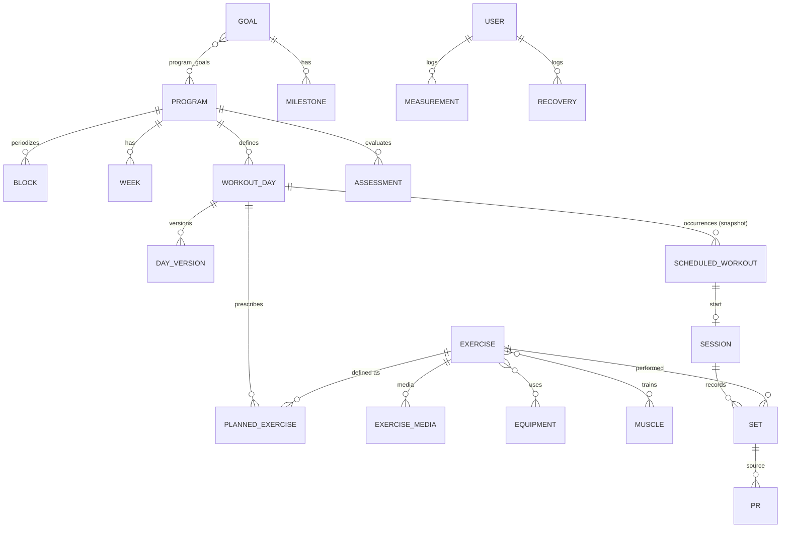

# 🏋️ Sports OS — خطة العمل الموحّدة والكاملة (الإصدار 4.0)

**الغرض:** وثيقة بناء **مكتفية بذاتها** لتطبيق **التدريب الرياضي الشخصي** (ويب + موبايل + ساعة اختياريًا، عربي RTL، يعمل أوفلاين أثناء التمرين): هدف ← برنامج ← أسبوع ← يوم تدريب ← تمرين مخطَّط ← جلسة فعلية ← مجموعات/فترات ← أداء ← أرقام قياسية وتحليلات ← تعافٍ ← اقتراحات. يعمل **كقسم مستقل تمامًا**، ومرتبط ببقية أنظمتك (Habit OS، Today، Finance، Projects OS، Home، Knowledge) عبر **عقود API/Events فقط**.

> **هذه الوثيقة تحلّ محلّ حزمة المواصفات المرفقة بالكامل** (`Sports_OS_Independent_Build_Specs_v1`: الإنجليزية + العربية + README). كل بند فيها موجود هنا (**مصفوفة التغطية §20**)، مع حسم تعارضاتها وسد فجواتها، ومع **ما اكتشفته في نظام اللياقة الفعلي في Notion**. لا تُرسَل الحزمة القديمة مع هذه الوثيقة لمنفّذ التطبيق.

**ما دخل في المراجعة:**
1. **حزمة Sports OS** (3 ملفات): النسختان الإنجليزية والعربية **متطابقتان في المضمون** (42 قسمًا) + README.
2. **نظام "🏋️ نظام اللياقة بتاعي" في Notion** — هو التنفيذ الحالي الفعلي للتدريب عندك: 12 قاعدة بيانات + دليل استخدام + برنامج 12 أسبوعًا يُمدَّد.
3. خطط **Today / Projects / Home / Learning / Knowledge v4.0** (لضمان توافق العقود، خصوصًا عقد Today).
4. ما لم أستطع قراءته: أكواد الصيغ نفسها (التاريخ، الإكمال، "فائت"، "الدورة الكبرى"…) — اعتمدت على أسمائها ونتائجها وعلى الدليل؛ وقواعد **الفيديوهات** و**الصور** و**المراجعة الأسبوعية** و**الروتينات الإضافية** لم أفتح حقولها (راجعت وجودها وعلاقاتها فقط).

**المرجع الأعلى عند التعارض:** هذه الوثيقة ← حزمة المواصفات ← سلوك Notion (التنفيذ المؤقت).

> **مفاتيح القراءة:** `SF-xx` ميزة محفوظة · `SC-xx` تعارض محسوم · `SG-xx` فجوة مسدودة · `SE-xx` تحسين مضاف · `SD-xx` قرار يحتاج تأكيدك · `SV-xx` قاعدة تحقق · `SA-xx` أتمتة · `ST-xx` اختبار قبول.

---

## 1) المراجعة الكاملة

### 1.1 حزمة المواصفات (EN/AR)
- **المضمون:** نظام تدريب كامل لا مجرد سجل تمارين: Goals · Exercise Library · Programs · Weeks · Workout Days · Planned Exercises · Sessions · Sets/Intervals · PRs · Measurements · Recovery · Analytics · Calendar (تجميع) · Notifications · Offline · Device adapters.
- **مبادئ ثابتة فيها (محفوظة):** الأداء الفعلي مصدر الحقيقة · المشتق لا يحرره المستخدم · القالب منفصل عن التاريخ · كل Set سجل حقيقي · لا workarounds من Notion · الحسابات في الـ Domain · Idempotency · التاريخ لا يتغير بتعديل القالب · التاريخ بتوقيت المستخدم · **لا تشخيص طبي**.
- **حدود (ما لا يملكه):** Habit/Finance/General Tasks/General Calendar/Journal/General Goals.
- **غموض داخلي في المواصفة نفسها** يحتاج حسمًا (يُحسم في §7): `Workout Days` تجمع القالب والتاريخ في جدول واحد بينما تطلب سلسلة Template→Occurrence→Session؛ حالة `Planned/Skipped` على Session مقابل Occurrence؛ كيف يُعرف "الرقم الحالي" لهدف ما؟ تعريف `Maintain`؛ صلاحية e1RM؛ حجم التدريب لتمارين وزن الجسم والإحماء؛ مقام الـ Consistency؛ عتبة قفزة الحمل؛ مقياس التعافي؛ حمولة حدث Habit؛ وحدات `default_unit`؛ وغيرها.
- **النص الإنجليزي والعربي لا يختلفان**؛ فلا تعارض بينهما، والتعارضات داخلية أو مع Notion.

### 1.2 نظام اللياقة في Notion — ما الموجود فعليًا (12 قاعدة)

| القاعدة | الحقول الفعلية | المشتق/ملاحظات |
|---|---|---|
| **📅 جدول التمرين** | الجلسة (عنوان)، **الأسبوع** (رقم)، **اليوم** (Saturday…Friday)، **المرحلة** (select بـ 20 قيمة تمزج Phase/Cycle/Deload/Test)، العضلة (7)، المدة (نص)، الشدة (Easy/Moderate/Hard)، **الحالة** (Not Started/In Progress/Completed/Skipped)، اسم التمرين، كارديو/MMA (نص)، تذكير (نص)، بحث الفيديوهات (نص)، ملاحظات + علاقات: التمرين اليومي (قالب)، الأسبوع، سجل التمرين، Habit Check-ins | **التاريخ = صيغة** من الأسبوع واليوم وبداية البرنامج · هل اليوم؟ · هل هذا الأسبوع؟ · فائت · علامة الإكمال · Day Ordinal · الدورة الكبرى · الطاقة/الصعوبة المسجّلة (متوسط) · عدد السجلات. **336 صفًا مبنيًا مسبقًا** (48 أسبوعًا: 19 سبتمبر 2026 → 20 أغسطس 2027) |
| **💪 التمارين اليومية** (7 قوالب) | الاسم، **النوع** (Strength+MMA / Strength+Cardio / Recovery / Rest)، العضلة (7)، المدة الأساسية (نص) + علاقات: التمارين، الروتينات الإضافية، الفيديوهات، الجدول | **التمرين الفعلي (الأقسام والمجموعات) نص داخل صفحة القالب** |
| **🏋️ مكتبة التمارين** | الاسم، **الفئة** (Strength/Warm-up/Cardio/MMA/Mobility)، **العضلة** (Chest/Back/Arms/Legs/Core/Full Body/**Face**/**Pelvic Floor**)، الصعوبة، **المجموعات/التكرارات/الراحة (نصوص)**، **التدرج (نص)**، ملاحظات الأداء + علاقات: التمارين اليومية، الفيديو | **الوصفة (Sets×Reps) داخل تعريف التمرين** لا داخل التمرين المخطَّط |
| **🗓️ الأسابيع** | رقم الأسبوع، **المرحلة** (20 قيمة)، + علاقات الجدول/التقدم/المراجعة | تاريخ البداية/النهاية، الجلسات المخططة/المكتملة، **نسبة الإنجاز**، **الدورة الكبرى** (صيغ) |
| **📊 سجل التمرين** | عنوان، التاريخ، **إجمالي المجموعات**، **إجمالي التكرارات**، **الوزن المستخدم (نص)**، **مسافة الجري (نص)**، **وقت الجري (نص)**، الطاقة، الصعوبة، مكتمل ✔، ملاحظات + علاقة اليوم | **سجل إجمالي للجلسة** لا سجل لكل مجموعة |
| **📈 التقدم** (أسبوعي) | الوزن، الصدر، الخصر، الذراع، الفخذ، **أقصى عدد ضغط**، **وقت البلانك (نص)**، **وقت/مسافة الجري (نص)**، الطاقة، التوتر، **متوسط النوم**، ملاحظات + علاقات الأسبوع/الصور | **قياسات الجسم + التعافي + اختبارات الأداء** في سجل واحد |
| **📸 صور التقدم** | (لم أفتح حقوله) علاقة بالتقدم وبتقييم المرحلة | صور لأسابيع 1/4/8/12 |
| **🧠 المراجعة الأسبوعية** | (لم أفتح حقولها) علاقة بالأسبوع | تأمل أسبوعي |
| **🏆 تقييم المرحلة** | **الدورة الكبرى** (Cycle 1–4)، تاريخ التقييم، **تقييمات من 10** (طاقة، تعافٍ، صعوبة، مرونة، MMA/حركة قدم)، الوزن، أقصى ضغط، مسافة/وقت الجري (نص)، نسبة الإنجاز (رقم يدوي)، ملاحظات القوة/الكارديو، **ما نجح/ما يحتاج تغييرًا/خطة الدورة الجاية**، علاقتا **التقدم في البداية/النهاية** وصور البداية/النهاية | مقارنة بداية الدورة بنهايتها |
| **🔁 تسجيل العادات** | التاريخ، **تنفس الصندوق**، **يوجا الوجه**، **الفك**، **كيجل** (checkboxes)، ملاحظات + علاقة يوم التمرين | **النقاط اليومية 0–5** (صيغة) + حالة التمرين (Rollup) — **عادات يومية بلا نهاية** |
| **🔵 الروتينات الإضافية** | (لم أفتح حقولها) تنفس، كيجل، يوجا الوجه، الفك، مرونة | |
| **🎥 مكتبة الفيديوهات** | (لم أفتح حقولها) **48 فيديو YouTube** متحقق منه | + صفحة "Complete Exercise + YouTube Embed Index (349)" |

**البرنامج:** 7 قوالب أيام: 🔴 صدر+MMA · 🔵 ذراع+LISS · 🟢 رجل+HIIT+حركة قدم · 🟡 ظهر+MMA · 🟣 كور+جري · 🟠 تعافي+مرونة · ⚪ راحة (+ تنفس الصندوق). **تدريب منزلي بوزن الجسم والشنطة**، 12 أسبوعًا قابلة للتمديد (Cycle 1 Foundation → 2 Progression → 3 Performance → 4 Maintenance/Long-term)، مع **Deload** و**أسابيع اختبار**، ويبدأ السبت. **تمارين التدرج** (Push-ups → Wide → Decline → Diamond → Archer (Cycle 2+) → Clapping (Cycle 3+)، Squat → Jump → Assisted Pistol → Pistol، … ) نصية في "التدرج".

### 1.3 ما يقوله الدليل (محفوظ)
افتح اليوم ← تمرينه وتماريناه وفيديوهاته في مكان واحد · الحالة (Not Started/Completed/Skipped) تُغيَّر يدويًا بعد الحصة · سجل التمرين **اختياري** لكنه يبني التاريخ ويغذي "برنامجي" · نقل يوم = سحب التاريخ في التقويم · تبديل يومين = تبديل التاريخ يدويًا · **العادات بلا نهاية** · التقدم أسبوعي والصور كل ~4 أسابيع والتقييم الشامل كل 12 أسبوعًا · عند اقتراب نهاية الجدول تُبنى **دفعة 12 أسبوعًا جديدة** (Cycle 4: صيانة + Deload كل 6 أسابيع) · صفحة "كيف تؤجّل البرنامج بأمان" (تأجيل يدوي لكل الصفوف).

### 1.4 اكتشافات مهمة من المراجعة
1. **سجل التمرين إجمالي وليس مجموعات:** لا سجل لكل Set (وزن/تكرار/RPE لكل مجموعة)، والوزن والمسافة والوقت **نصوص** — لا حساب Volume ولا PR ولا Pace ولا e1RM ممكن (SC-01، SC-02).
2. **الوصفة داخل مكتبة التمارين** (Sets/Reps/Rest/التدرج كنصوص على التمرين نفسه) فلا يمكن أن يختلف التمرين نفسه بين يومين أو أسبوعين، ولا Planned Exercise حقيقي (SC-03).
3. **الجدول مبنيّ مسبقًا (336 صفًا) بتاريخ صيغة** من (أسبوع + يوم + بداية البرنامج)؛ التأجيل/النقل **عملية يدوية** على كل الصفوف (وصفحة خاصة لشرحها)، والتمديد **بطلب منك** كل 12 أسبوعًا (SC-04).
4. **العادات اليومية (تنفس/كيجل/فك/يوجا وجه) تُسجَّل داخل نظام اللياقة** رغم أن Habit OS يملك العادات: ازدواج صريح (SC-18).
5. **الأسبوع "المرحلة" = 20 قيمة** تمزج الدورة والمرحلة وDeload والاختبار في select واحد (SC-06)، بلا كيان برنامج/كتلة حقيقي.
6. **التقدم الأسبوعي يخلط ثلاثة مفاهيم:** قياسات الجسم (وزن/محيطات) + تعافٍ (نوم/توتر/طاقة) + اختبارات أداء (أقصى ضغط/بلانك/جري) (SC-09).
7. **تقييم المرحلة يعتمد تقييمات ذاتية /10 ونسبة إنجاز يدوية**؛ لا قياس تلقائي من الأداء (SC-10).
8. **تصنيف العضلات يضم "Face" و"Pelvic Floor"** (يوجا الوجه وكيجل) — ليس تصنيف حركة (SC-07).
9. **MMA** فئة تمارين مستقلة (ملاكمة وهمية، حركة قدم) لا مكان لها في فئات المواصفة (Strength/Cardio/Mobility/Stretching/Skill/Recovery) ⇒ تُحوَّل إلى **Skill** (SC-08).
10. **Today في Notion للياقة "غير فلتري"** (الدليل يعترف: لا فلترة بصيغة/تاريخ نسبي) — وToday العام الجديد يحل ذلك (§15).
11. **المراجعة الأسبوعية** هنا تتكرر مع **مراجعة Projects OS الأسبوعية** (SC-19).

### 1.5 حكم على كل عنصر
| العنصر | الحكم | القرار |
|---|---|---|
| جدول 336 صفًا بتاريخ صيغة | **استبدال** | `scheduled_workouts` تُولَّد عند الحاجة (rolling) + "أجّل البرنامج" بنقرة |
| 7 قوالب أيام | **اعتماد** | `workout_days` (قوالب مُصدَّرة) + تمارين مخطَّطة مهيكلة |
| مكتبة التمارين (بالوصفة) | **تفكيك** | تعريف التمرين فقط، والوصفة في `planned_exercises` |
| سجل التمرين الإجمالي | **استبدال** | `workout_sessions` + `exercise_sets` (سجل لكل مجموعة/فترة) |
| نصوص الوزن/الوقت/المسافة | **استبدال** | قيم رقمية بوحدات ثابتة |
| الحالة اليدوية للصف | **استبدال** | حالة الحدث المشتقة من الجلسة |
| التقدم الأسبوعي | **تفكيك** | قياسات + تعافٍ + اختبارات أداء (جلسات Test) |
| تقييم المرحلة | **اعتماد + أتمتة** | `program_assessments` بلقطة مقاييس تلقائية + ما نجح/تغيير/خطة |
| تسجيل العادات | **نقل** | إلى Habit OS (مالكه) + أحداث |
| صور التقدم | **اعتماد خاص** | ملفات مشفّرة خاصة بقياس |
| المراجعة الأسبوعية | **دمج** | مراجعة Projects OS + إحصاءات Sports |
| 48 فيديو/فهرس 349 | **اعتماد** | وسائط التمرين (`exercise_media`) |

---

## 2) جرد الميزات المطلوبة (كلها محفوظة)

| ID | الميزة | أين تتحقق |
|---|---|---|
| SF-01 | الأهداف الرياضية (نوع، مقياس، اتجاه، بداية/هدف/وحدة، تواريخ، حالة، أولوية) وتقدم مشتق | §5.1، §6.7 |
| SF-02 | مكتبة التمارين (تصنيف، نمط حركة، عضلات، معدات، صعوبة، وضع تتبع، تعليمات، وسائط، System/User، أرشفة) | §5.2 |
| SF-03 | البرامج (11 نوعًا، حالات، مدة، أيام/أسبوع، هدف) | §5.3 |
| SF-04 | أسابيع البرنامج (Normal/Deload/Test/Recovery، نية/حجم) | §5.4 |
| SF-05 | أيام التدريب/القوالب (14 نوع يوم) | §5.5 |
| SF-06 | التمارين المخطَّطة (مجموعات، تكرار min/max، وزن، مدة، مسافة، RPE، راحة، إيقاع، قاعدة تدرج، Superset، اختياري) | §5.6 |
| SF-07 | محرك التدرّج (قواعد قابلة للضبط/الإيقاف، اقتراح لا تغيير صامت) | §6.9 |
| SF-08 | الجلسات الفعلية (حالات، RPE، طاقة قبل/بعد، مدة مشتقة، نسبة إكمال مشتقة) | §5.8، §6.5 |
| SF-09 | المجموعات/الفترات (8 أنواع مجموعة، تحقق بوضع التتبع، `client_generated_id`) | §5.9 |
| SF-10 | مؤقت الراحة (UI فقط) | §10.3 |
| SF-11 | الأرقام القياسية (7 أنواع + إعادة حساب) | §5.10، §6.8 |
| SF-12 | 1RM التقديري (Epley) | §6.3 |
| SF-13 | حجم التدريب (Σ وزن×تكرار) وتجميعاته | §6.2 |
| SF-14 | مقاييس الكارديو (pace/speed + توحيد الوحدات) | §6.4 |
| SF-15 | قياسات الجسم (مستقلة) | §5.11 |
| SF-16 | سجلات التعافي + الاستعداد القابل للضبط (غير طبي) | §5.12، §6.10 |
| SF-17 | تقويم التدريب (تجميع لا جدول) | §6.13 |
| SF-18 | التحليلات (تكرار، مدة، حجم، اتساق، حمل تدريبي) | §6.11 |
| SF-19 | كشف قفزة الحمل (عتبة قابلة للضبط، غير طبي) | §6.6 |
| SF-20 | تسمية البرنامج (Versioning): القالب ← الحدث المجدول ← الجلسة، والتاريخ لا يتغير | §5.5، §5.7، §9 |
| SF-21 | الإحماء/المرونة كفئة تمرين لا جدول جديد | §5.2 |
| SF-22 | تكامل الأهداف (إعادة حساب + معالم + كشف الإنجاز بلا تعديل صامت) | §6.7 |
| SF-23 | تكامل Habit/Today/Finance بلا تكرار | §15 |
| SF-24 | الإشعارات القابلة للضبط (تمرين/هدف/PR/برنامج/تعافٍ) | §12 |
| SF-25 | الأتمتة العشر (إكمال جلسة، PR، هدف، أحداث، جدولة، فائت، ملخص أسبوعي، إشعارات، مزامنة، تصحيح تاريخي) | §12 |
| SF-26 | الأوفلاين بحالاته الخمس + `client_generated_id` | §16 |
| SF-27 | محوّلات الأجهزة (`SportsDataProvider`) | §5.15، §15.7 |
| SF-28 | الأمان وعزل المستخدم وتدقيق التعديلات الحساسة | §13 |
| SF-29 | الشاشات: Dashboard · Today Workout · Programs/Builder · Exercises · History · Progress · Goals · Recovery · Measurements · Settings | §10 |
| SF-30 | الإجراءات: Start · Complete Set · Add Set · Skip · Replace · Finish | §9.3، §10.3 |
| SF-31 | برنامج التدريب المنزلي الحالي (7 قوالب، 12→48 أسبوعًا، MMA/LISS/HIIT، تدرّج وزن الجسم، Deload/اختبار) | §11.1، §15.6 |
| SF-32 | وسائط التمارين (48 فيديو + فهرس 349) | §5.2 (`exercise_media`) |
| SF-33 | قياسات الجسم + الصور + تقييم المرحلة | §5.11، §5.16 |

---

## 3) المبادئ والحدود

### 3.1 الاستقلال
Sports OS **تطبيق تدريب مستقل**، لا جدول تمارين داخل Habit OS. يعمل كاملًا (أهداف، برامج، جلسات، PR، تحليلات، تعافٍ، قياسات، تقويم، إشعارات، أوفلاين) **بلا أي نظام آخر وبلا جهاز قابل للارتداء**. الربط اختياري ومُحسِّن.

### 3.2 من يملك ماذا
| الكيان / الحقيقة | المالك | Sports يفعل ماذا |
|---|---|---|
| الأهداف الرياضية، المكتبة، البرامج، الأسابيع، القوالب، التمارين المخطَّطة، الأحداث المجدولة، الجلسات، المجموعات، PR، القياسات، التعافي، الإعدادات، التقييمات | **Sports** | يملكها بالكامل |
| العادات والسجلات والسلاسل (بما فيها "عادة التمرين" والعادات الدقيقة) | **Habit OS** | يرسل `sports.workout.completed` فقط |
| الدفتر المالي (اشتراك صالة، معدات، مدرّب) | **Finance** | مرجع/قراءة فقط؛ لا ينشئ معاملات |
| المهام العامة/التقويم العام/اليوميات/الأهداف العامة | **أنظمة أخرى (Projects/Core)** | لا ينسخها |
| المراجعة الأسبوعية العامة | **Projects OS** | يوفّر إحصاءات `stats/week` |
| الأجهزة المنزلية (دمبل، شنطة، حبل) | **Home** (Inventory) | `home_item_ref` اختياري على المعدة |
| الفيديوهات كمصادر معرفة | **Knowledge** | `bookmark_ref` اختياري |
| صفحة اليوم | **Today** | يوفّر Feed/Attention ويستقبل أمر "ابدأ التمرين" |
| الهوية والإشعارات والملفات والأحداث | **Core** | يستهلكها |

### 3.3 مصفوفة التدهور (عند غياب نظام مرتبط)
| الغائب | سلوك Sports |
|---|---|
| Habit OS | لا أحداث مستهلَكة؛ يعمل Sports بملخص التزام داخلي (Consistency) |
| Today | شاشة Dashboard/Today Workout الخاصة كافية |
| Finance | لا بطاقة مالية؛ مراجع الاشتراك/المعدات مخفية |
| Projects OS | يُبقي المراجعة الأسبوعية الخفيفة داخل Sports ويُخفي `kr_ref` |
| Home / Knowledge | `home_item_ref`/`bookmark_ref` مخفيان |
| الأجهزة | الإدخال اليدوي كافٍ |
| Core (إشعارات) | تنبيهات داخل التطبيق فقط |

### 3.4 المبادئ الحاكمة (ملزمة)
1. **التسجيل الفعلي مصدر الحقيقة** (الجلسات والمجموعات).
2. **المشتق لا يحرره المستخدم** (progress، volume، pace، e1RM، PR، load، readiness، consistency…) ولا يقبله الـ API من العميل.
3. **القالب منفصل عن التاريخ**: Template ← Scheduled Occurrence (لقطة) ← Session؛ **تعديل قالب لا يغيّر جلسة قديمة أبدًا**.
4. **كل مجموعة/فترة سجل حقيقي** بقيم رقمية ووحدات؛ لا نصوص ولا إجماليات بديلة.
5. **لا Workarounds من Notion** (لا صفوف مبنيّة مسبقًا، لا تاريخ صيغة، لا نصوص رقمية، لا حالة يدوية للإكمال).
6. **الحسابات في Domain/Service layer** لا في الواجهة.
7. **Idempotency** لكل ما يعاد: مجموعة، جلسة، مزامنة، استيراد، توليد جدول، حدث.
8. **التاريخ والجدولة بتوقيت المستخدم** (ومنطقة الجلسة تُثبَّت وقت البدء).
9. **المقاييس تدريبية لا طبية** (Readiness/Load Spike/…): لا تشخيص ولا تنبؤ بإصابة.
10. **حماية التاريخ:** الأرشفة بدل الحذف؛ لا حذف يضر التاريخ (تمرين، قالب، برنامج، مجموعة).
11. **بيانات حساسة** (وزن، قياسات، صور، تعافٍ): خاصة افتراضيًا، مشفّرة، قابلة للتصدير والحذف الكامل.
12. **لا تُكرَّر كيانات الأنظمة الأخرى** (عادة، معاملة، مهمة عامة): مرجع/حدث فقط.
13. **كل شاشة:** Loading / Empty / Error / Success / Offline / Syncing.
14. **Audit** للتعديلات الحساسة: تصحيح تاريخي، أرشفة تمرين، تغيير وحدة، حذف مجموعة، تغيير قاعدة تدرّج.

### 3.5 الملكية والخصوصية
Sports **شخصي** (`user_id`) بلا مشاركة؛ لا وصول لسجلات مستخدم آخر. مشاركة قراءة مع مدرّب خيار مستقبلي (SD-09).

---
## 4) النموذج المفاهيمي

```text
 هدف رياضي ──(M:N)── برنامج ──< كتلة/Block (Base/Build/Peak/Deload/Test…)
                         │
                         ├──< أسبوع (Normal/Deload/Test/Recovery)
                         └──< يوم تدريب (قالب مُصدَّر) ──< تمرين مخطَّط (وصفة) ──> تمرين (تعريف)
                                   │  (نسخة/Version)
                                   ▼
                          حدث مجدول (Scheduled Workout) = تاريخ + لقطة Snapshot (لا تتغير بعد البدء)
                                   │  start
                                   ▼
                              جلسة فعلية ──< مجموعة/فترة (Set/Interval)  ← سجل الأداء الحقيقي
                                   │
                    ┌──────────────┼───────────────┬───────────────┐
                    ▼              ▼               ▼               ▼
                 PRs (مشتقة)   حجم/حمل/تحليلات   تقدم الأهداف    أحداث → Habit/Today/Projects
 مستقلة: قياسات الجسم (+صور) · سجلات التعافي · تقييمات الكتل · ملاحظات أسبوعية · إعدادات
```
**قاعدة الاشتقاق:** `Set → Session metrics → PR · Volume · Load → Goal progress · Analytics`، ولا يتدفق شيء عكسيًا (لا قيمة مشتقة تُدخَل يدويًا).
**قاعدة التاريخ:** `Template → Occurrence(Snapshot) → Session`. تعديل القالب لا يلمس لقطات الأحداث ولا الجلسات.

---

## 5) نموذج البيانات الكامل

### 5.0 الحقول العامة (كل كيان)
`id` UUID ثابت · `user_id` NOT NULL (إلا التمارين النظامية) · `created_at` · `updated_at` · `deleted_at` (Soft Delete) · `archived_at` (حيث ينطبق) · `version` (تزامن متفائل) · `client_generated_id` (للكيانات القابلة للإنشاء أوفلاين). **القيم المشتقة لا تُخزَّن كحقول قابلة للتعديل**؛ المخابئ في `*_metrics_cache` قابلة لإعادة البناء الكاملة.
**التخزين الكانوني للوحدات:** الوزن بالكيلوجرام، والمسافة بالمتر، والزمن بالثواني (مع حفظ القيمة والوحدة الأصليتين للعرض).

### 5.1 الأهداف `training_goals`
| الحقل | النوع | إلزامي | ملاحظات |
|---|---|:-:|---|
| name | string | نعم | |
| type | enum | نعم | Strength · Muscle · Fat Loss · Endurance · Distance · Speed · Mobility · General Fitness · Sport Performance |
| description | text | لا | |
| target_metric | enum | شرطي | Weight · 1RM · Distance · Pace · Duration · Frequency · Other |
| direction | enum | للقياسي | Increase · Decrease · Maintain |
| start_value / target_value | decimal | شرطي | بالوحدة القانونية؛ `start ≠ target` للزيادة/النقص (SV-04) |
| unit | string | شرطي | |
| **tolerance** | decimal | لـ Maintain | نطاق ± حول الهدف (افتراضي 5% من الهدف) |
| **source_kind** | enum | نعم (manual) | `body_measurement` · `exercise_record` · `session_aggregate` · `manual` — **من أين يُؤخذ "الرقم الحالي"** (يحسم SC-11) |
| **source_ref** | JSON | شرطي | `{field}` لقياس جسم · `{exercise_id, record_type}` لـ PR · `{metric: frequency|duration|distance|volume, window_days}` لتجميع |
| start_date | date | نعم | |
| target_date | date | لا | |
| status | enum | نعم | `Active` · `Achieved` · `Paused` · `Cancelled` |
| priority | enum | لا | High · Medium · Low |
| achievement_detected_at / achieved_at | ts | نظام | الكشف تلقائي، والتحويل إلى Achieved بتأكيد (أو `auto_achieve`) |
| auto_achieve | bool | لا (false) | |
**علاقات:** `program_goals` (M:N مع البرامج) · `goal_milestones(goal_id, label, value, position, reached_at)`.
**مشتق:** `current_value`, `progress` (أو Not Measurable), `remaining`, `projected_date`, `milestone_state`.

### 5.2 مكتبة التمارين `exercises` (تعريف لا أداء)
| الحقل | النوع | ملاحظات |
|---|---|---|
| name (+ `name_ar` / `name_en` / `aliases[]`) | string | الاسم المعروض حسب اللغة؛ البحث على الكل |
| category | enum | Strength · Cardio · Mobility · Stretching · **Skill** · Recovery (MMA/ملاكمة وهمية = Skill) |
| exercise_type | enum | Compound · Isolation · Bodyweight · Machine · Cardio |
| movement_pattern | enum | Squat · Hinge · Push · Pull · Carry · Rotate · Locomotion · Other |
| primary_muscle_id / secondary_muscle_ids | FK / M:N | من تصنيف العضلات §5.13 |
| equipment_ids | M:N | من كتالوج المعدات §5.13 |
| difficulty | enum | Beginner · Intermediate · Advanced |
| **tracking_mode** | enum | `Weight-Reps` · `Reps` · `Duration` · `Distance` · `Time-Distance` · `Custom` (+`custom_metrics[]` المسموحة) |
| **load_type** | enum | `External` · `Bodyweight` · `Weighted Bodyweight` · `Assisted` · `Improvised` (شنطة) · `None` |
| unilateral | bool | تمرين لكل جهة (تسجَّل `side`) |
| default_unit | enum | kg · lb · reps · sec · min · km · mile — وحدة المقياس الرئيسي؛ وتفضيلات المستخدم تتجاوزها (§5.14) |
| instructions / cues / safety_notes | text | `safety_notes` عامة غير طبية |
| media | `exercise_media` | فيديو/صورة (§ أدناه) |
| variant_of_id · progression_next_id · regression_prev_id | FK self | **سلالم التدرّج** (Push-ups → Diamond → Archer…) |
| is_system_exercise | bool | تمرين نظامي (`user_id` فارغ) أو مخصَّص (`user_id` إلزامي) — CHECK |
| status | enum | `Active` · `Archived` (لا يحذف التاريخ) |
**`exercise_media(exercise_id, kind[video|image], url, provider, title, language, bookmark_ref, verified_at, position)`** (SF-32).
**علاقات:** `planned_exercises` · `exercise_sets` · `personal_records` · تاريخ التمرين (استعلام).
**قواعد:** النظامي يُستنسخ للتخصيص (`clone`) ولا يُعدَّل؛ الأرشفة تخفيه من الاختيار وتُبقي كل استخدامه؛ لا أوزان/تكرارات تاريخية هنا.

### 5.3 البرامج `programs`
| الحقل | النوع | ملاحظات |
|---|---|---|
| name, description, notes | | |
| program_type | enum | Strength · Hypertrophy · Fat Loss · Endurance · Running · Cycling · Swimming · Mixed · Sport Specific · General Fitness · Custom |
| goal_ids | M:N (`program_goals`) | هدف أو أكثر |
| duration_weeks | integer | |
| start_date | date | |
| end_date | date | **مشتق** من `start_date + duration_weeks` مع إزاحات التأجيل |
| days_per_week | smallint | عدد أيام التدريب (غير الراحة) — يُتحقق من تطابقه مع الأيام الفعلية (تحذير) |
| status | enum | `Draft` · `Active` · `Paused` · `Completed` · `Archived` |
| role | enum | `Primary` · `Secondary` (برنامج جري بجانب القوة…) |
| is_template / template_scope | bool / enum | قالب برنامج (system/user) |
| continuation_of_id | FK self | امتداد (مثل Cycle 2 بعد Cycle 1) |
| paused_at / started_at / completed_at | ts | نظام |
**سياسة البرنامج النشط:** إعداد صريح `active_program_policy` ∈ `single` (افتراضي) · `multiple` (§5.14) — **ليس افتراضًا مخفيًا** (SC-12).
**علاقات:** `program_blocks` · `program_weeks` · `workout_days` · `scheduled_workouts` · `workout_sessions` · `program_shifts` · `program_assessments`.
**`program_blocks`** (فترة/Mesocycle — تحل الـ select ذا الـ 20 قيمة): `program_id, name, block_type` (Base · Build · Peak · Deload · Test · Maintenance · Custom)، `start_week, end_week, focus, notes`.
**`program_shifts`** (تأجيل البرنامج): `program_id, from_date, days, reason, client_op_id (فريد)`، يُعاد بها اشتقاق تواريخ الأسابيع والأحداث.

### 5.4 أسابيع البرنامج `program_weeks`
`program_id`, `week_number`, `name`, `focus`, `block_id`, `week_type` (Normal · Deload · Test · Recovery), `intensity_target` (متوسط RPE أو %)، `volume_target` (مجموعات أو حمل)، `notes`، و**`start_date/end_date` مشتقان** (من تاريخ البرنامج وإزاحاته و`week_start_day`). `UNIQUE(program_id, week_number)`.

### 5.5 أيام التدريب (القوالب) `workout_days` + الإصدارات
| الحقل | ملاحظات |
|---|---|
| program_id (nullable للقالب المستقل) · week_id (nullable) · day_number | موضع اليوم في الأسبوع (1…7 حسب `week_start_day`) |
| name | مثل "صدر + MMA" |
| day_type | Strength · Push · Pull · Legs · Upper · Lower · Full Body · Running · Cycling · Swimming · Mobility · Recovery · Custom · **Rest** · **Skill** (المضاف: Rest وSkill لدعم يوم الراحة وMMA) |
| estimated_duration_minutes | |
| is_template | قالب قابل لإعادة الاستخدام عبر أسابيع/برامج |
| current_version | integer |
| notes | |
> **`planned_date` ينتقل إلى `scheduled_workouts.scheduled_date`** (الحدث المجدول)؛ القالب لا يحمل تاريخًا حقيقيًا (يحسم SC-13).
**`workout_day_versions`:** `workout_day_id, version, snapshot (قائمة التمارين المخطَّطة وقت الإصدار), reason, created_at/by` — يُنشأ إصدار جديد عند أي تعديل على التمارين المخطَّطة.

### 5.6 التمارين المخطَّطة `planned_exercises`
| الحقل | ملاحظات |
|---|---|
| workout_day_id · exercise_id · order_index | |
| prescription_type | `SetsReps` · `Duration` · `Distance` · `Interval` · `AMRAP` · `EMOM` · `Circuit` |
| target_sets · target_reps_min · target_reps_max | (مثل 4 × 8–10) |
| target_weight (+ unit، يُخزَّن kg) · target_load_note | مثل "شنطة 8 كجم" لـ Improvised |
| target_duration_seconds · target_distance (+ unit، يُخزَّن m) | |
| target_rpe_min · target_rpe_max | |
| rest_seconds · tempo | الإيقاع "3-1-1-0" |
| interval_spec | `{work_s, rest_s, rounds}` لـ HIIT/ملاكمة وهمية/فترات الجري |
| progression_rule | JSON (§6.9) |
| superset_group | تجميع Superset/Circuit |
| optional | تمرين اختياري (لا يدخل مقام الإكمال) |
| alternatives | تمارين بديلة (`exercise_ids`) لـ Replace |
| notes | |
**قاعدة:** المقاييس المسموحة تتوافق مع `tracking_mode` للتمرين (SV-06). **المخطَّط ≠ الأداء** (الأداء في `exercise_sets`).

### 5.7 الأحداث المجدولة `scheduled_workouts` (الحلقة الوسطى — SF-20)
| الحقل | ملاحظات |
|---|---|
| program_id · workout_day_id · workout_day_version · week_id | |
| scheduled_date | تاريخ محلي (بمنطقة المستخدم) |
| scheduled_time · timezone | اختياري (للتذكير) |
| **snapshot** | **لقطة** التمارين المخطَّطة وقت التوليد (+ تعديلات التدرّج المقبولة) — **تُجمَّد عند البدء** |
| status | `Scheduled` · `Started` · `Completed` · `Skipped` · `Suspended` (البرنامج موقوف) — و**`Missed` مشتقة** (§6.12) |
| source | `generated` · `manual` · `moved` |
| moved_from_date · skip_reason | |
| session_id | الجلسة المرتبطة بعد البدء (واحدة نشطة) |
**قيد التوليد idempotent:** `UNIQUE(program_id, workout_day_id, scheduled_date)`.
**الجلسة الحرة** (بلا برنامج) لا تحتاج حدثًا مجدولًا.

### 5.8 الجلسات `workout_sessions`
| الحقل | ملاحظات |
|---|---|
| scheduled_workout_id · workout_day_id · program_id | nullable للجلسة الحرة |
| session_type | Planned · Free · Test · Recovery |
| started_at | إلزامي عند البدء؛ `ended_at` عند الإنهاء |
| timezone · local_date | تُثبَّت وقت البدء (للتجميع حسب اليوم) |
| status (مخزَّن) | `Planned` (مسوَّدة اختيارية قبل البدء، مثل التحضير أوفلاين) · `In Progress` · `Completed` · `Abandoned` · `Cancelled` |
| overall_rpe · energy_before · energy_after | decimal (RPE 1–10 بخطوة 0.5؛ الطاقة 1–5) |
| distance · calories_burned | تُشتق/تُدخل (السعرات اختيارية) |
| paused_seconds | وقت التوقف (مقاطعة) |
| notes · completion_reason | سبب الإنهاء المبكر/الإلغاء |
| is_retroactive | سُجِّلت بعد حدوثها (SE-16) |
| source · external_ref | app · import · device + مرجع الاستيراد |
| **client_generated_id** | **فريد** لكل مستخدم (إنشاء أوفلاين/إعادة محاولة) |
**مشتق:** `duration_seconds`, `completion_percentage`, `total_volume`, `total_reps`, `total_distance`, `avg_pace`, `training_load`, `new_prs_count`.
**حالتا `Planned/Skipped` في المواصفة:** `Planned` مخزَّنة كمسوّدة اختيارية للجلسة (تُنشأ ثم تُبدأ)، أما **`Skipped` فتُسجَّل على الحدث المجدول** (لا جلسة بلا أداء) وتُقدَّم عبر الـ API كإسقاط في قوائم الجلسات (§7 SC-14).

### 5.9 المجموعات/الفترات `exercise_sets` (سجل الأداء الأهم)
| الحقل | ملاحظات |
|---|---|
| session_id · exercise_id (الفعلي) · planned_exercise_id (nullable) | تغيير التمرين = `exercise_id` ≠ المخطَّط |
| set_number > 0 | |
| set_type | Warmup · Working · Top Set · Drop Set · Backoff · Failure · Interval · Cooldown |
| is_extra | مجموعة فوق الهدف |
| side | left · right · both (للتمارين أحادية الجانب) |
| reps | integer |
| weight (+ weight_unit) → `weight_kg` | وزن خارجي أو مُضاف |
| added_load_kg · assist_kg | لـ Weighted/Assisted/Improvised |
| bodyweight_kg_at_time | لقطة وزن الجسم (للخيار §6.2) |
| duration_seconds | |
| distance (+ distance_unit) → `distance_m` | km · mile · m |
| rpe (1–10) · heart_rate_avg/max · rest_seconds (الفعلي بعدها) | |
| completed | NOT NULL |
| note · recorded_at | |
| **client_generated_id** | **`UNIQUE(user_id, client_generated_id)`** |
**`pace` و`speed` مشتقتان** (لا تُخزَّنان).
**جدول التحقق بوضع التتبع (SV-06):**
| `tracking_mode` | الحقول المطلوبة | المسموحة إضافيًا |
|---|---|---|
| Weight-Reps | `reps` + `weight` (أو `added_load`/`assist` حسب load_type) | rpe، rest، note |
| Reps | `reps` | rpe، side، note |
| Duration | `duration_seconds` | rpe، hr |
| Distance | `distance` | duration اختياري، hr |
| Time-Distance | `duration_seconds` + `distance` | hr، rpe |
| Custom | أي تركيبة من `custom_metrics` المعلنة للتمرين | — |
**قاعدة:** مقياس غير متوافق يُرفض (`METRIC_INCOMPATIBLE`) إلا في Custom.

### 5.10 الأرقام القياسية `personal_records` (مخبأ مشتق قابل لإعادة البناء)
`exercise_id`, `record_type` (Max Weight · Max Reps · Estimated 1RM · Best Distance · Best Time · Best Pace · Best Volume · **Longest Duration**), `context` (مثل `distance_m` لـ Best Time/Pace، أو `reps` لـ Max Weight عند تكرار محدد), `value` (قانوني), `unit`, `source_set_id` (أو `source_session_id` لـ Best Volume), `achieved_at`, `is_current`, `previous_pr_id`, `superseded_at`. الاحتفاظ بتاريخ تطوّر الرقم (خط زمني PR). **لا يُدخل يدويًا**.

### 5.11 قياسات الجسم `body_measurements` (مستقلة عن الأداء)
`recorded_at`, `measured_on` (تاريخ محلي), `weight_kg`, `body_fat_percent`, `neck/chest/waist/hips/thigh/arm` (سم), `notes`, `source` (Manual · Device · Import) + **`measurement_photos(measurement_id, file_id, angle[front|side|back|other], taken_at)`** (صور التقدم: خاصة ومشفّرة افتراضيًا). متعدد في اليوم مسموح، و"آخر قياس في اليوم" هو المعتمد في الحسابات.

### 5.12 سجلات التعافي `recovery_logs` (سياق تدريبي لا تشخيص طبي)
`date` (فريد لكل مستخدم/يوم — تحديث لا تكرار), `sleep_hours`, `energy` (1–5، الأعلى أفضل), `fatigue` (1–5، الأعلى أسوأ), `soreness` (1–5، الأعلى أسوأ), `stress` (1–5، الأعلى أسوأ), `notes`, `source`; **`readiness_score` مشتق (0–100)** (§6.10).

### 5.13 التصنيفات والمعدات
- **`muscle_groups`** (Chest · Back · Shoulders · Arms · Core · Legs · Full Body · Other(Face/Pelvic Floor…)) و**`muscles`** (Pectorals · Lats/Upper Back · Delts (Front/Side/Rear) · Biceps · Triceps · Forearms · Abs · Obliques · Lower Back · Glutes · Quads · Hamstrings · Calves · Hip Flexors · … + Face · Pelvic Floor) نظام + قابلة للإضافة.
- **`equipment`**: Bodyweight · Dumbbell · Barbell · Kettlebell · Resistance Band · Pull-up Bar · Bench/Chair · **Backpack (loaded)** · Jump Rope · Mat · Treadmill · Bike · Machine…؛ `is_available` (ما أملكه)، و`home_item_ref` اختياري (Home Inventory).

### 5.14 الإعدادات `sports_settings` (لكل مستخدم)
`timezone` · `week_start_day` (السبت) · `weight_unit` (kg/lb) · `distance_unit` (km/mile) · `pace_unit` (min/km أو min/mi) · `rpe_scale` · `default_rest_seconds` · `rest_timer{auto_start, sound, vibration}` · **`active_program_policy`** (`single`/`multiple`) · **`auto_progression`** (false) · **`missed_policy`** (`mark_skipped_after_grace` [24س] · `keep_missed` · `auto_reschedule`) · `schedule_horizon_days=14` · `load_spike_ratio=1.5` · `load_spike_min_previous=200` · `readiness_weights{sleep, energy, fatigue, soreness, stress}` · `readiness_low_threshold=40` · `e1rm_max_reps=12` · `volume_includes_warmup=false` · `bodyweight_volume_mode` (`off`/`bodyweight`/`added_load`) · `pr_min_distance_for_pace_m=1000` · `notifications{…}` · `quiet_hours` · `include_in_today=true` · `photos_privacy`.

### 5.15 الاستيراد والأجهزة (SF-27)
`sports_provider_connections(provider, tokens[مشفّرة], scopes, status, last_sync_at)` · `sports_import_runs(provider, started_at, finished_at, counts, status, error)` · **`external_activity_refs(provider, external_id, entity, entity_id)`** مع **`UNIQUE(user_id, provider, external_id)`** لمنع تكرار الاستيراد. الواجهة `SportsDataProvider{ importActivities(), importMetrics(), sync() }`.

### 5.16 التقييمات والملاحظات
- **`program_assessments`** (يحل "تقييم المرحلة"): `program_id`, `block_id` (اختياري), `assessment_date`, `start_snapshot` و`end_snapshot` (**لقطات مقاييس تلقائية**: جلسات مكتملة/مخططة، اتساق، حجم، تكرارات، PRs، نتائج اختبارات (أقصى ضغط/بلانك/جري)، متوسط استعداد/حمل، فروق القياسات)، تقييمات ذاتية اختيارية /10، `what_worked`, `what_to_change`, `next_plan`, صور (مراجع)، `status` (Draft/Closed، الإغلاق يجمّد اللقطة).
- **`sports_weekly_notes`** (بدل جدول المراجعة المكرر): `week_start, what_worked, what_stumbled, change, rating` — **يُقرأ** من مراجعة Projects OS الأسبوعية عبر `stats/week`، ويمكن كتابته من Sports عند غياب Projects.

### 5.17 الإشعارات
`sports_notification_prefs(category, enabled, lead_minutes)` · `sports_reminders(parent_type, parent_id, kind, remind_at, status, dedupe_key فريد)`.

### 5.18 خريطة العلاقات (ERD)


---
## 6) محرك الحسابات والدوال

> كل ما في هذا الفصل **مشتق** ويُحسب في Domain/Service، ولا يقبله الـ API من العميل. `today` بتوقيت المستخدم. المقاييس **تدريبية لا طبية**.

### 6.1 الوحدات والتقريب
```text
1 lb = 0.45359237 kg      1 mile = 1609.344 m      1 km = 1000 m
القانوني: kg · m · s     (تُحفظ القيمة والوحدة الأصليتان للعرض والتصدير)
التقريب للعرض فقط (الوزن 0.1، المسافة 0.01 km، pace لأقرب ثانية)، ولا يُقرَّب المخزَّن
تحويل وحدة التفضيل لا يعدّل التاريخ: يغيّر العرض فقط
```

### 6.2 حجم التدريب Volume (SF-13)
```text
set_volume = weight_kg × reps          (Weight-Reps فقط، completed = true، وبوزن > 0)
مجموعات تُحتسب: Working · Top Set · Drop Set · Backoff · Failure
لا تُحتسب افتراضيًا: Warmup · Cooldown · Interval        (volume_includes_warmup = false)
exercise_volume(session) = Σ set_volume          session_volume = Σ exercise_volume
week/program/muscle_volume = Σ session_volume مجمَّعة   (عضلة أساسية: وزن كامل · ثانوية: 0.5 اختياري)
```
**تمارين وزن الجسم (الحالة الخاصة بتدريبك):**
- لا Volume بالكيلوجرام حيث لا معنى له؛ المقياس الأساسي **`total_reps`** و`reps_by_exercise`.
- اختياري `bodyweight_volume_mode`: `bodyweight` (الوزن = آخر `weight_kg` قبل الجلسة × تكرارات) أو `added_load` (الحمل المضاف/الشنطة فقط).
- مجموعة بـ `weight` فارغ ⇒ `set_volume = null` (وليس 0).

### 6.3 1RM التقديري (Epley — SF-12)
```text
شروط: tracking_mode = Weight-Reps · load_type ∈ {External, Weighted Bodyweight} · completed · weight > 0
reps = 1                     → e1RM = weight
2 ≤ reps ≤ e1rm_max_reps(12) → e1RM = weight × (1 + reps / 30)
reps > 12 أو تمرين لا يدعم → لا تقدير (null) ويُوسم "غير موثوق"
```
يُعرض دائمًا بوسم **"تقديري"**، ويُحسب لكل مجموعة، وأعلى قيمة تُغذي PR "Estimated 1RM".

### 6.4 الكارديو (SF-14)
```text
distance_m = distance × عامل الوحدة       duration_s = duration_seconds
pace_sec_per_km = distance_m > 0 ? duration_s ÷ (distance_m / 1000) : null      (يُعرض min/km أو min/mi)
speed_kmh       = duration_s > 0 ? (distance_m / 1000) ÷ (duration_s / 3600) : null
مسافة/زمن صفر ⇒ null (لا قسمة على صفر)
فترات Interval: تُجمَّع فترات العمل (work) لحساب pace/distance؛ والراحة لا تدخل
متوسط pace للجلسة = Σ الزمن ÷ Σ المسافة (مرجَّح، وليس متوسط paces)
```

### 6.5 مشتقات الجلسة (SF-08)
```text
duration_seconds = (ended_at − started_at) − paused_seconds        (للجارية: حتى now)
total_reps = Σ reps (completed)     total_distance = Σ distance_m (completed)
completion_percentage (للجلسة المخطَّطة فقط) =
    Σ_(كل تمرين مخطَّط غير اختياري) min( completed_sets_for_it / target_sets , 1 )  ÷  عدد التمارين المخطَّطة غير الاختيارية
    · التمرين المستبدل يُحسب بمجموعات بديله (replacement) · المتخطّى = 0 · المجموعات الإضافية لا تتجاوز 100%
    · للتمارين الزمنية/المسافة: min(الفعلي ÷ الهدف, 1)
    · الجلسة الحرة: null
حالة Completed تتطلب ≥ 1 مجموعة مكتملة أو completion_reason صريحًا؛ وإلا Abandoned/Cancelled
```

### 6.6 الحمل التدريبي وقفزته (SF-19)
```text
session_load = (duration_seconds / 60) × overall_rpe          (sRPE؛ بلا RPE ⇒ لا حمل ويُعرض "بلا تقييم")
week_load    = Σ session_load للأسبوع (حسب week_start_day)
load_ratio   = week_load ÷ previous_week_load
load_spike   = previous_week_load ≥ load_spike_min_previous(200) AND load_ratio ≥ load_spike_ratio(1.5)
```
رسالة **غير طبية**: "حمل هذا الأسبوع أعلى بـ X% من الأسبوع الماضي؛ فكّر في تخفيف الحمل أو Deload". الأسابيع الأقل من الحد الأدنى لا تُفعّل التنبيه (تفادي الإنذارات الكاذبة).

### 6.7 تقدم الأهداف والمعالم (SF-01, SF-22)
**الرقم الحالي `current_value` من `source_kind`:**
| `source_kind` | الحساب |
|---|---|
| `body_measurement` | آخر قياس للحقل (آخر قياس في اليوم) |
| `exercise_record` | قيمة PR الحالي للتمرين و`record_type` |
| `session_aggregate` | `frequency`: جلسات مكتملة/أسبوع على آخر 4 أسابيع · `duration/distance/volume`: المتوسط/المجموع لـ `window_days` |
| `manual` | قيمة تُدخَل (وتُسجَّل في سجل) |
```text
Increase: progress = (current − start) / (target − start)
Decrease: progress = (start − current) / (start − target)
Maintain: progress = max(0, 1 − |current − target| / tolerance)        (tolerance الافتراضي = 5% من الهدف)
start = target في Increase/Decrease ⇒ مرفوض عند الحفظ (SV-04) / Not Measurable للمستورَد
progress يُقيَّد إلى [0,1] للتجميع، ويُعرض الخام (مثل 110%) ولا يُحرَّر
```
- **المعالم:** تُقيَّم عند 25/50/75/100% أو قائمة `goal_milestones`؛ بلوغ معلم يطلق `sports.goal.milestone_reached` (مرة واحدة، idempotent).
- **كشف الإنجاز:** عند `progress ≥ 1` يُضبط `achievement_detected_at` ويُقترح "Achieved" — **لا يُغيَّر الهدف بصمت** إلا إن `auto_achieve = true`.
- **إعادة الحساب:** عند أي تغيير في الجلسات/PR/القياسات/التصحيحات التاريخية.
- **التوقع:** `projected_date` من اتجاه آخر 28 يومًا (تقديري).

### 6.8 الأرقام القياسية (SF-11)
| النوع | الشرط | الاتجاه | الأصل |
|---|---|---|---|
| Max Weight | Weight-Reps، مجموعة مكتملة (غير Warmup)، `context = reps` اختياري | أعلى | مجموعة |
| Max Reps | Reps/Weight-Reps، مجموعة مكتملة، وزن ثابت أو وزن الجسم | أعلى | مجموعة |
| Estimated 1RM | §6.3 | أعلى | مجموعة |
| Best Distance | Distance/Time-Distance | أعلى | مجموعة/جلسة |
| Best Time | زمن لمسافة ثابتة (`context = distance_m`) | **أقل** | مجموعة |
| Best Pace | `distance_m ≥ pr_min_distance_for_pace_m (1000)` | **أقل** | مجموعة |
| Best Volume | أعلى `exercise_volume` في جلسة واحدة | أعلى | جلسة |
| **Longest Duration** | Duration (بلانك…) | أعلى | مجموعة |
**قواعد:** لا PR من مجموعة غير مكتملة أو Warmup أو بوحدة غير قابلة للتحويل · التعادل لا يُنشئ PR جديدًا · كل PR يشير لـ `source_set_id` · **عند تصحيح/حذف مجموعة تاريخية تُعاد بناء PR للتمرين (idempotent)** مع الحفاظ على الخط الزمني · حدث `sports.pr.achieved` عند التحسّن فقط.

### 6.9 محرك التدرّج (SF-07)
`progression_rule` على التمرين المخطَّط، **قابل للإيقاف** (`auto_progression=false` افتراضيًا ⇒ اقتراحات فقط):
```json
{ "type": "double_progression | linear | rpe_based | bodyweight_ladder | none",
  "rep_range": [8, 12], "increment": 2.5, "unit": "kg",
  "trigger": "all_sets_at_max | all_sets_completed | rpe_below",
  "rpe_below": 8, "next_exercise_id": "<variant>", "min_cycles": 2 }
```
| النوع | المنطق |
|---|---|
| **double_progression** | إذا حقّقت كل المجموعات `rep_max` ⇒ ارفع الوزن بـ `increment` وارجع إلى `rep_min` |
| **linear** | إن اكتملت كل المجموعات بالتكرارات المستهدفة ⇒ +`increment` في الجلسة التالية |
| **rpe_based** | RPE الفعلي < الهدف ⇒ زيادة؛ > الهدف بكثير ⇒ تثبيت/خفض |
| **bodyweight_ladder** (لتمارين وزنك) | عند بلوغ `rep_max` في كل المجموعات لمرتين متتاليتين ⇒ اقتراح **الانتقال للتمرين الأصعب** (`progression_next_id`: Push-ups → Wide → Decline → Diamond → Archer…) مع إعادة التكرار لأسفل المدى |
**دورة الاقتراح:** `Suggested → Accepted | Dismissed` (يُسجَّل)؛ القبول يعدّل **لقطة الحدث التالي** لا القالب؛ `auto_progression=true` يقبله تلقائيًا بإشعار. **لا تغيير صامت أبدًا**، والقواعد المعطَّلة لا تقترح.

### 6.10 الاستعداد (Readiness) — غير طبي (SF-16)
```text
مدخلات 0..1:  sleep_n = clamp(sleep_hours / 8, 0, 1)
              energy_n = (energy − 1)/4        fatigue_n = 1 − (fatigue − 1)/4
              soreness_n = 1 − (soreness − 1)/4  stress_n = 1 − (stress − 1)/4
readiness = 100 × Σ(w_i × input_i) ÷ Σ(w_i)    (يُعاد توزيع الأوزان على المدخلات الموجودة فقط)
الأوزان الافتراضية: sleep .30 · energy .25 · fatigue .20 · soreness .15 · stress .10   (قابلة للضبط)
< 2 مدخلات متاحة ⇒ لا حساب (null)
منخفض: readiness < readiness_low_threshold (40)
إرهاق مستمر: fatigue ≥ 4 لثلاثة أيام متتالية ⇒ اقتراح تخفيف الحمل
```
اقتراحات الواجهة **تدريبية** ("فكّر في جلسة أخف")، ولا تشخيص.

### 6.11 التحليلات (SF-18)
```text
frequency(week)  = جلسات Completed في الأسبوع       duration = Σ duration_seconds
consistency(period) = completed_planned ÷ eligible_planned
      eligible = أحداث مجدولة ≤ today وبرنامج غير موقوف، وتستثني Suspended وSkipped المعلَّمة excused
      completed_planned = أحداث بحالة Completed (Skipped بلا excused وMissed تُحتسب إخفاقًا)
volume_by_muscle/exercise/week/program (§6.2) · reps_total (وزن الجسم) · distance_total · pace_trend
training_streak = أيام/أسابيع متتالية بجلسة مكتملة (للقراءة؛ العادات في Habit OS)
PR_timeline = personal_records حسب achieved_at · load_trend (§6.6) · readiness_trend (§6.10)
```
كل التجميعات **حسب `local_date` للجلسة** و`week_start_day` للمستخدم.

### 6.12 الجدولة والأحداث (توليد + تأجيل + فائت)
```text
التوليد (idempotent): للبرنامج Active: لكل workout_day غير Rest ⇒ scheduled_date = start_date + إزاحات + (week_number−1)×7 + (day_number−1)
      ضمن أفق schedule_horizon_days (14) ؛ UNIQUE(program_id, workout_day_id, scheduled_date)
إيقاف البرنامج (Paused): الأحداث المستقبلية غير المبدوءة ⇒ Suspended (وتعود Scheduled عند الاستئناف)
تأجيل البرنامج: program_shifts(days) ⇒ يُعاد اشتقاق التواريخ للأحداث غير المبدوءة فقط؛ الجلسات القديمة لا تُمس
Missed (مشتق): scheduled_date < today AND status = Scheduled AND لا جلسة
missed_policy: mark_skipped_after_grace (الافتراضي، 24 ساعة بعد نهاية اليوم ⇒ Skipped تلقائيًا بسبب "فات")
               | keep_missed (تبقى Missed للمستخدم يقرر) | auto_reschedule (تُنقل لأقرب يوم متاح)
```
**الإنهاء المبكر للجلسة** لا يحوّل الحدث إلى Missed؛ يصبح Completed/Abandoned بحسب §6.5.

### 6.13 التقويم الموحّد (SF-17) — تجميع لا جدول
`CalendarItem` (نفس شكل Knowledge/Learning): تمارين مجدولة (بحالتها)، جلسات منجزة، مواعيد أهداف، بداية/نهاية برنامج، أسبوع Deload/Test؛ يُعاد عبر `GET /sports/calendar-items?from&to` ويُجمَّع مع بقية الأنظمة في Knowledge؛ **لا جدول Calendar**.

### 6.14 إعادة الحساب
1. **حسب الحدث:** مجموعة/جلسة (إنشاء/تعديل/حذف) · قياس · تعافٍ · هدف · إعدادات ⇒ إعادة حساب (جلسة ← PR ← أهداف ← تحليلات ← تنبيهات) في طابور بتجميع.
2. **الدالة idempotent** وتعيد البناء من التسجيل الفعلي.
3. **التصحيح التاريخي:** تعديل مجموعة قديمة ⇒ `recompute(exercise)` لـ PRs و`recompute(goals)` والتحليلات المتأثرة فقط، مع Audit.
4. **جدولة يومية 00:05 محليًا:** Missed/Skipped، التوليد الدوري للأحداث، قفزة الحمل، الأهداف القريبة.
5. `rebuild_metrics(user)` للإعادة الكاملة.

---

## 7) سجل التعارضات وكيف حُسمت

| ID | التعارض | المصادر | الحل |
|---|---|---|---|
| SC-01 | سجل التمرين **إجمالي** (مجموعات/تكرارات كأرقام للجلسة) لا سجل لكل مجموعة | Notion مقابل المواصفة | `exercise_sets` لكل مجموعة/فترة؛ الإجماليات مشتقة |
| SC-02 | الوزن/المسافة/الوقت **نصوص** | Notion | قيم رقمية بوحدات قانونية (§6.1) |
| SC-03 | الوصفة (Sets/Reps/Rest/التدرّج) داخل **مكتبة التمارين** | Notion | `planned_exercises` مهيكلة؛ التعريف بلا وصفة |
| SC-04 | **336 صفًا مبنيّة مسبقًا** بتاريخ صيغة، والتأجيل/التمديد يدويان | Notion | توليد دوري idempotent + `program_shifts` + استمرارية البرنامج |
| SC-05 | الإكمال بحالة يدوية على الصف مقابل حالة مشتقة من الجلسة | Notion/المواصفة | حالة الحدث من الجلسة؛ لا تحرير يدوي للإكمال |
| SC-06 | "المرحلة" = select بـ 20 قيمة (دورة+مرحلة+Deload+اختبار) | Notion | `program_blocks` + `program_weeks.week_type` |
| SC-07 | العضلات تضم Face وPelvic Floor (ليست حركة) | Notion | تصنيف `muscles` + مجموعة Other؛ وتمارين الوجه/الكيجل تُصنَّف Mobility/Recovery أو عادات في Habit OS |
| SC-08 | فئة MMA غير موجودة في فئات المواصفة | Notion/المواصفة | `Skill` |
| SC-09 | التقدم الأسبوعي يخلط قياسات جسم + تعافٍ + اختبارات أداء | Notion | `body_measurements` + `recovery_logs` + جلسات Test/PR |
| SC-10 | تقييم المرحلة بتقييمات /10 ونسبة إنجاز **يدوية** | Notion | لقطات مقاييس تلقائية + التقييم الذاتي اختياري |
| SC-11 | الهدف بلا تعريف لـ"الرقم الحالي" (المواصفة) | المواصفة | `source_kind` + `source_ref` (§5.1، §6.7) |
| SC-12 | "برنامج نشط واحد" قرار غير محسوم | المواصفة | إعداد صريح `active_program_policy` (الافتراضي single) + `role` |
| SC-13 | `workout_day` يحمل `planned_date` (قالب+حدث معًا) مع سلسلة Template→Occurrence→Session | المواصفة | القالب بلا تاريخ؛ `scheduled_workouts` بتاريخ ولقطة |
| SC-14 | حالتا `Planned/Skipped` على Session مع كيان الحدث | المواصفة | `Planned` مسوّدة مخزَّنة اختيارية، و`Skipped` على الحدث المجدول (وتُسقَط في قوائم الجلسات عبر الـ API) |
| SC-15 | `Missed` مذكور في السياسة وغير موجود في الحالات | المواصفة | `Missed` مشتقة + `missed_policy` |
| SC-16 | `default_unit` يخلط وزنًا/وقتًا/مسافة | المواصفة | وحدة المقياس الرئيسي + تفضيلات المستخدم + قانوني |
| SC-17 | `exercise_type` و`category` يتداخلان (Cardio في الاثنين) | المواصفة | `category` للاستخدام و`exercise_type` لطبيعة الحركة |
| SC-18 | **العادات اليومية** (تنفس/كيجل/فك/يوجا وجه) داخل اللياقة | Notion مقابل Habit OS | تنتقل إلى Habit OS؛ Sports يرسل `sports.workout.completed` |
| SC-19 | **مراجعة أسبوعية** هنا ومراجعة Projects OS | Notion/Projects | `sports_weekly_notes` + `stats/week` تقرأها Projects (مصدر واحد للتأمل الرياضي) |
| SC-20 | Volume: لا تعريف لـ Warmup ووزن الجسم | المواصفة | §6.2 (قواعد + خيار) |
| SC-21 | e1RM: لا حدود صلاحية | المواصفة | §6.3 (≤ 12 تكرارًا) |
| SC-22 | Consistency: مقام غير محدد (Skipped؟) | المواصفة | §6.11 (eligible + excused) |
| SC-23 | عتبة قفزة الحمل غير محددة | المواصفة | §6.6 قابلة للضبط |
| SC-24 | مقياس التعافي والاتجاه ("inverse") غير محددين | المواصفة | §6.10 |
| SC-25 | "Best Time" لزمن مسافة ثابتة مقابل مدة أطول (بلانك) | المواصفة | `Longest Duration` نوع مستقل |
| SC-26 | `client_generated_id` للمجموعات فقط | المواصفة | يشمل الجلسات والبدء والتخطي (idempotency كاملة) |
| SC-27 | `PR snapshot` "اختياري" مع مبدأ "المشتق لا يُخزَّن" | المواصفة | مخبأ قابل لإعادة البناء، غير قابل للإدخال |
| SC-28 | حمولة حدث Habit غير معرّفة | المواصفة | `sports.workout.completed` payload §14.3 |
| SC-29 | `weight_unit` على المجموعة مقابل الافتراضي للتمرين | المواصفة | القيمة والوحدة الأصليتان + `weight_kg` قانوني |
| SC-30 | التمارين النظامية و`user_id NOT NULL` | المواصفة | `is_system_exercise` بـ `user_id` فارغ + CHECK |
| SC-31 | `Custom` tracking بلا تعريف | المواصفة | `custom_metrics[]` المعلنة |
| SC-32 | بدء الأسبوع: السبت (Notion) مقابل افتراضي غير محدد | Notion | `week_start_day` إعداد (السبت) |
| SC-33 | الفيديو كعلاقة بقاعدة (Notion) مقابل `media_url` | Notion | `exercise_media` + `bookmark_ref` |
| SC-34 | الصور داخل التقدم بلا خصوصية | Notion | `measurement_photos` خاصة ومشفّرة |
| SC-35 | Today في Notion للياقة غير فلتري | Notion | feed/attention لـ Today العام |
| SC-36 | نظام اللياقة يتضمن "الدورة الكبرى/النسبة" كصيغ | Notion | `program_blocks` + `consistency` مشتقان |

---

## 8) سجل الفجوات والتحسينات

### 8.1 فجوات (غائبة عن المواصفة و/أو Notion)
| ID | الفجوة | الحل |
|---|---|---|
| SG-01 | لا مصدر لـ"الرقم الحالي" للهدف | `source_kind` |
| SG-02 | لا تصنيف عضلات/معدات | §5.13 |
| SG-03 | لا تمارين أحادية الجانب | `unilateral` + `side` |
| SG-04 | لا هيكل لـ AMRAP/EMOM/فترات | `prescription_type` + `interval_spec` |
| SG-05 | لا إيقاف مؤقت للجلسة | `paused_seconds` |
| SG-06 | لا تأجيل برنامج آمن | `program_shifts` |
| SG-07 | لا تدرّج لوزن الجسم | `bodyweight_ladder` + سلاسل التمارين |
| SG-08 | لا حمل مُحسَّن (شنطة/وزن مُضاف) | `load_type` + `added_load_kg` |
| SG-09 | لا اختبارات أداء مهيكلة | جلسات `Test` + PR |
| SG-10 | لا خط زمني للأرقام القياسية | `previous_pr_id` + الخط الزمني |
| SG-11 | لا سياسة لتصحيح التاريخ | §6.14 |
| SG-12 | لا Audit | `activity_log` |
| SG-13 | لا استيراد أنشطة (دون تكرار) | §5.15 |
| SG-14 | لا خصوصية للقياسات والصور | §13 |
| SG-15 | لا Deload تلقائي | `week_type` + اقتراح (SE-09) |
| SG-16 | لا إشعارات منظمة | §12 |
| SG-17 | لا أوفلاين | §16 |
| SG-18 | لا قياس نسبة إكمال حقيقية | §6.5 |
| SG-19 | لا تصدير/نسخ احتياطي | SE-15 |
| SG-20 | لا ربط بالأجهزة المنزلية/الصالة | `equipment.home_item_ref` |

### 8.2 تحسينات مضافة (SE)
| ID | التحسين | الفائدة |
|---|---|---|
| SE-01 | **مكتبة برامج جاهزة** بينها برنامجك الحالي (7 أيام، MMA/LISS/HIIT، وزن الجسم) | بدء فوري |
| SE-02 | **"آخر مرة" والهدف** أمام كل تمرين أثناء الجلسة | قرار أسرع |
| SE-03 | سلالم التدرّج لتمارين وزن الجسم | تقدم بلا أوزان |
| SE-04 | استبدال تمرين باقتراح (نفس النمط/العضلة/المعدات) | مرونة |
| SE-05 | مساعد الحمل المنزلي (الشنطة) + حاسبة الأقراص | واقعي لتدريبك |
| SE-06 | منشئ فترات مع إشارات صوتية (HIIT/LISS/ملاكمة/جري) | تنفيذ دقيق |
| SE-07 | مؤقت راحة في الخلفية + اهتزاز + ساعة | بلا فقدان تركيز |
| SE-08 | **"أجّل البرنامج"** بنقرة | يستبدل صفحة التأجيل اليدوية |
| SE-09 | تخطيط الكتل وDeload تلقائي مقترح | تدرّج آمن |
| SE-10 | بروتوكولات الاختبار (أقصى ضغط/بلانك/جري) | قياس موضوعي |
| SE-11 | مقارنة الصور مع قفل خصوصية | تحفيز آمن |
| SE-12 | ملخص أسبوعي + تقييم كتلة تلقائي | مراجعة بلا إدخال |
| SE-13 | اشتراك ICS وودجت وبدء من شاشة القفل | احتكاك أقل |
| SE-14 | محوّلات Apple Health/Health Connect/Strava/ملفات | استيراد |
| SE-15 | تصدير/نسخ احتياطي | ملكية بياناتك |
| SE-16 | **تسجيل بأثر رجعي** (نسيت أبدأ) | واقعية |
| SE-17 | إحماء/تبريد مقترح من نوع اليوم (فئة Mobility) | بلا جداول جديدة |
| SE-18 | اقتراح تخفيف الحمل من الاستعداد (غير طبي) | تعافٍ أذكى |
| SE-19 | ربط عادة "تمرين" في Habit OS تلقائيًا | بلا تسجيل مزدوج |
| SE-20 | تحليلات برنامج: خريطة التزام، خط PR زمني | رؤية التقدم |

---

## 9) دورات الحياة وقواعد التكامل

### 9.1 الحالات
| الكيان | الانتقالات | قيود |
|---|---|---|
| هدف | Active⇄Paused → Achieved · أي→Cancelled | Achieved بتأكيد (أو `auto_achieve`) |
| برنامج | Draft→Active⇄Paused→Completed → Archived | وفق `active_program_policy`؛ Active يولّد الأحداث |
| حدث مجدول | Scheduled→Started→Completed · Scheduled→Skipped · Scheduled⇄Suspended | `Missed` مشتق؛ اللقطة تُجمَّد عند Started |
| جلسة | Planned (اختيارية)→In Progress→Completed · In Progress→Abandoned · In Progress→Cancelled · Planned→Cancelled | Completed يتطلب مجموعة مكتملة أو سبب |
| مجموعة | إنشاء · تعديل · حذف ناعم | تُعاد المشتقات |
| تمرين | Active→Archived | لا حذف مع تاريخ |
| تقييم | Draft→Closed | الإغلاق يجمّد اللقطة |

### 9.2 قواعد التكامل (SV — تُنفَّذ في Domain Layer)
| ID | القاعدة |
|---|---|
| SV-01 | `user_id` من الرمز؛ كل وصول لسجل مستخدم آخر مرفوض |
| SV-02 | `UNIQUE(user_id, client_generated_id)` للجلسات والمجموعات (والبدء/التخطي بـ `client_op_id`) |
| SV-03 | لا جلسة `In Progress` ثانية للمستخدم إلا بإعداد صريح (افتراضي: واحدة) |
| SV-04 | هدف Increase/Decrease: `start ≠ target`؛ Maintain: `tolerance > 0` |
| SV-05 | `target_date ≥ start_date`؛ `program.duration_weeks > 0` |
| SV-06 | مقاييس المجموعة تتوافق مع `tracking_mode` (§5.9) وإلا `METRIC_INCOMPATIBLE` |
| SV-07 | `reps ≥ 0` صحيح؛ `weight ≥ 0`؛ `distance ≥ 0`؛ `duration ≥ 0`؛ `rpe ∈ [1,10]` بخطوة 0.5 |
| SV-08 | `set_number > 0`؛ مجموعة `completed` لا تُرقَّم بشكل مكرر ضمن (الجلسة، التمرين، الجانب) |
| SV-09 | `ended_at > started_at`؛ لا جلسة في المستقبل (`started_at ≤ now + سماحية`) |
| SV-10 | Completed بلا مجموعة مكتملة يتطلب `completion_reason` |
| SV-11 | لقطة الحدث **غير قابلة للتعديل** بعد Started |
| SV-12 | `UNIQUE(program_id, workout_day_id, scheduled_date)` |
| SV-13 | `UNIQUE(program_id, week_number)` · `UNIQUE(user_id, date)` للتعافي |
| SV-14 | تعديل التمارين المخطَّطة ينشئ **إصدارًا جديدًا** ولا يغيّر الأحداث/الجلسات السابقة |
| SV-15 | أرشفة تمرين مستخدم لا تحذف أي سجل |
| SV-16 | حذف مجموعة/جلسة تاريخية = حذف ناعم + `recompute` + Audit |
| SV-17 | الوحدات المدخلة قابلة للتحويل؛ غير المعروفة مرفوضة |
| SV-18 | لا يُقبل أي حقل مشتق (progress، volume، pace، e1RM، PR، load، readiness) من العميل |
| SV-19 | `external_activity_refs`: `UNIQUE(user_id, provider, external_id)` |
| SV-20 | الصور والقياسات خاصة؛ لا تُرسل إلى أي نظام آخر |
| SV-21 | نظام الأنظمة الأخرى (Habit/Finance/…) لا تُنشأ سجلاتها من Sports |

### 9.3 العمليات المركّبة
- **ابدأ تمرينًا مجدولًا:** `POST /sports/sessions/start {scheduled_workout_id, client_op_id}` ⇒ يُنشئ جلسة In Progress بنفس المفتاح مرة واحدة، ويضع الحدث `Started` ويجمّد لقطته، وينسخ `planned_exercises` كمجموعات متوقعة.
- **أضف مجموعة / أكمل مجموعة:** مجموعة جديدة `is_extra` عند تجاوز الهدف؛ الإكمال idempotent.
- **تخطَّ تمرينًا:** يُعلَّم المخطَّط `skipped` في الجلسة (يُحسب 0 في الإكمال).
- **استبدل تمرينًا:** المجموعات تُسجَّل على `exercise_id` البديل مع `planned_exercise_id` الأصلي.
- **أنهِ الجلسة:** يحسب المشتقات، يكتشف PRs، يحدّث الأهداف، يرسل `sports.workout.completed`.
- **هجر/ألغِ:** Abandoned (بمجموعات جزئية) أو Cancelled (بلا قيمة)، والحدث يعود Scheduled أو Skipped حسب اختيارك.
- **تصحيح جلسة مكتملة:** `POST /sports/sessions/:id/correct` بسبب ⇒ يعدّل مجموعات ويُعيد الحساب ويُسجَّل في Audit.
- **تخطَّ يوم/أجّل البرنامج/أوقفه/استأنفه:** وفق §6.12.
- **انسخ يوم/أسبوع/برنامج:** ينشئ قوالب جديدة بإصدارات مستقلة.
- **ترقية تمرين بالتدرّج:** يقبل الاقتراح فيُحدَّث لقطة الحدث التالي.
- **استيراد نشاط خارجي:** `external_ref` فريد؛ التكرار يُحدّث ولا ينشئ.
- **تغيير وحدة التفضيل:** يغيّر العرض فقط.

---
## 10) الشاشات والتنقل وتجربة الاستخدام

### 10.1 خريطة التنقل (كما في المواصفة)
```text
Sports
├── Dashboard        ← تمرين اليوم · البرنامج الحالي · الأسبوع الحالي · جلسات الأسبوع · وقت التدريب · الحجم/التكرارات · PRs جديدة · لقطة التعافي · الأهداف النشطة · التمرين القادم
├── Today Workout    ← شاشة التنفيذ الرئيسية (يجب أن تكون سريعة)
├── Programs         ← Program Builder: برنامج ← أسبوع ← يوم ← تمرين مخطَّط
├── Exercises        ← المكتبة + تاريخ كل تمرين وأرقامه القياسية
├── History          ← الجلسات (مرشحات، تفاصيل، تصحيح)
├── Progress         ← PR timeline · حجم/تكرارات · قياسات · اختبارات · صور · الحمل · الاستعداد
├── Goals            ← أهداف + معالم + توقع
├── Recovery         ← تسجيل يومي سريع + اتجاه
├── Measurements     ← وزن/محيطات/صور
└── Settings         ← الوحدات، السياسات، العتبات، الإشعارات، الخصوصية، الأجهزة
```

### 10.2 الشاشات الرئيسية
| الشاشة | المحتوى الإلزامي |
|---|---|
| **Dashboard** | القائمة أعلاه + زر **ابدأ تمرين اليوم** + تنبيهات (استعداد منخفض، قفزة حمل، هدف قريب) |
| **Today Workout** | لكل تمرين: **الاسم · هدف اليوم · نتيجتك السابقة · المجموعات · الوزن/التكرار/الزمن/المسافة · RPE · مؤقت الراحة**؛ الإجراءات: **Start Session · Complete Set · Add Set · Skip Exercise · Replace Exercise · Finish Workout** |
| **Program Builder** | بناء `برنامج ← أسبوع ← يوم ← تمرين مخطَّط`؛ إعادة ترتيب/نسخ **دون إعادة كتابة التاريخ**؛ إنشاء من قالب؛ معاينة تواريخ الأحداث؛ إصدارات اليوم |
| **Exercises** | بحث (عربي/إنجليزي)؛ مرشحات: فئة/عضلة/معدات/صعوبة/وضع تتبع؛ تفاصيل: تعليمات، وسائط، **تاريخك وأرقامك القياسية**، سلسلة التدرّج؛ استنساخ النظامي؛ أرشفة |
| **History** | قائمة جلسات (تاريخ/برنامج/نوع/مدة/حجم/تكرارات/إكمال%)؛ تفاصيل: كل المجموعات، PRs، RPE، ملاحظات؛ **تصحيح** (`correct`) بسبب |
| **Progress** | مخططات: PR timeline، الحجم/التكرارات الأسبوعية، الاتساق، pace، الوزن والمحيطات، **اختبارات الأداء** (أقصى ضغط/بلانك/جري)، الحمل والاستعداد، مقارنة صور (خاصة) |
| **Goals** | شريط تقدم + المتبقي + التوقع + المعالم؛ زر "أكّد الإنجاز" عند الكشف |
| **Recovery** | تسجيل يومي بخمس مؤشرات (انزلاق/نجوم) في 10 ثوانٍ؛ `readiness` واتجاهه؛ اقتراحات غير طبية |
| **Measurements** | إدخال سريع + صور + جدول/مخطط؛ متعددة يوميًا |
| **Settings** | §5.14 كاملة |

### 10.3 تفاصيل تجربة الاستخدام (SE)
- **وضع الصالة/المنزل:** أزرار كبيرة، استخدام بيد واحدة، **إبقاء الشاشة مستيقظة**، اهتزاز عند الإكمال، قفل اتجاه الشاشة اختياري.
- **إدخال المجموعة بنقرتين:** القيم مملوءة مسبقًا من **المجموعة السابقة/آخر مرة/الهدف**، أزرار +/− للوزن والتكرار، **"انسخ المجموعة السابقة"**، و"إكمال" ينشئ المجموعة (idempotent).
- **مؤقت الراحة (SF-10 — حالة واجهة لا جدول):** بدء تلقائي بعد المجموعة · إيقاف مؤقت · تخطٍّ · **+15/+30/+60 ثانية** · صوت/اهتزاز · يعمل في الخلفية (إشعار محلي) · **لا يُحفَظ كل tick** (يُحفظ فقط `rest_seconds` الفعلي في المجموعة).
- **السابق والهدف:** تحت كل مجموعة "السابق: 12×10 كجم · الهدف: 12 × 12".
- **تدريب منزلي:** اختيار حمل "شنطة" بوزنها (Improvised) مع حفظ الوزن؛ حاسبة أقراص للأوزان الحرة.
- **كارديو/فترات:** مؤقت فترات مع إشارات صوتية؛ تسجيل لكل فترة (work/rest).
- **استبدال تمرين:** قائمة بدائل (من `alternatives` ثم نفس النمط/العضلة/المعدات) مع الاحتفاظ بالمخطَّط.
- **إنهاء الجلسة:** ملخص (المدة، الحجم/التكرارات، **PRs الجديدة**، الإكمال%)، طلب RPE العام والطاقة بعد، **اقتراحات التدرّج** (قبول/رفض)، "سجّل في عادة التمرين" تلقائي عبر الحدث.
- **التعافي:** مطالبة صباحية اختيارية بتسجيل سريع.
- **التراجع (Undo)** بعد إكمال/حذف مجموعة 10 ثوانٍ.
- **الأوفلاين:** شارة الحالة (Pending/Syncing/Synced/Failed/Conflict) §16.
- **الحالات الإلزامية لكل شاشة:** Loading / Empty / Error / Success / Offline / Syncing.
- **RTL وإمكانية الوصول:** واجهة عربية بأسماء تمارين لاتينية متداخلة (Bidi)، لا اعتماد على اللون وحده، قارئ شاشة، أهداف لمس ≥ 48px.

---

## 11) القوالب والقيم الأولية وبيانات Demo

### 11.1 برامج جاهزة (SE-01)
| البرنامج | البنية |
|---|---|
| **تدريبك المنزلي الحالي (12 أسبوعًا قابلة للتمديد)** — يُستورَد من Notion (§15.6) | 7 أيام: 🔴 صدر + MMA · 🔵 ذراع + LISS · 🟢 رجل + HIIT + حركة قدم · 🟡 ظهر + MMA · 🟣 كور + جري · 🟠 تعافٍ + مرونة · ⚪ راحة؛ كتل: Foundation ← Progression ← Performance ← Maintenance؛ Deload وأسابيع اختبار؛ تدرّج وزن الجسم (Push-ups→Wide→Decline→Diamond→Archer→Clapping، Squat→Jump→Assisted Pistol→Pistol…) |
| Full Body 3×/أسبوع | 3 أيام مركّبة + كارديو خفيف |
| Upper/Lower 4×/أسبوع | علوي/سفلي × 2 |
| Push/Pull/Legs | 3–6 أيام |
| جري 5K (مشي/جري) | فترات تتدرج + أيام تعافٍ |
| مرونة وتعافٍ | جلسات Mobility |
تُنسخ كبرنامج `Draft` للمستخدم قابل للتعديل بإصداراته.

### 11.2 قيم أولية
- **تمارين نظامية** (~120) بتصنيف الفئة/النمط/العضلات/المعدات/وضع التتبع/`load_type`، وأسماء عربية وإنجليزية، تشمل **تمارين برنامجك** (ضغط وأنواعه، سكوات، لانجز، سحب بالحبل/البار، بلانك، جري، ملاكمة وهمية، حركة قدم، تمارين مرونة وتنفس).
- **المعدات:** Bodyweight, Backpack (loaded), Dumbbell, Barbell, Kettlebell, Band, Pull-up Bar, Chair, Jump Rope, Mat, Treadmill…
- **العضلات والمجموعات** (§5.13).
- **أنواع الأيام الخمسة عشر** (§5.5) وأنواع الكتل.

### 11.3 تحويل التمارين المنتهية مرونة/تنفس إلى عادات (SC-18)
تمارين المرونة المرتبطة بالجلسة تبقى تمارين Mobility داخل اليوم؛ أما **العادات اليومية المستقلة** (تنفس الصندوق، يوجا الوجه، الفك، كيجل) فتُنشأ كـ**عادات في Habit OS** (تُقترح عند الترحيل).

### 11.4 بيانات Demo (بتواريخ نسبية، معلَّمة `is_demo`، تُحذف بنقرة)
| الحالة | المدخلات | **المتوقع** |
|---|---|---|
| حجم تدريب | سكوات بشنطة 10 كجم: 3 مجموعات 12 / 12 / 10 تكرارًا (Working) + إحماء | Volume = 10 × 34 = **340 كجم**؛ الإحماء مستبعد؛ e1RM الأعلى = 10 × (1 + 12/30) = **14 كجم** (تقديري) |
| وزن الجسم | ضغط: 15 / 14 / 12 / 10 | **total_reps = 51**، Volume = null (وضع `off`) |
| كارديو | جري 5 كم في 25:00 | pace = **5:00 د/كم**، speed = **12 كم/س** |
| وحدات | 100 lb | **45.359237 كجم** |
| هدف نقص | خصر: بداية 90 · هدف 85 · الحالي 87.5 | **progress = 50%** |
| هدف Maintain | وزن 80 ± 4 والحالي 82 | progress = 1 − 2/4 = **50%** |
| الحمل | جلسة 60 د × RPE 7 | **load = 420**؛ أسبوع سابق 200 والحالي 420 ⇒ ratio 2.1 ⇒ **قفزة حمل** |
| الاستعداد | نوم 7.2 · طاقة 4 · إرهاق 2 · ألم 2 · توتر 3 | readiness = **77.5** |
| PR | وزن أعلى لتمرين ثم تصحيح مجموعة قديمة | يُعاد بناء PR بخطه الزمني |
| جدولة | برنامج Active بـ 6 أيام تدريب | يُولَّد أفق 14 يومًا بلا تكرار عند إعادة التشغيل |
| تأجيل | `program_shifts(days=3)` | تتحرك الأحداث غير المبدوءة 3 أيام والجلسات القديمة كما هي |

---

## 12) الأتمتة والإشعارات

### 12.1 الأتمتة (من المواصفة، عشر)
| ID | الأتمتة | المُشغِّل → الفعل | dedupe |
|---|---|---|---|
| SA-01 | **حساب مقاييس الجلسة** | إنهاء الجلسة ⇒ مدة/حجم/تكرارات/مسافة/pace/حمل/إكمال% | `session_metrics:{id}` |
| SA-02 | **تقييم PRs** | إنهاء الجلسة ⇒ PRs جديدة (§6.8) | `pr:{set}:{type}` |
| SA-03 | **تحديث الأهداف** | إنهاء الجلسة/قياس ⇒ التقدم، المعالم، كشف الإنجاز | `goal:{id}:{state}` |
| SA-04 | **إطلاق الأحداث** | `sports.workout.completed` للعادات وToday | `event_id` |
| SA-05 | **جدولة الحدث القادم** | توليد دوري idempotent + تأجيل/إيقاف | `UNIQUE(program, day, date)` |
| SA-06 | **تمرين فائت** | سياسة `missed_policy` (§6.12) | `missed:{event}` |
| SA-07 | **ملخص أسبوعي** | نهاية الأسبوع ⇒ مقاييس + قفزة حمل + استعداد | `weekly:{week}` |
| SA-08 | **مجدول الإشعارات** | تذكيرات التمرين/الراحة/الأهداف | `{kind}:{id}:{when}` |
| SA-09 | **المزامنة أوفلاين** | طابور `client_generated_id` | idempotent |
| SA-10 | **تصحيح تاريخي** | تعديل مجموعة قديمة ⇒ `recompute` PRs والتحليلات والأهداف | `recompute:{exercise}:{ts}` |
| SA-11 | اقتراحات التدرّج | بعد الجلسة ⇒ Suggested (أو تطبيق إن `auto_progression`) | `prog:{planned}:{session}` |
| SA-12 | تنبيه الاستعداد المنخفض | `readiness < عتبة` أو إرهاق مستمر | `readiness:{date}` |
| SA-13 | توليد برنامج الاستمرار | قبل نهاية البرنامج بـ 14 يومًا ⇒ اقتراح "تابع (Cycle التالي)" | `continue:{program}` |
| SA-14 | **ممنوع:** تغيير هدف/جلسة/تمرين بصمت؛ إنشاء عادة أو معاملة | — | — |

### 12.2 فئات الإشعار (كلها قابلة للضبط — المواصفة §29)
| الفئة | الأنواع |
|---|---|
| **التمرين** | قادم (قبل البدء بـ N دقيقة) · مستحق الآن · **فائت** · **انتهاء مؤقت الراحة** |
| **الأهداف** | معلَم · موعد قريب · **تحقق** |
| **الأرقام القياسية** | رقم قياسي جديد |
| **البرنامج** | أسبوع جديد · **Deload** · البرنامج ينتهي قريبًا |
| **التعافي** | **استعداد منخفض** · اتجاه إرهاق مستمر · قفزة حمل |
**قواعد:** لكل فئة `enabled` و`lead_minutes` · ساعات هدوء · Push/داخل التطبيق/بريد · **مؤقت الراحة محلي** (يعمل أوفلاين) · لا إشعار يطلب إجراءً طبيًا.

---

## 13) الأمان والخصوصية

1. **عزل المستخدم:** كل استعلام مقيَّد بـ `user_id` من الرمز؛ **لا وصول لسجلات مستخدم آخر** (اختبار إلزامي).
2. **تفويض من جهة الخادم** لكل endpoint؛ لا اعتماد على العميل.
3. **رموز التكامل مشفّرة** (Providers)، بنطاقات دنيا، قابلة للإلغاء، ولا تُسجَّل في السجلات.
4. **ملفات آمنة:** صور التقدم في تخزين خاص بروابط موقّعة قصيرة العمر، مشفّرة أثناء النقل والتخزين، ولا تظهر في أي Feed/Today/إشعار.
5. **Audit للتعديلات الحساسة:** تصحيح جلسة/مجموعة تاريخية، أرشفة تمرين، تغيير وحدة، حذف جلسة، تغيير قاعدة تدرّج، تغيير سياسة البرنامج، تصدير/حذف البيانات.
6. **بيانات صحية حساسة:** وزن/قياسات/تعافٍ/صور خاصة افتراضيًا؛ **لا تُرسَل إلى Today إلا ملخصات غير حساسة**؛ ولا تُشارَك مع Projects/Finance.
7. **غير طبي:** كل رسالة تعافٍ/حمل تدريبية، مع نص "لا يغني عن مختص".
8. **التصدير والحذف:** تصدير كامل (CSV/JSON + الصور) وحذف كامل للحساب الرياضي.
9. **Rate limiting** على الاستيراد والمزامنة؛ تحقق من حجم/نوع الملفات.
10. **المشاركة مع مدرّب:** مؤجلة (SD-09).

---

## 14) الخدمات والواجهات والأحداث

### 14.1 الخدمات (19 من المواصفة + إضافات)
```text
SportsDashboardService · TrainingGoalService · ExerciseService · ProgramService · ProgramVersionService
ProgramSchedulingService (+ShiftService) · WorkoutDayService · PlannedExerciseService
WorkoutSessionService · ExerciseSetService · ProgressionService · PRService
MeasurementService · RecoveryService · TrainingAnalyticsService · TrainingCalendarService
SportsNotificationService · SportsSyncService · SportsImportService
+ SportsFeedService (Today feed/attention) · AssessmentService · LoadService · TemplateLibraryService · DemoDataService · NotionImportService
```
**منطق العمل لا يعيش في مكونات الواجهة فقط.**

### 14.2 REST API (كل POST/PATCH يقبل `Idempotency-Key` و`If-Match: version`)
```text
# الأهداف
GET/POST   /sports/goals                      GET/PATCH /sports/goals/:id        POST /sports/goals/:id/confirm-achieved
# التمارين
GET/POST   /sports/exercises                  GET/PATCH /sports/exercises/:id    POST /sports/exercises/:id/clone | archive
GET        /sports/exercises/:id/history      GET /sports/muscles | equipment
# البرامج
GET/POST   /sports/programs                   GET/PATCH /sports/programs/:id     POST /sports/programs/:id/activate | pause | resume | complete | archive | continue | shift
GET/POST   /sports/programs/:programId/weeks  GET/POST /sports/programs/:id/blocks
GET/POST   /sports/workout-days               GET/PATCH /sports/workout-days/:id        POST /sports/workout-days/:id/copy
GET/POST   /sports/workout-days/:id/planned-exercises     PATCH /sports/planned-exercises/:id
GET        /sports/scheduled-workouts?from&to             POST /sports/scheduled-workouts/:id/skip | move | start
# الجلسات والمجموعات
GET/POST   /sports/sessions                   GET/PATCH /sports/sessions/:id
POST       /sports/sessions/start             {scheduled_workout_id|free, client_op_id}   (اختصار ينشئ ويبدأ بذرّة واحدة)
POST       /sports/sessions/:id/start         POST /sports/sessions/:id/finish | abandon | cancel | correct
GET/POST   /sports/sessions/:id/sets          PATCH/DELETE /sports/sets/:id
POST       /sports/sessions/:id/exercises/:plannedId/skip | replace
# المشتقات
GET        /sports/prs                        POST /sports/prs/recompute?exercise
GET        /sports/analytics?range&group_by   GET /sports/calendar   GET /sports/calendar-items?from&to
GET        /sports/stats/week?week_start
# القياسات والتعافي والتقييمات
GET/POST   /sports/measurements               POST /sports/measurements/:id/photos
GET/POST   /sports/recovery                   GET /sports/readiness
GET/POST   /sports/assessments                POST /sports/assessments/:id/close
GET/POST   /sports/weekly-notes
# الإعدادات والتكامل
GET/PATCH  /sports/settings
GET        /sports/feeds/today?date&tz        GET /sports/attention
GET/POST   /sports/providers                  POST /sports/providers/:id/sync       POST /sports/import
POST       /sports/integrations/notion/import {mode: dry_run|apply}
POST       /sports/demo/seed | DELETE /sports/demo       GET /sports/export
```
**لا يقبل الـ API كقيم موثوقة من العميل:** `current_volume` · `current_pr` · `completed_percentage` · `weekly_load` · `goal_progress` · `readiness_score` · `pace` · `e1rm` (SV-18).
**التوافق:** `POST /sports/sessions` + `POST /sports/sessions/:id/start` تتبعان المواصفة (إنشاء جلسة `Planned` كمسوّدة ثم البدء)؛ و`/sessions/start` اختصار الإنشاء+البدء.
**أكواد الأخطاء:** `METRIC_INCOMPATIBLE` · `DUPLICATE_CLIENT_ID` (يعيد السجل الأول) · `SESSION_ALREADY_ACTIVE` · `SESSION_NO_COMPLETED_SETS` · `SNAPSHOT_FROZEN` · `PROGRAM_POLICY_VIOLATION` · `GOAL_START_EQ_TARGET` · `UNIT_UNKNOWN` · `EXERCISE_ARCHIVED` · `DERIVED_FIELD_REJECTED` · `VERSION_CONFLICT` · `IMPORT_DUPLICATE`.

### 14.3 الأحداث (Outbox — تسليم مرة واحدة منطقيًا، المستهلكون idempotent)
**صادرة:** `sports.session.started|finished|abandoned|cancelled` · **`sports.workout.completed`** · `sports.workout.missed` · `sports.pr.achieved` · `sports.goal.milestone_reached|achievement_detected|achieved` · `sports.recovery.low_readiness` · `sports.load.spike_detected` · `sports.program.week_started|deload_week|ending|completed` · `sports.feed.updated`.
**حمولة `sports.workout.completed` (تحسم SC-28):**
```json
{ "event_id": "…", "user_id": "…", "session_id": "…", "scheduled_workout_id": "…|null", "program_id": "…|null",
  "planned": true, "session_type": "Planned|Free|Test|Recovery", "day_type": "Strength|…",
  "local_date": "2026-10-05", "started_at": "…", "ended_at": "…", "duration_seconds": 3300,
  "completion_percentage": 0.92, "total_reps": 180, "total_volume_kg": 340, "total_distance_m": 0,
  "overall_rpe": 7, "new_prs_count": 1 }
```
(Habit OS يقرر معيار "اكتملت عادة التمرين" من `planned` و`completion_percentage`، ولا يتلقى بيانات حساسة.)
**واردة:** `habit.*` (لا شيء مطلوب) · `home.item.archived` (لتنظيف `home_item_ref`) · `finance.transaction.deleted` (مرجع مالي مخبأ) · `core.user.timezone_changed`.

---
## 15) الربط والتكامل

### 15.1 Habit OS (المالك الوحيد للعادات — المواصفة §26)
- Sports **يطلق** `sports.workout.completed` (الحمولة §14.3) **ولا ينشئ أي سجل عادة**.
- Habit OS يملك "عادة التمرين" ويحسب الالتزام (adherence) من الحدث (مثلًا: جلسة مخطَّطة بإكمال ≥ عتبته)، ويسجّلها تلقائيًا فلا تسجيل مزدوج في Today (قسم Habits يقرأ من Habit OS).
- **العادات الدقيقة** (تنفس الصندوق، يوجا الوجه، الفك، كيجل) تنتقل إلى Habit OS (§15.6) وتبقى خارج Sports.
- إن غاب Habit OS: لا حدث مستهلَك، و`consistency` الداخلية تكفي.

### 15.2 Today (المواصفة §27)
| العنصر | العقد |
|---|---|
| **Feed** | `GET /sports/feeds/today?date&tz` ⇒ `TodayItem`: `scheduled_workout` (اسم، تركيز، مدة تقديرية، حالة)، التمرين القادم، `recovery_alert`، `goal_deadline`، `load_notice` — بصيغة `TodayItem` القانونية (خطة Today §4.2) |
| **Attention** | `GET /sports/attention` ⇒ **AR-S1** (تمرين فائت) · **AR-S2** (استعداد منخفض/إرهاق مستمر) · **AR-S3** (هدف قريب ومتأخر) · **AR-S4** (قفزة حمل) · **AR-S5** (برنامج ينتهي/أسبوع جديد/Deload) |
| **الإجراء** | `primary_action = POST /sports/sessions/start {scheduled_workout_id, client_op_id}` (Sports يملك الجلسة؛ **Today لا ينشئ Session بنفسه**)؛ ثانوية: تخطَّ اليوم `POST /sports/scheduled-workouts/:id/skip`، أجّل `move` |
| **الخصوصية** | لا قياسات جسم ولا صور ولا قيم تعافٍ خام في الـ Feed؛ فقط "استعداد منخفض" كرسالة |
| **الأحداث** | `sports.session.*` · `sports.workout.completed|missed` · `sports.recovery.low_readiness` · `sports.goal.achieved` تُبطل قسم Sports وAttention |

### 15.3 Finance (المواصفة §28)
Finance يملك اشتراكات الصالة ومشتريات المعدات ودفعات المدرّب؛ **كل حركة مالية = معاملة Finance واحدة**.
- Sports **لا ينشئ معاملات** ولا يخزّن مبالغ؛ يحتفظ فقط بـ**مراجع سياق**: `finance_ref` (دفعة متكررة لاشتراك الصالة) تُعرض قراءةً "الدفعة التالية".
- **المعدات:** الشراء يتم في Home (Purchase) أو مباشرة في Finance؛ Sports يربط `equipment.home_item_ref` فقط.
- Today يعرض "سجّل دفعة الصالة" من Finance (لا من Sports).

### 15.4 Projects OS
| الربط | التفاصيل |
|---|---|
| **المراجعة الأسبوعية** | `GET /sports/stats/week?week_start` (جلسات، مدة، حجم/تكرارات، PRs، اتساق، حمل، استعداد متوسط، `sports_weekly_notes`) تقرؤه مراجعة Projects OS كقراءة حية — لا مراجعة مكررة (SC-19) |
| **هدف رياضي ↔ OKR** | اختياري: `kr_ref` على الهدف (KR رقمي من Projects)، و`sports.goal.progress_changed` يغذّي Check-in (بقرار المستخدم، لا تلقائيًا) |
| **عند غياب Projects** | تبقى `sports_weekly_notes` الخاصة بالتأمل |

### 15.5 Home / Knowledge / Learning / Core
- **Home:** `equipment.home_item_ref` (دمبل، شنطة، حبل) + حدث `home.item.archived` لتنظيف المرجع.
- **Knowledge:** `exercise_media.bookmark_ref` اختياري (فيديو محفوظ كمصدر)، وSports يوفّر `GET /sports/calendar-items` للتقويم الموحّد.
- **Learning:** لا ارتباط.
- **Core:** هوية، إشعارات (محلية للراحة)، ملفات (الصور)، بحث، أحداث، تقويم.

### 15.6 الترحيل من Notion (نظام اللياقة الحالي)
**الأداة:** `POST /sports/integrations/notion/import` بوضعين `dry_run`/`apply`؛ كل سجل يحمل `external_ref(system='notion', source_id)` بقيد فريد ⇒ **إعادة التشغيل آمنة**.
**الترتيب:** التمارين + الوسائط ← المعدات ← البرنامج وكتله وأسابيعه ← قوالب الأيام + التمارين المخطَّطة ← الأحداث المجدولة ← الجلسات (+مجموعات تقريبية) ← القياسات والاختبارات ← تقييمات الكتل ← الملاحظات الأسبوعية ← (العادات إلى Habit OS).

| Notion | التطبيق | قواعد التحويل |
|---|---|---|
| 🏋️ مكتبة التمارين | `exercises` + `exercise_media` | الفئة: Strength→Strength · Warm-up→Mobility · Cardio→Cardio · **MMA→Skill** · Mobility→Mobility. العضلة تُطابَق مع `muscles` (**Face/Pelvic Floor**→مجموعة Other وتُقترح كعادات). `المجموعات/التكرارات/الراحة/التدرّج` (نصوص) **تُحلَّل إلى `planned_exercises`** عند التعيين لأيام، و`التدرّج` النصي إلى `progression_rule/bodyweight_ladder` (مراجعة مقترحة). `tracking_mode` يُستنتج (تمارين تكرارية→Reps، بلانك→Duration، جري→Time-Distance، أوزان→Weight-Reps) مع تقرير. الفيديو→`exercise_media` |
| 💪 التمارين اليومية (7) | `workout_days` (قوالب) | النوع: Strength+MMA→Skill/Strength… ، Strength+Cardio، Recovery، Rest؛ **التمارين والمجموعات من نص الصفحة** تُحلَّل إلى `planned_exercises` بمراجعة بشرية (تقرير الأسطر غير المحلَّلة) |
| 🗓️ الأسابيع | `program_weeks` + `program_blocks` | رقم الأسبوع؛ **المرحلة (20 قيمة)** تُفكَّك إلى `block` (Foundation/Progression/Performance/Maintenance/Long-term) و`week_type` (Deload/Test/Normal) |
| 📅 جدول التمرين (336 صفًا) | `scheduled_workouts` + `program_shifts` | **لا تُستورد الصفوف المستقبلية الجاهزة**؛ يُعاد توليدها من البرنامج. الصفوف **الماضية** ذات الحالة Completed/Skipped تُحوَّل: Completed→حدث Completed + جلسة (من السجل)، Skipped→Skipped. تاريخ الصيغة يُحسب من (بداية البرنامج + الأسبوع + اليوم) ويُقارَن بالمُولَّد (تقرير) |
| 📊 سجل التمرين | `workout_sessions` + `exercise_sets` | الجلسة بـ `is_retroactive=true`. **المجموعات الإجمالية** (إجمالي المجموعات/التكرارات) تُنشأ كـ**مجموعات مجمَّعة موسومة `imported_aggregate`** (لا تُحتسب في PR/e1RM)، و`الوزن المستخدم` (نص) يُحلَّل عند الإمكان وإلا يُحفظ في الملاحظة. `وقت/مسافة الجري` (نص) تُحلَّل إلى `duration/distance` (مثل "25:00"، "5 km") وإلا تقرير. الطاقة/الصعوبة→`energy_after/overall_rpe` (الصعوبة 1–5 تُحوَّل إلى RPE بتقريب موثّق) |
| 📈 التقدم (أسبوعي) | `body_measurements` + `recovery_logs` + جلسات `Test` | **يُفكَّك:** الوزن/المحيطات→قياس؛ النوم/الطاقة/التوتر→تعافٍ (أسبوعي ⇒ يوم الأسبوع الأول بتحذير)؛ أقصى ضغط/بلانك/جري→جلسة Test + مجموعات (Reps/Duration/Time-Distance) |
| 📸 صور التقدم | `measurement_photos` | تُرفَع الملفات الخاصة وتُربط بقياس الأسبوع (خاصة ومشفّرة) |
| 🏆 تقييم المرحلة | `program_assessments` | تقييمات /10 + النصوص تُنقل كما هي؛ **`نسبة الإنجاز` اليدوية تُهمَل** وتُستبدل بلقطة تلقائية؛ علاقتا "التقدم في البداية/النهاية" تُحوَّلان إلى `start_snapshot/end_snapshot` من القياسات والاختبارات |
| 🧠 المراجعة الأسبوعية | `sports_weekly_notes` | الحقول النصية فقط |
| 🔁 تسجيل العادات | **Habit OS** | لا يُستورد إلى Sports؛ يُسلَّم `habits_import.csv` (تنفس، يوجا وجه، فك، كيجل بتواريخها وحالاتها) لترحيل Habit OS |
| 🔵 الروتينات الإضافية | تمارين Mobility/عادات | حسب المحتوى (تنفس/كيجل/وجه→عادات؛ مرونة→تمارين) |
| 🎥 مكتبة الفيديوهات (48) + فهرس 349 | `exercise_media` | مطابقة الاسم؛ الفيديو بلا تمرين يُرفع في التقرير |

**فحوص الجودة قبل `apply` (تقرير إلزامي):** سطور تمارين نصية غير قابلة للتحليل · تمرين بلا فئة/وضع تتبع · أسابيع بمراحل غير معروفة · جلسات بلا يوم · نصوص وزن/وقت/مسافة غير قابلة للتحليل · أيام بلا تمارين · قياسات متكررة بنفس التاريخ · صور بلا قياس · تقييمات بلا برنامج · فيديوهات بلا تمرين · تاريخ صيغة يختلف عن المُولَّد.
**مصالحة بعد الاستيراد:** مقارنة عدد الجلسات المكتملة، وإجمالي التكرارات، ونسبة الإكمال الأسبوعية، وآخر أرقام الاختبارات، بين Notion والتطبيق. **الاختلافات المتوقعة فقط:** استبعاد المجموعات المجمَّعة من PR · توليد الأحداث المستقبلية بدل صفوفها الجاهزة · نسب الإكمال المشتقة بدل الصيغة القديمة · انتقال العادات.

### 15.7 محوّلات الأجهزة (المواصفة §32)
`SportsDataProvider { importActivities(), importMetrics(), sync() }` — اختياري: **Apple Health / Health Connect / Strava / ملفات FIT-GPX-TCX/CSV**. كل نشاط مستورد بـ `external_activity_refs` فريد (`UNIQUE(user_id, provider, external_id)`) ⇒ تكراره **يحدّث** ولا ينشئ. يتعارض نشاط مستورد مع جلسة يدوية في الوقت نفسه ⇒ **اقتراح دمج** لا دمج صامت. **النواة تعمل بلا أي جهاز.**

---

## 16) المنصات: ويب + موبايل + عربي + أوفلاين

| المحور | القرار |
|---|---|
| المنصات | ويب Responsive + تطبيق موبايل (iOS/Android) + ساعة اختيارية (بدء/إكمال مجموعة/مؤقت راحة) |
| اللغة | عربي RTL افتراضي + إنجليزي؛ أسماء التمارين ثنائية اللغة؛ Bidi |
| التوقيت | `timezone` و`local_date` للجلسة مثبَّتان وقت البدء؛ `week_start_day` السبت؛ DST |
| **أوفلاين (أساسي لتسجيل التمرين)** | يعمل بالكامل: عرض الأحداث والتمارين المخطَّطة (لقطة محمّلة مسبقًا)، **إنشاء جلسة، تسجيل مجموعات، مؤقت الراحة، إكمال/إنهاء**، قياسات وتعافٍ. لا يعمل: الاستيراد، التكاملات، الصور الكبيرة (تُؤجَّل) |
| **آلة حالات المزامنة (المواصفة §31)** | `Local Session → Local Sets → Pending → Syncing → Server Validation → Synced` مع الحالات **Pending · Syncing · Synced · Failed · Conflict**؛ تُعرض كشارة على الجلسة والمجموعة |
| منع التكرار | `client_generated_id` لكل جلسة ومجموعة (`UNIQUE(user_id, client_generated_id)`) و`client_op_id` للبدء/التخطي/التأجيل؛ إعادة الإرسال تعيد السجل الأول |
| التعارض (`Conflict`) | حالات: جلسة نشطة ثانية على جهاز آخر · الحدث تغيّر/تأجَّل أثناء العمل · الجلسة صُحّحت من جهاز آخر ⇒ حوار حل (احتفظ بالمحلي/الخادم/ادمج المجموعات: المجموعات **تراكمية** ولا تتعارض عادة) |
| لقطة الحدث | تُحمَّل مسبقًا (آخر 7 أيام) وتُجمَّد عند البدء فلا تتأثر بتعديلات القالب أثناء التمرين |
| الأداء | بدء الجلسة < 300 مللي ثانية محليًا؛ إدخال المجموعة < 100؛ لوحة < 1 ث؛ ترقيم صفحات للتاريخ |
| الإشعارات | محلية للراحة والتذكير + Push/بريد للبقية |
| الأمان | تشفير النقل/التخزين المحلي للقياسات والصور؛ قفل اختياري للصور |
| سهولة الوصول | تباين، أيقونة مع اللون، قارئ شاشة، أهداف لمس ≥ 48px |

---

## 17) خطة التنفيذ (دمج مراحل المواصفة الإحدى عشرة مع الاستقلالية)

> الحجم: S (أيام) · M (1–2 أسبوع) · L (2–4 أسابيع). **المرحلة 0 مشتركة مع الأقسام الأخرى** (Core).

| المرحلة | المحتوى (المواصفة §39) | الحجم | معيار الخروج |
|---|---|---|---|
| **0 — الأساس** | Core: هوية، ملفات، إشعارات، Outbox، Audit، i18n/RTL | (مشتركة) | تسجيل دخول + عزل |
| **1** | Schema + migrations + ملكية المستخدم + الإعدادات + الوحدات والتحويل | M | ST-01…ST-08 |
| **2** | مكتبة التمارين (+تصنيفات/معدات/وسائط/نظامية) + الأهداف | L | ST-09…ST-22 |
| **3** | البرامج + الكتل + الأسابيع + أيام التدريب (+إصدارات) + التمارين المخطَّطة + التوليد والتأجيل | L | ST-23…ST-44 |
| **4** | الجلسات + المجموعات + مؤقت الراحة + الإكمال/الإنهاء/التصحيح | L | ST-45…ST-68 |
| **5** | التدرّج + PRs + الحجم/e1RM/الكارديو + التحليلات | L | ST-69…ST-92 |
| **6** | القياسات + الصور + التعافي/الاستعداد | M | ST-93…ST-104 |
| **7** | Dashboard + History + Calendar + Progress + التقييمات | M | ST-105…ST-114 |
| **8** | الإشعارات + الأتمتة (SA-01…SA-14) | M | ST-115…ST-126 |
| **9** | الأوفلاين + الاستيراد + محوّلات الأجهزة | L | ST-127…ST-138 |
| **10** | تكامل Habit + Today + Finance + Projects | M | ST-139…ST-150 |
| **11** | الترحيل من Notion + E2E + أداء + مصالحة + Beta ببياناتك | L | كل §18 + مصفوفة DoD §20.3 |

**مخاطر المشروع:** (1) تعقيد الأوفلاين مع الحالات الخمس ← ابدأ بالتراكمي (مجموعات idempotent). (2) صحة PR/الحجم مع التصحيح التاريخي ← اختبارات خاصية + `recompute` idempotent. (3) ترحيل نصوص Notion (وصفات وأوزان) ← مراجعة بشرية وتقرير dry_run. (4) تحميل لقطة الحدث قبل التمرين ← التخزين المحلي والإبطال. (5) نطاق ضخم ← محوّلات الأجهزة والـ Builder المتقدم لاحقًا.

---

## 18) اختبارات القبول (تشمل الـ 18 للمواصفة وتزيد)

**الأساس والعزل والوحدات (المرحلة 1)**
- ST-01 عزل المستخدم: لا وصول لسجل مستخدم آخر (قراءة/تعديل/حذف) في كل endpoint.
- ST-02 `user_id` يُؤخذ من الرمز لا من الجسم.
- ST-03 تحويل 100 lb = 45.359237 كجم، و1 mile = 1609.344 م وبالعكس.
- ST-04 تغيير وحدة التفضيل يغيّر العرض فقط ولا التاريخ.
- ST-05 `week_start_day` السبت يحدد أسابيع التجميع.
- ST-06 رفض أي حقل مشتق من العميل (`DERIVED_FIELD_REJECTED`).
- ST-07 الإعدادات الافتراضية صحيحة وقابلة للتعديل.
- ST-08 كل الجداول تحمل الحقول العامة (id، user_id، created/updated، deleted).

**التمارين والأهداف (المرحلة 2)**
- ST-09 **أرشفة تمرين تحفظ التاريخ**؛ يختفي من الاختيار ويبقى في السجلات والتحليلات.
- ST-10 استنساخ تمرين نظامي لا يعدّل الأصل.
- ST-11 تصنيفات العضلات/المعدات وسلاسل التدرّج.
- ST-12 `tracking_mode` و`load_type` يتحكمان في الحقول المسموحة.
- ST-13 وسائط التمرين تُضاف وتُرتَّب وتُربط بـ `bookmark_ref` اختياريًا.
- ST-14 هدف Increase: `(current − start)/(target − start)`.
- ST-15 هدف Decrease: `(start − current)/(start − target)`.
- ST-16 هدف Maintain: `1 − |current − target|/tolerance` (مثل: 80±4 والحالي 82 ⇒ 50%).
- ST-17 `start = target` في Increase/Decrease مرفوض (`GOAL_START_EQ_TARGET`).
- ST-18 `source_kind` يحدد الرقم الحالي (قياس/PR/تجميع/يدوي).
- ST-19 المعالم تُقيَّم عند 25/50/75/100% وتطلق حدثًا مرة واحدة.
- ST-20 كشف الإنجاز **لا يغيّر الهدف بصمت**؛ التأكيد أو `auto_achieve`.
- ST-21 إعادة حساب الأهداف بعد تصحيح تاريخي.
- ST-22 الهدف مرتبط ببرنامج أو أكثر (M:N).

**البرامج والجدولة (المرحلة 3)**
- ST-23 دورة حياة البرنامج Draft→Active→Paused→Active→Completed→Archived.
- ST-24 **برنامجان Active** يخضعان لـ `active_program_policy` (single يمنع، multiple يسمح، وSecondary متاح).
- ST-25 **البرنامج الموقوف يوقف التوليد المستقبلي** (الأحداث Suspended وتعود عند الاستئناف).
- ST-26 التوليد idempotent (`UNIQUE(program, day, date)`) عند إعادة التشغيل.
- ST-27 تواريخ الأسابيع/الأحداث مشتقة من `start_date` و`week_start_day` والإزاحات.
- ST-28 `program_shifts` تحرك الأحداث غير المبدوءة فقط وتحفظ الجلسات.
- ST-29 **تعديل قالب/تمرين مخطَّط لا يغيّر جلسات قديمة ولا لقطات أحداث مبدوءة**.
- ST-30 تعديل القالب ينشئ إصدارًا جديدًا ويبقي الإصدارات السابقة.
- ST-31 لقطة الحدث تُجمَّد عند البدء (`SNAPSHOT_FROZEN`).
- ST-32 نسخ يوم/أسبوع/برنامج ينشئ إصدارات مستقلة.
- ST-33 إعادة ترتيب التمارين لا تمس التاريخ.
- ST-34 `UNIQUE(program_id, week_number)`.
- ST-35 `days_per_week` يطابق الأيام الفعلية أو يُحذَّر.
- ST-36 نوع الأسبوع Deload/Test ينعكس على الإشعارات والاقتراحات.
- ST-37 الكتل (`program_blocks`) تغطي نطاق الأسابيع بلا تعارض.
- ST-38 `Missed` مشتقة، و`missed_policy` الثلاث تعمل.
- ST-39 تأجيل/نقل حدث مفرد يحفظ `moved_from_date`.
- ST-40 برنامج الاستمرار `continuation_of_id` يبدأ من حيث انتهى.
- ST-41 `POST /scheduled-workouts/:id/skip` يحدد السبب ويؤثر على Consistency حسب `excused`.
- ST-42 القالب المستقل يُستعمل في أكثر من برنامج.
- ST-43 استيراد برنامجك المنزلي من Notion ينتج 7 أيام ومراحل وأسابيع صحيحة.
- ST-44 إنشاء الأحداث بتوقيت المستخدم (DST).

**الجلسات والمجموعات (المرحلة 4)**
- ST-45 **Start ينقل الجلسة إلى In Progress** وبدء الحدث إلى Started مرة واحدة.
- ST-46 **Finish يتحقق وينقل إلى Completed** (مجموعة مكتملة أو سبب).
- ST-47 Abandoned/Cancelled تعمل وتعيد الحدث Scheduled/Skipped بحسب الاختيار.
- ST-48 جلسة بلا مجموعات لا تُكمَل بلا سبب (`SESSION_NO_COMPLETED_SETS`).
- ST-49 جلسة `In Progress` ثانية ممنوعة افتراضيًا (`SESSION_ALREADY_ACTIVE`).
- ST-50 **التحقق بوضع التتبع**: Weight-Reps/Reps/Duration/Distance/Time-Distance/Custom (§5.9).
- ST-51 **معرّف العميل المكرر لا ينشئ مجموعة ثانية** (يعيد الأولى).
- ST-52 معرّف عميل مكرر للجلسة لا ينشئ جلسة ثانية.
- ST-53 مجموعة إضافية `is_extra` لا ترفع الإكمال فوق 100%.
- ST-54 تخطي تمرين يُحتسب 0 في الإكمال ولا يكسر الجلسة.
- ST-55 استبدال تمرين: المجموعات على البديل مع `planned_exercise_id` الأصلي، والإكمال محسوب عليه.
- ST-56 مجموعات unilateral بـ `side` وعدّ صحيح.
- ST-57 الوزن بـ lb يُخزَّن kg ويُعرض lb.
- ST-58 المسافة بالميل تُخزَّن بالمتر وتُعرض بالميل.
- ST-59 المؤقت المقطوع: `paused_seconds` والمدة المشتقة صحيحة.
- ST-60 مؤقت الراحة: بدء/إيقاف/تخطٍّ/+15/30/60 وصوت/اهتزاز، **ولا tick في قاعدة البيانات**.
- ST-61 تصحيح جلسة مكتملة بسبب يعيد الحساب ويُسجَّل في Audit.
- ST-62 حذف مجموعة تاريخية = حذف ناعم + `recompute` (PR/حجم/أهداف).
- ST-63 جلسة مرتبطة بتمرين مخطَّط مؤرشف/محذوف تبقى سليمة (اللقطة).
- ST-64 `local_date` مثبَّتة وقت البدء ولا تتحرك بتغيّر المنطقة الزمنية.
- ST-65 جلسة بأثر رجعي (`is_retroactive`) تحسب بشكل صحيح.
- ST-66 الجلسة الحرة بلا برنامج تعمل وتحسب كل شيء.
- ST-67 الجلسة Test تسجّل نتائج الاختبار وتغذي PR والتقييمات.
- ST-68 Today Workout يعرض الهدف والسابق وبقية الإجراءات الستة.

**المشتقات (المرحلة 5)**
- ST-69 **Volume صحيح** (340 كجم في مثال سكوات الشنطة) والإحماء مستبعد.
- ST-70 `set_volume = null` لوزن فارغ (لا 0).
- ST-71 وزن الجسم: `total_reps` أساسي، و`bodyweight_volume_mode` يعمل.
- ST-72 **e1RM صحيح** (Epley) و`reps = 1`، و> 12 ⇒ null.
- ST-73 **pace/speed صحيحان** (5:00 د/كم و12 كم/س) وقسمة الصفر ⇒ null.
- ST-74 متوسط pace الجلسة مرجَّح بالمسافة.
- ST-75 فترات Interval: العمل فقط في pace.
- ST-76 `completion_percentage` للجلسة المخطَّطة (واختياري/متخطّى/مستبدل).
- ST-77 PR لكل نوع (Max Weight/Reps/e1RM/Distance/Time/Pace/Volume/Longest Duration).
- ST-78 Best Time/Pace: الأقل أفضل، والحد الأدنى للمسافة للـ pace.
- ST-79 التعادل لا ينشئ PR جديدًا.
- ST-80 مجموعة Warmup/غير مكتملة لا تنتج PR.
- ST-81 **تصحيح تاريخي يعيد بناء PR** (ويحفظ الخط الزمني).
- ST-82 `sports.pr.achieved` عند التحسن فقط.
- ST-83 **الحمل الأسبوعي صحيح** (`مدة × RPE`) وبلا RPE ⇒ "بلا تقييم".
- ST-84 قفزة الحمل: 200→420 (ratio 2.1) ⇒ تنبيه، وأقل من الحد الأدنى لا ينبّه.
- ST-85 التدرّج double_progression/linear/rpe_based/bodyweight_ladder يقترح بالقواعد.
- ST-86 الاقتراح لا يغيّر شيئًا حتى يُقبَل؛ والقبول يعدّل لقطة الحدث التالي لا القالب.
- ST-87 `auto_progression=true` يقبل تلقائيًا مع إشعار.
- ST-88 الاتساق (consistency) بمقام eligible وSkipped/Suspended/excused.
- ST-89 التجميع حسب `local_date` والأسبوع بالسبت.
- ST-90 حجم العضلة (أساسية كاملة/ثانوية 0.5 اختياري).
- ST-91 تحليلات المدة والتكرار والاتجاهات.
- ST-92 `GET /sports/stats/week` يطابق الاستعلام الحي.

**القياسات والتعافي (المرحلة 6)**
- ST-93 قياسات متعددة يوميًا و"آخر قياس في اليوم" هو المعتمد.
- ST-94 صور التقدم خاصة ولا تظهر في أي Feed.
- ST-95 `weight_kg` قانوني ويُعرض بالوحدة المفضلة.
- ST-96 `recovery_logs` فريد لكل يوم (تحديث لا تكرار).
- ST-97 الاستعداد (77.5 في المثال) ويعيد توزيع الأوزان للمدخلات الناقصة.
- ST-98 < 2 مدخلات ⇒ null.
- ST-99 استعداد منخفض (< 40) ⇒ تنبيه تدريبي غير طبي.
- ST-100 إرهاق ≥ 4 لثلاثة أيام ⇒ اقتراح تخفيف الحمل.
- ST-101 هدف مرتبط بقياس يتحدث بعد قياس جديد.
- ST-102 تقييم كتلة: لقطات تلقائية تُجمَّد عند الإغلاق.
- ST-103 اختبارات الأداء (أقصى ضغط/بلانك/جري) تظهر في المقارنة.
- ST-104 تصدير القياسات والصور.

**الشاشات والتقويم (المرحلة 7)**
- ST-105 Dashboard يعرض كل عناصر §10.2.
- ST-106 History بالمرشحات وتفاصيل كل مجموعة.
- ST-107 Calendar يجمّع الأحداث والجلسات والأهداف **بلا جدول Calendar**.
- ST-108 `calendar-items` بالشكل الموحّد.
- ST-109 Progress charts صحيحة.
- ST-110 حالات Loading/Empty/Error/Offline/Syncing.
- ST-111 RTL/عربي مع أسماء لاتينية.
- ST-112 Program Builder: ترتيب/نسخ بلا مساس بالتاريخ.
- ST-113 Exercise detail: التاريخ والأرقام وسلسلة التدرّج.
- ST-114 الأداء: لوحة < 1 ث.

**الأتمتة والإشعارات (المرحلة 8)**
- ST-115 SA-01…SA-04 عند إنهاء الجلسة (مقاييس، PRs، أهداف، أحداث).
- ST-116 SA-05 الجدولة idempotent.
- ST-117 SA-06 `missed_policy` الثلاث.
- ST-118 SA-07 ملخص أسبوعي.
- ST-119 SA-08 كل فئة إشعار قابلة للضبط (تمرين/أهداف/PR/برنامج/تعافٍ).
- ST-120 تذكير قبل التمرين بـ N دقيقة، ومستحق، وفائت، وانتهاء الراحة.
- ST-121 معلم/موعد/تحقق هدف.
- ST-122 أسبوع جديد وDeload وانتهاء البرنامج.
- ST-123 استعداد منخفض/إرهاق مستمر.
- ST-124 dedupe الإشعارات وساعات الهدوء.
- ST-125 SA-14: لا تغيير صامت لهدف/جلسة/تمرين.
- ST-126 SA-13 اقتراح برنامج الاستمرار.

**الأوفلاين والاستيراد (المرحلة 9)**
- ST-127 **الأوفلاين لا يكرر السجلات** عند إعادة المزامنة.
- ST-128 حالات Pending→Syncing→Synced/Failed/Conflict تُعرض وتُعالَج.
- ST-129 جلسة كاملة أوفلاين (مجموعات + مؤقت + إنهاء) تُزامَن مرة واحدة.
- ST-130 تعارض جلسة نشطة على جهازين يعرض حل التعارض.
- ST-131 لقطة الحدث المحمّلة تبقى ثابتة أثناء التمرين.
- ST-132 مزامنة جزئية (بعض المجموعات) تستكمل بلا ازدواج.
- ST-133 `external_activity_refs` يمنع تكرار الاستيراد.
- ST-134 نشاط مستورد يتعارض مع جلسة يدوية ⇒ اقتراح دمج.
- ST-135 النواة تعمل بلا أي جهاز.
- ST-136 رموز التكامل مشفّرة ولا تُسجَّل.
- ST-137 استيراد ملف FIT/GPX/CSV.
- ST-138 `sync()` idempotent.

**التكامل (المرحلة 10)**
- ST-139 **تكامل Habit لا يكرر التمارين**: حدث واحد لكل جلسة مكتملة.
- ST-140 `sports.workout.completed` بالحمولة المعتمدة.
- ST-141 Sports لا ينشئ أي سجل عادة.
- ST-142 **Today يعرض التمرين الصحيح** (اليوم/القادم/التعافي/الهدف).
- ST-143 Today لا ينشئ جلسة بنفسه؛ `sessions/start` عند Sports وبمفتاح واحد.
- ST-144 Feed لا يتضمن بيانات جسم حساسة.
- ST-145 **Finance لا يكرر الحركة المالية**: Sports بلا معاملات، ومرجع قراءة فقط.
- ST-146 `home_item_ref` يُنظَّف عند أرشفة العنصر.
- ST-147 `stats/week` يغذي مراجعة Projects.
- ST-148 `kr_ref` اختياري ويتدهور بلطف.
- ST-149 التدهور اللطيف عند غياب أي نظام مرتبط.
- ST-150 الأحداث بالغلاف القانوني وتُسلَّم مرة واحدة منطقيًا.

---

## 19) قرارات تحتاج تأكيدك (لكل منها افتراضي مقترح)

| ID | القرار | الافتراضي | الأثر إن تغيّر |
|---|---|---|---|
| **SD-01** | ترحيل عاداتك اليومية (تنفس/وجه/فك/كيجل) إلى **Habit OS** وإخراجها من Sports | نعم | بديل: Sports يملك "روتينات" (يخالف المواصفة) |
| **SD-02** | الجدول مبنيّ بتوليد دوري (أفق 14 يومًا) بدل 336 صفًا جاهزة | نعم | أفق أطول |
| **SD-03** | `active_program_policy = single` + `role` Secondary | نعم | `multiple` |
| **SD-04** | `auto_progression` مغلق (اقتراحات فقط) | نعم | يُفتح من الإعدادات |
| **SD-05** | `missed_policy = mark_skipped_after_grace` (24س) | نعم | `keep_missed`/`auto_reschedule` |
| **SD-06** | حجم وزن الجسم: `off` (التكرارات هي المقياس) | نعم | `bodyweight`/`added_load` |
| **SD-07** | عتبة قفزة الحمل 1.5× بحد أدنى 200 | نعم | تغيير الأرقام |
| **SD-08** | أوزان الاستعداد (.30/.25/.20/.15/.10) وعتبته 40 | نعم | قابلة للضبط |
| **SD-09** | الرياضة شخصية بلا مشاركة؛ مشاركة المدرّب لاحقًا | نعم | بديل: قراءة مدرّب مبكرة |
| **SD-10** | المراجعة الأسبوعية في Projects، و`sports_weekly_notes` للتأمل الرياضي | نعم | مراجعة كاملة داخل Sports |
| **SD-11** | تحليل نصوص وصفات Notion بمراجعة بشرية (لا تحويل آلي أعمى) | نعم | تحويل آلي مع تقرير |
| **SD-12** | وجود الساعة (Watch) ضمن المرحلة 9 لا قبلها | نعم | أبكر |
| **SD-13** | `Longest Duration` نوع PR مضاف | نعم | حذفه |
| **SD-14** | الجلسة `Planned` كمسوّدة اختيارية و`Skipped` على الحدث | نعم | توحيد الحدث والجلسة |
| **SD-15** | صور التقدم خاصة ومحلية التشفير ولا تظهر في أي Feed | نعم | لا بديل مقبول |

---

## 20) مصفوفة التغطية — إثبات أن هذه الوثيقة تغني عن الحزمة

### 20.1 الحزمة (EN/AR — 42 قسمًا؛ النسختان متطابقتان)
| قسم المواصفة | أين في هذه الوثيقة |
|---|---|
| §1 تعريف النظام + ما يملكه/لا يملكه | §3.2، §4 |
| §2 مبادئ المعمارية (10) | §3.4 |
| §3 UX (Dashboard، Today Workout، Program Builder) | §10 |
| §4 Training Goals | §5.1، §6.7 |
| §5 Exercise Library | §5.2، §5.13 |
| §6 Workout Programs | §5.3 |
| §7 Program Weeks | §5.4 |
| §8 Workout Days/Templates | §5.5 |
| §9 Planned Exercises | §5.6 |
| §10 Progression Engine | §6.9 |
| §11 Workout Sessions | §5.8، §6.5 |
| §12 Exercise Sets/Intervals | §5.9 |
| §13 Rest Timer | §10.3 |
| §14 Personal Records | §5.10، §6.8 |
| §15 Estimated 1RM | §6.3 |
| §16 Training Volume | §6.2 |
| §17 Cardio Metrics | §6.4 |
| §18 Body Measurements | §5.11 |
| §19 Recovery Logs | §5.12، §6.10 |
| §20 Training Calendar | §6.13 |
| §21 Analytics (Frequency/Duration/Volume/Consistency/Load) | §6.11 |
| §22 Load Spike Detection | §6.6 |
| §23 Program Versioning | §5.5، §5.7، SV-14 |
| §24 Warm-up/Mobility | §5.2 (فئة)، SE-17 |
| §25 Goal Integration | §6.7 |
| §26 Habit OS Integration | §15.1 |
| §27 Today Integration | §15.2 |
| §28 Finance Integration | §15.3 |
| §29 Notifications | §12.2 |
| §30 Automation (10) | §12.1 (SA-01…SA-10) |
| §31 Offline Support | §16 |
| §32 Device Integration | §5.15، §15.7 |
| §33 Security | §13 |
| §34 Service Layer (19) | §14.1 |
| §35 API Surface | §14.2 |
| §36 State Transitions | §9.1 |
| §37 Edge Cases (18) | ST-09، ST-29، ST-53، ST-54، ST-55، ST-57/58، ST-48، ST-59، ST-127، ST-51/52، ST-17، ST-16، ST-81، ST-25، ST-64، ST-24، ST-63 |
| §38 Acceptance Tests (18) | ST-01، ST-09، ST-29، ST-45، ST-46، ST-50، ST-51، ST-69، ST-72، ST-73، ST-14/15، ST-81، ST-83، ST-25، ST-142، ST-139، ST-145، ST-127 |
| §39 Implementation Order (11 مرحلة) | §17 |
| §40 Definition of Done | §20.3 |
| §41 AI Builder Instruction | §20.3 (قائمة التعليمات) |
| §42 Shared Application Contract | §3.4، §5.0، §13 |
| README | هذا الملف يحلّ محلّه |

### 20.2 ما تضيفه هذه الوثيقة فوق الحزمة
حسم 36 تعارضًا · سد 20 فجوة · 20 تحسينًا · نموذج Template→Occurrence(Snapshot)→Session · مصدر "الرقم الحالي" للهدف · عقود التكامل (Today `feed/attention`، Habit event payload، Projects `stats/week`، Finance مراجع) · خطة ترحيل نظام اللياقة الفعلي من Notion · بيانات Demo بحسابات متوقعة · 150 اختبارًا.

### 20.3 Definition of Done وتعليمات المنفّذ (محفوظة من المواصفة §40–41)
**لا يُعلَن اكتمال Sports OS قبل:** إنشاء الأهداف · إنشاء البرامج · تخطيط أيام التدريب · بدء الجلسات · تسجيل المقاييس المدعومة · إكمال الجلسات · حفظ التاريخ · عمل حسابات PR/الحجم/الهدف · تحديث التحليلات · عدم إفساد التاريخ بتغيير القوالب · عدم تكرار البيانات بإعادة الإرسال أوفلاين · وصول بيانات Today الصحيحة · استهلاك Habit لأحداث الالتزام دون تكرار الجلسات · بقاء Finance مصدر الحقيقة المالية · وجود حالات الواجهة الأساسية · نجاح الاختبارات الحرجة.
**تعليمات المنفّذ (AI):** (1) افحص الكود الحالي وطابقه بهذه الوثيقة. (2) اعرض **المخطط الكامل** قبل بناء الواجهات التابعة. (3) نفّذ المراحل بالترتيب. (4) **لا تكرر حلول Notion الالتفافية.** (5) **لا تكرر بيانات الأنظمة الأخرى.** (6) **لا تخزّن مقاييس مشتقة كقيم مصدر.** (7) **حافظ على دقة التاريخ.** (8) لا تُعلن اكتمال ميزة بلا اختبارات. (9) اعتبر هذا الملف المواصفة الكاملة للوحدة. (10) **ابنِ Sports OS كتطبيق تدريب مستقل ثم اربطه بـ Personal OS؛ لا تختزله في جدول تمارين داخل Habit OS.**

---

## ملحق أ) إعدادات المستخدم (قابلة للضبط)
الوحدات (`weight_unit/distance_unit/pace_unit`) · `timezone` · `week_start_day` · `rpe_scale` · `default_rest_seconds` · `rest_timer{…}` · `active_program_policy` · `auto_progression` · `missed_policy` · `schedule_horizon_days` · `load_spike_ratio/min_previous` · `readiness_weights/low_threshold` · `e1rm_max_reps` · `volume_includes_warmup` · `bodyweight_volume_mode` · `pr_min_distance_for_pace_m` · إشعارات لكل فئة · ساعات الهدوء · `include_in_today` · الخصوصية والصور.

## ملحق ب) اتساق العقود مع بقية الأقسام
| البند | العقد المشترك |
|---|---|
| الهوية والإشعارات والملفات | Core |
| الأحداث | غلاف قانوني + Outbox + مستهلكون idempotent |
| Idempotency | `client_generated_id` / `client_op_id` / `Idempotency-Key` |
| التزامن | `version` + `If-Match` + `VERSION_CONFLICT` |
| Today | `GET /sports/feeds/today` و`/sports/attention` بـ`TodayItem` |
| Calendar | `GET /sports/calendar-items` بـ`CalendarItem` |
| Habit | `sports.workout.completed` فقط |
| Finance | مراجع قراءة؛ لا معاملات من Sports |
| Projects | `stats/week` + `kr_ref` اختياري |
| الأرشفة | `archived_at` + استثناء من الاختيار لا من التاريخ |

*— نهاية الوثيقة (الإصدار 4.0) —*
