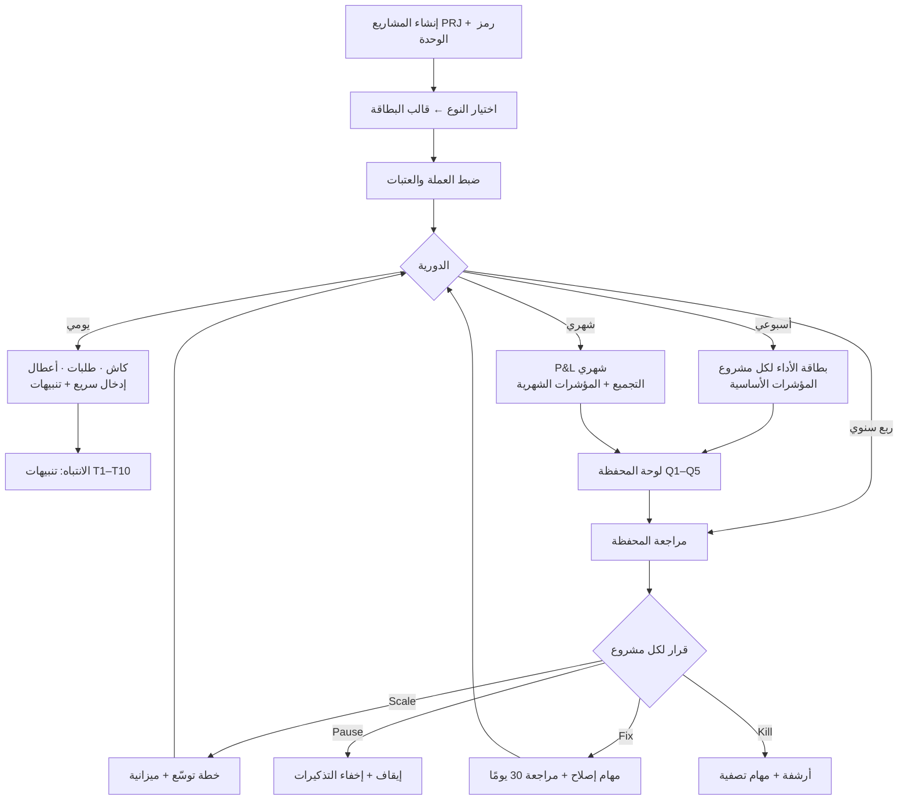

# 📈 Ventures OS — محفظة المشاريع التجارية: ملف البناء الكامل (الإصدار 1.0)

> **هذا هو الملف المرجعي للبناء.** يجمع القسم الجديد كاملًا: الهوية والتسجيل، حدود الملكية مع الأنظمة الموجودة، نموذج البيانات، الشاشات والتدفّقات، المحرّكات، التكاملات، الاختبارات، مراحل البناء. ثم **الملاحق أ–د** وفيها الملفات الأربعة السابقة **كاملةً دون حذف حرف**.
>
> **قاعدة الأسبقية:** عند أي اختلاف، **جسم هذا الملف (الأقسام 0–16) يغلب الملاحق**. الملاحق باقية للتفاصيل (حقول الوحدات الـ29، جداول المؤشرات، التدقيق، خريطة الربط). ما استُبعد من البناء **لم يُحذف**؛ يظهر في §10 بوسم «🗄 محفوظ — لن يُبنى» مع سببه.
>
> **أُضيف في هذا الإصدار:** §17 (تسليم تطبيق Masterplan للمطوّر) · §18 (قسم حملات البريد) · §19 (منصّة الموقع/المدونة في Content OS) · §20 (أثرها على بقية الملف). لم يُحذف شيء.
>
> **المرافق:** `VENTURES_METRIC_DEFS_v1.json` — تعريفات المؤشرات (278 تعريفًا) جاهزة كبذور (seed).
>
> **حدود:** هذا ملف مواصفات للبناء ولم يُكتب كود. قراءة الكود الحالي تمت على `origin/main` (commit `72a7b80`) ولم أشغّل اختبارات. ما لم أتحقق منه موسوم **⚠️ بوابة تحقق** وله رقم في §3.

---

## 0) الاسم والهوية

### 0.1 الاسم المقترح
| | |
|---|---|
| **الاسم** | **Ventures OS** |
| **العنوان العربي** | **محفظة المشاريع التجارية** |
| **المعرّف (`id`)** | `ventures` — **متحقَّق أنه غير مستخدم** (المعرّفات الحالية: content, projects, habits, knowledge, learning, finance, home, inventory, shopping, nutrition, sports, relationships, travel, spiritual) |
| **الأيقونة / اللون** | 📈 · `#0F766E` |
| **لماذا هذا الاسم** | القسم لا يدير مهام (هذا Projects OS) بل **يتتبّع أداء المشاريع التجارية كمحفظة** (متاجر، تطبيقات، مدونات، بزنس أرضي) ويقرّر Scale/Fix/Pause/Kill. كلمة *Ventures* تعني المشروعات التجارية المُدارة كاستثمارات، وتتّسق مع نمط التسمية «X OS»، وتميّزه عن «Projects» (التنفيذ) و«Finance» (المال). |
| **بدائل رفضتها** | `Portfolio OS` (عام، يوحي بمحفظة مالية → يلتبس مع Finance) · `Tracking OS` (يصف الوظيفة لا الغرض) · `Business OS` (واسع جدًا) · `Growth OS` (يغطي جزءًا فقط) |

### 0.2 تسجيله في `core/core.js` (`OS_SYSTEMS`)
```js
{id:"ventures",group:"work",scope:"shared",icon:"📈",color:"#0F766E",name:"Ventures OS",
 title:"محفظة المشاريع التجارية",status:"planned",phase:"قيد البناء",sensitive:true,
 plan:"VENTURES_OS_BUILD_SPEC_v1.md",
 desc:"تتبّع أداء المتاجر والتطبيقات والمدونات والبزنس الأرضي كمحفظة، وقرارات Scale/Fix/Pause/Kill.",
 sections:osSec("dashboard:المحفظة:◎|entry:الإدخال الأسبوعي:▦|projects:المشاريع:📁|money:الأداء المالي:💵|channels:القنوات:📡|email:حملات البريد:✉️|seo:SEO:🔍|growth:النمو:🧪|catalog:المنتجات والأفلييت:🛒|compliance:الامتثال والأمان:🛡️|decisions:القرارات والمراجعة:⚖️|tools:الأدوات:🧰|import:النقل والاستيراد:⤓|settings:الإعدادات:⚙️")}
```
- `sensitive:true` ← **يبدأ بلا صلاحية افتراضية** (نمط موجود: «نظام حساس — يبدأ بدون صلاحية افتراضيًا» في `platform/auth.jsx`). السبب: أرقام إيراد وربح ومنافسين.
- `status:"planned"` ثم `"live"` عند اكتمال المرحلة 2 على الأقل.
- **14 قسمًا** (أُضيف `email` — §18) = وحدة الصلاحيات (`osSectionLevel`). `money` قسم مستقل لأن المالية أحسّ من غيرها (§5.4).

---

## 1) حدود الملكية (مصدر الحقيقة لكل كيان)

> **القاعدة:** كل كيان له **مالك واحد**. Ventures **يرجع إليه بالمعرّف ولا ينسخه** إلا ما يلزم لعرضه سريعًا.

| الكيان | المالك | Ventures يفعل |
|---|---|---|
| المشروع (اسم، حالة، قائد، أعضاء، رؤية، ميزانية مخطّطة) | **Projects OS** | يقرأ؛ ويكتب فقط عند إنشاء مشروع عبر المعالج (جسر §8.1) |
| المهام والمراحل والمخاطر والمشاكل والقرارات التنفيذية والأهداف (OKR) والمخرجات | **Projects OS** | يربط ويفتح؛ يحوّل بنود الامتثال إلى خطر/مشكلة عبر الجسر |
| كل معاملة/رقم مالي، الاشتراكات المتكررة، العملات | **Finance OS** | **قراءة فقط** عبر `fin_projects_get` (§8.2) |
| المنشورات والمقالات والحملات البريدية والحسابات | **Content OS** | يقرأ (§8.3)، ويكتب `project_id` على الحساب عبر واجهته فقط |
| ملاحظات المشروع والفعاليات | **Knowledge OS** | يربط ⚠️ بوابة V4 |
| جهات الاتصال (موردون/شركاء/عملاء) | **Projects OS** | يرجع إليها بالمعرّف |
| مؤشرات الأداء الدورية اليدوية (مبيعات، احتفاظ، SEO…) | **Ventures** | يملكها |
| ملف المشروع التجاري (الكود، النوع، العملة، الوحدات) | **Ventures** | يملكه |
| وحدات SEO، المنافسون، المنتجات/SKU، الأفلييت، الحملات/UTM، قوائم الامتثال، قرارات المحفظة، سجل الاستيراد | **Ventures** | يملكها |

---

## 2) افتراضات البناء (قرارات لم تحسمها بعد — الافتراضي مكتوب عليه)

> غيّر أي بند يعني تعديل المواضع المشار إليها فقط.

| # | القرار | الافتراضي المعتمد | أثره |
|---|---|---|---|
| A1 | أين تعيش البيانات | **نظام مستقل `ventures`** بمخزن خاص | عزل الأداء والصلاحيات (§5) |
| A2 | تخزين المؤشرات | **جدول علائقي** + RPC ذرّية (اتباعًا لـ ADR-HOME-001) | §5.2 |
| A3 | نوع المشروع في Projects | **بلا إضافة أنواع**: متجر←«متجر»، مدونة←«محتوى»، تطبيق←«تطبيق»، بزنس أرضي←«عمل»، منتج رقمي←«أخرى». التفريق الحقيقي في `profiles.subtype` | يلغي C7 من التدقيق |
| A4 | «وضع التتبّع» | **يُلغى كحقل**: وجود ملف Ventures = مشروع متتبَّع. لا تغيير على تبويبات Projects | يلغي C4 |
| A5 | قرار Scale/Fix/Pause/Kill | سجل `portfolio_calls` في Ventures بنفس دورة حياة `decisions` (Proposed/Approved/Cancelled/Superseded) + `rationale` + `rejected_alternatives`؛ ويُنشئ **نظيره** في Projects عبر الجسر حين يتوفر (مرحلة 6) | الـRPC الحالي `projects_apply_records_batch` لا يقبل إلا `tasks` و`outputs` |
| A6 | المال | **Finance مصدر كل رقم مالي**؛ الإدخال اليدوي فقط عند غياب الربط (شارة «يدوي») | §8.2 |
| A7 | بيانات Masterplan المالية القديمة | **تجميع شهري** في المؤشرات (`source:"import"`) + CSV الأصل في تقرير الاستيراد | §9 |
| A8 | KPI Masterplan | **نتيجة رئيسية رقمية في OKR** عبر الجسر | §9 |
| A9 | الملفات | **روابط فقط** (رفع الملفات غير موجود في المنصة) | يلغي خيار النسخ |
| A10 | حدود الاستيراد | 5,000 سجل/مشروع و25,000/عملية؛ تحذير فوق 15,000 | §9 |
| A11 | بداية الأسبوع والمنطقة الزمنية | من إعدادات Projects (`weekStartDay:6` السبت، `Africa/Cairo`) | لا إعداد جديد |
| A12 | العتبات (أخضر/أحمر) | **فارغة** حتى تضبطها | لا اختراع أرقام |
| A13 | صافي الربح | `الربح الإجمالي − التشغيل − التسويق` | الملحق ب §10 |
| A14 | ROAS | `إيراد منسوب للإعلانات ÷ إنفاق الإعلانات` | الملحق ب §10 |
| A15 | التذكيرات | `api.integrations.notifications/calendar` **بعد بوابة V1**؛ وإلا تنبيهات داخل Ventures فقط | §8.5 |

---

## 3) بوابات التحقق قبل أي بناء (5 فحوص قصيرة)

> لم أتحقق منها. كل بوابة تُغلق بقراءة/تجربة محددة، ونتيجتها تغيّر بندًا بعينه.

| # | السؤال | كيف يُغلق | إن كانت الإجابة سلبية |
|---|---|---|---|
| **V1** | هل **يقرأ** أحدٌ `notifications`/`calendar` من `platform-integrations` (Travel/Nutrition يكتبان فقط)؟ | تتبّع قراءة الصف `platform-integrations/main` في `pages.jsx` و`Platform.jsx` | إضافة قارئ إلى «اليوم» أو الاكتفاء بتنبيهات Ventures (A15) |
| **V2** | كيف يقرأ Ventures **قائمة مشاريع Projects**؟ | سابقة موجودة: `integrations.sports.getNutritionContext` يقرأ `workspace_records` لنظام آخر. تجربة استعلام `workspace_records where system_id='projects' and collection='projects'` بحساب عضو Ventures فقط | فهرس مشاريع مصغّر داخل Ventures يُحدَّث بحدث/ربط |
| **V3** | كيف يقرأ Ventures **خطة Content OS** (blob واحد)؟ ومكان تخزينها؟ هل `_pageHealth` لكل حساب أم لكل منصة؟ | قراءة `osMakeApi` و`api.load` في `content/index.jsx` | ربط Content بقراءة يدوية للمؤشرات (إدخال) في المرحلة الأولى |
| **V4** | كيف يظهر **رابط المشروع في Knowledge** بعد الالتزام #97؟ | قراءة `knowledge/index.jsx` والترحيلات | الملاحظات تبقى روابط يدوية |
| **V5** | هل يجوز لـ Ventures **كتابة** سجلات Projects عبر RPC جديد `ventures_import_apply` يتحقق بـ`ws_access_level(ws,'projects',collection)='edit'` لكل مجموعة (نمط `projects_apply_records_batch`)؟ وكيف يتجاوز سياسة التتبّع `traceabilityPolicy:"require"`؟ | مراجعة الترحيل `20261029160000` و`traceabilityBlocked` في `domain.js` | المعالج ينشئ المشاريع فقط ويضع المهام عبر قالب (`instantiateProjectTemplate`) |

---

## 4) الأدوار والصلاحيات

### 4.1 ربطها بالنموذج الموجود
| ما كتبته سابقًا | الموجود |
|---|---|
| مالك/مسؤول/محرر/مشاهد | `Owner/Admin/Member/Viewer` (`store.jsx` سطر role) + مستوى النظام `view/edit` + `manage` |
| مجموعات صلاحية مخصّصة | **أقسام النظام** (13) و`collection_sections` (§5.4) |
| خصوصية المشروع | `visibility`: `workspace`/`private`، و`visible_to` على **السجل** (RLS) |

### 4.2 المصفوفة
| الفعل | Viewer | Member (editor) | Admin | Owner |
|---|---|---|---|---|
| رؤية لوحة المحفظة (غير المالية) | ✔ | ✔ | ✔ | ✔ |
| رؤية قسم `money` | حسب قسمه | حسب قسمه | ✔ | ✔ |
| إدخال مؤشرات تشغيلية (`entry`) | ✘ | ✔ | ✔ | ✔ |
| إدخال مؤشرات مالية يدوية | ✘ | حسب قسم `money` | ✔ | ✔ |
| إنشاء مشروع تجاري/تشغيل المعالج | ✘ | ✔ | ✔ | ✔ |
| التراجع عن استيراد | ✘ | ✘ | ✔ | ✔ |
| اقتراح قرار محفظة | ✘ | ✔ | ✔ | ✔ |
| **اعتماد** قرار محفظة (Approved) | ✘ | ✘ | ✔ | ✔ |
| Kill (إلغاء ثم أرشفة المشروع) | ✘ | ✘ | ✔ | ✔ |
| ضبط العتبات والقوالب والتعيينات | ✘ | ✘ | ✔ | ✔ |
- كل قسم يمنح `none/view/edit` من صفحة المشاركة الموجودة.
- **افتراضي الأقسام الحسّاسة** (`money`, `decisions`, `import`, `settings`): بلا صلاحية للـMember إلا بمنح صريح.

---

## 5) نموذج البيانات

### 5.1 قاعدة العزل
- سجلات Ventures في `workspace_records` بـ`system_id='ventures'` (عبر `useRecordStore({systemId:"ventures"})`).
- **المؤشرات والـSKU الدورية في جداول علائقية** (حجمها يتنامى) مع RPC ذرّية.
- لا يُكتب شيء في سجلات نظام آخر إلا عبر الجسر (§8.1).
- كل سجل يخص مشروعًا **خاصًا** يرث `visible_to` من المشروع إجباريًا.

### 5.2 الجداول العلائقية (ترحيل جديد — **لا يُطبَّق قبل موافقتك**)
```sql
-- ملخّص التصميم (النمط من الترحيلات الحالية: security invoker + ws_access_level + RLS لكل جدول)
create table public.ventures_metric_values(
  workspace_id uuid not null,
  project_id   text not null,
  period_type  text not null check (period_type in ('D','W','M','Q')),
  period_start date not null,
  key          text not null,           -- من ventures_metric_defs
  class        text not null check (class in ('ops','fin')),
  value_num    numeric, value_text text, value_bool boolean,
  no_data      boolean not null default false,
  source       text not null default 'manual' check (source in ('manual','paste','csv','import','finance','content','derived')),
  note         text,
  version      integer not null default 1,
  created_by   uuid, updated_by uuid, updated_at timestamptz not null default now(),
  primary key (workspace_id, project_id, period_type, period_start, key)
);
create table public.ventures_sku_period_values(
  workspace_id uuid not null, project_id text not null, sku text not null,
  period_type text not null, period_start date not null,
  units numeric, revenue numeric, returns numeric, ad_spend numeric,
  version integer not null default 1, updated_at timestamptz not null default now(),
  primary key (workspace_id, project_id, sku, period_type, period_start)
);
create table public.ventures_counters(workspace_id uuid primary key, project_seq integer not null default 0);
```
- **RLS:** `ops` تتبع `ws_access_level(workspace_id,'ventures','entry')` (view/edit)؛ `fin` تتبع `…'money'`. سياسة واحدة بشرط على `class`.
- **المشاريع الخاصة:** صف المؤشر يُرفض/يُخفى إن كان المشروع `private` والمستخدم ليس عضوًا (دالة مساعدة تقرأ `workspace_records` — ⚠️ بوابة V2).
- **RPC (security invoker):**
  | الدالة | وظيفتها | الحدود |
  |---|---|---|
  | `ventures_metrics_upsert(p jsonb)` | كتابة دفعة قيم مع **مقارنة `version`** لكل صف (تعارض ← يُرجع الصفوف المتعارضة) | حتى 500 صف |
  | `ventures_metrics_get(p_ws, p_projects text[], p_type, p_from, p_to)` | قراءة السلسلة؛ تُخفي `fin` لمن لا يملك `money` | |
  | `ventures_sku_upsert(p jsonb)` | مبيعات SKU | 500 |
  | `ventures_next_code(p_ws)` | يعيد `PRJ-###` التالي **ذرّيًا** (لا تكرار عند التزامن) | |
  | `ventures_import_apply(p_ws, p_import_id, p_changes)` | كتابة دفعة سجلات في Projects: لكل مجموعة يتحقق `ws_access_level(ws,'projects',collection)='edit'` | حتى 1000/استدعاء؛ مجموعات: projects, tasks, objectives, krs, risks, issues, outputs |
  | `ventures_import_undo(p_ws, p_import_id)` | حذف ناعم لكل سجل `data->>'import_id'=…` في `projects` و`ventures` | يحترم 14 يومًا |

### 5.3 المجموعات (سجلات `ventures`)
| المجموعة | الغرض | القسم |
|---|---|---|
| `profiles` | ملف المشروع التجاري (id = `vp_{project_id}`): `project_id, code, unit_code, kind, subtype, currency, area_sqm, modules_override, thresholds_override, finance_ref, content_account_ids[], source{system,site_id,import_id}` | `projects` |
| `keywords` · `seo_audit` · `geo` · `ai_checks` · `backlinks` | وحدات SEO (حقولها في الملحق أ §7.20–7.23 و7.8) | `seo` |
| `competitors` · `strategy` · `experiments` | المنافسون، الاستراتيجية القصيرة، نتائج التجارب/CRO (مرتبطة بعنصر اكتشاف) | `growth` |
| `products` · `affiliate` | المنتجات/SKU (بيانات ثابتة)، رصيد/عمولة الأفلييت (مرتبط بجهة اتصال) | `catalog` |
| `checklist` | قوائم الامتثال والأمان (حقل `module`) مع زر «حوّل إلى خطر/مشكلة» | `compliance` |
| `campaigns` | UTM والحملات | `channels` |
| `portfolio_calls` | قرارات المحفظة (A5) | `decisions` |
| `imports` | سجل الاستيراد/التراجع | `import` |
| `settings` · `lookups` · `prefs` · `activity` | إعدادات (عتبات، تعيين تصنيفات Finance، قوالب)، قوائم، تفضيلات المستخدم (إسكات التنبيهات — `visible_to` صاحبها)، سجل نشاط | `settings` |
- **تعريفات المؤشرات** `ventures_metric_defs`: ملف JSON ثابت في الكود (المرافق) + تخصيصات الـworkspace في `settings`. لا جدول.

### 5.4 `collection_sections` (ترحيل صغير)
```sql
insert into public.collection_sections(system_id,collection,section_id) values
 ('ventures','profiles','projects'),
 ('ventures','keywords','seo'),('ventures','seo_audit','seo'),('ventures','geo','seo'),('ventures','ai_checks','seo'),('ventures','backlinks','seo'),
 ('ventures','competitors','growth'),('ventures','strategy','growth'),('ventures','experiments','growth'),
 ('ventures','products','catalog'),('ventures','affiliate','catalog'),
 ('ventures','checklist','compliance'),('ventures','campaigns','channels'),
 ('ventures','portfolio_calls','decisions'),('ventures','imports','import'),
 ('ventures','settings','settings'),('ventures','lookups','settings'),('ventures','prefs','settings') on conflict do nothing;
```

### 5.5 المعرّفات الحتمية (idempotency)
| الكيان | الصيغة |
|---|---|
| ملف المشروع | `vp_{project_id}` |
| قيمة مؤشر | مفتاح مركّب `(project, period_type, period_start, key)` |
| سجل مستورد | `imp_{import_source}_{site_id}_{module}_{original_id}` (أو hash له) |
| حملة | `cmp_{project}_{campaign_code}` |
| قرار محفظة | `pc_{project}_{yyyymmdd}_{n}` |

---

## 6) الشاشات (13 قسمًا)

> **التفصيل الدقيق للأزرار والخانات** لكل قسم من وحدات Masterplan في **الملحق أ §7**، ولبطاقات الأداء في **الملحق ب**. هنا: ما تفعله كل شاشة، مصادرها، سلوكها، وحالاتها. كل شاشة تستخدم `core/kit.jsx` (`Tabs, FormModal, Board, Seg, Stat, Progress, Empty, Chip, useConfirm`).

### 6.1 `dashboard` — لوحة المحفظة
- **المصادر:** `profiles` + `ventures_metrics_get` + صحة Projects (`projectMetrics` عبر V2) + Finance (إن مسموح) + `portfolio_calls`.
- **المحتوى:** بطاقات الأسئلة الخمسة Q1–Q5 (الملحق ب §12.1)، جدول المشاريع (الملحق ب §12.2)، رسوم (تركّز الإيراد، خريطة مخاطر، مؤشر القرار عبر الزمن)، عدّاد «بيانات الأسبوع ناقصة».
- **الأزرار:** مرشّحات (النوع، النوع الفرعي، الحالة، المسؤول، القرار) · اختيار الفترة (أسبوع/شهر/ربع) · عملة العرض · ترتيب · «تصدير CSV» · «ابدأ مراجعة ربع سنوية».
- **الجوال:** بطاقات بدل الجدول (ملحوظة التدقيق U6).
- **حالات:** فارغ (لا مشاريع): `Empty` + «أضف مشروعًا أو انقل من Masterplan»؛ تحميل؛ خطأ؛ بدون عتبات (شارة «اضبط العتبات»).

### 6.2 `entry` — الإدخال الأسبوعي الجماعي
- **جدول:** صف لكل مشروع، عمود لكل مؤشر **أساسي** من نوع إدخال (الملحق ب §3.4)، مع مبدّل «أساسي/كامل».
- **التفاعل:** تنقّل بالأسهم/Tab/Enter، لصق من Sheets (يقبل الفاصلة العربية `٫` والأرقام الهندية)، «انسخ من الأسبوع الماضي»، «لا بيانات» لكل خلية (يفرّق عن الصفر)، حفظ جماعي (`ventures_metrics_upsert` على دفعات ≤500)، مؤشر «غير محفوظ».
- **مشتقات** تظهر حيّة للقراءة فقط؛ وناقصة ← «—» مع «ينقص: …».
- **القيم من مصادر خارجية** (Finance/Content) تظهر مقفلة بشارة المصدر ولا تُكتب يدويًا.
- **الأزرار:** حفظ · حفظ وانتقل لنموذج المشروع · استيراد CSV (يستخدم `core/csv.js`) · تصدير · الفترة (◀ ▶).
- **الصلاحية:** `entry=edit`؛ المالية اليدوية تتطلب `money=edit`.
- **الأخطاء:** تعارض نسخة ← يعرض القيم الأحدث ويطلب إعادة المحاولة؛ رقم غير صالح ← تحقق قبل الحفظ؛ فترة مستقبلية ← مرفوضة؛ تعديل فترة > 90 يومًا ← يطلب سببًا.
- **غير متصل:** يُحفظ في الطابور المحلي (نمط `recordQueue`) ويُرسل عند الاتصال.

### 6.3 `projects` — المشاريع التجارية
- **القائمة:** كل المشاريع التي لها `profiles`، بالكود (PRJ-###) ورمز الوحدة، النوع، مؤشر القرار، الصحة، آخر بيانات.
- **إنشاء:** «＋ مشروع تجاري» (يختار مشروعًا موجودًا في Projects **أو** ينشئ جديدًا عبر الجسر) + «إنشاء دفعة من CSV» (§9.2).
- **صفحة المشروع (تبويبات — 9 فقط):**
  | التبويب | المحتوى | المصدر |
  |---|---|---|
  | نظرة عامة | صحة التنفيذ (Projects) + أداء العمل (مؤشر القرار) + آخر قرار + أعلام المخاطر | Projects + metrics |
  | الأداء | بطاقة الأداء حسب النوع (الملحق ب) | metrics |
  | المال | كتلة Finance (§8.2) | Finance |
  | SEO | الكلمات/الفحص/الجغرافي/الذكاء/الباك لينك (للمدونات والمتاجر المفعّلة) | `ventures` |
  | النمو | المنافسون، الاستراتيجية، التجارب | `ventures` |
  | المنتجات | المنتجات/SKU والأفلييت | `ventures` |
  | الامتثال والأمان | القوائم + تحويل لخطر/مشكلة | `ventures` + Projects |
  | المحتوى | حسابات Content OS المرتبطة وحالة النشر | Content OS |
  | القرارات | تاريخ قرارات المحفظة | `portfolio_calls` |
  - **المهام/الأهداف/المخاطر/المشاكل/المخرجات** تُفتح في Projects بزر «افتح في Projects OS» (لا تكرار).
  - التبويبات الظاهرة تتبع `kind/subtype` و`modules_override` (مصفوفة الملحق أ §4.2).
- **تغيير النوع الفرعي:** يغيّر بطاقة الأداء والتبويبات؛ **القيم المدخلة تبقى** وغير المنطبق يظهر بشارة (لا حذف).

### 6.4 `money` — الأداء المالي
- كتلة Finance لكل مشروع (الإيراد، المصروف، الصافي، ROI، الحرق، استهلاك الميزانية) + جدول المعاملات المرتبطة.
- **تعيين التصنيفات:** «تصنيف Finance ← مؤشر» (`settings.finance_category_map`) لتغذية `marketing_spend` و`cogs` و`shipping_cost` و`platform_fees` و`payment_fees` و`returns_value`.
- **الإدخال اليدوي** للمشاريع غير المربوطة.
- **زر «اربط بملف Finance»**: يفتح Finance للإنشاء/الربط (`fin_project_save` بـ`project_ref`)؛ لا ننشئ ملفًا مالّيًا من Ventures.
- بلا صلاحية Finance: الكتلة مخفية و«غير متاح».

> **ملاحظة (§18):** يُضاف قسم رابع عشر `email` — حملات البريد، وتفاصيله في §18.

### 6.5 `channels` — القنوات والحملات
جدول المصدر/الوسيط ← جلسات/إنفاق/إيراد/ROAS/CAC من `campaigns` ومؤشر الجلسات حسب المصدر؛ صف «بدون UTM» لإظهار فجوة التتبّع؛ «＋ حملة» (منشئ UTM، §6.10).

### 6.6 `seo` — SEO (5 وحدات)
تبويب لكل وحدة مع فلتر المشروع؛ الحقول والأزرار حرفيًا من الملحق أ §7.20 (الكلمات) §7.21 (فحص SEO) §7.22 (الجغرافي) §7.23 (الذكاء الاصطناعي) §7.8 (الباك لينك). فحص SEO بحالات Done/Todo/N/A و🌱 زرع القائمة الافتراضية (40 بندًا — الملحق هـ).

### 6.7 `growth` — النمو
المنافسون (§7.4)، استراتيجية قصيرة (§7.3: جمهور/دول/نموذج/خروج فقط)، التجارب وCRO (§7.5 و§7.9): الفرضية = عنصر اكتشاف في Projects (رابط)، والنتيجة (lift/winner/decision) هنا؛ الفوز يقترح «إنجازًا».

### 6.8 `catalog` — المنتجات والأفلييت
المنتجات/SKU (§7.18) بمولّد SKU؛ الأفلييت (§7.7): الشبكة/البرنامج = جهة اتصال بدور «شريك»، وهنا الرصيد والعمولة وآخر دفعة.

### 6.9 `compliance` — الامتثال والأمان
قوائم الامتثال (§7.14) والأمان (§7.15) بحالات OK/Risk/Issue؛ زر **«حوّل إلى خطر»** و**«حوّل إلى مشكلة»** عبر الجسر (يرتبط بـ`risks`/`issues` الموجودة فتدخل الصحة والتنبيهات دون كود جديد).

### 6.10 `tools` — الأدوات
منشئ UTM · مولّد SKU · قاموس الأحداث (مرجع) · سجل الأكواد — **التفصيل الكامل في الملحق ب §11**. قاموس الأحداث **مرجع أسماء** وليس ناقل أحداث المنصّة (`publishOSEvent`) — يُسمّى «أحداث التحليلات» لتفادي الالتباس.

### 6.11 `decisions` — القرارات والمراجعة
- **سجل القرارات:** `portfolio_calls` بحقول الملحق ب §9.2 + حالة الاعتماد (A5).
- **أثر القرار على حالة المشروع (يطابق جدول الانتقالات الفعلي `canChangeProjectStatus`):**
  | القرار | الأثر |
  |---|---|
  | Scale | بلا تغيير حالة؛ مهمة «خطة التوسّع»؛ علامة ⭐ |
  | Fix | مهام إصلاح لكل مؤشر خارج العتبة؛ مراجعة 30 يومًا |
  | Pause | `On Hold` (مسموح من Planned/In Progress)؛ يُلغى تذكير الأسبوعي |
  | Kill | `Cancelled` ثم `Archived` (خطوتان؛ `In Progress→Archived` غير مسموح)؛ مهام تصفية |
- **المراجعة الربع سنوية:** معالج الملحق ب §13.3؛ **تقريرها** = «تحديث أصحاب مصلحة» بمستوى المحفظة (`project_id` فارغ) أو ملف قابل للتصدير ⚠️ يعتمد V5.

### 6.12 `import` — النقل والاستيراد
معالج 4 خطوات (§9). المصادر: Masterplan JSON · CSV مشاريع. سجل الاستيراد + تقرير + تراجع.

### 6.13 `settings` — الإعدادات
عتبات لكل نوع (قيمتان لمؤشر القرار أولًا) · تعيين تصنيفات Finance · قوالب المؤشرات (تفعيل/إخفاء) · قوائم (مصادر UTM، أنواع SKU) · أعلام التنبيه · تصدير JSON · السلة (نمط Projects).

---

## 7) المحرّكات (`src/systems/ventures/domain.js` — دوال نقية بلا I/O)

| الدالة | وظيفتها |
|---|---|
| `evalMetric(def, values)` | يحسب المشتق بـ**محرّك الصيغ المستخرج** `core/kpiEngine.js` (من `content/index.jsx`: `computeKpiExpression`, `computeKpiValue`)؛ ناقص المدخلات ← `null` مع قائمة «ينقص» |
| `aggregatePeriod(def, rows, periodType)` | يجمع اليومي ← أسبوعي ← شهري ← ربع حسب قاعدة المؤشر: **عدّ=مجموع، نسبة=مشتقة بعد الجمع، رصيد=آخر قيمة، متوسط** (قاعدة لكل تعريف) |
| `scorecardFor(profile, defs)` | يحدد المؤشرات المنطبقة (`applies_to`) + «أساسي/كامل» |
| `decisionMetric(profile, values)` | مؤشر القرار حسب النوع (الملحق ب §9.1) |
| `thresholdState(def, value, thresholds)` | good/warn/bad أو `none` (لا عتبات ← لا لون) |
| `portfolioQuestions(ctx)` | Q1–Q5 (الملحق ب §12.1) |
| `ventureAlerts(memberId, ctx)` | قواعد §7.1 بمفاتيح dedupe للإسكات |
| `suggestCall(profile, ctx)` | اقتراح قرار **فقط عند وجود عتبات** (لا قرار آلي) |
| `canApplyCall(project, call, idx)` | يفحص الانتقال بنفس جدول Projects |
| `masterplanToVenture(json, opts)` | محوّل الاستيراد (`importMasterplan.js`) نقي وقابل للاختبار: مطابقة القيم، تنظيف الأرقام، كشف اليتيمة والتكرار |

### 7.1 التنبيهات (النهائية)
| # | القاعدة | الخطورة |
|---|---|---|
| V-A1 | بيانات الأسبوع ناقصة بعد 3 أيام | معلومة |
| V-A2 | صافي المساهمة < 0 لفترتين (متجر) | تحذير |
| V-A3 | الاسترداد/المرتجعات فوق العتبة | تحذير |
| V-A4 | D30 تحت العتبة مع إنفاق اكتساب مرتفع (تطبيق): «لا تصرف على الاكتساب» | تحذير |
| V-A5 | Crash-free تحت العتبة | حرج |
| V-A6 | SKU صافي مساهمته سالب 4 أسابيع | معلومة |
| V-A7 | اعتماد > X% على مورد/منتج واحد | تحذير |
| V-A8 | فاقد/فرق جرد فوق العتبة (أرضي) | تحذير |
| V-A9 | قرار منتهي موعد مراجعته | تحذير |
| V-A10 | مدونة: محتوى متهاوٍ فوق العتبة | معلومة |
| V-A11 | كلمات خارج أول 10 (مجمّعة) | معلومة |
| V-A12 | رصيد أفلييت متاح | معلومة |
| V-A13 | مشروع بلا ربط Finance وفيه مدخلات مالية يدوية | معلومة |
- **الأمان/الامتثال/التجديد/الهامش الخاسر/المهام المتأخرة** لا تُكرَّر: تأتي من **الصحة والمخاطر والمشاكل وFinance (البنود المتكررة)** الموجودة.
- تُحسب كل قاعدة بمفتاح `key` فريد؛ **الإسكات** (7 أيام) في `prefs` لكل مستخدم.
- لا إشعارات خارج التطبيق إلى حين `notify`؛ التذكير الزمني عبر المنصّة بعد V1.

### 7.2 الصحة
**لا درجة رقمية، ولا تعديل على `projectMetrics`.** Ventures يعرض **مؤشرين منفصلين**: «صحة التنفيذ» (من Projects كما هي) و«أداء العمل» (مؤشر القرار + العتبات).

---

## 8) التكاملات (عقد كل ربط)

### 8.1 جسر Projects
| الاتجاه | الآلية | الاستخدام |
|---|---|---|
| قراءة | استعلام `workspace_records` (سابقة `getNutritionContext`) ⚠️ V2 | قائمة المشاريع وصحتها |
| كتابة | `ventures_import_apply` (V5) | إنشاء مشروع/مهام/OKR/مخاطر عبر المعالج |
| تحويل | الجسر نفسه | بند امتثال ← خطر/مشكلة؛ قرار ← تغيير حالة |
| فتح | Deep link `?system=projects&project=…` | «افتح في Projects OS» |

### 8.2 Finance (قراءة فقط)
- **القراءة:** `fin_projects_get(p_ws)` ← لكل ملف مالي مرتبط (`project_ref = project_id`): `revenue_base`, `expenses_base`, `net_profit_base`, `budget`, `budget_used_pct`, `roi_pct`, `monthly_burn_base`, `last_activity`, `unvalued_transactions`, المعاملات.
- **التجميع بالفترة:** من قائمة المعاملات (`local_date`, `pnl_effect`, `base_amount`, `category_id`) + `finance_category_map`.
- **العملة:** `*_base` (عملة أساس Finance). لا أسعار صرف في Ventures.
- **الصلاحية:** يتطلب صلاحية Finance (`ledger` view)؛ بدونها تُخفى الكتلة. ⚠️ طريقة عبور الفحص من نظام آخر تُحسم مع V2.
- **التضارب:** مؤشر يدوي مقابل رقم Finance لنفس الفترة ← يظهر الاثنان وتنبيه إن اختلفا > 10% (قابل للضبط).
- **غير مربوط:** «اربط» (§6.4).

### 8.3 Content OS (قراءة)
- ربط `project_id` على **الحساب** (`plan._accounts[i]`) عبر واجهة Content.
- المقروء: `plan._pageHealth` (شهري) و`plan._analytics` وعدد المنشورات حسب الحالة ⚠️ V3.
- لا نكتب في blob Content (قفل الطابع الزمني للخطة كلها).

### 8.4 Knowledge · جهات الاتصال · OKR
ملاحظات/فعاليات ← روابط ⚠️ V4 · موردون/شركاء ← جهات الاتصال بالمعرّف · KPI Masterplan ← KRs رقمية (`initial_value/current_value/target_value`) عبر الجسر.

### 8.5 المنصّة
`api.integrations.notifications.upsert({workspaceId, sourceSystem:"ventures", sourceKey:"entry:{project}:{weekStart}", dueAt, title})` · `calendar.upsert({… sourceKey:"call:{id}", date, sourceRecordId})` · `cancel/remove` عند Pause/Kill. نمط الفحص `getVenturesIntegrationStatus(api)` كما في Travel/Nutrition. **مشروط بـV1.**

### 8.6 أحداث المنصّة
`publishOSEvent` (ناقل المتصفح، best-effort) لـ«ظهور في اليوم»، ولا يُعتمد عليه لما هو حرج. للحرج لاحقًا: outbox دائم بنمط `home_outbox_events`.

### 8.7 الكود المشترك المُستخرج (بلا تغيير سلوك)
| الوحدة الجديدة | من | يستفيد منه |
|---|---|---|
| `core/csv.js` (`parseCsv`, `parseDate`, `parseAmount`, `fingerprint`, `signature`) | `finance/TransactionImport.jsx` | Finance (كما هو) + Ventures |
| `core/kpiEngine.js` | `content/index.jsx` | Content (كما هو) + Ventures |
- **شرط:** اختبارات Finance وContent الحالية تمرّ قبل/بعد الاستخراج.

---

## 9) النقل من Masterplan + الإنشاء الدفعي

> التفصيل الكامل لكل خطوة وخانة في **الملحق أ §6**. هنا **التعديلات المعتمدة** (تغلب الملحق):

### 9.1 معالج النقل — 4 خطوات (بدل 6)
1. **الملف:** رفع JSON + فحص (صحة، حجم، سجلات يتيمة، مكررة، أعداد حقيقية).
2. **المراجعة:** شاشة واحدة لكل مشروع: الاسم، النوع الفرعي، الكود، القائد، الرؤية (`workspace`/`private`)، الأولوية، تعيين المسؤولين والقيم والتكرار (مع «كلها سليمة» لقبول الاقتراحات دفعة).
3. **تجربة جافة ثم تنفيذ:** دفعات 200 عبر `ventures_import_apply` (≤1000)، شريط تقدّم، إيقاف/استئناف/تصغير.
4. **التقرير والتراجع:** CSV (UTF-8 BOM)، تراجع 14 يومًا عبر `ventures_import_undo`.

### 9.2 مطابقات معتمدة (تصحّح الملحق أ)
| العنصر | المطابقة |
|---|---|
| حالة المشروع | نشط→`In Progress` · متوقف→`On Hold` · مؤرشف→`Archived`. حالة يدوية بلا مقابل ← `legacy_status` + تقرير المطابقة |
| حالة المهمة | Todo→Not Started · In Progress→In Progress · Review→In Progress + وسم · Done→Completed · الملغاة تأخذ `cancelled_reason`="مستورد" (V-19) |
| الرؤية | `workspace` أو `private`؛ وكل سجل فرعي لمشروع خاص يحمل `visible_to` |
| المراحل | مهام أب `is_phase`؛ **لا يُكتب عليها حالة/تقدير/موعد** (مشتقة، F-25) |
| سياسة التتبّع | الاستيراد يحمل `import_id` ويتجاوز `traceabilityPolicy` بقرار مسجّل، ولا يتجاوز V-01/02/05/19 ⚠️ V5 |
| `finance` | تجميع شهري في المؤشرات (`source:"import"`) + CSV الأصل في التقرير (A7) |
| `kpi` | KRs رقمية (الهدف=`target12`، و3/6 في الوصف) (A8) |
| `compliance` / `security` | قوائم + تحويل لخطر/مشكلة |
| `content` / `email` / `distribution` | لا تُستورد كمجموعات؛ تُسجَّل في التقرير كـ«انقلها إلى Content OS» مع CSV (لا أداة نقل آلية للـblob) |
| `assets` | مخرجات (روابط فقط) |
| `team` | مهام؛ `members` لا تُنقل |
| `notes` | ملاحظة Knowledge ⚠️ V4 |
| `tech` | تكلفة/تجديد ← تُذكر في التقرير لإنشاء **بنود متكررة في Finance يدويًا** (أو CSV جاهز لاستيرادها)؛ بنود الإعداد ← مهام |
| ملفات | روابط فقط |
| حدود | 5,000/مشروع، 25,000/عملية |

### 9.3 الإنشاء الدفعي من CSV (الـ27 مشروعًا)
الأعمدة: `unit_code, name, kind, subtype, owner_email, currency, status, link, area_sqm` (التحقق في الملحق ب §16). الكود `PRJ-###` من `ventures_next_code`. **نوع Projects** يُشتق من A3.

---

## 10) حالة كل وحدة Masterplan (29) — ما يُبنى وما يُربط وما يُحفظ

> **لا حذف:** كل وحدة باقية تفاصيلها في الملحق أ §7. العمود الأخير يقول ماذا سيحدث لها فعلًا.

| # | الوحدة | الحالة | الوجهة | ملاحظة |
|---|---|---|---|---|
| 1 | dashboard | 🔗 ربط | `dashboard` (§6.1) | |
| 2 | phases | 🔗 ربط | Projects: مهام أب + قالب | حقل `is_phase` |
| 3 | business | 🏗 بناء صغير | `growth/strategy` | |
| 4 | competitors | 🏗 بناء | `growth/competitors` | |
| 5 | experiments | 🏗 بناء صغير | `growth/experiments` + اكتشاف | |
| 6 | finance | 🔗 ربط | Finance | 🗄 سجل مالي Masterplan محفوظ كـCSV فقط |
| 7 | affiliate | 🏗 بناء صغير | `catalog/affiliate` + جهات اتصال | |
| 8 | links | 🏗 بناء | `seo/backlinks` | |
| 9 | cro | 🏗 بناء صغير | `growth/experiments` (نوع CRO) | |
| 10 | team | 🔗 ربط | Projects: المهام | |
| 11 | members | 🔗 ربط | فريق المنصّة | 🗄 دعوات Masterplan لا تُنقل |
| 12 | calendar | 🔗 ربط | تقويم المنصّة/اليوم | |
| 13 | notes | 🔗 ربط | Knowledge ⚠️ V4 | |
| 14 | compliance | 🏗 بناء صغير | `compliance/checklist` + Projects.risks | |
| 15 | security | 🏗 بناء صغير | `compliance/checklist` + Projects.issues | |
| 16 | tech | 🔗 ربط | Finance (بنود متكررة) + قالب مهام | 🗄 `p_tech` المالي لن يُبنى |
| 17 | content | 🔗 ربط | Content OS | 🗄 دورة حياة المحتوى لن تُبنى هنا |
| 18 | products | 🏗 بناء | `catalog/products` | |
| 19 | assets | 🔗 ربط | Projects: المخرجات | |
| 20 | keywords | 🏗 بناء | `seo/keywords` | |
| 21 | seoAudit | 🏗 بناء | `seo/seo_audit` | |
| 22 | geo | 🏗 بناء | `seo/geo` | |
| 23 | ai | 🏗 بناء | `seo/ai_checks` | |
| 24 | email | 🔗 ربط | Content OS (منصّة Email) | |
| 25 | distribution | 🔗 ربط | Content OS (المنصّات) | |
| 26 | health | 🔗 ربط | `projectMetrics` | 🗄 درجة 40+8×عدد السجلات لن تُنقل |
| 27 | kpi | 🔗 ربط | Projects: OKR | |
| 28 | alerts | 🔗 ربط | `computeAlerts` + §7.1 | 🗄 التنبيهات اليدوية → مشاكل |
| 29 | priority | 🔗 ربط | Projects: الاكتشاف | 🗄 المعادلة غير المطبّقة لن تُنقل |

**الجرد:** 🔗 17 · 🏗 12 (بناء كامل أو صغير). المجموعات الجديدة: 22 مجموعة نظرية سابقة ← **18 مجموعة سجلات + جدولان علائقيان** (بعضها صغير جدًا).

### 10.1 بطاقات الأداء (الملحق ب)
| النوع | ما يُبنى | ما يُربط |
|---|---|---|
| متجر (كل الأنواع) | البطاقة الموحدة + SKU | مؤشرات المال من Finance |
| دروبشيبينج/POD/رقمي | إضافات كل نوع | — |
| تطبيق | بطاقة كاملة (إدخال: لا مصدر آخر) | — |
| مدونة | بطاقة | المؤشرات الشهرية من Content OS حيث أمكن (V3) |
| أرضي O01/O02 | بطاقتان بإدخال يومي | — |
| المشتركة (7 مجموعات) | لكل مشروع | المالية من Finance، المهام/المتأخرات من Projects |

---

## 11) التدفّقات الكاملة (تغلق ثغرات التدقيق)

> كل تدفّق: **دخول ← خطوات ← نجاح ← فشل/فراغ/صلاحية ← تراجع**.

**F-A — إنشاء مشروع تجاري واحد**
1. `projects` ← «＋ مشروع تجاري». 2. اختيار: مشروع موجود في Projects / جديد. 3. إدخال: الاسم، `kind`، `subtype`، رمز الوحدة، العملة، القائد، الرؤية. 4. `ventures_next_code` ← PRJ-###. 5. إن كان جديدًا: الجسر ينشئ المشروع (نوع Projects من A3) وقالبه. 6. إنشاء `profiles`. **فشل:** رمز مكرّر/نوع لا يطابق البادئة ← رسالة؛ فشل الجسر ← لا `profiles` (ذرّية). **تراجع:** سلة.

**F-B — ربط Finance**
1. تبويب «المال» ← «اربط». 2. لا ملف مالي ← يفتح Finance لإنشائه بـ`project_ref`. 3. عند وجوده: `profiles.finance_ref` ويظهر الرقم بشارة «من Finance». 4. بلا صلاحية Finance ← «غير متاح». **تضارب العملة:** لا مقارنة + تحذير.

**F-C — ربط حساب Content OS**
1. «المحتوى» ← «اربط حساب». 2. قائمة حسابات Content (قراءة). 3. كتابة `project_id` على الحساب **عبر واجهة Content** ⚠️ V3. 4. تظهر المؤشرات الشهرية. **غير متاح:** نموذج إدخال يدوي.

**F-D — الإدخال الأسبوعي الجماعي** (§6.2): فتح الشبكة ← الفترة الحالية ← ملء/لصق/نسخ ← حفظ جماعي ← تأكيد وعدّاد الناقص. **تعارض/أخطاء/غير متصل** كما في §6.2.

**F-E — التهيئة الأولى للعتبات:** أول فتح للوحة بلا عتبات ← بطاقة «اضبط عتبتين لمؤشر القرار لكل نوع» ← `settings` ← تظهر الألوان وQ4/Q5 المقترحة. تخطّي ← ترتيب فقط.

**F-F — قرار محفظة:** من لوحة/مشروع ← «اتخاذ قرار» ← خانات (قرار، سبب، بدائل، مراجعة قادمة، مسؤول) + لقطة أدلة ثابتة ← **اقتراح** (Proposed) ← اعتماد الأدمن (Approved) ← تنفيذ الأثر (§6.11) عبر الجسر. **رفض الانتقال:** رسالة بسبب `canChangeProjectStatus`. **تراجع عن Kill:** استرجاع من `Archived/Cancelled` (الانتقالات الموجودة تسمح) + قرار جديد يستبدل (Superseded).

**F-G — المراجعة الربع سنوية:** «ابدأ مراجعة» ← اختيار الربع (`quarterLabel`) ← بطاقات Q1–Q5 ← مشروعًا مشروعًا (قرار/تخطٍّ) ← ملخص ← تأكيد ← مهام المتابعة + التقرير. **مشروع بلا بيانات:** شارة «بيانات قديمة» ولا يُمنع. **مسودة:** تُحفظ تلقائيًا (`prefs`).

**F-H — النقل (§9)** + **إعادة النقل:** بصمة `source_hash` و`edited_at` لكل سجل منقول؛ ما عدّله المستخدم يفوز ويُسجَّل التعارض. **تراجع:** مهام لها جلسات وقت لا تُحذف جلساتها.

**F-I — مشروع خاص (`private`):** كل سجل Ventures له `visible_to` من المشروع؛ المؤشرات (جدول علائقي) تُفلتر بدالة العضوية؛ المعالج يطبّق نفس القاعدة. **اختبار إلزامي** (V-02 §13).

**F-J — السلة والحذف:** سجلات Ventures تدخل سلة النظام (نمط Projects)؛ حذف مشروع من Projects ← تبقى سجلات Ventures معلّمة «مشروع محذوف» وتُنظَّف عند الحذف النهائي (حدّ 1000 سجل: يُنفَّذ على دفعات).

**F-K — غير متصل:** طابور محلي لكل كتابة (سجلات وRPC)؛ شارة «⟳»؛ إعادة إرسال عند الاتصال؛ تعارض النسخة ← عرض الأحدث.

**F-L — الديمو:** كل شاشة لها بيانات Demo في `demo.js` (`buildSeed`) وتعمل بلا قاعدة.

**F-M — تغيير النوع الفرعي:** (dropship→pod): المؤشرات المدخلة تبقى، البطاقة تتبدّل، غير المنطبق بشارة، سجل نشاط.

**F-N — إسكات تنبيه:** `prefs` للمستخدم؛ يُلغى تلقائيًا بعد 7 أيام.

**F-O — تصدير:** JSON لكل بيانات Ventures (إعدادات)، CSV لبطاقة مشروع ولوحة المحفظة.

---

## 12) الاختبارات

### 12.1 ملفات الاختبار الجديدة (تُضاف إلى سكربت `npm test`)
| الملف | يغطي |
|---|---|
| `tests/t_ventures_domain.mjs` | `evalMetric` (قسمة على صفر، ناقص المدخلات)، `aggregatePeriod`، `thresholdState`، `portfolioQuestions`، `ventureAlerts`، `canApplyCall` |
| `tests/t_ventures_import_masterplan.mjs` | `masterplanToVenture`: المطابقات، الأرقام النصية، اليتيمة، التكرار، الحتمية، الحدود، المراحل |
| `tests/t_ventures_contract.mjs` | عقد RPC والجداول (RLS على قاعدة حقيقية كما تفعل `t_real.js`): `class fin/ops`، المشاريع الخاصة، `next_code` بالتزامن |
| `tests/t_ventures.js` | تجوال واجهة الديمو لكل قسم |
| `tests/t_core_csv.mjs` · `tests/t_core_kpi_engine.mjs` | الوحدتان المستخرجتان (+ بقاء اختبارات Finance/Content) |

### 12.2 حالات القبول
- **كل حالات الملحق أ §13 (MP-01…MP-30)** و**الملحق ب §17 (PF-01…PF-32)** و**الملحق ج §8 (X-01…X-15)** تُنقل إلى الملفات أعلاه (يُعدَّل منها ما يخالف §2: لا `p_ledger`، لا أنواع جديدة، لا نسخ ملفات).
- **جديدة خاصة بهذا الجسم:**
| # | السيناريو | المتوقع |
|---|---|---|
| VN-01 | مستخدم بلا `money` يقرأ `ventures_metrics_get` | صفوف `fin` غير موجودة |
| VN-02 | كتابة `fin` بـ`entry=edit` فقط | مرفوضة |
| VN-03 | `ventures_next_code` من جلستين متزامنتين | كودان مختلفان |
| VN-04 | مشروع `private` وعضو غير مشارك | لا يرى `profiles` ولا المؤشرات |
| VN-05 | `ventures_metrics_upsert` بصف نسخته قديمة | يُرجَّع التعارض ولا يكتب |
| VN-06 | `ventures_import_apply` بلا صلاحية `projects.tasks` | يفشل كله (ذرّي) |
| VN-07 | `ventures_import_undo` | يحذف ناعمًا ما له `import_id` فقط |
| VN-08 | Kill على `In Progress` | `Cancelled` ثم `Archived` |
| VN-09 | Pause على `Idea` | يُرفض بسبب الانتقال |
| VN-10 | وحدة `core/csv.js` على ملف Finance القديم | نتائج مطابقة تمامًا |
| VN-11 | وحدة `kpiEngine` على KPIs Content الحالية | قيم مطابقة تمامًا |
| VN-12 | فتح Ventures بلا صلاحية القسم `money` | لا يظهر `money` ولا بياناته |
| VN-13 | نظام `sensitive` لعضو جديد | بلا وصول حتى يُمنح |
| VN-14 | Finance غير متاح | كتلة المال «غير متاح» دون كسر الصفحة |
| VN-15 | حساب Content غير مرتبط | نموذج إدخال يدوي |

---

## 13) ملفات الكود (قائمة تنفيذ)

| المسار | جديد/تعديل | المحتوى |
|---|---|---|
| `src/systems/ventures/index.jsx` | جديد | المسار والراوتر (نمط `projects/index.jsx`) |
| `src/systems/ventures/domain.js` | جديد | §7 |
| `src/systems/ventures/lookups.js` | جديد | القوائم، قوالب البطاقات (تُولَّد من `VENTURES_METRIC_DEFS_v1.json`) |
| `src/systems/ventures/store.jsx` | جديد | `useRecordStore({systemId:"ventures"})` + RPC للمؤشرات + الجسر |
| `src/systems/ventures/screens_*.jsx` | جديد | الشاشات الـ13 (§6) |
| `src/systems/ventures/parts.jsx` | جديد | شبكة الإدخال، بطاقة المؤشر، نماذج |
| `src/systems/ventures/importMasterplan.js` | جديد | المحوّل النقي |
| `src/systems/ventures/demo.js` | جديد | بيانات الديمو |
| `src/core/csv.js` · `src/core/kpiEngine.js` | جديد (استخراج) | §8.7 |
| `src/systems/finance/TransactionImport.jsx` | تعديل | يستورد من `core/csv.js` (بلا تغيير سلوك) |
| `src/systems/content/index.jsx` | تعديل | يستورد من `core/kpiEngine.js` (+ حقل `project_id` على الحساب بعد V3) |
| `src/core/core.js` | تعديل | تسجيل النظام (§0.2) |
| `src/platform/integrations.js` | تعديل (اختياري) | `projects` bridge أو قارئ `notifications` (V1/V5) |
| `supabase/migrations/…_ventures_core.sql` | جديد | الجداول العلائقية + RPC + RLS |
| `supabase/migrations/…_ventures_collection_sections.sql` | جديد | §5.4 |
| `supabase/migrations/…_ventures_import_rpc.sql` | جديد | `ventures_import_apply/undo` (V5) |
| `tests/…` | جديد | §12.1 |
| `package.json` | تعديل | إضافة الاختبارات إلى `test` |
| `plans/VENTURES_OS_BUILD_SPEC_v1.md` | هذا الملف | |

---

## 14) مراحل البناء (كل مرحلة قابلة للإطلاق وحدها)

| المرحلة | المحتوى | الاعتماد | معيار القبول |
|---|---|---|---|
| **0** | إغلاق البوابات V1–V5 | — | وثيقة قصيرة بنتيجة كل بوابة وتعديل البنود المتأثرة |
| **1 — الهيكل** | تسجيل النظام والأقسام، `profiles`، المخزن، الديمو، `collection_sections`، صلاحيات `sensitive`، استخراج `csv.js` و`kpiEngine.js` باختباراتهما | 0 | يفتح النظام بالديمو؛ VN-12/13؛ `t_core_*` ✔؛ اختبارات Finance/Content ✔ |
| **2 — المؤشرات** | الترحيل العلائقي + RPC، التعريفات، بطاقات المدونة والمتجر (الأساسي)، شبكة الإدخال، العتبات | 1 | VN-01…05؛ `t_ventures_domain` ✔؛ إدخال أسبوعي فعلي لمشروعين |
| **3 — المشاريع والنقل** | إنشاء مشروع (F-A)، CSV دفعي للـ27، المعالج (Masterplan JSON)، الجسر، التقرير والتراجع | 2 + V5 | MP-*، VN-06/07؛ نقل مشروع تجريبي كامل ثم التراجع |
| **4 — المال والمحتوى** | كتلة Finance وتعيين التصنيفات، ربط حسابات Content | 2 + V2/V3 | VN-14/15، مطابقة أرقام Finance لمشروع حقيقي |
| **5 — الوحدات** | SEO الخمس، المنافسون، المنتجات/الأفلييت، الامتثال والأمان | 3 | حقول الملحق أ لكل وحدة؛ تحويل خطر/مشكلة |
| **6 — القرار والمحفظة** | `portfolio_calls`، لوحة المحفظة Q1–Q5، المراجعة الربع سنوية، التنبيهات، التذكيرات (V1) | 4 + 5 | VN-08/09؛ PF-*؛ مراجعة تجريبية كاملة |
| **7 — اكتمال البطاقات** | التطبيق، الأرضي O01/O02، إضافات POD/الرقمي، منشئ UTM/SKU، تصدير | 2 | PF-04/05/28 وغيرها |

**ما أنصح بشحنه أولًا:** المرحلتان 1 و2 (قاعدة + إدخال أسبوعي)، ثم 3 (نقل المشاريع).

---

## 15) المخاطر المفتوحة

| # | الخطر | التخفيف |
|---|---|---|
| R1 | قراءة بيانات نظام لآخر (Projects/Content/Finance) غير محسومة | بوابات V2/V3 وخطة بديلة لكل منها |
| R2 | الصلاحيات عبر الأنظمة (Finance حسّاس) | إخفاء الكتلة + اختبار VN-14 |
| R3 | حجم الإدخال اليدوي لـ27 مشروعًا | «أساسي»، لصق، نسخ، CSV؛ والتوصيلات لاحقًا |
| R4 | تعديل Projects (الجسر/الـRPC) قد يصطدم باختباراته الـ57+ | RPC مستقل بدل تعديل الموجود |
| R5 | استخراج `csv.js`/`kpiEngine.js` قد يغيّر سلوك Finance/Content | اختبارات مطابقة قبل/بعد (VN-10/11) |
| R6 | بيانات Masterplan الفعلية غير معروفة | الأعداد تظهر عند الفحص؛ حدود الاستيراد |
| R7 | التذكيرات قد تُخزَّن ولا تظهر (V1) | بديل: تنبيهات Ventures |
| R8 | العتبات الفارغة تجعل اللوحة باهتة | F-E التهيئة |

---

## 16) القرارات المطلوبة منك
| # | القرار | الافتراضي |
|---|---|---|
| 1 | **الاسم** Ventures OS — محفظة المشاريع التجارية | موافقة (أو اختر من البدائل §0.1) |
| 2 | A1: نظام مستقل | نعم |
| 3 | A2: جدول علائقي للمؤشرات | نعم |
| 4 | A3: عدم إضافة أنواع جديدة في Projects | نعم |
| 5 | A5: قرارات المحفظة سجل في Ventures أولًا ثم نظير في Projects | نعم |
| 6 | A7: المالية القديمة تجميع شهري | نعم |
| 7 | أسماء المشاريع الـ27 وتوزيع E01–E11 على دروبشيبينج/POD/رقمي | **أحتاجها** |
| 8 | A13/A14: تعريفا صافي الربح وROAS | موافقة |
| 9 | من يُدخل المالية يدويًا | Admin فقط |
| 10 | من أين نبدأ | المرحلة 0 ثم 1 |

---


## 17) تسليم تطبيق Masterplan Pro للمطوّر — هل يُرفق؟

**الجواب: نعم، يُرفق كمرجع، بشروط.** هو مصدر الحقيقة لأشياء محددة لا يعرفها المطوّر من هذا الملف وحده، وليس نموذجًا للبناء.

### 17.1 ما يُرفق ولماذا
| المرفق | لماذا يحتاجه المطوّر | شرط |
|---|---|---|
| ملف التطبيق الأصلي (HTML واحد) | القوائم الافتراضية الفعلية (53 مهمة مراحل / 40 SEO / 31 تقنية / 6 KPI، والأرقام في ملاحظاته القديمة 46/38 مختلفة عن الكود)، والمعادلات، وقواعد التنبيه الثمانية، ومعنى كل حقل | **بعد حذف أي إعداد Supabase أو مفاتيح منه** (انظر 17.2) |
| **ملف تصدير JSON حقيقي** (`masterplan_stage1_v1`) لمشروع أو اثنين | أهم مرفق: عليه يُبنى ويُختبر `masterplanToVenture` وحالات MP-* و§9، فالبيانات الحقيقية تكشف ما لا تكشفه القوائم | يُنظَّف من أسماء/أرقام/إيميلات حقيقية إن سيُشارَك خارج فريقك |
| هذا الملف + `VENTURES_METRIC_DEFS_v1.json` | هما المواصفات | — |
| لقطات شاشة لتبويبات التطبيق | تسريع فهم الشاشات | اختياري |

### 17.2 ما لا يُرفق
- **مفاتيح Supabase أو أي إعداد اتصال** داخل التطبيق: تُحذف من النسخة المرفقة، وأنصح بتدوير أي مفتاح ظهر في أي محادثة أو ملف سابق.
- بيانات عملاء أو أرقام مالية حقيقية.

### 17.3 تعليمات تُكتب للمطوّر مع المرفق (انسخها)
1. **المواصفات تغلب التطبيق.** عند أي اختلاف اتبع هذا الملف (جسمه ثم الملاحق).
2. **لا تنقل كود التطبيق ولا بنيته.** هو ملف واحد بتخزين محلي ومسح كامل عند الاستيراد؛ الجديد علائقي وبصلاحيات.
3. يُستخدم التطبيق لثلاثة أشياء فقط: (أ) القوائم الافتراضية والمعادلات، (ب) فهم معنى الحقول، (ج) شكل ملف التصدير الذي سيُستورد.
4. لا تبنِ ما وسمناه «ربط» (§10) — الموجود في OS Hub هو الأساس.
5. اختبارات الاستيراد تُكتب على ملف التصدير الحقيقي المرفق.

---

## 18) قسم حملات البريد داخل Ventures OS (قسم جديد: `email`)

### 18.1 الحدّ الفاصل مع Content OS (قرار تصميم)
Content OS يملك منصّة «Email» ومسار كتابة كل رسالة (هدف، Subject، Preview، الجسم، CTA، قالب، Test، جدولة). **لن نكرّره.** Ventures يدير **الحملة كوحدة أعمال**: القوائم والشرائح، التسلسلات الآلية، الجدولة على مستوى المحفظة، الأداء والإيراد والتسليم. الربط بين الاثنين برقم المنشور:

| يملكه Content OS | يملكه Ventures (القسم الجديد) |
|---|---|
| نص الرسالة ومراحل إنتاجها | الحملة كسجل أعمال (هدف، قائمة، شريحة، موعد، ميزانية) |
| الحساب/المنصّة | القوائم والشرائح وصحتها |
| — | التسلسلات الآلية (Welcome/Nurture/Win-back/Cart) |
| — | الأداء بعد الإرسال والإيراد المنسوب وUTM |
| — | فحص التسليم (SPF/DKIM/DMARC) والامتثال |
- حقل `content_post_id` في الحملة يربطها بمنشور Content OS (اختياري) فيُفتح بزر «افتح الرسالة في Content OS».
- مشروع بلا ربط Content: الحملة تُدار هنا بحقول الموضوع والرابط فقط.

### 18.2 تسجيله
- يُضاف إلى `osSec` قسم: `email:حملات البريد:✉️` (يصبح **14 قسمًا**)، بعد `channels`.
- ترحيل `collection_sections`: `('ventures','email_campaigns','email')`, `('ventures','email_lists','email')`, `('ventures','email_flows','email')`, `('ventures','email_checks','email')`.
- الصلاحية: `email=edit` للتحرير؛ **الإيراد** في الحملة يُعامل كمؤشر `fin` (يظهر لمن يملك `money` فقط).
- تحديث §14: يُبنى القسم في **المرحلة 5** مع القنوات (يعتمد المرحلة 2).

### 18.3 المجموعات (سجلات `ventures`)
| المجموعة | حقولها |
|---|---|
| `email_campaigns` | `project_id`, `name`, `type` (Newsletter/Welcome/Sequence/Promotion/Transactional/Re-engagement/Launch), `goal` (وعي/تفاعل/مبيعات/استرجاع), `list_id`, `segment`, `esp` (منصّة الإرسال), `subject_a`, `subject_b` (A/B), `preview_text`, `status` (Draft/Scheduled/Sending/Sent/Paused/Cancelled), `scheduled_at`, `sent_at`, `utm_campaign` (من منشئ UTM)، `content_post_id`, `owner_id`, `link`, **نتائج الإرسال:** `sent`, `delivered`, `opens`, `clicks`, `unsubs`, `bounces_hard`, `bounces_soft`, `spam_complaints`, `conversions`, `revenue` (fin), `notes`, `winner` (A/B) |
| `email_lists` | `project_id`, `name`, `esp`, `size`, `size_date`, `source` (نموذج موقع/صفحة هبوط/استيراد/مزيج)، `double_optin` (نعم/لا)، `last_clean_date`, `segments[]` (اسم + شرط نصي + حجم) |
| `email_flows` | `project_id`, `name`, `trigger` (اشتراك/شراء/سلة متروكة/عدم نشاط/…)، `emails[]` (ترتيب، تأخير بالأيام، عنوان، رابط)، `status` (Draft/Live/Paused)، `list_id`، نتائج آخر 30 يومًا (`entered`, `completed`, `revenue`) |
| `email_checks` | قائمة التسليم والامتثال لكل نطاق: SPF · DKIM · DMARC · نطاق إرسال مخصص · رابط إلغاء الاشتراك ظاهر · عنوان فعلي في التذييل · موافقة صريحة موثقة · قائمة سلبية/Suppression · تنظيف دوري — كل بند `OK/Risk/Todo` + ملاحظة + تاريخ |

### 18.4 المقاييس المشتقة (تُحسب ولا تُدخل)
| المؤشر | الصيغة |
|---|---|
| نسبة التسليم | `delivered ÷ sent` |
| نسبة الفتح | `opens ÷ delivered` (تنبيه ⚠️: فتح الإيميل غير موثوق بسبب حماية الخصوصية؛ يُعرض بوسم «تقريبي» ولا يُبنى عليه قرار وحده) |
| نسبة النقر CTR | `clicks ÷ delivered` |
| النقر إلى الفتح CTOR | `clicks ÷ opens` |
| إلغاء الاشتراك | `unsubs ÷ delivered` |
| الارتداد | `(hard+soft) ÷ sent` |
| الشكاوى | `spam_complaints ÷ delivered` |
| التحويل | `conversions ÷ clicks` |
| إيراد الرسالة الواحدة RPR | `revenue ÷ delivered` |
| نمو القائمة | `size_now − size_prev` (من لقطتين) |
- تُجمَّع شهريًا إلى `ventures_metric_values` بمفاتيح `email_*` (`source:'derived'`) لتظهر في بطاقة المشروع والمحفظة؛ المفتاحان الموجودان `email_signups` (مدونة) و`emails_captured` (رقمي) و`email_sms_revenue` (مشترك) يبقيان كما هي ويُغذَّيان من هذا القسم **حين يوجد**، ويُدخلان يدويًا حين لا يوجد.
- **قاعدة منع المضاعفة:** حجم القائمة رصيد (آخر قيمة) لا يُجمع (قرار الملحق أ §7.24 محفوظ).

### 18.5 الشاشات
1. **نظرة عامة:** بطاقات: حجم القوائم، نمو 30 يومًا، آخر حملة، متوسط CTR/إلغاء/ارتداد، إيراد البريد (إن سُمح)، حملات هذا الأسبوع، مشاكل التسليم المفتوحة.
2. **الحملات:** جدول + تقويم + لوحة حالات (Board). مرشّحات: المشروع، النوع، الحالة، القائمة. أزرار: ＋ حملة · نسخ حملة · استيراد نتائج CSV (من ESP عبر `core/csv.js` مع تعيين الأعمدة) · تصدير.
3. **نموذج الحملة:** الحقول في 18.3 مجمّعة (الأساسيات · الجمهور · المحتوى والاختبار A/B · الجدولة · النتائج). «النتائج» تُقفل حتى الحالة Sent. اختيار A/B Winner يحفظ السبب.
4. **القوائم والشرائح:** حجم + لقطات تاريخية (رسم)، «سجّل لقطة اليوم»، صحة القائمة (آخر تنظيف، الارتداد، الشكاوى).
5. **التسلسلات:** خريطة خطوات بتأخيرها، مؤشرات آخر 30 يومًا، حالة.
6. **التسليم والامتثال:** `email_checks` مع زر «حوّل إلى خطر/مشكلة» (الجسر §8.1) مثل قسم الامتثال.
- الحالات: فارغ / تحميل / خطأ / غير متصل كباقي الأقسام.

### 18.6 القواعد والتنبيهات
| # | القاعدة | الخطورة |
|---|---|---|
| V-A14 | شكاوى سبام فوق العتبة (افتراضي فارغ حتى تضبطه؛ المرجع الشائع أقل من 0.1%) | حرج |
| V-A15 | ارتداد صلب فوق العتبة | تحذير |
| V-A16 | حملة Scheduled تجاوز موعدها دون Sent | تحذير |
| V-A17 | قائمة لم تُنظَّف منذ N يومًا | معلومة |
| V-A18 | بند تسليم/امتثال Risk مفتوح | تحذير |
| V-A19 | مشروع بلا أي حملة منذ N يومًا (عتبة فارغة افتراضيًا) | معلومة |
- أرقام العتبات **لا أخترعها**: تُضبط في الإعدادات (القاعدة A12).
- تتحقق الحفظ: `0 ≤ rate ≤ 100`، `delivered ≤ sent`، `opens ≤ delivered`، `clicks ≤ delivered`؛ حملة Sent بلا `sent` تُنبَّه ولا تُمنع.

### 18.7 النقل من Masterplan (الوحدة 7.24 — تحديث §10)
حقول الوحدة القديمة (8 حقول) تُنقل إلى `email_campaigns`: `subject→name`, `type→type`, `subscribers→sent` (⚠️ كانت «المشتركين» وقت الإرسال)، `open`/`ctr` → `opens`/`clicks` بعد التحويل من نسبة إلى عدد مع حفظ النسبة الأصلية في `notes` إن لم يُعرف `delivered`، `revenue→revenue`, `status` (Draft/Scheduled/Sent) كما هي، `date→sent_at/scheduled_at`. حالة الوحدة في §10: **من «ربط Content OS» إلى «🏗 بناء + ربط Content OS»** (الصف 24).

### 18.8 تكاملات
- **UTM:** كل حملة تولّد `utm_campaign` من منشئ UTM (§6.10) فتظهر في القنوات `channels` كمصدر «email».
- **Finance:** الإيراد المنسوب يبقى رقمًا تقديريًا من ESP؛ الإيراد الفعلي يُقرأ من Finance (A6) والفرق يُعرض.
- **المنصّة:** `notifications.upsert` بمفتاح `email:{campaign_id}` قبل الموعد بيوم (مشروط V1).
- **Content OS:** `content_post_id` + عرض حالة الرسالة (المرحلة الحالية) داخل الحملة (قراءة، مشروط V3).

### 18.9 الاختبارات
EM-01 حساب كل مقياس (قسمة على صفر ← `null`) · EM-02 رفض `opens>delivered` · EM-03 تجميع شهري يطابق مجموع الحملات · EM-04 حجم القائمة لا يُجمع · EM-05 إيراد الحملة مخفي عمّن بلا `money` · EM-06 استيراد CSV من ESP بتعيين أعمدة وإعادة الاستيراد بلا تكرار (بصمة) · EM-07 تنبيه موعد فائت · EM-08 تحويل بند تسليم إلى خطر · EM-09 نقل حقول Masterplan 7.24 · EM-10 حملة بلا `content_post_id` تعمل.

---

## 19) نوع منصّة «موقع / مدونة» في Content OS (نشر المقالة كاملًا)

### 19.1 ما وجدته في الكود (حقائق قبل التصميم)
1. `DEFAULT_PLATFORMS` فيه **14 منصّة** (Instagram … Reddit، و**Medium** آخرها). **لا توجد منصّة موقع/مدونة ولا Email افتراضية.** (تصحيح لما كتبته سابقًا في الملخصات: أن منصّتي Website وEmail موجودتان — الموجود **مسار عمل عام** فقط، انظر 2.)
2. يوجد مسار عمل جاهز اسمه `WEBSITE` (و`EMAIL`) في `DEFAULT_TASKS/DEFAULT_FIELDS`، لكن `getCategory(type,pid)` لا يختاره إلا إذا كان `pid==="website"` حرفيًا، بينما المنصّات الافتراضية معرّفاتها `plt_*` والمنصّة التي ينشئها المستخدم تأخذ `plt_<timestamp>`. **أي أن مسار WEBSITE لا يُفعَّل عمليًا في المنصّات الحالية** ⚠️ بوابة V6 (تأكيد بالتجربة).
3. **Medium** (أقرب شيء) أنواعه 12 بلا مراحل (`stages` غير موجودة)، فيسقط على المسار العام `TEXT` (قصير جدًا لمقالة).
4. كل نوع محتوى في منصّات مثل Instagram له `stages[]` (اسم، ترتيب، وصف، مخرَج، مهام، حقول، مسؤول افتراضي) وكل منشور يحمل **نسخة مستنسخة** `post._workflow` فلا تتأثر المنشورات القديمة بأي تعديل لاحق (مصرّح به في الكود).
5. `DEFAULT_PLATFORMS` لا يُستخدم إلا حين `plan._platforms` فارغة؛ فأي منصّة افتراضية جديدة **لا تظهر في الخطط الموجودة** دون ترحيل إضافي (يوجد نمط ترحيل بنسخ المخطط `*_SchemaVersion` في الملف).
6. الخطة كلها blob واحد بقفل طابع زمني (`api.load/save`) — أي تعديل مني على الخطة يجب أن يمرّ عبر نفس القفل.

### 19.2 القرار
إنشاء منصّة افتراضية جديدة: **`website`** — الاسم «الموقع / المدونة»، الوسم `WEB`، اللون `#0F766E`، **بمعرّف `website` حرفيًا** كي يعمل `getCategory` الموجود ويُوسَّع المسار القائم بدل بناء مسار موازٍ. (البديل `plt_website` يتطلب تعديل `getCategory`؛ أرجّح المعرّف الحرفي لأنه لا يغيّر المنطق الحالي. ويُحسم بالبوابة V6.)

### 19.3 أنواع المحتوى (`contentTypes`) — كلها بمراحل كاملة
| النوع | الفئة | التكرار المثالي | ملاحظة |
|---|---|---|---|
| مقال مدونة (Blog Post) | نص | 1–3/أسبوع | النوع الأساسي والمسار الكامل في 19.4 |
| دليل شامل (Pillar/Guide) | نص | 1–2/شهر | يضاف: خريطة مواضيع فرعية + ربط داخلي إلزامي من الأعمدة |
| مراجعة / مقارنة منتج (Review/Comparison) | نص | 1–2/أسبوع | حقول: المنتج، الإفصاح، المزايا/العيوب، رابط الأفلييت |
| شرح خطوات (Tutorial/How-to) | نص | 1/أسبوع | HowTo schema |
| قائمة (Listicle) | نص | 1/أسبوع | |
| دراسة حالة (Case Study) | نص | 1/شهر | |
| أخبار/تحديث (News) | نص | عند الحاجة | مسار مختصر |
| صفحة هبوط (Landing Page) | صفحة | حسب الحملة | + CTA/تحويل/اختبار A/B |
| صفحة منتج/تصنيف (Product/Category Page) | صفحة | حسب الكتالوج | لمتاجر المحتوى |
| صفحة مفيدة (About/FAQ/Policy) | صفحة | مرة | مسار قانوني/ثابت |
| **تحديث مقال قديم (Content Refresh)** | صيانة | حسب الأداء | يبدأ من مقال منشور (§19.6) |
- `scheduleMode:"fixed"` · `bestDays` الثلاثاء/الخميس · `bestTimes` يُترك فارغًا حتى يضبطه المستخدم (لا اخترع توقيتًا) ← قيم Medium الحالية (`7-9 ص`) لا تُنسخ.

### 19.4 مراحل «مقال مدونة» (النوع الأساسي) — من الفكرة إلى ما بعد النشر
> تُكتب كـ`stages[]` بنفس بنية Instagram (`id, name, order, desc, deliverable, tasks[], fields[], defaultAssigneeId`). **المهام والحقول الحالية في `WEBSITE` تبقى كما هي (لا حذف)** وتُضاف إليها ما يلي:

| # | المرحلة | المخرَج | المهام (إضافة على الموجود) | الحقول |
|---|---|---|---|---|
| 1 | الفكرة والبحث | موضوع معتمد + كلمة رئيسية | ابحث الكلمة الرئيسية · راجع أفضل 5 نتائج · حدّد نية البحث · تأكد من عدم التكرار مع مقال موجود (Cannibalization) · حدّد الركيزة/العنقود · حدّد الـCTA والمنتج/الأفلييت المرتبط | `keyword`, `secondary_keywords`, `search_intent`, `cluster`, `word_count`, `competitor_notes`, `target_url_slug`, `funnel_stage`, `cta_goal` |
| 2 | المخطط (Outline) | مخطط H2/H3 + أسئلة الجمهور | اكتب المخطط · أسئلة People Also Ask · روابط داخلية مستهدفة (3 على الأقل) · مصادر موثوقة | `outline`, `faq_questions`, `internal_link_targets`, `sources` |
| 3 | الكتابة | مسودة كاملة | H1 بالكلمة الرئيسية · المقدمة · الجسم H2/H3 · الخلاصة+CTA · FAQ | `h1`, `seo_title` (≤60), `meta_desc` (≤155), `slug`, `content_body`, `author`, `reading_time` |
| 4 | التحرير | نسخة مصحّحة | تدقيق لغوي · تدقيق معلومات · نبرة الهوية · إفصاح الأفلييت/الرعاية عند الحاجة | `fact_check`, `disclosure` (لا/أفلييت/برعاية), `editor_notes` |
| 5 | الصور والوسائط | وسائط جاهزة | صورة رئيسية · WebP مضغوطة · Alt Text لكل صورة · صورة OG · فيديو/انفوجرافيك إن وُجد | `hero_img`, `alt_texts`, `og_image`, `media_links` |
| 6 | الإدراج في الـCMS | صفحة Draft | أضف المحتوى · التصنيف والوسوم · الروابط الداخلية · Schema (Article/FAQ/HowTo) · Canonical · Breadcrumbs · فهرس المحتويات · روابط UTM على الخارجية الخاصة بك | `cms`, `design_link` (رابط المعاينة), `category`, `tags`, `schema_type`, `canonical`, `speed_score` |
| 7 | المراجعة والاعتماد | موافقة | فحص SEO النهائي (عنوان/ميتا/H1/ألت/روابط) · Mobile · Page Speed · روابط مكسورة · موافقة المسؤول | `seo_check`, `mobile_ok`, `links_ok`, `approved_by`, `review_notes` |
| 8 | النشر | مقال حيّ | انشر/جدول · اطلب الفهرسة في Search Console · تأكد من الـSitemap · أضفه لـ«أحدث المقالات»/القائمة | `publish_at`, `live_url`, `indexed`, `sitemap_ok` |
| 9 | التوزيع | نشر اجتماعي/بريدي | أنشئ منشورات للمنصّات من المقال · أدرجه في النشرة البريدية القادمة · إشعار القائمة | `social_post_ids` (روابط لمنشورات Content OS)، `newsletter_campaign_id` (حملة §18) |
| 10 | المتابعة (+7 / +30 / +90 يومًا) | قرار | سجّل: ظهور/نقرات/متوسط الترتيب/CTR (Search Console) · جلسات · تحويلات · إيراد؛ ثم قرّر: اتركه / حدّثه / ادمجه / احذفه-أعد توجيهه | `gsc_impressions`, `gsc_clicks`, `avg_position`, `sessions`, `conversions`, `revenue`, `decision` (keep/refresh/merge/redirect) |
- المرحلة 10 تُغذّي `plan._analytics` للمنشور (موجود) وتُجمَّع شهريًا إلى مؤشرات المدونة في Ventures (`blog_*` في الملف المرافق) ← **هذا هو الربط الفعلي** الذي كان مشروطًا بـV3.
- المرحلة 9 تربط بحملات §18 وبمنشورات منصّات أخرى بالمعرّف (لا نسخ).

### 19.5 مسارات الأنواع الأخرى
- **صفحة هبوط:** (1) الهدف والجمهور · (2) رسالة العرض والـCTA · (3) الكتابة · (4) التصميم · (5) التتبّع (UTM/Pixel/أحداث) · (6) الإدراج في الـCMS · (7) مراجعة + اختبار الجوال/السرعة · (8) النشر · (9) اختبار A/B · (10) نتائج التحويل.
- **تحديث مقال قديم:** (1) اختيار المقال (من تحليل الانخفاض) · (2) تشخيص (انخفاض ترتيب/محتوى قديم/منافس جديد) · (3) خطة التحديث · (4) إعادة الكتابة · (5) تحديث الصور/الروابط/Schema · (6) مراجعة · (7) النشر وتغيير تاريخ التحديث · (8) إعادة طلب الفهرسة · (9) متابعة +14/+45 يومًا.
- **أخبار:** بحث ← كتابة ← مراجعة ← نشر ← توزيع (5 مراحل).
- **صفحة ثابتة (About/Policy):** مسودة ← مراجعة قانونية ← نشر ← مراجعة سنوية.
- بقية الأنواع تستخدم مسار «مقال مدونة» مع حقول إضافية حسب النوع (جدول 19.3).

### 19.6 «تحديث المحتوى» وربط الأداء
- زر **«ابدأ تحديثًا»** على أي مقال منشور (من Ventures أو Content) يُنشئ منشورًا جديدًا نوعه Content Refresh ويحمل `refresh_of` (معرّف المقال الأصلي).
- تنبيه V-A10 (محتوى متهاوٍ) يقترح مقالات للتحديث.

### 19.7 الربط بين المنصّة والمشروع
- يُضاف `project_id` إلى **الحساب** في `plan._accounts` (§8.3) فيُعرَف الموقع التابع لأي مشروع.
- `_pageHealth` الشهري (مفتاحه المنصّة لا الحساب ⚠️ V3) يُغذّي بطاقة المدونة.
- موقعان لمشروعين مختلفين: حسابان على نفس المنصّة `website` لكل منهما `project_id`.

### 19.8 التنفيذ (دون كسر الموجود)
| البند | المطلوب |
|---|---|
| إضافة المنصّة | عنصر جديد في `DEFAULT_PLATFORMS` بالمعرّف `website` |
| الخطط الموجودة | **ترحيل إضافي** (لا يستبدل): إن لم توجد منصّة بمعرّف `website` تُضاف؛ إن وجدت منصّة مستخدم بنفس الاسم تُعرَض للمستخدم للدمج ولا تُكتب فوقها. نسخة مخطط جديدة `_websitePlatformSchemaVersion` بنمط الترحيلات الحالية |
| المنشورات القديمة | لا تُمسّ (`_workflow` المستنسخ) |
| المسار العام `WEBSITE` | يبقى كما هو كاحتياطي، ويُوسَّع بحقول 19.4 |
| الكود | `src/systems/content/index.jsx` (قائمة المنصّات + الترحيل + `getCategory` إن لزم) |
| الاختبارات | `t_content_website_platform.mjs` (CW-01…CW-08 أدناه) + بقاء اختبارات Content الحالية |
| قفل الخطة | الترحيل يمرّ عبر `api.load/save` بقفل `updatedAt` |

### 19.9 اختبارات
CW-01 خطة فارغة تحصل على 15 منصّة (14 + `website`) · CW-02 خطة قديمة تُرحَّل بإضافة `website` دون تغيير باقي المنصّات · CW-03 منصّة مستخدم موجودة بالاسم لا تُكتب فوقها · CW-04 منشور قديم يحتفظ بـ`_workflow` · CW-05 منشور جديد من نوع «مقال مدونة» يستنسخ 10 مراحل بالترتيب · CW-06 `getCategory(type,"website")` ← `WEBSITE` · CW-07 مرحلة المتابعة تكتب في `_analytics` · CW-08 ترحيل مرتين لا يكرّر (idempotent).

### 19.10 بوابة تحقق جديدة
| # | السؤال | كيف يُغلق |
|---|---|---|
| **V6** | هل `pid` الذي يصل إلى `getCategory` هو معرّف المنصّة فعلًا؟ وهل يوجد في خطط حقيقية منصّة بمعرّف `website`/`email`؟ | تتبّع استدعاءات `getCategory` وتجربة إنشاء منشور على منصّة بمعرّف `website` |

---

## 20) أثر الإضافات على بقية الملف (لتتّسق الأقسام)
| الموضع | التعديل |
|---|---|
| §0.2 / §6 | الأقسام **14** (أُضيف `email`) |
| §5.3 | 4 مجموعات جديدة: `email_campaigns, email_lists, email_flows, email_checks` |
| §5.4 | 4 صفوف `collection_sections` (18.2) |
| §10 | الوحدة 24 (email): 🏗 بناء + 🔗 ربط · الوحدتان 17 و25: الربط يصبح عبر المنصّة `website` (§19) |
| §12 | اختبارات EM-01…10 وCW-01…08 تُضاف |
| §13 | ملفات: شاشة `screens_email.jsx`، وتعديل `content/index.jsx` (§19.8)، واختبار `t_content_website_platform.mjs` |
| §14 | المرحلة 5 تضم قسم البريد؛ ومنصّة `website` في Content OS تُبنى **قبل** المرحلة 4 لأنها تغذّي ربط المحتوى (V3 + V6) |
| §3 | بوابة V6 مضافة |
| §16 | قرارات: هل نعتمد المعرّف الحرفي `website`؟ (افتراضي: نعم) · هل يُفعَّل القسم `email` من المرحلة 5؟ (افتراضي: نعم) |

---


## 21) قرارات مُعتمدة (من صاحب المشروع، 2026-11-03)

| القرار | الحالة |
|---|---|
| معرّف منصّة المدونة في Content OS = `website` حرفيًا (§19.2) | ✅ معتمد |
| مراحل «الموقع / المدونة» كما في §19.4–19.5 | ✅ معتمدة — **البذرة الجاهزة:** `VENTURES_WEBSITE_PLATFORM_DEF_v1.json` (منصّة كاملة: 11 نوعًا و95 مرحلة بمهامها وحقولها، بشكل `DEFAULT_PLATFORMS`) |
| قسم `email` (حملات البريد) داخل Ventures، يُبنى في المرحلة 5 (§18) | ✅ معتمد |
| باقي القرارات (§16: أسماء الـ27 مشروعًا، توزيع E01–E11، وغيرها) | ⏳ تُجاب عبر المبرمج |

**ملاحظات تنفيذ للمبرمج على بذرة المنصّة:**
1. شكل حقول المراحل `{k,l,t,p}` هو شكل `DEFAULT_FIELDS`؛ منصّة Instagram الافتراضية تحمل `fields:[]` فتأكد من شكل حقول المراحل المخصّصة في الكود (بوابة V6) قبل الدمج.
2. المراحل في «مقال مدونة» **و**الأنواع المشتقة منه متطابقة عمدًا؛ يُعدَّل أحدها بعد الإطلاق دون أن يتأثر الآخر (كل نوع نسخته).
3. الترحيل إضافي ولا يكتب فوق منصّات المستخدم (§19.8)، وقفل `updatedAt` إلزامي.
4. هذه البذرة بيانات فقط؛ **لم يُكتب ولم يُشغَّل أي كود** في OS Hub.


---

# الملحق أ — نقل Masterplan Pro وأنواع المشاريع والتتبّع (المرجع الكامل للوحدات الـ29)

> **ملحق كامل بلا حذف.** عند أي اختلاف مع جسم الملف (الأقسام 0–16) فالجسم هو الأغلب.

# 🧭 Projects OS — أنواع المشاريع ووحدات التتبّع + نقل مشاريع Masterplan Pro (الإصدار 1.0)

> **الغرض:** ملف مواصفات تفصيلي لإضافة قدرة جديدة إلى Projects OS: **تنقل مشروعًا قائمًا (موقعًا من Masterplan Pro) إلى هنا ويبقى له مهامه كاملة، ويُتتبَّع بوحدات تناسب نوعه**. الملف يشرح كل قسم وكل زر وكل خانة وماذا يفعل، ومصدر كل قاعدة.
>
> **مصدر التحليل:** الملف المرفق `masterplan-main.zip` (63 ملفًا: `index.html` بحجم ~121KB، `supabase-adapter.js`، 5 migrations، 22 ملف ملاحظات، مشروع Android). كل ما هو منقول من الكود موسوم بـ 📄، وكل قرار تصميم مني موسوم بـ 🛠️، وكل تصحيح لخلل في الأصل موسوم بـ ⚙️.
>
> **حدود الفحص:** حلّلت الكود قراءةً وبرمجيًا (استخراج الحقول والشروحات والجداول بسكربت)، **ولم أشغّل التطبيق في متصفح**، ولم أصل إلى بياناتك الفعلية داخل Masterplan (لا في ملف التصدير ولا في Supabase الخاص به). لذلك أعداد السجلات الحقيقية ستظهر فقط في «معاينة الاستيراد» عند أول نقل.

---

## 0) الفهرس
1. تفسير الطلب والقرارات المطلوبة منك · 2. تحليل Masterplan Pro (ما هو، حجمه، بنيته، أخطاؤه) · 3. المبادئ والقرارات المعمارية · 4. أنواع المشاريع وملفات الوحدات · 5. وضع الإدارة مقابل وضع التتبّع · 6. **معالج النقل (كل خطوة، زر، خانة)** · 7. **مرجع الأقسام الـ29 (كل قسم، زر، خانة)** · 8. الأزرار العامة (الشريط العلوي/الجانبي/النماذج) · 9. التنبيهات التلقائية · 10. الصحة والأولويات · 11. نموذج البيانات والصلاحيات · 12. الأمان والخصوصية · 13. اختبارات القبول · 14. خطة التنفيذ · 15. الفجوات والأسئلة المفتوحة · ملحق: القوائم الافتراضية الجاهزة

---

## 1) تفسير الطلب
طلبك: «أقدر أنقل مشروعًا إلى هنا، ولا تزال له مهام، إنما يُتتبَّع وتظهر الأشياء الموجودة هنا (في Masterplan)، وأختار نوعه فتظهر الأشياء التي تناسبه، وأريد ملفًا تفصيليًا جدًا لكل زر وقسم وخانة».

**كيف فهمته (وهذا هو التصميم):**
1. **«ينقل مشروعًا»** = معالج نقل من Masterplan Pro (ملف تصدير JSON، ولاحقًا من Supabase) ينشئ **مشروعًا في Projects OS** لكل موقع.
2. **«لا تزال له مهام»** = المهام والمراحل تُنقل وتبقى مهام حقيقية في شجرة المهام الحالية (تقدّم، صحة، تقويم، مؤقّت) — لا جدول موازٍ.
3. **«يُتتبَّع»** = وضع جديد للمشروع اسمه **«تتبّع»** (§5) مناسب لمشروع يُدار خارج النظام أو يُتابَع فقط، بدل وضع **«إدارة»** الكامل (PRD/اكتشاف/OKR).
4. **«أختار نوعه فتظهر الأشياء التي تناسبه»** = **نوع المشروع** يحدد **ملف الوحدات** (§4): أي تبويبات تتبّع تظهر (كلمات مفتاحية، منتجات، أفلييت…).

**قرارات أحتاجها منك (لكل منها افتراضي — الملف مكتوب عليه):**
| # | القرار | الافتراضي في هذا الملف |
|---|---|---|
| Q1 | هل «وضع التتبّع» ما فهمته أم تقصد شيئًا آخر؟ | كما في §5 |
| Q2 | الأنواع الجديدة المقترحة: «موقع محتوى/أفلييت»، «متجر دروب شيبينج/POD»، «منتج رقمي» (تُضاف لأنواعك الحالية) | موافق |
| Q3 | المالية: سجل مالي داخل المشروع (تتبّع فقط) أم الانتظار لـ Finance OS؟ | سجل تتبّع الآن + ربط لاحق |
| Q4 | الملفات المرفوعة في Masterplan: نبقي الروابط أم ننسخها لتخزين OS Hub؟ | الروابط افتراضيًا + خيار النسخ |
| Q5 | هل نحتاج نقلًا مباشرًا من Supabase الخاص بـ Masterplan؟ | ملف JSON أولًا، Supabase في المرحلة 2 |

---

## 2) تحليل Masterplan Pro

### 2.1 ما هو
لوحة إدارة **متعددة المواقع** (محفظة مواقع) لمن يبني مواقع محتوى/أفلييت/متاجر: لكل «موقع» 28 وحدة بيانات (استراتيجية، منافسون، كلمات، محتوى، باك لينك، مالية…) + لوحة محفظة. واجهة عربية RTL بالكامل، ويُحفظ كل شيء في المتصفح (`localStorage`) مع **مزامنة اختيارية** مع Supabase.

### 2.2 الأرقام (من الكود مباشرة)
| العنصر | العدد | ملاحظة |
|---|---|---|
| الأقسام (modules) في القائمة | **29** | في 8 مجموعات: Portfolio, Strategy, Growth, Operations, Content, SEO, Distribution, Insights |
| جداول بيانات لها نموذج إدخال | **22 + phaseDefs** (=23 كائن `fields`) | الباقي (dashboard, calendar, notes, members, health, priority) شاشات عرض/مشتقّة |
| خانات النموذج الإجمالية | **203** | لكل خانة شرح (أيقونة ⓘ) |
| مهام المراحل الافتراضية | **53** في 5 مراحل | ⚠️ ملاحظات المشروع الأصلية تقول 46 — الكود 53 |
| بنود فحص SEO الافتراضية | **40** في 7 أقسام | ⚠️ الملاحظات تقول 38 — الكود 40 |
| بنود إعداد التقنيات الافتراضية | **31** في 5 مجموعات | مطابق |
| مؤشرات KPI الافتراضية | **6** (أهداف 3/6/12 شهرًا) | مطابق |
| قواعد التنبيه التلقائي | **8** | §9 |
| أزرار الشريط العلوي | 7 | §8 |
| أدوار الأعضاء | 4 (owner/admin/editor/viewer) | §7 `members` |

### 2.3 البنية التقنية 📄
- **ملف واحد** `index.html` (HTML + CSS + JavaScript خام بلا إطار) + `config.js` + `supabase-adapter.js` (غلاف `MasterplanCloudBridge`) + `sw.js` + `manifest.webmanifest`.
- **التخزين المحلي:** مفتاح `masterplan_stage1_v1` بصيغة `{sites:[], activeSite, data:{<module>:[سجلات]}}`، وكل سجل يحمل `siteId`.
- **التخزين السحابي (اختياري):** جدولان عامّان: `sites(id, owner_id, name, domain, niche, priority, notes)` و`module_records(id, owner_id, site_id, module, data jsonb)` + `team_members` (أدوار/دعوات) + مخزن ملفات `assets` (قراءة عامة). RLS بدالة `site_role()`.
- **الملفات:** الرفع إلى `assets/<site_id>/<timestamp>_<filename>` ويُحفظ الرابط العام في الحقل، ومسار التخزين في `<field>Path`.
- **PWA + Android WebView** (مشروع Kotlin يغلّف الموقع) — **لا يُنقلان** (OS Hub لديه PWA/موبايل خاص).
- **الأمان:** رؤوس CSP/HSTS/X-Frame-Options ومنع الفهرسة عبر `vercel.json` و`robots.txt` — خاصة بالتطبيق المستقل، لا علاقة لها بالنقل.
- **ملاحظة تشغيلية:** `config.js` يشير إلى **مشروع Supabase خاص بـ Masterplan** (غير مشروع OS Hub). أي بيانات مزامنة سحابيًا موجودة هناك، لا هنا. (الملاحظات الأصلية تقول إن «تفعيل Supabase» آخر خطوة، لكن الملف مضبوط على مشروع فعلي — لا أعرف إن كانت تحتوي بياناتك.)

### 2.4 شكل البيانات (يحدد ما يستطيع المعالج قراءته)
```json
{
  "sites": [{ "id": "site_ab12", "name": "Travel Compare", "domain": "travelcompare.example", "niche": "Travel", "priority": "High", "notes": "..." }],
  "activeSite": "site_ab12",
  "data": {
    "team":     [{ "id": "team_x1", "siteId": "site_ab12", "title": "...", "phase": "Phase 1 — Foundation", "status": "Todo", "...": "..." }],
    "keywords": [{ "id": "keywords_y2", "siteId": "site_ab12", "keyword": "...", "position": "14" }],
    "phaseDefs":[{ "id": "...", "siteId": "...", "name": "Phase 1 — Foundation", "icon": "🏗️", "subtitle": "...", "order": 1 }]
  }
}
```
- كل القيم **نصوص** عند الإدخال (حتى الأرقام) — المعالج يحوّلها ويسجّل أي قيمة غير صالحة في التقرير.
- قيم القوائم المخزّنة **إنجليزية** (`Done`, `Winning`…) والواجهة عربية؛ لذلك الخريطة في §7 تعتمد القيم الإنجليزية.
- السحابة تخزّن نفس الكائن داخل `module_records.data` مع `module` = اسم القسم.

### 2.5 أخطاء وقيود في الأصل (لن تُنقل كما هي) ⚙️
| # | الخلل/القيد | ما يفعله OS Hub |
|---|---|---|
| B1 | **سجلات مكررة يتيمة:** كان كل حفظ يولّد معرّفًا جديدًا فتتراكم نسخ في السحابة (ثُبّت لاحقًا لكن النسخ القديمة باقية) | كشف التكرار عند الاستيراد (§6.4) |
| B2 | «صحة الموقع» = متوسط 40+8×عدد السجلات، وتفصيلها بفروق شكلية | لا تُنقل؛ صحة Projects OS الحقيقية (§10) |
| B3 | «محرك الأولويات» يعرض معادلة غير مطبّقة ويعطي 50 افتراضيًا | شفافية + استبعاد غير المُدرَج (§7 priority) |
| B4 | بطاقة «زيادة الإيراد» تجمع نسب التحسن | متوسط التحسن للتجارب المكتملة |
| B5 | المتوسطات تعدّ الحقول الفارغة صفرًا | تُهمَل الفارغة، والفراغ يظهر «—» |
| B6 | جمع المشتركين/الأرصدة عبر حملات/عملات مختلفة | الأحدث / لا جمع عبر عملات |
| B7 | `quickAdd` الافتراضي يفتح «محتوى» حتى في صفحات لا نموذج لها | يفتح قائمة اختيار القسم |
| B8 | «المرحلة» نص يطابق الاسم (ربط هش) | علاقة أب/ابن |
| B9 | الإعدادات الظاهرة «مفعّل/جاري» في بعض الشاشات (مثل «الـ20 Module موجودة») نصوص قديمة | تُهمل |
| B10 | لا طابع زمني للسجلات (غالبًا) فيصعب ترتيبها/كشف الأحدث | تُستنتج الأحدثية من ترتيب الملف؛ التاريخ = تاريخ الاستيراد مع وسم |

---

## 3) المبادئ والقرارات المعمارية 🛠️
| # | القرار | السبب |
|---|---|---|
| M1 | **الموقع = مشروع.** لا كيان «موقع» جديد | Projects OS يملك هرمًا كاملًا (مهام، صحة، أشخاص، مخاطر…) |
| M2 | **النوع يحدّد ملف الوحدات**، ويمكن تخصيصه لكل مشروع | يحقق «أختار نوعه فتظهر الأشياء المناسبة» دون شاشات فارغة |
| M3 | **وحدات التتبّع تبويبات داخل تفاصيل المشروع** وليست أقسامًا عليا في القائمة | قاعدة UX: لا ازدحام (تدقيق v4.1) |
| M4 | **المهام والمراحل تستخدم شجرة Projects OS** (المرحلة = أب `is_phase`) | تقدّم/صحة/تقويم/مؤقّت جاهزة |
| M5 | **المالية داخل المشروع «تتبّع» فقط** (لا معاملات رسمية) | مبدأ §15.3: Finance OS هو المالك |
| M6 | **إعادة الاستيراد آمنة (idempotent):** `source = {system, site_id, id}` | لا تكرار عند تكرار النقل |
| M7 | **لا بيانات مخفية تُحذف:** إخفاء وحدة لا يحذف سجلاتها | تغيير النوع لا يفقد شيئًا |
| M8 | **الحذف ناعم + تراجع دفعة كاملة 14 يومًا** | أمان النقل |
| M9 | **القيم المخزّنة إنجليزية، العرض عربي** (كالأصل) | الاستقرار والفلاتر |
| M10 | **الملفات روابط افتراضيًا** مع خيار النسخ | لا نقل ملفات ضخمة دون موافقة |
| M11 | **الحقول المالية/الاستراتيجية حساسة** → قسم صلاحيات منفصل | بيانات إيراد ومنافسين |
| M12 | **كل رقم مشتق** (لا مخزّن): هامش، تقدّم، متوسطات | دقة دائمة |

---

## 4) أنواع المشاريع وملفات الوحدات

### 4.1 الأنواع
أنواعك الحالية في Projects OS (`project_type`): تطبيق · براند · متجر · محتوى · عمل · أخرى. **تُضاف ثلاثة أنواع** (قابلة للتخصيص من الإعدادات → القوائم):
| النوع الجديد | متى تختاره |
|---|---|
| **موقع محتوى/أفلييت** (`website_content`) | موقع مقالات/مقارنات/أفلييت يعتمد على SEO — هذا نوع كل مواقع Masterplan الأصلية (Travel/AI Tools/VPN Compare) |
| **متجر دروب شيبينج / POD** (`store_dropship`) | متجر منتجات مادية بمورّد أو طباعة عند الطلب |
| **منتج رقمي** (`digital_product`) | كتاب/كورس/قالب يُباع عبر Gumroad/Payhip/موقعك |

نوع **«مخصّص»**: تختار الوحدات بنفسك يدويًا.

### 4.2 مصفوفة الأنواع × الوحدات
الرموز: ✔ ظاهرة افتراضيًا · ○ اختيارية (تُفعَّل من «تخصيص الوحدات») · — مخفية.

| الوحدة (تبويب) | موقع محتوى | متجر | منتج رقمي | تطبيق | براند | محتوى | عمل/أخرى |
|---|---|---|---|---|---|---|---|
| **المهام / المراحل** (أساسي) | ✔ | ✔ | ✔ | ✔ | ✔ | ✔ | ✔ |
| **ملاحظات** | ✔ | ✔ | ✔ | ✔ | ✔ | ✔ | ✔ |
| **الأصول** | ✔ | ✔ | ✔ | ✔ | ✔ | ✔ | ○ |
| **المؤشرات (KPI)** | ✔ | ✔ | ✔ | ✔ | ✔ | ✔ | ○ |
| **الاستراتيجية** | ✔ | ✔ | ✔ | ○ | ✔ | ○ | ○ |
| **الأداء المالي (تتبّع)** | ✔ | ✔ | ✔ | ○ | ○ | — | ○ |
| **التقنيات والميزانية** | ✔ | ✔ | ○ | ✔ | ○ | — | ○ |
| **الأمان** | ✔ | ✔ | ○ | ✔ | — | — | — |
| **الامتثال** | ✔ | ✔ | ○ | ✔ | ○ | — | — |
| **التجارب** | ✔ | ✔ | ○ | ✔ | — | — | — |
| **تحسين التحويل** | ✔ | ✔ | ✔ | — | — | — | — |
| **الإيميل** | ✔ | ✔ | ✔ | ○ | ✔ | ✔ | — |
| **التوزيع** | ✔ | ✔ | ✔ | ○ | ✔ | ✔ | — |
| **المحتوى (دورة الحياة)** | ✔ | ○ | ○ | — | ○ | ✔ | — |
| **الكلمات المفتاحية** | ✔ | ○ | — | — | — | ○ | — |
| **فحص SEO** | ✔ | ○ | — | — | — | — | — |
| **الاستهداف الجغرافي** | ✔ | ○ | — | — | — | — | — |
| **ظهور الذكاء الاصطناعي** | ✔ | ○ | — | — | — | — | — |
| **الباك لينك** | ✔ | ○ | — | — | — | — | — |
| **المنافسون** | ✔ | ✔ | ✔ | ○ | ✔ | — | — |
| **الأفلييت** | ✔ | ○ | ✔ | — | — | — | — |
| **المنتجات** | ○ | ✔ | ✔ | — | ○ | — | — |
| **التنبيهات اليدوية** | ✔ | ✔ | ✔ | ✔ | ✔ | ✔ | ✔ |

> الوحدات «الأساسية للجميع» (لا تُخفى): المهام، الأشخاص، التقويم، الانتباه (التنبيهات التلقائية)، الملاحظات.

### 4.3 اختيار النوع وما يحدث
- **أين يظهر:** في نموذج «مشروع جديد»، وفي معالج النقل (لكل مشروع)، وفي «تعديل المشروع».
- **ماذا يظهر فور الاختيار:** بطاقة «ستظهر لك هذه الوحدات: …» + زر «تخصيص الوحدات» (قائمة خانات اختيار لكل وحدة).
- **تغيير النوع لاحقًا:** تتغير الوحدات الافتراضية، وما فيه بيانات يبقى ظاهرًا مع شارة «لم تعد ضمن النوع». لا حذف.
- **التخصيص:** تفعيل/إخفاء وحدة لمشروع واحد، ويُحفظ في `modules_override`.
- **القاعدة:** وحدة فيها بيانات لا يمكن إخفاؤها إلا بتأكيد «سيبقى المحتوى محفوظًا ويمكن إظهارها لاحقًا».

---

## 5) وضع الإدارة مقابل وضع التتبّع
| الجانب | **إدارة** (المعتاد في Projects OS) | **تتبّع** (الجديد) |
|---|---|---|
| متى | مشروع تبنيه وتديره هنا من الصفر | مشروع قائم/مستورد تريد متابعته وقياسه |
| المهام | شجرة كاملة + PRD + اكتشاف | شجرة المهام فقط (المراحل والمهام المنقولة) |
| التبويبات الافتراضية | كل التبويبات الأساسية | يُخفي: PRD، الاكتشاف، OKR المرتبطة، المخرجات (مع بقائها قابلة للتفعيل) |
| الصحة | القواعد الكاملة | نفس القواعد، لكن **غياب PRD/Roadmap لا يخفض الصحة** |
| تاريخ الهدف | مطلوب لحساب الصحة | اختياري؛ إن غاب تكون الصحة «غير محدّدة بتاريخ» لا «حرجة» |
| وحدات التتبّع | حسب النوع | حسب النوع (هي القلب) |
| مصدر المشروع | يدوي | وسم «مستورد من Masterplan» + رابط للمصدر |
| التحويل بين الوضعين | زر «حوّل إلى إدارة» في تعديل المشروع | زر «حوّل إلى تتبّع» في تعديل المشروع — بلا فقد بيانات |


---

## 6) معالج النقل من Masterplan Pro (كل خطوة، زر، خانة)

> **الفكرة:** نافذة من 6 خطوات تقرأ ملف التصدير، تعرض لك ما سيُنشأ **قبل** أي كتابة، ثم تنشئ مشروعًا لكل موقع تختاره. لا يُكتب شيء في قاعدة البيانات قبل الخطوة 5.
> **مكانه:** Projects OS ← «المشاريع» ← زر **«⤓ نقل من Masterplan»** (بجانب «＋ مشروع جديد»)، ومن الإعدادات ← «الاستيراد».
> **من يستطيع:** `ws_access_level ≥ editor` في قسم الاستيراد (§11.4). المشاهد لا يرى الزر.

### 6.0 المسار العام
| # | الخطوة | يكتب في القاعدة؟ | يمكن الرجوع؟ |
|---|---|---|---|
| 1 | اختيار المصدر | لا | — |
| 2 | فحص الملف | لا | نعم |
| 3 | اختيار المواقع وضبط كل مشروع | لا | نعم |
| 4 | الخريطة والمعاينة (مطابقة القيم، الأشخاص، التكرار) | لا | نعم |
| 5 | الخيارات + تجربة جافة (Dry run) ثم التنفيذ | **نعم عند «ابدأ النقل»** | لا، لكن يوجد تراجع دفعة كاملة |
| 6 | التقرير والتراجع | يقرأ فقط (والتراجع يكتب) | — |

شريط التقدّم أعلى النافذة يعرض الخطوات الست؛ الخطوة الحالية مضيئة، والمكتملة عليها ✓ وقابلة للنقر للرجوع، والتالية معطّلة حتى تكتمل شروط الحالية. زر **✕** يغلق النافذة، وإن كان هناك عمل غير منفّذ يسأل: «تخرج دون نقل؟ ستُفقد الاختيارات» (الملف نفسه لا يُحفظ على الخادم قبل الخطوة 5).

---

### 6.1 الخطوة 1 — اختيار المصدر
| العنصر | ماذا يفعل | الأخطاء/الحالات |
|---|---|---|
| بطاقة **«ملف تصدير JSON»** (مفعّلة) | تفتح اختيار ملف. الملف هو ما يُنتجه زر «تصدير» في Masterplan باسم `masterplan-stage1-backup.json` | — |
| منطقة **السحب والإفلات** | نفس عمل البطاقة؛ تتلوّن عند تمرير الملف فوقها | ملف ليس `.json` ← «اختر ملف JSON» |
| بطاقة **«من Supabase الخاص بـ Masterplan»** (معطّلة، شارة «قريبًا — المرحلة 2») | تُظهر شرحًا فقط. عند تفعيلها لاحقًا: تطلب رابط المشروع ومفتاحًا للقراءة وتقرأ الجداول `sites` و`module_records` و`team_members` | — |
| رابط **«كيف أصدّر من Masterplan؟»** | يفتح تعليمات من 3 أسطر: افتح Masterplan ← زر «تصدير» أعلى الشاشة ← احفظ الملف | — |
| شارة **حدود الحجم** | «حتى 25MB لكل ملف» | تجاوز الحد ← «الملف كبير جدًا» |
| زر **«التالي»** | معطّل حتى يُقرأ ملف صالح | — |

**ما لا يفعله هذا الملف:** لا يحمل الملفات المرفوعة نفسها (فقط روابطها) ولا أعضاء الفريق (الدعوات تبقى في Masterplan) — الخطوة 4 تشرح ما يحدث لكل منهما.

---

### 6.2 الخطوة 2 — فحص الملف (التحقق)
بعد قراءة الملف محليًا في المتصفح (لا يُرسل شيء للشبكة بعد) تظهر لوحة «ماذا وجدنا».

**فحوص الصحة (بالترتيب، وأول فشل يوقف):**
| # | الفحص | عند الفشل |
|---|---|---|
| 1 | الملف JSON صالح | «الملف تالف أو ليس تصدير Masterplan» |
| 2 | يحوي `sites` مصفوفة و`data` كائنًا | «لم أجد مواقع. هل هذا ملف Masterplan؟» |
| 3 | الحد الأقصى: 50 موقعًا و200,000 سجل | «الملف أكبر من الحد، قسّمه» |
| 4 | كل سجل له `id` و`siteId` ينتمي لموقع موجود | السجلات اليتيمة (بلا موقع) تُحصى وتُهمل مع سطر في التقرير، **ولا توقف** |
| 5 | تحذير نسخة: يحاول معرفة إن كان الملف من إصدار أقدم (غياب `phaseDefs` مثلًا) | تحذير أصفر فقط: «ملف قديم، المراحل ستُنشأ من القالب إن وافقت» |

**ما تعرضه اللوحة:**
- جدول «المواقع الموجودة»: الاسم · الدومين · التخصص · الأولوية · عدد السجلات الكلي.
- جدول «السجلات حسب القسم» (22 قسمًا + `phaseDefs`): أرقام فعلية من الملف. هنا فقط يظهر الحجم الحقيقي لبياناتك.
- بطاقة **«ملاحظات الفحص»**: عدد اليتيمة، عدد المعرّفات المكررة (يظهر عند وجود المشكلة B1)، أقسام فارغة.
- **زر «اختر ملفًا آخر»** يعود للخطوة 1 ويمسح الحالة.
- **زر «التالي»** (معطّل لو لم يوجد موقع واحد على الأقل).

---

### 6.3 الخطوة 3 — اختيار المواقع وضبط كل مشروع
جدول، **صف لكل موقع**، وفوقه شريط أدوات.

**شريط الأدوات:**
| العنصر | ماذا يفعل |
|---|---|
| خانة **«تحديد الكل»** | تحدّد/تلغي تحديد كل المواقع |
| مربع **بحث** | يفلتر الصفوف بالاسم/الدومين |
| قائمة **«طبّق على المحدّد»** (نوع / وضع / مسؤول) | تضبط قيمة واحدة على كل الصفوف المحدّدة دفعة واحدة، وتبقى قابلة للتعديل صفًّا صفًّا |
| شارة **«X محدّد من Y»** | عدّاد |

**أعمدة كل صف (وكل خانة تتحكم في أي شيء):**
| الخانة | النوع | الافتراضي | ماذا تفعل بالضبط |
|---|---|---|---|
| ☑ **نقل** | خانة اختيار | محدّدة | غير المحدّد لا يُنشأ ولا يُقرأ بعد هذا |
| **اسم المشروع** | نص (حتى 120 حرفًا) | `site.name` | اسم المشروع في Projects OS. إن وُجد مشروع بنفس الاسم تظهر شارة «اسم مستخدم» (الخطوة 4 تقرر دمج/جديد) |
| **النوع** | قائمة: موقع محتوى/أفلييت · متجر دروب شيبينج/POD · منتج رقمي · تطبيق · براند · محتوى · عمل · أخرى · مخصّص | **موقع محتوى/أفلييت** | يحدد ملف الوحدات (§4.2). **اقتراح تلقائي:** إن وُجدت سجلات في `products` ولا توجد `keywords` ← متجر؛ إن وُجدت `keywords`/`seoAudit` ← موقع محتوى. الاقتراح يظهر بشارة «مقترح» ويمكنك تغييره |
| **الوضع** | قائمة: تتبّع · إدارة | **تتبّع** | انظر §5. تتبّع يخفي PRD/اكتشاف/OKR المرتبطة |
| **المسؤول (Lead)** | قائمة أشخاص الـworkspace | أنت | مالك المشروع. إلزامي |
| **الحالة** | قائمة: نشط · متوقف · مؤرشف | نشط | حالة المشروع لحظة الإنشاء |
| **الأولوية** | منخفضة · متوسطة · عالية | `site.priority` (Low/Medium/High) | تُحوَّل مباشرة |
| **الرؤية** | الجميع · الفريق فقط · أنا فقط | الفريق فقط | من يرى المشروع (يطبّق قسم الصلاحيات) |
| زر **«تخصيص الوحدات»** | يفتح قائمة خانات اختيار بكل الوحدات الـ23 مع الافتراضي حسب النوع | — | يحفظ `modules_override`. الوحدة التي لها بيانات في الملف تُفعَّل تلقائيًا وتحمل شارة «فيها بيانات» ولا يمكن إخفاؤها هنا |
| سطر **«ستظهر: …»** | عرض فقط | — | يسرد الوحدات الفعلية الناتجة |

**التحقق قبل «التالي»:** اسم غير فارغ · Lead محدّد · إن اخترت «إدارة» يظهر تنبيه أن PRD/الاكتشاف سيكونان فارغين.

**الأزرار:** «رجوع» · «التالي» (معطّل إن لم يُحدَّد صف).

---

### 6.4 الخطوة 4 — الخريطة والمعاينة 
هنا تُحسم كل قرارات التحويل **على أرقام حقيقية** من ملفك. أربع تبويبات داخل الخطوة:

#### 6.4.1 تبويب «ماذا سيُنشأ»
جدول لكل مشروع محدّد: عدد المهام (مراحل + مهام) · الكلمات · المحتوى · المنتجات … إلخ، مع مجموع كل صف. زر **«عرض التفاصيل»** يفتح أول 20 سجلًا من كل قسم كما ستبدو بعد التحويل.

#### 6.4.2 تبويب «مطابقة القيم» (Enum mapping)
القيم المخزّنة في Masterplan إنجليزية (`Done`, `Winning`…) وتُحوَّل إلى قيم Projects OS. الجدول يعرض لكل قيمة وُجدت فعلًا: **القيمة الأصلية ← القيمة الجديدة (قائمة قابلة للتغيير) ← عدد السجلات**.
| القاعدة | التفصيل |
|---|---|
| قيمة معروفة | تُطابَق تلقائيًا (مثال: Todo ← «للتنفيذ»، Doing ← «قيد التنفيذ»، Done ← «منجزة») |
| قيمة غير معروفة | تظهر بخلفية صفراء وقائمة اختيار؛ إن لم تختر تُحفَظ **كنص حر** في حقل الوصف مع وسم، ولا تُفقَد |
| قيمة فارغة | تبقى فارغة (ليست صفرًا — خلل B5) |
| الأرقام | تُحوَّل من نص: `"1,200"` و`"$45"` و`"12%"` تُنظَّف؛ ما لا يُحوَّل يُسجَّل «قيمة غير رقمية» ويُترك الحقل فارغًا مع حفظ الأصل في الملاحظة |
| التواريخ | تُقبَل `YYYY-MM-DD` و`DD/MM/YYYY`؛ غير الصالح يُسجَّل في التقرير |
| زر **«احفظ هذه المطابقة كقالب»** | يحفظها لاستعمالها في عمليات نقل لاحقة |

#### 6.4.3 تبويب «الأشخاص والمسؤولين»
حقول `owner` و`assignee` في Masterplan نصوص حرة (اسم أو بريد). الجدول: **النص الأصلي ← الشخص في الـworkspace (قائمة بحث) ← عدد المهام**.
- مطابقة تلقائية: البريد الكامل أولًا، ثم الاسم المطابق تمامًا. أي شيء آخر يبقى «غير مطابق».
- خيارات كل صف: **اختر شخصًا** · **اتركه بلا مسؤول** · **عيّنه لي** · **أنشئ جهة اتصال خارجية** (بلا صلاحية دخول، تظهر كاسم فقط).
- أعضاء `team_members`/الدعوات لا تُنشأ كحسابات؛ يظهر سطر «لن يُرسل دعوات. أضف الأشخاص من الإعدادات».

#### 6.4.4 تبويب «التكرار والتعارض»
- **كشف التكرار (B1):** سجلان بنفس القسم والمشروع ولهما نفس بصمة المحتوى (حقول العنوان الأساسية) ← يُعدّان نسخة واحدة؛ يُعرض العدد.
- **مشروع موجود مسبقًا:** إن وُجد مشروع مصدره `{system:"masterplan", site_id}` نفسه (نقل سابق) يظهر خيار لكل مشروع: **«حدّث الموجود»** (يضيف الجديد ويحدّث المتغيّر ولا يحذف) · **«أنشئ نسخة جديدة»** · **«تخطَّ»**. الافتراضي «حدّث».
- **اسم مطابق دون مصدر:** خيارات: دمج في المشروع الموجود · إنشاء جديد باسم «الاسم (2)» · تخطٍّ.
- **سياسة التعارض عند التحديث:** إن عدّلت سجلًا بعد نقله ثم أعدت النقل، **يفوز ما عدّلتَه أنت** ويُسجَّل التعارض في التقرير (لا يُكتب فوقه).

زر **«رجوع»** و**«التالي»** (يتطلب حل كل التعارضات الحمراء).

---

### 6.5 الخطوة 5 — الخيارات والتنفيذ
**خيارات النقل (خانات اختيار):**
| الخيار | الافتراضي | ماذا يفعل |
|---|---|---|
| **تحويل المراحل إلى مهام أب** | ✔ | كل `phaseDefs` ← مهمة `is_phase` ومهام الفريق التي `phase` فيها = اسمها تصبح أبناءها (يحل B8). إن تعذّر الربط تُوضع المهمة تحت «غير مصنّف» |
| **ضمّ السجلات اليتيمة تحت «غير مصنّف»** | ✔ | بدل إهمالها |
| **إنشاء القوائم الافتراضية للمفقود** (مراحل/SEO/تقنيات/KPI) | ✘ | الأصل كان يزرعها عند إنشاء الموقع؛ هنا لا نزرع شيئًا لم يكن عندك إلا بطلبك (الملحق) |
| **الملفات:** نبقي الروابط ○ / ننسخ إلى تخزين OS Hub ○ | الروابط | النسخ يحمّل الملف من رابطه العام ويعيد رفعه؛ الفاشل يبقى رابطًا مع تحذير |
| **نقل التنبيهات اليدوية** | ✔ | التلقائية لا تُنقل أبدًا (تُحسب) |
| **وسم المشاريع «Masterplan»** | ✔ | وسم للتصفية |
| **إرسال إشعارات للمسؤولين** | ✘ | لا إزعاج أثناء النقل |

**زر «تجربة جافة (Dry run)»:** يمر على كل شيء **دون كتابة** ويعرض نتيجة فعلية: «سيُنشأ X مشروعًا، Y مهمة، Z سجل تتبّع؛ سيُهمَل N؛ تحذيرات M». إن وُجدت أخطاء مانعة (اسم مشروع فارغ، Lead مفقود) تُعرض وتُمنع الخطوة.

**زر «ابدأ النقل» (أساسي):** مفعّل بعد نجاح التجربة الجافة. يطلب تأكيدًا: «سيُنشأ X مشروعًا. يمكنك التراجع لمدة 14 يومًا».
**أثناء التنفيذ:**
- شريط تقدّم + «مشروع 2 من 5 · الكلمات المفتاحية 120/340».
- تُكتب البيانات **على دفعات** (200 سجل/دفعة) داخل معاملات؛ فشل دفعة يعيد المحاولة 3 مرات ثم **يوقف ذلك المشروع فقط** ويكمل الباقي.
- زر **«إيقاف»**: يكمل الدفعة الحالية ثم يتوقف؛ ما تم يبقى قابلًا للتراجع، وما لم يتم يمكن استئنافه («متابعة» لاحقًا بنفس المعرّف).
- زر **«تصغير»**: يحوّل النافذة لشريط صغير ويكمل في الخلفية.
- فقدان الاتصال: يتوقف مؤقتًا ويستأنف تلقائيًا.

---

### 6.6 الخطوة 6 — التقرير والتراجع
| العنصر | ماذا يفعل |
|---|---|
| **بطاقات الملخص** | مشاريع أُنشئت/حُدّثت/تُخطّيت · مهام · سجلات تتبّع · أُهمل · تحذيرات |
| **جدول لكل مشروع** | الحالة (✓ كامل · ⚠ جزئي · ✕ فشل) + رابط «افتح المشروع» |
| **قائمة التحذيرات** | مرتّبة: قيمة غير رقمية، مسؤول غير مطابق، رابط ملف لا يعمل، تعارض… كل سطر بقسم ورقم السجل الأصلي |
| زر **«تنزيل التقرير CSV»** | يحوّل الجدول والتحذيرات لملف (UTF-8 مع BOM ليفتح بالعربية في Excel) |
| زر **«افتح أول مشروع»** | ينتقل لتفاصيل المشروع |
| زر **«تراجع عن هذا النقل»** | يضع كل ما أنشأه هذا النقل في السلة (حذف ناعم) لمدة 14 يومًا، ولا يمسّ ما أضفتَه أنت بعد النقل داخل تلك المشاريع (يظهر تحذير بعددها قبل التأكيد) |
| زر **«إغلاق»** | يغلق النافذة؛ التقرير يبقى في الإعدادات ← «سجل الاستيراد» (`p_imports`) |

**سجل الاستيراد (الإعدادات):** جدول بكل عملية: التاريخ · من نفّذها · الملف · الأعداد · الحالة · أزرار «التقرير» و«تراجع» (ما دام ضمن 14 يومًا) و«استئناف» (للمتوقف).

### 6.7 صيغة المصدر وتطبيق الخريطة
- **الصيغة المدعومة:** نفس الكائن في §2.4 (`sites`, `activeSite`, `data`). `activeSite` يُتجاهل. أي مفتاح قسم غير معروف في `data` يُهمَل ويُذكر في الفحص.
- **التطبيق (لكل مشروع):** (1) إنشاء المشروع ← (2) مراحل ← مهام أب ← (3) مهام الفريق ← أبناء ← (4) كل قسم تتبّع ← مجموعته (§11) ← (5) الملاحظات ← مستند ← (6) تنبيهات يدوية. كل سجل يحمل `source = {system:"masterplan", site_id, id, import_id}` (يضمن عدم التكرار ويسمح بالتراجع).
- **ثبات المعرّفات:** المعرّف الجديد يُشتق من `(مشروع، قسم، id الأصلي)` فتكرار النقل لا ينتج سجلًا ثانيًا.
- **المرحلة 2 (Supabase):** نفس الخطوات بعد خطوة 1؛ الفرق أن المصدر يُقرأ مباشرة، وتُستخدم `owner_id` لتحديد من يملك المواقع، وتُضاف خانة «نقل أعضاء الفريق كجهات اتصال».


---

## 7) مرجع الأقسام الـ29 (كل قسم، زر، خانة)

> لكل قسم: مكانه في OS Hub، الأنواع التي تظهره، بطاقات الملخص، الأزرار، كل خانة (المفتاح، الاسم، النوع، إلزامي، القيم، الشرح)، القواعد، قاعدة الاستيراد، الحالات. الحقول والشروحات مستخرجة برمجيًا من الكود 📄، وعبارات الشرح حُيّدت من صيغة المؤنث/العامية.


### المحفظة (Portfolio)

#### 7.1 🏆 لوحة تحكم المحفظة — `dashboard`

| | |
|---|---|
| **المكان في OS Hub** | تُدمج في «الرئيسية» الحالية لـ Projects OS (لا شاشة جديدة) |
| **يظهر افتراضيًا لأنواع** | كل الأنواع |
| **عدد الحقول في النموذج** | — |

**الغرض.** كانت تعرض عدد المواقع وصحة الموقع الحالي ومهامه وتنبيهاته وجدول المحفظة. في OS Hub كل «موقع» أصبح مشروعًا فيظهر في مصفوفة صحة المشاريع الموجودة أصلًا.

**بطاقات الملخص (أعلى الشاشة):**

| البطاقة | كيف تُحسب |
|---|---|
| إجمالي المواقع | عدد المشاريع المنقولة من Masterplan (مرشَّح بوسم المصدر) |
| صحة الموقع الحالي | كانت 40 + 8×عدد السجلات (مؤشر شكلي). ⚙️ تُستبدل بصحة Projects OS الحقيقية + إشارات الوحدات (القسم 10) |
| المهام | عدد المهام الورقية للمشروع |
| التنبيهات | تلقائي + يدوي (القسم 9) |

**الأزرار والتحكمات:**

| الزر / العنصر | ماذا يفعل بالضبط |
|---|---|
| جدول «المحفظة» | صف لكل موقع: الاسم، التخصص (Niche)، الأولوية، الصحة، عدد المهام، عدد التنبيهات. في OS Hub يقابله عرض «المشاريع» مع فلتر النوع والوسم «Masterplan». |
| قائمة اختيار الموقع (الشريط الجانبي) | تُستبدل بمحدد المشروع (مفتوح من «المشاريع» أو بحث عام). |

**القواعد والتحقق:**

- لا يُنسخ رقم الصحة القديم (كان يُحسب من عدد السجلات لا من جودتها).

**قاعدة الاستيراد من Masterplan:**

- site.name → project.name · site.domain → project.links[0] (عنوان «الموقع») · site.niche → project.tags[0] + حقل «التخصص» · site.priority → project.priority (Low/Medium/High كما هي) · site.notes → ملاحظات المشروع (انظر notes).

**الحالات:** Loading (هيكل) · Empty: «لا توجد بيانات بعد. استخدم «إضافة» لبدء هذا القسم.» مع زر الإضافة · Error: رسالة + «أعد المحاولة» · Offline: شارة + عمليات معلّقة.

---

#### 7.2 📋 مراحل الموقع — `phases`

| | |
|---|---|
| **المكان في OS Hub** | تبويب «المهام» ← عرض جديد «المراحل» (المرحلة = مهمة أب من الدرجة الأولى بعلامة is_phase) |
| **يظهر افتراضيًا لأنواع** | موقع محتوى/أفلييت، متجر، منتج رقمي، تطبيق، براند |
| **عدد الحقول في النموذج** | 4 |

**الغرض.** خمس مراحل افتراضية (Foundation · Content Launch · SEO & Authority · Monetization · Scale) تضم 53 مهمة جاهزة (الملاحظات الأصلية تقول 46 لكن الكود الفعلي 53 — اعتمدنا الكود)، وكل مرحلة بطاقة بنسبة إنجاز وقائمة مهام بخانات اختيار. ملاحظة الأصل: «المرحلة» نص مكتوب في المهمة (ربط هش بالاسم) — في OS Hub تصبح علاقة أب/ابن حقيقية.

**بطاقات الملخص (أعلى الشاشة):**

| البطاقة | كيف تُحسب |
|---|---|
| المراحل | عدد المهام الجذرية ذات is_phase |
| مهام المراحل | عدد المهام الورقية تحت كل المراحل |
| مكتملة | الورقية بحالة Completed |
| نسبة الإنجاز الكلية | مكتملة ÷ مهام المراحل (null إن لم توجد مهام — يُعرض «—» لا 0%) |

**الأزرار والتحكمات:**

| الزر / العنصر | ماذا يفعل بالضبط |
|---|---|
| ＋ إضافة مرحلة جديدة | نموذج: الاسم (إلزامي) · الأيقونة · الوصف/المدة · الترتيب. ينشئ مهمة جذرية is_phase. |
| ✏ (بجانب اسم المرحلة) | تعديل الاسم/الأيقونة/الوصف/الترتيب. تغيير الاسم لا يحتاج تحديث المهام (علاقة بالمعرّف) — يلغي الحاجة لـ «Cascade rename» في الأصل. |
| 🗑 (بجانب اسم المرحلة) | تأكيد يوضّح عدد المهام. خياران: «احذف المرحلة وانقل مهامها إلى جذر المشروع» (الافتراضي، مطابق للأصل: تعود لتصنيف «عام») أو «احذف المرحلة ومهامها». لا حذف صامت لمهام. |
| خانة اختيار بجانب كل مهمة | تبديل Completed/Not Started فورًا؛ عند الإكمال يُملأ completed_at تلقائيًا ويُمسح عند التراجع. التقدم يُعاد حسابه. |
| تعديل / حذف (لكل مهمة) | نفس نموذج المهمة (القسم team) / حذف ناعم. |
| ＋ إضافة مهمة لهذه المرحلة | يفتح نموذج مهمة وقد ملأ المرحلة (parent) مسبقًا. |
| 🌱 استخدام القالب الافتراضي (5 مراحل + مهامها) | يظهر فقط حين لا توجد مراحل. يطبّق قالب «موقع محتوى/أفلييت» (53 مهمة) بمعاينة العدد قبل التطبيق، ولا يكرر إن وُجد. |

**خانات النموذج (نموذج «المرحلة»؛ نموذج المهمة في قسم «الفريق والمهام»):**

| المفتاح | اسم الخانة | النوع | إلزامي | القيم / الشكل | ماذا تفعل الخانة وماذا تكتب فيها |
|---|---|---|---|---|---|
| `name` | اسم المرحلة | نص | نعم | — | اسم المرحلة زي ما هيظهر في صفحة المراحل (مثال: 'مرحلة الإطلاق' أو أي اسم تختاره بحرية). |
| `icon` | الأيقونة (إيموجي) | نص | لا | — | إيموجي بسيط يمثّل المرحلة (مثال: 🚀 أو 🏗️) — اختياري، لو سيبته فاضي هيظهر شكل افتراضي. |
| `subtitle` | وصف مختصر / المدة الزمنية | نص | لا | — | وصف مختصر أو مدة زمنية تقديرية (مثال: 'الشهر 1-2 ¦ الأساسيات') — نص حر يظهر تحت اسم المرحلة. |
| `order` | الترتيب | رقم | لا | رقم ≥ 0 | رقم ترتيب المرحلة بين باقي المراحل (1، 2، 3...) — بيتحكم في مكانها في صفحة المراحل من فوق لتحت. |

**القواعد والتحقق:**

- الحالة المعروضة: Done ↔ Completed. باقي الحالات (Todo/In Progress/Review) تظهر بدون شطب.
- المرحلة تُعدّ مكتملة تلقائيًا إن اكتملت كل مهامها (حسب قواعد Projects OS).

**قاعدة الاستيراد من Masterplan:**

- كل قيمة مميزة في team.phase تتطابق مع phaseDefs.name → مهمة جذرية is_phase بالأيقونة/الوصف/الترتيب.
- مهام team.phase = «عام» أو فارغ أو اسم غير موجود في phaseDefs → تُوضع في جذر المشروع (بدون أب) مع وسم «عام».
- إن لم توجد phaseDefs للموقع (لم يستخدم المراحل) لا تُنشأ مراحل.

**الحالات:** Loading (هيكل) · Empty: «لا توجد بيانات بعد. استخدم «إضافة» لبدء هذا القسم.» مع زر الإضافة · Error: رسالة + «أعد المحاولة» · Offline: شارة + عمليات معلّقة.

---

### الاستراتيجية (Strategy)

#### 7.3 🏢 استراتيجية العمل — `business`

| | |
|---|---|
| **المكان في OS Hub** | تبويب «الاستراتيجية» في تفاصيل المشروع |
| **يظهر افتراضيًا لأنواع** | موقع محتوى/أفلييت، متجر، منتج رقمي، براند، محتوى |
| **عدد الحقول في النموذج** | 17 |

**الغرض.** نموذج ربح الموقع وأهدافه الرقمية (إيراد، زيارات، تحويل، ميزانية، نقطة تعادل، خروج وتقييم).

**بطاقات الملخص (أعلى الشاشة):**

| البطاقة | كيف تُحسب |
|---|---|
| الإيراد المستهدف | مجموع monthlyRevenue لكل سجلات الاستراتيجية (⚙️ يُعرض الأحدث فقط حتى لا تُجمع نسخ قديمة) |
| الزيارات المستهدفة | الأحدث من traffic |
| الميزانية الشهرية | الأحدث من budget |
| سجلات الاستراتيجية | عدد السجلات |

**أعمدة الجدول:** الجمهور · الدول · نموذج العمل · المصدر الأساسي للدخل · الإيراد الشهري المستهدف · الزيارات المستهدفة · نسبة التحويل المستهدفة % · الميزانية الشهرية · استراتيجية الخروج · إجراء (تعديل/حذف).

**الأزرار والتحكمات:**

| الزر / العنصر | ماذا يفعل بالضبط |
|---|---|
| ＋ استراتيجية الموقع | يفتح نموذج الإضافة (الحقول أدناه). عند «حفظ»: يتحقق من الإلزامي → ينشئ السجل مرتبطًا بالمشروع → يحدّث البطاقات والجدول فورًا → رسالة «تم الحفظ». «إلغاء» أو Esc يغلق بلا حفظ. |
| 🔍 بحث | مربع بحث نصي يفلتر صفوف الجدول محليًا أثناء الكتابة على كل الأعمدة الظاهرة؛ لا يغيّر البيانات. |
| تعديل (في كل صف) | يفتح نفس النموذج مملوءًا بقيم السجل. الحفظ يحدّث نفس السجل (نفس المعرّف) بقفل متفائل بالنسخة: إن عدّله شخص آخر قبلك يظهر تنبيه «حُمّلت آخر نسخة، أعد المحاولة». |
| حذف (في كل صف) | مربع تأكيد ← حذف ناعم (يذهب إلى السلة ويمكن استرجاعه 30 يومًا من إعدادات المشروع) + رسالة تراجع 10 ثوانٍ. |

**خانات النموذج:**

| المفتاح | اسم الخانة | النوع | إلزامي | القيم / الشكل | ماذا تفعل الخانة وماذا تكتب فيها |
|---|---|---|---|---|---|
| `audience` | الجمهور المستهدف | نص | لا | — | صف مختصر لجمهورك المستهدف (العمر، الاهتمامات، المشكلة اللي بتحلها ليهم). حقل نصي حر، مش مرتبط بأي قسم تاني تلقائيًا — بس بيفيدك ترجع له وقت ما تكتب محتوى أو تصمم عروض. |
| `countries` | الدول | نص | لا | — | الدول أو المناطق الجغرافية اللي بتستهدفها بالموقع ده (مثال: مصر، السعودية، أمريكا). بيفيدك في التخطيط للعملات والضرائب والامتثال (قسم Compliance). |
| `model` | نموذج العمل | نص | نعم | — | طريقة تحقيق الربح الأساسية (مثال: Affiliate، Ads، SaaS، منتج رقمي). حقل وصفي حر. |
| `primary` | المصدر الأساسي للدخل | نص | لا | — | أكبر مصدر دخل حاليًا (مثال: عمولات أفلييت من أمازون). لا يتحسب تلقائيًا — إنت اللي بتحدده يدويًا بناءً على أرقام قسم Financial Center. |
| `secondary` | المصدر الثانوي للدخل | نص | لا | — | مصدر دخل ثانوي أو مستقبلي (مثال: إعلانات AdSense). حقل وصفي، لتنويع مصادر الدخل مش لحساب تلقائي. |
| `monthlyRevenue` | الإيراد الشهري المستهدف | رقم | لا | رقم ≥ 0 | رقم الإيراد الشهري اللي بتستهدفه (بالجنيه/الدولار). ده هدف تضعه إنت — يتقارن يدويًا مع الأرقام الفعلية في Financial Center، مش بيتحدث تلقائيًا من هناك. |
| `annualRevenue` | الإيراد السنوي المستهدف | رقم | لا | رقم ≥ 0 | نفس الفكرة بس على مستوى سنة كاملة — عادة = monthlyRevenue × 12 تقريبًا، لكن محسوبة يدويًا مش تلقائيًا. |
| `traffic` | الزيارات المستهدفة | رقم | لا | رقم ≥ 0 | عدد الزيارات الشهرية اللي طامع توصله. يفيدك تقارنه بأرقام حقيقية لو ربطت أداة تحليلات لاحقًا (خارج نطاق النظام الحالي). |
| `conversion` | نسبة التحويل المستهدفة % | رقم | لا | رقم (0–100، بدون علامة %) | نسبة الزوار اللي بيحولوا لعميل/عمولة (مثال: 2.5 يعني 2.5%). حقل رقمي بس، من غير علامة % — النظام بيضيفها في العرض بس. |
| `epc` | EPC المستهدف | رقم | لا | رقم ≥ 0 | Earnings Per Click — متوسط الربح لكل نقرة على رابط الأفلييت. مفيد جدًا لو بتشتغل بموديل الأفلييت. |
| `aov` | متوسط قيمة الطلب / الليد | رقم | لا | رقم ≥ 0 | Average Order Value لو بتبيع منتج، أو Lead Value لو شغلك ليدز. رقم بالعملة. |
| `breakEven` | نقطة التعادل | رقم | لا | رقم ≥ 0 | الرقم (إيراد شهري) اللي لو وصلتله يبقى الموقع بيغطي مصاريفه بالظبط. تحسبه يدويًا من قسم Financial Center. |
| `budget` | الميزانية الشهرية | رقم | لا | رقم ≥ 0 | الميزانية الشهرية المخصصة لتشغيل الموقع ده (محتوى + أدوات + إعلانات لو فيه). رقم تقديري بتحدده إنت. |
| `cac` | الحد الأقصى لتكلفة اكتساب العميل | رقم | لا | رقم ≥ 0 | Customer Acquisition Cost الأقصى المسموح بيه — أعلى مبلغ ممكن تدفعه لجذب عميل واحد من غير ما تخسر. |
| `exit` | استراتيجية الخروج | نص | لا | — | لو بتفكر تبيع الموقع مستقبلًا، اكتب هنا استراتيجيتك أو التايم لاين المتوقع. حقل نصي حر للتخطيط. |
| `valuation` | القيمة التقديرية | رقم | لا | رقم ≥ 0 | القيمة السوقية التقديرية للموقع حاليًا أو المستهدفة (عادة بتتحسب كمضاعف للإيراد السنوي، إنت بتحطها يدويًا). |
| `notes` | ملاحظات | نص طويل | لا | — | أي ملاحظات إضافية حرة عن استراتيجية الموقع، مش مرتبطة بحقل معين. |

**القواعد والتحقق:**

- ⚙️ تصحيح: الأصل يجمع كل السجلات (إن كتبت استراتيجيتين تتضاعف الأرقام). الجديد: «السجل الحالي» = الأحدث تحديثًا، والباقي «نسخ سابقة» تظهر في سجل التاريخ.
- annualRevenue يُقترح = monthlyRevenue × 12 كقيمة افتراضية قابلة للتعديل (الأصل يدوي بالكامل).
- الحقول المالية حساسة: قسم tracking_money (القائد/المدير فقط افتراضيًا).

**قاعدة الاستيراد من Masterplan:**

- كل سجل business → سجل استراتيجية؛ الأحدث (حسب أي طابع زمني أو آخر ظهور في الملف) يُعلَّم «حالي».

**الحالات:** Loading (هيكل) · Empty: «لا توجد بيانات بعد. استخدم «إضافة» لبدء هذا القسم.» مع زر الإضافة · Error: رسالة + «أعد المحاولة» · Offline: شارة + عمليات معلّقة.

---

#### 7.4 🥊 استخبارات المنافسين — `competitors`

| | |
|---|---|
| **المكان في OS Hub** | تبويب «المنافسون» |
| **يظهر افتراضيًا لأنواع** | موقع محتوى/أفلييت، متجر، منتج رقمي، براند |
| **عدد الحقول في النموذج** | 14 |

**الغرض.** جدول مقارنة بأرقام تُدخل يدويًا من أدوات SEO (لا ربط خارجي).

**بطاقات الملخص (أعلى الشاشة):**

| البطاقة | كيف تُحسب |
|---|---|
| المنافسون | عدد السجلات |
| فجوات الكلمات | Σ keywordGaps |
| فجوات المحتوى | Σ contentGaps |
| فجوات الباك لينك | Σ linkGaps |

**أعمدة الجدول:** اسم المنافس · الرابط / الدومين · الزيارات · الكلمات المفتاحية · قوة الدومين (DR) · عدد الصفحات · فجوات الكلمات المفتاحية · فجوات المحتوى · فجوات الباك لينك · نقطة القوة · إجراء (تعديل/حذف).

**الأزرار والتحكمات:**

| الزر / العنصر | ماذا يفعل بالضبط |
|---|---|
| ＋ منافس | يفتح نموذج الإضافة (الحقول أدناه). عند «حفظ»: يتحقق من الإلزامي → ينشئ السجل مرتبطًا بالمشروع → يحدّث البطاقات والجدول فورًا → رسالة «تم الحفظ». «إلغاء» أو Esc يغلق بلا حفظ. |
| 🔍 بحث | مربع بحث نصي يفلتر صفوف الجدول محليًا أثناء الكتابة على كل الأعمدة الظاهرة؛ لا يغيّر البيانات. |
| تعديل (في كل صف) | يفتح نفس النموذج مملوءًا بقيم السجل. الحفظ يحدّث نفس السجل (نفس المعرّف) بقفل متفائل بالنسخة: إن عدّله شخص آخر قبلك يظهر تنبيه «حُمّلت آخر نسخة، أعد المحاولة». |
| حذف (في كل صف) | مربع تأكيد ← حذف ناعم (يذهب إلى السلة ويمكن استرجاعه 30 يومًا من إعدادات المشروع) + رسالة تراجع 10 ثوانٍ. |
| زر جديد: «حوّل فجوة إلى مهمة» | من صف المنافس: ينشئ مهمة «سدّ فجوة …» مرتبطة بالمشروع (تحويل اختياري، لا يوجد في الأصل). |

**خانات النموذج:**

| المفتاح | اسم الخانة | النوع | إلزامي | القيم / الشكل | ماذا تفعل الخانة وماذا تكتب فيها |
|---|---|---|---|---|---|
| `name` | اسم المنافس | نص | نعم | — | اسم الموقع أو الشركة المنافسة. |
| `domain` | الرابط / الدومين | نص | لا | — | الدومين بتاع المنافس (مثال: example.com). مفيد لو حبيت تدور عليه لاحقًا في أدوات SEO خارجية. |
| `traffic` | الزيارات | رقم | لا | رقم ≥ 0 | تقدير الزيارات الشهرية للمنافس (من أداة زي Ahrefs/Semrush تجيبها إنت يدويًا وتكتبها هنا — النظام مش متصل بأداة خارجية حاليًا). |
| `keywords` | الكلمات المفتاحية | رقم | لا | رقم ≥ 0 | عدد الكلمات المفتاحية اللي المنافس متصدر فيها تقريبًا. |
| `dr` | قوة الدومين (DR) | رقم | لا | رقم ≥ 0 | Domain Rating (قوة الدومين من 0-100)، رقم بتجيبه من أداة خارجية. |
| `pages` | عدد الصفحات | رقم | لا | رقم ≥ 0 | تقريبًا كام صفحة/مقال عند المنافس. |
| `revenueModel` | نموذج الربح | نص | لا | — | إزاي المنافس بيربح (أفلييت، إعلانات، منتج...). بتساعدك تقارن استراتيجيتك بيه. |
| `strength` | نقطة القوة | نص | لا | — | أهم نقطة قوة عند المنافس — نص حر. |
| `weakness` | نقطة الضعف | نص | لا | — | أهم نقطة ضعف تقدر تستغلها إنت. |
| `contentVelocity` | سرعة نشر المحتوى | رقم | لا | رقم ≥ 0 | تقريبًا كام مقال بينشر في الشهر — مؤشر على سرعة إنتاجه للمحتوى. |
| `keywordGaps` | فجوات الكلمات المفتاحية | رقم | لا | رقم ≥ 0 | عدد الكلمات المفتاحية اللي المنافس متصدر فيها وإنت لأ — فرصة محتوى تقدر تستغلها في قسم Content. |
| `contentGaps` | فجوات المحتوى | رقم | لا | رقم ≥ 0 | عدد المواضيع اللي المنافس غطاها وإنت لسه ما كتبتش عنها. |
| `linkGaps` | فجوات الباك لينك | رقم | لا | رقم ≥ 0 | عدد الدومينات اللي بتعمل باك لينك للمنافس ومش عاملة ليك — فرصة لقسم Link Building CRM. |
| `monetizationGaps` | فجوات التربيح | رقم | لا | رقم ≥ 0 | طرق ربح المنافس بيستخدمها وإنت لسه لأ — فرصة تنويع دخل. |

**القواعد والتحقق:**

- الأعمدة الرقمية ≥ 0 (يُرفض السالب).
- domain يُنظَّف (إزالة https:// و/ في الأخير) ويُستخدم لكشف تكرار نفس المنافس في المشروع (تحذير لا منع).

**قاعدة الاستيراد من Masterplan:**

- حقل بحقل بنفس الأسماء؛ التكرار حسب domain المنظَّف.

**الحالات:** Loading (هيكل) · Empty: «لا توجد بيانات بعد. استخدم «إضافة» لبدء هذا القسم.» مع زر الإضافة · Error: رسالة + «أعد المحاولة» · Offline: شارة + عمليات معلّقة.

---

### النمو (Growth)

#### 7.5 🧪 التجارب — `experiments`

| | |
|---|---|
| **المكان في OS Hub** | تبويب «التجارب» |
| **يظهر افتراضيًا لأنواع** | موقع محتوى/أفلييت، متجر، منتج رقمي، تطبيق |
| **عدد الحقول في النموذج** | 11 |

**الغرض.** سجل اختبارات A/B وتجارب النمو: فرضية، متغيّر، نسختان، مقياس، حالة، نتيجة وقرار وخطة تراجع.

**بطاقات الملخص (أعلى الشاشة):**

| البطاقة | كيف تُحسب |
|---|---|
| التجارب | عدد السجلات |
| شغّالة | status = Running |
| الفائزون | عدد من عندهم winner غير فارغ |
| زيادة الإيراد | الأصل: Σ lift (جمع نسب لا معنى له). ⚙️ يُستبدل بـ «متوسط التحسن %» للتجارب المكتملة فقط |

**أعمدة الجدول:** اسم التجربة · الفرضية · النسخة الأصلية (Control) · النسخة المختبرة (Variant) · المقياس الأساسي · الحالة · نسبة التحسن % · الفائز · القرار · إجراء (تعديل/حذف).

**الأزرار والتحكمات:**

| الزر / العنصر | ماذا يفعل بالضبط |
|---|---|
| ＋ تجربة | يفتح نموذج الإضافة (الحقول أدناه). عند «حفظ»: يتحقق من الإلزامي → ينشئ السجل مرتبطًا بالمشروع → يحدّث البطاقات والجدول فورًا → رسالة «تم الحفظ». «إلغاء» أو Esc يغلق بلا حفظ. |
| 🔍 بحث | مربع بحث نصي يفلتر صفوف الجدول محليًا أثناء الكتابة على كل الأعمدة الظاهرة؛ لا يغيّر البيانات. |
| تعديل (في كل صف) | يفتح نفس النموذج مملوءًا بقيم السجل. الحفظ يحدّث نفس السجل (نفس المعرّف) بقفل متفائل بالنسخة: إن عدّله شخص آخر قبلك يظهر تنبيه «حُمّلت آخر نسخة، أعد المحاولة». |
| حذف (في كل صف) | مربع تأكيد ← حذف ناعم (يذهب إلى السلة ويمكن استرجاعه 30 يومًا من إعدادات المشروع) + رسالة تراجع 10 ثوانٍ. |

**خانات النموذج:**

| المفتاح | اسم الخانة | النوع | إلزامي | القيم / الشكل | ماذا تفعل الخانة وماذا تكتب فيها |
|---|---|---|---|---|---|
| `name` | اسم التجربة | نص | نعم | — | اسم مختصر للتجربة (مثال: تغيير لون زرار CTA). |
| `hypothesis` | الفرضية | نص | لا | — | إيه اللي متوقع يحصل ولية؟ (مثال: تغيير اللون هيزود الـ CTR لأنه أوضح بصريًا). |
| `variable` | المتغيّر | نص | لا | — | العنصر اللي بتغيره بالظبط في التجربة (اللون، النص، الترتيب...). |
| `control` | النسخة الأصلية (Control) | نص | لا | — | وصف النسخة الأصلية (Control) قبل التجربة. |
| `variant` | النسخة المختبرة (Variant) | نص | لا | — | وصف النسخة الجديدة (Variant) اللي بتختبرها. |
| `metric` | المقياس الأساسي | نص | لا | — | المقياس اللي هتحكم بيه على نجاح التجربة (مثال: CTR، Conversion Rate). |
| `status` | الحالة | قائمة اختيار | لا | `Planned` (مخطَّط) · `Running` (يعمل الآن) · `Completed` (مكتمل) | مرحلة التجربة حاليًا. |
| `lift` | نسبة التحسن % | رقم | لا | رقم (0–100، بدون علامة %) | نسبة التحسن (أو التراجع) اللي حصلت في المقياس الأساسي بعد التجربة، بالمئة. |
| `winner` | الفائز | نص | لا | — | مين كسب — Control ولا Variant؟ |
| `decision` | القرار | نص | لا | — | القرار النهائي بناءً على النتيجة (مثال: نطبق التغيير على كل الموقع). |
| `rollback` | خطة التراجع | نص | لا | — | خطة التراجع لو التجربة فشلت أو حصلت مشكلة. |

**القواعد والتحقق:**

- عند الانتقال إلى Completed تُطلب winner وdecision (تحذير لا منع).
- التجربة التي لها تاريخ (due/date) تظهر في التقويم (مصدر «تجربة»).
- لا تُربط بقسم «التجارب» في Skincare ولا غيره — هذا نطاق مشاريع الويب فقط.

**قاعدة الاستيراد من Masterplan:**

- الحقول كما هي. الحقل date/due إن وُجد (غير ظاهر في النموذج الأصلي لكنه يقرؤه التقويم) يُنقل كتاريخ استحقاق.

**الحالات:** Loading (هيكل) · Empty: «لا توجد بيانات بعد. استخدم «إضافة» لبدء هذا القسم.» مع زر الإضافة · Error: رسالة + «أعد المحاولة» · Offline: شارة + عمليات معلّقة.

---

#### 7.6 💵 المركز المالي — `finance`

| | |
|---|---|
| **المكان في OS Hub** | تبويب «الأداء المالي (تتبع)» — سجل بسيط غير رسمي |
| **يظهر افتراضيًا لأنواع** | موقع محتوى/أفلييت، متجر، منتج رقمي، تطبيق، براند |
| **عدد الحقول في النموذج** | 6 |

**الغرض.** حركات إيراد/مصروف للموقع. مبدأ Projects OS (§15.3): النظام لا يملك المعاملات المالية؛ لذلك هذا «سجل تتبّع» داخل المشروع، ويُربط لاحقًا بـ Finance OS بحدث اختياري.

**بطاقات الملخص (أعلى الشاشة):**

| البطاقة | كيف تُحسب |
|---|---|
| الإيراد | Σ revenue |
| المصاريف | Σ expense |
| صافي الربح | الإيراد − المصاريف (أحمر إن سالب) |
| الهامش | صافي ÷ إيراد × 100 (null إن لم يوجد إيراد — يُعرض «—») |

**أعمدة الجدول:** النوع · التصنيف · الإيراد · المصروف · التاريخ · ملاحظة · إجراء (تعديل/حذف).

**الأزرار والتحكمات:**

| الزر / العنصر | ماذا يفعل بالضبط |
|---|---|
| ＋ حركة مالية | يفتح نموذج الإضافة (الحقول أدناه). عند «حفظ»: يتحقق من الإلزامي → ينشئ السجل مرتبطًا بالمشروع → يحدّث البطاقات والجدول فورًا → رسالة «تم الحفظ». «إلغاء» أو Esc يغلق بلا حفظ. |
| 🔍 بحث | مربع بحث نصي يفلتر صفوف الجدول محليًا أثناء الكتابة على كل الأعمدة الظاهرة؛ لا يغيّر البيانات. |
| تعديل (في كل صف) | يفتح نفس النموذج مملوءًا بقيم السجل. الحفظ يحدّث نفس السجل (نفس المعرّف) بقفل متفائل بالنسخة: إن عدّله شخص آخر قبلك يظهر تنبيه «حُمّلت آخر نسخة، أعد المحاولة». |
| حذف (في كل صف) | مربع تأكيد ← حذف ناعم (يذهب إلى السلة ويمكن استرجاعه 30 يومًا من إعدادات المشروع) + رسالة تراجع 10 ثوانٍ. |
| شارة «غير مربوط بـ Finance OS» | تظهر دائمًا إلى أن يُفعَّل الربط؛ توضح أن الأرقام للمتابعة ولا تدخل الحسابات الرسمية. |

**خانات النموذج:**

| المفتاح | اسم الخانة | النوع | إلزامي | القيم / الشكل | ماذا تفعل الخانة وماذا تكتب فيها |
|---|---|---|---|---|---|
| `type` | النوع | قائمة اختيار | نعم | `Revenue` (إيراد) · `Expense` (مصروف) | هل السطر ده إيراد ولا مصروف؟ بيتحكم في أي عمود يتحسب بيه (Revenue أو Expense). |
| `category` | التصنيف | نص | لا | — | تصنيف الحركة المالية (مثال: عمولات أفلييت، استضافة، كاتب محتوى). |
| `revenue` | الإيراد | رقم | لا | رقم ≥ 0 | المبلغ لو النوع Revenue — سيبه فاضي أو صفر لو السطر مصروف. |
| `expense` | المصروف | رقم | لا | رقم ≥ 0 | المبلغ لو النوع Expense — سيبه فاضي أو صفر لو السطر إيراد. |
| `date` | التاريخ | تاريخ | لا | YYYY-MM-DD | تاريخ الحركة المالية. |
| `note` | ملاحظة | نص | لا | — | أي تفاصيل إضافية عن الحركة. |

**القواعد والتحقق:**

- إن كان type = Revenue فالمصروف يُتجاهل، وبالعكس (يُصفَّر الحقل المخالف عند الحفظ).
- المبلغ ≥ 0، التاريخ ≤ اليوم+1 (تحذير للمستقبل).
- العملة: حقل جديد currency (افتراضي USD كما في الأصل) — لا يُجمع إيراد بعملتين دون تحويل؛ يظهر تحذير.

**قاعدة الاستيراد من Masterplan:**

- الحقول كما هي؛ currency = USD إن لم تُحدَّد (الأصل لا يخزن عملة)، مع ملاحظة في التقرير.

**الحالات:** Loading (هيكل) · Empty: «لا توجد بيانات بعد. استخدم «إضافة» لبدء هذا القسم.» مع زر الإضافة · Error: رسالة + «أعد المحاولة» · Offline: شارة + عمليات معلّقة.

---

#### 7.7 💰 برامج الأفلييت — `affiliate`

| | |
|---|---|
| **المكان في OS Hub** | تبويب «الأفلييت» |
| **يظهر افتراضيًا لأنواع** | موقع محتوى/أفلييت، منتج رقمي |
| **عدد الحقول في النموذج** | 13 |

**الغرض.** سطر واحد لنوعين: «برنامج» أو «شبكة» (ShareASale/CJ/Impact…)، مع العمولة والكوكي والرصيد والحالة.

**بطاقات الملخص (أعلى الشاشة):**

| البطاقة | كيف تُحسب |
|---|---|
| البرامج | عدد type=Program |
| الشبكات | عدد type=Network |
| مقبولة | status ∈ {Accepted, Active} |
| إجمالي الأرصدة | Σ balance (⚙️ لا يُجمع عبر عملات مختلفة) |

**أعمدة الجدول:** النوع · اسم البرنامج / الشبكة · الشبكة / المنصة · نوع العمولة · قيمة العمولة · الرصيد الحالي · الحالة · تاريخ آخر دفعة · إجراء (تعديل/حذف).

**الأزرار والتحكمات:**

| الزر / العنصر | ماذا يفعل بالضبط |
|---|---|
| ＋ برنامج / شبكة | يفتح نموذج الإضافة (الحقول أدناه). عند «حفظ»: يتحقق من الإلزامي → ينشئ السجل مرتبطًا بالمشروع → يحدّث البطاقات والجدول فورًا → رسالة «تم الحفظ». «إلغاء» أو Esc يغلق بلا حفظ. |
| 🔍 بحث | مربع بحث نصي يفلتر صفوف الجدول محليًا أثناء الكتابة على كل الأعمدة الظاهرة؛ لا يغيّر البيانات. |
| تعديل (في كل صف) | يفتح نفس النموذج مملوءًا بقيم السجل. الحفظ يحدّث نفس السجل (نفس المعرّف) بقفل متفائل بالنسخة: إن عدّله شخص آخر قبلك يظهر تنبيه «حُمّلت آخر نسخة، أعد المحاولة». |
| حذف (في كل صف) | مربع تأكيد ← حذف ناعم (يذهب إلى السلة ويمكن استرجاعه 30 يومًا من إعدادات المشروع) + رسالة تراجع 10 ثوانٍ. |

**خانات النموذج:**

| المفتاح | اسم الخانة | النوع | إلزامي | القيم / الشكل | ماذا تفعل الخانة وماذا تكتب فيها |
|---|---|---|---|---|---|
| `type` | النوع | قائمة اختيار | نعم | `Program` (برنامج) · `Network` (شبكة) | هل السطر ده 'برنامج أفلييت' معين (زي عمولة على منتج) ولا 'شبكة' بتدير حسابك فيها كذا برنامج (زي ShareASale أو CJ)؟ |
| `name` | اسم البرنامج / الشبكة | نص | نعم | — | اسم البرنامج أو الشبكة. |
| `category` | التصنيف | نص | لا | — | تصنيف حر للبرنامج (مثال: SaaS، Hosting، VPN) — يفيدك لو عندك برامج كتير. |
| `network` | الشبكة / المنصة | نص | لا | — | اسم الشبكة اللي البرنامج ده شغال من خلالها (مثال: ShareASale, CJ, Impact) أو 'Direct' لو التسجيل مباشر مع الشركة نفسها. |
| `commissionType` | نوع العمولة | قائمة اختيار | لا | `CPA` (CPA (مبلغ لكل عملية)) · `Recurring` (متكررة) · `RevShare` (نسبة من البيع) · `Flat` (مبلغ ثابت) · `N/A` (لا ينطبق) | طريقة حساب العمولة: مبلغ ثابت لكل عملية (CPA)، نسبة متكررة شهريًا (Recurring)، نسبة من قيمة البيع (RevShare)، أو مبلغ ثابت (Flat). |
| `commissionValue` | قيمة العمولة | نص | لا | — | قيمة العمولة الفعلية (مثال: '30%' أو '$50') — نص حر عشان يستوعب أي صيغة. |
| `cookieDuration` | مدة الكوكي (بالأيام) | رقم | لا | رقم ≥ 0 | مدة صلاحية الكوكي بالأيام — كل ما زادت، زادت فرصة إنك تاخد عمولة حتى لو الزائر اشترى بعد فترة من الضغط على رابطك. |
| `minPayout` | الحد الأدنى للسحب | رقم | لا | رقم ≥ 0 | أقل رصيد لازم توصله عشان الشبكة تسمحلك تسحب فلوسك. |
| `balance` | الرصيد الحالي | رقم | لا | رقم ≥ 0 | رصيدك الحالي المتراكم في البرنامج أو الشبكة دي (بتحدّثه يدويًا من وقت للتاني). |
| `lastPayout` | تاريخ آخر دفعة | تاريخ | لا | YYYY-MM-DD | تاريخ آخر مرة استلمت فيها دفعة من البرنامج/الشبكة دي. |
| `status` | الحالة | قائمة اختيار | لا | `Accepted` (مقبول) · `Pending` (معلّق) · `Rejected` (مرفوض) · `Not Applied` (لم أتقدّم) · `Active` (نشط) | حالة حسابك في البرنامج: مقبول، معلّق للمراجعة، مرفوض، لسه ما اتقدمتش، أو Active لو ده سطر شبكة بتستخدميها فعليًا. |
| `loginEmail` | إيميل الحساب | نص | لا | — | الإيميل المسجّل بيه حسابك في الشبكة دي — يفيدك وقت ما تنسى أي إيميل استخدمت. |
| `notes` | ملاحظات | نص طويل | لا | — | أي تفاصيل إضافية، زي شروط خاصة أو تواريخ مهمة. |

**القواعد والتحقق:**

- تنبيه تلقائي: شبكة (Network) رصيدها > 0 → «رصيد متاح — اسحب» (Info).
- balance ≥ minPayout يرفع التنبيه إلى «يمكن السحب الآن» (⚙️ تحسين).
- commissionValue نص حر عمدًا ('30%' أو '$50').

**قاعدة الاستيراد من Masterplan:**

- نفس الحقول والقيم.

**الحالات:** Loading (هيكل) · Empty: «لا توجد بيانات بعد. استخدم «إضافة» لبدء هذا القسم.» مع زر الإضافة · Error: رسالة + «أعد المحاولة» · Offline: شارة + عمليات معلّقة.

---

#### 7.8 🔗 إدارة الباك لينك — `links`

| | |
|---|---|
| **المكان في OS Hub** | تبويب «الباك لينك» (جدول + Pipeline بالحالات) |
| **يظهر افتراضيًا لأنواع** | موقع محتوى/أفلييت |
| **عدد الحقول في النموذج** | 11 |

**الغرض.** Pipeline: Prospect → Contacted → Replied → Negotiating → Published → Verified / Lost مع DR والسعر والـ Anchor والصفحة المستهدفة وتاريخ المتابعة.

**بطاقات الملخص (أعلى الشاشة):**

| البطاقة | كيف تُحسب |
|---|---|
| فرص محتملة | status=Prospect |
| تم التواصل | status=Contacted |
| منشور | status=Published |
| متوسط قوة الدومين | متوسط dr للسجلات التي لها dr (⚙️) |

**أعمدة الجدول:** الدومين · جهة الاتصال · قوة الدومين (DR) · الزيارات · السعر · نص الرابط (Anchor) · الصفحة المستهدفة · الحالة · المتابعة · إجراء (تعديل/حذف).

**الأزرار والتحكمات:**

| الزر / العنصر | ماذا يفعل بالضبط |
|---|---|
| ＋ فرصة باك لينك | يفتح نموذج الإضافة (الحقول أدناه). عند «حفظ»: يتحقق من الإلزامي → ينشئ السجل مرتبطًا بالمشروع → يحدّث البطاقات والجدول فورًا → رسالة «تم الحفظ». «إلغاء» أو Esc يغلق بلا حفظ. |
| 🔍 بحث | مربع بحث نصي يفلتر صفوف الجدول محليًا أثناء الكتابة على كل الأعمدة الظاهرة؛ لا يغيّر البيانات. |
| تعديل (في كل صف) | يفتح نفس النموذج مملوءًا بقيم السجل. الحفظ يحدّث نفس السجل (نفس المعرّف) بقفل متفائل بالنسخة: إن عدّله شخص آخر قبلك يظهر تنبيه «حُمّلت آخر نسخة، أعد المحاولة». |
| حذف (في كل صف) | مربع تأكيد ← حذف ناعم (يذهب إلى السلة ويمكن استرجاعه 30 يومًا من إعدادات المشروع) + رسالة تراجع 10 ثوانٍ. |
| Board | سحب بين الحالات يغيّر status؛ الانتقال إلى Contacted يقترح followup بعد 7 أيام. |

**خانات النموذج:**

| المفتاح | اسم الخانة | النوع | إلزامي | القيم / الشكل | ماذا تفعل الخانة وماذا تكتب فيها |
|---|---|---|---|---|---|
| `domain` | الدومين | نص | نعم | — | دومين الموقع اللي بتحاول تجيب منه باك لينك. |
| `contact` | جهة الاتصال | نص | لا | — | اسم الشخص المسؤول عن التواصل في الموقع ده. |
| `email` | الإيميل | نص | لا | — | إيميل التواصل. |
| `dr` | قوة الدومين (DR) | رقم | لا | رقم ≥ 0 | Domain Rating بتاع الموقع ده — كل ما كان أعلى كل ما اللينك أقوى. |
| `traffic` | الزيارات | رقم | لا | رقم ≥ 0 | تقدير زيارات الموقع الشهرية. |
| `price` | السعر | رقم | لا | رقم ≥ 0 | التكلفة لو اللينك مدفوع (سيبه فاضي لو مجاني). |
| `type` | نوع الرابط | نص | لا | — | نوع اللينك (Guest Post، Niche Edit، Directory...). |
| `anchor` | نص الرابط (Anchor) | نص | لا | — | النص اللي هيتحط عليه اللينك (Anchor Text). |
| `target` | الصفحة المستهدفة | نص | لا | — | الصفحة عندك اللي هيتوجه لها اللينك. |
| `status` | الحالة | قائمة اختيار | لا | `Prospect` (فرصة محتملة) · `Contacted` (تم التواصل) · `Replied` (ردّوا) · `Negotiating` (تفاوض) · `Published` (منشور) · `Verified` (تم التحقق) · `Lost` (ضاعت) | مرحلة العملية الحالية في الـ Pipeline (من أول ما بتدور على الفرصة لحد ما تتأكد إن اللينك اتنشر فعلًا). |
| `followup` | المتابعة | تاريخ | لا | YYYY-MM-DD | تاريخ آخر متابعة أو الموعد التالي للمتابعة. |

**القواعد والتحقق:**

- followup يظهر في التقويم (مصدر «باك لينك»).
- followup قبل اليوم والحالة ليست Published/Verified/Lost → «متابعة متأخرة» (إضافة).

**قاعدة الاستيراد من Masterplan:**

- كما هي.

**الحالات:** Loading (هيكل) · Empty: «لا توجد بيانات بعد. استخدم «إضافة» لبدء هذا القسم.» مع زر الإضافة · Error: رسالة + «أعد المحاولة» · Offline: شارة + عمليات معلّقة.

---

#### 7.9 📈 مركز تحسين التحويل — `cro`

| | |
|---|---|
| **المكان في OS Hub** | تبويب «تحسين التحويل» |
| **يظهر افتراضيًا لأنواع** | موقع محتوى/أفلييت، متجر، منتج رقمي |
| **عدد الحقول في النموذج** | 8 |

**الغرض.** لقطات أداء صفحة/مكان: نسب نقر الأفلييت وCTA والجدول والخارجي والتسجيل والربح لكل جلسة.

**بطاقات الملخص (أعلى الشاشة):**

| البطاقة | كيف تُحسب |
|---|---|
| نسبة نقر الأفلييت | متوسط affiliate للسجلات المعبّأة |
| نسبة نقر CTA | متوسط cta |
| التسجيل | متوسط signup |
| الإيراد لكل جلسة | متوسط rps |

**أعمدة الجدول:** الصفحة · المكان · نسبة نقر الأفلييت % · نسبة نقر CTA % · نسبة نقر الجدول % · نسبة النقر الخارجي % · نسبة التسجيل % · الربح لكل جلسة · إجراء (تعديل/حذف).

**الأزرار والتحكمات:**

| الزر / العنصر | ماذا يفعل بالضبط |
|---|---|
| ＋ لقطة تحويل | يفتح نموذج الإضافة (الحقول أدناه). عند «حفظ»: يتحقق من الإلزامي → ينشئ السجل مرتبطًا بالمشروع → يحدّث البطاقات والجدول فورًا → رسالة «تم الحفظ». «إلغاء» أو Esc يغلق بلا حفظ. |
| 🔍 بحث | مربع بحث نصي يفلتر صفوف الجدول محليًا أثناء الكتابة على كل الأعمدة الظاهرة؛ لا يغيّر البيانات. |
| تعديل (في كل صف) | يفتح نفس النموذج مملوءًا بقيم السجل. الحفظ يحدّث نفس السجل (نفس المعرّف) بقفل متفائل بالنسخة: إن عدّله شخص آخر قبلك يظهر تنبيه «حُمّلت آخر نسخة، أعد المحاولة». |
| حذف (في كل صف) | مربع تأكيد ← حذف ناعم (يذهب إلى السلة ويمكن استرجاعه 30 يومًا من إعدادات المشروع) + رسالة تراجع 10 ثوانٍ. |

**خانات النموذج:**

| المفتاح | اسم الخانة | النوع | إلزامي | القيم / الشكل | ماذا تفعل الخانة وماذا تكتب فيها |
|---|---|---|---|---|---|
| `page` | الصفحة | نص | نعم | — | الصفحة اللي بتقيس أداءها. |
| `zone` | المكان | قائمة اختيار | لا | `Top` (أعلى الصفحة) · `Middle` (وسط الصفحة) · `Bottom` (أسفل الصفحة) | مكان العنصر في الصفحة (أعلى، وسط، أسفل) — بيفيدك تعرف مكان أفضل أداء. |
| `affiliate` | نسبة نقر الأفلييت % | رقم | لا | رقم (0–100، بدون علامة %) | نسبة النقر على روابط الأفلييت في الصفحة دي. |
| `cta` | نسبة نقر CTA % | رقم | لا | رقم (0–100، بدون علامة %) | نسبة النقر على أزرار الـ Call To Action. |
| `table` | نسبة نقر الجدول % | رقم | لا | رقم (0–100، بدون علامة %) | نسبة النقر على جداول المقارنة لو موجودة. |
| `outbound` | نسبة النقر الخارجي % | رقم | لا | رقم (0–100، بدون علامة %) | نسبة النقر على أي روابط خارجية تانية. |
| `signup` | نسبة التسجيل % | رقم | لا | رقم (0–100، بدون علامة %) | نسبة تسجيل الزوار (لو فيه نموذج تسجيل/اشتراك). |
| `rps` | الربح لكل جلسة | رقم | لا | رقم ≥ 0 | Revenue Per Session — متوسط الربح من كل جلسة زيارة على الصفحة دي. |

**القواعد والتحقق:**

- النسب بين 0 و100.
- السجلات تاريخية (لقطات)؛ ⚙️ يُضاف حقل التاريخ تلقائيًا عند الإنشاء لعرض الاتجاه.

**قاعدة الاستيراد من Masterplan:**

- captured_at = تاريخ الاستيراد إن لم يوجد (مع وسم).

**الحالات:** Loading (هيكل) · Empty: «لا توجد بيانات بعد. استخدم «إضافة» لبدء هذا القسم.» مع زر الإضافة · Error: رسالة + «أعد المحاولة» · Offline: شارة + عمليات معلّقة.

---

### العمليات (Operations)

#### 7.10 👥 الفريق والمهام — `team`

| | |
|---|---|
| **المكان في OS Hub** | تبويب «المهام» (شجرة المهام الحالية) — لا جدول موازٍ |
| **يظهر افتراضيًا لأنواع** | كل الأنواع |
| **عدد الحقول في النموذج** | 13 |

**الغرض.** مهام الموقع بحقول: المرحلة، المسؤول، الأولوية، الحالة، التواريخ، الساعات المتوقعة/الفعلية، المراجع، الاعتماد، الإنجاز، الملاحظات.

**بطاقات الملخص (أعلى الشاشة):**

| البطاقة | كيف تُحسب |
|---|---|
| المهام | عدد المهام الورقية |
| مفتوح | غير Completed/Cancelled |
| أولوية عالية | priority = High أو Urgent |
| الساعات المتوقعة | Σ estimated_minutes ÷ 60 |

**أعمدة الجدول:** المهمة · المرحلة · المسؤول · الأولوية · الحالة · تاريخ البدء · تاريخ الاستحقاق · الساعات المتوقعة · المراجع · الاعتماد على مهمة أخرى · إجراء (تعديل/حذف).

**الأزرار والتحكمات:**

| الزر / العنصر | ماذا يفعل بالضبط |
|---|---|
| ＋ مهمة | يفتح نموذج الإضافة (الحقول أدناه). عند «حفظ»: يتحقق من الإلزامي → ينشئ السجل مرتبطًا بالمشروع → يحدّث البطاقات والجدول فورًا → رسالة «تم الحفظ». «إلغاء» أو Esc يغلق بلا حفظ. |
| 🔍 بحث | مربع بحث نصي يفلتر صفوف الجدول محليًا أثناء الكتابة على كل الأعمدة الظاهرة؛ لا يغيّر البيانات. |
| تعديل (في كل صف) | يفتح نفس النموذج مملوءًا بقيم السجل. الحفظ يحدّث نفس السجل (نفس المعرّف) بقفل متفائل بالنسخة: إن عدّله شخص آخر قبلك يظهر تنبيه «حُمّلت آخر نسخة، أعد المحاولة». |
| حذف (في كل صف) | مربع تأكيد ← حذف ناعم (يذهب إلى السلة ويمكن استرجاعه 30 يومًا من إعدادات المشروع) + رسالة تراجع 10 ثوانٍ. |
| عرض (شجرة / Board / قائمة) | من Projects OS الحالي (§10.2 Tasks Tree). |

**خانات النموذج:**

| المفتاح | اسم الخانة | النوع | إلزامي | القيم / الشكل | ماذا تفعل الخانة وماذا تكتب فيها |
|---|---|---|---|---|---|
| `title` | المهمة | نص | نعم | — | اسم المهمة. |
| `phase` | المرحلة | اختيار مرحلة (من مراحل المشروع) | لا | «عام» + مراحل المشروع | مرحلة بناء الموقع اللي المهمة دي تابعة لها. القائمة دي مبنية على المراحل اللي إنت عاملها بنفسك للموقع ده تحديدًا (من صفحة 'المراحل')، مش قائمة ثابتة — لو ضفت أو حذفت مرحلة هناك، هتتغيّر هنا تلقائيًا. ده مختلف تمامًا عن حقل Stage في قسم Content Lifecycle اللي بيتابع دورة حياة مقال واحد. اختر 'عام' لو المهمة مش تابعة لمرحلة معينة. |
| `assignee` | المسؤول | نص | لا | — | مين المسؤول عن تنفيذ المهمة (اسم حر، أو لاحقًا ممكن تربطه بعضو من قسم Team Members). |
| `priority` | الأولوية | قائمة اختيار | لا | `Low` (منخفضة) · `Medium` (متوسطة) · `High` (عالية) | أولوية المهمة. |
| `status` | الحالة | قائمة اختيار | لا | `Todo` (للتنفيذ) · `In Progress` (قيد التنفيذ) · `Review` (مراجعة) · `Done` (تم) | حالة تنفيذ المهمة الحالية. |
| `start` | تاريخ البدء | تاريخ | لا | YYYY-MM-DD | تاريخ بدء المهمة. |
| `due` | تاريخ الاستحقاق | تاريخ | لا | YYYY-MM-DD | تاريخ الاستحقاق — المهام دي بتظهر تلقائيًا في Master Calendar بناءً على التاريخ ده. |
| `hours` | الساعات المتوقعة | رقم | لا | رقم ≥ 0 | عدد الساعات المتوقعة لإنجاز المهمة. |
| `actual` | الساعات الفعلية | رقم | لا | رقم ≥ 0 | عدد الساعات الفعلية اللي اتصرفت — قارنها بـ Estimated Hours لتقييم الدقة في التقدير. |
| `reviewer` | المراجع | نص | لا | — | مين هيراجع المهمة بعد التنفيذ. |
| `dependency` | الاعتماد على مهمة أخرى | نص | لا | — | لو المهمة دي متوقفة على مهمة تانية، اكتب اسمها هنا (ربط نصي، مش تلقائي). |
| `completedAt` | تاريخ الإنجاز | تاريخ | لا | YYYY-MM-DD | تاريخ الإنجاز الفعلي — بيتحط تلقائيًا لما تعلّم المهمة كـ Done من صفحة المراحل، أو تقدر تكتبه يدويًا هنا. |
| `notes` | ملاحظات | نص طويل | لا | — | أي تفاصيل إضافية عن المهمة. |

**القواعد والتحقق:**

- الحالات: Todo→Not Started · In Progress→In Progress · Review→In Progress + وسم «مراجعة» (لا حالة مقابلة، تُحفظ review_pending=true) · Done→Completed.
- assignee نص حر في الأصل → يُطابَق مع أعضاء Workspace بالاسم/الإيميل؛ غير المطابق يُترك بلا مسؤول ويُحفظ الاسم في ملاحظة «المسؤول الأصلي: …».
- hours → estimated_minutes = hours×60. actual → جلسة عمل واحدة «مستوردة» بقيمة actual×60 (تاريخ = completedAt أو تاريخ الاستيراد) حتى تظهر في «الوقت الفعلي».
- dependency نص: تُحاول مطابقته بعنوان مهمة؛ نجح → علاقة blocked_by، فشل → يبقى نصًا في الملاحظات.
- due < اليوم وغير مكتملة → «متأخرة» وتدخل التنبيه التلقائي (Warning).

**قاعدة الاستيراد من Masterplan:**

- الربط بالمرحلة: انظر قسم المراحل. completedAt ← completed_at (إن كانت الحالة Done ولا تاريخ → تاريخ الاستيراد مع وسم تقدير).

**الحالات:** Loading (هيكل) · Empty: «لا توجد بيانات بعد. استخدم «إضافة» لبدء هذا القسم.» مع زر الإضافة · Error: رسالة + «أعد المحاولة» · Offline: شارة + عمليات معلّقة.

---

#### 7.11 🧑‍🤝‍🧑 أعضاء الفريق والصلاحيات — `members`

| | |
|---|---|
| **المكان في OS Hub** | تبويب «الأشخاص» + إعدادات Workspace (لا نظام دعوات منفصل) |
| **يظهر افتراضيًا لأنواع** | كل الأنواع |
| **عدد الحقول في النموذج** | — |

**الغرض.** في Masterplan جدول team_members بأدوار owner/admin/editor/viewer ودعوات بالإيميل. في OS Hub الأعضاء والصلاحيات تُدار على مستوى المنصة، فلا تُنقل الدعوات.

**بطاقات الملخص (أعلى الشاشة):**

| البطاقة | كيف تُحسب |
|---|---|
| الأعضاء / نشط / مدعو / دورك | تُقرأ من أعضاء المشروع (Lead/Contributor/Reviewer/Stakeholder) ودورك في المنصة |

**الأزرار والتحكمات:**

| الزر / العنصر | ماذا يفعل بالضبط |
|---|---|
| ＋ إرسال دعوة | يُستبدل بزر «أضف عضوًا للمشروع» (من أعضاء الـ Workspace الحاليين). الدعوة بإيميل جديد تتم من إعدادات الـ Workspace. |
| تغيير الصلاحية | اختيار دور المشروع (قائد/مساهم/مراجع/صاحب مصلحة). |
| إزالة | إزالة العضو من المشروع فقط (ليس من الـ Workspace). |
| ✔ تفعيل دعوتي | غير مطلوب (التفعيل عند أول دخول للمنصة). |

**القواعد والتحقق:**

- تعيين الأدوار: owner→قائد المشروع · admin→قائد/مدير (إن كان Admin في المنصة) · editor→مساهم · viewer→صاحب مصلحة (قراءة).

**قاعدة الاستيراد من Masterplan:**

- تُستورد قائمة بريد/دور كاقتراح فقط؛ لا تُنشأ حسابات. يُعرض «عضو غير موجود في الـ Workspace — ادعُه» لكل بريد لا يطابق عضوًا.

**الحالات:** Loading (هيكل) · Empty: «لا توجد بيانات بعد. استخدم «إضافة» لبدء هذا القسم.» مع زر الإضافة · Error: رسالة + «أعد المحاولة» · Offline: شارة + عمليات معلّقة.

---

#### 7.12 📅 التقويم الرئيسي — `calendar`

| | |
|---|---|
| **المكان في OS Hub** | عنصر تقويم المشاريع الحالي + التقويم الموحّد (Knowledge) |
| **يظهر افتراضيًا لأنواع** | كل الأنواع |
| **عدد الحقول في النموذج** | — |

**الغرض.** عرض موحّد لكل ما له تاريخ: مهام (due/start)، تجارب، باك لينك (followup)، إيميل (date)، محتوى (publish)، توزيع (scheduled).

**بطاقات الملخص (أعلى الشاشة):**

| البطاقة | كيف تُحسب |
|---|---|
| الشهر / الأحداث / اليوم | شهر حالي، عدد الأحداث المؤرَّخة، تاريخ اليوم |

**الأزرار والتحكمات:**

| الزر / العنصر | ماذا يفعل بالضبط |
|---|---|
| جدول (العنصر · المصدر · التاريخ · الحالة) | الأصل جدول بلا تنقل. في OS Hub: شبكة شهرية + قائمة، فلتر حسب المصدر، والنقر يفتح السجل. |

**القواعد والتحقق:**

- كل حدث يحمل مصدرًا صريحًا (لا تخمين من شكل البيانات كما كان في النسخة الأولى).
- العناصر بلا تاريخ لا تظهر.
- التقويم الموحّد يقرأ فقط (لا نسخ).

**قاعدة الاستيراد من Masterplan:**

- لا شيء يُستورد؛ يُشتق من البيانات.

**الحالات:** Loading (هيكل) · Empty: «لا توجد بيانات بعد. استخدم «إضافة» لبدء هذا القسم.» مع زر الإضافة · Error: رسالة + «أعد المحاولة» · Offline: شارة + عمليات معلّقة.

---

#### 7.13 📓 الملاحظات — `notes`

| | |
|---|---|
| **المكان في OS Hub** | تبويب «ملاحظات» (مستند حر واحد لكل مشروع) |
| **يظهر افتراضيًا لأنواع** | كل الأنواع |
| **عدد الحقول في النموذج** | — |

**الغرض.** مساحة نصية حرة لكل موقع غير مرتبطة بأي حقل (عمود notes في جدول sites).

**الأزرار والتحكمات:**

| الزر / العنصر | ماذا يفعل بالضبط |
|---|---|
| مساحة النص | textarea كبيرة، تحفظ مسودة محليًا أثناء الكتابة (لا تُرسل للشبكة). |
| 💾 حفظ الملاحظات | حفظ صريح (لا حفظ تلقائي على الشبكة). النتيجة: «تم الحفظ» أو «حُفظ محليًا وفشلت المزامنة — السبب …» أو «حُفظ محليًا فقط (الوضع التجريبي)» — ثلاث حالات واضحة كما في الأصل. |

**القواعد والتحقق:**

- الحد 100,000 حرف.
- نسخة سابقة واحدة تُحفظ للتراجع (⚙️ إضافة).

**قاعدة الاستيراد من Masterplan:**

- site.notes → المستند الرئيسي. إن كان فارغًا لا يُنشأ.

**الحالات:** Loading (هيكل) · Empty: «لا توجد بيانات بعد. استخدم «إضافة» لبدء هذا القسم.» مع زر الإضافة · Error: رسالة + «أعد المحاولة» · Offline: شارة + عمليات معلّقة.

---

#### 7.14 ⚠️ المخاطر والامتثال — `compliance`

| | |
|---|---|
| **المكان في OS Hub** | تبويب «الامتثال» (قائمة بنود قانونية) مرتبط بـ «المخاطر» الحالية |
| **يظهر افتراضيًا لأنواع** | موقع محتوى/أفلييت، متجر، منتج رقمي، تطبيق، براند |
| **عدد الحقول في النموذج** | 7 |

**الغرض.** بنود قانونية/تنظيمية (سياسة الخصوصية، إفصاح الأفلييت…) بحالة Pass/Review/Risk ودرجة خطورة ومراجعة.

**بطاقات الملخص (أعلى الشاشة):**

| البطاقة | كيف تُحسب |
|---|---|
| الفحوصات | عدد السجلات |
| ناجح | status=Pass |
| الخطورة | status=Risk |
| عالية | risk=High |

**أعمدة الجدول:** البند · التصنيف · الحالة · درجة الخطورة · المسؤول · تاريخ المراجعة · ملاحظات · إجراء (تعديل/حذف).

**الأزرار والتحكمات:**

| الزر / العنصر | ماذا يفعل بالضبط |
|---|---|
| ＋ بند امتثال | يفتح نموذج الإضافة (الحقول أدناه). عند «حفظ»: يتحقق من الإلزامي → ينشئ السجل مرتبطًا بالمشروع → يحدّث البطاقات والجدول فورًا → رسالة «تم الحفظ». «إلغاء» أو Esc يغلق بلا حفظ. |
| 🔍 بحث | مربع بحث نصي يفلتر صفوف الجدول محليًا أثناء الكتابة على كل الأعمدة الظاهرة؛ لا يغيّر البيانات. |
| تعديل (في كل صف) | يفتح نفس النموذج مملوءًا بقيم السجل. الحفظ يحدّث نفس السجل (نفس المعرّف) بقفل متفائل بالنسخة: إن عدّله شخص آخر قبلك يظهر تنبيه «حُمّلت آخر نسخة، أعد المحاولة». |
| حذف (في كل صف) | مربع تأكيد ← حذف ناعم (يذهب إلى السلة ويمكن استرجاعه 30 يومًا من إعدادات المشروع) + رسالة تراجع 10 ثوانٍ. |
| حوّل إلى خطر مشروع | زر جديد على بند Risk: ينشئ سجل خطر في «المخاطر» الحالية (عنوان، شدة، مسؤول) ويربط الاثنين. |

**خانات النموذج:**

| المفتاح | اسم الخانة | النوع | إلزامي | القيم / الشكل | ماذا تفعل الخانة وماذا تكتب فيها |
|---|---|---|---|---|---|
| `item` | البند | نص | نعم | — | البند القانوني/التنظيمي (مثال: Privacy Policy، إفصاح الأفلييت). |
| `category` | التصنيف | نص | لا | — | تصنيف البند (خصوصية، إفصاح، حقوق نشر...). |
| `status` | الحالة | قائمة اختيار | لا | `Pass` (ناجح) · `Review` (مراجعة) · `Risk` (مخاطرة) | هل الموقع ملتزم بالبند ده حاليًا؟ |
| `risk` | درجة الخطورة | قائمة اختيار | لا | `Low` (منخفضة) · `Medium` (متوسطة) · `High` (عالية) | لو مش ملتزم، إيه درجة الخطورة المحتملة؟ |
| `owner` | المسؤول | نص | لا | — | مين المسؤول عن متابعة البند ده. |
| `review` | تاريخ المراجعة | تاريخ | لا | YYYY-MM-DD | تاريخ آخر مراجعة أو الموعد التالي للمراجعة. |
| `notes` | ملاحظات | نص طويل | لا | — | أي تفاصيل إضافية. |

**القواعد والتحقق:**

- تنبيه تلقائي Critical لأي بند status=Risk.
- review أقدم من اليوم → «مراجعة متأخرة» (إضافة).

**قاعدة الاستيراد من Masterplan:**

- كما هي — لا تُحوَّل تلقائيًا إلى مخاطر (قرار المستخدم).

**الحالات:** Loading (هيكل) · Empty: «لا توجد بيانات بعد. استخدم «إضافة» لبدء هذا القسم.» مع زر الإضافة · Error: رسالة + «أعد المحاولة» · Offline: شارة + عمليات معلّقة.

---

#### 7.15 🔐 الأمان والاسترجاع — `security`

| | |
|---|---|
| **المكان في OS Hub** | تبويب «الأمان» |
| **يظهر افتراضيًا لأنواع** | موقع محتوى/أفلييت، متجر، منتج رقمي، تطبيق |
| **عدد الحقول في النموذج** | 7 |

**الغرض.** فحوصات: SSL، دومين، نسخ احتياطي، وقت التشغيل، برمجيات خبيثة، تسجيل الدخول، تحديثات، ثغرات + حقل «تجربة الاسترجاع».

**بطاقات الملخص (أعلى الشاشة):**

| البطاقة | كيف تُحسب |
|---|---|
| فحوصات الأمان | عدد السجلات |
| ناجح | status=Pass |
| مشاكل | status=Issue |
| النسخ الاحتياطية | type=Backup |

**أعمدة الجدول:** النوع · البند · الحالة · آخر فحص · تجربة الاسترجاع · المسؤول · ملاحظات · إجراء (تعديل/حذف).

**الأزرار والتحكمات:**

| الزر / العنصر | ماذا يفعل بالضبط |
|---|---|
| ＋ بند أمان | يفتح نموذج الإضافة (الحقول أدناه). عند «حفظ»: يتحقق من الإلزامي → ينشئ السجل مرتبطًا بالمشروع → يحدّث البطاقات والجدول فورًا → رسالة «تم الحفظ». «إلغاء» أو Esc يغلق بلا حفظ. |
| 🔍 بحث | مربع بحث نصي يفلتر صفوف الجدول محليًا أثناء الكتابة على كل الأعمدة الظاهرة؛ لا يغيّر البيانات. |
| تعديل (في كل صف) | يفتح نفس النموذج مملوءًا بقيم السجل. الحفظ يحدّث نفس السجل (نفس المعرّف) بقفل متفائل بالنسخة: إن عدّله شخص آخر قبلك يظهر تنبيه «حُمّلت آخر نسخة، أعد المحاولة». |
| حذف (في كل صف) | مربع تأكيد ← حذف ناعم (يذهب إلى السلة ويمكن استرجاعه 30 يومًا من إعدادات المشروع) + رسالة تراجع 10 ثوانٍ. |

**خانات النموذج:**

| المفتاح | اسم الخانة | النوع | إلزامي | القيم / الشكل | ماذا تفعل الخانة وماذا تكتب فيها |
|---|---|---|---|---|---|
| `type` | النوع | قائمة اختيار | نعم | `SSL` (SSL) · `Domain` (دومين) · `Backup` (نسخ احتياطي) · `Uptime` (وقت التشغيل) · `Malware` (برمجيات خبيثة) · `Login` (تسجيل الدخول) · `Update` (تحديث) · `Vulnerability` (ثغرة) | نوع البند الأمني اللي بتتابعه. |
| `item` | البند | نص | نعم | — | وصف مختصر للبند (مثال: شهادة SSL لدومين X). |
| `status` | الحالة | قائمة اختيار | لا | `Pass` (ناجح) · `Issue` (مشكلة) · `Pending` (معلّق) | حالة البند حاليًا. |
| `last` | آخر فحص | تاريخ | لا | YYYY-MM-DD | آخر مرة اتفحص فيها البند ده. |
| `restore` | تجربة الاسترجاع | قائمة اختيار | لا | `Yes` (نعم) · `No` (لا) · `N/A` (لا ينطبق) | لو بند Backup، هل جربت فعليًا إنك ترجّعه (Restore Test) للتأكد إنه شغال؟ |
| `owner` | المسؤول | نص | لا | — | المسؤول عن متابعة البند. |
| `notes` | ملاحظات | نص طويل | لا | — | تفاصيل إضافية. |

**القواعد والتحقق:**

- تنبيه Critical لأي بند Issue.
- بند Backup وrestore ≠ Yes → «لم يُجرَّب الاسترجاع» (إضافة).
- last أقدم من 90 يومًا → «يحتاج فحصًا» (حد قابل للتعديل).

**قاعدة الاستيراد من Masterplan:**

- كما هي.

**الحالات:** Loading (هيكل) · Empty: «لا توجد بيانات بعد. استخدم «إضافة» لبدء هذا القسم.» مع زر الإضافة · Error: رسالة + «أعد المحاولة» · Offline: شارة + عمليات معلّقة.

---

#### 7.16 ⚙️ التقنيات والميزانية — `tech`

| | |
|---|---|
| **المكان في OS Hub** | تبويب «التقنيات والميزانية» |
| **يظهر افتراضيًا لأنواع** | موقع محتوى/أفلييت، متجر، منتج رقمي، تطبيق، براند |
| **عدد الحقول في النموذج** | 10 |

**الغرض.** نوعان: «بند إعداد» (Checklist WordPress من 31 بندًا في 5 مجموعات) و«تكلفة متكررة» (اشتراكات) مع تواريخ التجديد.

**بطاقات الملخص (أعلى الشاشة):**

| البطاقة | كيف تُحسب |
|---|---|
| $/شهر | Σ cost للأدوات النشطة (⚙️ الأصل يجمع حتى الملغاة) |
| $/سنة (تقديري) | Σ annualCost + (Σ cost × 12) |
| أدوات | عدد السجلات |
| غير ضرورية | essential=No (فرصة توفير) |

**أعمدة الجدول:** الأداة / البند · التصنيف · النوع · $/شهر · ضرورية؟ · الحالة · تاريخ التجديد / الانتهاء · إجراء (تعديل/حذف).

**الأزرار والتحكمات:**

| الزر / العنصر | ماذا يفعل بالضبط |
|---|---|
| ＋ أداة / تكلفة | يفتح نموذج الإضافة (الحقول أدناه). عند «حفظ»: يتحقق من الإلزامي → ينشئ السجل مرتبطًا بالمشروع → يحدّث البطاقات والجدول فورًا → رسالة «تم الحفظ». «إلغاء» أو Esc يغلق بلا حفظ. |
| 🔍 بحث | مربع بحث نصي يفلتر صفوف الجدول محليًا أثناء الكتابة على كل الأعمدة الظاهرة؛ لا يغيّر البيانات. |
| تعديل (في كل صف) | يفتح نفس النموذج مملوءًا بقيم السجل. الحفظ يحدّث نفس السجل (نفس المعرّف) بقفل متفائل بالنسخة: إن عدّله شخص آخر قبلك يظهر تنبيه «حُمّلت آخر نسخة، أعد المحاولة». |
| حذف (في كل صف) | مربع تأكيد ← حذف ناعم (يذهب إلى السلة ويمكن استرجاعه 30 يومًا من إعدادات المشروع) + رسالة تراجع 10 ثوانٍ. |
| 🌱 استخدام قائمة الإعداد الافتراضية (31 بند) | يظهر حين لا بنود Setup؛ يضيفها بمعاينة. |

**خانات النموذج:**

| المفتاح | اسم الخانة | النوع | إلزامي | القيم / الشكل | ماذا تفعل الخانة وماذا تكتب فيها |
|---|---|---|---|---|---|
| `item` | الأداة / البند | نص | نعم | — | اسم الأداة أو الخدمة (مثال: SiteGround GrowBig، RankMath Pro، Domain: example.com). |
| `category` | التصنيف | قائمة اختيار | لا | `Hosting` (استضافة) · `Domain` (دومين) · `Theme` (ثيم) · `Plugin` (إضافة) · `Analytics` (تحليلات) · `Security` (أمان) · `Email` (إيميل) · `CDN` (CDN) · `Other` (أخرى) | تصنيف الأداة — يفيدك تشوف مصاريفك مقسّمة حسب النوع. |
| `type` | النوع | قائمة اختيار | لا | `Setup Item` (بند إعداد) · `Recurring Cost` (تكلفة متكررة) | 'Setup Item' لبند إعداد تقني بتتابع حالته (زي تفعيل SSL)، أو 'Recurring Cost' لاشتراك بتدفع فيه بانتظام. |
| `cost` | $/شهر | رقم | لا | رقم ≥ 0 | التكلفة الشهرية بالدولار (أو عملتك). سيبه صفر لو الأداة مجانية أو مش اشتراك دوري. |
| `annualCost` | $/سنة | رقم | لا | رقم ≥ 0 | التكلفة السنوية — لو الأداة بتتدفع سنويًا مرة واحدة بدل شهريًا. |
| `essential` | ضرورية؟ | قائمة اختيار | لا | `Yes` (نعم) · `No` (لا) · `Maybe` (ربما) | هل الأداة دي ضرورية فعلاً؟ 'No' أو 'Maybe' بتساعدك تلاقي فرص توفير في المصاريف. |
| `freeAlternative` | بديل مجاني | نص | لا | — | لو فيه بديل مجاني أو أرخص، اكتبه هنا كمرجع سريع وقت مراجعة الميزانية. |
| `status` | الحالة | قائمة اختيار | لا | `Active` (نشط) · `Todo` (للتنفيذ) · `Cancelled` (ملغاة) | Active لو شغالة فعليًا دلوقتي، Todo لو لسه محتاجة تتظبط، Cancelled لو ألغيتها. |
| `renewalDate` | تاريخ التجديد / الانتهاء | تاريخ | لا | YYYY-MM-DD | تاريخ تجديد الاشتراك أو انتهاء الدومين/الاستضافة — بيظهر تلقائيًا كتنبيه لو قرّب أو فات. |
| `notes` | ملاحظات | نص طويل | لا | — | أي تفاصيل إضافية، زي بيانات الحساب أو خطوات الإعداد. |

**القواعد والتحقق:**

- تنبيه تلقائي: renewalDate لأداة Active — فات (Critical) أو خلال 30 يومًا (Warning).
- ينقص: تحويل تلقائي بين شهري/سنوي (يبقى يدويًا كما في الأصل).

**قاعدة الاستيراد من Masterplan:**

- الحقول كما هي؛ بنود Setup تحتفظ بحالتها (Todo/Active/Cancelled).

**الحالات:** Loading (هيكل) · Empty: «لا توجد بيانات بعد. استخدم «إضافة» لبدء هذا القسم.» مع زر الإضافة · Error: رسالة + «أعد المحاولة» · Offline: شارة + عمليات معلّقة.

---

### المحتوى (Content)

#### 7.17 🔄 دورة حياة المحتوى — `content`

| | |
|---|---|
| **المكان في OS Hub** | تبويب «المحتوى» (جدول + Board بالمراحل) |
| **يظهر افتراضيًا لأنواع** | موقع محتوى/أفلييت، محتوى |
| **عدد الحقول في النموذج** | 8 |

**الغرض.** كل مقال/قطعة محتوى بمراحل 14: Idea → Research → Brief → Writing → Editing → Fact Check → SEO → Design → Review → Scheduled → Published → Monitoring → Update → Retire.

**بطاقات الملخص (أعلى الشاشة):**

| البطاقة | كيف تُحسب |
|---|---|
| المحتوى | عدد السجلات |
| منشور | status=Published |
| يحتاج تحديث | status=Update (Content Decay) |
| متوسط التقييم | متوسط score للمقالات التي لها تقييم (⚙️ الأصل يحسب الفارغ صفرًا فيخفض المتوسط) |

**أعمدة الجدول:** العنوان · الكلمة المفتاحية الأساسية · المرحلة · الحالة · الكاتب · تاريخ النشر · التقييم · نسبة التراجع % · إجراء (تعديل/حذف).

**الأزرار والتحكمات:**

| الزر / العنصر | ماذا يفعل بالضبط |
|---|---|
| ＋ محتوى | يفتح نموذج الإضافة (الحقول أدناه). عند «حفظ»: يتحقق من الإلزامي → ينشئ السجل مرتبطًا بالمشروع → يحدّث البطاقات والجدول فورًا → رسالة «تم الحفظ». «إلغاء» أو Esc يغلق بلا حفظ. |
| 🔍 بحث | مربع بحث نصي يفلتر صفوف الجدول محليًا أثناء الكتابة على كل الأعمدة الظاهرة؛ لا يغيّر البيانات. |
| تعديل (في كل صف) | يفتح نفس النموذج مملوءًا بقيم السجل. الحفظ يحدّث نفس السجل (نفس المعرّف) بقفل متفائل بالنسخة: إن عدّله شخص آخر قبلك يظهر تنبيه «حُمّلت آخر نسخة، أعد المحاولة». |
| حذف (في كل صف) | مربع تأكيد ← حذف ناعم (يذهب إلى السلة ويمكن استرجاعه 30 يومًا من إعدادات المشروع) + رسالة تراجع 10 ثوانٍ. |
| Board بالمراحل | سحب البطاقة بين المراحل يغيّر stage (إضافة جديدة). |

**خانات النموذج:**

| المفتاح | اسم الخانة | النوع | إلزامي | القيم / الشكل | ماذا تفعل الخانة وماذا تكتب فيها |
|---|---|---|---|---|---|
| `title` | العنوان | نص | نعم | — | عنوان المقال/المحتوى. |
| `keyword` | الكلمة المفتاحية الأساسية | نص | لا | — | الكلمة المفتاحية الأساسية المستهدفة — لو نفس الكلمة موجودة في قسم Keyword Intelligence هتقدر تتابع ترتيبها من هناك يدويًا. |
| `stage` | المرحلة | قائمة اختيار | لا | `Idea` (فكرة) · `Research` (بحث) · `Brief` (Brief) · `Writing` (كتابة) · `Editing` (تحرير) · `Fact Check` (تدقيق معلومات) · `SEO` (SEO) · `Design` (تصميم) · `Review` (مراجعة) · `Scheduled` (مجدول) · `Published` (منشور) · `Monitoring` (متابعة) · `Update` (تحديث) · `Retire` (إيقاف) | مرحلة المحتوى في دورة الإنتاج (من الفكرة لحد النشر والمتابعة). |
| `status` | الحالة | قائمة اختيار | لا | `Draft` (مسودة) · `Scheduled` (مجدول) · `Published` (منشور) · `Update` (تحديث) | الحالة العامة للمحتوى. |
| `author` | الكاتب | نص | لا | — | اسم الكاتب/المسؤول عن المحتوى. |
| `publish` | تاريخ النشر | تاريخ | لا | YYYY-MM-DD | تاريخ النشر (فعلي أو مجدول) — بيظهر في Master Calendar. |
| `score` | التقييم | رقم | لا | رقم ≥ 0 | تقييمك الداخلي لجودة المحتوى (رقم من 0-100 مثلاً، مقياس حر بتحدده إنت). |
| `decay` | نسبة التراجع % | رقم | لا | رقم (0–100، بدون علامة %) | نسبة تراجع الأداء (Content Decay) — يعني هل المقال بدأ يفقد ترافيك أو ترتيب بمرور الوقت؟ رقم تقديري بتحطه يدويًا بعد ما تلاحظ التراجع. |

**القواعد والتحقق:**

- ⚠️ stage (14 مرحلة لمقال واحد) مختلف عن مراحل الموقع (phases) — لا يختلطان.
- publish يظهر في التقويم (مصدر «محتوى»).
- score وdecay بين 0 و100.
- إن stage=Published ولا publish → يُقترح تاريخ اليوم.

**قاعدة الاستيراد من Masterplan:**

- stage وstatus كما هي. المحتوى المرتبط بكلمة (keyword) يُربط بكلمة في وحدة الكلمات إن وُجد تطابق نصي تام (اختياري).

**الحالات:** Loading (هيكل) · Empty: «لا توجد بيانات بعد. استخدم «إضافة» لبدء هذا القسم.» مع زر الإضافة · Error: رسالة + «أعد المحاولة» · Offline: شارة + عمليات معلّقة.

---

#### 7.18 🛒 المنتجات (مادي/رقمي) — `products`

| | |
|---|---|
| **المكان في OS Hub** | تبويب «المنتجات» |
| **يظهر افتراضيًا لأنواع** | متجر، منتج رقمي |
| **عدد الحقول في النموذج** | 12 |

**الغرض.** ثلاثة أنواع في جدول واحد: Dropshipping · Print on Demand · Digital Product، مع التكلفة والبيع والهامش والمنصة والحالة وملف التصميم/المنتج.

**بطاقات الملخص (أعلى الشاشة):**

| البطاقة | كيف تُحسب |
|---|---|
| المنتجات | عدد السجلات |
| رابحة | status ∈ {Winning, Scaling} |
| قيد الاختبار | status=Testing |
| متوسط الهامش | متوسط ((بيع−تكلفة)÷بيع×100) للمنتجات التي لها سعر بيع |

**الأزرار والتحكمات:**

| الزر / العنصر | ماذا يفعل بالضبط |
|---|---|
| ＋ منتج | يفتح نموذج الإضافة (الحقول أدناه). عند «حفظ»: يتحقق من الإلزامي → ينشئ السجل مرتبطًا بالمشروع → يحدّث البطاقات والجدول فورًا → رسالة «تم الحفظ». «إلغاء» أو Esc يغلق بلا حفظ. |
| 🔍 بحث | مربع بحث نصي يفلتر صفوف الجدول محليًا أثناء الكتابة على كل الأعمدة الظاهرة؛ لا يغيّر البيانات. |
| تعديل (في كل صف) | يفتح نفس النموذج مملوءًا بقيم السجل. الحفظ يحدّث نفس السجل (نفس المعرّف) بقفل متفائل بالنسخة: إن عدّله شخص آخر قبلك يظهر تنبيه «حُمّلت آخر نسخة، أعد المحاولة». |
| حذف (في كل صف) | مربع تأكيد ← حذف ناعم (يذهب إلى السلة ويمكن استرجاعه 30 يومًا من إعدادات المشروع) + رسالة تراجع 10 ثوانٍ. |
| عمود «الملف» | صورة مصغّرة إن كان الامتداد صورة، وإلا أيقونة 📎 تفتح الملف في تبويب جديد. |
| عمود «الهامش» | $ (نسبة%) بالأحمر إن سالب. |

**خانات النموذج:**

| المفتاح | اسم الخانة | النوع | إلزامي | القيم / الشكل | ماذا تفعل الخانة وماذا تكتب فيها |
|---|---|---|---|---|---|
| `name` | اسم المنتج | نص | نعم | — | اسم المنتج زي ما هيظهر للعميل. |
| `type` | نوع المنتج | قائمة اختيار | نعم | `Dropshipping` (دروب شيبينج) · `Print on Demand` (طباعة عند الطلب) · `Digital Product` (منتج رقمي) | دروب شيبينج (بتشحن من مورّد جاهز)، طباعة عند الطلب (تصميمك إنت بيتطبع وقت الطلب)، أو منتج رقمي (كتاب، كورس، Template بتبيعه أونلاين من غير شحن)؟ بيفرق في نوع البيانات اللي هتحتاجيها. |
| `category` | التصنيف / النيش | نص | لا | — | تصنيف/نيش المنتج (مثال: إكسسوارات حيوانات أليفة، كتاب تطوير ذاتي). |
| `design` | ملف التصميم / المنتج | ملف (رفع أو رابط) | لا | رفع إلى التخزين أو لصق رابط خارجي | ارفع ملف حقيقي (بيتخزن في Supabase Storage): تصميم/Mockup لو منتج مادي، أو الملف النهائي نفسه (PDF/الكورس) لو منتج رقمي. أو الصق رابط خارجي بدل الرفع. |
| `designWhy` | ليه اخترتي التصميم/المنتج ده | نص طويل | لا | — | ليه اخترت المنتج/الفكرة دي بالذات؟ (اتجاه ترند، منافس بينجح فيه، طلب من عميل...) — يفيدك ترجع له وقت ما تقيّم الأداء بعدين. |
| `supplier` | المورّد / شركة الطباعة / المُنشئ | نص | لا | — | اسم المورّد (Dropshipping)، شركة الطباعة (POD)، أو مين اللي عمل المنتج الرقمي (إنت، فريلانسر...). |
| `supplierCost` | سعر التكلفة / الإنتاج | رقم | لا | رقم ≥ 0 | سعر التكلفة من المورّد/شركة الطباعة، أو تكلفة إنتاج المنتج الرقمي (كتابة، تصميم، مونتاج). سيبه 0 لو عملته بنفسك من غير تكلفة. بيتقارن تلقائيًا مع سعر البيع لحساب الهامش في الداشبورد. |
| `sellPrice` | سعر البيع | رقم | لا | رقم ≥ 0 | السعر اللي هتبيع بيه للعميل النهائي. |
| `variants` | الأشكال / الصيغة | نص | لا | — | للمنتج المادي: مقاسات/ألوان. للمنتج الرقمي: صيغة الملف (PDF، فيديو، Notion Template...). |
| `platform` | منصة البيع | قائمة اختيار | لا | `Shopify` (Shopify) · `WooCommerce` (WooCommerce) · `Etsy` (Etsy) · `TikTok Shop` (TikTok Shop) · `Amazon` (Amazon) · `Gumroad` (Gumroad) · `Payhip` (Payhip) · `Own Site` (موقعي الخاص) · `Other` (أخرى) | المنصة اللي المنتج مباع عليها — من متاجر إلكترونية (Shopify, Etsy) لمنصات بيع منتجات رقمية (Gumroad, Payhip) أو موقعك الخاص. |
| `status` | الحالة | قائمة اختيار | لا | `Testing` (قيد التجربة) · `Winning` (رابح) · `Scaling` (قيد التوسّع) · `Losing` (بدأ يخسر) · `Killed` (مُغلق) · `Paused` (متوقف) | مرحلة المنتج: بيتجرب لسه، طلع رابح، بتوسّعي فيه، بدأ يخسر، اتقفل، أو متوقف مؤقتًا. |
| `notes` | ملاحظات | نص طويل | لا | — | أي تفاصيل إضافية عن المنتج. |

**القواعد والتحقق:**

- الهامش مشتق ولا يُخزَّن.
- تنبيه تلقائي Critical «هامش خسارة»: sellPrice ≤ supplierCost (وكلاهما > 0) والحالة ليست Killed/Paused.
- تسميات الحقول تتغير حسب النوع: للمادي (تصميم/مورّد/مقاسات)، للرقمي (الملف النهائي/المُنشئ/الصيغة).

**قاعدة الاستيراد من Masterplan:**

- design (ملف) ← رابط كما هو؛ designPath (مسار التخزين) يُحفظ للمرجع. خيار «انسخ الملفات إلى تخزين OS Hub» في المعالج.

**الحالات:** Loading (هيكل) · Empty: «لا توجد بيانات بعد. استخدم «إضافة» لبدء هذا القسم.» مع زر الإضافة · Error: رسالة + «أعد المحاولة» · Offline: شارة + عمليات معلّقة.

---

#### 7.19 🗃️ مكتبة الأصول — `assets`

| | |
|---|---|
| **المكان في OS Hub** | تبويب «الأصول» (مرتبط بمخرجات المشروع Outputs) |
| **يظهر افتراضيًا لأنواع** | كل الأنواع |
| **عدد الحقول في النموذج** | 6 |

**الغرض.** ملفات هوية وصور وفيديو وقوالب: اسم، نوع، تصنيف، ملف (رفع أو رابط)، مسؤول، إصدار.

**بطاقات الملخص (أعلى الشاشة):**

| البطاقة | كيف تُحسب |
|---|---|
| الأصول | عدد السجلات |
| الشعارات | type=Logo |
| الصور | type=Image |
| القوالب | type=Template |

**الأزرار والتحكمات:**

| الزر / العنصر | ماذا يفعل بالضبط |
|---|---|
| ＋ أصل | يفتح نموذج الإضافة (الحقول أدناه). عند «حفظ»: يتحقق من الإلزامي → ينشئ السجل مرتبطًا بالمشروع → يحدّث البطاقات والجدول فورًا → رسالة «تم الحفظ». «إلغاء» أو Esc يغلق بلا حفظ. |
| 🔍 بحث | مربع بحث نصي يفلتر صفوف الجدول محليًا أثناء الكتابة على كل الأعمدة الظاهرة؛ لا يغيّر البيانات. |
| تعديل (في كل صف) | يفتح نفس النموذج مملوءًا بقيم السجل. الحفظ يحدّث نفس السجل (نفس المعرّف) بقفل متفائل بالنسخة: إن عدّله شخص آخر قبلك يظهر تنبيه «حُمّلت آخر نسخة، أعد المحاولة». |
| حذف (في كل صف) | مربع تأكيد ← حذف ناعم (يذهب إلى السلة ويمكن استرجاعه 30 يومًا من إعدادات المشروع) + رسالة تراجع 10 ثوانٍ. |
| رفع ملف | اختيار ملف من الجهاز ← يُرفع إلى تخزين OS Hub ويُحفظ الرابط والمسار؛ استبدال الملف يحذف القديم من التخزين. |
| لصق رابط خارجي | بديل عن الرفع. |

**خانات النموذج:**

| المفتاح | اسم الخانة | النوع | إلزامي | القيم / الشكل | ماذا تفعل الخانة وماذا تكتب فيها |
|---|---|---|---|---|---|
| `name` | اسم الأصل | نص | نعم | — | اسم الأصل (الملف). |
| `type` | النوع | قائمة اختيار | نعم | `Logo` (شعار) · `Image` (صورة) · `Video` (فيديو) · `Screenshot` (لقطة شاشة) · `Infographic` (إنفوجرافيك) · `Template` (قالب) · `Document` (مستند) | نوع الملف. |
| `category` | التصنيف | نص | لا | — | تصنيف حر (مثال: شعارات القسم التسويقي). |
| `url` | الملف | ملف (رفع أو رابط) | لا | رفع إلى التخزين أو لصق رابط خارجي | ارفع ملف فعلي من جهازك (بيتخزن في Supabase Storage)، أو الصق رابط خارجي لو الملف مستضاف مكان تاني. |
| `owner` | المسؤول | نص | لا | — | مين المسؤول عن هذا الأصل أو صاحب حقوقه. |
| `version` | الإصدار | نص | لا | — | رقم أو تاريخ الإصدار، لو الملف بيتحدث بمرور الوقت. |

**القواعد والتحقق:**

- تنبيه تلقائي Info: أصل بلا ملف/رابط.
- الحذف يمسح الملف من التخزين (لا ملفات يتيمة).

**قاعدة الاستيراد من Masterplan:**

- url كما هو؛ خيار نسخ الملفات.

**الحالات:** Loading (هيكل) · Empty: «لا توجد بيانات بعد. استخدم «إضافة» لبدء هذا القسم.» مع زر الإضافة · Error: رسالة + «أعد المحاولة» · Offline: شارة + عمليات معلّقة.

---

### SEO (SEO)

#### 7.20 🔍 ذكاء الكلمات المفتاحية — `keywords`

| | |
|---|---|
| **المكان في OS Hub** | تبويب «الكلمات المفتاحية» |
| **يظهر افتراضيًا لأنواع** | موقع محتوى/أفلييت |
| **عدد الحقول في النموذج** | 11 |

**الغرض.** تتبّع كلمات مستهدفة: حجم بحث، صعوبة، CPC، نية، ترتيب حالي ومستهدف، مجموعة (Cluster)، ميزات SERP، درجة فرصة، وتصادم داخلي.

**بطاقات الملخص (أعلى الشاشة):**

| البطاقة | كيف تُحسب |
|---|---|
| الكلمات المفتاحية | عدد السجلات |
| الفرص | opportunity ≥ 70 |
| أول 10 نتائج | 1 ≤ position ≤ 10 |
| تصادم داخلي | cannibal = Yes |

**أعمدة الجدول:** الكلمة المفتاحية · حجم البحث الشهري · صعوبة الكلمة (KD) · تكلفة النقرة (CPC) · نية البحث · الترتيب الحالي · المجموعة · ميزات نتائج البحث · درجة الفرصة · تصادم داخلي · إجراء (تعديل/حذف).

**الأزرار والتحكمات:**

| الزر / العنصر | ماذا يفعل بالضبط |
|---|---|
| ＋ كلمة مفتاحية | يفتح نموذج الإضافة (الحقول أدناه). عند «حفظ»: يتحقق من الإلزامي → ينشئ السجل مرتبطًا بالمشروع → يحدّث البطاقات والجدول فورًا → رسالة «تم الحفظ». «إلغاء» أو Esc يغلق بلا حفظ. |
| 🔍 بحث | مربع بحث نصي يفلتر صفوف الجدول محليًا أثناء الكتابة على كل الأعمدة الظاهرة؛ لا يغيّر البيانات. |
| تعديل (في كل صف) | يفتح نفس النموذج مملوءًا بقيم السجل. الحفظ يحدّث نفس السجل (نفس المعرّف) بقفل متفائل بالنسخة: إن عدّله شخص آخر قبلك يظهر تنبيه «حُمّلت آخر نسخة، أعد المحاولة». |
| حذف (في كل صف) | مربع تأكيد ← حذف ناعم (يذهب إلى السلة ويمكن استرجاعه 30 يومًا من إعدادات المشروع) + رسالة تراجع 10 ثوانٍ. |

**خانات النموذج:**

| المفتاح | اسم الخانة | النوع | إلزامي | القيم / الشكل | ماذا تفعل الخانة وماذا تكتب فيها |
|---|---|---|---|---|---|
| `keyword` | الكلمة المفتاحية | نص | نعم | — | نص الكلمة المفتاحية بالظبط. |
| `volume` | حجم البحث الشهري | رقم | لا | رقم ≥ 0 | MSV = Monthly Search Volume، عدد مرات البحث الشهرية عن الكلمة دي (من أداة SEO خارجية). |
| `kd` | صعوبة الكلمة (KD) | رقم | لا | رقم ≥ 0 | Keyword Difficulty — صعوبة التصدر لهذه الكلمة، من 0 لـ100. |
| `cpc` | تكلفة النقرة (CPC) | رقم | لا | رقم ≥ 0 | Cost Per Click — متوسط تكلفة النقرة لو حد بيعلن على نفس الكلمة، مؤشر على قيمتها التجارية. |
| `intent` | نية البحث | قائمة اختيار | لا | `Informational` (معلوماتية) · `Commercial` (تجارية) · `Transactional` (شرائية) · `Navigational` (توجيهية (براند)) | نية البحث وراء الكلمة (يدور يقرأ، يقارن، يشتري، يدور على براند معين). |
| `position` | الترتيب الحالي | رقم | لا | رقم ≥ 0 | ترتيبك الحالي في نتائج جوجل لهذه الكلمة. |
| `target` | الترتيب المستهدف | رقم | لا | رقم ≥ 0 | الترتيب اللي طامع توصله. |
| `cluster` | المجموعة | نص | لا | — | مجموعة الكلمات المرتبطة اللي الكلمة دي تابعة لها — بيفيدك تنظم المحتوى حوالين مواضيع لا كلمات منفصلة. |
| `serp` | ميزات نتائج البحث | نص | لا | — | أي SERP Features ظاهرة في نتيجة البحث (مثال: Featured Snippet، People Also Ask، AI Overview). |
| `opportunity` | درجة الفرصة | رقم | لا | رقم ≥ 0 | تقييمك لجاذبية الفرصة (حجم بحث عالي + صعوبة منخفضة = فرصة قوية). رقم تحدده إنت بناءً على باقي الأعمدة. |
| `cannibal` | تصادم داخلي | قائمة اختيار | لا | `No` (لا) · `Yes` (نعم) | هل فيه أكتر من صفحة عندك بتتنافس على نفس الكلمة دي (تصادم داخلي)؟ |

**القواعد والتحقق:**

- تنبيه تلقائي Info: position > 10 (الأصل) — ⚙️ يُهمَل إن كان الترتيب فارغًا/0.
- kd وopportunity بين 0 و100؛ volume وcpc ≥ 0.
- تكرار نفس الكلمة (بعد تنظيف المسافات والحروف) → تحذير.

**قاعدة الاستيراد من Masterplan:**

- كما هي.

**الحالات:** Loading (هيكل) · Empty: «لا توجد بيانات بعد. استخدم «إضافة» لبدء هذا القسم.» مع زر الإضافة · Error: رسالة + «أعد المحاولة» · Offline: شارة + عمليات معلّقة.

---

#### 7.21 ✅ قائمة فحص SEO — `seoAudit`

| | |
|---|---|
| **المكان في OS Hub** | تبويب «فحص SEO» (بطاقات بالأقسام السبعة) |
| **يظهر افتراضيًا لأنواع** | موقع محتوى/أفلييت |
| **عدد الحقول في النموذج** | 4 |

**الغرض.** 40 بندًا في 7 أقسام (الملاحظات تقول 38؛ الكود 40) (Metadata، بنية المحتوى، الصور، Schema، Core Web Vitals، الزحف والفهرسة، الموبايل وUX). كل قسم بطاقة بنسبة إنجاز.

**بطاقات الملخص (أعلى الشاشة):**

| البطاقة | كيف تُحسب |
|---|---|
| الأقسام | عدد الأقسام (7 + أي قسم أضفته) |
| البنود | عدد السجلات |
| مكتملة | status=Done |
| نسبة الإنجاز | Done ÷ (البنود غير N/A) — null إن لم يوجد |

**الأزرار والتحكمات:**

| الزر / العنصر | ماذا يفعل بالضبط |
|---|---|
| خانة اختيار لكل بند | تبديل Done/Todo فورًا. |
| تعديل / حذف | نموذج البند (البند، القسم، الحالة، ملاحظات) / حذف ناعم. |
| ＋ إضافة بند لهذا القسم | نموذج بالقسم محدد مسبقًا. |
| 🌱 استخدام قائمة الفحص الافتراضية | يظهر حين لا بنود؛ يضيف 40 بندًا بمعاينة. |

**خانات النموذج:**

| المفتاح | اسم الخانة | النوع | إلزامي | القيم / الشكل | ماذا تفعل الخانة وماذا تكتب فيها |
|---|---|---|---|---|---|
| `item` | بند الفحص | نص | نعم | — | وصف بند الفحص (مثال: Meta Title بين 50-60 حرف). |
| `category` | التصنيف | قائمة اختيار | نعم | `Metadata` (الميتاداتا) · `Content Structure` (بنية المحتوى) · `Images` (الصور) · `Schema` (Schema) · `Core Web Vitals` (Core Web Vitals) · `Crawling & Indexing` (الزحف والفهرسة) · `Mobile & UX` (الموبايل وتجربة المستخدم) | تصنيف البند — بيفيدك تشوف نسبة الإنجاز في كل مجال لوحده (ميتاداتا، بنية المحتوى، الصور...). |
| `status` | الحالة | قائمة اختيار | لا | `Todo` (للتنفيذ) · `Done` (تم) · `N/A` (لا ينطبق) | Done لو خلصته، Todo لو لسه، N/A لو مش منطبق على الصفحة دي. |
| `notes` | ملاحظات | نص طويل | لا | — | أي تفاصيل أو رابط الصفحة اللي البند ده بينطبق عليها. |

**القواعد والتحقق:**

- N/A لا يدخل المقام.
- الأقسام الإضافية (قيمة category غير القياسية) تظهر كبطاقات إضافية.

**قاعدة الاستيراد من Masterplan:**

- كما هي؛ قيم category خارج السبعة تُحفظ كأقسام مخصّصة.

**الحالات:** Loading (هيكل) · Empty: «لا توجد بيانات بعد. استخدم «إضافة» لبدء هذا القسم.» مع زر الإضافة · Error: رسالة + «أعد المحاولة» · Offline: شارة + عمليات معلّقة.

---

#### 7.22 🌍 استهداف جغرافي (GEO) — `geo`

| | |
|---|---|
| **المكان في OS Hub** | تبويب «الاستهداف الجغرافي» |
| **يظهر افتراضيًا لأنواع** | موقع محتوى/أفلييت |
| **عدد الحقول في النموذج** | 7 |

**الغرض.** صفحات لكل سوق/مدينة: أولوية، نوع الصفحة، رابط، كلمة، منافسة، حالة. ⚠️ ليس نفس «ظهور الذكاء الاصطناعي (GEO)».

**بطاقات الملخص (أعلى الشاشة):**

| البطاقة | كيف تُحسب |
|---|---|
| الأسواق | عدد السجلات |
| منشورة | status=Completed |
| قيد التنفيذ | status=In Progress |
| مخططة | status=Planned |

**أعمدة الجدول:** السوق / المدينة · الأولوية · نوع الصفحة · الكلمة المستهدفة · المنافسة · الحالة · الرابط · إجراء (تعديل/حذف).

**الأزرار والتحكمات:**

| الزر / العنصر | ماذا يفعل بالضبط |
|---|---|
| ＋ سوق / مدينة | يفتح نموذج الإضافة (الحقول أدناه). عند «حفظ»: يتحقق من الإلزامي → ينشئ السجل مرتبطًا بالمشروع → يحدّث البطاقات والجدول فورًا → رسالة «تم الحفظ». «إلغاء» أو Esc يغلق بلا حفظ. |
| 🔍 بحث | مربع بحث نصي يفلتر صفوف الجدول محليًا أثناء الكتابة على كل الأعمدة الظاهرة؛ لا يغيّر البيانات. |
| تعديل (في كل صف) | يفتح نفس النموذج مملوءًا بقيم السجل. الحفظ يحدّث نفس السجل (نفس المعرّف) بقفل متفائل بالنسخة: إن عدّله شخص آخر قبلك يظهر تنبيه «حُمّلت آخر نسخة، أعد المحاولة». |
| حذف (في كل صف) | مربع تأكيد ← حذف ناعم (يذهب إلى السلة ويمكن استرجاعه 30 يومًا من إعدادات المشروع) + رسالة تراجع 10 ثوانٍ. |

**خانات النموذج:**

| المفتاح | اسم الخانة | النوع | إلزامي | القيم / الشكل | ماذا تفعل الخانة وماذا تكتب فيها |
|---|---|---|---|---|---|
| `market` | السوق / المدينة | نص | نعم | — | اسم السوق أو المدينة أو الدولة اللي الصفحة دي مستهدفاها (مثال: دبي، الرياض، أمريكا). ده استهداف جغرافي، مختلف عن قسم AI Visibility/GEO اللي بيتابع ظهورك في محركات الذكاء الاصطناعي. |
| `priority` | الأولوية | رقم | لا | رقم ≥ 0 | أولوية السوق ده بالنسبة لباقي الأسواق (رقم، الأقل=الأهم أو حسب نظامك الخاص). |
| `pageType` | نوع الصفحة | قائمة اختيار | لا | `Main Market` (السوق الرئيسي) · `GEO Page` (صفحة جغرافية) · `Language Variant` (نسخة لغة) | هل دي الصفحة الرئيسية للموقع، صفحة مخصصة لسوق معين (GEO Page)، أو نسخة بلغة تانية؟ |
| `url` | الرابط | نص | لا | — | رابط الصفحة المستهدفة لهذا السوق (لو موجودة بالفعل). |
| `keyword` | الكلمة المستهدفة | نص | لا | — | الكلمة المفتاحية الرئيسية اللي الصفحة دي مستهدفاها في السوق ده. |
| `competition` | المنافسة | قائمة اختيار | لا | `Low` (منخفضة) · `Medium` (متوسطة) · `High` (عالية) | مستوى المنافسة على الكلمة دي في السوق المحدد. |
| `status` | الحالة | قائمة اختيار | لا | `Planned` (مخطَّط) · `In Progress` (قيد التنفيذ) · `Completed` (مكتمل) | مرحلة الصفحة: لسه مخططة، شغالين عليها، أو خلصت ومنشورة. |

**القواعد والتحقق:**

- priority عدد صحيح موجب؛ الأقل = الأهم (يُعرض ذلك صراحة، الأصل غامض).
- url يتحقق من الصيغة.

**قاعدة الاستيراد من Masterplan:**

- كما هي.

**الحالات:** Loading (هيكل) · Empty: «لا توجد بيانات بعد. استخدم «إضافة» لبدء هذا القسم.» مع زر الإضافة · Error: رسالة + «أعد المحاولة» · Offline: شارة + عمليات معلّقة.

---

#### 7.23 🤖 ظهور الذكاء الاصطناعي (GEO) — `ai`

| | |
|---|---|
| **المكان في OS Hub** | تبويب «ظهور الذكاء الاصطناعي» |
| **يظهر افتراضيًا لأنواع** | موقع محتوى/أفلييت |
| **عدد الحقول في النموذج** | 7 |

**الغرض.** اختبار استعلامات في محركات الذكاء الاصطناعي وتسجيل: هل ظهرت (مذكور/مقتبس/موصى به/غير ظاهر) وبأي ترتيب ومن المنافسون.

**بطاقات الملخص (أعلى الشاشة):**

| البطاقة | كيف تُحسب |
|---|---|
| الاستعلامات | عدد السجلات |
| مذكور | result=Mentioned |
| مُقتبس | result=Cited |
| غير موجود | result=Not Found |

**أعمدة الجدول:** الاستعلام · المحرك · النتيجة · الترتيب · رابط الاقتباس · المنافسون · آخر فحص · إجراء (تعديل/حذف).

**الأزرار والتحكمات:**

| الزر / العنصر | ماذا يفعل بالضبط |
|---|---|
| ＋ استعلام ذكاء اصطناعي | يفتح نموذج الإضافة (الحقول أدناه). عند «حفظ»: يتحقق من الإلزامي → ينشئ السجل مرتبطًا بالمشروع → يحدّث البطاقات والجدول فورًا → رسالة «تم الحفظ». «إلغاء» أو Esc يغلق بلا حفظ. |
| 🔍 بحث | مربع بحث نصي يفلتر صفوف الجدول محليًا أثناء الكتابة على كل الأعمدة الظاهرة؛ لا يغيّر البيانات. |
| تعديل (في كل صف) | يفتح نفس النموذج مملوءًا بقيم السجل. الحفظ يحدّث نفس السجل (نفس المعرّف) بقفل متفائل بالنسخة: إن عدّله شخص آخر قبلك يظهر تنبيه «حُمّلت آخر نسخة، أعد المحاولة». |
| حذف (في كل صف) | مربع تأكيد ← حذف ناعم (يذهب إلى السلة ويمكن استرجاعه 30 يومًا من إعدادات المشروع) + رسالة تراجع 10 ثوانٍ. |

**خانات النموذج:**

| المفتاح | اسم الخانة | النوع | إلزامي | القيم / الشكل | ماذا تفعل الخانة وماذا تكتب فيها |
|---|---|---|---|---|---|
| `query` | الاستعلام | نص | نعم | — | السؤال أو الاستعلام اللي بتختبره في محركات الذكاء الاصطناعي. |
| `engine` | المحرك | قائمة اختيار | نعم | `Google AI` (Google AI) · `ChatGPT` (ChatGPT) · `Perplexity` (Perplexity) · `Gemini` (Gemini) · `Claude` (Claude) · `Copilot` (Copilot) | المحرك اللي بتختبر فيه (ChatGPT، Gemini، إلخ). |
| `result` | النتيجة | قائمة اختيار | لا | `Mentioned` (مذكور) · `Cited` (مقتبس منه) · `Recommended` (موصى به) · `Not Found` (غير ظاهر) | هل موقعك ظهر في الإجابة؟ وبأي شكل (مذكور، مقتبس منه، متوصى بيه، أو مش ظاهر خالص). |
| `position` | الترتيب | رقم | لا | رقم ≥ 0 | لو الإجابة فيها ترتيب أو قائمة، موقعك جه في أي ترتيب تقريبًا. |
| `citation` | رابط الاقتباس | نص | لا | — | رابط الصفحة اللي المحرك اقتبس منها أو أشار ليها (لو موجود). |
| `competitors` | المنافسون | نص | لا | — | أسماء المواقع المنافسة اللي ظهرت في نفس الإجابة. |
| `checked` | آخر فحص | تاريخ | لا | YYYY-MM-DD | آخر تاريخ اختبرت فيه الاستعلام ده — الإجابات بتتغير مع الوقت فمهم تعيد الاختبار دوريًا. |

**القواعد والتحقق:**

- checked أقدم من 30 يومًا → علامة «يحتاج إعادة فحص» (⚙️ إضافة؛ لأن الإجابات تتغيّر).
- نفس الاستعلام × المحرك يُسجَّل كسجل جديد لكل فحص (تاريخ الفحص يوضّح التغيّر).

**قاعدة الاستيراد من Masterplan:**

- كما هي.

**الحالات:** Loading (هيكل) · Empty: «لا توجد بيانات بعد. استخدم «إضافة» لبدء هذا القسم.» مع زر الإضافة · Error: رسالة + «أعد المحاولة» · Offline: شارة + عمليات معلّقة.

---

### التوزيع (Distribution)

#### 7.24 📧 مركز الإيميل — `email`

| | |
|---|---|
| **المكان في OS Hub** | تبويب «الإيميل» |
| **يظهر افتراضيًا لأنواع** | موقع محتوى/أفلييت، متجر، منتج رقمي، براند، محتوى |
| **عدد الحقول في النموذج** | 8 |

**الغرض.** حملات: نشرة/ترحيب/سلسلة/ترويج، مشتركون، فتح، نقر، إيراد، حالة، تاريخ.

**بطاقات الملخص (أعلى الشاشة):**

| البطاقة | كيف تُحسب |
|---|---|
| المشتركين | Σ subscribers (⚙️ الأحدث حملةً هو العدد الحالي — الجمع يضاعف نفس الجمهور) |
| نسبة الفتح | متوسط open |
| نسبة النقر | متوسط ctr |
| الإيراد | Σ revenue |

**أعمدة الجدول:** اسم الحملة · النوع · المشتركين · نسبة الفتح % · نسبة النقر % · الإيراد · الحالة · التاريخ · إجراء (تعديل/حذف).

**الأزرار والتحكمات:**

| الزر / العنصر | ماذا يفعل بالضبط |
|---|---|
| ＋ حملة | يفتح نموذج الإضافة (الحقول أدناه). عند «حفظ»: يتحقق من الإلزامي → ينشئ السجل مرتبطًا بالمشروع → يحدّث البطاقات والجدول فورًا → رسالة «تم الحفظ». «إلغاء» أو Esc يغلق بلا حفظ. |
| 🔍 بحث | مربع بحث نصي يفلتر صفوف الجدول محليًا أثناء الكتابة على كل الأعمدة الظاهرة؛ لا يغيّر البيانات. |
| تعديل (في كل صف) | يفتح نفس النموذج مملوءًا بقيم السجل. الحفظ يحدّث نفس السجل (نفس المعرّف) بقفل متفائل بالنسخة: إن عدّله شخص آخر قبلك يظهر تنبيه «حُمّلت آخر نسخة، أعد المحاولة». |
| حذف (في كل صف) | مربع تأكيد ← حذف ناعم (يذهب إلى السلة ويمكن استرجاعه 30 يومًا من إعدادات المشروع) + رسالة تراجع 10 ثوانٍ. |

**خانات النموذج:**

| المفتاح | اسم الخانة | النوع | إلزامي | القيم / الشكل | ماذا تفعل الخانة وماذا تكتب فيها |
|---|---|---|---|---|---|
| `subject` | اسم الحملة | نص | نعم | — | اسم أو عنوان الحملة/النشرة. |
| `type` | النوع | قائمة اختيار | لا | `Newsletter` (نشرة) · `Welcome` (ترحيب) · `Sequence` (سلسلة) · `Promotion` (ترويج) | نوع الإيميل المُرسل. |
| `subscribers` | المشتركين | رقم | لا | رقم ≥ 0 | عدد المشتركين اللي استلموا الإيميل ده. |
| `open` | نسبة الفتح % | رقم | لا | رقم (0–100، بدون علامة %) | نسبة من فتحوا الإيميل (Open Rate). |
| `ctr` | نسبة النقر % | رقم | لا | رقم (0–100، بدون علامة %) | نسبة من ضغطوا على رابط جوه الإيميل (Click Through Rate). |
| `revenue` | الإيراد | رقم | لا | رقم ≥ 0 | الإيراد اللي جاب من الحملة دي (لو قابل للقياس). |
| `status` | الحالة | قائمة اختيار | لا | `Draft` (مسودة) · `Scheduled` (مجدول) · `Sent` (أُرسلت) | حالة الحملة. |
| `date` | التاريخ | تاريخ | لا | YYYY-MM-DD | تاريخ الإرسال أو الجدولة. |

**القواعد والتحقق:**

- date يظهر في التقويم (مصدر «إيميل»).
- open وctr بين 0 و100.

**قاعدة الاستيراد من Masterplan:**

- كما هي.

**الحالات:** Loading (هيكل) · Empty: «لا توجد بيانات بعد. استخدم «إضافة» لبدء هذا القسم.» مع زر الإضافة · Error: رسالة + «أعد المحاولة» · Offline: شارة + عمليات معلّقة.

---

#### 7.25 📱 التوزيع — `distribution`

| | |
|---|---|
| **المكان في OS Hub** | تبويب «التوزيع» |
| **يظهر افتراضيًا لأنواع** | موقع محتوى/أفلييت، متجر، منتج رقمي، براند، محتوى |
| **عدد الحقول في النموذج** | 6 |

**الغرض.** إعادة استخدام المحتوى على المنصات: المحتوى الأصلي، المنصة، الشكل، الحالة، الموعد، الرابط بعد النشر.

**بطاقات الملخص (أعلى الشاشة):**

| البطاقة | كيف تُحسب |
|---|---|
| عدد القطع | عدد السجلات |
| جاهز | status=Ready |
| منشور | status=Published |
| المنصات | عدد المنصات المختلفة |

**أعمدة الجدول:** المحتوى الأصلي · المنصة · الشكل · الحالة · موعد النشر · الرابط · إجراء (تعديل/حذف).

**الأزرار والتحكمات:**

| الزر / العنصر | ماذا يفعل بالضبط |
|---|---|
| ＋ عنصر توزيع | يفتح نموذج الإضافة (الحقول أدناه). عند «حفظ»: يتحقق من الإلزامي → ينشئ السجل مرتبطًا بالمشروع → يحدّث البطاقات والجدول فورًا → رسالة «تم الحفظ». «إلغاء» أو Esc يغلق بلا حفظ. |
| 🔍 بحث | مربع بحث نصي يفلتر صفوف الجدول محليًا أثناء الكتابة على كل الأعمدة الظاهرة؛ لا يغيّر البيانات. |
| تعديل (في كل صف) | يفتح نفس النموذج مملوءًا بقيم السجل. الحفظ يحدّث نفس السجل (نفس المعرّف) بقفل متفائل بالنسخة: إن عدّله شخص آخر قبلك يظهر تنبيه «حُمّلت آخر نسخة، أعد المحاولة». |
| حذف (في كل صف) | مربع تأكيد ← حذف ناعم (يذهب إلى السلة ويمكن استرجاعه 30 يومًا من إعدادات المشروع) + رسالة تراجع 10 ثوانٍ. |

**خانات النموذج:**

| المفتاح | اسم الخانة | النوع | إلزامي | القيم / الشكل | ماذا تفعل الخانة وماذا تكتب فيها |
|---|---|---|---|---|---|
| `content` | المحتوى الأصلي | نص | نعم | — | اسم أو رابط المحتوى الأصلي اللي بتوزعه. |
| `channel` | المنصة | قائمة اختيار | نعم | `X` (X) · `LinkedIn` (LinkedIn) · `Reddit` (Reddit) · `Facebook` (Facebook) · `Pinterest` (Pinterest) · `YouTube` (YouTube) · `TikTok` (TikTok) · `Newsletter` (نشرة) | المنصة اللي هتنشر عليها. |
| `format` | الشكل | نص | لا | — | شكل المحتوى على المنصة دي (فيديو قصير، صورة، ثريد، بوست نصي...). |
| `status` | الحالة | قائمة اختيار | لا | `Idea` (فكرة) · `Ready` (جاهز) · `Scheduled` (مجدول) · `Published` (منشور) | حالة النشر على هذه المنصة. |
| `scheduled` | موعد النشر | تاريخ | لا | YYYY-MM-DD | تاريخ النشر المجدول. |
| `url` | الرابط | نص | لا | — | رابط البوست بعد ما يتنشر فعليًا (عبّيه بعد النشر). |

**القواعد والتحقق:**

- scheduled يظهر في التقويم (مصدر «توزيع»).
- الحالة Published بلا url → تذكير بإضافته.

**قاعدة الاستيراد من Masterplan:**

- content نص حر؛ يُحاول ربطه بعنوان محتوى (اقتراح).

**الحالات:** Loading (هيكل) · Empty: «لا توجد بيانات بعد. استخدم «إضافة» لبدء هذا القسم.» مع زر الإضافة · Error: رسالة + «أعد المحاولة» · Offline: شارة + عمليات معلّقة.

---

### الرؤى (Insights)

#### 7.26 ❤️ صحة الموقع — `health`

| | |
|---|---|
| **المكان في OS Hub** | بطاقة «الصحة» في Overview (صحة Projects OS) + «إشارات الوحدات» |
| **يظهر افتراضيًا لأنواع** | كل الأنواع |
| **عدد الحقول في النموذج** | — |

**الغرض.** في الأصل: درجة = متوسط (40 + 8×عدد السجلات) في 6 وحدات، وتفصيل من 7 فئات يُشتق بفروق صغيرة حول الرقم نفسه (مؤشرات شكلية وفق ملاحظات المراجعة الأصلية).

**بطاقات الملخص (أعلى الشاشة):**

| البطاقة | كيف تُحسب |
|---|---|
| الإجمالي/تقني/SEO/التربيح | ⚙️ لا تُستورد. تُستبدل بإشارات حقيقية (القسم 10) |

**الأزرار والتحكمات:**

| الزر / العنصر | ماذا يفعل بالضبط |
|---|---|
| تفصيل الصحة / ملخص الإجراءات | يُستبدل بقائمة أسباب الصحة (Health reasons) الحالية + رابط لكل مصدر. |

**القواعد والتحقق:**

- لا توجد أرقام مختلقة: كل نقطة تأتي من بيانات فعلية.

**قاعدة الاستيراد من Masterplan:**

- لا شيء يُستورد.

**الحالات:** Loading (هيكل) · Empty: «لا توجد بيانات بعد. استخدم «إضافة» لبدء هذا القسم.» مع زر الإضافة · Error: رسالة + «أعد المحاولة» · Offline: شارة + عمليات معلّقة.

---

#### 7.27 🚀 لوحة مؤشرات الأداء — `kpi`

| | |
|---|---|
| **المكان في OS Hub** | تبويب «المؤشرات» |
| **يظهر افتراضيًا لأنواع** | كل الأنواع (افتراضي ✔ لموقع المحتوى/المتجر/الرقمي) |
| **عدد الحقول في النموذج** | 6 |

**الغرض.** ستة مؤشرات افتراضية بأهداف 3/6/12 شهرًا وقيمة حالية: Organic Traffic، عدد المقالات، DA، Backlinks، Email Subscribers، الإيراد/شهر.

**بطاقات الملخص (أعلى الشاشة):**

| البطاقة | كيف تُحسب |
|---|---|
| المؤشرات | عددها |
| متوسط التقدم | متوسط (current ÷ target12) لكل مؤشر، مسقوف عند 100% — ⚙️ يُهمَل المؤشر بلا هدف (الأصل يعتبره 0%) |
| محقق بالكامل | current ≥ target12 |
| متأخر | التقدم < 30% |

**الأزرار والتحكمات:**

| الزر / العنصر | ماذا يفعل بالضبط |
|---|---|
| ＋ إضافة مؤشر | نموذج المؤشر. |
| بطاقة لكل مؤشر | شريط تقدم: أخضر ≥100% · أزرق ≥50% · برتقالي دون ذلك. تحتها أهداف 3/6/12. |
| تعديل / حذف | نموذج / حذف ناعم. |
| 🌱 استخدام الأهداف الافتراضية | يظهر حين لا مؤشرات. |
| ✎ تحديث سريع للقيمة (جديد) | حقل رقم على البطاقة يحدّث current مع تسجيل التاريخ (لرسم الاتجاه لاحقًا). |

**خانات النموذج:**

| المفتاح | اسم الخانة | النوع | إلزامي | القيم / الشكل | ماذا تفعل الخانة وماذا تكتب فيها |
|---|---|---|---|---|---|
| `metric` | المؤشر | نص | نعم | — | اسم المؤشر اللي بتتابعه (مثال: Organic Traffic/شهر، عدد المقالات، Domain Authority). |
| `unit` | الوحدة | نص | لا | — | وحدة القياس (مثال: زيارة، مقال، $، رابط) — نص حر يفيدك وقت عرض الأرقام. |
| `current` | القيمة الحالية | رقم | لا | رقم ≥ 0 | القيمة الحالية الفعلية للمؤشر ده دلوقتي — لازم تحدّثها بنفسك بين فترة والتانية. |
| `target3` | الهدف (3 شهور) | رقم | لا | رقم ≥ 0 | الهدف اللي طامع توصله بعد 3 شهور من بداية الموقع. |
| `target6` | الهدف (6 شهور) | رقم | لا | رقم ≥ 0 | الهدف بعد 6 شهور. |
| `target12` | الهدف (12 شهر) | رقم | لا | رقم ≥ 0 | الهدف بعد سنة كاملة — ده المرجع الأساسي لحساب نسبة التقدم في الداشبورد. |

**القواعد والتحقق:**

- ⚙️ الأصل يقيس بهدف 12 شهرًا فقط. الجديد يعرض أيضًا «حالة الأفق الحالي»: بحسب عمر المشروع (≤3 شهور → target3 …).
- يمكن ربط مؤشر بـ KR في OKRs (اختياري).

**قاعدة الاستيراد من Masterplan:**

- كما هي.

**الحالات:** Loading (هيكل) · Empty: «لا توجد بيانات بعد. استخدم «إضافة» لبدء هذا القسم.» مع زر الإضافة · Error: رسالة + «أعد المحاولة» · Offline: شارة + عمليات معلّقة.

---

#### 7.28 🚨 مركز التنبيهات — `alerts`

| | |
|---|---|
| **المكان في OS Hub** | «الانتباه» الحالية (Attention) + تبويب «تنبيهات يدوية» |
| **يظهر افتراضيًا لأنواع** | كل الأنواع |
| **عدد الحقول في النموذج** | 7 |

**الغرض.** جزءان: (1) تنبيهات تلقائية تُحسب لحظيًا من البيانات (8 قواعد)، (2) تنبيهات يدوية تُدخَل بنموذج.

**بطاقات الملخص (أعلى الشاشة):**

| البطاقة | كيف تُحسب |
|---|---|
| حرج / تحذير / معلومة / مفتوح | عدد التنبيهات اليدوية حسب severity وstatus≠Resolved |

**أعمدة الجدول:** التنبيه · الخطورة · المصدر · المقياس · التغيير · الحالة · الموعد · إجراء (تعديل/حذف).

**الأزرار والتحكمات:**

| الزر / العنصر | ماذا يفعل بالضبط |
|---|---|
| ＋ تنبيه | يفتح نموذج الإضافة (الحقول أدناه). عند «حفظ»: يتحقق من الإلزامي → ينشئ السجل مرتبطًا بالمشروع → يحدّث البطاقات والجدول فورًا → رسالة «تم الحفظ». «إلغاء» أو Esc يغلق بلا حفظ. |
| 🔍 بحث | مربع بحث نصي يفلتر صفوف الجدول محليًا أثناء الكتابة على كل الأعمدة الظاهرة؛ لا يغيّر البيانات. |
| تعديل (في كل صف) | يفتح نفس النموذج مملوءًا بقيم السجل. الحفظ يحدّث نفس السجل (نفس المعرّف) بقفل متفائل بالنسخة: إن عدّله شخص آخر قبلك يظهر تنبيه «حُمّلت آخر نسخة، أعد المحاولة». |
| حذف (في كل صف) | مربع تأكيد ← حذف ناعم (يذهب إلى السلة ويمكن استرجاعه 30 يومًا من إعدادات المشروع) + رسالة تراجع 10 ثوانٍ. |

**خانات النموذج:**

| المفتاح | اسم الخانة | النوع | إلزامي | القيم / الشكل | ماذا تفعل الخانة وماذا تكتب فيها |
|---|---|---|---|---|---|
| `title` | التنبيه | نص | نعم | — | عنوان التنبيه. |
| `severity` | الخطورة | قائمة اختيار | لا | `Critical` (حرج) · `Warning` (تحذير) · `Info` (معلومة) | درجة خطورة التنبيه. |
| `source` | المصدر | نص | لا | — | مصدر التنبيه (أي قسم أو نظام ولّده). |
| `metric` | المقياس | نص | لا | — | المقياس اللي حصل فيه التغيير (مثال: Traffic، Revenue). |
| `change` | التغيير | نص | لا | — | وصف التغيير اللي حصل (مثال: -32% خلال أسبوع). |
| `status` | الحالة | قائمة اختيار | لا | `Open` (مفتوح) · `Acknowledged` (تم الاطلاع) · `Resolved` (تم الحل) | حالة متابعة التنبيه. |
| `due` | الموعد | تاريخ | لا | YYYY-MM-DD | موعد لازم تتصرف فيه قبله. |

**القواعد والتحقق:**

- القواعد الثمانية الأصلية + الجديدة في القسم 9.
- التلقائية غير مخزّنة (تُحسب عند الفتح) لتفادي التكرار والتقادم.

**قاعدة الاستيراد من Masterplan:**

- التنبيهات التلقائية لا تُستورد؛ اليدوية تُنقل كما هي.

**الحالات:** Loading (هيكل) · Empty: «لا توجد بيانات بعد. استخدم «إضافة» لبدء هذا القسم.» مع زر الإضافة · Error: رسالة + «أعد المحاولة» · Offline: شارة + عمليات معلّقة.

---

#### 7.29 🧠 محرك الأولويات — `priority`

| | |
|---|---|
| **المكان في OS Hub** | قسم «ترتيب الفرص» أسفل «الانتباه» (مؤجَّل للمرحلة 2) |
| **يظهر افتراضيًا لأنواع** | موقع محتوى/أفلييت |
| **عدد الحقول في النموذج** | — |

**الغرض.** ترتيب فرص من مصادر: competitors, keywords, content, cro, finance. الدرجة الأصلية = opportunity أو lift أو score أو 50 (افتراضي).

**بطاقات الملخص (أعلى الشاشة):**

| البطاقة | كيف تُحسب |
|---|---|
| المعادلة | الأصل يعرض «الاحتمالية × الفرصة × الإيراد ÷ الجهد» لكنها غير مطبّقة (لا حقول احتمالية/جهد). ⚙️ يُكتب بوضوح: «ترتيب حسب الدرجات المُدخلة» |
| أولوية عالية | الدرجة ≥ 70 |
| الإجراءات | عدد العناصر |

**الأزرار والتحكمات:**

| الزر / العنصر | ماذا يفعل بالضبط |
|---|---|
| جدول (# · الفرصة · المصدر · الدرجة · القرار) | القرار: ≥80 «استثمر الآن» · ≥60 «خطّط له» · دون ذلك «صيانة». العتبات قابلة للتعديل. |

**القواعد والتحقق:**

- ⚙️ لا تُستخدم القيمة الافتراضية 50 للسجلات بلا درجة — تُستبعد.
- المرحلة 2: حقلا confidence وeffort (1–5) وصيغة ICE شفافة.

**قاعدة الاستيراد من Masterplan:**

- لا شيء يُستورد.

**الحالات:** Loading (هيكل) · Empty: «لا توجد بيانات بعد. استخدم «إضافة» لبدء هذا القسم.» مع زر الإضافة · Error: رسالة + «أعد المحاولة» · Offline: شارة + عمليات معلّقة.

---

---

## 8) الأزرار العامة (كانت في الشريط العلوي والجانبي وفي النماذج)

### 8.1 الشريط العلوي في Masterplan ← ما يقابله في OS Hub
| زر في Masterplan | ماذا كان يفعل (من الكود 📄) | ماذا يحدث في OS Hub 🛠️ |
|---|---|---|
| شارة **Local / Cloud** | حالة المزامنة | شارة الاتصال/الوضع التجريبي الموجودة أصلًا في OS Hub |
| **📲 تثبيت التطبيق** | يظهر عند توفّر تثبيت PWA | لا يُنقل: OS Hub له تثبيته الخاص |
| **☁ الحساب** | نافذة دخول/إنشاء حساب/خروج على Supabase الخاص بـ Masterplan (كلمة مرور ≥ 6 أحرف) | لا يُنقل: الدخول واحد لـ OS Hub |
| **↻ مزامنة** | يسحب المواقع من السحابة ويستبدل المحلي، ويرفع المحلي إن كانت السحابة فارغة | يُستبدل بـ Realtime والقفل المتفائل الموجودين. ⚙️ الأصل كان يستبدل قائمة المواقع من السحابة دون الملاحظات؛ لا يُكرَّر |
| **تصدير** | ينزّل كل الحالة JSON باسم `masterplan-stage1-backup.json` | **«تصدير المشروع»** (JSON + CSV لكل وحدة) من قائمة المشروع ⋯، مع صلاحية `export` |
| **استيراد** | يقرأ JSON ويستبدل **الحالة كلها** مباشرة **دون أي تحقق أو تأكيد** | ⚙️ يُستبدل بمعالج §6 (تحقق + معاينة + تراجع). لا استبدال شامل أبدًا |
| **＋ إضافة** | `quickAdd`: يفتح نموذج الإضافة للقسم الحالي، وإن لم يكن للقسم نموذج يفتح «محتوى» (B7) | زر «＋ إضافة» داخل التبويب الحالي. في الصفحة الرئيسية للمشروع يفتح **قائمة اختيار** (مهمة · ملاحظة · تنبيه · سجل في وحدة…) |

### 8.2 الشريط الجانبي
| العنصر | الأصل | OS Hub |
|---|---|---|
| قائمة **اختيار الموقع** | تغيّر `activeSite` وكل الشاشات تتبعه | محدد المشروع في أعلى صفحة المشروع + البحث العام |
| **✏ تعديل** | نافذة: الاسم، Domain، Niche، Priority | «تعديل المشروع» + خانة **النوع** و**الوضع** و«تخصيص الوحدات» |
| **🗑 حذف** | يحذف الموقع (وكل بياناته) بعد تأكيد | حذف ناعم للمشروع بكل محتواه ← السلة 30 يومًا. تأكيد بكتابة اسم المشروع |
| **＋ موقع جديد** | نافذة بـ4 خانات + 4 خانات «زرع القوائم الافتراضية» | «＋ مشروع جديد» مع **النوع** (يقترح الوحدات) + خيار «ابدأ من قالب» (الملحق). ⚙️ نصّ الأصل يقول «38 بند» والكود 40 |
| **قائمة الأقسام (29 زرًّا في 8 مجموعات)** | تنقّل بين الأقسام | تبويبات داخل المشروع حسب ملف الوحدات؛ المجموعات تصبح أقسامًا مطويّة في قائمة «＋ وحدة» |

### 8.3 العناصر المتكررة في كل قسم (نمط واحد لـ22 جدولًا)
| العنصر | يفعل |
|---|---|
| **بطاقات الملخص** | أرقام مشتقة (§7 لكل قسم)؛ لا قيم مخزّنة |
| **🔍 بحث** | يفلتر الصفوف محليًا على كل الأعمدة الظاهرة؛ لا يغيّر البيانات |
| **＋ إضافة** | نموذج بحقول القسم؛ «حفظ» يتحقق من الإلزامي وينشئ السجل ويحدّث فورًا؛ «إلغاء»/Esc يغلق دون حفظ |
| **تعديل** (بالصف) | نفس النموذج مملوءً؛ يحفظ على نفس المعرّف بقفل متفائل (تعارض ← «حُمّلت آخر نسخة، أعد المحاولة») |
| **حذف** (بالصف) | تأكيد ← سلة (30 يومًا) + تراجع 10 ثوانٍ |
| **🌱 استخدام القالب الافتراضي** | يظهر فقط حين يكون القسم فارغًا (مراحل/SEO/تقنيات/KPI)؛ يزرع القائمة الافتراضية بعد تأكيد |
| **أيقونة ⓘ** بجانب كل خانة | تعرض شرح الخانة (النصوص في §7 بعد تحييد الصياغة) |
| **قفل الأقسام الحساسة** | إن لم تملك صلاحية القسم تُخفى بياناته ويظهر «ليس لديك صلاحية لعرض المالية» |
| **تصدير الجدول** | زر CSV لكل جدول (جديد) |

### 8.4 نموذج الإضافة/التعديل: السلوك الموحّد
- **الإلزامي** تحته خط أحمر عند الفراغ ولا يُحفظ.
- **الأرقام**: لوحة أرقام، تقبل الفاصلة العشرية، وتعرض `—` إن فارغة (لا صفرًا).
- **التواريخ**: منتقي تاريخ؛ تخزين `YYYY-MM-DD`.
- **القوائم**: القيم المخزّنة إنجليزية، والمعروض عربي (مطابق للأصل).
- **الرفع (ملف/صورة)**: خانة رابط + زر «رفع» (حد 10MB لكل ملف؛ الأنواع: صورة، PDF، مستند، جدول). المرفوع يخزّن في تخزين OS Hub ويحفظ المسار بجانب الرابط.
- **حفظ المسودة**: تُحفظ محليًا أثناء الكتابة وتُستعاد عند إعادة فتح النموذج.

---

## 9) التنبيهات التلقائية

> تُحسب عند فتح المشروع/الانتباه ولا تُخزَّن (لا تكرار ولا تقادم). كل تنبيه يظهر في «الانتباه» الحالية بزر **«افتح السجل»**.

### 9.1 القواعد الثمانية الأصلية 📄
| # | القاعدة | الخطورة | الشرط بالضبط | ما يظهر |
|---|---|---|---|---|
| A1 | مهمة متأخرة | تحذير | `due < اليوم` والحالة ≠ منجزة | «مهمة متأخرة: {العنوان} — كان المفروض تنتهي {التاريخ}» |
| A2 | كلمة خارج أول 10 | معلومة | `position > 10` (وغير فارغ) | «كلمة خارج أول 10 نتائج: {الكلمة} — الترتيب #{n}» |
| A3 | مشكلة أمنية | حرج | `status = Issue` | «مشكلة أمنية: {البند}» |
| A4 | مخاطرة امتثال | حرج | `status = Risk` | «مخاطرة امتثال: {البند}» |
| A5 | أصل بلا ملف | معلومة | `url` فارغ | «أصل بدون ملف: {الاسم}» |
| A6 | رصيد أفلييت متاح | معلومة | `type = Network` و`balance > 0` | «رصيد متاح: {الاسم} — ${المبلغ} في انتظار السحب» |
| A7 | تجديد | حرج: فات · تحذير: خلال 30 يومًا | `renewalDate` موجود و`status = Active` | «تجديد فات ميعاده / قرّب» |
| A8 | هامش خسارة | حرج | `sellPrice ≤ supplierCost` (كلاهما > 0) والحالة ليست Killed/Paused | «هامش خسارة: {المنتج}» |

### 9.2 ⚙️ إصلاحات على القواعد القديمة
| القاعدة | المشكلة في الأصل | الإصلاح |
|---|---|---|
| A2 | كل كلمة ترتيبها > 10 تنتج تنبيهًا ولو كانت جديدة، فيمتلئ الانتباه | تظهر مجمّعة: «12 كلمة خارج أول 10» + قائمة قابلة للطي؛ وتستثني الحالة «Planned/Idea» |
| A1 | `due` نص يُقارن بنص | مقارنة تواريخ حقيقية بتوقيت المشروع |
| A7 | `new Date(renewalDate)` بتنسيقات غير قياسية قد يعطي NaN | تُتجاهل القيمة غير الصالحة وتُسجّل كتحذير بيانات |
| A6 | تجمع عملات مختلفة | يُعرض الرصيد بعملته ولا يُجمع |
| A5 | تنبيه لكل أصل ناقص | تجميع: «5 أصول بلا ملف» |

### 9.3 قواعد جديدة لوحدات التتبّع 🛠️ (قابلة للإيقاف من الإعدادات)
| # | القاعدة | الخطورة | الشرط |
|---|---|---|---|
| N1 | تجربة جارية طويلة | معلومة | Running لأكثر من 30 يومًا |
| N2 | KPI متأخر | تحذير | تقدّم < 30% بعد مرور نصف مدة الهدف |
| N3 | محتوى عالق | معلومة | مرحلة غير «منشور» بلا تحديث 21 يومًا |
| N4 | باك لينك معلّق | معلومة | Pitched بلا ردّ 14 يومًا |
| N5 | حملة بريد بلا نتائج | معلومة | Sent منذ 7 أيام ومعدل الفتح فارغ |
| N6 | مصاريف تفوق الإيراد 3 أشهر متتالية | حرج | سجل مالي تتبّعي |
| N7 | منتج بلا سعر بيع | معلومة | Active وsellPrice فارغ |
| N8 | جاهزية الأرقام | معلومة | KPI بلا قيمة حالية |

كل تنبيه: **زر «إسكات 7 أيام»** (يحفظ لكل مستخدم) و**«حوّله إلى مهمة»** (ينشئ مهمة في الشجرة بوصف التنبيه).

---

## 10) الصحة والأولويات: بدائل الأرقام الشكلية

### 10.1 الصحة
- **تُستبدل** درجة Masterplan (متوسط 40+8×عدد السجلات) بـ **صحة Projects OS** (مهام متأخرة، تقدّم مقابل الزمن، مخاطر، آخر نشاط).
- **إشارات الوحدات** تضاف كأسباب (Health reasons) بمصدر قابل للنقر، **لا ترفع الدرجة بل تخفضها فقط** عند وجود خلل:
  | الإشارة | تأثير | مصدر |
  |---|---|---|
  | مشكلة أمنية مفتوحة | −10 لكل مشكلة حتى −20 | الأمان |
  | امتثال في خطر | −5 لكل بند حتى −15 | الامتثال |
  | تجديد فائت | −5 | التقنيات |
  | هامش خسارة | −5 | المنتجات |
  | KPI < 30% بعد منتصف المدة | −5 | المؤشرات |
- **وضع التتبّع:** غياب PRD/Roadmap/تاريخ هدف **لا يخفض**.
- لا نسخ للدرجة القديمة، وتظهر عبارة «لا بيانات كافية» بدل رقم مختلق.

### 10.2 الأولويات (مؤجّل للمرحلة 2)
- «ترتيب الفرص»: يجمع عناصر `competitors/keywords/content/cro/finance` التي لها **درجة مُدخلة**، ويستبعد الباقي (لا افتراضي 50).
- المرحلة 2 تضيف حقلي الثقة والجهد (1–5) وصيغة ICE بشفافية كاملة.

---

## 11) نموذج البيانات والصلاحيات

### 11.1 حقول جديدة على `projects`
| الحقل | النوع | الافتراضي | الوصف |
|---|---|---|---|
| `project_type` | lookup | حالي | يضاف: `website_content`, `store_dropship`, `digital_product`, `custom` |
| `tracking_mode` | `management` \| `tracking` | `management` | §5 |
| `module_profile` | نص | مشتق من النوع | مفتاح ملف الوحدات |
| `modules_override` | jsonb `{module: true/false}` | `{}` | تخصيص المشروع |
| `source` | jsonb | null | `{system, site_id, import_id, imported_at}` للمستورد |
| `external_links` | jsonb | `[]` | يشمل الدومين |
| `niche` | نص | null | التخصص |

### 11.2 المجموعات الجديدة (Collections)
كل مجموعة سجلًا لكل كيان عبر `useRecordStore` (قفل متفائل، حذف ناعم، Realtime)، وكل سجل فيه: `project_id`, `source` (اختياري), `created_by`, `updated_at`, `version`.

| المجموعة | تقابل قسم | المجموعة الصلاحية |
|---|---|---|
| `p_strategy` | الاستراتيجية | `tracking_money` |
| `p_competitors` | المنافسون | `tracking_growth` |
| `p_experiments` | التجارب | `tracking_growth` |
| `p_cro` | تحسين التحويل | `tracking_growth` |
| `p_kpis` | المؤشرات | `tracking_growth` |
| `p_ledger` | الأداء المالي | `tracking_money` |
| `p_affiliate` | الأفلييت | `tracking_money` |
| `p_products` | المنتجات | `tracking_money` |
| `p_tech` | التقنيات والميزانية | `tracking_money` |
| `p_keywords` | الكلمات | `tracking_seo` |
| `p_seo_audit` | فحص SEO | `tracking_seo` |
| `p_geo` | الاستهداف الجغرافي | `tracking_seo` |
| `p_ai_checks` | ظهور الذكاء الاصطناعي | `tracking_seo` |
| `p_links` | الباك لينك | `tracking_seo` |
| `p_content` | المحتوى | `tracking_content` |
| `p_emails` | الإيميل | `tracking_content` |
| `p_distribution` | التوزيع | `tracking_content` |
| `p_security` | الأمان | `tracking_ops` |
| `p_compliance` | الامتثال | `tracking_ops` |
| `p_assets` | الأصول | `tracking_ops` |
| `p_notes` | الملاحظات (مستند لكل مشروع) | افتراضي المشروع |
| `p_alerts` | التنبيهات اليدوية | افتراضي المشروع |
| `p_imports` | سجل الاستيراد | `imports` |

**المراحل والمهام والأشخاص والتقويم:** لا مجموعات جديدة؛ تستخدم `tasks` (مع `is_phase`) والأشخاص والتقويم الحاليين.

**الحقول:** كل مجموعة تحمل حقول قسمها كما في §7 (المفتاح الإنجليزي كما في Masterplan، حتى يكون الاستيراد والتصدير 1:1). الأرقام تُخزَّن `numeric` وتُحوَّل عند الاستيراد، والقوائم تخزّن القيمة الإنجليزية.

### 11.3 مجموعات الصلاحيات (`collection_sections`)
| المجموعة | المحتوى | الافتراضي |
|---|---|---|
| `tracking_seo` | كلمات، فحص SEO، جغرافي، ذكاء اصطناعي، باك لينك | محرر فما فوق يكتب، الكل يقرأ |
| `tracking_growth` | منافسون، تجارب، تحسين تحويل، مؤشرات | مثلها |
| `tracking_content` | محتوى، إيميل، توزيع | مثلها |
| `tracking_ops` | أمان، امتثال، أصول | مسؤول وأعلى يقرأ/يكتب (أمان وامتثال حسّاسان) |
| `tracking_money` | مالية، استراتيجية، أفلييت، منتجات، تقنيات وميزانية | **مسؤول وأعلى فقط** (حسّاس) |
| `imports` | سجل الاستيراد والتراجع | محرر يشغّل، مسؤول يتراجع |

يُضاف ملف ترحيل (migration) واحد يسجل المجموعات الـ23 والمجموعات الستّ ويضبط RLS بالصيغة المعتمدة في مشروعك؛ **لا يُطبَّق على القاعدة إلا بعد موافقتك**.

### 11.4 مصفوفة الصلاحيات
| الفعل | مشاهد | محرر | مسؤول | مالك |
|---|---|---|---|---|
| رؤية وحدات غير حساسة | ✔ | ✔ | ✔ | ✔ |
| رؤية المالية/الاستراتيجية | ✘ | ✘ | ✔ | ✔ |
| إضافة/تعديل سجلات | ✘ | ✔ | ✔ | ✔ |
| تشغيل معالج النقل | ✘ | ✔ | ✔ | ✔ |
| تراجع عن نقل | ✘ | ✘ | ✔ | ✔ |
| تغيير النوع/الوضع/الوحدات | ✘ | ✔ | ✔ | ✔ |
| حذف مشروع | ✘ | ✘ | ✘ | ✔ |
| تصدير | ✔ (غير الحساس) | ✔ | ✔ | ✔ |

---

## 12) الأمان والخصوصية
1. **لا مفاتيح في الملف:** ملف Masterplan لا يحمل مفاتيح، لكن `config.js` فيه مفتاح مشروع Supabase خاص بـ Masterplan. المعالج لا يقرؤه ولا يطلبه؛ مفتاحه يُستخدم فقط في المرحلة 2 وبإدخالك أنت وبلا حفظ.
2. **المعالجة في المتصفح:** الملف يُحلَّل محليًا ولا يُرفع قبل «ابدأ النقل»، ثم يُكتب عبر نفس الصلاحيات (RLS) التي تُطبَّق على أي إدخال.
3. **تنظيف المدخلات:** كل النصوص تُهرَّب عند العرض (الأصل يعرض روابط وصور من حقول حرة)؛ الروابط تُقبل `https://` و`http://` فقط، وتُرفض `javascript:` و`data:`.
4. **الصور/الملفات:** روابط الأصول في Masterplan **عامة القراءة**؛ عند النسخ تصبح خاصة وبصلاحية المشروع. يظهر تحذير: «كانت هذه الملفات متاحة لأي شخص بالرابط».
5. **بيانات حسّاسة:** المالية والاستراتيجية والمنافسون في مجموعة منفصلة (§11.3). حقول مثل بيانات الدخول في «الأمان» لا يجب أن تحوي كلمات مرور؛ يظهر تنبيه عند اكتشاف نمط كلمة مرور ويُقترح استخدام مدير كلمات مرور.
6. **التراجع والسلة:** كل ما يُنشأ يحمل `import_id`؛ التراجع حذف ناعم 14 يومًا ثم حذف نهائي تلقائي.
7. **السجل (Audit):** من نقل، متى، كم سجلًا، وما تغيّر.
8. **حدود المعدّل:** لا أكثر من عمليتي نقل متوازيتين لكل workspace.

---

## 13) اختبارات القبول (كل بند قابل للتنفيذ يدويًا)
| # | السيناريو | النتيجة المتوقعة |
|---|---|---|
| MP-01 | رفع ملف ليس JSON | رسالة «الملف تالف…» ولا ينتقل |
| MP-02 | ملف بلا `sites` | «لم أجد مواقع» |
| MP-03 | ملف بموقعين و5 أقسام | جدول فحص بأعداد تطابق الملف تمامًا |
| MP-04 | سجلات يتيمة | تُحصى وتظهر في التحذيرات، ولا تُنشأ إلا إن اخترت «غير مصنّف» |
| MP-05 | تغيير نوع موقع إلى «متجر» | تظهر وحدة «المنتجات» وتُخفى «الكلمات»، ويبقى ما فيه بيانات ظاهرًا بشارة |
| MP-06 | الوضع «تتبّع» بلا PRD وبلا تاريخ هدف | الصحة ليست «حرجة» بسبب الغياب |
| MP-07 | قيمة حالة غير معروفة | تظهر صفراء في المطابقة؛ بلا اختيار تُحفظ نصًّا ولا تُفقد |
| MP-08 | رقم `"1,200"` و`"$45"` و`"abc"` | الأولان يُنظَّفان، الثالث فارغ مع تحذير |
| MP-09 | مرحلتان وبهما 12 مهمة | مهمتا أب و12 ابنًا، والتقدّم يُحسب من الأبناء |
| MP-10 | مهمة بمرحلة غير موجودة | تحت «غير مصنّف» |
| MP-11 | مسؤول `a@x.com` مطابق لشخص | تُسند المهمة له |
| MP-12 | مسؤول غير مطابق | «غير مطابق» ويمكن الاختيار/الترك |
| MP-13 | إعادة نقل نفس الملف | لا تكرار؛ «حدّث الموجود» افتراضيًا |
| MP-14 | عدّلت مهمة بعد النقل ثم أعدت النقل | تبقى تعديلاتي ويُسجَّل التعارض |
| MP-15 | سجلان مكرران (B1) | يُنقل واحد، ويُذكر العدد |
| MP-16 | «تجربة جافة» | لا يُكتب شيء في القاعدة |
| MP-17 | فشل دفعة عند السجل 400 | 3 محاولات ثم إيقاف ذلك المشروع فقط وإكمال الباقي |
| MP-18 | «إيقاف» ثم «متابعة» | يكمل من نفس النقطة بلا تكرار |
| MP-19 | «تراجع عن هذا النقل» | كل ما أُنشئ في السلة، وما أضفتُه أنا يبقى (مع تحذير بعدده) |
| MP-20 | مشاهد يفتح الإعدادات | لا يرى زر النقل |
| MP-21 | محرر يحاول فتح المالية | «ليس لديك صلاحية» |
| MP-22 | حقل رابط `javascript:alert(1)` | يُرفض ولا يُنفّذ |
| MP-23 | A2 مع 12 كلمة ترتيبها > 10 | تنبيه مجمّع واحد |
| MP-24 | تجديد بتاريخ غير صالح | يُتجاهل مع تحذير بيانات (لا NaN) |
| MP-25 | KPI بلا قيمة حالية | يظهر `—` لا 0% |
| MP-26 | متوسط التقدّم مع KPI فارغ | الفارغ مُهمل من المتوسط |
| MP-27 | جدول «الأصول» ونسخ ملف فاشل | يبقى الرابط مع تحذير |
| MP-28 | تنزيل تقرير CSV بالعربية | يفتح في Excel بلا رموز مشوهة |
| MP-29 | تحويل مشروع «تتبّع» إلى «إدارة» ثم العودة | لا فقد بيانات |
| MP-30 | حذف مشروع | يذهب للسلة ويمكن استرجاعه |

---

## 14) خطة التنفيذ

| المرحلة | المحتوى | ما يعمل في نهايتها |
|---|---|---|
| **1 — الأساس** | حقول المشروع الجديدة، الأنواع الثلاثة، ملف الوحدات و«تخصيص الوحدات»، وضع التتبّع، تعديل الصحة | إنشاء مشروع بنوع ووضع وظهور التبويبات المناسبة |
| **2 — المعالج (MVP)** | ملف JSON فقط: الخطوات 1–6، المراحل والمهام والملاحظات والـ KPI | نقل مواقعك بمهامها كاملة وتقرير وتراجع |
| **3 — وحدات التتبّع الأساسية** | الكلمات، المحتوى، المنتجات، الأفلييت، المالية، التقنيات | بقية بياناتك تظهر وتُتتبَّع |
| **4 — البقية** | SEO، جغرافي، ذكاء اصطناعي، باك لينك، إيميل، توزيع، تجارب، تحسين تحويل، أمان، امتثال، منافسون، أصول | كل الـ23 وحدة |
| **5 — التنبيهات والتقارير** | القواعد الثمانية + الجديدة، الأولويات، تصدير | الانتباه الكامل |
| **6 — لاحقًا** | نقل مباشر من Supabase، ربط المالية بـ Finance OS، نسخ الملفات، قوالب الأنواع | — |

**ما يمكن شحنه بسرعة:** المرحلتان 1 و2 (تعطيك الفائدة الأساسية: النقل مع المهام). الباقي تدريجي بلا إعادة عمل لأن النموذج عام.

---

## 15) الفجوات والأسئلة المفتوحة
| # | البند | الحالة |
|---|---|---|
| G1 | بياناتك الفعلية في Masterplan | لم أرها؛ لا ملف تصدير ولا وصول لـ Supabase الخاص به. الأعداد الحقيقية تظهر عند الفحص |
| G2 | هل Supabase الخاص بـ Masterplan يحوي بيانات حقيقية؟ | غير معروف |
| G3 | عدد المراحل/البنود الافتراضية | ملاحظات الأصل تقول 46 مهمة و38 بند SEO، والكود 53 و40 (وحقل نموذج «موقع جديد» يقول 38). اعتمدت الكود |
| G4 | الملفات المرفوعة | لا أعرف حجمها الفعلي؛ يتحدد بقرار Q4 |
| G5 | أعضاء الفريق والدعوات | لا تُنقل كحسابات (تحتاج موافقتهم) |
| G6 | تطبيق Android | غير منقول (OS Hub له موبايل خاص) |
| G7 | الكود لم يُشغَّل | التحليل قراءة وبرمجة استخراج، دون تجربة واجهة Masterplan |
| G8 | Learning OS | في تعارض مفتوح مع نسختك الموجودة على `main` (بانتظار قرارك) — لا علاقة له بهذا الملف |
| G9 | ربط المالية بـ Finance OS | مؤجّل للمرحلة 6 (Q3) |
| G10 | الأنواع الثلاثة الجديدة | افتراضية بانتظار تأكيدك (Q2) |

**قراراتك المطلوبة:** Q1 وضع التتبّع · Q2 الأنواع الجديدة · Q3 المالية · Q4 الملفات · Q5 النقل المباشر من Supabase (راجع §1).

---

### ملحق: القوائم الافتراضية الجاهزة كما هي في الكود (للقوالب)

#### مراحل الموقع — 53 مهمة

**Phase 1 — Foundation** (15)

1. شراء Domain مناسب (Namecheap / GoDaddy)
2. إعداد Hosting: SiteGround GrowBig ($25/شهر)
3. تثبيت WordPress + GeneratePress Theme ($59)
4. تثبيت RankMath Pro — SEO Plugin
5. تثبيت WP Rocket — Speed Plugin
6. تثبيت Smush Pro — Image Compression
7. تثبيت Lasso — Affiliate Link Management
8. تثبيت WP Table Builder — Comparison Tables
9. ربط Cloudflare CDN (مجاني)
10. تفعيل SSL Certificate
11. ربط Google Analytics 4
12. ربط Google Search Console
13. إعداد هيكل Categories الرئيسية
14. إنشاء: About / Contact / Privacy / Disclosure
15. إعداد Business Email (Google Workspace)

**Phase 2 — Content Launch** (11)

1. Keyword Research شامل بـ Ahrefs / Semrush
2. بناء Content Calendar للأشهر الثلاثة
3. كتابة 20 مقال مقارنة (X vs Y)
4. كتابة 10 مقال Best-Of (Best X for Y)
5. كتابة 5 صفحات Review تفصيلية (+3000 كلمة)
6. إنشاء Comparison Tables تفاعلية
7. بناء Internal Linking Structure
8. التسجيل في برامج الـ Affiliate
9. إضافة Schema Markup (Review + FAQ)
10. تحسين جميع الصور (WebP + ALT)
11. إعداد Template موحد للمقارنات

**Phase 3 — SEO & Authority** (12)

1. Guest Posting على مواقع DA 40+ في النيش
2. HARO: الرد على طلبات الصحفيين يومياً
3. Broken Link Building بـ Ahrefs
4. Resource Page Link Building
5. Digital PR: دراسة / إحصائيات أصلية
6. نشر 5 مقالات/أسبوع بانتظام
7. Content Clusters لكل فئة رئيسية
8. تحديث وإعادة تحسين المقالات القديمة
9. بناء Email List بـ ConvertKit
10. Social Media: Twitter + LinkedIn
11. Podcast Appearances للـ Authority
12. Reddit / Quora presence

**Phase 4 — Monetization** (8)

1. A/B Testing للـ CTAs وأزرار الـ Affiliate
2. إضافة Google AdSense كمصدر ثانوي
3. Sponsored Reviews: $500–$2000/مراجعة
4. Newsletter Monetization أسبوعي
5. Sticky Sidebar CTAs للمقالات الطويلة
6. Exit Intent Popups
7. Direct Deals مع الشركات
8. Digital Products: Templates / Checklists

**Phase 5 — Scale** (7)

1. توظيف كتّاب محتوى متخصصين
2. إنشاء Style Guide للكتّاب
3. أتمتة نشر السوشيال ميديا
4. Programmatic SEO: توليد صفحات GEO تلقائياً
5. YouTube Channel للـ Authority الإضافي
6. بناء Community (Discord / Forum)
7. التفكير في Sell الموقع أو Partnership

#### قائمة فحص SEO — 40 بندًا

**Metadata** (5)

1. H1 يحتوي الـ keyword (مرة واحدة)
2. Meta Title: 50–60 حرف + keyword
3. Meta Description: 150–160 حرف + CTA
4. URL Slug قصير بدون stop words
5. Breadcrumb Navigation مفعّلة

**Content Structure** (7)

1. Keyword في أول 100 كلمة
2. H2/H3 hierarchy واضحة
3. Table of Contents بـ Anchor Links
4. Comparison Table في أول 500 كلمة
5. FAQ Section (5+ أسئلة)
6. Internal Links: 3–5/مقال
7. External Links موثوقة (nofollow)

**Images** (6)

1. Alt Text وصفي + keyword
2. File Names وصفية
3. WebP format
4. Lazy Loading مفعّل
5. < 100KB/صورة
6. Responsive (srcset)

**Schema** (5)

1. Review Schema للمراجعات
2. FAQ Schema لكل مقارنة
3. Article Schema
4. Breadcrumb Schema
5. Validation: Rich Results Test

**Core Web Vitals** (5)

1. LCP < 2.5s
2. CLS < 0.1
3. INP < 200ms
4. PageSpeed Mobile: 90+
5. WP Rocket / Nitropack مفعّل

**Crawling & Indexing** (7)

1. Sitemap XML محدّث
2. Robots.txt صحيح
3. لا Broken Links داخلية
4. Canonical Tags صحيحة
5. HTTPS بالكامل
6. لا Duplicate Content
7. Redirect chains ≤ 1 hop

**Mobile & UX** (5)

1. Mobile-First Design
2. Font Size > 14px
3. Tap Targets > 48px
4. لا Horizontal Scroll على Mobile
5. Search Box متاحة

#### قائمة إعداد WordPress/Analytics — 31 بندًا (type=Setup Item)

**الإعداد الأساسي** — تصنيف الأداة: Theme (7)

1. WordPress آخر إصدار
2. GeneratePress Premium Theme ($59)
3. تعطيل Default Themes والـ Plugins غير الضرورية
4. WordPress Admin URL مخصص (أمان)
5. Two-Factor Authentication
6. XML-RPC معطّل
7. Auto-updates للـ Core والـ Plugins

**Plugins الأساسية** — تصنيف الأداة: Plugin (10)

1. RankMath Pro — SEO شامل
2. WP Rocket — Speed Optimization
3. Smush Pro — Image Compression
4. Lasso — Affiliate Links
5. WP Table Builder — Comparison Tables
6. ConvertKit — Email Opt-ins
7. Hotjar — Heatmaps
8. UpdraftPlus — Extra Backups
9. Wordfence — Security
10. MonsterInsights — GA4

**Google Tools** — تصنيف الأداة: Analytics (5)

1. Google Analytics 4 — Property منشأ
2. GA4 Enhanced Measurement مفعّل
3. GA4 Conversion Goals محدّدة
4. Google Search Console مرتبط
5. Google Tag Manager Container مضاف

**Affiliate Tracking** — تصنيف الأداة: Analytics (4)

1. Lasso — كل الروابط موثّقة
2. UTM Parameters لكل حملة
3. Custom Goals في GA4 لـ Outbound Clicks
4. Revenue Spreadsheet شهري محدّث

**UX & Performance** — تصنيف الأداة: Analytics (5)

1. Hotjar Heatmaps مفعّلة
2. Hotjar Session Recordings
3. PageSpeed Baseline مسجّل
4. Uptime Monitor (UptimeRobot مجاني)
5. Error Tracking: 404 في Search Console

#### مؤشرات الأداء الافتراضية (6)

| المؤشر | الوحدة | الحالي | 3 شهور | 6 شهور | 12 شهر |
|---|---|---|---|---|---|
| Organic Traffic/شهر | زيارة | 0 | 500 | 5,000 | 25,000 |
| عدد المقالات | مقال | 0 | 25 | 70 | 150 |
| Domain Authority | DA | 0 | 5 | 15 | 30 |
| Backlinks | رابط | 0 | 10 | 100 | 500 |
| Email Subscribers | مشترك | 0 | 50 | 500 | 2,000 |
| الإيراد/شهر | $ | 0 | 0 | 500 | 3,000 |


---

# الملحق ب — بطاقات أداء الـ27 مشروعًا وتصميم المحفظة

> **ملحق كامل بلا حذف.** عند أي اختلاف مع جسم الملف (الأقسام 0–16) فالجسم هو الأغلب.

# 📊 Projects OS — بطاقات الأداء الموحّدة للمحفظة (27 مشروعًا) + تدفّق المراجعة (الإصدار 1.0)

> **ملحق للملف:** `MASTERPLAN_MIGRATION_PROJECT_TYPES_TRACKING_v1.md` (أنواع المشاريع ووحدات التتبّع). هذا الملف **يضيف** إليه ولا يستبدله، ويستخدم نفس المفاهيم (النوع ← ملف وحدات، وضع «تتبّع»، `useRecordStore`، المجموعات الصلاحية).
>
> **مصدره:** النص الذي أرفقتَه (أولًا… سادسًا): المؤشرات المشتركة، المتاجر الـ11 (دروبشيبينج/POD/رقمي)، التطبيقات الـ3، المدونات الـ11، البزنس الأرضي (O01/O02)، والربط في نظام واحد.
>
> **حدود:** هذا تصميم مواصفات لم يُنفَّذ في الكود بعد. لا أعرف أسماء مشاريعك الـ27 ولا أي مشروع من E01–E11 هو دروبشيبينج أو POD أو رقمي (انظر §14). كل ما هو منقول حرفيًا من نصك موسوم 📝، وكل قرار مني موسوم 🛠️.

---

## 0) الفهرس
1. ماذا أخذت من النص وأين وضعته · 2. المحفظة: الأنواع والأكواد · 3. محرّك المؤشرات (كيف تُخزَّن وتُحسب) · 4. **المؤشرات المشتركة لكل مشروع** · 5. **بطاقة المتجر + دروبشيبينج + POD + رقمي** · 6. **بطاقة التطبيق** · 7. **بطاقة المدونة** · 8. **بطاقة البزنس الأرضي (O01/O02)** · 9. مؤشر القرار وسجل القرارات (Scale/Fix/Pause/Kill) · 10. المعادلات · 11. الربط الموحّد (IDs، UTM، SKU، Events، الربط المالي) · 12. **لوحة المحفظة (الأسئلة الخمسة)** · 13. **التدفّق التشغيلي (يومي/أسبوعي/شهري/ربع سنوي)** · 14. الشاشات والأزرار والخانات · 15. نموذج البيانات والصلاحيات · 16. إنشاء الـ27 مشروعًا دفعة واحدة · 17. اختبارات القبول · 18. خطة التنفيذ · 19. الفجوات والقرارات

---

## 1) ماذا أخذت من النص وأين وضعته
| جزء النص | ماذا فعلت به | القسم |
|---|---|---|
| أولًا: القاسم المشترك (7 مجموعات) | **بطاقة مشتركة** تظهر في كل مشروع مهما كان نوعه | §4 |
| معادلات أساسية (الربح الإجمالي، CAC، ROAS، MER، AOV، CVR، المرتجعات، LTV/CAC) | مؤشرات **مشتقة** تُحسب ولا تُدخل | §10 |
| ثانيًا: المتاجر (بطاقة موحدة + 3 أنواع) | بطاقة متجر + إضافات لكل نوع | §5 |
| ثالثًا: التطبيقات | بطاقة تطبيق مختلفة تمامًا عن المتجر | §6 |
| رابعًا: المدونات | بطاقة مدونة | §7 |
| خامسًا: البزنس الأرضي O01/O02 | بطاقتان | §8 |
| «مؤشر القرار» لكل نوع + Scale/Fix/Pause/Kill | مؤشر قرار معروض + سجل قرارات | §9 |
| سادسًا: IDs/UTM/SKU/Events/ربط مالي | أدوات وقواعد تسمية تفرضها الشاشات | §11 |
| لوحة المحفظة (5 أسئلة) | لوحة محفظة فيها بطاقة لكل سؤال | §12 |
| دورية المراجعة يومي/أسبوعي/شهري/ربع سنوي | تدفّق + مهام مكررة + شاشات | §13 |
| «مصدر واحد للحقيقة» (Sheets/GA4/المنصات/POS/المحاسبة) | **أُجِّل**: الإدخال اليدوي/CSV أولًا، التوصيلات لاحقًا | §18 |

**ما غيّرته أو أضفته 🛠️ (بدقّة):**
- **صافي الربح** لم يُعرَّف في نصك؛ اعتمدت `الربح الإجمالي − مصاريف التشغيل − مصاريف التسويق`.
- **ROAS** في نصك «الإيراد ÷ مصاريف الإعلانات»؛ جعلته `الإيراد المنسوب للإعلانات ÷ مصاريف الإعلانات` (حقل إدخال إضافي) لأن إيراد الموقع كله لا يُنسب للإعلان. إن أردته كما كتبت اجعل الحقل = الإيراد.
- **العتبات (أخضر/أحمر):** نصك لا يحدد أرقامًا، فلم أخترع أي رقم. العتبات فارغة افتراضيًا وتضبطها أنت لكل مؤشر.
- **حقول مساعدة** (مثل `orders` و`ad_revenue`) أضفتها لأن الصيغ لا تعمل بدونها.
- **مجموعة «أساسي»** من المؤشرات لكل نوع (§3.4) لأن إدخال 40–50 مؤشرًا أسبوعيًا لـ27 مشروعًا غير واقعي يدويًا.

---

## 2) المحفظة: الأنواع والأكواد

### 2.1 ربط مشاريعك بأنواع النظام
| مجموعتك | العدد | نوع المشروع في النظام | ملف المؤشرات |
|---|---|---|---|
| متاجر دروبشيبينج | ؟ من 11 | `store_dropship` | متجر + دروبشيبينج |
| متاجر POD | ؟ من 11 | `store_pod` **(جديد)** | متجر + POD |
| متاجر رقمية | ؟ من 11 | `digital_product` | متجر + رقمي |
| تطبيقات A01–A03 | 3 | `app` | تطبيق |
| مدونات B01–B11 | 11 | `website_content` | مدونة |
| بزنس أرضي O01 (تيشرتات) | 1 | `offline_retail` **(جديد)** + `subtype=apparel` | أرضي O01 |
| بزنس أرضي O02 (منتجات عامة) | 1 | `offline_retail` + `subtype=general` | أرضي O02 |

يُضاف النوعان الجديدان إلى قائمة الأنواع في الملف الأول (§4.1)، ومصفوفة الوحدات تحصل على ثلاث وحدات جديدة:

| الوحدة الجديدة | متجر | تطبيق | مدونة | أرضي | عمل/أخرى |
|---|---|---|---|---|---|
| **بطاقة الأداء** (§4–8) | ✔ | ✔ | ✔ | ✔ | ○ (المشتركة فقط) |
| **القرارات** (§9) | ✔ | ✔ | ✔ | ✔ | ✔ |
| **أدوات الربط** (UTM/SKU/Events) (§11) | ✔ | ○ (UTM+Events) | ✔ (UTM) | ○ (SKU) | — |

### 2.2 الأكواد
| الكود | الشكل | مثال | قاعدة |
|---|---|---|---|
| **كود المشروع** `code` | `PRJ-###` | `PRJ-007` | فريد في الـworkspace، **لا يتغيّر بعد الإنشاء**، يُولَّد تلقائيًا بالتسلسل |
| **رمز الوحدة** `unit_code` | `E01–E11` · `A01–A03` · `B01–B11` · `O01–O02` | `B04` | يُدخل عند الإنشاء؛ البادئة تُحدَّد من `kind`، والرقم فريد داخل البادئة |
| **نوع الكيان** `kind` | `store` · `app` · `blog` · `offline` | — | يحدد رمز الوحدة وبطاقة الأداء |

---

## 3) محرّك المؤشرات

### 3.1 الفكرة
بدل 250+ عمودًا ثابتًا، المؤشرات **تعريفات** (`p_metric_defs`) وقيمها **سجلات** (`p_metric_values`): سجل لكل (مشروع، فترة، مؤشر). فتُضاف مؤشرات جديدة دون تعديل قاعدة البيانات، وتتغيّر البطاقة حسب النوع بتغيير القالب فقط.

### 3.2 أنواع المؤشرات
| النوع | معناه | يُخزَّن؟ |
|---|---|---|
| **إدخال** | رقم تكتبه أو تلصقه أو يستورده CSV | نعم |
| **مشتق** | يُحسب من إدخالات (مثل CAC) | **لا** (يُحسب دائمًا، مبدأ M12) |
| **نص/جدول** | ملاحظة أو جدول فرعي (مصادر، حملات، SKU، أسباب…) | نعم |
| **نعم/لا** | خانة (مثل «اعتماد على مورد واحد») | نعم |

### 3.3 الفترات والعملات
- **الفترة:** يومي / أسبوعي / شهري / ربع سنوي. بداية الأسبوع إعداد (الافتراضي **السبت** 🛠️ لأن التوقيت القاهري).
- **كل مؤشر له تكرار موصى به** (عمود «التكرار»)؛ المؤشر الشهري لا يُطلب أسبوعيًا.
- **الفترة الناقصة:** مؤشر بلا قيمة يظهر «—» ويُهمَل من المتوسطات (لا يُعدّ صفرًا). صفر حقيقي يُدخل صراحةً.
- **العملة:** لكل مشروع عملة (`currency`). تجميع المحفظة يتطلب جدول أسعار صرف شهريًا (`p_fx_rates`) تُدخله أنت؛ بدونه لا تُجمَع الأرقام عبر عملات مختلفة (يظهر تنبيه، لا رقم خاطئ).

### 3.4 المجموعة «الأساسي» (الحد الأدنى الأسبوعي) 🛠️
الهدف: إدخال معقول لـ27 مشروعًا. الباقي شهري/ربع سنوي/اختياري ويُفعَّل من زر «الوضع الكامل».

| النوع | المؤشرات الأسبوعية الأساسية |
|---|---|
| **متجر (كل الأنواع)** | الإيراد · الطلبات · الجلسات · مصاريف الإعلانات · COGS · الشحن · الرسوم (منصة+دفع) · المرتجعات · الطلبات المتأخرة · تذاكر الدعم |
| **تطبيق** | التثبيتات · D1 · D7 · DAU · MRR (شهري) · Crash-free · التقييم · الإنفاق التسويقي |
| **مدونة** | الجلسات العضوية · كلمات Top 10 · CTR · نقرات الأفلييت · الإيراد (شهري) · أخطاء الفهرسة |
| **أرضي** | Footfall · الفواتير · الإيراد · COGS · الفاقد · الكاش (يومي) |

### 3.5 العتبات والتلوين
لكل مؤشر عتبتان اختياريتان (`good`، `bad`) حسب اتجاه «الأفضل» (↑ أو ↓). بلا عتبات يظهر الرقم بلا لون. زر **«🎯 العتبات»** في بطاقة الأداء. يُمكن ضبط عتبات افتراضية **لكل نوع** ثم تخصيصها لمشروع.

---

## 4) المؤشرات المشتركة لكل مشروع 📝
> مصدرها «أولًا». **تظهر في كل المشاريع** ولو كان لنوعها بطاقة خاصة (البطاقة الخاصة تضيف عليها). الأسئلة التي تجيب عنها: هل النمو صحي؟ ماذا يبيع وماذا يخسر؟ أين المخاطر؟ هل يستحق الوقت؟

| المجال | المؤشر | المفتاح | الوحدة | النوع | الصيغة / ملاحظة | التكرار | الأفضل |
|---|---|---|---|---|---|---|---|
| المالية | الإيراد | `revenue` | ج | إدخال | — | أسبوعي | ↑ |
| المالية | تكلفة البضاعة/الخدمة (COGS) | `cogs` | ج | إدخال | — | أسبوعي | ↓ |
| المالية | الربح الإجمالي | `gross_profit` | ج | مشتق | revenue − cogs | أسبوعي | ↑ |
| المالية | هامش الربح الإجمالي | `gross_margin_pct` | % | مشتق | gross_profit ÷ revenue | أسبوعي | ↑ |
| المالية | مصاريف التشغيل | `opex` | ج | إدخال | — | شهري | ↓ |
| المالية | مصاريف التسويق | `marketing_spend` | ج | إدخال | — | أسبوعي | ↓ |
| المالية | صافي الربح | `net_profit` | ج | مشتق | gross_profit − opex − marketing_spend 🛠️ (انتبه: لا تُدخل التسويق مرتين) | شهري | ↑ |
| المالية | التدفق النقدي | `cash_flow` | ج | إدخال | يُدخل أو يُربط لاحقًا بـ Finance OS | أسبوعي | ↑ |
| المالية | الذمم | `receivables` | ج | إدخال | — | شهري | ↓ |
| المالية | الضرائب/الرسوم | `taxes_fees` | ج | إدخال | — | شهري | ↓ |
| العملاء | عدد الطلبات/المعاملات | `orders` | # | إدخال | مدخل مساعد للحسابات | أسبوعي | ↑ |
| العملاء | عملاء جدد | `new_customers` | # | إدخال | — | أسبوعي | ↑ |
| العملاء | عملاء متكررون | `repeat_customers` | # | إدخال | — | أسبوعي | ↑ |
| العملاء | متوسط قيمة الطلب AOV | `aov` | ج | مشتق | revenue ÷ orders | أسبوعي | ↑ |
| العملاء | تكلفة اكتساب العميل CAC | `cac` | ج | مشتق | marketing_spend ÷ new_customers | أسبوعي | ↓ |
| العملاء | قيمة العميل LTV | `ltv` | ج | إدخال | تُدخل حسب نموذج عملك (لا تُحسب تلقائيًا) | ربع سنوي | ↑ |
| العملاء | LTV ÷ CAC | `ltv_cac` | × | مشتق | ltv ÷ cac — الحكم عليها حسب نموذج العمل | ربع سنوي | ↑ |
| العملاء | معدل الشراء المتكرر | `repeat_rate` | % | مشتق | repeat_customers ÷ (new_customers + repeat_customers) 🛠️ | شهري | ↑ |
| العملاء | الشكاوى | `complaints` | # | إدخال | — | أسبوعي | ↓ |
| العملاء | متوسط التقييمات | `rating_avg` | 1–5 | إدخال | — | شهري | ↑ |
| التسويق | الجلسات/الزيارات | `sessions` | # | إدخال | — | أسبوعي | ↑ |
| التسويق | أهم المصادر | `top_sources` | نص | نص/جدول | من جدول المصادر أو نص | أسبوعي | — |
| التسويق | معدل التحويل CVR | `cvr` | % | مشتق | orders ÷ sessions | أسبوعي | ↑ |
| التسويق | مصاريف الإعلانات | `ad_spend` | ج | إدخال | — | أسبوعي | ↓ |
| التسويق | الإيراد المنسوب للإعلانات | `ad_revenue` | ج | إدخال | مدخل مساعد لحساب ROAS 🛠️ | أسبوعي | ↑ |
| التسويق | ROAS | `roas` | × | مشتق | ad_revenue ÷ ad_spend | أسبوعي | ↑ |
| التسويق | MER | `mer` | × | مشتق | revenue ÷ marketing_spend | أسبوعي | ↑ |
| التسويق | عدد الليدز | `leads` | # | إدخال | للخدمات/المدونات | أسبوعي | ↑ |
| التسويق | تكلفة الليد | `cost_per_lead` | ج | مشتق | marketing_spend ÷ leads | أسبوعي | ↓ |
| التسويق | إيراد الإيميل/SMS | `email_sms_revenue` | ج | إدخال | — | شهري | ↑ |
| المنتج/الخدمة | المرتجعات | `returns` | # | إدخال | — | أسبوعي | ↓ |
| المنتج/الخدمة | معدل المرتجعات | `return_rate` | % | مشتق | returns ÷ orders | أسبوعي | ↓ |
| المنتج/الخدمة | مشاكل الجودة | `quality_issues` | # | إدخال | — | أسبوعي | ↓ |
| المنتج/الخدمة | المخزون (وحدات) | `stock_units` | # | إدخال | إن وُجد | أسبوعي | — |
| المنتج/الخدمة | مدة التنفيذ | `fulfillment_days` | يوم | إدخال | — | أسبوعي | ↓ |
| التشغيل | التأخيرات | `delays` | # | إدخال | — | أسبوعي | ↓ |
| التشغيل | الأخطاء | `errors` | # | إدخال | — | أسبوعي | ↓ |
| التشغيل | تذاكر الدعم | `support_tickets` | # | إدخال | — | أسبوعي | ↓ |
| التشغيل | متوسط وقت الرد | `avg_response_hours` | ساعة | إدخال | — | أسبوعي | ↓ |
| المخاطر | اعتماد على منصة واحدة | `dep_platform` | نعم/لا | نعم/لا | — | ربع سنوي | ↓ |
| المخاطر | اعتماد على مورد واحد | `dep_supplier` | نعم/لا | نعم/لا | — | ربع سنوي | ↓ |
| المخاطر | اعتماد على حساب إعلاني واحد | `dep_ad_account` | نعم/لا | نعم/لا | — | ربع سنوي | ↓ |
| المخاطر | إيراد أكبر منتج | `top_product_revenue` | ج | إدخال | مدخل مساعد | شهري | — |
| المخاطر | تركّز الإيراد | `revenue_concentration_pct` | % | مشتق | top_product_revenue ÷ revenue | شهري | ↓ |
| المخاطر | بنود امتثال مفتوحة | `compliance_open` | # | مشتق | من وحدة الامتثال | شهري | ↓ |
| المخاطر | خطر ملكية فكرية | `ip_risk` | نعم/لا | نعم/لا | — | ربع سنوي | ↓ |
| المشروع نفسه | المالك | `owner` | شخص | نص/جدول | من حقل Lead في المشروع | — | — |
| المشروع نفسه | المرحلة | `phase` | قائمة | نص/جدول | من شجرة المهام | — | — |
| المشروع نفسه | المهام المتأخرة | `overdue_tasks` | # | مشتق | من المهام | أسبوعي | ↓ |
| المشروع نفسه | العوائق | `blockers` | نص | نص/جدول | — | أسبوعي | — |
| المشروع نفسه | القرار: Scale / Fix / Pause / Kill | `decision` | قائمة | نص/جدول | سجل قرارات (§9) | ربع سنوي | — |


**ملاحظات على المشتركة:**
- «الإيراد وحده مضلل؛ المهم الربح والكاش» 📝 ← لذلك تعرض البطاقة **الربح الإجمالي وصافي الربح والتدفق النقدي** بحجم أكبر من الإيراد.
- المجموعة «المشروع نفسه» لا تُدخل: المالك والمرحلة والمتأخرات تأتي من مهام Projects OS، والقرار من سجل القرارات (§9) — **لا ازدواج**.
- المخاطر المنطقية (نعم/لا) تُراجع ربع سنويًا؛ وتغذي «تركّز المخاطر» في لوحة المحفظة (§12).

---

## 5) بطاقة المتجر الإلكتروني (E01–E11) 📝
> **بطاقة موحدة** لكل المتاجر الـ11، ثم **إضافات** حسب النوع. تُضاف فوق المؤشرات المشتركة (§4).

### 5.1 البطاقة الموحدة (كل المتاجر)
| المجال | المؤشر | المفتاح | الوحدة | النوع | الصيغة / ملاحظة | التكرار | الأفضل |
|---|---|---|---|---|---|---|---|
| المبيعات | عدد القطع المباعة | `items_sold` | # | إدخال | — | أسبوعي | ↑ |
| المبيعات | قطع/طلب | `items_per_order` | # | مشتق | items_sold ÷ orders | أسبوعي | ↑ |
| المبيعات | سلال أُنشئت | `carts_created` | # | إدخال | — | أسبوعي | — |
| المبيعات | معدل السلة المتروكة | `abandoned_cart_rate` | % | مشتق | 1 − (orders ÷ carts_created) | أسبوعي | ↓ |
| المبيعات | بدء الدفع | `checkout_started` | # | إدخال | — | أسبوعي | — |
| المبيعات | معدل إتمام الدفع | `checkout_completion_rate` | % | مشتق | orders ÷ checkout_started | أسبوعي | ↑ |
| الربحية | تكلفة الشحن | `shipping_cost` | ج | إدخال | — | أسبوعي | ↓ |
| الربحية | رسوم المنصة | `platform_fees` | ج | إدخال | — | شهري | ↓ |
| الربحية | رسوم الدفع | `payment_fees` | ج | إدخال | — | شهري | ↓ |
| الربحية | قيمة المرتجعات | `returns_value` | ج | إدخال | — | أسبوعي | ↓ |
| الربحية | صافي المساهمة | `contribution_net` | ج | مشتق | revenue − cogs − shipping_cost − platform_fees − payment_fees − ad_spend − returns_value | أسبوعي | ↑ |
| الربحية | صافي المساهمة لكل طلب | `contribution_per_order` | ج | مشتق | contribution_net ÷ orders | أسبوعي | ↑ |
| التسويق | CTR | `ctr` | % | إدخال | — | أسبوعي | ↑ |
| التسويق | CPC | `cpc` | ج | إدخال | — | أسبوعي | ↓ |
| التسويق | الجلسات حسب المصدر | `sessions_by_source` | جدول | نص/جدول | جدول فرعي: المصدر · الجلسات | أسبوعي | — |
| التسويق | أداء الحملات | `campaign_performance` | جدول | نص/جدول | جدول فرعي: الحملة · إنفاق · إيراد · ROAS | أسبوعي | — |
| المنتج | أفضل 20 منتج/SKU | `top_skus` | جدول | مشتق | يُرتَّب تلقائيًا من جدول SKU حسب صافي المساهمة | شهري | — |
| المنتج | المنتجات الخاسرة | `losing_skus` | # | مشتق | عدد SKU صافي مساهمتها < 0 | شهري | ↓ |
| المنتج | معدل المرتجعات لكل منتج | `return_rate_by_sku` | % | مشتق | من جدول SKU | شهري | ↓ |
| المنتج | شكاوى الجودة | `quality_complaints` | # | إدخال | — | أسبوعي | ↓ |
| العميل | سبب الاسترجاع | `return_reason` | جدول | نص/جدول | جدول فرعي: السبب · العدد | شهري | — |
| التشغيل | وقت التجهيز | `prep_days` | يوم | إدخال | — | أسبوعي | ↓ |
| التشغيل | وقت الشحن | `ship_days` | يوم | إدخال | — | أسبوعي | ↓ |
| التشغيل | طلبات متأخرة | `late_orders` | # | إدخال | — | أسبوعي | ↓ |
| التشغيل | نسبة الطلبات المتأخرة | `late_orders_pct` | % | مشتق | late_orders ÷ orders | أسبوعي | ↓ |
| التشغيل | أخطاء الطلب | `order_errors` | # | إدخال | — | أسبوعي | ↓ |
| المخزون (اختياري) | متوسط البيع اليومي | `avg_daily_sales` | # | إدخال | — | أسبوعي | — |
| المخزون (اختياري) | أيام المخزون | `stock_days` | يوم | مشتق | stock_units ÷ avg_daily_sales | أسبوعي | — |
| المخزون (اختياري) | وحدات مباعة | `units_sold` | # | إدخال | — | أسبوعي | ↑ |
| المخزون (اختياري) | معدل البيع | `sell_through` | % | مشتق | units_sold ÷ (units_sold + stock_units) 🛠️ | شهري | ↑ |
| المخزون (اختياري) | مخزون ميت | `dead_stock_units` | # | إدخال | — | شهري | ↓ |
| المخزون (اختياري) | حالات نقص المخزون | `stockouts` | # | إدخال | — | أسبوعي | ↓ |


### 5.2 إضافات متاجر الدروبشيبينج
**مؤشر القرار الأساسي 📝:** `contribution_net` (صافي المساهمة بعد الإعلان والشحن والرسوم) — «وليس ROAS فقط».

| المجال | المؤشر | المفتاح | الوحدة | النوع | الصيغة / ملاحظة | التكرار | الأفضل |
|---|---|---|---|---|---|---|---|
| أداء المورد | مدة تجهيز المورد | `supplier_prep_days` | يوم | إدخال | — | أسبوعي | ↓ |
| أداء المورد | مدة شحن المورد | `supplier_ship_days` | يوم | إدخال | — | أسبوعي | ↓ |
| أداء المورد | نسبة تأخر المورد | `supplier_late_pct` | % | إدخال | — | أسبوعي | ↓ |
| أداء المورد | نسبة أخطاء المورد | `supplier_error_pct` | % | إدخال | — | أسبوعي | ↓ |
| أداء المورد | نسبة الإلغاء | `supplier_cancel_pct` | % | إدخال | — | أسبوعي | ↓ |
| جودة المنتج | تقييم المنتج | `product_rating` | 1–5 | إدخال | — | شهري | ↑ |
| النزاعات المالية | Chargebacks | `chargebacks` | # | إدخال | — | أسبوعي | ↓ |
| النزاعات المالية | النزاعات | `disputes` | # | إدخال | — | أسبوعي | ↓ |
| النزاعات المالية | قيمة الاستردادات | `refunds_value` | ج | إدخال | — | أسبوعي | ↓ |
| النزاعات المالية | نسبة الاسترداد | `refund_pct` | % | مشتق | refunds_value ÷ revenue | أسبوعي | ↓ |
| مزامنة المخزون | أخطاء نفاد المخزون | `oos_errors` | # | إدخال | — | أسبوعي | ↓ |
| مزامنة المخزون | طلبات لم تُنفَّذ | `unfulfilled_orders` | # | إدخال | — | أسبوعي | ↓ |
| مزامنة المخزون | اختلاف السعر | `price_mismatch` | # | إدخال | — | أسبوعي | ↓ |
| أداء المنتج | منتجات مختبرة | `products_tested` | # | إدخال | معدل الاختبار | شهري | ↑ |
| أداء المنتج | منتجات رابحة | `winning_products` | # | إدخال | — | شهري | ↑ |
| أداء المنتج | نسبة المنتجات الرابحة | `winner_rate` | % | مشتق | winning_products ÷ products_tested | شهري | ↑ |
| الاعتماد | إيراد أكبر مورد | `top_supplier_revenue` | ج | إدخال | — | شهري | — |
| الاعتماد | نسبة الإيراد من مورد واحد | `top_supplier_share_pct` | % | مشتق | top_supplier_revenue ÷ revenue | شهري | ↓ |
| الاعتماد | نسبة الإيراد من منتج واحد | `top_product_share_pct` | % | مشتق | top_product_revenue ÷ revenue | شهري | ↓ |


### 5.3 إضافات متاجر الطباعة عند الطلب (POD)
**مؤشر القرار 📝:** هامش الربح لكل تصميم + معدل الشكاوى/الاستبدال.

| المجال | المؤشر | المفتاح | الوحدة | النوع | الصيغة / ملاحظة | التكرار | الأفضل |
|---|---|---|---|---|---|---|---|
| أداء التصميم | مبيعات كل تصميم | `design_sales` | جدول | مشتق | جدول التصاميم: التصميم · مبيعات · CTR · CVR | أسبوعي | ↑ |
| أداء التصميم | أفضل تصميم/منتج | `best_design` | نص | مشتق | أعلى هامش | شهري | — |
| الهوامش | تكلفة القطعة الفارغة | `blank_cost` | ج | إدخال | لكل SKU | شهري | ↓ |
| الهوامش | تكلفة الطباعة | `print_cost` | ج | إدخال | لكل SKU | شهري | ↓ |
| الهوامش | الشحن | `pod_shipping` | ج | إدخال | — | شهري | ↓ |
| الهوامش | هامش كل تصميم/مقاس/لون | `design_margin` | ج | مشتق | sell_price − blank_cost − print_cost − pod_shipping − رسوم | شهري | ↑ |
| الجودة | شكاوى الطباعة | `print_complaints` | # | إدخال | — | أسبوعي | ↓ |
| الجودة | العيوب | `defects` | # | إدخال | — | أسبوعي | ↓ |
| الجودة | المرتجعات/الاستبدال | `replacements` | # | إدخال | حسب المقاس أو اللون | أسبوعي | ↓ |
| الجودة | معدل الشكاوى/الاستبدال | `complaint_rate` | % | مشتق | (print_complaints + replacements) ÷ orders 🛠️ | أسبوعي | ↓ |
| الإنتاج | مدة الإنتاج | `production_days` | يوم | إدخال | — | أسبوعي | ↓ |
| الإنتاج | مدة الشحن | `pod_ship_days` | يوم | إدخال | — | أسبوعي | ↓ |
| الإنتاج | طلبات متأخرة | `pod_late_orders` | # | إدخال | — | أسبوعي | ↓ |
| الموسمية | إيراد التصميمات الموسمية | `seasonal_revenue` | ج | إدخال | وسم التصميم: عيد/ترند/موسم | شهري | — |
| المخاطر | مخاطر حقوق الملكية | `ip_flags` | # | إدخال | — | شهري | ↓ |
| المخاطر | تصميمات مقلدة | `copied_designs` | # | إدخال | — | شهري | ↓ |
| المخاطر | الاعتماد على مورّد POD | `pod_supplier_share_pct` | % | إدخال | — | ربع سنوي | ↓ |


### 5.4 إضافات المتاجر الرقمية
**مؤشر القرار 📝:** صافي الإيراد بعد الرسوم والاسترداد + تكلفة اكتساب العميل.

| المجال | المؤشر | المفتاح | الوحدة | النوع | الصيغة / ملاحظة | التكرار | الأفضل |
|---|---|---|---|---|---|---|---|
| القمع | زيارات صفحة المنتج | `product_views` | # | إدخال | — | أسبوعي | ↑ |
| القمع | إضافة للسلة | `add_to_cart` | # | إدخال | — | أسبوعي | ↑ |
| القمع | إتمام الشراء | `purchases` | # | إدخال | — | أسبوعي | ↑ |
| القمع | معدل التحويل | `digital_cvr` | % | مشتق | purchases ÷ product_views | أسبوعي | ↑ |
| التسليم | مشاكل الوصول/التحميل | `access_issues` | # | إدخال | — | أسبوعي | ↓ |
| التسليم | نسبة مشاكل الوصول | `access_issue_rate` | % | مشتق | access_issues ÷ purchases | أسبوعي | ↓ |
| التسليم | إعادة الإرسال | `resends` | # | إدخال | — | أسبوعي | ↓ |
| الاسترداد | عدد الاستردادات | `refunds` | # | إدخال | — | أسبوعي | ↓ |
| الاسترداد | معدل الاسترداد | `refund_rate` | % | مشتق | refunds ÷ purchases | أسبوعي | ↓ |
| الاسترداد | سبب الاسترداد | `refund_reason` | جدول | نص/جدول | جدول فرعي | شهري | — |
| الاسترداد | النزاعات | `disputes` | # | إدخال | — | أسبوعي | ↓ |
| القيمة | طلبات فيها Upsell/Bundle | `upsell_orders` | # | إدخال | — | أسبوعي | ↑ |
| القيمة | Upsell/Bundle attach rate | `attach_rate` | % | مشتق | upsell_orders ÷ purchases | أسبوعي | ↑ |
| القيمة | إيميلات مكتسبة | `emails_captured` | # | إدخال | — | أسبوعي | ↑ |
| الحماية | قرصنة/تسريب | `piracy_incidents` | # | إدخال | — | شهري | ↓ |
| الحماية | متوسط التحميلات/ترخيص | `downloads_per_license` | # | إدخال | إن أمكن | شهري | — |
| الاشتراكات (إن وجدت) | بداية تجارب | `trials` | # | إدخال | — | أسبوعي | ↑ |
| الاشتراكات (إن وجدت) | تحويل Trial → Paid | `paid_from_trial` | # | إدخال | — | أسبوعي | ↑ |
| الاشتراكات (إن وجدت) | نسبة Trial → Paid | `trial_to_paid` | % | مشتق | paid_from_trial ÷ trials | شهري | ↑ |
| الاشتراكات (إن وجدت) | مشتركون نشطون | `active_subs` | # | إدخال | — | شهري | ↑ |
| الاشتراكات (إن وجدت) | مشتركون ألغوا | `churned_subs` | # | إدخال | — | شهري | ↓ |
| الاشتراكات (إن وجدت) | Churn | `churn` | % | مشتق | churned_subs ÷ مشتركي بداية الفترة | شهري | ↓ |
| الاشتراكات (إن وجدت) | MRR | `mrr` | ج | إدخال | — | شهري | ↑ |
| الاشتراكات (إن وجدت) | ARPU | `arpu` | ج | مشتق | mrr ÷ active_subs | شهري | ↑ |
| المحتوى | جلسات محتوى مؤدية للمنتج | `content_sessions` | # | إدخال | — | شهري | ↑ |
| المحتوى | مشتريات من المحتوى | `purchases_from_content` | # | إدخال | — | شهري | ↑ |
| المحتوى | تحويل المحتوى → المنتج | `content_to_product_cvr` | % | مشتق | purchases_from_content ÷ content_sessions | شهري | ↑ |
| المحتوى | صافي الإيراد بعد الرسوم والاسترداد | `net_revenue` | ج | مشتق | revenue − رسوم − refunds_value | شهري | ↑ |


### 5.5 جداول فرعية للمتاجر (تغذي البطاقة)
| الجدول | الأعمدة | يغذّي |
|---|---|---|
| **SKU** (`p_skus`) | الكود · الاسم · النوع · التكلفة · السعر · الحالة · (دروبشيبينج) المورد · (POD) التصميم/المقاس/اللون | أفضل 20، الخاسرة، هامش كل SKU/تصميم |
| **مبيعات SKU بالفترة** (`p_sku_periods`) | SKU · الفترة · وحدات · إيراد · مرتجعات · إنفاق إعلاني (اختياري) | صافي مساهمة لكل SKU، معدل المرتجعات لكل منتج |
| **الجلسات حسب المصدر** | المصدر · الوسيط · الجلسات | أهم المصادر |
| **الحملات** (`p_campaigns`) | كود الحملة · القناة · إنفاق · إيراد | أداء الحملات، ROAS لكل حملة |

---

## 6) بطاقة التطبيق (A01–A03) 📝
> **مختلفة عن المتجر**: القلب هو **الاحتفاظ والتفعيل**. تُضاف فوق المشتركة (والتي تُقرأ هنا بمعنى المشتركين/الاشتراكات: الإيراد = إيراد الاشتراكات والمشتريات).
>
> **مؤشر القرار 📝:** `D30 Retention` + `MRR` + `Crash-free`. «لو الاحتفاظ ضعيف، لا تصرف على الاكتساب» ← تظهر هذه الجملة كتنبيه في البطاقة عندما D30 تحت عتبته وإنفاق الاكتساب مرتفع (القاعدة T4 في §12.4).

| المجال | المؤشر | المفتاح | الوحدة | النوع | الصيغة / ملاحظة | التكرار | الأفضل |
|---|---|---|---|---|---|---|---|
| الاكتساب | مشاهدات صفحة المتجر | `listing_views` | # | إدخال | — | أسبوعي | ↑ |
| الاكتساب | التثبيتات | `installs` | # | إدخال | — | أسبوعي | ↑ |
| الاكتساب | CPI | `cpi` | ج | مشتق | ad_spend ÷ installs_paid (إن لم يُدخَل installs_paid يُستخدم installs) | أسبوعي | ↓ |
| الاكتساب | تحويل صفحة المتجر | `listing_cvr` | % | مشتق | installs ÷ listing_views | أسبوعي | ↑ |
| الاكتساب | مصادر التثبيت | `install_sources` | جدول | نص/جدول | جدول فرعي | أسبوعي | — |
| التفعيل | إتمام Onboarding | `onboarding_completion` | % | إدخال | — | أسبوعي | ↑ |
| التفعيل | أول جلسة | `first_session_rate` | % | إدخال | — | أسبوعي | ↑ |
| التفعيل | أول إجراء أساسي | `first_core_action_rate` | % | إدخال | — | أسبوعي | ↑ |
| التفعيل | معدل الإسقاط لكل خطوة | `step_dropoff` | جدول | نص/جدول | جدول فرعي: الخطوة · النسبة | أسبوعي | ↓ |
| الاحتفاظ | D1 Retention | `d1` | % | إدخال | — | أسبوعي | ↑ |
| الاحتفاظ | D7 Retention | `d7` | % | إدخال | — | أسبوعي | ↑ |
| الاحتفاظ | D30 Retention | `d30` | % | إدخال | — | شهري | ↑ |
| الاحتفاظ | DAU | `dau` | # | إدخال | — | أسبوعي | ↑ |
| الاحتفاظ | MAU | `mau` | # | إدخال | — | شهري | ↑ |
| الاحتفاظ | DAU ÷ MAU | `stickiness` | % | مشتق | dau ÷ mau | شهري | ↑ |
| الاحتفاظ | جلسات/مستخدم | `sessions_per_user` | # | إدخال | — | أسبوعي | ↑ |
| الاحتفاظ | مدة الجلسة | `session_minutes` | دقيقة | إدخال | — | أسبوعي | ↑ |
| الإيراد | Trial start | `trial_starts` | # | إدخال | — | أسبوعي | ↑ |
| الإيراد | Trial → Paid | `trial_to_paid_pct` | % | إدخال | — | شهري | ↑ |
| الإيراد | MRR | `mrr` | ج | إدخال | — | شهري | ↑ |
| الإيراد | ARPU | `arpu` | ج | إدخال | — | شهري | ↑ |
| الإيراد | Churn | `churn` | % | إدخال | — | شهري | ↓ |
| الإيراد | Refunds | `refunds` | # | إدخال | — | شهري | ↓ |
| الإيراد | مشاهدات Paywall | `paywall_views` | # | إدخال | — | أسبوعي | — |
| الإيراد | Paywall CVR | `paywall_cvr` | % | مشتق | مشتريات ÷ paywall_views | أسبوعي | ↑ |
| التفاعل | استخدام الميزات الأساسية | `core_feature_usage` | % | إدخال | — | أسبوعي | ↑ |
| التفاعل | Feature adoption | `feature_adoption` | % | إدخال | — | شهري | ↑ |
| التفاعل | Push opt-in | `push_optin` | % | إدخال | — | شهري | ↑ |
| التفاعل | فتح الإشعارات | `notification_open_rate` | % | إدخال | — | شهري | ↑ |
| الجودة التقنية | Crash-free sessions | `crash_free` | % | إدخال | — | أسبوعي | ↑ |
| الجودة التقنية | ANR | `anr_rate` | % | إدخال | — | أسبوعي | ↓ |
| الجودة التقنية | أخطاء API | `api_errors` | # | إدخال | — | أسبوعي | ↓ |
| الجودة التقنية | زمن التحميل | `load_ms` | ms | إدخال | — | أسبوعي | ↓ |
| الجودة التقنية | أداء الإصدارات | `release_perf` | جدول | نص/جدول | جدول فرعي: الإصدار · Crash-free · تقييم | شهري | — |
| المتجر | التقييم | `store_rating` | 1–5 | إدخال | — | أسبوعي | ↑ |
| المتجر | المراجعات | `reviews_count` | # | إدخال | — | أسبوعي | ↑ |
| المتجر | الشكاوى | `store_complaints` | # | إدخال | — | أسبوعي | ↓ |
| المتجر | حالة الامتثال | `compliance_status` | قائمة | نص/جدول | ok / تحذير / مخالفة | شهري | — |
| المتجر | سياسة الخصوصية سارية | `privacy_policy_ok` | نعم/لا | نعم/لا | — | ربع سنوي | ↑ |
| الدعم | تذاكر | `app_tickets` | # | إدخال | — | أسبوعي | ↓ |
| الدعم | وقت الرد | `app_response_hours` | ساعة | إدخال | — | أسبوعي | ↓ |
| الدعم | أسباب الإلغاء | `cancel_reasons` | جدول | نص/جدول | جدول فرعي | شهري | — |
| المخاطر | اعتماد على متجر واحد | `dep_single_store` | نعم/لا | نعم/لا | — | ربع سنوي | ↓ |
| المخاطر | تغيير سياسات المتجر | `policy_change` | نص | نص/جدول | — | ربع سنوي | — |
| المخاطر | منافس جديد | `competitor_note` | نص | نص/جدول | — | ربع سنوي | — |
| المخاطر | تكلفة الاستضافة | `hosting_cost` | ج | إدخال | — | شهري | ↓ |


---

## 7) بطاقة المدونة (B01–B11) 📝
> **مؤشر القرار 📝:** الجلسات العضوية المؤهلة + الإيراد لكل 1000 جلسة (RPM أو EPC).

| المجال | المؤشر | المفتاح | الوحدة | النوع | الصيغة / ملاحظة | التكرار | الأفضل |
|---|---|---|---|---|---|---|---|
| النمو العضوي | جلسات عضوية | `organic_sessions` | # | إدخال | — | أسبوعي | ↑ |
| النمو العضوي | جلسات عضوية مؤهلة | `qualified_organic_sessions` | # | إدخال | ما تعدّه أنت مؤهلًا (دولة/نية) | أسبوعي | ↑ |
| النمو العضوي | صفحات مفهرسة | `indexed_pages` | # | إدخال | — | شهري | ↑ |
| النمو العضوي | كلمات في Top 3 | `kw_top3` | # | إدخال | — | أسبوعي | ↑ |
| النمو العضوي | كلمات في Top 10 | `kw_top10` | # | إدخال | — | أسبوعي | ↑ |
| النمو العضوي | متوسط الترتيب | `avg_position` | # | إدخال | — | أسبوعي | ↓ |
| النمو العضوي | CTR | `organic_ctr` | % | إدخال | — | أسبوعي | ↑ |
| المحتوى | مقالات منشورة | `articles_published` | # | إدخال | — | شهري | ↑ |
| المحتوى | أداء كل مقال | `article_performance` | جدول | نص/جدول | جدول المقالات: عنوان · جلسات · إيراد · آخر تحديث | شهري | — |
| المحتوى | محتوى متهاوٍ (Decay) | `decaying_articles` | # | إدخال | — | شهري | ↓ |
| المحتوى | فرص التحديث | `refresh_opportunities` | # | إدخال | — | شهري | — |
| التفاعل | وقت القراءة | `read_time` | ثانية | إدخال | — | أسبوعي | ↑ |
| التفاعل | Scroll depth | `scroll_depth` | % | إدخال | — | أسبوعي | ↑ |
| التفاعل | Engagement | `engagement_rate` | % | إدخال | — | أسبوعي | ↑ |
| التفاعل | Bounce | `bounce_rate` | % | إدخال | — | أسبوعي | ↓ |
| التفاعل | صفحات/جلسة | `pages_per_session` | # | إدخال | — | أسبوعي | ↑ |
| التحويل | تسجيل الإيميل | `email_signups` | # | إدخال | — | أسبوعي | ↑ |
| التحويل | تحميل Lead magnet | `leadmagnet_downloads` | # | إدخال | — | أسبوعي | ↑ |
| التحويل | نقرات أفلييت | `affiliate_clicks` | # | إدخال | — | أسبوعي | ↑ |
| التحويل | تحويلات لمنتج/خدمة | `product_conversions` | # | إدخال | — | شهري | ↑ |
| الإيراد | إيراد إعلانات | `ad_revenue_blog` | ج | إدخال | — | شهري | ↑ |
| الإيراد | RPM | `rpm` | ج | مشتق | ad_revenue_blog ÷ sessions × 1000 | شهري | ↑ |
| الإيراد | إيراد أفلييت | `affiliate_revenue` | ج | إدخال | — | شهري | ↑ |
| الإيراد | EPC | `epc` | ج | مشتق | affiliate_revenue ÷ affiliate_clicks | شهري | ↑ |
| الإيراد | إيراد منتجات | `product_revenue` | ج | إدخال | — | شهري | ↑ |
| الإيراد | إيراد رعاية | `sponsorship_revenue` | ج | إدخال | — | شهري | ↑ |
| الإيراد | الإيراد لكل 1000 جلسة | `rev_per_1000` | ج | مشتق | revenue ÷ sessions × 1000 | شهري | ↑ |
| SEO تقني | Core Web Vitals (نسبة الصفحات الناجحة) | `cwv_pass_pct` | % | إدخال | — | شهري | ↑ |
| SEO تقني | سرعة الصفحة | `page_speed` | ث | إدخال | — | شهري | ↓ |
| SEO تقني | أخطاء الفهرسة | `indexing_errors` | # | إدخال | — | أسبوعي | ↓ |
| SEO تقني | الروابط الداخلية | `internal_links` | # | إدخال | — | شهري | ↑ |
| SEO تقني | Backlinks | `backlinks` | # | إدخال | — | شهري | ↑ |
| المخاطر | محتوى AI مكرر | `dup_ai_content` | # | إدخال | — | شهري | ↓ |
| المخاطر | حالات Cannibalization | `cannibalization` | # | إدخال | — | شهري | ↓ |
| المخاطر | اعتماد على كلمة واحدة | `top_keyword_share` | % | إدخال | نسبة الجلسات من أكبر كلمة | شهري | ↓ |
| المخاطر | تأثير تحديثات جوجل | `core_update_note` | نص | نص/جدول | — | ربع سنوي | — |


**ملاحظة:** وحدات المدونة الموجودة أصلًا (الكلمات، المحتوى، الباك لينك، فحص SEO… في الملف الأول) هي **سجلات تفصيلية**؛ بطاقة الأداء هنا **ملخص الفترة**. المؤشرات المشتركة بينهما (مثل `kw_top10`) يمكن أن **تُحسب تلقائيًا** من وحدة الكلمات بدل الإدخال اليدوي (خيار «مصدر القيمة: وحدة الكلمات»).

---

## 8) بطاقة البزنس الأرضي 📝

### 8.1 O01 — بيع تيشرتات
**مؤشر القرار 📝:** هامش المساهمة لكل متر مربع + Sell-through للمقاسات/التصميمات.

| المجال | المؤشر | المفتاح | الوحدة | النوع | الصيغة / ملاحظة | التكرار | الأفضل |
|---|---|---|---|---|---|---|---|
| المبيعات | الزوار Footfall | `footfall` | # | إدخال | — | يومي | ↑ |
| المبيعات | عدد الفواتير | `transactions` | # | إدخال | — | يومي | ↑ |
| المبيعات | معدل التحويل | `offline_cvr` | % | مشتق | transactions ÷ footfall | أسبوعي | ↑ |
| المبيعات | قطع/فاتورة | `units_per_invoice` | # | مشتق | items_sold ÷ transactions | أسبوعي | ↑ |
| المنتج | مبيعات كل تصميم/مقاس/لون | `variant_sales` | جدول | نص/جدول | جدول SKU | أسبوعي | — |
| المنتج | Sell-through | `sell_through_o` | % | مشتق | units_sold ÷ (units_sold + stock_units) | شهري | ↑ |
| المنتج | مخزون ميت | `dead_stock_o` | # | إدخال | — | شهري | ↓ |
| المنتج | أيام المخزون | `stock_days_o` | يوم | مشتق | stock_units ÷ avg_daily_sales | شهري | — |
| الربحية | تكلفة القطعة | `unit_cost` | ج | إدخال | — | شهري | ↓ |
| الربحية | الطباعة | `print_cost_o` | ج | إدخال | — | شهري | ↓ |
| الربحية | الإيجار | `rent` | ج | إدخال | — | شهري | ↓ |
| الربحية | الرواتب | `payroll` | ج | إدخال | — | شهري | ↓ |
| الربحية | المساحة (م²) | `area_sqm` | م² | إدخال | ثابت للفرع | — | — |
| الربحية | هامش المساهمة | `contribution_margin` | ج | مشتق | revenue − cogs − print_cost_o − رسوم متغيّرة 🛠️ | شهري | ↑ |
| الربحية | هامش المساهمة لكل م² | `contribution_per_sqm` | ج/م² | مشتق | contribution_margin ÷ area_sqm | شهري | ↑ |
| الجودة | المرتجعات/الاستبدال | `returns_exchanges` | # | إدخال | — | أسبوعي | ↓ |
| الجودة | العيوب | `defects_o` | # | إدخال | — | أسبوعي | ↓ |
| الجودة | الشكاوى | `complaints_o` | # | إدخال | — | أسبوعي | ↓ |
| التشغيل | دقة المخزون | `inventory_accuracy` | % | إدخال | — | شهري | ↑ |
| التشغيل | فرق الجرد | `count_variance` | # | إدخال | — | شهري | ↓ |
| التشغيل | الفاقد | `shrinkage` | # | إدخال | — | شهري | ↓ |
| التشغيل | وقت التجهيز | `prep_time_o` | دقيقة | إدخال | — | أسبوعي | ↓ |
| التسويق المحلي | العروض المنفّذة | `offers_run` | # | إدخال | — | شهري | — |
| التسويق المحلي | الإحالات | `referrals` | # | إدخال | — | شهري | ↑ |
| التسويق المحلي | سوشيال محلي (وصول) | `local_social_reach` | # | إدخال | — | شهري | ↑ |


### 8.2 O02 — بيع منتجات عامة
**مؤشر القرار 📝:** معدل دوران المخزون + هامش المساهمة للفرع.

| المجال | المؤشر | المفتاح | الوحدة | النوع | الصيغة / ملاحظة | التكرار | الأفضل |
|---|---|---|---|---|---|---|---|
| المبيعات | Footfall | `footfall` | # | إدخال | — | يومي | ↑ |
| المبيعات | عدد الفواتير | `transactions` | # | إدخال | — | يومي | ↑ |
| المبيعات | Conversion | `offline_cvr` | % | مشتق | transactions ÷ footfall | أسبوعي | ↑ |
| المبيعات | Basket size (قطع/فاتورة) | `basket_size` | # | مشتق | items_sold ÷ transactions | أسبوعي | ↑ |
| المخزون | متوسط قيمة المخزون | `inventory_value_avg` | ج | إدخال | — | شهري | — |
| المخزون | معدل دوران المخزون | `inventory_turnover` | × | مشتق | cogs ÷ inventory_value_avg | شهري | ↑ |
| المخزون | أيام التغطية | `days_cover` | يوم | مشتق | inventory_value_avg ÷ (cogs ÷ أيام الفترة) | شهري | — |
| المخزون | SKU بطيء | `slow_skus` | # | إدخال | — | شهري | ↓ |
| المخزون | الفاقد Shrinkage | `shrinkage_pct` | % | إدخال | — | شهري | ↓ |
| المخزون | دقة الجرد | `count_accuracy` | % | إدخال | — | شهري | ↑ |
| الربحية | هامش كل SKU | `sku_margin` | جدول | مشتق | من جدول SKU | شهري | ↑ |
| الربحية | ربحية الفرع | `branch_profit` | ج | مشتق | gross_profit − opex | شهري | ↑ |
| الربحية | هامش مساهمة الفرع | `branch_contribution` | ج | مشتق | gross_profit − تكاليف الفرع المباشرة | شهري | ↑ |
| العملاء | تكرار الشراء | `repeat_o` | % | إدخال | — | شهري | ↑ |
| العملاء | عملاء جدد | `new_o` | # | إدخال | — | شهري | ↑ |
| العملاء | شكاوى | `complaints_o` | # | إدخال | — | أسبوعي | ↓ |
| العملاء | مرتجعات | `returns_o` | # | إدخال | — | أسبوعي | ↓ |
| الموردون | مدة التوريد | `supplier_lead_days` | يوم | إدخال | — | شهري | ↓ |
| الموردون | الالتزام | `supplier_compliance` | % | إدخال | — | شهري | ↑ |
| الموردون | جودة الدفعات | `batch_quality` | 1–5 | إدخال | — | شهري | ↑ |
| التشغيل | الكاش | `cash_on_hand` | ج | إدخال | — | يومي | — |
| التشغيل | الورديات | `shifts` | # | إدخال | — | أسبوعي | — |
| التشغيل | الموظفون | `staff_count` | # | إدخال | — | شهري | — |
| التشغيل | الفاقد التشغيلي | `shrink_ops` | # | إدخال | — | شهري | ↓ |


**ملاحظة:** البزنس الأرضي له **إدخال يومي** (Footfall، الفواتير، الكاش) لأن الكاش والفاقد لا ينتظران أسبوعًا. في الأسبوع/الشهر تُجمع اليوميات تلقائيًا (جمع الإدخالات من نوع «عدد»، ومتوسط/آخر قيمة لغيرها حسب تعريف المؤشر).

---

## 9) مؤشر القرار وسجل القرارات

### 9.1 مؤشر القرار لكل نوع 📝
| النوع | مؤشر القرار المعروض في رأس البطاقة |
|---|---|
| دروبشيبينج | صافي المساهمة بعد الإعلان والشحن والرسوم |
| POD | هامش الربح لكل تصميم + معدل الشكاوى/الاستبدال |
| رقمي | صافي الإيراد بعد الرسوم والاسترداد + CAC |
| تطبيق | D30 Retention + MRR + Crash-free |
| مدونة | الجلسات العضوية المؤهلة + الإيراد/1000 جلسة |
| أرضي O01 | هامش المساهمة/م² + Sell-through |
| أرضي O02 | دوران المخزون + هامش مساهمة الفرع |

### 9.2 سجل القرارات (`p_decisions`) — Scale / Fix / Pause / Kill
| الخانة | النوع | إلزامي | ماذا تفعل |
|---|---|---|---|
| القرار | Scale · Fix · Pause · Kill | نعم | اختيار واحد |
| السبب | نص | نعم | لا يُحفظ بدون سبب |
| الأدلة | تلقائي | — | لقطة بمؤشر القرار وصافي الربح والتدفق وآخر 4 فترات وقت اتخاذ القرار (لا تتغيّر لاحقًا) |
| موعد المراجعة القادمة | تاريخ | نعم | يولّد مهمة تذكير |
| المسؤول | شخص | نعم | من ينفّذ |
| أنشئ مهام المتابعة | خانة | لا | ينشئ مهام جاهزة حسب القرار (أدناه) |

| القرار | ماذا يحدث تلقائيًا (بعد تأكيدك) |
|---|---|
| **Scale** | مهمة «خطة التوسّع» + اقتراح ميزانية + علامة ⭐ في المحفظة |
| **Fix** | مهمة لكل مؤشر خارج العتبة + موعد مراجعة قصير (افتراضي 30 يومًا) |
| **Pause** | حالة المشروع «متوقف»؛ تُخفى تذكيرات الأسبوعي؛ يبقى في المحفظة بشارة |
| **Kill** | تأكيد بكتابة كود المشروع؛ المشروع «مؤرشف»؛ لا حذف بيانات؛ مهمة «تصفية: إعلانات/اشتراكات/دومين» |

**الصلاحية:** مسؤول فأعلى. المحرر يقترح قرارًا (يُرسَل للمراجعة).
**لا قرار تلقائي:** النظام قد **يقترح** (إن ضُبطت عتبات) لكن لا يقرّر ولا يغيّر الحالة وحده.

---

## 10) المعادلات 📝 (كلها مشتقة، null-safe)
| المعادلة | الصيغة | قاعدة القسمة على صفر/الفراغ |
|---|---|---|
| الربح الإجمالي | الإيراد − COGS | فراغ إن أحدهما فارغ |
| هامش الربح الإجمالي | الربح الإجمالي ÷ الإيراد | «—» إن الإيراد = 0 |
| CAC | مصاريف التسويق ÷ عملاء جدد | «—» إن لا عملاء جدد (لا ∞) |
| ROAS | إيراد منسوب للإعلانات ÷ مصاريف الإعلانات | «—» إن لا إنفاق |
| MER | إجمالي الإيراد ÷ إجمالي مصاريف التسويق | «—» إن لا إنفاق |
| AOV | الإيراد ÷ عدد الطلبات | «—» إن لا طلبات |
| CVR | الطلبات ÷ الجلسات | «—» إن لا جلسات |
| معدل المرتجعات | المرتجعات ÷ الطلبات | «—» إن لا طلبات |
| LTV/CAC | LTV ÷ CAC | «—»؛ **التفسير حسب نموذج العمل** 📝 لذلك لا لون افتراضي |
| صافي الربح 🛠️ | الربح الإجمالي − التشغيل − التسويق | تحذير «تأكد ألا يكون التسويق داخل التشغيل» |
| صافي المساهمة (متجر) | الإيراد − COGS − الشحن − رسوم المنصة − رسوم الدفع − الإعلانات − المرتجعات | الأجزاء الفارغة تُحسب «—» وتظهر الشارة «ناقص: …» ولا تُعامل صفرًا |

**قاعدة عامة:** المشتق **لا يظهر رقمًا** إن كان أحد مدخلاته ناقصًا؛ يظهر «—» مع تلميح «ينقص: {الحقل}». هذا يمنع أرقامًا مضلّلة (نفس درس الخلل B5 في Masterplan).

---

## 11) الربط الموحّد في نظام واحد (من «سادسًا») 📝

### 11.1 IDs موحدة
المنفّذة في §2.2 (`PRJ-###` + رمز الوحدة). يظهر الكود في كل قائمة وتقرير ومعرّف مهمة، ويُبحَث به.

### 11.2 UTM موحد — شاشة «منشئ UTM»
**الخانات:**
| الخانة | إلزامي | القاعدة |
|---|---|---|
| المشروع | نعم | يُحدّد `code` |
| `utm_source` | نعم | قائمة (facebook, instagram, google, tiktok, email, sms…) قابلة للتوسعة؛ أحرف صغيرة |
| `utm_medium` | نعم | قائمة (cpc, social, email, organic, referral, affiliate…) |
| `utm_campaign` | نعم | يُبنى تلقائيًا `prj-007_اسم-الحملة` 🛠️ (كود المشروع + اسم بأحرف صغيرة وشرطات) |
| `utm_content` | لا | للنسخة/الكرييتيف |
| `utm_term` | لا | للكلمة |
| الرابط الوجهة | نعم | `https://` فقط |

**الأزرار:** «توليد» (يعرض الرابط) · «📋 نسخ» · «💾 حفظ كحملة» (يُنشئ سجلًا في `p_campaigns` لتظهر في تقارير القنوات) · «تحقق» (يكشف التكرار وأحرفًا غير مسموحة).
**التحقق:** لا مسافات ولا حروف كبيرة؛ لا يتجاوز 100 حرف لكل جزء؛ كود الحملة فريد داخل المشروع.

### 11.3 SKU موحد — شاشة «مولّد SKU»
**الصيغة 📝:** كود المشروع + النوع + المنتج + المقاس/اللون ← `PRJ-007-TS-HOODIE-L-BLK`.
| الخانة | القاعدة |
|---|---|
| المشروع | يحدد البادئة |
| النوع | قائمة تعرّفها أنت (TS=تيشرت، HD=هودي، DG=رقمي…) |
| المنتج | حروف/أرقام/شرطات، حتى 20 |
| المقاس / اللون | اختياري؛ أكواد قصيرة من قوائمك |
- **الفرادة:** يرفض SKU مكررًا داخل المشروع. **لا يغيّر SKU بعد وجود مبيعات عليه** (يُؤرشف ويُنشأ جديد).
- زر «توليد دفعة» من CSV (منتج × مقاسات × ألوان).

### 11.4 Events موحدة — «قاموس الأحداث» (مرجع + تعيين)
هذا **قاموس مرجعي** يوحّد أسماء الأحداث ويربطها بمؤشرات البطاقة؛ لا يركّب كود تتبّع في مواقعك (هذا خارج النظام الحالي).
| الحدث | يغذّي المؤشر | الأنواع |
|---|---|---|
| `view_item` | `product_views` | متجر، رقمي |
| `add_to_cart` | `add_to_cart` | متجر، رقمي |
| `purchase` | `orders` · `revenue` · `purchases` | متجر، رقمي |
| `sign_up` | `new_customers` · `email_signups` | الكل |
| `trial_start` | `trial_starts` / `trials` | تطبيق، رقمي |
| `subscription_start` | `active_subs` / `mrr` | تطبيق، رقمي |
| `app_open` | `dau` · `sessions_per_user` | تطبيق |
| `onboarding_complete` | `onboarding_completion` | تطبيق |
| `lead` | `leads` | مدونة، خدمات |
| `offline_sale` | `transactions` · `revenue` | أرضي |

**الفائدة العملية الآن:** عند استيراد CSV من GA4 أو منصة المتجر يُستخدم هذا الجدول كخريطة أعمدة جاهزة. **لاحقًا:** توصيلات مباشرة (§18).

### 11.5 الربط المالي
نصّك: «كل إيراد/مصروف مرتبط بمشروع + قناة + SKU/حملة».
- السجل المالي التتبّعي `p_ledger` (من الملف الأول) يحصل على حقول: `project_id` · `channel` · `sku` · `campaign_code` · `kind` (إيراد/مصروف/COGS/تسويق/رسوم/ضريبة).
- **مبدأ §15.3:** Finance OS هو مالك المعاملات. هنا **تتبّع غير رسمي** للقرار؛ وحين يُربط Finance OS تُستبدل الإدخالات بربط عبر `project_id` و`campaign_code`.
- **مصدر أرقام P&L الشهري:** إن وُجدت حركات في `p_ledger` لتلك الفترة فهي المصدر (شارة «من السجل المالي»)، وإلا فالمؤشرات المُدخلة (شارة «ملخص مُدخل»). لا خلط بينهما في نفس الفترة.

### 11.6 «لوحة واحدة»
تبويب **محفظة** + تبويب **لكل مشروع** + تبويب **قنوات** (§14).

---

## 12) لوحة المحفظة: الأسئلة الخمسة 📝

> عتبات الأعداد (مثل «3 فترات») إعدادات تضبطها. لا قرار تلقائي: اللوحة **تقترح وتبرز** والقرار لك.

### 12.1 كل سؤال ← بطاقة ← حساب فعلي
| # | السؤال | البطاقة | كيف تُحسب بالضبط | البيانات اللازمة |
|---|---|---|---|---|
| Q1 | أي مشروع يولّد **ربحًا نقديًا فعليًا**؟ | «يولّد كاشًا» | `cash_flow > 0` و`net_profit > 0` لآخر N فترات (افتراضي 3)، مرتّبة بالتدفق | `cash_flow`, `net_profit` |
| Q2 | أي مشروع **يستهلك وقتًا/كاشًا بلا أفق**؟ | «يستنزف» | `cash_flow ≤ 0` **و**اتجاه الإيراد ≤ 0 لآخر N فترات **و**وقت مسجّل في المؤقّت > حد (اختياري) | `cash_flow`, `revenue`, وقت المهام |
| Q3 | أين **تركّز الإيراد والمخاطر**؟ | «التركّز» | حصة كل مشروع من إيراد المحفظة؛ وعدد المشاريع المعتمدة على نفس المنصة/المورد/الحساب الإعلاني؛ وأكبر منتج في كل مشروع | `revenue`, `dep_*`, `revenue_concentration_pct` |
| Q4 | أي مشروع **يستحق Scale**؟ | «مرشّح للتوسّع» | `net_profit > 0` **و**مؤشر القرار يتحسّن لفترتين **و**صحة المشروع ليست حمراء **و**بلا مخاطر حرجة مفتوحة | مؤشر القرار حسب النوع |
| Q5 | أي مشروع **Fix / Pause / Kill**؟ | «يحتاج قرارًا» | مؤشر القرار تحت عتبة «سيّئ» أو `net_profit < 0` لـN فترات، أو قرار منتهي موعد مراجعته | العتبات + سجل القرارات |

> **شرط التشغيل:** بلا عتبات لا تظهر قوائم Q4/Q5 «المقترحة»، فقط ترتيب حسب مؤشر القرار مع ملاحظة «اضبط العتبات لتظهر الاقتراحات».

### 12.2 الجدول الرئيسي للمحفظة (صف لكل مشروع)
| العمود | المصدر |
|---|---|
| الكود · الرمز (PRJ-007 · B04) | §2.2 |
| الاسم · النوع | المشروع |
| الإيراد · صافي الربح · التدفق النقدي | المؤشرات (محوّلة لعملة العرض) |
| **مؤشر القرار** (اسمه حسب النوع + قيمته + سهم الاتجاه) | §9.1 |
| المخاطر (أعلام: منصة/مورد/إعلان/IP) | §4 |
| القرار الحالي + تاريخه | §9.2 |
| الصحة | صحة Projects OS |
| **آخر تحديث للبيانات** | شارة رمادية «قديم» إن فات أكثر من فترة |

**أزرار/تحكمات:** مرشّحات (النوع · الكيان · الحالة · المسؤول · القرار) · اختيار الفترة · عملة العرض · ترتيب بأي عمود · «تصدير CSV» · «ابدأ مراجعة ربع سنوية» (§13).

### 12.3 رسوم اللوحة
تركّز الإيراد (أعمدة مكدّسة حسب المشروع) · خريطة مخاطر (مصفوفة مشروع × نوع خطر) · أداء مؤشر القرار عبر الزمن لكل مجموعة (متاجر/تطبيقات/مدونات/أرضي).

### 12.4 تنبيهات بطاقات الأداء (تُضاف إلى §9 في الملف الأول)
| # | القاعدة | الخطورة |
|---|---|---|
| T1 | بيانات الفترة لم تُسجَّل (أسبوعي متأخر 3 أيام) | معلومة |
| T2 | صافي المساهمة < 0 لفترتين (متجر) | تحذير |
| T3 | معدل الاسترداد/المرتجعات فوق عتبته | تحذير |
| T4 | **D30 تحت عتبته مع إنفاق اكتساب مرتفع** (تطبيق) — «لا تصرف على الاكتساب» | تحذير |
| T5 | Crash-free تحت العتبة | حرج |
| T6 | SKU صافي مساهمته سالب 4 أسابيع | معلومة |
| T7 | اعتماد > X% على مورد/منتج واحد | تحذير |
| T8 | فاقد/فرق جرد فوق العتبة (أرضي) | تحذير |
| T9 | قرار منتهي موعد مراجعته | تحذير |
| T10 | مدونة: محتوى متهاوٍ فوق عتبة | معلومة |

---

## 13) التدفّق التشغيلي (الدورية) 📝

### 13.1 المخطط


### 13.2 الجدول التنفيذي
| الدورية | ماذا تفعل | الشاشة | ما يولّده النظام |
|---|---|---|---|
| **يومي** | تسجّل الكاش والطلبات والأعطال (للأرضي: Footfall والفواتير) · تفتح «الانتباه» | «إدخال سريع» + الانتباه | تنبيهات؛ لا مهام إلا إن اخترت |
| **أسبوعي** | تُدخل **المؤشرات الأساسية** لكل مشروع (أو تلصقها من جدول) | بطاقة الأداء ← «＋ تسجيل الفترة» | مهمة مكررة «بطاقة الأداء الأسبوعية» لكل مشروع نشط + تنبيه T1 عند التأخر |
| **شهري** | تُدخل المؤشرات الشهرية وتراجع **P&L** | «P&L الشهري» (عرض مشتق) | مهمة «مراجعة الشهر»؛ تقرير PDF/CSV |
| **ربع سنوي** | تراجع المحفظة وتتخذ **Scale/Fix/Pause/Kill** لكل مشروع | «مراجعة ربع سنوية» (معالج §14.6) | سجل قرارات + مهام المتابعة |

> **المهام المكررة:** تُنشأ بقاعدة تكرار على مهام Projects OS. **أفترض** أن النظام الحالي يدعم تكرار المهام؛ إن لم يكن، تُضاف قاعدة التكرار ضمن المرحلة 1 (§18).

### 13.3 معالج المراجعة الربع سنوية (خطوات)
1. **اختر الربع** ← يعرض كل المشاريع النشطة مع مؤشر القرار.
2. **راجع الأسئلة الخمسة** (بطاقات Q1–Q5 بالأرقام).
3. **مشروع بمشروع:** شاشة بمؤشر القرار + آخر 4 فترات + المخاطر + المهام المتأخرة + العوائق ← زر **«اتخذ قرارًا»** (§9.2).
4. **ملخص:** عدد القرارات لكل نوع + المهام التي ستُنشأ ← «تأكيد وإنشاء».
5. **تقرير الربع** (CSV/PDF) محفوظ.
المشروع الذي لم تُحدّث بياناته يظهر بشارة «بيانات قديمة» ويُنصح بتحديثها قبل القرار (لا يُمنع).

---

## 14) الشاشات والأزرار والخانات

### 14.1 تبويب «بطاقة الأداء» داخل المشروع
**الرأس:**
| العنصر | ماذا يفعل |
|---|---|
| مبدّل **أسبوع / شهر / ربع** | يغيّر الفترة المعروضة (البطاقات تُعاد حسابها) |
| **◀ ▶** وقائمة الفترة | تنقّل بين الفترات |
| مبدّل **أساسي / كامل** | يخفي/يُظهر المؤشرات غير الأساسية (§3.4) |
| **مؤشر القرار** (بطاقة كبيرة) | القيمة + الاتجاه + لونها حسب العتبة |
| زر **＋ تسجيل الفترة** | يفتح نموذج الإدخال (أدناه) |
| زر **لصق من جدول** | تلصق صفوفًا من Sheets (مفتاح ← قيمة)؛ يعرض معاينة ثم «تطبيق» |
| زر **استيراد CSV** | أعمدة: `period,key,value,note`؛ يتحقق ويعرض الأخطاء قبل الحفظ |
| زر **مقارنة** | فترتان، أو هذا المشروع مقابل مشروع آخر من نفس النوع |
| زر **🎯 العتبات** | يحرّر `good/bad` لكل مؤشر (لهذا المشروع أو افتراضي النوع) |
| زر **⋯ تصدير** | CSV للبطاقة |

**البطاقات:** مجموعات حسب المجال (المالية، العملاء، …). كل مؤشر: **القيمة · الفرق عن الفترة السابقة (% وسهم) · مخطط مصغّر لآخر 8 فترات · لون العتبة · أيقونة ⓘ (التعريف والصيغة) · شارة «مشتق» أو «إدخال»**. مؤشر ناقص: «—» مع «ينقص: …».

**نموذج «تسجيل الفترة»:**
| الخانة | القاعدة |
|---|---|
| الفترة | منتقي؛ لا يقبل فترة مستقبلية؛ يحذّر إن كانت مسجّلة (يفتحها للتعديل) |
| العملة | من المشروع؛ تغييرها هنا يحذّر |
| كل مؤشر إدخال | رقم ≥ 0 (إلا التدفق النقدي يقبل السالب)؛ **خانة «لا بيانات»** بجانب كل مؤشر تفرّق بين الصفر والفراغ |
| المشتقات | تُعرض حيّة (للقراءة فقط) أثناء الكتابة |
| الجداول الفرعية | زر «＋ صف» لكل جدول (مصدر، حملة، سبب…) |
| ملاحظة | نص حتى 500 حرف لكل مؤشر |
- **الحفظ:** «حفظ» (تحقق: أرقام صالحة، النسب 0–100، الأعداد صحيحة) ← قفل متفائل بالنسخة ← إشعار «تم». «حفظ وانتقل للمشروع التالي» **لتسريع الأسبوعي** (يفتح نفس الفترة للمشروع التالي النشط).
- **التقييد:** تعديل فترة قديمة (> 90 يومًا) يتطلب سببًا ويُسجَّل في السجل.

### 14.2 لوحة المحفظة
كما في §12 (بطاقات الأسئلة، الجدول، الرسوم، المرشّحات، التصدير).

### 14.3 تبويب «القنوات»
| الجزء | المحتوى |
|---|---|
| جدول القنوات | المصدر/الوسيط ← جلسات · إنفاق · إيراد · ROAS · CAC (من الحملات والجلسات) على مستوى المحفظة أو مشروع |
| مرشّحات | المشروع · الفترة · القناة |
| **أزرار** | «＋ حملة» (منشئ UTM) · «تصدير» |
- الأرقام تظهر فقط حيث توجد حملات بأكواد؛ «بدون UTM» تُجمَّع في صف مستقل لتُرى فجوة التتبّع.

### 14.4 نافذة «اتخاذ قرار»
حقول §9.2. أزرار: **حفظ القرار** · **إلغاء**. تأكيد إضافي لـ Kill (كتابة الكود). تظهر لقطة الأدلة قبل الحفظ.

### 14.5 شاشات الأدوات (§11)
«منشئ UTM» · «مولّد SKU» · «قاموس الأحداث» · «سجل الأكواد» (يعرض PRJ ورمز الوحدة وحالتهما).

### 14.6 معالج «مراجعة ربع سنوية»
§13.3.

### 14.7 الإعدادات الجديدة
| الإعداد | الافتراضي |
|---|---|
| بداية الأسبوع | السبت |
| عملة العرض للمحفظة | عملة المشروع الأكبر |
| أسعار الصرف الشهرية | فارغ (إدخال يدوي) |
| N (عدد الفترات لتقييم Q1/Q2/Q5) | 3 |
| قوالب المؤشرات والعتبات الافتراضية لكل نوع | فارغة العتبات |
| تفعيل قواعد T1–T10 | الكل |
| تذكير الإدخال الأسبوعي | يوم/ساعة تختارهما |

---

## 15) نموذج البيانات والصلاحيات

### 15.1 حقول جديدة على `projects`
| الحقل | النوع | ملاحظة |
|---|---|---|
| `code` | نص `PRJ-###` | فريد، ثابت |
| `unit_code` | نص | `E01…O02`، فريد داخل البادئة |
| `kind` | `store`/`app`/`blog`/`offline`/`other` | يحدد البطاقة |
| `subtype` | نص | `dropship`/`pod`/`digital`/`apparel`/`general`… |
| `currency` | نص ISO | |
| `scorecard_template` | نص | مشتق من النوع، قابل للتخصيص |

### 15.2 المجموعات الجديدة
| المجموعة | المحتوى | المجموعة الصلاحية |
|---|---|---|
| `p_metric_defs` | تعريفات المؤشرات (المفتاح، العنوان، الوحدة، النوع، الصيغة، التكرار، الاتجاه، أساسي؟، القوالب المطبَّق عليها، عتبات افتراضية) | `tracking_ops` |
| `p_mv_fin` | قيم المؤشرات **المالية** (الإيراد، التكاليف، الأرباح، التدفق، الذمم، الضرائب، LTV/CAC) | `tracking_money` (مسؤول فأعلى) |
| `p_mv_ops` | قيم باقي المؤشرات (تسويق، منتج، تشغيل، احتفاظ، SEO…) | `tracking_growth` (محرر يكتب) |
| `p_thresholds` | عتبات مخصّصة لكل مشروع/مؤشر | `tracking_ops` |
| `p_skus` · `p_sku_periods` | SKU ومبيعاتها | `tracking_money` |
| `p_campaigns` | الحملات وUTM | `tracking_growth` |
| `p_decisions` | القرارات | `decisions` (مسؤول فأعلى يكتب، الجميع يقرأ ما عدا المشاهد الخارجي) |
| `p_fx_rates` | أسعار الصرف | `tracking_money` |
| `p_code_registry` | سجل الأكواد (يمنع التكرار) | `imports` |

**كل سجل قيمة:** `project_id` · `period_type` · `period_start` · `key` · `value_num`/`value_text`/`value_bool` · `no_data` · `source` (`manual`/`paste`/`csv`/`derived_from_module`/`connector`) · `note` · `version` · `created_by` · `updated_at`. **المشتقات لا تُخزَّن.**
**تقسيم القيم إلى مجموعتين** (مالي/تشغيلي) هو الطريقة المتاحة لإخفاء المالية عن المحرر دون تعقيد صلاحيات الحقول؛ تعريف كل مؤشر يحدد في أي مجموعة تُكتب قيمته (`group = fin|ops`).

### 15.3 الصلاحيات
| الفعل | مشاهد | محرر | مسؤول | مالك |
|---|---|---|---|---|
| رؤية المؤشرات التشغيلية | ✔ | ✔ | ✔ | ✔ |
| رؤية المؤشرات المالية والمحفظة | ✘ | ✘ | ✔ | ✔ |
| تسجيل مؤشرات تشغيلية | ✘ | ✔ | ✔ | ✔ |
| تسجيل مؤشرات مالية | ✘ | ✘ | ✔ | ✔ |
| ضبط العتبات/القوالب | ✘ | ✘ | ✔ | ✔ |
| اتخاذ قرار | ✘ | يقترح | ✔ | ✔ |
| Kill (أرشفة) | ✘ | ✘ | ✔ | ✔ |

> **تنبيه تصميمي:** إن كان من يُدخل المالية هو المحرر عندك، غيّر مجموعة `tracking_money` الافتراضية إلى «محرر». القرار لك (§19-Q8).

ملف الترحيل (migration) يسجل المجموعات الجديدة ويضبط RLS؛ **لا يُطبَّق على القاعدة قبل موافقتك**.

---

## 16) إنشاء الـ27 مشروعًا دفعة واحدة
يُضاف إلى معالج النقل (الملف الأول §6) مصدرٌ ثالث: **«جدول CSV لمشاريع جديدة»** (وليس فقط Masterplan).

| العمود | إلزامي | القاعدة |
|---|---|---|
| `unit_code` | نعم | `E01–E11` / `A01–A03` / `B01–B11` / `O01–O02`؛ فريد |
| `name` | نعم | حتى 120 |
| `kind` | نعم | store/app/blog/offline (يتحقق من تطابقه مع البادئة) |
| `subtype` | للمتجر والأرضي | dropship/pod/digital · apparel/general |
| `owner_email` | نعم | يطابق شخصًا في الـworkspace |
| `currency` | نعم | ISO |
| `status` | لا | نشط افتراضيًا |
| `link` | لا | `https://` |
| `area_sqm` | للأرضي | رقم > 0 |

**المعاينة:** `code` (PRJ-###) يُولَّد ويُعرض؛ يعرض النوع المشتق وقالب البطاقة؛ يكتشف التكرار؛ **تجربة جافة** ثم «إنشاء». **التراجع** كما في المعالج (14 يومًا).
> الاتفاق: عند استيراد مواقع Masterplan (المدونات غالبًا) يُطبَّق نفس `unit_code`/`kind` في الخطوة 3 من المعالج، فلا يتكرر العمل.

---

## 17) اختبارات القبول
| # | السيناريو | المتوقع |
|---|---|---|
| PF-01 | إنشاء 27 مشروعًا من CSV | 27 كودًا PRJ تسلسلية فريدة؛ رموز الوحدات صحيحة |
| PF-02 | `unit_code` مكرر أو يخالف `kind` | يُرفض السطر مع السبب |
| PF-03 | تغيير `code` بعد الإنشاء | غير ممكن |
| PF-04 | مشروع `dropship` | تظهر البطاقة الموحدة + إضافات الدروبشيبينج، ولا تظهر إضافات POD |
| PF-05 | مشروع `app` | بطاقة التطبيق (احتفاظ/تفعيل/جودة) لا مبيعات متجر |
| PF-06 | إدخال إيراد 1000 وطلبات 0 | AOV = «—» لا ∞ |
| PF-07 | مصاريف التسويق مُدخلة وعملاء جدد فارغ | CAC = «—» مع «ينقص: عملاء جدد» |
| PF-08 | مؤشر فارغ مقابل صفر | الفارغ «—» ويُهمل من المتوسط؛ الصفر 0 |
| PF-09 | صافي المساهمة مع رسوم دفع مفقودة | يظهر «ناقص: رسوم الدفع» ولا رقم مضلل |
| PF-10 | لصق 30 مؤشرًا من Sheets | معاينة ثم تطبيق؛ الأخطاء تُعرض ولا تُحفظ |
| PF-11 | CSV بمؤشر غير معروف | يُهمل مع تحذير |
| PF-12 | فترتان لنفس المشروع | تعديل الموجودة لا إنشاء مكررة |
| PF-13 | محرر يفتح مؤشرات مالية | غير مرئية |
| PF-14 | بلا عتبات | لا ألوان ولا اقتراحات Q4/Q5، مع رسالة |
| PF-15 | بعد ضبط العتبات | تظهر الألوان والاقتراحات |
| PF-16 | مشروعان بعملتين وبلا سعر صرف | لا تجميع، ورسالة «أدخل سعر الصرف» |
| PF-17 | Kill | يطلب كتابة الكود؛ يؤرشف؛ لا حذف بيانات |
| PF-18 | Pause | حالة متوقف؛ اختفاء تذكير الأسبوعي |
| PF-19 | قرار بلا سبب | يُرفض |
| PF-20 | لقطة أدلة القرار | لا تتغيّر بعد تحديث القيم لاحقًا |
| PF-21 | UTM بحروف كبيرة ومسافات | يرفض أو يطبّع بتحذير |
| PF-22 | حفظ UTM كحملة | تظهر في «القنوات» |
| PF-23 | SKU مكرر داخل المشروع | يُرفض |
| PF-24 | تعديل SKU عليه مبيعات | غير مسموح (أرشفة وإنشاء جديد) |
| PF-25 | قناة بلا UTM | تُجمَّع في «بدون UTM» |
| PF-26 | T1 (أسبوعي متأخر) | تنبيه بعد 3 أيام |
| PF-27 | T4 (تطبيق D30 ضعيف + إنفاق) | تنبيه «لا تصرف على الاكتساب» |
| PF-28 | مشروع أرضي: إدخال يومي | يُجمع أسبوعيًا بقاعدة المؤشر (عدّ/متوسط/آخر) |
| PF-29 | معالج المراجعة الربع سنوية | قرار لكل مشروع نشط + مهام + تقرير |
| PF-30 | مشروع ببيانات قديمة في المراجعة | شارة «بيانات قديمة» ولا يُمنع |
| PF-31 | تعديل فترة عمرها > 90 يومًا | يطلب سببًا ويُسجَّل |
| PF-32 | تغيير نوع مشروع من dropship إلى pod | المؤشرات المُدخلة تبقى، والبطاقة تتبدّل، وغير المنطبق يظهر بشارة |

---

## 18) خطة التنفيذ
| المرحلة | المحتوى | يعمل في نهايتها |
|---|---|---|
| **1** | حقول المشروع (code/unit_code/kind/subtype/currency)، النوعان الجديدان، الإنشاء الدفعي من CSV، سجل الأكواد | الـ27 مشروعًا موجودة بأكوادها وأنواعها |
| **2** | محرّك المؤشرات + البطاقة المشتركة + بطاقة المدونة والمتجر (الأساسي) + إدخال/لصق/CSV | تسجيل أسبوعي فعلي لأغلب المحفظة |
| **3** | بطاقتا التطبيق والأرضي + بقية إضافات المتجر (دروبشيبينج/POD/رقمي) + SKU والحملات | كل البطاقات |
| **4** | سجل القرارات + لوحة المحفظة + تنبيهات T1–T10 + المهام المكررة | الدورة التشغيلية كاملة |
| **5** | معالج المراجعة الربع سنوية + P&L شهري + تبويب القنوات | المراجعة الدورية |
| **6** (لاحقًا) | توصيلات مباشرة (GA4، منصات المتاجر، App Store/Play، POS، المحاسبة)، ربط Finance OS | إدخال يدوي أقل |

**ما أنصح بالبدء به:** المرحلتان 1 و2 (تعطيك قاعدة البيانات الموحدة والإدخال الأسبوعي). المراحل الباقية تعتمد عليهما.

---

## 19) الفجوات والقرارات
| # | البند | الحالة |
|---|---|---|
| G1 | أسماء المشاريع الـ27 وتوزيع E01–E11 على دروبشيبينج/POD/رقمي | **ناقص** — أحتاج جدولًا بها (أو تكتب لي الأعداد). وجود CSV في §16 يغني عن الباقي |
| G2 | بعض المتاجر قد تجمع أكثر من نوع (دروبشيبينج + POD) | غير مغطى؛ الافتراضي نوع واحد لكل مشروع، وإضافات النوع الثاني يدويًا |
| G3 | العتبات | لم أضع أي رقم؛ تضبطها أنت (أو تعطيني أرقامك لأحوّلها لقوالب) |
| G4 | الإدخال اليدوي لـ27 مشروعًا | ثقيل؛ لذلك «الأساسي» وCSV؛ والتوصيلات المباشرة المرحلة 6 |
| G5 | وحدة الوقت المسجَّل (Q2) | تفترض استخدامك للمؤقّت؛ بدونه يُهمل شرط الوقت |
| G6 | تكرار المهام | أفترض أنه موجود في Projects OS؛ إن لم يكن يُبنى في المرحلة 1 |
| G7 | عملات متعددة | تحتاج أسعار صرف مُدخلة |
| G8 | غير منفَّذ | هذا الملف تصميم لم يُنفَّذ في الكود ولم أختبره |

**قرارات مطلوبة منك (الافتراضي بين قوسين):**
- **Q6:** هل «صافي الربح = الإجمالي − التشغيل − التسويق» مناسب لك؟ (نعم)
- **Q7:** هل أضيف النوع `store_pod` و`offline_retail` كنوعين جديدين؟ (نعم)
- **Q8:** من يُدخل المالية: مسؤول فقط أم المحرر أيضًا؟ (مسؤول فقط)
- **Q9:** بداية الأسبوع (السبت)؟
- **Q10:** هل تريد تفعيل «الأساسي» أسبوعيًا والباقي شهريًا؟ (نعم)
- **Q11:** هل تعتمد تعريف ROAS بحقل «الإيراد المنسوب للإعلانات»؟ (نعم)


---

# الملحق ج — تدقيق التعارضات وتجربة المستخدم والتدفّقات

> **ملحق كامل بلا حذف.** عند أي اختلاف مع جسم الملف (الأقسام 0–16) فالجسم هو الأغلب.

# 🔍 تدقيق التعارضات وتجربة المستخدم واكتمال التدفّقات — مواصفات النقل والتتبّع والمحفظة (الإصدار 1.0)

> **يدقّق:** `MASTERPLAN_MIGRATION_PROJECT_TYPES_TRACKING_v1.md` و`PORTFOLIO_SCORECARDS_27_PROJECTS_v1.md`
> **مقابل:** الكود الفعلي لـ OS Hub على `origin/main` (commit `72a7b80`، 1 نوفمبر 2026)، وخطة Projects OS v4، وتغطية الفيتشرات `PROJECTS_OS_COVERAGE.md`، وترحيلات قاعدة البيانات.
> **قاعدة الأسبقية:** عند أي تعارض بين هذا الملف والملفين السابقين، **هذا الملف هو الصحيح** (القسم 6 يسرد التصحيحات بدقّة).

---

## 0) الخلاصة (حكمي بصراحة)

| السؤال | الإجابة |
|---|---|
| هل الملفان متوافقان مع النظام الأساسي؟ | **جزئيًا.** المفاهيم متوافقة (نوع ← وحدات، تتبّع، شجرة المهام، حذف ناعم) لكن **صياغتي كتبتها قبل قراءة الكود** فخالفت النظام في **14 نقطة صلبة** (§2) و**9 نقاط تداخل** (§3). أخطرها: المالية، الصحة، التخزين/الأداء، الحالات.
| هل يمكن البناء مباشرة من الملفين؟ | **لا.** يلزم تطبيق التصحيحات (§6) أولًا، وإلا سيخالف التنفيذ قواعد النظام أو يبطئه أو يكرّر ما هو موجود. |
| هل كل شيء له تدفّق (Flow)؟ | **لا.** من 38 تدفّقًا فحصتها: 8 مكتملة، 19 جزئية، **11 ناقصة** (§5). |
| تجربة المستخدم؟ | 10 مشاكل (§4)، أهمها: 23 تبويبًا داخل المشروع، وإدخال أسبوعي لـ27 مشروعًا بنموذج لكل مشروع. |
| ما الذي سلم؟ | محتوى الأقسام الـ29 وحقولها وشروحها (مستخرجة من الكود)، المعادلات، ملفات المؤشرات حسب النوع، تدفّق المراجعة، قواعد الأكواد/UTM/SKU. هذه **تبقى** وتتغيّر فقط طريقة تخزينها وعرضها. |

---

## 1) ما الذي فحصته (الأدلة)

| المصدر | ما أخذته منه |
|---|---|
| `src/systems/projects/domain.js` | الحالات وانتقالاتها، الصحة، قواعد التحقق V-xx، التنبيهات، القوالب |
| `src/systems/projects/lookups.js` | الأنواع (`project_type`)، قوائم الحالات، القوالب الجاهزة |
| `src/systems/projects/store.jsx` | قائمة المجموعات `COLLS`، التحميل، الصلاحيات `can()`، الحذف النهائي |
| `src/systems/projects/screens_b.jsx` | تبويبات تفاصيل المشروع (12) |
| `src/systems/projects/index.jsx` + `core/core.js` | الصفحات/الأقسام المسجّلة (18 قسمًا) ونموذج الصلاحيات |
| `src/core/records.jsx` | `useRecordStore` (تحميل كل السجلات، الصفحات، الطابور، Realtime) |
| `supabase/migrations/*` | ترحيلات Projects (الدفعات الذرّية) وFinance (ربط المشاريع) و`collection_sections_map` |
| `plans/Projects_OS_v4_...` §15.3 وجداول الاستيراد | مبدأ المالية، نمط «تقرير المطابقة» |
| `plans/PROJECTS_OS_COVERAGE.md` | ما نُفِّذ وما أُجِّل صراحةً |

**ما لم أفحصه:** لم أشغّل الاختبارات ولا التطبيق، ولم أقرأ كل ملفات Finance، ولم أتحقق من آلية `osSec` الدقيقة لإخفاء أقسام داخل نظام (أنبّه عليها حيث تؤثر). كل بند أدناه معه الملف/الدالة التي بنيت عليها الحكم.

---

## 2) تعارضات صلبة (يجب تغيير التصميم)

> الخطورة: 🔴 يكسر النظام أو يخالف مبدأً معتمدًا · 🟠 يعطي سلوكًا خاطئًا · 🟡 تنظيف.

| # | الخطورة | ما قلته أنا | واقع النظام (الدليل) | النتيجة لو بُني كما كتبت | التصحيح |
|---|---|---|---|---|---|
| **C1** | 🔴 | أنشئ سجلًا مستقلًا للمالية `p_ledger` للإيراد والمصروف | **Finance OS مبني فعلًا**: `finance_projects` يشترط `project_ref` لمشروع موجود في Projects OS، و`finance_project_transactions` يربط المعاملات بالمشروع (`20261027192500…ledger_lens`، `20261028223000…link_to_projects_os`). الخطة §15.3: Projects OS «لا يسجّل أي حركة مالية» | ازدواج مصدر الحقيقة المالي، وأرقام متضاربة بين النظامين | **حذف `p_ledger` كليًا**. المالية = من Finance عبر الربط (قراءة فقط). بيانات Masterplan المالية القديمة: تُجمَّع شهريًا في مؤشرات البطاقة وتُحفظ نسختها الأصلية CSV مع تقرير الاستيراد (قرار D2) |
| **C2** | 🔴 | مؤشرات مالية يدوية (`revenue`, `net_profit`, `cash_flow`…) في مجموعة `p_mv_fin` | نفس المبدأ + Finance لديه الإيراد والمصروف والعملات وأسعار الصرف (`FXRates.jsx`) | نفس الازدواج، وأسعار صرف مكررة (`p_fx_rates` عندي مقابل `FXRates` عندهم) | المؤشرات المالية = **ملخصات تشغيلية مُدخلة** مع شارة «يدوي». إن كان المشروع مربوطًا بـ Finance تُعرض أرقامه بجانبها للقراءة وتُنبَّه الفروق. **حذف `p_fx_rates`** واستخدام أسعار صرف Finance. القرار D2 يحدد هل تُسحب تلقائيًا |
| **C3** | 🔴 | الصحة = درجة رقمية بخصومات (−10، −5…) | الصحة **فئات** (`Red/Orange/Yellow/Green/OnHold/Completed/NotEvaluated`) مع **رموز أسباب** تُحسب في `projectMetrics` وتغطيها 57 اختبارًا (`t_projects_domain.mjs`). المشاريع `Idea/Cancelled/Archived` = `NotEvaluated` | كسر الاختبارات ومعنى الصحة | **ألغي الدرجة الرقمية**. تُضاف رموز أسباب جديدة قليلة (§6.3) داخل `projectMetrics` مع اختبارات، و**أداء العمل (المحفظة) مؤشر منفصل** عن «صحة التنفيذ» (لا نخلط) |
| **C4** | 🟠 | «وضع التتبّع: غياب PRD لا يخفض الصحة» | الصحة لا تعتمد على PRD أصلًا (تعتمد على: مشاكل حرجة، مهام متأخرة، تجاوز الموعد، مخاطر عالية، اقتراب الموعد مع تقدّم منخفض) | ادّعاء بلا معنى | أحذف الجملة. وضع التتبّع يؤثر **على التبويبات الظاهرة فقط** لا على الصحة |
| **C5** | 🔴 | تخزين كل قيمة مؤشر كسجل (مشروع × فترة × مؤشر) | `useRecordStore` **يحمّل كل سجلات النظام إلى المتصفح** (صفحات 1000) ويعيد حساب `data` و`metrics` لكل المشاريع عند أي تغيّر في `recs` (`records.jsx` س71–83، `store.jsx` الـ`useMemo`). تقديري: 27×~50×52 ≈ **70 ألف سجل/سنة** للمؤشرات وحدها، + ما سيُستورد من Masterplan (كلمات، محتوى، روابط…) | بطء تحميل لكل من يفتح Projects حتى المشاهد، ورسم من جديد مع كل حفظ، وتجاوز حدّ 1000 في الحذف النهائي (`ops.length > 1000` في `permanentlyDeleteProject` و`purge`) | (أ) **سجل واحد لكل (مشروع، فترة)** يحمل `values` كخريطة (≈ 1.8 ألف سجل/سنة). (ب) **نظام مستقل `tracking`** لكل بيانات التتبّع والمؤشرات بمخزن خاص، حتى لا تبطئ Projects (قرار D1 — أوصي به) |
| **C6** | 🔴 | 23 مجموعة جديدة `p_*` | `COLLS` في `store.jsx` قائمة ثابتة؛ السلة والاسترجاع والحذف النهائي تستخدم قوائم ثابتة (`["tasks","outputs","risks","issues","decisions","prds","updates"]`). كل مجموعة جديدة تحتاج تعديلات في 5 أماكن + سطر في `collection_sections` | مجموعات جديدة **لا تُحذف مع المشروع ولا تُسترجع** وتبقى يتيمة | **5 مجموعات فقط** بدل 23 (§6.2): `trk_seo`, `trk_growth`, `trk_content`, `trk_ops`, `trk_money`، يميّز الوحدة حقل `module`، + `metrics` و`campaigns` و`skus` و`imports`. وإضافتها لقوائم الحذف/الاسترجاع صراحةً |
| **C7** | 🔴 | قيم نوع المشروع بمفاتيح إنجليزية `website_content`… وحقل `project_type` | الحقل في المشروع اسمه **`type`** وقيمته **نص عربي حر** من قائمة `project_type` القابلة للتعديل في الإعدادات (`lookups.js`، `parts.jsx`). والقائمة المحفوظة في الـworkspace **تحلّ محل** الافتراضية كلها (`{...DEFAULT_LOOKUPS, ...l.lists}`) | الأنواع الجديدة **لن تظهر** في أي workspace حفظ قائمته؛ وإعادة تسمية نوع من الإعدادات تكسر ملف الوحدات | قيم عربية: «موقع محتوى/أفلييت»، «متجر دروبشيبينج»، «متجر POD»، «منتج رقمي»، «بزنس أرضي». وملف الوحدات يُربط **بمفتاح ثابت** `tracking_profile` مخزَّن على المشروع (لا بالنص). وإجراء «إضافة الأنواع الناقصة» لمرة واحدة في الإعدادات |
| **C8** | 🔴 | حالة المشروع في المعالج: نشط/متوقف/مؤرشف؛ وKill/Pause تغيّر الحالة | الحالات: `Idea, Planned, In Progress, On Hold, Completed, Cancelled, Archived` مع **جدول انتقالات** (`canChangeProjectStatus`). مثلًا: `In Progress → Archived` **غير مسموح**؛ `Completed` يتطلب مهامًا؛ `Planned → Completed` ممنوع | حالات غير صالحة، وKill يفشل | المطابقة: نشط←`In Progress`، متوقف←`On Hold`، مؤرشف←`Archived`. **Pause=`On Hold`**، **Kill=`Cancelled` ثم `Archived`** (خطوتان)، Scale بلا تغيير حالة |
| **C9** | 🟠 | مطابقة القيم: Todo←«للتنفيذ»، Doing←«قيد التنفيذ»، Done←«منجزة» | حالات المهام: `Not Started / In Progress / Completed / Cancelled` (`L.taskStatus`). `Cancelled` **يتطلب `cancelled_reason`** (V-19) | تسميات غير موجودة | أصحّح التسميات؛ وأي مهمة ملغاة مستوردة تأخذ سببًا تلقائيًا «مستورد من Masterplan». (قسم المراحل 7.2/7.10 كان صحيحًا بالفعل) |
| **C10** | 🟠 | المراحل = مهام أب `is_phase` | المهمة الأب: **الحالة والتقدير والموعد مشتقة وغير قابلة للتعديل** (F-25). والحقل `is_phase` غير موجود | سيكتب المعالج حالة على أب يُعاد حسابها فتضيع | لا يُكتب أي حقل مشتق على الأب؛ يُضاف `is_phase` (سجلات JSON لا تحتاج ترحيل DB) وعرض «المراحل» يقرأ الأبناء. تواريخ المراحل تُشتق من أبنائها |
| **C11** | 🟠 | المعالج يكتب مهامًا بحرية | `traceabilityPolicy:"require"` لأنواع محددة **يرفض مهمة بلا PRD/اكتشاف/مشكلة** (`traceabilityBlocked`، إلا لمشروع النظام). وتحقق V-01…V-22 | فشل استيراد مهام في أنواع مفعَّلة عليها السياسة | الاستيراد يحمل علامة `import_id` تتجاوز سياسة التتبّع **بقرار صريح مسجّل**، ولا تتجاوز V-01/02/05/19 |
| **C12** | 🔴 | رؤية المشروع: الجميع/الفريق/أنا؛ وسجلاتي الجديدة بلا قيد | `visibility` = `workspace` أو `private` فقط، والخصوصية **على مستوى السجل** (`visible_to`) تحميها RLS (`records.jsx: _vis`). مشروع خاص تُحجب سجلاته عن غير الأعضاء | تسريب بيانات مشروع خاص (مالية/استراتيجية/منافسون) إن لم تحمل سجلاتي `visible_to` | كل سجل تتبّع/مؤشر/استيراد لمشروع `private` يرث `visible_to` من المشروع إجباريًا، ويُختبر (PF/MP جديد §8) |
| **C13** | 🟠 | «مهام مكررة» أسبوعية وتذكير دفع/بريد | **لا يوجد تكرار للمهام** في Projects (لا حقل ولا منطق). و**الإشعارات خارج التطبيق مؤجّلة** (Edge Function `notify` لم تُبنَ) | وعد بلا آلية | التذكير = **تنبيه داخل التطبيق** عبر `computeAlerts` (مفاتيح dedupe) يظهر في «اليوم» عند الفتح. وربطه بـ«المراجعة الأسبوعية» (F-16). التكرار الحقيقي مؤجّل مع `notify` |
| **C14** | 🟠 | «ملفات: ننسخ إلى تخزين OS Hub (10MB)» و«رفع ملف» في النماذج | رفع الملفات **غير موجود** (Core Files مؤجّل: «حاليًا رابط + ملاحظات») | خيار لا يعمل | **روابط فقط** الآن. إلغاء خيار النسخ من المعالج (يعود مع Core Files) |

---

## 3) تداخلات (نكرّر شيئًا موجودًا) — قرار إعادة الاستخدام

| # | ما أضفتُه | الموجود | القرار |
|---|---|---|---|
| O1 | `p_decisions` لقرارات Scale/Fix/Pause/Kill | **`decisions` موجودة**: حالات `Proposed/Approved/Cancelled/Superseded`، حقول `rationale` و`rejected_alternatives` و`expected_impact` و`superseded_by_id` وسجل نشاط | **أعيد استخدامها**: قرار المحفظة = سجل `decisions` بحقل `portfolio_call: Scale|Fix|Pause|Kill` ولقطة الأدلة. يرث الاعتماد والاستبدال والسجل مجانًا |
| O2 | `p_kpis` (KPI 3/6/12 شهرًا) | **OKR**: هدف + نتائج رقمية (`initial_value/current_value/target_value`) + Check-in + نبض `pace` + تنبيه `krCheckin` أسبوعي | KPI Masterplan ← **نتيجة رئيسية رقمية** (الهدف = target12، و3/6 في الوصف). تبويب «الأهداف» الموجود يعمل. بطاقة الأداء تظل للأرقام الدورية، ويمكن ربط نتيجة رئيسية بمؤشر (مرحلة لاحقة) |
| O3 | وحدة `compliance` و`security` | `risks` (احتمال×أثر 5×5، تخفيف) و`issues` (شدّة، حل إلزامي) مع تحويل خطر←مشكلة | يبقى **قائمة فحص** (OK/Risk/Issue) لكن بزر «حوّل إلى خطر/مشكلة» فيدخل الصحة والتنبيهات الحالية دون كود جديد. التنبيهان A3/A4 يُستبدلان بقواعد الصحة الحالية |
| O4 | `p_assets` (مكتبة الأصول) | `outputs` (معرض مخرجات + دورة اعتماد Draft/Review/Final، رابط+ملاحظات) | **تُدمج**: الأصل = مخرج (النوع: Design/Document/…). A5 «أصل بلا ملف» تصبح «مخرج بلا رابط» |
| O5 | `team`/`members` | المهام والأشخاص والفريق (`profiles`, `teams`) | سبق: تُدمج (مؤكَّد) |
| O6 | `alerts` اليدوية | تنبيهات محسوبة فقط (`computeAlerts`) و`issues` | التنبيه اليدوي ← **مشكلة** (`issues`) بشدّة مطابقة؛ لا مجموعة جديدة |
| O7 | أسعار الصرف `p_fx_rates` | `FXRates.jsx` في Finance | يُحذف (C2) |
| O8 | إعداد «بداية الأسبوع» والمنطقة الزمنية | `settings.weekStartDay: 6` (السبت) و`timezone: Africa/Cairo` موجودان | أحذف إعداداتي وأستخدم الموجودة (وهي تطابق افتراضي السبت) |
| O9 | زرع القوائم الافتراضية 🌱 (53 مهمة…) | **القوالب** (`BUILTIN_TEMPLATES` + `instantiateProjectTemplate` بإزاحة المواعيد، مهام + مخاطر) | المراحل الـ53 تصبح **قالب «موقع محتوى/أفلييت»** يُنشأ بنفس المحرّك. قوائم SEO/تقنيات/KPI (ليست مهامًا) تبقى أزرار زرع في وحدتها |

---

## 4) تجربة المستخدم — المشاكل والحلول

| # | المشكلة | الدليل | الحل |
|---|---|---|---|
| **U1** | **23 تبويبًا** تُضاف إلى 12 موجودة فتصبح ~35 داخل المشروع | `tabs` في `screens_b.jsx` = 12 | تبويب واحد **«التتبّع»** بتنقّل داخلي من 5 مجموعات (SEO · النمو · المحتوى · التشغيل · المال) + تبويب **«الأداء»**. أي 14 تبويبًا فقط، وللأنواع التي لها ملف وحدات فقط |
| **U2** | **الإدخال الأسبوعي** لـ27 مشروعًا بنموذج لكل مشروع (~10 مؤشرات أساسية × 27 = 270 خانة) | تصميمي §14.1 | **شاشة شبكة (جدول)**: صف لكل مشروع وعمود لكل مؤشر أساسي، تنقّل بالأسهم/Tab، «انسخ من الأسبوع الماضي»، لصق من Sheets، حفظ جماعي. مكوّن الشبكة غير موجود في `kit.jsx` فيُبنى |
| **U3** | **المعالج 6 خطوات + 4 تبويبات داخل خطوة** لمهمة تُنفَّذ مرة أو مرتين | تصميمي §6 | **4 خطوات**: ملف ← مراجعة (تجميع الاقتراحات: نوع/مسؤول/مطابقة/تكرار في شاشة واحدة بإقرار «كلها سليمة») ← تجربة جافة وتنفيذ ← تقرير. المتقدّم تحت «خيارات متقدّمة» |
| **U4** | **البدء البارد**: لا عتبات ← لا ألوان ولا اقتراحات فتبدو اللوحة فارغة | §12.1 | خطوة تهيئة: «اضبط عتبتين لمؤشر القرار» لكل نوع (قيمتان فقط). وإلى ذلك تعرض اللوحة ترتيبًا مع شارة «اضبط العتبات». وفي مرحلة لاحقة: اقتراح العتبات من تاريخك (النسب المئوية) |
| **U5** | **التباس مصطلحات**: «الصحة» (تنفيذ) مقابل أداء العمل، و«قرار» (قائمة قرارات المشروع) مقابل Scale/Fix/Pause/Kill، و«الانتباه» غير موجودة | لا صفحة «الانتباه»؛ التنبيهات في قسم «تنبيهات» بشاشة اليوم/الرئيسية (`screens_a.jsx` س112) | مؤشران منفصلان بتسميتين: **«صحة التنفيذ»** و**«أداء العمل»**. القرار = نفس كيان القرارات مع شارة «قرار محفظة». وأستبدل عبارة «الانتباه» بـ«التنبيهات» في كل المواصفات |
| **U6** | **المحفظة على الجوال**: جدول 27 صفًّا × 10 أعمدة | الواجهة قائمة على بطاقات/شبكات (`auto-fill minmax`) | عرض بطاقات على الشاشات الضيقة، وأعمدة قابلة للإخفاء، وتجميع بالنوع. صف مضغوط (الكود، الاسم، مؤشر القرار، لون، آخر تحديث) والباقي عند الفتح |
| **U7** | نصوص «Dry run / Scale / Fix / Pause / Kill / Footfall» إنجليزية في واجهة عربية | — | تسمية عربية أولًا مع المصطلح بين قوسين: «تجربة جافة»، «توسّع (Scale)»، «إصلاح (Fix)»، «إيقاف مؤقت (Pause)»، «إنهاء (Kill)» |
| **U8** | حالات فارغة بنص Masterplan الحرفي | أسلوب النظام: `Empty` بأيقونة وعنوان وزر إجراء | استخدام مكوّن `Empty` وصياغة الإجراء التالي بدل الجملة الموحّدة |
| **U9** | تأكيد «Kill» بكتابة الكود نمط جديد | النظام يستخدم `useConfirm` (مثل الحذف النهائي) | أستخدم `useConfirm` بـ`danger` مع ملخص ما سيحدث، وأبقي الكتابة للحذف النهائي فقط |
| **U10** | التذكيرات تعتمد على اليقظة | لا إشعارات خارج التطبيق | عدّاد «بيانات الأسبوع ناقصة (N مشروعًا)» في اليوم، ورابط مباشر لشبكة الإدخال |

---

## 5) اكتمال التدفّقات (Flow)

> **تعريف التدفّق الكامل:** نقطة دخول + محفّز + خطوات + نجاح + فشل/فراغ/صلاحية + تراجع. ✔ مكتمل · ◐ جزئي · ✘ ناقص.

| # | التدفّق | الحالة | ما ينقص |
|---|---|---|---|
| F1 | نقل Masterplan (ملف ← تقرير) | ◐ | سجل الاستيراد لا يذكر **من يرى التقرير**، وما يحدث لمن لا يملك صلاحية المشروع الخاص؛ وإيقاف/استئناف يحتاج حالة محفوظة (`imports` + `resume_token`) |
| F2 | إعادة النقل (تحديث) | ◐ | قاعدة «ما عدّلتَه يفوز» تحتاج **بصمة التعديل** لكل سجل منقول (`source_hash`, `edited_at`) |
| F3 | التراجع عن نقل | ◐ | بعد النقل ثم التعديل: لا قاعدة لـ**المهام التي أصبح لها جلسات وقت** (لا يُحذف تاريخ الوقت: `sessions` محفوظة) |
| F4 | إنشاء 27 مشروعًا من CSV | ✔ | — (مع C7: نص النوع عربي) |
| F5 | اختيار النوع وتغييره | ◐ | **تدفّق «إضافة الأنواع الناقصة»** للـworkspaces ذات القوائم المحفوظة (C7) غير موجود |
| F6 | تخصيص الوحدات لمشروع | ◐ | أين تُحفظ (`modules_override`) وكيف تُحسم الصلاحية: من يستطيع التخصيص؟ (`project.edit` = القائد) |
| F7 | وضع إدارة ↔ تتبّع | ◐ | ما يظهر/يختفي حرفيًا من تبويبات المشروع الـ12 غير مسرود |
| F8 | تسجيل فترة (مشروع واحد) | ✔ | — |
| F9 | **الإدخال الأسبوعي الجماعي (شبكة)** | ✘ | لا شاشة ولا تدفّق (U2) |
| F10 | تصحيح قيمة خاطئة بعد أسبوع | ◐ | سبب التعديل وسجل النشاط موجودان لـ>90 يومًا فقط؛ المطلوب لكل تعديل |
| F11 | ضبط العتبات لأول مرة | ✘ | لا تهيئة (U4) |
| F12 | عرض مشروع بلا بيانات فترة | ◐ | حالة «لا بيانات هذا الأسبوع» وزر «انسخ» مفقودان |
| F13 | قرار محفظة (Scale/Fix/Pause/Kill) | ◐ | لا ربط بانتقالات الحالة (C8)، ولا بـ`decisions`، ولا **تراجع عن Kill** (استرجاع من `Archived`/`Cancelled`) |
| F14 | مراجعة ربع سنوية | ◐ | لا تعريف لـ«الربع» (من `quarterLabel`) ولا ماذا يحدث لمشروع بلا بيانات، ولا حفظ مسودة المراجعة |
| F15 | التنبيهات T1–T10/N1–N8/A1–A8 | ◐ | لم تُربط بـ`computeAlerts` ولا بمفاتيح dedupe ولا بـ`automations` في الإعدادات (C13) |
| F16 | الإسكات 7 أيام | ✘ | لا مكان للتخزين لكل مستخدم (يلزم `profiles`/`settings` لكل عضو) |
| F17 | UTM: توليد ← حفظ حملة ← ظهور في القنوات | ✔ | — |
| F18 | SKU: توليد ← تكرار ← أرشفة | ✔ | — |
| F19 | استيراد CSV للمؤشرات | ◐ | لا حدود للحجم ولا معالجة ترميز UTF-8-BOM عند القراءة (فقط عند التصدير) |
| F20 | لصق من Sheets | ◐ | يحدد المفتاح لا الفترة؛ لا تعامل مع الفاصلة العشرية العربية `٫` والأرقام الهندية |
| F21 | عملات متعددة | ✘ | يتعارض مع Finance (C2) — يجب إعادة تعريفه |
| F22 | ربط مشروع بـ Finance | ✘ | لا تدفّق: من يربط؟ ماذا يظهر؟ ماذا لو اختلفت العملة (الخطة: يُمنع الحساب ويظهر تحذير) |
| F23 | مشروع خاص (`private`) | ✘ | لا تدفّق للرؤية في المعالج ولا في وحدات التتبّع (C12) |
| F24 | الصلاحيات: مشاهد/عضو/مسؤول/مالك | ◐ | ربط مصفوفتي بـ`can()` و`osSectionLevel` غير مكتوب (§6.4) |
| F25 | السلة والاسترجاع للمجموعات الجديدة | ✘ | غير مذكور (C6) |
| F26 | الحذف النهائي لمشروع مستورد كبير | ✘ | حدّ 1000 سجل (C5) — لا تدفّق بديل |
| F27 | وضع غير متصل (Offline) | ◐ | الطابور `os-record-write-queue` موجود لكن الإدخال الجماعي والمعالج لم يُصمَّما عليه |
| F28 | النسخة التجريبية (Demo) | ✘ | كل شاشة تحتاج بيانات Demo ضمن `buildSeed` |
| F29 | التصدير | ◐ | تصدير JSON موجود في الإعدادات؛ تصدير CSV (V2 في الخطة) — أعتمد JSON الموجود ثم CSV بعده |
| F30 | بدء مشروع من قالب | ◐ | القالب الجديد «موقع محتوى/أفلييت» والأنواع الجديدة تحتاج قوالب/قائمة مهام (O9) |
| F31 | تجميع الإدخالات اليومية (الأرضي) | ◐ | قاعدة الجمع لكل مؤشر (عدّ/متوسط/آخر) مذكورة لكنها غير مُعرَّفة لكل مؤشر |
| F32 | دورة حياة عملة العرض | ✘ | مرتبطة بـF21 |
| F33 | تغيير اسم نوع في الإعدادات | ✘ | لا تدفّق (C7) |
| F34 | نقل مشروع بين نوعين (dropship→pod) | ◐ | PF-32 يذكر النتيجة ولا الخطوات |
| F35 | إنشاء مشروع جديد داخل النظام بنوع تتبّع | ✔ | — |
| F36 | تحويل تنبيه إلى مهمة | ✔ | — |
| F37 | مراجعة التقرير بعد النقل | ✔ | — |
| F38 | أخطاء الشبكة أثناء النقل | ✔ | (إعادة محاولة 3 مرات + إيقاف المشروع المتأثر فقط) |

**الجرد (عددته آليًا من الجدول):** ✔ 8 · ◐ 19 · ✘ 11 (F9, F11, F16, F21, F22, F23, F25, F26, F28, F32, F33). F32 و F21 متلازمتان.

---

## 6) التصحيحات (Errata) — تُطبَّق على الملفين

### 6.1 معمارية مقترحة بعد التصحيح
```
Projects OS (كما هو)                    نظام جديد: Tracking OS («التتبّع والأداء»)  [قرار D1]
  projects · tasks · decisions            metrics · campaigns · skus · imports
  risks · issues · objectives/krs         trk_seo · trk_growth · trk_content · trk_ops · trk_money
        │   (type, tracking_profile,              │
        └──── project_id / code ──────────────────┘
              حقول جديدة على المشروع فقط: code, unit_code, kind, subtype, tracking_profile,
              tracking_mode, source ؛ على المهمة: is_phase, source, import_id
```
- **حقول المشروع/المهمة الجديدة بلا ترحيل DB** (السجلات JSON في `workspace_records.data`). الترحيل مطلوب فقط لـ`collection_sections` (ربط المجموعات بالأقسام) ولأي RPC دفعات.
- **إن رُفض D1:** تُوضع نفس المجموعات داخل Projects مع شرط عزل `useMemo` (حتى لا تُعاد صحة كل المشاريع عند كل حفظ مؤشر)، وتحميل كسول للمجموعات الثقيلة. أبلغ عن كلفتها: تعديل `useRecordStore` أو `store.jsx`.

### 6.2 المجموعات النهائية (بدل 23)
| المجموعة | المحتوى | القسم (صلاحية) |
|---|---|---|
| `metrics` | سجل لكل (مشروع، نوع الفترة، بدايتها): `values{key:{v,no_data,note,src}}` و`tables{sources,campaigns,sku_rows,reasons…}`. المعرّف حتمي `m_{project}_{W/M/Q/D}_{date}` (idempotent مثل `sessionId`) | `scorecards` |
| `campaigns` | UTM والحملات | `growth` |
| `skus` | الأصناف | `money` |
| `trk_seo` | كلمات، فحص SEO، جغرافي، ذكاء اصطناعي، باك لينك (حقل `module`) | `seo` |
| `trk_growth` | استراتيجية، منافسون، تجارب، تحسين تحويل | `growth` |
| `trk_content` | محتوى، إيميل، توزيع | `content` |
| `trk_ops` | أمان، امتثال (قوائم)، تقنيات، ملاحظات | `ops` |
| `trk_money` | أفلييت، منتجات، ميزانية التقنيات | `money` |
| `imports` | سجل الاستيراد والتراجع | `imports` |
| *(موجودة)* `tasks` `decisions` `risks` `issues` `objectives` `krs` `outputs` | المراحل/المهام، قرارات المحفظة، الامتثال/الأمان المحوَّلة، KPI، الأصول | كما هي |
- **تُضاف** كل مجموعة جديدة إلى: `COLLS`، قوائم السلة، `permanentlyDeleteProject`، `restoreTrashRecord`، `collection_sections`.
- **الحذف النهائي:** حدّ 1000 يستحق قرارًا: رفع الحد في RPC `projects_purge_records_batch` أو الحذف على دفعات (D5).

### 6.3 الصحة والأداء (يستبدل §10 في الملف الأول)
- **لا درجة رقمية.** تُضاف رموز أسباب (تُحسب في `projectMetrics` ويُضاف لها اختبارات في `t_projects_domain.mjs`):
  | الرمز | المستوى | الشرط | ملاحظة |
  |---|---|---|---|
  | `SECURITY_ISSUE_OPEN` | Red | قائمة الأمان فيها بند Issue **محوَّل إلى مشكلة حرجة** | بالفعل تُحسب عبر `CRITICAL_ISSUE_OPEN` إن حُوّل (O3) فلا رمز جديد |
  | `RENEWAL_OVERDUE` | Orange | تجديد فائت لخدمة نشطة | |
  | `LOSS_MARGIN_PRODUCT` | Orange | منتج بهامش خسارة | |
  | `DATA_STALE` | Yellow | لا بيانات أداء لأكثر من فترتين (مشروع نشط بتتبّع) | |
- **أداء العمل** مؤشر منفصل: يظهر بجانب الصحة على بطاقة المشروع وفي لوحة المحفظة ولا يغيّر لون الصحة.
- **الصحة لمن لا يرى القسم:** المنطق الحالي «قد تحسب بدونها لمن لا يملك صلاحيتها» (تغطية الفيتشرات) — يبقى كما هو، ويُذكر في الواجهة.

### 6.4 الصلاحيات (يستبدل مصفوفتي)
| ما كتبته | ما يقابله في النظام |
|---|---|
| مشاهد / محرر / مسؤول / مالك | `Viewer` / `Member` / `Admin` / `Owner` (system) + أدوار المشروع `Lead/Contributor/Reviewer/Stakeholder` |
| «تشغيل المعالج: محرر فما فوق» | `can("project.create")` (متاح للعضو) + الأدمن للتراجع/الحذف النهائي |
| «اتخاذ قرار: مسؤول» | `can("decision.write", p)` = قائد/مساهم؛ **اعتماد** قرار المحفظة (`Approved`) للأدمن/المالك |
| «تغيير النوع/الوحدات» | `can("project.edit", p)` = قائد المشروع أو الأدمن |
| مجموعات `tracking_money` إلخ | **أقسام** مسجّلة في `OS_SYSTEMS` (وحدة الصلاحيات الفعلية)، مرتبطة بالمجموعات عبر `collection_sections`. الإخفاء داخل نظام موجود **يتطلب التحقق من `osSec`** (D6) |
| المحرر يرى المالية؟ | يتبع قسم `money`: يُعيَّن في صفحة المشاركة؛ لا أحدّد الافتراضي بنفسي (Q8) |

### 6.5 المعالج (تعديلات)
- **الحالة:** المطابقة C8. **الرؤية:** `workspace`/`private` (+ أعضاء المشروع) C12.
- **المطابقة:** حالات المهام C9؛ المهام الملغاة تأخذ سببًا.
- **الأب/المراحل:** C10 (لا حقول مشتقة على الأب).
- **الحزم:** عبر RPC الدفعات الذرّية `projects_atomic_records_batch` (حدّه **1000 تغيير/استدعاء**، فدفعتي 200 مقبولة). كل دفعة تحمل `import_id`.
- **الملفات:** روابط فقط (C14). حذف خيار النسخ.
- **الحجم:** أحذف «50 موقعًا/200 ألف سجل» (يتجاوز قدرة التحميل الحالية). الحد المقترح: **5,000 سجل لكل مشروع** و**25,000 للاستيراد الواحد**، مع تحذير فوق 15,000 في الـworkspace كله.
- **الخطوات:** تُختصر إلى 4 (U3).
- **المالية:** لا وحدة `finance` ولا `p_ledger` (C1): تُجمَّع شهريًا في `metrics` (`revenue`, `opex`) مع `src:"import"` وتُحفظ الأصول في تقرير الاستيراد (D2).
- **الأنماط:** أعتمد اسم «تقرير المطابقة» كما في استيراد Notion بالخطة، وحقل `legacy_status` لأي حالة يدوية لا مقابل لها.

### 6.6 التنبيهات (يستبدل §9 جزئيًا)
- كل القواعد تُنفَّذ داخل `computeAlerts(memberId, ctx)` بـ`key` فريد (للإسكات والتكرار) وتُضاف أعلام في `settings.automations` (مثل `trackingAlerts`, `scorecardDue`).
- تظهر في قسم «تنبيهات» بشاشة اليوم/الرئيسية (لا صفحة «الانتباه»).
- القواعد المخصّصة بالأمان والامتثال تُلغى لصالح الصحة (O3). تبقى: A1 (مهام متأخرة — موجودة)، A2 مجمّعة، A6, A7, A8 كتنبيهات بيانات، و T1–T10 المعدّلة.
- **لا إشعارات خارج التطبيق** إلى حين `notify` (C13). الإسكات لكل مستخدم يحتاج تخزينًا في `profiles` (F16).

### 6.7 أنواع المشاريع والقوالب
- القيم العربية (C7) ومفتاح `tracking_profile` الثابت.
- قوالب جديدة بنفس صيغة `BUILTIN_TEMPLATES`: «موقع محتوى/أفلييت» (من المراحل الـ53)، «متجر دروبشيبينج/POD» و«منتج رقمي» و«بزنس أرضي» (مهام + مخاطر يحددها المحتوى لاحقًا).
- إجراء إعدادات «إضافة الأنواع الناقصة» (يدمج الافتراضي مع المحفوظ دون حذف شيء).

### 6.8 ما يُلغى نهائيًا من الملفين
`p_ledger` · `p_fx_rates` · الدرجة الرقمية للصحة · «مهام مكررة» · «مجموعة 23 p_*» · نسخ الملفات إلى التخزين · «الانتباه» كصفحة · إعداد «بداية الأسبوع» الجديد · `p_decisions` · `p_kpis` · `p_assets` · `alerts` اليدوية · وحدة `finance` المستوردة · «50 موقعًا/200 ألف سجل».

---

## 7) ما يجب تعديله في الكود (قائمة تنفيذ دقيقة)

| الملف | التعديل |
|---|---|
| `src/systems/projects/lookups.js` | إضافة الأنواع العربية، قوالب جديدة، `TRACKING_PROFILES` (مفتاح ← وحدات) |
| `src/systems/projects/domain.js` | رموز صحة جديدة (§6.3) + `REASON_LABEL`؛ انتقالات Kill/Pause؛ تجاوز `traceabilityBlocked` عند `import_id` موثَّق؛ ثوابت المراحل (`is_phase`) ومنع كتابة المشتق |
| `src/systems/projects/store.jsx` | `COLLS` + السلة + `permanentlyDeleteProject` + `restoreTrashRecord`؛ `computeAlerts` ctx؛ عزل `useMemo` لصحة المشاريع |
| `src/systems/projects/screens_b.jsx` | تبويبان «التتبّع» و«الأداء» حسب `tracking_profile`؛ حقول المشروع (code/kind/subtype/tracking_mode) في `ProjectForm` (`parts.jsx`) |
| `src/systems/projects/screens_c.jsx` | الإعدادات: «إضافة الأنواع الناقصة»، عتبات الأداء، أعلام الأتمتة |
| `src/core/core.js` | تسجيل أقسام جديدة (`osSec`) أو نظام `tracking` (D1) |
| `supabase/migrations/` | ترحيل `collection_sections` للمجموعات الجديدة؛ (إن لزم) رفع حد الحذف النهائي؛ **لا تُطبَّق قبل موافقتك** |
| `src/systems/projects/demo.js` | بيانات Demo لكل شاشة جديدة |
| `tests/` | `t_projects_domain.mjs` (رموز الصحة، انتقالات، سياسة التتبّع)، اختبارات الاستيراد (idempotent، `visible_to`، دفعات)، `t_projects.js` (UI) وإضافتها إلى سكربت `npm test` |
| ملف جديد | `src/systems/projects/importMasterplan.js` (محوّل نقي بلا I/O يمكن اختباره) |

---

## 8) اختبارات قبول إضافية (تُضاف للملفين)
| # | السيناريو | المتوقع |
|---|---|---|
| X-01 | استيراد إلى مشروع نوعه عليه `traceabilityPolicy: require` | المهام تُنشأ بعلامة `import_id`؛ V-01/02/05 تعمل |
| X-02 | مشروع `private` + استيراد | كل السجلات الفرعية `visible_to = أعضاء المشروع`؛ عضو غير مشارك لا يرى شيئًا (يُختبر على قاعدة حقيقية) |
| X-03 | مهمة أب مستوردة | لا تحمل حالة/تقديرًا/موعدًا مكتوبًا؛ تُشتق |
| X-04 | Kill على مشروع `In Progress` | `Cancelled` ثم `Archived`، ولا خطأ انتقال |
| X-05 | Pause على `Idea` | يُرفض برسالة الانتقال |
| X-06 | حفظ 20 سجل `metrics` | لا إعادة حساب صحة كل المشاريع (قياس عدد استدعاءات `projectMetrics`) |
| X-07 | حذف نهائي لمشروع فيه 1200 سجل | سلوك محدّد (دفعات أو رفض واضح بسبب) لا فشل صامت |
| X-08 | مجموعة `trk_*` | تُحذف وتُسترجع مع المشروع |
| X-09 | workspace بقائمة `project_type` محفوظة | «إضافة الأنواع الناقصة» تضيف دون حذف المحفوظ |
| X-10 | إعادة تسمية نوع | ملف الوحدات لا يتغيّر (مفتاح ثابت) |
| X-11 | مشروع مربوط بـ Finance بعملة مختلفة عن بطاقة الأداء | لا مقارنة؛ تحذير (قاعدة الخطة) |
| X-12 | استيراد مرتين بدون تعديل | صفر تغييرات في الثانية |
| X-13 | استيراد، تعديل مهمة، استيراد | تعديلي يبقى ويُسجَّل تعارض |
| X-14 | حذف مشروع مستورد ثم التراجع عن الاستيراد | سلوك محدّد (لا سجلات يتيمة) |
| X-15 | مستخدم Viewer | لا يرى زر النقل ولا شبكة الإدخال |

---

## 9) خطة تنفيذ مُعدَّلة
| المرحلة | المحتوى | شرط البدء |
|---|---|---|
| **0 — تثبيت القرارات** | D1–D6 (§10) ثم تحديث الملفين إلى v1.1 بالتصحيحات | موافقتك |
| **1 — الأساس** | أنواع عربية + `tracking_profile` + حقول المشروع + قوالب + «إضافة الأنواع الناقصة» + رموز الصحة وتعديلات `domain.js` باختباراتها | 0 |
| **2 — المعالج (MVP)** | ملف JSON فقط: مراحل ومهام ونتائج رئيسية (KPI) وملاحظات؛ 4 خطوات؛ دفعات ذرّية؛ تقرير؛ تراجع | 1 |
| **3 — بطاقة الأداء + شبكة الإدخال** | `metrics` وبطاقتا المدونة والمتجر الأساسية + شبكة الأسبوعي | 1 (+D1) |
| **4 — وحدات التتبّع** | المجموعات الخمس تدريجيًا بالأهمية (كلمات/محتوى/منتجات أولًا) | 3 |
| **5 — القرارات والمحفظة والمراجعة** | `decisions` بـ`portfolio_call`، اللوحة، المراجعة الربع سنوية، التنبيهات | 3 |
| **6 — لاحقًا** | Finance (سحب تلقائي)، Core Files، `notify`، تكرار المهام، توصيلات GA4/المنصات | حسب النواة |

---

## 10) قراراتك المطلوبة (لكل منها توصيتي)
| # | القرار | الخيارات | توصيتي |
|---|---|---|---|
| **D1** | أين تعيش بيانات التتبّع؟ | (أ) داخل Projects · (ب) **نظام مستقل `tracking`** | **(ب)** عزل أداء وصلاحيات. **شرط:** أتحقق أولًا من آلية قراءة قائمة المشاريع من نظام آخر (لم أتحقق منها) |
| **D2** | بيانات Masterplan المالية القديمة | (أ) تجميع شهري في المؤشرات + CSV في التقرير · (ب) استيراد كمعاملات في Finance · (ج) تجاهلها | **(أ)** (ب أدق لكنه يحتاج حسابات وعملات Finance) |
| **D3** | هل تُسحب أرقام Finance تلقائيًا إلى بطاقة الأداء؟ | الآن / لاحقًا | لاحقًا؛ الآن عرض جانبي للقراءة فقط |
| **D4** | أنواع المشاريع | إضافة 5 أنواع عربية كما في §6.7 | موافقة |
| **D5** | الحذف النهائي لمشروع كبير | رفع حد 1000 · حذف على دفعات | حذف على دفعات (أسلم) |
| **D6** | إخفاء أقسام التتبّع المالية | أقسام جديدة في `OS_SYSTEMS` · داخل نظام `tracking` (D1-ب) | يتبع D1 |
| **D7** | حدّ الاستيراد | 5,000/مشروع و25,000/عملية | موافقة |
| **D8** | هل أحدّث الملفين إلى v1.1 مدمجين بالتصحيحات؟ | نعم/لا | نعم بعد حسم D1–D3 |

---

## 11) حدود هذا التدقيق
- **قراءة كود فقط**، لم أنفّذ اختبارات ولا شغّلت التطبيق.
- **لم أتحقق** من: آلية `osSec`/إخفاء الأقسام الداخلية بدقة، وإمكان قراءة مشاريع من نظام آخر، وحقول Finance التي يمكن سحبها، وكيف تُعرَض `alerts` في كل الشاشات (تحققت من شاشة اليوم فقط).
- تقديرات الأحجام (70 ألف سجل…) **حسابية** لا قياس.
- الاعتراضات مبنية على `origin/main` بتاريخه؛ إن تغيّر الكود فقد يتغيّر بعضها.


---

# الملحق د — خريطة إعادة الاستخدام والربط

> **ملحق كامل بلا حذف.** عند أي اختلاف مع جسم الملف (الأقسام 0–16) فالجسم هو الأغلب.

# 🔗 خريطة الربط بالنظام الأساسي — «اربط بالموجود ولا تبنِ من الصفر» (الإصدار 1.0)

> **تكمّل:** `MASTERPLAN_MIGRATION_PROJECT_TYPES_TRACKING_v1.md` · `PORTFOLIO_SCORECARDS_27_PROJECTS_v1.md` · `AUDIT_CONFLICTS_UX_FLOWS_v1.md`
> **قاعدة الأسبقية:** هذا الملف يُلغي أي «مجموعة جديدة / شاشة جديدة» في الملفات السابقة إذا ظهر هنا أن لها مقابلًا موجودًا.
> **الأساس:** فحصت الكود على `origin/main` (commit `72a7b80`): Projects، Finance، Content OS، Knowledge، Home، طبقة `platform/` وطبقة `core/`. كل بند معه الملف/الدالة التي بنيته عليها. ما لم أتحقق منه موسوم **⚠️ غير متحقَّق**.

---

## 0) الخلاصة

| | قبل (الملفات السابقة) | بعد (هذا الملف) |
|---|---|---|
| وحدات Masterplan الـ29 | 23 وحدة/مجموعة جديدة | **16 وحدة تُربط بما هو موجود بالكامل · 6 بإضافة صغيرة · 7 فقط جديدة فعلًا** (§2) |
| مجموعات بيانات جديدة | `metrics` + 5 مجموعات `trk_*` + `campaigns` + `skus` + `imports` | `metrics` + 4 مجموعات `trk_*` أصغر + `campaigns` + `imports` (§5) |
| المالية | سجل مالي خاص + عملات + أسعار صرف | **صفر مالية جديدة**: قراءة من `fin_projects_get` (§3.1) |
| المحتوى/الإيميل/التوزيع | 3 وحدات جديدة | **Content OS** (فيه منصّتا الموقع والإيميل وتحليلات KPI) (§3.2) |
| التذكيرات والتقويم | تنبيهات داخلية فقط | **خدمات المنصّة** `notifications` و`calendar` (§3.5) |
| محرّك صيغ المؤشرات | كتبته من جديد | **محرّك KPI الموجود في Content OS** (§3.2) |
| استيراد CSV | بنيته من جديد | **`TransactionImport.jsx`**: قارئ CSV + تواريخ + مبالغ + بصمة تكرار جاهزة (§3.6) |

---

## 1) ما الموجود فعلًا (مُتحقَّق منه)

| النظام | ما يقدّمه | الدليل (ملف/دالة) |
|---|---|---|
| **Finance OS** | ملف مالي لمشروع يشترط `project_ref` لمشروع من Projects؛ ربط معاملات بالمشروع؛ **ملخص جاهز لكل مشروع**: `revenue_base`, `expenses_base`, `net_profit_base`, `budget_used_pct`, `roi_pct`, `monthly_burn_base`, `last_activity`، وقائمة المعاملات؛ بنود متكرّرة (اشتراكات) بتاريخ استحقاق وتجديد تلقائي؛ أسعار صرف وعملات؛ ميزانيات؛ تقارير؛ **استيراد CSV للمعاملات** | `fin_projects_get` و`fin_project_save` و`fin_project_transaction_link` (ترحيل `20261027192500…ledger_lens`)، `Recurring.jsx` و`fin_recurring_save`، `FXRates.jsx`، `TransactionImport.jsx`، `Reports.jsx` |
| **Content OS** | حسابات (`_accounts`) ومنصّات (`_platforms`) **تشمل Website وEmail**، منشورات بحالات دورة حياة (not_started/writing/…)، تقويم، جدول نشر، **تحليلات لكل منشور** و**صحة الصفحة الشهرية** (`_pageHealth`) مع **محرّك KPI** بصيغ (ratio/percent/sum/difference/expression/weighted/manual) | `content/index.jsx`: `computeKpiExpression`, `computeKpiValue`, `plan._analytics`, `plan._pageHealth`, قوالب `WEBSITE` و`EMAIL` |
| **Projects OS** | مهام، قوالب بإزاحة مواعيد، قرارات (دورة اعتماد + استبدال)، مخاطر 5×5، مشاكل، OKR رقمي + Check-in، مخرجات (معرض + اعتماد)، جهات اتصال (أدوار: **مورّد، شريك، عميل**… + متابعة + كشف تكرار)، اكتشاف (فرص/أفكار بترتيب أولوية)، مراجعة أسبوعية حيّة، **تحديثات أصحاب مصلحة بمستوى المحفظة** (`project_id` فارغ)، اجتماعات، وقت/مؤقّت، سلة | `domain.js`، `lookups.js`، `store.jsx`، الخطة §updates |
| **Knowledge OS** | موارد، أفكار، ملاحظات، اجتماعات، فعاليات، وارد، تصنيفات (جداول علائقية عبر `knowledge_load_snapshot`)؛ التزام #97: **اجتماعات مرتبطة بمشاريع** | `knowledge/repository.js` |
| **Platform integrations** | خدمة `api.integrations`: **`notifications.upsert/cancel`** (عنوان + `dueAt` + `sourceSystem` + `sourceKey`) و**`calendar.upsert/remove`** (تاريخ + `sourceRecordId`)، يستعملها Travel وNutrition | `platform/integrations.js`، `Platform.jsx` س31، `travel/integrations.js`، `nutrition/integrations.js` |
| **أحداث النظام** | ناقل أحداث بالمتصفح (best-effort) + **outbox دائم** في القاعدة لـ Home→Today وHome→Finance | `integrationEvents.js`، `home_outbox_events`، `home_today_outbox_load` |
| **core/kit** | `Tabs`، `FormModal`، `Board`، `Seg`، `Stat`، `Progress`، `Empty`، `Chip`، `useConfirm`؛ `dates.js` (`weekStart`, `quarterLabel`, `diffDays`)؛ `records.jsx` (طابور غير متصل، قفل متفائل)؛ نمط Demo | `core/kit.jsx`, `dates.js`, `records.jsx` |
| **Platform team/auth** | الدعوات والأدوار على مستوى الـworkspace | `platform/auth.jsx`, `OSTeamPage` |
| **اتجاه المنصّة للتخزين** | ADR-HOME-001: الجداول العلائقية مصدر الحقيقة للبيانات التشغيلية، مع RPC ذرّية وoutbox دائم بدل JSON كامل | `plans/ADR_HOME_001_SOURCE_OF_TRUTH_AR.md` |

**ما لا يصلح للربط (وسببه):** Personal Inventory وShopping وHome inventory — **شخصية/منزلية** لا مخزون تجاري؛ Relationships — شخصي؛ Learning/Sports/Nutrition — لا علاقة.

---

## 2) مصفوفة الربط: كل وحدة Masterplan (29)

> **الرموز:** 🟢 ربط كامل (لا بناء) · 🟡 ربط جزئي + إضافة صغيرة · 🔴 جديد فعلًا

| # | وحدة Masterplan | القرار | تُربط بـ | كيف | ما يبقى جديدًا |
|---|---|---|---|---|---|
| 1 | dashboard | 🟢 | لوحة Projects + لوحة المحفظة | تعرض مشاريع `Masterplan` بالمرشّحات | — |
| 2 | phases | 🟢 | شجرة المهام + **قالب** | قالب «موقع محتوى/أفلييت» (الـ53 مهمة) بمحرّك `instantiateProjectTemplate` | حقل `is_phase` فقط |
| 3 | business (استراتيجية) | 🟡 | وصف المشروع/`final_goal` + OKR + ملف Finance (`budget`, `scope`) | الجمهور/الدول/نموذج العمل نص في المشروع؛ الإيراد المستهدف = نتيجة رئيسية؛ الميزانية = `budget_planned` | سجل استراتيجية قصير (جمهور، دول، نموذج، خروج) |
| 4 | competitors | 🔴 | — (Knowledge «موارد» للتوثيق فقط) | جدول منافسين بأرقام (زيارات، DR، فجوات) | `trk_growth` |
| 5 | experiments | 🟡 | **الاكتشاف** (Idea/Opportunity) + الإنجازات | الفرضية = عنصر اكتشاف؛ نتيجة التجربة (lift/winner) حقول إضافية؛ الفوز ← «إنجاز» | حقول النتيجة |
| 6 | finance | 🟢 | **Finance** | ملف مالي مرتبط + `fin_projects_get` (§3.1). لا سجل مالي في Projects | — |
| 7 | affiliate | 🟡 | **جهات الاتصال** (دور: شريك) | الشبكة/البرنامج = جهة اتصال + متابعة؛ الأرصدة والعمولة سجل صغير بمرجع جهة الاتصال | `trk_money` (رصيد/عمولة/آخر دفعة) |
| 8 | links (باك لينك) | 🔴 | جهات اتصال (المتواصَل معه) اختياريًا | جدول + مراحل Pitched/Won | `trk_seo` |
| 9 | cro | 🟡 | تجارب (#5) | نفس كيان التجربة بنوع «CRO» | نوع فقط |
| 10 | team | 🟢 | المهام | مباشرة | — |
| 11 | members | 🟢 | **فريق/دعوات المنصّة** | لا استيراد حسابات | — |
| 12 | calendar | 🟢 | **تقويم المنصّة** + «اليوم/الأسبوع» + فعاليات Knowledge | `integrations.calendar.upsert` لتواريخ المهام/القرارات/التجديد | — |
| 13 | notes | 🟢 | **Knowledge: ملاحظات** | ملاحظة مرتبطة بالمشروع (لا `p_notes`) ⚠️ آلية الربط بالمشروع من Knowledge غير متحقَّقة بعد #97 | — |
| 14 | compliance | 🟡 | **المخاطر** | بنود Risk تُحوَّل إلى `risks`؛ OK تبقى قائمة | قائمة الفحص `trk_ops` |
| 15 | security | 🟡 | **المشاكل** | بنود Issue تُحوَّل إلى `issues` | قائمة الفحص `trk_ops` |
| 16 | tech | 🟢 | **Finance (بنود متكررة)** + قالب المهام | التكلفة والتجديد = بند متكرّر مرتبط بالمشروع (`fin_recurring_save`: اسم، مبلغ، تكرار، `next_payment_date`، تجديد تلقائي)؛ بنود الإعداد الـ31 = مهام من القالب | — |
| 17 | content | 🟢 | **Content OS** | حساب Website لكل مدونة؛ المقالات = منشورات بحالاتها (§3.2) | رابط `project_id` على الحساب |
| 18 | products | 🔴 | — | جدول المنتجات/SKU/الهامش | `trk_money` |
| 19 | assets | 🟢 | **المخرجات** | الأصل = مخرج (رابط + ملاحظة + اعتماد) | — |
| 20 | keywords | 🔴 | — | ذكاء الكلمات (ترتيب، حجم، نية) | `trk_seo` |
| 21 | seoAudit | 🔴 | — | قائمة فحص 40 بندًا بحالات Done/Todo/N/A (لا نحوّلها مهامًا حتى لا تُغرق «مهامي») | `trk_seo` |
| 22 | geo | 🔴 | — | استهداف جغرافي | `trk_seo` |
| 23 | ai (ظهور الذكاء الاصطناعي) | 🔴 | — | فحوص الظهور | `trk_seo` |
| 24 | email | 🟢 | **Content OS: منصّة Email** | حملات/نشرات كمنشورات، وتحليلاتها في KPI المنصّة | — |
| 25 | distribution | 🟢 | **Content OS: المنصّات والحسابات** | نشر وتقويم وإعادة توظيف | — |
| 26 | health | 🟢 | `projectMetrics` | كما في التدقيق | — |
| 27 | kpi | 🟢 | **OKR** | KPI ← نتيجة رئيسية رقمية (الهدف = target12) + Check-in أسبوعي مدمج | — |
| 28 | alerts | 🟢 | `computeAlerts` + **`notifications.upsert`** | قواعد في المحرّك الحالي؛ التذكيرات الزمنية إلى المنصّة | — |
| 29 | priority | 🟢 | **الاكتشاف** (حالة Prioritized + ترتيب) | بدل محرّك أولويات جديد | — |

**الجرد:** 🟢 16 · 🟡 6 (3 و5 و7 و9 و14 و15) · 🔴 7 (4 و8 و18 و20 و21 و22 و23). أي **7 وحدات جديدة فعلًا + 6 بإضافة صغيرة**، بدل 23.

---

## 3) تفاصيل أهم الربطات

### 3.1 المالية ← Finance OS (بدل أي سجل مالي)
**ما يُقرأ:** `fin_projects_get(p_ws)` يعيد لكل ملف مالي: `revenue_base` · `expenses_base` · `net_profit_base` · `budget` و`budget_used_pct` · `roi_pct` · `monthly_burn_base` · `last_activity` · `unvalued_transactions` · المعاملات.

**كيف تُغذّي بطاقة الأداء:**
| مؤشر البطاقة | المصدر |
|---|---|
| الإيراد، المصاريف، صافي الربح | `revenue_base`، `expenses_base`، `net_profit_base` للفترة (فلترة بتاريخ المعاملات المرتبطة) |
| مصاريف التسويق/COGS/الشحن/الرسوم | **تعيين تصنيفات Finance ← مؤشرات**: شاشة إعداد صغيرة «تصنيف «إعلانات» ← `marketing_spend`». المعاملة تحمل `category_id` (متحقَّق). تجميع المعاملات المرتبطة بالمشروع حسب التصنيف |
| ROI، الحرق الشهري، نسبة استهلاك الميزانية | جاهزة من Finance (تُعرض ولا تُحسب هنا) |
| التدفق النقدي | غير موجود جاهزًا؛ يُحسب من المعاملات (دخل − مصروف نقدي) أو يبقى إدخالًا يدويًا — **⚠️ يحتاج حسم** |
| الذمم | قد يقابلها **الديون** في Finance (`Debts.jsx`) ⚠️ غير متحقَّق من ربطها بالمشروع |

**قواعد الربط:**
1. **المرجع:** `finance_projects.project_ref = projects.id` (موجود ويُفرض: لا ملف مالي بلا مشروع).
2. **المصدر لكل رقم:** شارة «من Finance» (قراءة فقط) أو «مُدخل» عند غياب الربط. لا خلط في نفس المؤشر والفترة.
3. **العملة:** أرقام Finance بعملة الأساس (`*_base`). لا أسعار صرف جديدة (يُحذف `p_fx_rates`).
4. **الصلاحية ⚠️:** Finance نظام `scope:"personal"` وملفاته تحتاج `fin__need(ws,'ledger',…)`. قراءة أرقامه داخل شاشة مشتركة **لا تجوز لمن لا يملك صلاحية Finance**: تُخفى كتلة المالية لهم وتظهر «غير متاح». لم أتحقق من كيفية عبور هذا الفحص من نظام آخر.
5. **قيد التصميم:** Finance يقرأ فقط معاملات **مرتبطة** بالمشروع؛ المعاملات غير المرتبطة لا تظهر (قد تظهر «معاملات غير مرتبطة بأي مشروع» كتنبيه في Finance).
6. **استيراد Masterplan المالي القديم:** يُحوَّل صفوفًا إلى **معاملات Finance** عبر مسار `TransactionImport` نفسه (يتطلب حسابًا وتصنيفًا) أو يُجمَّع شهريًا (قرار D2 في التدقيق). ولا ازدواج.

### 3.2 المحتوى والإيميل والتوزيع ← Content OS
**ما يقابل ماذا:**
| Masterplan | Content OS |
|---|---|
| مقال (دورة حياة) | منشور على منصة **Website** بحالاته وقوالب خطواته (`WEBSITE`: كلمة مفتاحية، نية بحث، عدد كلمات، CTA…) |
| حملة بريد | منشور على منصة **Email** (`EMAIL`: هدف، شريحة، Subject Line…) |
| قناة توزيع | منصة/حساب (Instagram، TikTok…) مع إعادة التوظيف `REPURPOSE_MATRIX` |
| مدونة B01–B11 | **حساب Website** لكل مدونة |
| متجر (توزيع اجتماعي) | حسابات اجتماعية للمتجر |

**الربط:** إضافة حقل `project_id` على **الحساب** (`plan._accounts[i]`) ويُنشأ من «ربط حساب بمشروع» في بطاقة الأداء. عبر هذا الحقل تقرأ بطاقة الأداء:
- **صحة الصفحة الشهرية** (`plan._pageHealth[platformId].entries[{period:"YYYY-MM", values, computed}]`) لمدخلات المدونة (جلسات، CTR…) ⚠️ **غير متحقَّق** أنها تُحفظ لكل حساب أم لكل منصة (الكود يفهرسها بـ`platformId`).
- تحليلات المنشورات (`plan._analytics`).
- عدد المقالات المنشورة من حالات المنشورات.

**محرّك الصيغ:** بدل كتابة محرّك مؤشرات جديد، تُستخرج `computeKpiExpression` و`computeKpiValue` من `content/index.jsx` إلى وحدة مشتركة (`core/kpiEngine.js`) وتستعملها بطاقة الأداء: أنواعها ratio/percent/sum/difference/expression/weighted/manual، مع **قسمة على صفر ← `null`** (وهو السلوك الذي أريده أصلًا: «—» لا ∞).

**⚠️ قيود يجب أخذها بالحسبان:**
- Content OS يحفظ **خطة كاملة كـ blob واحد** (`api.save(plan, updatedAt)` بقفل على الطابع الزمني). لذلك **لا نكتب فيه من خارجه**؛ نقرأ فقط ونكتب `project_id` عبر واجهته.
- لا أعرف كيف يقرأ نظام آخر خطة Content (يوجد سابق: `integrations.sports.getNutritionContext` يقرأ `workspace_records` لنظام Nutrition مباشرة). **التحقق مطلوب قبل التصميم النهائي.**
- Content OS **لا يعرّف UTM** (ذكرٌ واحد غير مرتبط). فمنشئ UTM يبقى جديدًا.

### 3.3 Projects OS — أكثر ما يُعاد استخدامه
| الحاجة | الموجود | الربط |
|---|---|---|
| مراحل/مهام | `tasks` + القوالب | قالب لكل نوع، حقل `is_phase` |
| قرار Scale/Fix/Pause/Kill | `decisions` (Proposed/Approved/Superseded + `rationale` + `rejected_alternatives`) | حقل `portfolio_call` |
| KPI | OKR | نتيجة رقمية + Check-in |
| تقرير الربع للمحفظة | **تحديثات أصحاب المصلحة** بـ`project_id` فارغ = مستوى المحفظة، مسودة من البيانات الحية + لقطة | تقرير المراجعة الربع سنوية = «تحديث» بأقسام Asks/Metrics/Lows/Highlights/Next |
| المراجعة الأسبوعية | `reviews` (مسودة تلقائية، أقسام حيّة ثم لقطة) | قسم حي «أداء المحفظة هذا الأسبوع» + «بيانات ناقصة» |
| الموردون/الشركاء/العملاء | جهات الاتصال بدور مورّد/شريك/عميل + متابعة + كشف تكرار | موردو الدروبشيبينج وشبكات الأفلييت |
| أولويات الفرص | الاكتشاف (Inbox→Prioritized→Working On) | بدل «محرّك الأولويات» |
| وقت العمل | جلسات + مؤقّت | شرط «وقت مسجَّل» في سؤال المحفظة Q2 |
| التراجع/السلة | سلة + RPC ذرّية | للمجموعات الجديدة تُضاف للقوائم |
| إعدادات | عتبات، أتمتة، قوائم | عتبات الأداء وأعلام التنبيه هناك |

### 3.4 Knowledge OS
- **ملاحظات Masterplan** ← ملاحظة Knowledge مرتبطة بالمشروع (لا `p_notes`)، و«أفكار/موارد» للمنافسين تُربط للتوثيق.
- **فعاليات Knowledge + تقويم المنصّة** مصدر التقويم الموحّد (#12).
- ⚠️ لا أعرف شكل رابط المشروع في Knowledge بعد الالتزام #97 (قرأت `repository.js` فقط). يُحسم قبل التنفيذ.

### 3.5 التذكيرات والتقويم ← خدمات المنصّة (يعالج ثغرة التدقيق C13)
`api.integrations` يوفّر ما احتجته:

| الحاجة | الاستدعاء | المفتاح (`sourceKey`) |
|---|---|---|
| تذكير إدخال بطاقة الأسبوع | `notifications.upsert({workspaceId, sourceSystem:"projects", sourceKey:"scorecard:{project}:{weekStart}", dueAt, title})` | يمنع التكرار (`upsert` بالمفتاح) |
| موعد مراجعة قرار | `calendar.upsert({workspaceId, sourceSystem, sourceKey:"decision:{id}", date, sourceRecordId})` | |
| تجديد اشتراك | يأتي أصلًا من Finance (البند المتكرّر) فلا ننشئه | — |
| إلغاء عند الإيقاف/الإنهاء | `notifications.cancel` / `calendar.remove` | Pause/Kill |
**النمط المتّبع:** `getXIntegrationStatus(api)` (فحص توفّر الخدمة) و`xSourceKey` كما في `travel/integrations.js` و`nutrition/integrations.js`. فإن لم تتوفر الخدمة يُكتفى بتنبيهات `computeAlerts`.
**⚠️ ثغرة:** وجدت من **يكتب** إلى هذه الخدمة (Travel/Nutrition) ولم أجد في صفحة «اليوم» (`pages.jsx`) من **يقرؤها** (تقرأ أحداث Learning وoutbox Home فقط). أي أن التذكير قد يُخزَّن ولا يظهر. **تحقق إلزامي قبل الاعتماد** على هذا الربط، وإلا نضيف قارئًا.

### 3.6 استيراد CSV ← كود Finance
من `TransactionImport.jsx` (يُستخرج لـ`core/csv.js` ويُستعمل في Finance كما هو):
| الدالة الجاهزة | استخدامها عندنا |
|---|---|
| `parseCsv` — يزيل BOM ويكتشف الفاصل `,` أو `;` ويدعم الاقتباس | استيراد المؤشرات والمشاريع (CSV) |
| `parseDate` — `YYYY-MM-DD` و`DD/MM/YYYY` مع حسم اليوم/الشهر | تواريخ المؤشرات |
| `parseAmount` — يُنظّف العملات (EGP/جنيه/$…) والفواصل | أرقام Masterplan النصية |
| `fingerprint` (SHA-256) + `signature` | منع إعادة استيراد الملف نفسه |
| واجهة **تعيين الأعمدة** (`mapping`) | معالج النقل وCSV المشاريع |
هذا يعالج ثغرة F19/F20 (الترميز/الأرقام) جزئيًا؛ يبقى دعم الأرقام الهندية/الفاصلة العربية `٫` إضافة صغيرة.

### 3.7 الأنماط الخمسة المعتمدة (كلها موجودة في الكود)
| # | النمط | مثال في الكود | أستخدمه في |
|---|---|---|---|
| P1 | **مرجع بالمعرّف** | `finance_projects.project_ref` ← مشروع | حساب Content ← مشروع؛ سجلات التتبّع `project_id`؛ مورّد ← جهة اتصال |
| P2 | **قراءة عبر RPC** | `fin_projects_get` | بطاقة المالية |
| P3 | **خدمات المنصّة** | `integrations.notifications/calendar` | تذكيرات ومواعيد |
| P4 | **أحداث** | `publishOSEvent` (best-effort) و`home_outbox_events` (دائم) | ظهور في «اليوم»؛ للحرج نستخدم النمط الدائم لا المتصفح |
| P5 | **كود مشترك** | استخراج دوال إلى `core/` | `csv.js`، `kpiEngine.js` |

---

## 4) ما يتغيّر في التصميم السابق (Errata جديدة فوق التدقيق)

| الموضع السابق | بعد الربط |
|---|---|
| مجموعات `trk_content` (محتوى/إيميل/توزيع) | **تُحذف** → Content OS |
| `trk_ops`: تقنيات وميزانيتها، ملاحظات | **تُحذف** → Finance (بنود متكرّرة) + القالب + Knowledge. تبقى فقط **قوائم فحص الامتثال والأمان** |
| `trk_money`: أفلييت، منتجات، ميزانية التقنيات | تبقى **المنتجات/SKU** و**رصيد/عمولة الأفلييت** فقط؛ الشبكات والموردون في جهات الاتصال |
| `trk_growth`: استراتيجية، منافسون، تجارب، CRO | تبقى **منافسون** و**استراتيجية قصيرة**؛ التجارب/CRO ← الاكتشاف + حقول نتيجة |
| `trk_seo` | تبقى كلها (كلمات، فحص SEO، جغرافي، ذكاء اصطناعي، باك لينك) — لا مقابل |
| مؤشرات المال في `metrics` | تُقرأ من Finance، وتُدخل يدويًا فقط عند غياب الربط |
| مؤشرات المدونة/المحتوى | تُقرأ من Content OS (`_pageHealth`) حيث أمكن، وإلا يدويًا |
| تعريف صيغ المؤشرات من الصفر | محرّك Content OS المستخرج |
| تذكير الإدخال الأسبوعي | `notifications.upsert` (بعد التحقق §3.5) + `computeAlerts` |
| تقرير الربع | «تحديث أصحاب المصلحة» بمستوى المحفظة |
| قرارات المحفظة | `decisions` + `portfolio_call` |
| منشئ UTM | **يبقى جديدًا** (لا مقابل) — صغير |
| مولّد SKU | يبقى جديدًا مع جدول المنتجات |
| شبكة الإدخال الأسبوعي | **جديدة** (`kit` لا يحوي شبكة جدولية) |

**المجموعات الجديدة بعد الربط:** `metrics` · `trk_seo` · `trk_growth` (منافسون + استراتيجية) · `trk_ops` (قوائم الامتثال/الأمان) · `trk_money` (منتجات + أفلييت) · `campaigns` · `imports`. **7 بدل 10.**

**ملاحظة تخزين (ADR-HOME-001):** اتجاه المنصّة نحو جداول علائقية للبيانات التشغيلية ذات الحجم. `metrics` (سلسلة زمنية متنامية) مرشّح طبيعي لجدول علائقي مع RPC ذرّية بدل سجلات JSON في `workspace_records` التي تُحمَّل كلها إلى المتصفح — وهذا يخفف مشكلة الأداء التي ذكرتها في التدقيق (C5). القرار D1 يتغيّر إلى: **جدول `tracking_metric_values` علائقي + بقية المجموعات سجلات**.

---

## 5) ما يبقى بناؤه فعلًا (الحد الأدنى الجديد)

| العنصر | لماذا لا يوجد بديل |
|---|---|
| **شبكة الإدخال الأسبوعي** (جدول مشروع × مؤشر) | لا مكوّن جدولي في `kit` |
| **جدول `metrics`/القيم** للمؤشرات اليدوية (المبيعات، الاحتفاظ…) | لا نظام يخزّن مؤشرات المتاجر/التطبيقات |
| **وحدات SEO الخمس** | لا مقابل |
| **منافسون + استراتيجية قصيرة** | لا مقابل |
| **منتجات/SKU + رصيد الأفلييت** | الموجود شخصي |
| **قوائم الامتثال والأمان** (OK/Risk/Issue) مع زر التحويل | فوق `risks/issues` الموجودة |
| **منشئ UTM** + **قاموس الأحداث** | لا مقابل |
| **لوحة المحفظة** | تجمع الموجود (`projectMetrics` + Finance + `decisions` + metrics) |
| **معالج النقل** | استيراد Notion مؤجَّل V2 في الخطة؛ يُبنى فوق `core/csv.js` والدفعات الذرّية |
| **تعيين تصنيفات Finance ← مؤشرات** | ربط جديد صغير |
| **رابط حساب Content ← مشروع** | حقل واحد |

---

## 6) أثر على خطة التنفيذ
| المرحلة | التغيير |
|---|---|
| 0 | **تحقّقات قصيرة قبل أي بناء (ساعات لا أيام):** (1) من يقرأ `notifications/calendar` في اليوم؟ (2) كيف تُقرأ بيانات Content OS من نظام آخر؟ (3) كيف يمرّ فحص صلاحية Finance؟ (4) رابط المشروع في Knowledge |
| 1 | أنواع المشاريع وقوالبها + حقول المشروع + استخراج `core/csv.js` و`core/kpiEngine.js` (بلا تغيير سلوك، باختبارات Finance/Content الموجودة) |
| 2 | معالج النقل (مهام/مراحل/KPI→OKR/ملاحظات/مخرجات) بدل 23 مجموعة |
| 3 | `metrics` + الشبكة + ربط Finance |
| 4 | وحدات SEO ومنافسون ومنتجات |
| 5 | ربط Content OS + القرارات + اللوحة + التقرير |
| 6 | تذكيرات المنصّة (بعد التحقق) + المراجعة الربع سنوية |

---

## 7) قرارات مطلوبة
| # | القرار | توصيتي |
|---|---|---|
| R1 | **Content OS مصدر المحتوى/الإيميل/التوزيع** للمدونات والمتاجر (لا وحدات موازية) | نعم |
| R2 | **Finance مصدر كل رقم مالي** + تعيين تصنيفات ← مؤشرات | نعم |
| R3 | **KPI Masterplan ← OKR** | نعم |
| R4 | **التذكيرات عبر `api.integrations`** بعد التحقق من القارئ | نعم، مع قارئ جديد إن لزم |
| R5 | **جدول علائقي للمؤشرات** (اتباعًا لـ ADR) بدل سجلات JSON | نعم |
| R6 | بيانات Masterplan المالية القديمة ← معاملات Finance (أدق) أم تجميع شهري (أبسط) | تجميع شهري الآن |
| R7 | هل يُسمح لمن لا يملك صلاحية Finance برؤية الأرقام المالية في بطاقة الأداء | لا (تُخفى) |

---

## 8) حدود هذا الفحص
- قراءة كود فقط؛ لم أشغّل شيئًا.
- لم أقرأ Content OS كاملًا (6606 سطرًا): اعتمدت على مفاتيحه الظاهرة. **أماكن التخزين وصلاحيات الكتابة فيه غير متحقَّقة.**
- لم أتحقق من: قارئ `notifications` في «اليوم»، آلية قراءة نظام لنظام آخر وفحص صلاحية Finance، ربط Knowledge بالمشروع، ربط الديون بالمشروع.
- أعداد الجرد في §2 مبنية على قراءتي لحقول كل وحدة؛ قد يغيّرها التحقق.
