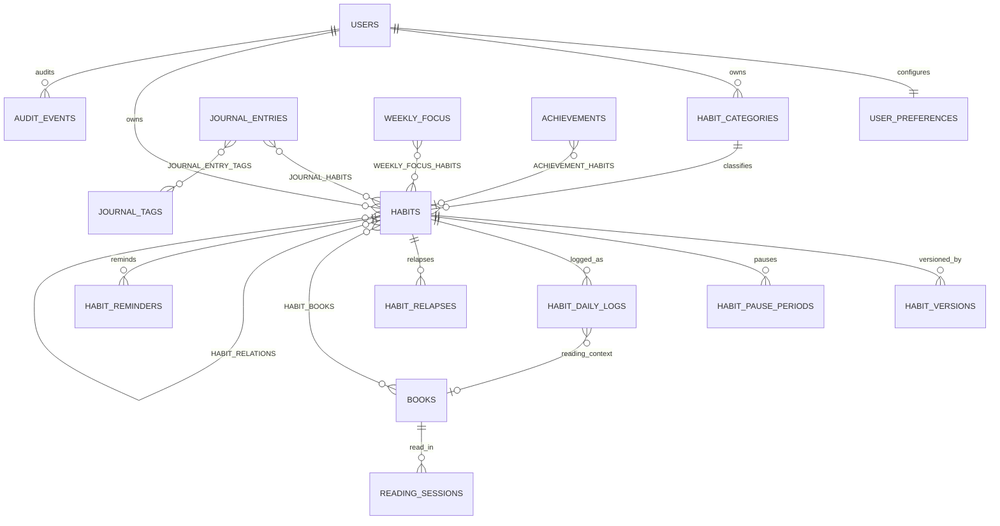

# Habit OS — المواصفة الموحدة لقاعدة البيانات والمنتج والواجهة

**الإصدار:** 1.1 — مواصفة تصميمية قابلة للتحويل إلى migrations؛ تحديث مواءمة الحقول والواجهة بتاريخ 2026-10-04.
**الحالة:** مخطط معتمد للتنفيذ النموذجي؛ لا توجد قاعدة بيانات أو خدمة خلفية موصولة في النموذج الأولي.  
**المصادر المدمجة:** `docs/source/01_HABIT_OS_INDEPENDENT_BUILD_SPEC.md` و`docs/source/HABIT_OS_SPEC_ADDENDUM_AR.md`.
**اللغة/الواجهة:** العربية واتجاه RTL؛ نموذج الواجهة يستخدم camelCase ومخطط SQL يستخدم snake_case، والتحويل موثق في القسم 13.1.
**قاعدة البيانات المستهدفة عند التنفيذ:** MySQL 8.0.16+، InnoDB، UTC للأوقات المطلقة والتاريخ المحلي المحفوظ للمواعيد اليومية.

---

## 1. الهدف والحدود

Habit OS تطبيق مستقل لإدارة العادات، مع المحافظة على روابط السياقات الأخرى من دون إنشاء نسخ مكررة لكيانات المشاريع أو التعلّم أو المال أو المنزل أو المحتوى. يملك النظام المجالات التالية:

1. مكتبة العادات.
2. سجل العادات اليومي.
3. سجل الانتكاسات للعادات السيئة.
4. الجورنال/اليوميات.
5. الكتب وجلسات القراءة.
6. التركيز والمراجعة الأسبوعيان.
7. الإنجازات.
8. إعدادات المستخدم والتذكيرات والتصدير والخصوصية اللازمة لدعم المجالات السابقة.

> **المبدأ:** تتبّع كل شيء، لكن اجعل تركيز اليوم على 3–5 عادات. العادات السيئة تُقاس بالأيام النظيفة وأحداث الانتكاس، وليس بسلاسل نجاح اعتيادية.

هذه الوثيقة تصف **نموذج بيانات منتج كامل**. تطبيق الويب الحالي نموذج تفاعلي تجريبي يستخدم `localStorage` فقط؛ لا يسجل دخولًا ولا يرسل بيانات إلى خادم ولا ينفّذ ملف SQL على قاعدة فعلية.

## 2. القرارات التي توحّد الملفين وتحل التعارضات

| موضع التعارض/الغموض | القرار الموحد |
|---|---|
| علاقة العادة بالكتاب حقل مفرد أحيانًا وعلاقة M:N في موضع آخر | الحقيقة المرجعية M:N عبر `habit_books`. يمكن لعدة عادات أن ترتبط بكتاب، ولكل عادة عدة كتب. سجل اليوم يحتفظ بـ`book_id` اختياري للسياق فقط. |
| ربط الجورنال بعادة واحدة مقابل مخطط يذكر علاقة متعددة | M:N عبر `journal_habits`. يسمح بأكثر من تدوينة في التاريخ نفسه. |
| تقدم الكتاب يعتمد على `tracked_pages` غير المعرّف | جلسات `reading_sessions` هي مصدر القراءة المعياري؛ تقدم الصفحات = الصفحات قبل التتبع + مجموع صفحات الجلسات. |
| حقل عدد مرات متكرر في اليوم | يسجل كل إنجاز في `habit_daily_logs` مع `occurrence_key` ثابت؛ قيد فريد يمنع تكرار الموعد نفسه ولا يمنع المواعيد المختلفة في اليوم. |
| جدول العادة نص حر أو `frequency/days` مبهم | جدول مؤرخ في `habit_versions` مع `schedule_type` وقاعدة منظمة JSON ووقت/منطقة زمنية. القاعدة تخضع لتحقق التطبيق قبل الحفظ. |
| تعديل الجدول/الهدف يغير معنى الماضي | كل تعديل ينشئ نسخة تسري من تاريخ محدد. تحتفظ السجلات بلقطة الهدف/الحد الأدنى/الوحدة والمنطقة الزمنية السارية. |
| غياب سجل يُفسر كسجل فائت محفوظ | لا ينشئ التطبيق سجلًا فائتًا تلقائيًا. الموعد المستحق الذي انقضى بلا إدخال يُحسب فائتًا في المؤشرات فقط؛ ويمكن للمستخدم إنشاء حالة `Missed` صريحة. |
| علاقة الأسبوع بالعادات | M:N عبر `weekly_focus_habits`؛ لكل مستخدم أسبوع واحد يبدأ بتاريخ فريد. تحذير فوق 5 عادات، دون حذف أو منع. |
| قيَم الإنجازات المشتقة | `current_value` و`is_achieved` مخبآن/مشتقان؛ يمكن تخزين cache لإعادة الحساب السريعة، لكن السجل الأساسي هو بيانات العادات/الانتكاسات. |
| حذف سجل تاريخي أو عادة | الأرشفة/الحذف القابل للاستعادة أولًا. الحذف النهائي لعادة ذات تاريخ يتطلب اختيارًا واضحًا لمصير سجلاتها، ويعاد الحساب بعدها. |
| الوضع الحالي مقابل المحسوب | `habits.status` هو حالة المستخدم (`Active/Paused/Archived`)؛ `Ended` حالة عرض مشتقة عندما يتجاوز التاريخ `end_date`. فترة الإيقاف تحفظ بالتواريخ في جدول مستقل. |

## 3. قواعد الهوية والملكية

- المعرّفات `CHAR(36)` بصيغة UUID، وتولّدها طبقة التطبيق. كل جدول مستخدم يحمل `user_id`، ويُتحقق من الملكية على **الخادم** عند بناء المنتج الحقيقي، لا بمجرد إخفاء صف في واجهة المستخدم.
- الجداول ذات العلاقات الإلزامية إلى سجل مستخدم آخر تستخدم FK مركبًا على `(user_id, parent_id)` حيث يناسب، لمنع ربط سجل بمستخدم آخر.
- في واجهة النموذج الحالي لا يوجد حساب مستخدم حقيقي؛ `demo-user` مالك محلي افتراضي لأغراض العرض فقط.
- أوقات الأحداث تخزّن كـUTC، مع تاريخ محلي ومنطقة زمنية محفوظين عندما يؤثران في معنى اليوم أو الفترة.
- نص اليوميات لا ينسخ إلى سجلات التدقيق أو سجلات التشغيل. اليوميات خاصة افتراضيًا.

## 4. مخطط الكيانات والعلاقات

### قواعد حذف العلاقات

| العلاقة | السلوك عند الأرشفة | الحذف النهائي |
|---|---|---|
| Habit → Daily Log / Relapse | تبقى السجلات ظاهرة تاريخيًا | `RESTRICT` حتى يتحقق مسار الحذف الصريح؛ بعدها يحذف التطبيق السجلات التابعة داخل معاملة واحدة إذا اختار المستخدم حذفها معها |
| Habit → Version / Pause / Reminder | تبقى للتاريخ مع العادة المؤرشفة | حذف تابع للعادة بعد التحقق من قرار الحذف النهائي |
| Habit ↔ Book | الرابط يبقى | صف الربط يُحذف؛ جلسات القراءة مستقلة وتحفظ العنوان اللقطة إن فُك رابط الكتاب |
| Daily Log → Book context | رابط سياقي اختياري | يفك التطبيق الرابط (`book_id = NULL`) قبل حذف الكتاب؛ لا يحذف السجل اليومي |
| Journal ↔ Habit / Tag | الروابط تبقى مع العنصر المؤرشف | يحذف الربط فقط؛ لا يحذف الجورنال أو سجل العادة بسبب حذف العنصر المرتبط |
| Weekly Focus ↔ Habit | روابط للمراجعة التاريخية | حذف العادة يحذف رابط الأسبوع؛ المراجعة نفسها تبقى |
| Achievement ↔ Habit | علاقة اختيارية واحدة | يحذف رابط `achievement_habits` فقط؛ الإنجاز يبقى مستقلًا |
| Account → كل بيانات المستخدم | لا ينطبق | حذف الحساب إجراء منفصل، مؤكد، ويراعي مدة الاحتفاظ والنسخ الاحتياطية |

كل سجل أساسي يملك `deleted_at` و`purge_after` عند دعمه لسلة محذوفات. الأرشفة ليست حذفًا. سلة محذوفات قابلة للاستعادة لمدة موصى بها 30 يومًا، والحذف النهائي يتبع سياسة معلنة. لا تُعد المدة تفعيلًا لحذف آلي في النموذج الأولي.

## 5. قاموس الجداول والحقول

الحقول المشتركة: `id`, `user_id`, `created_at`, `updated_at` حيث ينطبق. الأنواع التفصيلية وقيود SQL النهائية في `../database/schema.sql`.

### 5.1 `users`
هوية مالك البيانات. في المنتج الحقيقي يرتبط بمعرّف هوية موثوق أو نظام دخول؛ لا يخزّن سر كلمة المرور في هذا المخطط.

- `id` UUID، PK.
- `external_subject` معرّف مزود الهوية، فريد عند وجوده.
- `email` اختياري، و`display_name`.
- `account_status`: `active`, `disabled`, `deletion_pending`.
- أوقات الإنشاء والتعديل.

### 5.2 `user_preferences`
صف واحد لكل مستخدم (PK/FK `user_id`): `timezone` IANA مطلوب (مثل `Africa/Cairo`)، `week_starts_on` (0–6، الاثنين افتراضيًا)، `locale`, `date_format`, `quiet_hours_start/end`, `created_at`, `updated_at`. إعدادات الواجهة لا تغيّر تاريخًا محليًا محفوظًا في سجل سابق.

### 5.3 `habit_categories`
تصنيف قابل للتهيئة لكل مستخدم: `id`, `user_id`, `slug`, `name`, `sort_order`, `is_active`, أوقات الإنشاء والتعديل. تُزرع التصنيفات الافتراضية لكل حساب: Religion, Fitness, Sleep & Recovery, Mind, Learning, Work, Projects, Content, Money, Digital, Relationships, Home, Care, Mobility, Development, Bad Habits. لا تنشئ هذه التصنيفات كيانات Projects/Finance/Learning منفصلة.

### 5.4 `habits`
تعريف العادة الأساسي، لا نتائجها اليومية:

- `id`, `user_id`, `category_id`, `name`.
- `type`: `good` أو `bad`.
- `level`: `growth`, `maintenance`, `automatic`, `deferred`.
- `status`: `active`, `paused`, `archived`.
- `start_date` مطلوب، `end_date` اختياري وشامل؛ `NULL` يعني مستمرة بلا نهاية محددة.
- حقول النص: `why`, `reward`, `usual_triggers`, `quit_reason`, `recovery_plan`.
- `archived_at`, `deleted_at`, `purge_after`, الأوقات المشتركة.
- قيد `end_date IS NULL OR end_date >= start_date`.
- لا تخزن المقاييس المحسوبة كقيمة قابلة للتحرير هنا. `best_clean_streak` تاريخ محفوظ/مشتق ولا يعدّل من نموذج تحرير العادة.

### 5.5 `habit_versions`
لقطة إعداد سارية على فترة، لكل تعديل للجدول أو الهدف أو الوحدة/الوزن:

- `id`, `user_id`, `habit_id`, `effective_from` شامل، `effective_to` غير شامل أو `NULL` للنسخة الحالية.
- `tracking_type`: `check`, `quantity`, `duration`, `avoidance`.
- `schedule_type`: `daily`, `weekdays`, `times_per_period`, `interval`, `monthly`, `custom`.
- `schedule_rule` JSON؛ أمثلة بنيوية في القسم 6.
- `timezone` منطقة IANA للحساب عند سريان هذه النسخة.
- `start_date` شامل و`end_date` شامل/`NULL` بلا نهاية مخططة؛ تعديل مدة العادة ينشئ نسخة جديدة حتى لا يعيد تفسير الماضي.
- `goal`, `minimum`, `unit`; `goal > 0` للقياس الكمي/المدة؛ `minimum` اختياري بين صفر والهدف.
- `weight` عدد 1–3، `priority`, `preferred_time` اختياري.
- فريد `(user_id, habit_id, effective_from)`. يمنع التطبيق تداخل النسخ بقفل العادة داخل معاملة؛ `effective_to` يساوي تاريخ سريان النسخة التالية.
- لا تجعل تغيير الهدف يعيد تفسير سجلات أقدم؛ احفظ snapshot في سجل اليوم أو أشر إلى النسخة السارية.

### 5.6 `habit_pause_periods`
`id`, `user_id`, `habit_id`, `start_date`, `end_date` اختياري شامل، `reason`, الأوقات المشتركة. يُمنع التداخل غير المقصود بين فترات الإيقاف بالتحقق في خدمة المجال. الموعد أثناء فترة الإيقاف غير مستحق ولا يكسر السلسلة.

### 5.7 `habit_daily_logs`
مصدر الحقيقة للإدخالات الفعلية:

- `id`, `user_id`, `habit_id`, `local_date`, `timezone_snapshot`, `occurrence_key`.
- `status`: `done`, `partial`, `missed`, `vacation`, `skipped`.
- `actual` decimal اختياري؛ `goal_snapshot`, `minimum_snapshot`, `unit_snapshot`, `weight_snapshot` تحفظ سياق القياس.
- `note`, `trigger_text`, `book_id` اختياري كسياق قراءة لا كعلاقة ملكية.
- `deleted_at`, `purge_after`, الأوقات المشتركة.
- Unique `(user_id, habit_id, local_date, occurrence_key)`. عند إدخال الموعد ذاته مرة أخرى يعرض تعديل السجل الموجود أو يرفض التكرار (idempotent).
- FK الكتاب سياقي؛ حذف الكتاب يفك `book_id` ولا يحذف Daily Log.
- القيمة `actual >= 0`; قواعد اتساق الحالة والهدف تحقق في طبقة المجال وفي الاختبارات.

### 5.8 `habit_relapses`
حدث تاريخي للعادات من نوع `bad` فقط:

- `id`, `user_id`, `habit_id`, `event_at_utc`, `local_date`, `timezone_snapshot`.
- `trigger`, `related_habit_id` اختياري، `severity` اختياري 1–5، `what_happened`, `plan_24h`, `outcome`.
- `deleted_at`, `purge_after`, الأوقات المشتركة.
- الخدمة تتحقق أن العادة الرئيسية `type = bad` وأن العادة المرتبطة إن وجدت تملكها للمستخدم نفسه.
- الإضافة/التعديل/الحذف تعيد حساب clean days وbest clean streak من كامل الأحداث، ولا تمسح أفضل سلسلة تاريخية صحيحة بسبب تعديل عادي.

### 5.9 `books`
`id`, `user_id`, `name` مطلوب، `author`, `status`, `category`, `format`, `language`, `total_pages >= 0` اختياري، `pages_before_tracking >= 0` default 0، `start_date`, `end_date`, `rating` من 1 إلى 5، `priority`, `key_idea`, `notes_quotes`, `cover_url`, `external_url`, `deleted_at`, `purge_after`, أوقات مشتركة.

القيم الافتراضية للحالة: `want_to_read`, `reading`, `on_hold`, `completed`, `abandoned`. التقدم المشتق: `current_page = pages_before_tracking + SUM(reading_sessions.pages_read)`؛ `remaining = MAX(total_pages - current_page, 0)`؛ إن كانت الصفحات الكلية `NULL` أو صفرًا، لا تقسم ولا تعرض نسبة غير معرفة على أنها 100%.

### 5.10 `reading_sessions`
سجل جلسة مستقل: `id`, `user_id`, `book_id`, `read_on` تاريخ محلي، `timezone_snapshot`, `pages_read` >= 0، `page_start`, `page_end`, `duration_seconds` >= 0، `note`, `book_title_snapshot`, `deleted_at`, `purge_after`, أوقات مشتركة. يجب أن يكون عدد الصفحات أو مدة القراءة أكبر من صفر؛ إن توفر النطاق، يجب ألا تكون النهاية قبل البداية. جلسات متعددة للكتاب في اليوم مسموحة. قبل حذف كتاب نهائيًا يفك رابط `book_id` ويحفظ عنوان الكتاب في `book_title_snapshot`.

`book_id` يكون nullable بعد الفك الصريح؛ يبقى سجل الجلسة وعنوانه اللقطة. قيد FK من نوع `RESTRICT` يمنع حذف الكتاب حتى تنفّذ الخدمة فك العلاقة وحفظ عنوانه داخل المعاملة نفسها.

### 5.11 `habit_books`
جدول ربط M:N: `user_id`, `habit_id`, `book_id`, `link_type` (`supports`, `related`, `reading_goal`), `created_at`; PK مركب يمنع تكرار الرابط. حذف الرابط لا يحذف كتابًا أو عادة.

### 5.12 `journal_entries`
يسمح بأكثر من إدخال في اليوم:

- `id`, `user_id`, `entry_date`, `entry_time` اختياري، `timezone_snapshot`, `title` مطلوب.
- `intention`, `top_3` JSON، `mood` 1–5، `energy` 1–5، `gratitude`, `win`, `learning`, `worries`, `tomorrow_plan`, `body`.
- `deleted_at`, `purge_after`, الأوقات المشتركة.
- لا يوجد Unique على `(user_id, entry_date)` عمدًا.

### 5.13 `journal_habits`
رابط M:N بين `journal_entries` و`habits`: PK مركب `(user_id, journal_entry_id, habit_id)`، `relation_note` اختياري. حذف الرابط لا يحذف اليومية ولا العادة.

### 5.14 `journal_tags` و`journal_entry_tags`
وسم يملكه المستخدم: `id`, `user_id`, `name`, `color`, unique `(user_id, normalized_name)`. جدول ربط `journal_entry_tags` بمفتاح مركب يمنع تكرار الوسم في التدوينة. وسوم الجورنال مستقلة عن تصنيفات العادات.

### 5.15 `weekly_focus`
مراجعة واحدة لكل مستخدم لكل أسبوع: `id`, `user_id`, `start_date`, `end_date`, `what_worked`, `what_failed`, `rating` 1–5، `next_week_adjustment`, `deleted_at`, `purge_after`, الأوقات المشتركة. Unique `(user_id,start_date)` و`end_date >= start_date`. بداية الأسبوع تأتي من إعداد المستخدم وتُنسخ تواريخها إلى السجل.

### 5.16 `weekly_focus_habits`
رابط M:N لمجموعة عادات الأسبوع: `user_id`, `weekly_focus_id`, `habit_id`, `position`; PK `(user_id, weekly_focus_id, habit_id)` وUnique للموقع داخل الأسبوع. التحذير عند أكثر من 5 لا يحذف ولا يمنع. مراجعة الأسبوع لا تنشئ Daily Logs.

### 5.17 `achievements` و`achievement_habits`
تعريف الإنجاز: `id`, `user_id`, `name`, `condition_type` (`clean_days`, `total_quantity`, `completed_days`), `condition_value > 0`, `current_value` cache مشتق، `is_achieved` مشتق، `achieved_at` أول وقت تحقق محفوظ، `enabled`, `archived_at`, `deleted_at`, `purge_after`, الأوقات المشتركة. `achievement_habits` يربط صفر أو عادة واحدة بالإنجاز (Unique على `user_id, achievement_id`) من دون FK اختياري قابل لتعارض الملكية. لا تحرر قيم الحالة من الواجهة. عند تصحيح بيانات تاريخية أعد الحساب مع الاحتفاظ بتاريخ أول تحقق وفق قرار المنتج؛ إذا زال التحقق بعد التصحيح، حدّث الحالة وأظهر التاريخ المصحح في سجل التدقيق.

### 5.18 `habit_relations`
روابط مسماة بين عادتين للمستخدم: `id`, `user_id`, `source_habit_id`, `target_habit_id`, `relation_type` (`related`, `alternative`, `replacement`, `supports`), `is_directed`, `created_at`. تمنع العادة من ربط نفسها؛ يمنع التكرار بالـUnique. لأن بعض الأنواع متماثلة، يطبّع التطبيق ترتيب الطرفين قبل التخزين؛ العلاقات الموجهة لا يسمح لها بدورة إذا فعّلت دلالة parent/alternative directed.

### 5.19 `habit_reminders`
`id`, `user_id`, `habit_id`, `local_time`, `timezone_override` اختياري، `days_of_week` JSON أو قاعدة مناسبة، `enabled`, `snooze_minutes`, `quiet_hours_respected`, `created_at`, `updated_at`. كل عادة قد تملك أكثر من تذكير. إعدادات النموذج الحالي للعرض فقط ولا ترسل Push/إشعارات نظام.

### 5.20 `audit_events`
`id`, `user_id`, `entity_type`, `entity_id`, `action`, `changed_fields` JSON، `created_at`, `request_id` اختياري. لا تحفظ body الجورنال أو نصوصًا حساسة في payload التدقيق. يحق للمستخدم تصدير بياناته؛ سجلات التشغيل لا تعرض بيانات مستخدم آخر.

## 6. قواعد الجدولة والسلاسل

### 6.1 أنواع الجدول وقواعدها

| `schedule_type` | معنى `schedule_rule` |
|---|---|
| `daily` | `{ "every_n_days": 1 }` أو N؛ نقطة البداية `start_date` |
| `weekdays` | `{ "days": [1,3,5] }`؛ ترميز أيام الأسبوع موحد ومثبت في التطبيق |
| `times_per_period` | `{ "period":"week", "target_count":3, "week_starts_on":1 }` أو `period:"month"` |
| `interval` | `{ "unit":"day|week|month", "every_n":2, "anchor_date":"YYYY-MM-DD" }` |
| `monthly` | `{ "kind":"day_of_month", "day":31, "missing_day":"skip" }` أو `{ "kind":"last_day" }`، أو `{ "kind":"nth_weekday", "nth":1, "weekday":1 }`؛ `nth:-1` يعني آخر وقوع لذلك اليوم في الشهر |
| `custom` | قاعدة منظمة موثقة بإصدار schema؛ لا تقبل نصًا حرًا غير قابل للحساب |

بداية الأسبوع الافتراضية الاثنين (`1` في ترميز 0=الأحد)، لكنها إعداد مستخدم وتنسخ إلى قاعدة أهداف الفترات، كي لا يعيد تغيير الإعداد تفسير أسابيع تاريخية.

### 6.2 قاعدة موعد الاستحقاق

1. الجدول ينتج «موعدًا» أو «فترة هدف» حسب نوعه. الموعد غير المجدول محايد: لا يكسر سلسلة ولا يدخل مقام الالتزام.
2. أيام الأسبوع المحددة تقيس السلسلة عبر المواعيد المجدولة المتتالية؛ الثلاثاء المحايد لا يكسر عادة الاثنين/الأربعاء/الجمعة.
3. `N times per week/month` يقيس النجاح على مستوى الفترة: يلزم إكمال N إدخالات ناجحة في فترة مكتملة. الفترة الحالية لا تحكم قبل انتهائها.
4. تكرار كل N أيام يحسب من نقطة الارتكاز (عادة `start_date`) لا من آخر إنجاز.
5. شهر لا يحتوي اليوم المطلوب يتبع `missing_day=skip`؛ `last_day` قاعدة مستقلة لا لبس فيها.
6. المواعيد المستقبلية والفترة المفتوحة لا تحسب فائتة. الموعد الماضي الذي انقضى بلا سجل يحسب Missed ضمن المقاييس من دون row تلقائي.
7. `Vacation/Excused` و`Skipped` محايدان: ليسا نجاحًا ولا فشلًا ولا يدخلان مقام الالتزام، ويظهران مستقلين في التاريخ. يمكن لسياسة الاستثناء وضع حد اختيارى بعدد الأيام.
8. التوقف `Paused` يستثني التواريخ المحددة ولا يكسر السلسلة؛ الأرشفة تخفي العادة النشطة وتحفظ التاريخ.

### 6.3 الأهداف والحساب

- `check`: لا كمية؛ تسجيل صريح Done.
- `quantity` و`duration`: `goal > 0`. `actual >= goal` ⇒ Done؛ `minimum > 0` و`minimum <= actual < goal` ⇒ Partial؛ دون minimum أو صفر ⇒ Missed عند نهاية الموعد/الفترة. إذا `minimum=0` يلزم `actual>0` لتسجيل Partial.
- نسبة الإنجاز = `min(actual/goal, 1)`؛ لا تتجاوز 1.0. الدرجة الموزونة = النسبة × الوزن الساري. الوزن بين 1–3.
- `avoidance`: لا يسجل سلسلة نجاح عادية؛ يعتمد على أيام نظيفة من تاريخ البداية حتى تاريخ انتكاس العادة، دون احتساب يوم الانتكاس كيوم نظيف. clean days الحالية = عدد الأيام المحلية الكاملة بعد آخر انتكاس (أو بعد بداية العادة إذا لم توجد انتكاسات). أفضل سلسلة تاريخية = أكبر فرق أيام نظيفة بين الأحداث/البداية والنهاية المحددة، تحفظ تاريخيًا ولا تعدل يدويًا.
- `current_streak`, `best_streak`, `clean_days`, `compliance_ratio` ومجموع الكمية مؤشرات مشتقة قابلة للتخزين المؤقت، وليست حقول إدخال.

## 7. تدفق الإضافة والتعديل والحذف

| الكيان | الإضافة والتعديل | الأرشفة/الحذف والاستعادة |
|---|---|---|
| Habit | إنشاء مع تحقق الجدول والهدف ونوع القياس؛ تغيير الجدول/الهدف يضيف `habit_versions` بتاريخ سريان | أرشفة افتراضية، تحفظ السجلات. الحذف النهائي لعادة ذات تاريخ يتطلب اختيار حذف السجلات التابعة أو إلغاء. |
| Daily Log | Quick Log أو إدخال قديم؛ تعديل الحالة/الكمية/الملاحظة/التاريخ | إلغاء/نقل للسلة؛ إعادة حساب streaks والإنجازات. منع duplicate occurrence. |
| Relapse | عادة Bad فقط؛ الوقت والمحفز والخطورة وخطة 24 ساعة/النتيجة | تعديل أو حذف يعيد حساب clean days كاملًا ويحفظ أفضل سجل صحيح. |
| Journal | تدفق New Journal؛ إدخالات متعددة في اليوم | سلة واستعادة؛ لا تحذف العادة المرتبطة. |
| Book | حالة وتفاصيل وإدخال صفحات سابقة | حذف الكتاب يفك روابط Daily Log / reading sessions ويحتفظ بسجلات جلسات القراءة ولقطة الاسم. |
| Reading Session | واحدة أو أكثر في اليوم، صفحات/نطاق/مدة/ملاحظة | تعديل/حذف الجلسة يعيد حساب صفحات الكتاب والإنجازات؛ حذف الكتاب لا يمحوها. |
| Weekly Focus | إنشاء مراجعة للفترة واختيار عادات | حذف مراجعة لا يحذف Daily Logs؛ فريد لكل أسبوع مستخدم. |
| Achievement | تعريف شرط وعتبة أو تفعيل افتراضي | تعطيل/أرشفة، لا تعديل للمقاييس المشتقة؛ حذف منفصل عند طلب المستخدم. |

- أي عملية تؤثر في مؤشرات تكون داخل transaction في المنتج النهائي، وتعيد الحساب مرة آمنة (idempotent).
- قبل تغيير/حذف تاريخي، اعرض العنصر والفترة والمقاييس التي تتغير، خاصة سلسلة الالتزام وأيام النظافة.
- كل قراءة/كتابة/حذف على خادم حقيقي يحدد `user_id` المصرح به. لا يقبل معرف العميل وحده.
- Soft delete لا يزيل روابط الجداول؛ الاستعادة تعيد إظهارها ثم تعيد الحساب. الحذف النهائي يطبق سياسة FK المذكورة.

## 8. قيم افتراضية للحقول المفتوحة

- حالات الكتاب: `want_to_read`, `reading`, `on_hold`, `completed`, `abandoned`.
- تقييم الكتاب والأسبوع: 1–5؛ مزاج وطاقة: 1–5؛ شدة الانتكاسة: 1–5. كل ذلك اختياري.
- بداية الأسبوع: الاثنين؛ منطقة التوقيت: المنطقة IANA للمستخدم؛ لا تخمّنها من الخادم.
- زيادة عادات التركيز عن خمس تظهر تحذيرًا فقط؛ لا حذف ولا منع.
- تاريخ اليوميات محلي للمستخدم، ولا يوجد حد فريد لتدوينة واحدة باليوم.

## 9. مواصفات الواجهة لكل قسم

| القسم | المكونات والمعلومات | الإجراءات الأساسية |
|---|---|---|
| لوحة اليوم | تحية باسم اليوم، حلقة/ملخص التقدم، 3–5 عادات تركيز، بطاقة Bad/Clean Days، تقدم الأسبوع | Done / Partial / Skip / Vacation من ضغطة، فتح ملاحظة/كمية اختيارية، أضف عادة للتركيز |
| مكتبة العادات | فلاتر All/Growth/Maintenance/Automatic/Deferred/Archived، فئة وحالة وجدول، بحث | إضافة/تعديل، أرشفة/استعادة، تفاصيل وجدول/مواعيد/سجل، حذف صريح من سلة |
| سجل يومي | قائمة/تقويم بالتاريخ، اسم العادة والحالة والكمية والملاحظة والكتاب السياقي | إضافة سابقة، تعديل، إلغاء/استعادة، بحث حسب العادة/التاريخ |
| الانتكاسات | بطاقة لكل عادة سيئة: آخر حدث، أيام نظيفة، أفضل سلسلة، جدول أحداث | تسجيل/تعديل/حذف انتكاس؛ trigger، severity، what happened، plan 24h، outcome |
| Journal | محرر يومية خاص مع التاريخ، العنوان، intention/top3/mood/energy/gratitude/win/learning/worries/tomorrow/body؛ قائمة تاريخية | إنشاء متعدد في اليوم، تعديل، وسوم متعددة، عادات مرتبطة متعددة، بحث/تصفية، تصدير/سلة |
| الكتب | بطاقة الغلاف الاختيارية والحالة والمؤلف والتقدم/المتبقي والتصنيف | إضافة/تعديل/حذف آمن، تغيير الحالة، جلسة قراءة جديدة، ربط بعادة، اقتباس/فكرة |
| جلسات القراءة | جدول اليوم/الكتاب، صفحات/نطاق/مدة وملاحظة | إضافة عدة جلسات، تعديل/حذف، تحديث تقدم الكتاب تلقائيًا |
| التركيز الأسبوعي | الأسبوع، عادات التركيز، تقدمها، تقييم وملاحظات | إنشاء/تعديل مراجعة، اختيار M:N؛ تنبيه >5؛ لا يكرر السجلات |
| الإنجازات | الشرط والعتبة والتقدم والحالة/التاريخ | إنشاء/تعديل التعريف، تعطيل/أرشفة؛ المشتقات لا تحرر |
| الإعدادات | منطقة زمنية وبداية الأسبوع وإدارة فئات/تذكيرات نموذجية وتصدير JSON/CSV والخصوصية | حفظ تفضيلات محلية، تصدير البيانات، استعادة مثال، عرض حدود التخزين |

### سلوك العرض والوصول

- RTL حقيقي بـ`dir=rtl` و`lang=ar`; جميع النصوص والأرقام تُعرض دون أن تتغير قيمتها.
- تنقل جانبي يميني على الشاشة الواسعة، وقائمة/شريط قابل للفتح على الهاتف؛ لا تمرير أفقي غير مقصود.
- نماذج مخصصة حسب الكيان بدل نموذج قاعدة عام؛ حوار جانبي أو نافذة قصيرة لإدخال/تعديل؛ تحقق inline ورسالة تأكيد للحذف.
- ألوان الحالة لا تعتمد على اللون وحده: نص/رمز/Label لكل Done/Partial/Missed/Skip/Vacation.
- قوائم فارغة ذات CTA واضح، ومؤشر حفظ/تأكيد، وفوكس مرئي بلوحة المفاتيح، aria-label للأزرار، تباين مناسب، واحترام `prefers-reduced-motion`.
- روتين اليوم هو الأسرع: فتح التطبيق ← Focus 3–5 ← تسجيل سريع ← رؤية التقدم المحدّث.

## 10. ميزات المنتج وترتيبها

### أساسي بهذا التصميم

جدولة مرنة وتواريخ البداية/النهاية، Quick Log، سجل قراءة فعلي، يوميات متعددة/اليوم وروابط متعددة، تاريخ تعديل مؤرخ، فلاتر/تقويم أساسي، تذكيرات كإعدادات قابلة للتمكين مستقبلًا، تصدير JSON/CSV، خصوصية وعزل مستخدم عند backend، دعم RTL والوصول، وإعادة احتساب مشتقات التاريخ.

### لاحقًا عند اختيار منصة/Backend

إشعارات حقيقية/Snooze وإيقاف التذكير بعد الإنجاز، widgets وإجراءات notification، تكاملات HealthKit/Google Health/Fitbit/Strava بعد موافقة صريحة، مؤقت/عداد، مزامنة/Offline وحل تعارضات، نسخ احتياطي مشفر واستعادة، قوالب وتحديات ومشاركة اختيارية، score للاتساق يشرح نفسه. لا ترسل اليوميات أو البيانات الصحية لتكامل/نموذج خارجي دون موافقة صريحة.

ميزة التذكيرات المعلنة في الواجهة الحالية تجريبية ولا تدّعي إرسال تنبيه. مزايا مشاركة المجتمع والتحديات والتكاملات الصحية غير مفعلة.

## 11. الخصوصية والتصدير

1. كل مسار خادم في النسخة الحقيقية يعزل `user_id` عند كل SELECT/INSERT/UPDATE/DELETE، ويستخدم تحققًا في قاعدة البيانات أو طبقة خدمة موثوقة.
2. اليوميات خاصة افتراضيًا. لا تكامل أو مشاركة أو استخدام لنموذج خارجي دون إشعار/اختيار واضح.
3. تشفير النقل والتخزين في النسخة المستضافة، أدنى صلاحية ممكنة، وعدم كتابة نص الجورنال في logs.
4. تصدير JSON كامل للكيانات والعلاقات وCSV للسجلات، مع المنطقة الزمنية ومعاني الحالات وتاريخ التصدير.
5. سياسة معلنة للنسخ الاحتياطي والاستعادة ومدة الاحتفاظ بعد الحذف النهائي؛ لا يوعد بتخزين سحابي قبل تحديد مكان/مفاتيح النسخ.
6. صفحة خصوصية مستقبلية للحذف النهائي، سلة محذوفات، التصدير، والتذكيرات/التكاملات. نموذج اليوم يعرض أن التخزين على المتصفح وحده.

## 12. اختبار القبول

يجب عند بناء backend مستقبلًا اختبار الحالات الأصلية والمضافة، وأهمها:

- Done يواصل السلسلة، Vacation وSkipped محايدان/يحافظان على السلسلة ولا يدخلان مقام النجاح، Partial وMissed يقطعان السلسلة عند الموعد المستحق.
- Bad relapse يعيد أيام النظافة للصفر عند نقطة الحدث ويحفظ أفضل سلسلة تاريخية؛ تعديل/حذف حدث قديم يعيد حساب الأثر كاملًا.
- نسبة الإنجاز لا تتجاوز 1.0؛ الوزن 1–3؛ الأرشفة تزيل العادة من التركيز النشط دون حذف تاريخها.
- أيام غير مجدولة لا تكسر السلسلة؛ الأسبوع/الشهر لا يحكم قبل نهايته؛ ترتيب المنطقة الزمنية ونقطة بداية الأسبوع ثابتان.
- الهدف الشهري 29/30/31 يحترم `missing_day`; النهاية شاملة وNULL مفتوحة؛ التوقف يستثني الفترة.
- الأهداف الكمية تصنف Done/Partial/Missed حسب goal/minimum؛ تغيير نسخة إعداد لا يغير الماضي.
- الجلسات تضيف تقدم صفحات، والصفحات المتبقية لا تنزل تحت صفر؛ صفر/NULL للصفحات الكلية لا ينتج قسمة على صفر.
- يومية ثانية في التاريخ نفسه مقبولة؛ روابط المذكرات/الكتب/الأسبوع M:N لا تتكرر.
- تكرار Quick Log لنفس occurrence لا ينشئ سجلين. التعديل القديم يعيد حساب المؤشرات والإنجازات.
- لا يمكن قراءة سجل مستخدم آخر بتغيير ID؛ التصدير يحترم الملكية والعلاقات.
- حذف الكتاب يفك الرابط ولا يحذف daily logs أو جلسات القراءة؛ حذف سجل لا يحدث Cascade غير مصرح به.
- Today يعرض تغييرات Habit من دون امتلاك بيانات عادة أو إنشاء سجلات مكررة.
- RTL لا يقلب دلالة تاريخ/قيمة مخزنة، والواجهة قابلة للجوال ولوحة المفاتيح.

## 13. افتراضات وحدود هذا التسليم

- نموذج HTML/CSS/JavaScript تفاعلي مع `localStorage`; لا يوجد server أو database مفعّل أو auth أو مزامنة أو خدمة إشعارات. ملف `schema.sql` **تصميم/DDL مراجعة** وليس قاعدة تم إنشاؤها.
- لا نشر عام؛ رابط المعاينة مؤقت. لا تُدخل بيانات شخصية فعلية في نموذج العرض.
- MySQL 8.0.16+ مستهدف للمخطط؛ قواعد عدم تداخل النسخ/الفترات وامتلاك المستخدم تحتاج تحقق خدمة/معاملة إضافة إلى قيود SQL.
- نموذج الواجهة التجريبي يستخدم camelCase ويحتوي معرفات مثال وصفية؛ لا يُحمّل مباشرة إلى MySQL. يجب تنفيذ تحويل camelCase↔snake_case وتوليد UUIDs الإنتاجية كما في القسم 13.1 قبل تشغيل الـbackend.

### 13.1 عقد التحويل بين نموذج الواجهة ومخطط SQL

المخطط SQL هو عقد التخزين، أما قيم JavaScript أدناه فهي DTOs للنموذج الأولي. التحويل يتم في طبقة الخدمة/المستودع، ولا تُستخدم قيم المتصفح لإثبات هوية المالك. الحقول غير المذكورة تتبع التحويل المعتاد camelCase إلى snake_case.

| نموذج JavaScript | جدول/عمود SQL | قاعدة التحويل |
|---|---|---|
| `userId` | جميع `user_id` | يؤخذ من جلسة الخادم، ولا يُوثق بما يرسله العميل. |
| `preferences.remindersEnabled` | `user_preferences.reminders_enabled` | مفتاح عام؛ لا يغني عن حالة كل تذكير مستقل في `habit_reminders`. |
| `id` | `id CHAR(36)` | بيانات العرض تستخدم معرفات وصفية مثل `habit-read`؛ عند إنشاء بيانات إنتاجية تُولّد UUIDs وتُحدّث معها كل المراجع. لا تستورد معرفات العرض كما هي. |
| `habit.type` | `habits.habit_type` | القيم `good` و`bad` كما هي. |
| `habit.scheduleType`, `scheduleRule`, `trackingType`, `goal`, `minimum`, `unit`, `weight`, `startDate`, `endDate` داخل النسخة | `habit_versions.schedule_type`, `schedule_rule`, `tracking_type`, `goal`, `minimum`, `unit`, `weight`, `start_date`, `end_date` | لا تحفظ نسخة الإعداد التاريخية كأعمدة متنافسة في `habits`؛ تُحفظ في `habit_versions` مع `effective_from/effective_to/timezone`. |
| `habit.categoryId` | `habits.category_id` | FK إلى تصنيف للمستخدم نفسه. |
| `log.localDate`, `timezoneSnapshot`, `occurrenceKey`, `actual`, `goalSnapshot`, `minimumSnapshot`, `unitSnapshot`, `weightSnapshot` | الأعمدة المناظرة في `habit_daily_logs` | تحويل الاسم إلى snake_case؛ يحتفظ `actual` بقيود عدم السلبية. |
| `log.trigger`, `bookId`, `bookTitleSnapshot` | `trigger_text`, `book_id`, `book_title_snapshot` في `habit_daily_logs` | عند حذف كتاب نهائيًا يُحفظ العنوان في اللقطة ثم يصبح `book_id = NULL`. السلسلة الفارغة تتحول إلى `NULL`. |
| `relapse.at`/`localDate`, `time`, `eventAtUtc`, `timezoneSnapshot`, `trigger`, `whatHappened`, `plan24h` | `local_date`, `local_time`, `event_at_utc`, `timezone_snapshot`, `trigger_text`, `what_happened`, `plan_24h` في `habit_relapses` | `eventAtUtc` هو ISO UTC؛ التاريخ/الوقت المحليان والـtimezone snapshot يبقيان كما أُدخلا. |
| `journal.date`, `entryTime`, `timezoneSnapshot`, `top3`, `tagIds`, `habitIds` | `entry_date`, `entry_time`, `timezone_snapshot`, `top_3`, `journal_entry_tags`, `journal_habits` | يحول `top3` من أسطر نصية إلى مصفوفة JSON؛ المراجع تتحول إلى صفوف ربط داخل معاملة واحدة. |
| `book.name`, `cover`, `url` | `books.name`, `cover_url`, `external_url` | `cover` و`url` الفارغان يصبحان `NULL`. |
| `session.readOn`, `pagesRead`, `durationMinutes`, `bookTitleSnapshot` | `read_on`, `pages_read`, `duration_seconds`, `book_title_snapshot` في `reading_sessions` | `duration_seconds = durationMinutes × 60`؛ تظل الجلسة ممكنة بلا `book_id` بعد الفك الصريح وتحفظ لقطة العنوان. |
| `focus.startDate`, `endDate`, `worked`, `failed`, `adjustment`, `habitIds` | `start_date`, `end_date`, `what_worked`, `what_failed`, `next_week_adjustment`, `weekly_focus_habits` | تتحول قائمة العادات إلى صفوف ربط؛ لا تُنشأ سجلات يومية من مراجعة الأسبوع. |
| `achievement.currentValue`, `achieved` | `current_value`, `is_achieved` | حقول مشتقة تُعاد حسابها من السجلات؛ لا يحررها المستخدم مباشرة. |
| `journalTag.normalizedName` | `journal_tags.normalized_name` | يحسب الخادم قيمة Unicode NFKC بعد trim/case-fold، ويتحقق من التفرد لكل مستخدم. |
| `reminder.daysOfWeek`, `timezoneOverride` | `days_of_week JSON`, `timezone_override` | `daysOfWeek = NULL` تعني اتباع جدول العادة؛ المصفوفة تستخدم أرقام 0–6 حيث الأحد=0. القيمة النصية الفارغة للمنطقة تتحول إلى `NULL`. |
| `habitBooks`, `habitRelations`, `achievementLinks` | `habit_books`, `habit_relations`, `achievement_habits` | كل علاقة تُكتب/تحذف في صفوف مستقلة مع التحقق من ملكية طرفي العلاقة. |

بيانات JSON المحلية نموذج عرض فقط، ولا تمثل ترحيلًا أو نسخة احتياطية إنتاجية؛ يلزم اختبار تحويل مستقل ومعاملة حفظ لكل كيان مترابط عند بناء backend.

## 14. المصادر

- المواصفة الأصلية: `docs/source/01_HABIT_OS_INDEPENDENT_BUILD_SPEC.md` الإصدار 2.0.
- ملحق التصميم: `docs/source/HABIT_OS_SPEC_ADDENDUM_AR.md`.
- [Habitify على App Store](https://apps.apple.com/us/app/habitify-habit-tracker/id1111447047)، [Loop Habit Tracker على Google Play](https://play.google.com/store/apps/details?id=org.isoron.uhabits&hl=en_US)، [Streaks](https://streaksapp.com/) — للاسترشاد بفئات الميزات الشائعة فقط.
